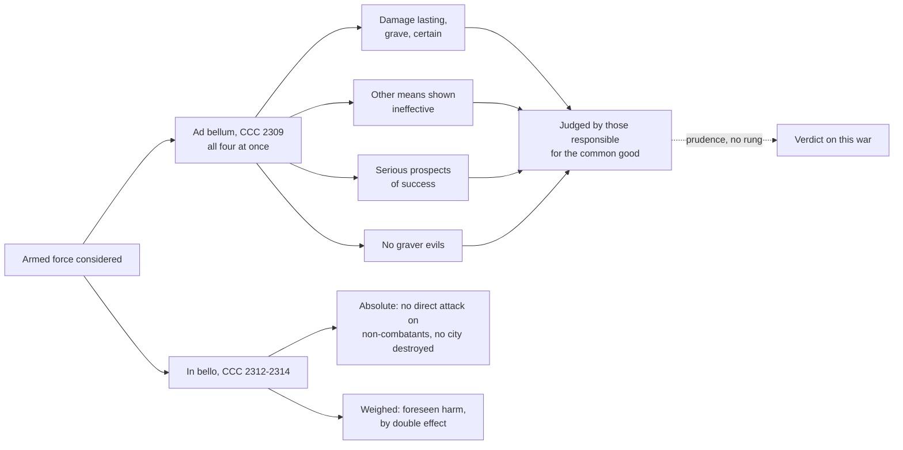

# Catholic Social Teaching · Lesson 5.3: War and peace in the Church's teaching

> ⏱ ~15 min · Module 5: The political community, peace and the stranger · Builds on: [5.1](05-01-the-political-community-and-the-limits-of-the-state.md), [`moral-theology` 4.2](../../moral-theology/lessons/04-02-double-effect-and-cooperation-as-catholic-method.md) · Unlocks: [5.4](05-04-deterrence-and-the-challenge-to-just-war.md)

## Why this matters

An army crosses a border, and within a week three Catholics are on air. One says the Church obliges the nation to fight. One says the Church no longer accepts any war. One says morality is a luxury when survival is at stake. All three misread the teaching, each at a different layer: what it permits, what it forbids absolutely, and who is competent to judge the rest.

## The idea

Think of surgery. Cutting into a body is normally an assault. It heals only for the right reason, as a last resort, with a real chance of working, and without worse harm than the disease. Some cuts are never allowed: no surgeon takes a bystander's kidney to save his patient. And the surgeon in the theatre, not the ethicist, decides whether this case meets the conditions; the ethicist can still name the cuts that are murder.

The teaching on war has the same three layers: **conditions** for using armed force at all, **absolute limits** on what may be done with it, and an **assignment of competence** that leaves the verdict on a particular war to those who govern. It uses double effect from [`moral-theology` 4.2](../../moral-theology/lessons/04-02-double-effect-and-cooperation-as-catholic-method.md) and [`ethics` 3.2](../../ethics/lessons/03-02-the-doctrine-of-double-effect.md), and authority ordered to the common good from [5.1](05-01-the-political-community-and-the-limits-of-the-state.md).

## Source

Aquinas's third condition rests on Augustine's reply to the Manichaean Faustus, who had attacked the wars of Moses (*Contra Faustum* XXII.74, tr. Richard Stothert, *Nicene and Post-Nicene Fathers*, first series, vol. 4, ed. Philip Schaff, 1887):

> What is the evil in war? Is it the death of some who will soon die in any case, that others may live in peaceful subjection? This is mere cowardly dislike, not any religious feeling. The real evils in war are love of violence, revengeful cruelty, fierce and implacable enmity, wild resistance, and the lust of power, and such like; and it is generally to punish these things, when force is required to inflict the punishment, that, in obedience to God or some lawful authority, good men undertake wars, when they find themselves in such a position as regards the conduct of human affairs, that right conduct requires them to act, or to make others act in this way.

Augustine moves the evil of war from the body to the will: not death, which comes to all, but five disorders of desire. These are what [right intention](../reference.md#right-intention) excludes. Aquinas quotes the list in q.40 a.1 (English Dominican Province) to show that a war with lawful authority and just cause can still be "rendered unlawful through a wicked intention". Two things here the modern teaching does not repeat, death set aside as "cowardly dislike" and war framed as punishment; [5.4](05-04-deterrence-and-the-challenge-to-just-war.md) needs both.

## The teaching

**T1. The source text** (ST II-II q.40 a.1, English Dominican Province). A just war needs "three things": the sovereign's authority, since the care of the common weal is committed to those in authority; a just cause, some fault in those attacked; and a right intention, the advancement of good or the avoidance of evil. Reconstructing the article is [`philosophical-method`](../../philosophical-method/syllabus.md) Boss 4's. *In words:* right hands, right cause, right aim.

**T2. Defence, a right and a duty** (GS 79 §4; CCC 2265, 2308). All must work to avoid war. But while the danger lasts and no competent international authority exists, governments cannot be denied [legitimate defence](../reference.md#legitimate-defence) once peaceful means are exhausted, and for those responsible for others it is a grave duty. Defending a people differs from subjugating other nations (GS 79 §4). *Dignitas Infinita* 38 (2024) restates the right. The soldier acts on public authority ([`moral-theology` 5.1](../../moral-theology/lessons/05-01-the-inviolability-of-innocent-life.md)). *In words:* a government may, and sometimes must, defend its people by force; it may never conquer.

**T3. The conditions** (CCC 2309). Defence by military force must meet strict conditions at once: the aggressor's damage is lasting, grave and certain; every other means of ending it has been shown impractical or ineffective; there are serious prospects of success; and arms will not produce evils graver than the evil removed, where modern weapons weigh very heavily. The Catechism calls these the traditional elements of "just war" doctrine ([just-war criteria](../reference.md#just-war-criteria)). *In words:* only against real, continuing harm, when nothing else works, if it can work, and never at a worse price.

**T4. Who judges** (CCC 2309–2311). Evaluating the conditions belongs to the [prudential judgment](../reference.md#prudential-judgment) of those responsible for the common good, who may impose the duties of defence. They should provide fairly for those who refuse arms for conscience, who serve another way ([conscientious objection](../reference.md#conscientious-objection); GS 79 §3). Renouncing violence is a witness of charity (CCC 2306), not a rule for states. *In words:* government decides; the objector is respected.

**T5. Limits in war** (GS 79 §2; CCC 2312–2313, 2297). The natural law binds permanently in armed conflict. Non-combatants, the wounded and prisoners must be respected ([non-combatant immunity](../reference.md#non-combatant-immunity)); criminal orders are crimes, blind obedience excuses no one, and genocide must be resisted. [Terrorism](../reference.md#terrorism), killing indiscriminately, is gravely against justice and charity (CCC 2297; the *Compendium* 514, quoting John Paul II, adds a right of defence against it, exercised within law). *In words:* a just war does not make every act in it just.

**T6. The condemnation** (GS 80; CCC 2314). Scientific weapons require evaluating war "with an entirely new attitude". Making the popes' condemnations of total war its own, the Council declares any act of war aimed indiscriminately at destroying whole cities or wide areas with their people a crime against God and man ([the condemnation of total war](../reference.md#the-condemnation-of-total-war)). *In words:* no cause licenses destroying a city with its people.

**T7. The atomic age** (PT 127). John XXIII judged it contrary to reason (*alienum est a ratione*) in the atomic age to think war fit *ad violata iura sarcienda*, for repairing violated rights. The *Compendium* 497 widens the object to war as an "instrument of justice". The Latin targets redress, and GS 79 §4 kept defence two years later. GS 81's judgment on the arms race is weighed in [Boss 1](../syllabus.md), deterrence in 5.4. *In words:* war became a hopeless way to settle claims, not an abolished defence.

**T8. New weapons** (*Antiqua et Nova* 99, 2025; MH 197–200, 2026). [Autonomous weapons](../reference.md#autonomous-weapons) make war easier to start, undermining force as a last resort in legitimate defence (AeN 99, taken up in MH 197). No lethal or irreversible decision may be entrusted to a machine (MH 198); MH 199–200 require identifiable responsibility, time for moral judgment, the distinction of civilians, and effective human control. *In words:* last resort and discrimination, applied to a new machine.

**T9. The newest sentence** (MH 192). Leo XIV writes that, without prejudice to self-defence "in the strictest sense", the "just war" theory, too often used to justify any war, is "now outdated"; its note cites *Fratelli Tutti* 258, which invokes CCC 2309, still unrevised. How far MH 192 reaches is [5.4](05-04-deterrence-and-the-challenge-to-just-war.md)'s question. *In words:* self-defence kept; the reach argued.

**Mark the levels.** On [the ladder](../../fundamental-theology/lessons/04-04-the-ladder-of-doctrinal-authority.md) ([levels of authority](../reference.md#levels-of-authority)):

- **At least rung 3:** defence as right and duty: GS 79 §4 (Vatican II, pastoral constitution, 7 December 1965), located in CCC 2265 and 2308, restated in DI 38 (DDF declaration, ordinary approval, 2 April 2024), as `moral-theology` 5.1 fixes it.
- **Rung 3:** CCC 2309's conditions and assignment (locating GS 79 and the tradition); GS 79 on conduct and objectors (CCC 2311–2313); CCC 2297; PT 127 (encyclical, 1963), its scope argued; MH 197–200 (encyclical, 2026), with AeN 99 (dicastery note, ordinary approval, light grade).
- **Rung 1** beneath T5: directly killing the innocent is always gravely wrong (EV 57). Double effect, used for foreseen harm, is a rung-4 framework.
- **GS 80:** **at least rung 3, heaviest conciliar grade**, commonly called the Council's only formal condemnation; some hold it infallible, which is not manifest, so default down (can. 749 §3).
- **No magisterial level:** Augustine; Aquinas (rung 4, common teaching); the *Compendium*, a locator. **No rung:** whether a given war meets the conditions. MH 192 is rung 3 as an act; its content is 5.4's.

**Principle or application.** [Principles](../reference.md#principle-and-application), owed religious submission: those of T2–T6 (defence, the conditions and their assignment, the limits in war, the condemnation) and MH 198's ban on leaving lethal decisions to machines. **Applications**: the design of MH 200's framework (the need is principle), owed [serious, respectful consideration](../reference.md#the-three-assents); whether this war or intervention qualifies and how alternative service runs, no rung. **[Empirical premises](../reference.md#empirical-premise)**, decided by evidence: what a weapon destroys, whether autonomy lowers the threshold of war, whether an army can win. [Both errors](../reference.md#the-two-symmetrical-errors): "the Church teaches this war is just (or unjust)" inflates; "non-combatant immunity is a papal preference" demotes.

**Where it stops.** The doctrine gives verdicts at the edges: no conquest, no direct attack on the innocent, no city destroyed, no criminal orders obeyed. Between them each condition is a judgment of fact and proportion that CCC 2309 hands to those responsible for the common good, not to moralists, bishops or commentators. That is competence, not immunity: rulers stay open to moral criticism, and no critic may claim the Church's authority for his verdict (GS 43). The Church drafts no war plan ([the doctrine's disclaimers](../reference.md#the-doctrines-disclaimers)); the law on force is [`international-relations`](../../international-relations/syllabus.md) 4.2's.

## The map

The conditions feed one judgment, assigned to rulers; the absolute limits feed none.

## Worked examples

**Example 1 (clean): Belmora invaded.** Invented case. Tasca's armoured columns cross Belmora's eastern border, seize two farming districts and expel their villagers; Tasca refuses talks and mediation fails. The damage is lasting, grave, certain and continuing; peaceful means were refused; Belmora's army can hold the river line; driving the columns back threatens nothing graver than the conquest. So the doctrine **permits** defence and makes it a **duty** of Belmora's government (CCC 2265), whose judgment it is. It **forbids** absolutely shelling Tascan towns in reprisal or mistreating prisoners, and requires provision for objectors. It does **not** decide how many divisions to send.

**Example 2 (strain): Tasca's northern province.** Invented case. Tasca begins killing a minority in its north; three neighbours weigh intervening, with the regional security council deadlocked. The *Compendium* 506 holds that the international community must intervene for groups whose survival is threatened, that when other means fail it is legitimate and even obligatory to disarm the aggressor (quoting John Paul II, World Day of Peace 2000), and that sovereignty is no bar, within international law. Benedict XVI told the UN General Assembly (18 April 2008) that when a state cannot protect its people, the international community must act through the Charter's means ([responsibility to protect](../reference.md#responsibility-to-protect)). The conditions strain. **Authority:** without a mandate, are three neighbours responsible for this people's common good? **Success:** a cornered regime may kill faster. **Proportion:** the war may spread. The principle fixes the duty to protect and the limits; whether this coalition acts, and how, is its governments' judgment, and the law is [`international-relations`](../../international-relations/syllabus.md) 4.4's.

## Watch out

- **You might think the just-war conditions are Aquinas's opinion,** to take or leave. That demotes: the article has no magisterial level, but CCC 2309 restates its tradition at rung 3. "The criteria are defined" overstates: no act defines them.
- **You might think CCC 2309's last sentence puts rulers beyond criticism,** or that a bishop's verdict on a war binds. It assigns competence only, and no one may claim the Church's authority for his verdict (GS 43).
- **You might read PT 127 as abolishing defence.** That drops its object, *ad violata iura sarcienda*; GS 79 §4 kept defence.
- **You might think MH 192 abolished just war or revised the Catechism,** or is "just the Pope's opinion". It keeps self-defence "in the strictest sense", CCC 2309 is unrevised, and the act is an encyclical.

## One-liner

> War may be waged only in defence, under strict conditions that rulers must judge, and never by attacking the innocent, which no ruler's judgment can make lawful.

## Problems

**P1 (🟢)** *(Exegetical)* Close reading of the Source (*Contra Faustum* XXII.74, tr. Stothert, NPNF first series, vol. 4).

(a) What does Augustine deny is the evil in war, and what does he put in its place? Name the words that decide it. **Two sentences.**

(b) Aquinas quotes the passage's list in q.40 a.1 under right intention. What does that placement show a war can lack even when its authority and cause are sound? **One sentence.**

(c) Name one claim in the passage that the Catechism's teaching on war does not repeat, and the paragraph that weighs the matter differently. **Two sentences.**

**P2 (🟡)** *(Exegetical (a) · Evaluative (b))* A case written for the problem. Twelve years ago Tasca seized Belmora's coastal province of Arnhale. It has settled its own citizens there and imprisons Belmoran residents who protest. Since the armistice there has been no fighting; Belmora has tried negotiation, sanctions and arbitration, and Tasca has refused every proposal. Belmora's rebuilt army could probably retake Arnhale in weeks, at a cost of several thousand lives, and Tasca has threatened missile strikes on Belmoran cities in reply. Belmora's cabinet asks whether a war to retake Arnhale would be lawful.

(a) Say what the Church's teaching decides here and what it assigns to the cabinet. Give at least five claims, one line each, marking each as principle, application or empirical premise, with its level.

(b) Give your own verdict on whether Belmora may go to war, and mark the level of your verdict. **100 words or fewer.** Any verdict passes if the moves are made.

**P3 (🔴)** *(Apologetic: (a) Exegetical, graded first · (b) reply)* **The realist objection.** Hans J. Morgenthau (1904–1980), the founding figure of postwar American [political realism](../reference.md#political-realism), held in *Politics Among Nations* (Knopf, 1948) that international politics, like all politics, is "a struggle for power". In paraphrase, from the "six principles of political realism" that open the second edition (1954): the statesman is guided by the national interest defined in terms of power; universal moral principles cannot be applied to states in their abstract form but must be filtered through the circumstances of time and place, and prudence, the weighing of the consequences of alternative actions, is the supreme political virtue; an individual may say *fiat justitia, pereat mundus* (let justice be done though the world perish), but a state has no right to say it for those in its care; and realism refuses to identify any nation's moral aspirations with the moral law that governs the universe. The 1948 edition records that some moral rules bar policies absolutely, that the duty not to kill non-combatants on purpose became a fundamental principle of modern war, and that total war is eroding such limits; that the Western powers' wish to avoid war at any price before 1939 worked to their great disadvantage; and that the first rule of diplomacy is to divest it of the crusading spirit.

(a) State, as Morgenthau would, the objection that judging a government's decision for war by the just-war conditions is a mistake. **100 words or fewer.** This part is graded first and strictly; a wrong statement fails the problem.

(b) Reply from the Church's teaching (CCC 2309–2313, GS 79–80, and *Magnifica Humanitas* 205 and 218, paraphrased), opening with a named concession. **150 words or fewer.** A reply that concludes Morgenthau is right passes if it is a good reply.

Solutions

**P1** *(Exegetical)*

**Must hit, strict:**

- (a) **Denied:** the death of those who "will soon die in any case"; objecting to it is "mere cowardly dislike, not any religious feeling". **Put in its place:** disorders of the will, "The real evils in war are love of violence, revengeful cruelty, fierce and implacable enmity, wild resistance, and the lust of power".
- (b) **Right intention is a condition of its own.** A war with lawful authority and a just cause can still be "rendered unlawful through a wicked intention", so a war can lack an aim free of the desires on the list, that is, an aim at the good and at peace.
- (c) **Either** (i) that death is not the evil in war: CCC 2307 urges prayer and action against war because of the evils and injustices every war brings, and CCC 2309's fourth condition weighs the destruction itself, modern weapons most heavily; **or** (ii) that war punishes: CCC 2309 frames armed force as *legitimate defence* against an aggressor's damage (with CCC 2308 and GS 79 §4).

**Wrong turns:** reading Augustine as saying killing in war is morally indifferent; he says the deaths are not *the* evil, and he still requires lawful authority and a right will. Saying the placement makes intention the only condition. Treating the passage as magisterial: it has no magisterial level. In (c), citing GS 80 alone without saying what in the passage it answers.

**Model answer:** (a) Augustine denies that the evil of war is the death of people who will soon die anyway, calling that objection "mere cowardly dislike", and names instead five disorders of the will, from "love of violence" to "the lust of power". (b) A war declared by lawful authority for a just cause can still be unjust if it is fought from those desires rather than for the good and for peace. (c) The Catechism does not treat death in war as beside the point: CCC 2307 urges action against war because of the evils every war brings, and CCC 2309 makes the destruction a war would cause, with modern weapons weighing most, a condition that can forbid it.

---

**P2** *(Exegetical (a) · Evaluative (b))*

**Must hit, strict (a)** (five or more, including the assignment, one absolute limit and one empirical premise):

1. All four conditions must hold at once (CCC 2309): **principle, rung 3**.
2. Whether they hold is the **cabinet's** prudential judgment (CCC 2309): the assignment is a **principle, rung 3**; the verdict itself is an **application, no rung**.
3. Retaking one's own seized territory is not conquest, but any war to subjugate Tasca or annex more would be forbidden (GS 79 §4): **principle, at least rung 3**.
4. Whether a twelve-year occupation is *continuing* damage, so that force is defence, or a *past* wrong to be repaired, the redress PT 127 doubts in the atomic age, is **not settled by the texts**; it is part of the cabinet's judgment.
5. "Retake in weeks", "several thousand lives", whether Tasca would really fire on cities: **empirical premises, no rung**; evidence decides them.
6. If it fights: no direct attack on Tascan civilians or settlers as such, prisoners respected, no city destroyed (GS 80; CCC 2312–2314): **principles**; the norm beneath is **rung 1**, GS 80 **at least rung 3** at its heaviest grade.
7. Provision for objectors (CCC 2311): **principle, rung 3**; its form is an **application**.

**Must hit, any verdict (b):**

- Take a position on whether force here is defence or redress (item 4), with the case's facts.
- Run last resort and proportion on the facts: are twelve years of refused proposals proof that other means are "impractical or ineffective", and is Tasca's threat against cities a graver evil in prospect?
- Mark the verdict as an **application with no rung**, which another Catholic could weigh differently without dissent.
- Say that whatever is decided, the in-bello limits bind absolutely.

**Wrong turns:** "the Church forbids (or permits) this war". Treating PT 127 as settling the case either way. Skipping proportion because the cause is just. Treating the cabinet's judgment as beyond criticism. Treating MH 192 or FT 258 as having decided the case: that is 5.4's question, and neither names it.

**Model answer (a):** as items 1–7.

**Model answer (b), one of several:** Not yet. I read the occupation as continuing damage, not a closed wrong: residents are imprisoned and settlers keep arriving, so retaking Arnhale would be defence of a people under foreign rule. But two conditions fail for now. Twelve years without fighting shows peaceful pressure slow, not shown ineffective, and Tasca's threat against cities makes the likely price graver than the evil removed. This verdict is an application with no rung: a Catholic who judged the threat a bluff could conclude otherwise without dissent. Whatever the cabinet decides, no attack on Tascan civilians is lawful.

---

**P3** *(Apologetic: (a) Exegetical, graded first · (b) reply)*

**Accept:** any faithful statement in Morgenthau's terms (struggle for power, interest defined as power, the statesman as trustee, prudence, the crusading spirit). For (b), any verdict, including that Morgenthau wins, if the reply engages the named texts and opens with a named concession.

**Must hit, strict (a), graded first:**

- The **premise about politics:** among states, politics is a struggle for power, and the statesman's guide is the national interest defined as power.
- The **statesman's ethics:** moral principles bind only as filtered through circumstances; prudence, the weighing of consequences, is the supreme virtue; the state may not sacrifice those in its care to an abstract principle as an individual may sacrifice himself.
- The **target is moralism, not morality:** fixed criteria applied to states invite each nation to read its cause as the moral law, and that crusading spirit makes wars total, while principled reluctance to fight has cost democracies dearly. So war is to be judged by the national interest, moderated by prudence.
- Realism **keeps some moral barriers** (it records the protection of non-combatants as one); it is not "anything goes".

**Must hit (b):**

- A **named concession** that is really conceded: CCC 2309 assigns the judgment to those responsible for the common good, not to moralists; prospects of success and proportion are consequence-weighing, which is prudence; the ban on subjugation (GS 79 §4) and Augustine's "lust of power" refuse the crusade as firmly as Morgenthau's fifth principle; or MH 218's "healthy realism".
- The **disagreement located exactly:** whether any act is excluded whatever it costs the nation (GS 80; CCC 2312–2313, rung-1 norm beneath), or whether the common good a ruler serves is survival through power or a good that includes justice, pursued only by licit means ([5.1](05-01-the-political-community-and-the-limits-of-the-state.md)).
- **MH used accurately:** MH 205 calls "false realism" the belief that war is an inevitable part of human nature, and calls *Realpolitik* that resigns consciences to war's inevitability what is truly irresponsible; MH 218 asks for a realism that identifies interests, fears and power, without reducing politics to morality or surrendering to violence.

**Wrong turns:** the caricature, "might makes right" or "morality has no place", which is Thucydides' Athenians or Thrasymachus, not Morgenthau. Making him a structural realist (Waltz) or saying he held war inevitable and good; he wrote to preserve peace by diplomacy. In (b), answering only "realism is immoral"; treating MH 205 as a refutation of Morgenthau by name; claiming the Church rejects prudence or consequence-weighing.

**Model answer (a):** Among states, with no authority above them, politics is a struggle for power, and the statesman's guide is the national interest defined as power. He is a trustee: a private man may let justice be done though the world perish, but a statesman may not stake the nation entrusted to him on an abstract rule. Moral principles bind only as filtered through circumstances, and prudence, weighing consequences, is the supreme political virtue. Fixed criteria tempt each nation to read its cause as the moral law; that crusading spirit makes wars total, and scruple about fighting has cost democracies dearly.

**Model answer (b), one of several:** Concession: the statesman is a trustee. CCC 2309 gives the judgment to those responsible for the common good, not to moralists, and two of its conditions, success and proportion, are the weighing of consequences Morgenthau calls prudence. The ban on subjugation (GS 79 §4) and Augustine's "lust of power" refuse the crusade as firmly as his fifth principle, and Leo XIV asks for a realism that maps interests and power without reducing politics to morality (MH 218). The disagreement is narrower: whether any act is excluded whatever it costs the nation. Morgenthau records moral barriers as facts of statecraft that total war erodes; the Church holds them binding on the state itself: no direct attack on non-combatants, no city destroyed (GS 80; CCC 2312–2313). Prudence applies principles; it cannot suspend them. And a human nature fated to war, which MH 205 calls false realism, would make the barriers idle.

## Flashback

**From Lesson [5.1](05-01-the-political-community-and-the-limits-of-the-state.md) (The political community and the limits of the state):** *(Exegetical, diagnose.)* Two letters to a Selbourne newspaper, invented, written for this problem and not the words of any real person:

> **Letter 1:** "No government may pursue even the common good by evil means. The Church guards the moral order, so no bill should pass without the bishops' consent."

> **Letter 2:** "Our laws are made by citizens, not drafted by bishops: the state is autonomous. So morality is private, and a Catholic legislator leaves her conscience at the door. Countries that keep faith out of politics are more peaceful."

(a) Which letter denies the [rightful autonomy of earthly affairs](../reference.md#rightful-autonomy-of-earthly-affairs), and which asserts autonomy in the false sense? Correct each from the texts. **Two sentences per letter.**

(b) Mark each letter's first sentence, and Letter 2's last, as principle, application or empirical premise, with level and act. **One line each.**

Solution

**Must hit, strict (a):**

- **Letter 1 denies the rightful autonomy** (inflation). The Church is bound to no political system (GS 76) and must not take the political battle into her own hands (DCE 28). A bishops' veto would claim her authority for every contingent choice in every bill (GS 43).
- **Letter 2 asserts the false autonomy** (demotion). GS 36 rejects autonomy as independence from God; the 2002 Doctrinal Note (§6) frees the state from the Church, not from morality. Authority binds only within the moral order (GS 74), and pluralism covers no policy undermining fundamental ethical requirements (Doctrinal Note 3, 5).

**Must hit, strict (b):**

1. **Principle, rung 3** (GS 74, pastoral constitution; CCC 1903 locates it); religious submission.
2. **Principle, rung 3**: autonomy in the right sense (GS 36, pastoral constitution; MH 21; DCE 28–29); religious submission.
3. **Empirical premise, no magisterial level**; evidence decides. Even if true, it cannot carry the middle sentence: keeping bishops from drafting laws is not keeping morality out of them.

**Wrong turns:** correcting Letter 1 by silencing the Church about laws (its first sentence is her teaching); correcting Letter 2 by denying the state any autonomy; rung 1 because Romans 3:8 lies behind it; giving the peace claim the Church's authority either way.

**Model answer:** (a) Letter 1 denies the rightful autonomy: the Church is bound to no political system and must not take the political battle into her own hands (GS 76; DCE 28). A bishops' veto would claim her authority for every contingent choice in a bill (GS 43). Letter 2 asserts the false autonomy: GS 36 rejects independence from God, and the 2002 Note frees the state from the Church, not from morality. Authority binds only within the moral order, so the legislator takes her conscience into office (GS 74). (b) As the must-hits.

## Connections

- **Backward:** [5.1](05-01-the-political-community-and-the-limits-of-the-state.md) gave authority ordered to the common good by licit means and the limit of obedience, which T5 extends to orders in war. [`moral-theology` 5.1](../../moral-theology/lessons/05-01-the-inviolability-of-innocent-life.md) fixed legitimate defence at least at rung 3 and the public/private asymmetry the soldier relies on; [`moral-theology` 4.2](../../moral-theology/lessons/04-02-double-effect-and-cooperation-as-catholic-method.md) supplies double effect. [2.3](02-03-mater-et-magistra-and-pacem-in-terris.md) and [2.4](02-04-gaudium-et-spes-to-justice-in-the-world.md) read *Pacem in Terris* and *Gaudium et Spes* whole, and [4.5](04-05-the-new-things-of-our-time-magnifica-humanitas.md) gave MH's frame for T8.
- **Forward:** [5.4](05-04-deterrence-and-the-challenge-to-just-war.md) takes deterrence, *Fratelli Tutti* 258 and what *Magnifica Humanitas* 192 and 194 teach, on this lesson's floor.
- **Sideways:** [`philosophical-method`](../../philosophical-method/syllabus.md) Boss 4 reads q.40 a.1 as a disputed question ([4.4](../../philosophical-method/lessons/04-04-arguing-within-a-tradition-the-disputed-question.md)). [`ethics` 3.2](../../ethics/lessons/03-02-the-doctrine-of-double-effect.md) argues double effect secularly, strategic and terror bomber included. Realism, the Melian Dialogue and Morgenthau are [`international-relations`](../../international-relations/syllabus.md) 2.1's; the law on force and humanitarian intervention are its 4.2 and 4.4, which cede the moral question here. [`conflict-and-bargaining`](../../conflict-and-bargaining/syllabus.md) 4.3 models terrorism and leaves its morality to this lesson. Valladolid argued this teaching for the Indies ([`church-history` 7.1](../../church-history/lessons/07-01-conquest-and-conscience-in-the-americas.md)); the crusades strained it ([`church-history` 4.3](../../church-history/lessons/04-03-the-crusades.md)). Exemptions for pacifists are argued secularly in [`political-philosophy` 6.3](../../political-philosophy/lessons/06-03-conscience-and-exemptions.md), and Machiavelli's counsel that rulers learn not to be good is [`history-of-political-thought` 3.1](../../history-of-political-thought/lessons/03-01-machiavelli-the-prince.md)'s.
