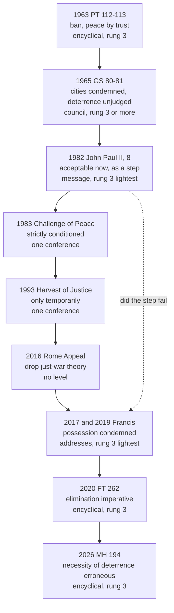

# Catholic Social Teaching · Lesson 5.4: Deterrence, and the challenge to just war

> ⏱ ~15 min · Module 5: The political community, peace and the stranger · Builds on: [5.3](05-03-war-and-peace.md), [1.2](01-02-permanent-principles-and-contingent-applications.md), [`moral-theology` 5.4](../../moral-theology/lessons/05-04-the-death-penalty-and-ccc-2267.md) · Unlocks: [6.1](06-01-integral-ecology-laudato-si.md)

## Why this matters

On 20 September 2017, the day the Treaty on the Prohibition of Nuclear Weapons opened for signature, the Holy See signed and ratified it; no nuclear-armed state has joined. Seven weeks later Francis condemned not only the threat to use the weapons but their very possession. In 1982 John Paul II had told the United Nations that deterrence could still be judged morally acceptable. "The Church reversed itself," say some; "that's just this pope," say others. Both skip the condition the 1982 judgment hung on.

## The idea

A permission can carry its own expiry clause. A doctor lets a patient keep a dangerous painkiller for now, as a step toward tapering off, never as a cure. Ten years on there has been no tapering, and a new doctor calls the prescription wrong. Read one way, the drug may never be kept: a new principle. Read the other, the permission lapsed because its condition failed: the old principle on new facts. Both doctors agree that the drug was never the goal and an overdose was always forbidden.

What never moved is [5.3](05-03-war-and-peace.md)'s floor: [legitimate defence](../reference.md#legitimate-defence) under CCC 2309's strict conditions, and GS 80's absolute condemnation of war on whole cities. The permission is John Paul II's 1982 judgment on [nuclear deterrence](../reference.md#nuclear-deterrence). [`moral-theology` 5.4](../../moral-theology/lessons/05-04-the-death-penalty-and-ccc-2267.md) ran this shape on the death penalty: development or contradiction turns on the old teaching's level and on what the new text asserts. This lesson uses that method.

## The teaching

**T1. The Council named deterrence and did not bless it.** Paraphrased throughout. *Pacem in Terris* (1963) asked for nuclear weapons to be banned (§112): peace rests on mutual trust, not an equal supply of arms (§113). *Gaudium et Spes* 81 (1965), whatever the facts about deterrence, judged the arms race no safe road to peace; GS 80 condemned every act of war aimed indiscriminately at whole cities. *In words:* war on cities and the race were condemned; deterrence itself was left unjudged.

**T2. John Paul II, 1982: acceptable, on a condition.** His [message to the UN's Second Special Session on Disarmament](../reference.md#the-1982-condition), dated 7 June 1982, was read to the Assembly on 11 June by Cardinal Agostino Casaroli, his Secretary of State. §8: "in current conditions", deterrence based on balance, not as an end in itself but as a step toward progressive disarmament, may still be judged morally acceptable; and no one may rest content with this minimum, always open to the danger of explosion. *In words:* tolerable for now, and only as a stage on the way out.

**T3. The US bishops, 1983: the sorting at work.** [1.2](01-02-permanent-principles-and-contingent-applications.md) read the levels *The Challenge of Peace* (3 May 1983) assigns itself (§§9–10). Here they are applied. *Principles restated:* nuclear weapons may never be used to destroy population centres (§147, quoting GS 80); no one may intend to kill the innocent as part of a deterrence strategy (§178). *Application, by its own label:* no first use (§150; §10's example). *Verdict,* applying John Paul II "through our own prudential judgments": a ["strictly conditioned moral acceptance"](../reference.md#strictly-conditioned-acceptance) of deterrence (§186), on three tests: deterrence only against others' use, never plans to prevail; sufficiency, not superiority; each new weapon judged by whether it brings progressive disarmament nearer (§188). *In words:* a principle forbids the intention; the bishops' prudence tolerates the posture.

**T4. 1992–1993: the reservation and the test.** CCC 2315 says deterrence by accumulating arms raises "strong moral reservations"; the text is unrevised. *The Harvest of Justice Is Sown in Peace*, approved by the US bishops on 17 November 1993, kept the 1983 conditions as a guide, reported Catholics divided over abandoning them after the Cold War, and judged that deterrence may be justified only temporarily, with an active commitment to disarmament as its only moral basis. *In words:* the permission was now openly a wasting one.

**T5. Francis: [possession condemned](../reference.md#possession-of-nuclear-weapons).** To a Vatican symposium (10 November 2017) he gave two grounds, the catastrophic effects of any use and the risk of accidental detonation, and concluded that the threat of use and the weapons' "very possession" are to be firmly condemned. At Hiroshima (24 November 2019) he called possession immoral, recalling 2017. *Fratelli Tutti* 262 (2020) calls deterrence through fear no solution, doubts that nuclear deterrence answers today's threats, and makes total elimination "a moral and humanitarian imperative"; it does not call possession immoral. *In words:* the possession sentence lives in two addresses; the encyclical sets the goal.

**T6. Leo XIV: the premise called erroneous.** [*Magnifica Humanitas*](../reference.md#magnifica-humanitas) 194 (15 May 2026) calls the treaty an important step that risks staying symbolic without the major powers, and the belief that deterrence is indispensable to security "widespread yet erroneous". His message for the World Day of Peace 2026 says deterrence rests on fear and force, not law and trust, while still naming legitimate defence as a principle. Neither text speaks of possession. *In words:* Leo attacks deterrence's necessity, not possession.

**T7. The challenge to just war.** *Fratelli Tutti* 258 finds it very difficult nowadays to invoke the old criteria for a just war, while invoking CCC 2309's conditions. *Magnifica Humanitas* 192 says that, without prejudice to self-defence "in the strictest sense", just-war "theory", too often used to justify any war, is "now outdated" (its note cites FT 258). CCC 2308–2309 are unrevised, and *Dignitas Infinita* 38 (2024) reaffirmed self-defence. Theologians read MH 192 two ways: it narrows licit war to strict self-defence and retires the [criteria](../reference.md#just-war-criteria) as a framework for justifying more; or it judges the theory's *use* and present warfare, leaving CCC 2309's conditions as what strict self-defence means. The just-war theorists' reply takes the second line: the criteria are what condemn the wars that misuse them, since war on cities fails [non-combatant immunity](../reference.md#non-combatant-immunity) and nuclear exchange fails proportion. *In words:* a misused theory is retired; whether the criteria are is argued.

**T8. Nonviolence and [just peace](../reference.md#just-peace), 2016.** A Rome conference (11–13 April 2016), sponsored by the Pontifical Council for Justice and Peace and Pax Christi International, issued an "Appeal": stop teaching just-war theory, which too often endorsed war, and shift to a "Just Peace" approach. Francis's peace message for 2017 called active nonviolence the "natural and necessary complement" to limiting force by moral norms. *In words:* the conference asked for a new framework; the pope added to the old one.

**Mark the levels.** By [the ladder](../../fundamental-theology/lessons/04-04-the-ladder-of-doctrinal-authority.md), [levels of authority](../reference.md#levels-of-authority) and the genres of [`fundamental-theology` 4.5](../../fundamental-theology/lessons/04-05-reading-a-documents-weight.md):

- **The floor:** never directly kill the innocent, **rung 1** (*Evangelium Vitae* 57; [`moral-theology` 5.1](../../moral-theology/lessons/05-01-the-inviolability-of-innocent-life.md)); GS 80's condemnation, **at least rung 3**, at the heaviest conciliar grade (infallibility is not manifest, so default down); legitimate defence, **at least rung 3**.
- **1982, and the 2017 and 2026 peace messages:** papal messages, **rung 3 at its lightest**. **The 2017 and 2019 addresses:** the same, at most.
- **1983, 1993:** [particular teaching of one conference](../reference.md#bishops-conference-teaching), before *Apostolos Suos* (1998). Restated principles keep their own weight; the conference's applications bind no one's assent, by their own words.
- **CCC 2315:** a locator; it adds no level.
- **FT 258, 262; MH 192, 194:** encyclicals, **rung 3** as acts.
- **Freely disputed (rung 5):** whether the possession judgment is principle or a reading of conditions; what MH 192 teaches.
- **The ratification:** a juridical act in international law, **no doctrinal rung**. **The 2016 Appeal:** **no magisterial level**.

**Principle or application.** See [principle and application](../reference.md#principle-and-application) and [the three assents](../reference.md#the-three-assents). *Principles*, owed religious submission at their rung: never intend or do the destruction of cities; deterrence is never an end and is ordered to disarmament; elimination is a moral goal; legitimate defence stands. *Applications*, owed serious, respectful consideration: 1982's toleration; the bishops' conditions and no first use; the ratification; on one reading, the possession judgment and MH 194. [*Empirical premises*](../reference.md#empirical-premise), revisable on evidence: that deterrence has prevented major war; the risk of accident; that deterrence fails against terrorism (FT 262); that the powers are not disarming (MH 194). [The two errors](../reference.md#the-two-symmetrical-errors): "possession is defined as intrinsically evil" inflates two addresses; "1982 still stands, so Francis gave an opinion" demotes a papal act and drops 1982's condition.

**Where it stops.** The doctrine fixes boundaries: no plan or intention to strike population centres; no deterrence held as permanent or as an end; real work toward verified reduction. Which weapons to cut first, how fast, by treaty or alone, inside which alliance, whether to sign the treaty: these are [prudential judgments](../reference.md#prudential-judgment) for those responsible for the common good, as CCC 2309 assigns them for war. The documents say so: John Paul II would not enter the technical questions (1982 §1); the bishops called the decisive judgments highly technical (§192); Leo XIV said the Church brings no technical answers ([the doctrine's disclaimers](../reference.md#the-doctrines-disclaimers)).

## The timeline

Each statement carries its genre and rung; the dashed edge is the dispute.

## Worked examples

**Example 1 (clean): weighing the 1982 sentence.**

- *Principle:* deterrence is never an end; it is defensible at most as ordered to progressive disarmament; no one may rest content with it. This restates PT 113 and binds.
- *Application:* that in current conditions deterrence may *still* be judged acceptable. *Current* and *still* carry a time-index.
- *Not said:* that deterrence is good, that a threat against cities is licit (GS 80; CoP §178), or that the toleration is permanent.

Citing 1982 for "the Church approves deterrence" drops both qualifiers; calling 1982 an error misses that it wrote its own expiry clause.

**Example 2 (strain): Altmark's defence minister.** Altmark, an invented state, holds nuclear weapons inside an alliance. Its new defence minister, Edda Rennick, is a practising Catholic.

- *Required on either reading:* no plan, directive or intention to strike population centres, even as a threat (GS 80; CoP §178); the arsenal treated as a stage, with verified, balanced reductions pursued and superiority refused (1982 §8; FT 262).
- *Asked by 2017 and MH 194:* to weigh, with the respect owed to papal teaching, that possession is condemned and deterrence not indispensable; never to wave them off.
- *The strain:* on the principle reading, holding the arsenal is itself wrong, and every year of a phased exit needs a reason; on the conditions reading, her duty is to make the promised disarmament come. Neither says whether to cut alone, how fast, or how to keep an ally from rearming in Altmark's place. That is her judgment as one responsible for the common good, formed by the teaching. If she could serve only by intending what GS 80 forbids, she must resign.

## Watch out

- **You might cite *Fratelli Tutti* 262 for possession**, but that sentence is in the 2017 and 2019 addresses; FT 262 rejects deterrence through fear and makes elimination the goal. Nor is it Leo XIV's: MH 194 calls deterrence's necessity an erroneous belief and is silent on possession.
- **The two errors.** "Since 2017 possession is defined as intrinsically evil, and every Catholic in a nuclear force is in mortal sin" inflates two addresses and skips the conditions for mortal sin. "John Paul II approved deterrence, so Francis gave his view" demotes a papal act and drops 1982's condition.
- **You might read *The Challenge of Peace* as approving deterrence**, but its acceptance is strictly conditioned, its own prudential judgment (§186), not binding in conscience (§10), and one conference's.
- **You might think the 2016 Appeal or MH 192 abolished just-war teaching.** The Appeal has no magisterial level; CCC 2308–2309 are unrevised, and DI 38 reaffirmed self-defence. What MH 192 retires is argued; the floor is not.

## One-liner

> John Paul II tolerated deterrence only as a step toward disarmament; whether Francis's condemnation of possession and Leo XIV's verdict on deterrence mean the step failed or the principle grew is argued, while the floor does not move.

## Problems

**P1 (🟢)** *(Exegetical)* Sort and weigh. Each item paraphrases a statement, written for this problem. Say whether it is a **principle**, an **application** or an **empirical premise** (split any item that mixes them), give its level and the assent it asks, and correct any misstated level. **One line each.** Then, **in one sentence**, say which items' status is itself argued among Catholic theologians, and about what.

1. John Paul II taught the UN in 1982 that nuclear deterrence based on balance is morally acceptable.
2. *The Challenge of Peace* (1983) judged that no first use of nuclear weapons could be morally justified, so Catholics everywhere owe that judgment religious submission.
3. Deterrence by accumulating arms raises strong moral reservations (CCC 2315).
4. The threat to use nuclear weapons, and their very possession, is to be firmly condemned (Francis, address of 10 November 2017); since it is only an address, Catholics may set it aside unweighed.
5. Possessing nuclear weapons is immoral (Francis, Hiroshima, 24 November 2019).
6. Nuclear deterrence is an inadequate answer to terrorism, cyber threats and poverty, and the total elimination of nuclear weapons is a moral and humanitarian imperative (*Fratelli Tutti* 262).

**P2 (🟡)** *(Exegetical)* Find the crux. An invented exchange at a university panel in 2017, written for this problem and not the words of any real person. Both speakers are Catholics.

> **Talitha Fennimore (a just-peace advocate):** "I grant that a people may defend itself against an attack already under way. But for sixteen centuries rulers have dressed their wars in the just-war criteria. A framework that has licensed more wars than it has stopped should no longer be taught. The Church should teach active nonviolence and just peace instead, as the Rome Appeal asked."
>
> **Corwen Delane (a just-war theorist):** "Every war you have in mind failed the criteria; the criteria are what condemn it. Take them away and the defence you just granted has no public limits: no last resort, no proportion, no immunity for civilians. Misuse is a reason to teach the criteria better, not to stop."

(a) Name one claim they share, with its level. **One sentence.**

(b) Name the single premise one of them must deny, and say whether it is a principle, an application or an empirical premise. **One sentence.**

(c) Say what would move it and who is competent to weigh it, and give the level of the Appeal Fennimore cites. **Two sentences.**

**P3 (🔴)** *(Evaluative)* Steelman and reply. Is Francis's judgment that possessing nuclear weapons is immoral (2017, 2019), read together with *Magnifica Humanitas* 194, a **development of principle**, or the **1982 principle applied to conditions** that no longer meet its condition? Any verdict passes if you (i) state the 1982 condition exactly, (ii) give the strongest case for the reading you reject, and (iii) mark the level of your own conclusion. **150 words or fewer.**

Solutions

**P1** *(Exegetical)*

**Must hit, strict:**

1. **Misstated: both conditions dropped.** A papal message, **rung 3 at its lightest**, carrying a **principle** (deterrence never an end, ordered to progressive disarmament) and an **application** (in current conditions it may still be judged acceptable), the latter owed serious consideration.
2. **Misstated twice.** No first use is the letter's own example of a prudential judgment (§10): an **application**, not binding in conscience but owed serious attention. And it is particular teaching of one conference, never universal.
3. **Principle**-level caution, not a verdict. The Catechism locates it and adds no level; it weighs what the conciliar teaching it summarizes weighs.
4. **Understated.** A papal address is papal teaching, **rung 3 at its lightest, at most**, never a private opinion; it asks at least serious, respectful weighing. Its classification is disputed (see the sentence).
5. A papal address, **rung 3 at its lightest, at most**, restating 2017. **Principle** on one reading, **application** on the other.
6. **Split.** The first clause is an **empirical premise** (FT 262 voices "doubts"), revisable on evidence. The second is a **principle** (the goal), **rung 3**, an encyclical. FT 262 does not say possession is immoral.

Sentence: items 4 and 5. Theologians argue whether the possession judgment develops the principle (a deterrent threat involves an intention to do what GS 80 forbids) or applies 1982's condition to a world that has not disarmed: **rung 5** as to that reading.

**Wrong turns:** treating item 1 as "1982 approved deterrence", or as a principle. Giving item 2 universal force. Giving CCC 2315 a level of its own, or calling it a condemnation. Calling 4 or 5 defined, or "intrinsically evil" teaching (the addresses do not use the phrase). Accepting 4's "only an address". Citing FT 262 for possession.

**Model answer:** as above, one line each, with the sentence.

---

**P2** *(Exegetical)*

**Must hit, strict:**

- (a) Defence by armed force is licit under strict conditions: **at least rung 3** (CCC 2308–2309, unrevised; DI 38). Accept instead the immunity of non-combatants, with its core norm (never directly kill the innocent) at **rung 1**.
- (b) The crux is Fennimore's claim that the framework, as actually taught and used, licenses more wars than it restrains. Delane must deny it. It is an **empirical premise** about a teaching's practical effects, with a prudential judgment about what to teach resting on it. It is not a principle: Fennimore granted self-defence, and neither speaker defends the wars in question.
- (c) Historical and social-scientific evidence would move it: whether invoking the criteria has changed decisions (refusals, objectors, rules of engagement) or only supplied cover, and whether nonviolent strategies achieve what force would (the Appeal cites research claiming they do). Historians and social scientists weigh the evidence; what the Church teaches is the Magisterium's to judge, and so far it has kept CCC 2309 and added nonviolence as a complement (2017 message). The Appeal has **no magisterial level**.

**Wrong turns:** naming legitimate defence as the crux (Fennimore conceded it). Naming pacifism against defence, which neither speaker holds. Treating the Appeal as Church teaching because a pontifical council co-sponsored the conference. Making the level of *Magnifica Humanitas* 192 the crux: neither speaker relies on it.

**Model answer:** (a) Both hold that a people may use force in self-defence under strict conditions, at least rung 3 (CCC 2308–2309). (b) Delane must deny that the criteria, as taught, license more wars than they stop: an empirical premise, carrying a prudential judgment about teaching. (c) Evidence on whether invoking the criteria has restrained decisions, and on what nonviolent strategies achieve, would move it; historians and social scientists weigh that, while what is taught belongs to the Magisterium, which has kept CCC 2309 and added nonviolence as a complement. The Appeal has no magisterial level.

---

**P3** *(Evaluative)*

**Must hit, any verdict:**

- **The 1982 condition exactly:** "in current conditions", deterrence based on balance, not as an end in itself but as a step toward progressive disarmament, may still be judged acceptable. Both qualifiers are required.
- **The acts:** two addresses (**rung 3 at its lightest, at most**) and an encyclical (MH 194, rung 3) that judges the belief in deterrence's necessity and never mentions possession.
- **The strongest case for the rejected reading.** *For development:* a deterrent works only if the threat is credible; credibility seems to need a conditional intention to do, if deterrence fails, what GS 80 forbids; intending a forbidden act is already wrong (CoP §178); and 2017 condemns the threat of use as well. So possession for deterrence is wrong whatever the conditions. *For conditions:* 2017's stated grounds are largely factual (the effects of any use, the risk of accident); MH 194 argues from the stalled treaty, a new arms race and "tactical" weapons; and 1982 made toleration depend on progress that has not come. So the old principle, unchanged, now yields a new verdict.
- **The level of your own claim:** the question is **freely disputed (rung 5)**; your verdict is a theological opinion.

**Wrong turns:** citing FT 262 or MH for "possession is immoral". Dropping either 1982 qualifier. Calling either reading defined, or saying MH 194 settles it. Giving the addresses encyclical weight. Reaching a verdict without the other side's best case.

**Model answer, one of several:** In 1982 John Paul II judged that, in current conditions, deterrence based on balance, not as an end but as a step toward progressive disarmament, could still be accepted. Francis's 2017 grounds are mostly factual: what any use would do, the risk of accident, a hardened mentality of fear. MH 194 argues the same way: the treaty stalls, arsenals evolve, a new race begins. So I read both as the 1982 principle applied to a world that never took the step; the toleration has lapsed. The strongest case against me: a deterrent must be credible, credibility seems to require a conditional intention to do what GS 80 forbids, and intending the forbidden is already wrong, so possession for deterrence was never more than a tolerated wrong. Mine is a theological opinion on a freely disputed question (rung 5); the addresses are rung 3 at their lightest.

## Flashback

**From Lesson [5.2](05-02-religious-liberty-dignitatis-humanae.md) (Religious liberty: *Dignitatis Humanae* (1965)):** *(Exegetical: apply to a hard case (a) · sort and weigh (b).)* A case invented, written for this problem. In Altmark (Example 2), a Catholic lay association prays the rosary weekly on the public verge outside the nuclear submarine base. The government (1) bans "religious gatherings" within two kilometres of military sites, though union pickets there need only the ordinary permit; and (2) prosecutes, under the ordinary criminal law, two members who cut the fence and poured blood on a bunker door as "a liturgy of disarmament".

(a) Within DH 7's limit, or a violation of the right? Give the deciding sections for each act. **Two sentences.**

(b) The association says the Council has settled that its rosary may never be moved; the ministry, that siting near bases is its call and no teaching binds it. Is where the line falls at this gate a principle, an application or an empirical premise, at what level, and who judges it? What in DH 7 binds both? **Two sentences.**

Solution

**Must hit, strict (a):**

- (1) **Violates.** It burdens religious gatherings alone, breaching equality before the law (DH 6), and is partisan and wider than necessary (DH 7); public worship in common is inside the right (DH 2, 4).
- (2) **Within the limit.** The right holds "within due limits" (DH 2), and its users must respect others' rights and public peace (DH 7). The ordinary law, applied impartially, is not coercion in religion.

**Must hit, strict (b):**

- The line at this gate is an **application**, left to political prudence and the civil authority (CCC 2109): legislators and courts judge it, and it has **no magisterial level**. It rests on **empirical premises** (does the rosary block the gate or endanger the site?).
- Binding both: the limit and its criterion, a **principle**, **rung 3** (DH 7): [just public order](../reference.md#just-public-order) (others' rights, public peace, public morality), guarded by norms conforming to the objective moral order, impartial, curtailing freedom only as far as necessary. The association inflates an application into a conciliar verdict; the ministry demotes a principle ([the two symmetrical errors](../reference.md#the-two-symmetrical-errors)).

**Wrong turns:** calling every rule near a base a violation (DH 7 expects regulatory norms). Excusing the damage because Francis condemned possession: whatever that judgment's level (P1 above), DH protects religious acts, not damage to another's property. Granting the ministry "no teaching binds it".

**Model answer (a):** (1) violates DH 6 and 7: banning religious gatherings alone breaches equality before the law and curtails more than necessary. (2) is within DH 7: the right never covered damaging another's property, and the ordinary law applied equally is not coercion in religion.

**Model answer (b):** The line at this gate is an application with no magisterial level, drawn by civil prudence (CCC 2109) on empirical premises about access and security. Both are bound by DH 7's rung-3 principle that religious freedom yields only to just public order, impartially and no further than necessary: the association inflates an application, the ministry demotes a principle.

## Connections

- **Backward:** [5.3](05-03-war-and-peace.md) supplies the floor: legitimate defence, CCC 2309's conditions and their assignment to those responsible for the common good, GS 80, and MH 192 stated. [1.2](01-02-permanent-principles-and-contingent-applications.md) taught *The Challenge of Peace*'s self-marking (§§9–10), shown at work here. [`moral-theology` 5.4](../../moral-theology/lessons/05-04-the-death-penalty-and-ccc-2267.md) is the parallel case: a rung-3 text, a disputed reading. [`moral-theology` 4.2](../../moral-theology/lessons/04-02-double-effect-and-cooperation-as-catholic-method.md) gives double effect, under which the US bishops judged foreseen civilian deaths by proportion (§§180–182).
- **Forward:** [6.1](06-01-integral-ecology-laudato-si.md) takes up the environmental grounds FT 262 and the 2017 address give. [6.2](06-02-integral-human-development-and-the-international-order.md) takes up the missing supranational authority that John Paul II names in 1982 §8, where he calls negotiation the only realistic response, and GS 81's universal public authority.
- **Sideways:** deterrence as strategy (second strike, mutual assured destruction, counterforce against countervalue) is [`international-relations`](../../international-relations/syllabus.md) 2.4, formalized in [`conflict-and-bargaining`](../../conflict-and-bargaining/syllabus.md) 2.3–2.4; both model and neither judges. The intention argument meets game theory's credible threat ([`grad-game-theory` 3.2](../../grad-game-theory/lessons/03-02-backward-induction-subgame-perfection.md)): if Schelling's threat that leaves something to chance can deter without a settled intention to strike, one premise of the development reading weakens, and that is a question of strategy the moralist must take from those courses. MH 205 and 218 reject a "false realism" for a "healthy realism", which meets the realist foil of [5.3](05-03-war-and-peace.md). For [conscientious objection](../reference.md#conscientious-objection), *Harvest* (1993) backed legal protection for those who refuse service in strategic nuclear forces.
