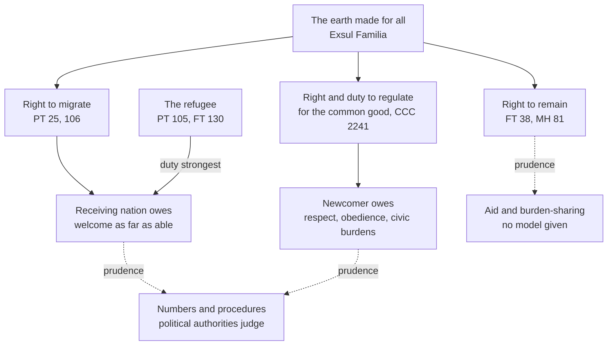

# Catholic Social Teaching · Lesson 5.5: Migration

> ⏱ ~15 min · Module 5: The political community, peace and the stranger · Builds on: [2.3](02-03-mater-et-magistra-and-pacem-in-terris.md), [3.2](03-02-the-common-good.md), [5.1](05-01-the-political-community-and-the-limits-of-the-state.md), [`political-philosophy` 6.2](../../political-philosophy/lessons/06-02-immigration-may-a-state-exclude.md) · Unlocks: [6.2](06-02-integral-human-development-and-the-international-order.md)

## Why this matters

Two Catholics argue about a border, and each reads you half of Catechism 2241: one the duty of prosperous nations to welcome the foreigner, the other the state's right to set conditions on immigration. The paragraph holds both because the teaching is a pair, a right to migrate and a right to regulate, each with its own condition and duties. Get the pair right and you can mark, sentence by sentence, what in an immigration law binds.

## The idea

A stranger knocks at a farmhouse in a storm. The household may not leave him outside to die. It may ask his name, give him the back room and set house rules; he owes it courtesy and a hand with the work. How many it can shelter depends on the size of the house, and the household judges that, honestly. If he is running from someone who means to kill him, the case for opening the door is strongest.

Scale the house to a nation. The root is Scripture: "you shall love him as yourselves: for you were strangers in the land of Egypt" (Leviticus 19:34, Douay–Rheims; the Holiness Code is read in [`old-testament` 2.6](../../old-testament/lessons/02-06-covenant-and-law.md)), and "I was a stranger, and you took me in" (Matthew 25:35, Douay–Rheims). [`political-philosophy` 6.2](../../political-philosophy/lessons/06-02-immigration-may-a-state-exclude.md) argued the secular question (Carens, Wellman, Miller) and filed this tradition as one position; this lesson teaches it from within.

## The teaching

**T1. The [right to migrate](../reference.md#right-to-migrate)** (*Pacem in Terris* 25, 106). When there are just reasons a person must be permitted to emigrate and settle elsewhere, for citizenship of one state does not take him out of the human family (PT 25). He has a right to enter a country where he hopes to provide better for his family, so rulers must receive newcomers and, so far as their community's genuine good allows, help those who want to join it (106). The Council asked that migrant workers be treated as persons, not tools of production, and joined by their families (GS 66; LE 23 is [4.1](04-01-work-and-the-worker-laborem-exercens.md)'s). *In words:* the right to move belongs to the person; the state does not grant it.

**T2. The root** ([*Exsul Familia*](../reference.md#exsul-familia), Pius XII, 1 August 1952). This apostolic constitution on the spiritual care of migrants opens with the Holy Family, refugees in Egypt from a wicked king, as the model and protector of every migrant driven out by fear of persecution or by want. Quoting his 1941 Pentecost radio message, it grounds migration in the earth made for the use of all, and calls this natural law. The Pontifical Council's instruction *Erga Migrantes Caritas Christi* (EMCC 20, 2004) and Francis (2025) call it the Church's "magna charta" on migration. *In words:* migration is first a question of the [universal destination of goods](../reference.md#universal-destination-of-goods) ([3.5](03-05-the-universal-destination-of-goods-and-private-property.md)).

**T3. The paired paragraph** (CCC 2241). Nations that are better off must, as far as they are able, take in the foreigner who seeks the safety and the living he lacks at home, and authorities must uphold the natural right that puts a guest under his hosts' protection. For the common good in their charge, political authorities may set legal conditions on the right to immigrate, chiefly the newcomer's duties: to respect with gratitude his new country's material and spiritual heritage, to keep its laws and to carry his share of civic burdens. EMCC 29 sets the same pair side by side. *In words:* welcome as far as you can; regulate for the [common good](../reference.md#common-good); the newcomer keeps the house rules.

**T4. The [right to remain](../reference.md#right-to-remain)** (*Fratelli Tutti* 38, 129). There is also a right not to emigrate, to remain in one's homeland (FT 38, quoting Benedict XVI). Ideally no one should have to leave; but until conditions at home improve, everyone's right to find a place that meets his family's basic needs must be respected (FT 129). *In words:* no one should have to leave, and those who must, may.

**T5. [Refugees](../reference.md#refugees)** (PT 103–105). Exiles do not lose their rights as persons by losing their citizenship (PT 105). CCC 2241's clause on the safety a person lacks at home names the need at its sharpest; FT 130 asks for steps especially for those fleeing grave humanitarian crises; and Leo XIV told the World Meeting of Popular Movements (23 October 2025) that states have the right and the duty to protect their borders, balanced by the moral obligation to give refuge. The Church's category is wider than the 1951 Convention's (`political-philosophy` 6.2 gives it): fear of persecution *or* want. *In words:* the less a person can stay, the stronger his claim.

**T6. [The four verbs](../reference.md#the-four-verbs) and the Samaritan.** Francis's message for the 2018 World Day of Migrants and Refugees (signed 15 August 2017) sums up the response as welcome, protect, promote, integrate, each filled with concrete proposals; FT 129 restates them. FT's second chapter (56–86) reads the Good Samaritan ([`new-testament` 2.3](../../new-testament/lessons/02-03-luke.md)): we do not choose who is near enough to be our neighbour; we become one (80). *In words:* a program of hospitality, read out of the parable.

**T7. The newest acts.** Francis's letter to the bishops of the United States (10 February 2025) says dignity is the measure of laws, not the reverse (§3); a rightly formed conscience must reject any measure that equates lacking legal status with criminality, yet a nation may defend itself against those who have committed violent or serious crimes (§4); an orderly, legal migration policy is not impeded (§5); and the true *ordo amoris* is the Samaritan's, not love spreading outward in rings of interest (§6). Aquinas's order of charity (the nearer first, other things equal; extreme need can outrank nearness) is [`moral-theology` 3.2](../../moral-theology/lessons/03-02-faith-hope-and-charity.md)'s; on its plain words §6 rejects rings of interest, not ordered duties. *[Magnifica Humanitas](../reference.md#magnifica-humanitas)* 81 (2026) makes the treatment of migrants a "litmus test" of social justice, with two complementary commitments: safe and legal routes, dignified reception and integration; and the right to remain, by tackling root causes. *In words:* the newest texts restate the pair.

**Mark the levels.** ([The ladder](../../fundamental-theology/lessons/04-04-the-ladder-of-doctrinal-authority.md); [levels of authority](../reference.md#levels-of-authority).) The right to migrate and the duty to receive are **rung 3**: PT 25 and 106 (encyclical, John XXIII, 11 April 1963), restating Pius XII and repeated in GS 66, EMCC 29 (an instruction John Paul II approved, 1 May 2004) and MH 81 (encyclical, Leo XIV, 2026). *Exsul Familia*'s doctrine is rung 3 at a light grade; its norms were **law**, since replaced. CCC 2241 footnotes nothing, so find the acts: its welcome and common-good limit restate PT 106, the right to regulate is restated in EMCC 29 and the 2025 letter (§§4–5), and the immigrant's duties apply the citizen's duties (CCC 2238–2240; Romans 13:7) to the newcomer. All **rung 3**, owed religious submission, qualifier included. The right to remain: **rung 3** (FT 38; encyclical, 2020). No act says refugees are the strongest case, so default down: it is what CCC 2241, PT 105 and FT 130 plainly imply. The 2025 letter and Leo XIV's address are **rung 3 at its lightest** for what they restate. The four verbs: a pastoral program, **no rung** beyond the principles beneath them.

**Principle or application.** The [principles](../reference.md#principle-and-application) of T1–T5 (both rights, the duties on each side, the refugee's rights, the right to remain) ask religious submission. **Applications** ask [serious, respectful consideration](../reference.md#the-three-assents) (GS 43): the 2018 message's proposals (humanitarian visas, alternatives to detention, family reunion without financial tests) and the 2025 letter's judgment on one country's deportation program; a state's quotas and procedures are its prudence, no rung. A Catholic who weighs that judgment and reads the facts otherwise dissents from nothing; one who waves it away unweighed has not done what the documents ask. **[Empirical premises](../reference.md#empirical-premise)**: what migration does to wages, budgets and cohesion, and whether aid reduces emigration. The [two symmetrical errors](../reference.md#the-two-symmetrical-errors): "the Church teaches open borders" inflates the welcome into a ban on regulation; "migration is pure policy" demotes two rung-3 rights to opinion.

**Where it stops.** The principles do not say how many, on what criteria or how fast. CCC 2241 places that [prudential judgment](../reference.md#prudential-judgment) with political authorities, for the common good in their charge, much as CCC 2309 places the judgment of a war ([5.3](05-03-war-and-peace.md)). It is bounded: "able" is not "willing"; the good in question is the community's genuine good (PT 106's Latin: *non fucatum*, "unpainted"), which includes its share of the [universal common good](../reference.md#universal-common-good) ([3.2](03-02-the-common-good.md)); and no capacity licenses treating a person as less than one (FT 39). FT 132 asks for shared planning and global governance of migration, designing none. A bishop may teach, judge and plead, but his figure is an application ([1.2](01-02-permanent-principles-and-contingent-applications.md)). The doctrine offers no immigration model ([the doctrine's disclaimers](../reference.md#the-doctrines-disclaimers)).

## The paired duties

Two rights, each answered by duties; the refugee's claim presses hardest; every dashed line hands over to prudence.

## Worked examples

**Example 1 (clean): Ostrevia's asylum rule** (invented, written for this lesson).

- *"No one asking for protection is returned to a country where he faces persecution while his claim is heard."* **Principle applied**: the refugee keeps his rights (PT 105) and is a guest under protection (CCC 2241). Returning him would cooperate in the persecution (the lesson's inference, from [`moral-theology` 3.5](../../moral-theology/lessons/03-05-social-sin-and-cooperation-in-the-sins-of-others.md) on cooperation). International law's non-refoulement rule is **law, no rung**.
- *"Claimants live in open centres, and no child is detained."* Dignity is required; these means are **prudence** (the 2018 message's plea to spare minors detention is an application).
- *"Claimants may take paid work after four months."* The direction follows "promote" and the right to work (PT 18); **the four months is prudence**.
- *"A claimant refused on appeal must leave."* **Permitted**: entry may be put under juridical conditions (CCC 2241), and the appeal serves legal protection (PT 27).

One principle, three prudent means: every figure may change without dissent.

**Example 2 (strain): Halvenor's offer.** The wealthy, invented Halvenor proposes to triple aid to the region its migrants come from, fund camps near their homes, and admit no one for ten years. The right to remain and the duty to welcome pull apart.

- **Decided.** Tackling causes is a real duty, not a dodge (FT 129; MH 81). PT 102 already preferred bringing work to workers over uprooting them.
- **Forbidden.** Using the second commitment to cancel the first. MH 81 calls them complementary, and FT 129 binds us now, before conditions improve. A refugee at the border today cannot live on next decade's development.
- **Permitted.** A mix weighted toward aid, with protection near home where it is genuinely safe. Wellman's view that a state may sometimes help refugees where they are (`political-philosophy` 6.2) is the secular cousin: part of the answer, never all of it.
- **Where it stops.** The proportions, and whether aid in fact reduces emigration (an empirical question). Halvenor's authorities judge; FT 132's burden-sharing has no scheme.

## Watch out

- **You might think the qualifier (as far as they are able) makes the duty a matter of taste**, but it is part of the principle: "able" is not "willing". Calling every limit a sin inflates the welcome; treating any limit at all as enough demotes it.
- **You might think CCC 2241 is rung 3 because the Catechism says so**, but it footnotes nothing. Its weight comes from the acts that teach the same pair (PT 25, 106; EMCC 29; MH 81): rung 3, neither more nor less.
- **You might think the 2025 letter made opposing one country's program a duty of faith, or that it is only a letter.** It restates principles at the lightest rung-3 grade, judges a program as an application, and affirms a nation's right to act against serious criminals (§4) and to regulate legal migration (§5).

## One-liner

> The person may migrate for just reasons and the nation may and must regulate for the common good; each right carries duties, the refugee's claim presses hardest, and almost every number between is prudence.

## Problems

**P1 (🟢)** *(Exegetical)* **Sort and weigh.** Six claims, paraphrased for this problem. For each, say whose right or duty it states (the receiving nation or its authorities, the migrant, or neither), whether it is a principle, an application or an empirical premise, and its level (or "no rung") with the assent it asks. **One line each.**

1. Better-off nations must, as far as they are able, take in the foreigner who seeks the safety and the living he lacks at home (CCC 2241).
2. Those who govern may, for the common good entrusted to them, set legal conditions on the right to immigrate (CCC 2241).
3. Newcomers owe the country that takes them in grateful respect for its material and spiritual inheritance, obedience to its laws and a share of its civic burdens (CCC 2241).
4. Public authorities must uphold the natural right by which a guest is under the protection of those who host him (CCC 2241).
5. Humanitarian visas should be made simpler to obtain, and family reunion granted without financial requirements (Francis, message for the 2018 World Day of Migrants and Refugees).
6. Newcomers lower the wages of native-born workers who compete with them for jobs.

**P2 (🟡)** *(Exegetical (a) · Evaluative (b))* **Apply to a hard case.** Carvessa (invented) is a country of 2.4 million people. Civil war in neighbouring Drassen (invented), where an armed faction is hunting down members of one religious minority, has driven 110,000 people across the border in ten weeks. Carvessa's shelters are full, and its border towns' schools and clinics are overwhelmed. The government proposes three things. Everyone already in the country is registered and protected, and no one is sent back to Drassen while the war lasts. Carvessa asks richer states to resettle some of the refugees. And from next month, arrivals beyond a total of 150,000 will be sheltered in camps at the border until another country takes them.

(a) What does the teaching require, permit and forbid here, and where does it stop giving a verdict? Say who judges the rest. **120 words or fewer.**

(b) Is the 150,000 ceiling, with border camps beyond it, a sound capacity judgment? **100 words or fewer.** Any verdict passes if the moves are made.

**P3 (🔴)** *(Exegetical)* **Diagnose.** Two invented leaflets, written for this problem and not the words of any real person or group:

> **Leaflet A**, from the invented Wayfarers' Circle: "The Church teaches open borders. Catechism 2241 says rich nations must welcome the foreigner, full stop, and Pope Francis's four verbs are binding doctrine. So every visa rule is a sin against the stranger."

> **Leaflet B**, from the invented Hearth and Ledger Society: "Migration is purely a matter of prudence, so the Church has no teaching on it. Even the Catechism admits the state may set whatever conditions it likes. Papal letters on borders are the Pope's opinion, and no Catholic need weigh them."

Name **two** errors in each leaflet, correct each from the texts, and give the right level wherever a level is at issue. Do not judge any particular policy. **150 words or fewer.**

Solutions

**P1** *(Exegetical)*

**Must hit, strict:**

1. **The receiving nation's duty. Principle, rung 3**, owed religious submission. The act is PT 106, with EMCC 29 and MH 81; the Catechism locates it. The qualifier (as far as they are able) is part of the principle, not an escape from it.
2. **The receiving authorities' right. Principle, rung 3** (PT 106's limit; EMCC 29; Francis's 2025 letter §5), owed religious submission. It is a right exercised for the common good, not a blank cheque.
3. **The migrant's duty. Principle, rung 3**: the citizen's duties of CCC 2238–2240 (Romans 13:7) applied to the newcomer. Religious submission.
4. **The receiving authorities' duty. Principle**: the natural-law duty of hospitality as the Catechism teaches it. No source is footnoted, so the act is the Catechism's own promulgation (*Fidei Depositum*, 1992): **rung 3**, nothing higher manifest. Religious submission.
5. **Addressed to receiving states. Application**: concrete proposals in a papal message (rung 3 at its lightest as a document). Owed **serious, respectful consideration**; a Catholic who weighs them and judges otherwise does not dissent.
6. **Neither. Empirical premise, no rung.** It stands or falls on evidence, which differs from case to case, and even if true it feeds the capacity judgment rather than cancelling the duty.

**Wrong turns:** calling 1 a counsel of generosity (understatement), or reading it without its qualifier (overstatement). Calling 2 a licence for any condition at all. Grading 3 as an application because it concerns behaviour. Giving 5 religious submission because a pope wrote it, or calling it weightless. Treating 6 as something the Church teaches, in either direction.

**Model answer:** (1) Receiving nation; principle, rung 3 (PT 106; CCC locates it); submission, qualifier included. (2) Receiving authorities; principle, rung 3; submission; bounded by the common good. (3) Migrant; principle, rung 3, the citizen's duties applied; submission. (4) Receiving authorities; principle, rung 3 via the Catechism itself; submission. (5) Receiving states; application in a message; serious consideration. (6) Neither; empirical premise; no rung; evidence.

---

**P2** *(Exegetical (a) · Evaluative (b))*

**Must hit, strict (a):**

- **Requires:** protection for those already in, who are the strongest case: they flee persecution and cannot find security at home (CCC 2241; PT 105). Decent shelter, security and basic services (FT 130's steps). Not returning anyone to the faction, by the lesson's inference from PT 105 and the guest's protection. **Richer states have a duty too**: CCC 2241 lays the welcome first on "the more prosperous nations", and FT 132 asks for shared effort, so Carvessa's appeal for resettlement is the teaching at work, not a way out of it.
- **Permits:** registration, temporary protection, conditions on stay (CCC 2241), and a ceiling as a capacity judgment.
- **Forbids:** treating the refugees as less than persons (FT 39), or using any ceiling to leave people without shelter or safety.
- **Stops:** at the number, camps versus dispersal, and how long. These are prudential judgments on empirical premises (housing, services, security, outside help), made by Carvessa's authorities for the common good in their charge (CCC 2241), not by bishops or commentators. The texts design no international sharing scheme.

**Must hit, any verdict (b):** a verdict on the ceiling; at least one empirical premise named, with the evidence that would change the verdict; a statement that the principle does not fix 150,000; what must hold at any ceiling (safe, decent camps; no one pushed back to Drassen); one consideration from the other side.

**Wrong turns:** saying the teaching forbids any ceiling, or that it requires one. Treating Carvessa as exempt because it is not rich, when the refugees are already its guests. Treating the duty of the richer states as optional charity. Treating "the government says the clinics are overwhelmed" as settled rather than as an empirical premise to be checked.

**Model answer (a):** The teaching requires Carvessa to protect and decently house those already in. They flee persecution and cannot find security at home, the strongest case (CCC 2241; PT 105), and none may be returned to the faction hunting them. It requires the more prosperous states to share the burden (CCC 2241; FT 132), so Carvessa's appeal is the teaching applied. It permits registration, conditions and a capacity ceiling. It forbids treating the refugees as less than persons (FT 39). It stops at the number, the camps and the timing, which Carvessa's authorities must judge for the common good on the facts.

**Model answer (b), one of several:** Roughly sound, if the camps are safe and temporary; the teaching does not fix the number. Absorbing 150,000 people, over 6 percent of the population, in a few months strains any small country, and the clinics' collapse is checkable. Evidence that families could be housed in towns, or that richer states had pledged places, would change my verdict by making the camps unnecessary. Whatever the number, the camps must be decent and no one may be pushed back to Drassen. Someone who judges the ceiling too low, since border camps tend to become permanent, makes an equally faithful judgment.

---

**P3** *(Exegetical)*

**Must hit, strict (any two per leaflet):**

- **Leaflet A:**
  - **"Full stop"** drops the qualifier (as far as they are able) and the paragraph's second half, the authorities' right to regulate for the common good (CCC 2241; PT 106; EMCC 29, rung 3). The Church does not teach open borders: this is the inflation error.
  - **"Binding doctrine."** The four verbs are a pastoral program (application) in a papal message and FT 129. The principles beneath them are rung 3; the proposals ask serious, respectful consideration.
  - **"Every visa rule is a sin."** Juridical conditions are expressly permitted for the common good (CCC 2241). A particular rule can be unjust, but not because it is a rule.
- **Leaflet B:**
  - **"No teaching."** The right to migrate and the duty to receive are rung 3: PT 25 and 106 (encyclical), restated in CCC 2241 and MH 81. This is the demotion error.
  - **"Whatever conditions it likes"** drops the condition of the common good and the welcome duty beside it. The community's genuine good (PT 106) is the measure, and it includes the universal common good.
  - **"The Pope's opinion."** Papal letters restate principles at rung 3, lightest grade, and their applications ask serious, respectful consideration (GS 43). They are not weightless.

**Wrong turns:** correcting A by denying any duty to welcome, or correcting B by claiming the Church fixes admission numbers. Calling the four verbs "rung 3 doctrine" while correcting A. Arguing whether a particular visa policy is wise.

**Model answer:** Leaflet A drops CCC 2241's qualifier (as far as they are able) and its second half: authorities may set juridical conditions for the common good (PT 106; EMCC 29; rung 3). So the Church does not teach open borders, and a visa rule is not a sin as such. The four verbs are a pastoral program, owed serious consideration, not doctrine; the rights beneath them are rung 3. Leaflet B denies two rung-3 principles, the right to migrate and the duty to receive (PT 25, 106; MH 81). It drops the condition on the state's power, the common good rightly understood, and the duty beside it. Papal letters are rung 3 at their lightest for principles restated, and their applications must still be weighed (GS 43).

## Flashback

**From Lesson [5.3](05-03-war-and-peace.md) (War and peace in the Church's teaching):** *(Exegetical, reconstruct.)* A paraphrase of *Magnifica Humanitas* 197–198 (Leo XIV, 2026) on [autonomous weapons](../reference.md#autonomous-weapons), written for this problem:

> Autonomous weapons are easy to deploy, so they make war more feasible and less subject to human control, violating the principle that armed force is a last resort in legitimate self-defence; their use must be held to the strictest ethical limits. Moral judgment is not calculation: it involves conscience, personal responsibility and the recognition of the other as a person. So lethal or irreversible decisions may not be entrusted to artificial systems.

(a) Set out the paraphrase's two arguments as numbered premises and conclusions, marking each line principle, application or empirical premise, with its level. **Six lines or fewer.**

(b) A study (invented) finds such weapons make governments no readier to go to war. Which conclusion loses its support, which stands, and does the last-resort principle fall? **Two sentences.**

Solution

**Must hit, strict (a):**

- **Argument 1.** P1 armed force only as a last resort in legitimate defence: **principle, rung 3** (GS 79 §4; CCC 2309). P2 autonomous weapons make war easier to start: **empirical premise, no rung**, though MH 197 (with AeN 99) asserts it. C1 so they undermine last resort and need the strictest limits: an **application** in a rung-3 encyclical, owed serious, respectful consideration, and only as strong as P2 (accept "principle applied" if that dependence is said).
- **Argument 2.** P3 moral judgment involves conscience, responsibility and recognizing the other as a person, and is not calculation: **principle, rung 3** (MH 198, encyclical, 2026). C2 no lethal or irreversible decision may be entrusted to a machine: **principle, rung 3**; religious submission.

**Must hit, strict (b):** **C1 loses this argument's support**, since it rested on P2; **the last-resort principle stands**, for a principle applied to a false empirical premise yields a mistaken application, not a false principle. **C2 stands untouched**: it rests on what moral judgment is, not on how governments behave.

**Wrong turns:** grading P2 rung 3 because an encyclical states it. Making C2 depend on how accurately machines perform. Reading C2 as a ban on all military AI (MH 197 limits its use; MH 200 asks for human control).

**Model answer:** (a) The five lines above, P1 to C2. (b) C1 loses this support, but the last-resort principle stands: a false empirical premise spoils an application, never the principle it applies. C2 stands, because it rests on what moral judgment is, not on how governments behave.

## Connections

- **Backward:** [2.3](02-03-mater-et-magistra-and-pacem-in-terris.md) read PT 25 among *Pacem in Terris*'s paired rights; this lesson adds 103–106. [3.2](03-02-the-common-good.md) supplies the common good and the universal common good that bound every capacity judgment. [3.5](03-05-the-universal-destination-of-goods-and-private-property.md) gives *Exsul Familia*'s root, the earth made for all. [5.1](05-01-the-political-community-and-the-limits-of-the-state.md) gave authority's duties and limits, of which the right to regulate is one. [3.1](03-01-human-dignity.md) gives the dignity that legal status cannot remove, and [4.1](04-01-work-and-the-worker-laborem-exercens.md) the emigrant worker of LE 23.
- **Forward:** [6.2](06-02-integral-human-development-and-the-international-order.md) takes up the root causes, development and the international order that FT 132 points to. [6.4](06-04-three-readings-catholic-liberal-integralist-progressive.md) puts the Catholic liberal, integralist and progressive readings on one map; each must keep both halves of this pair.
- **Sideways:** [`political-philosophy` 6.2](../../political-philosophy/lessons/06-02-immigration-may-a-state-exclude.md) supplies the secular arguments this lesson only names. Its exit/entry asymmetry is the pressure point PT 25 and 106 answer, pairing a right to leave with a right to enter under the receiving community's genuine good, so the right to migrate ↔ the exit/entry asymmetry ↔ the universal destination of goods are one question asked three ways. The order of charity is [`moral-theology` 3.2](../../moral-theology/lessons/03-02-faith-hope-and-charity.md)'s and cooperation is its [3.5](../../moral-theology/lessons/03-05-social-sin-and-cooperation-in-the-sins-of-others.md)'s. The stranger in the Torah is [`old-testament` 2.6](../../old-testament/lessons/02-06-covenant-and-law.md)'s, and the Samaritan [`new-testament` 2.3](../../new-testament/lessons/02-03-luke.md)'s.
