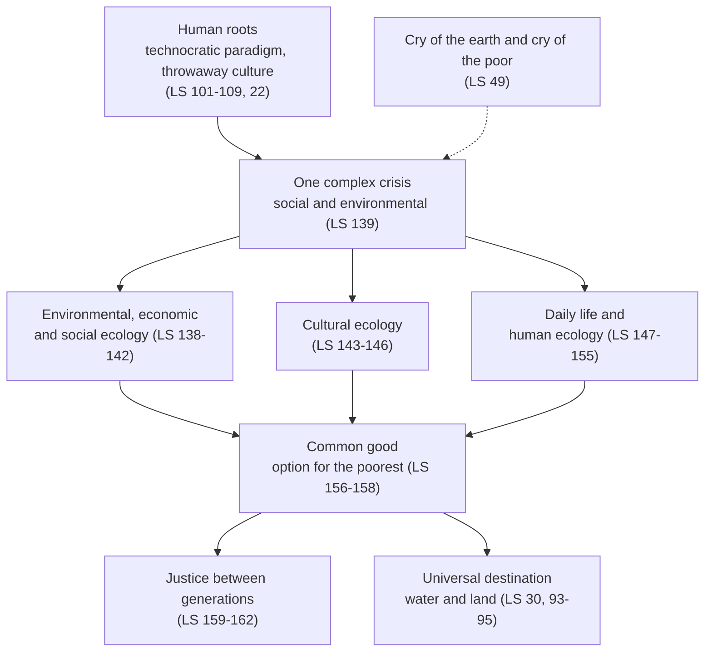

# Catholic Social Teaching · Lesson 6.1: Integral ecology: *Laudato Si'* (2015)

> ⏱ ~15 min · Module 6: Creation, development, and the arguments among Catholics · Builds on: [3.5](03-05-the-universal-destination-of-goods-and-private-property.md), [5.4](05-04-deterrence-and-the-challenge-to-just-war.md) · Unlocks: [6.2](06-02-integral-human-development-and-the-international-order.md)

## Why this matters

At an invented town meeting, one speaker reads out *Laudato Si'* as if it fixed the carbon price. The next says it is only the Pope's view of the weather. Both misread it, in opposite directions. In 2026 Leo XIV called integral ecology an "indispensable dimension" of the social doctrine (*Magnifica Humanitas* 84); the encyclical's science and policies, it says itself, weigh differently.

## The idea

A good village doctor, shown a child's rash, asks about the well, the father's job and the food: one case, not three. [*Laudato Si'*](../reference.md#laudato-si) calls that way of looking [integral ecology](../reference.md#integral-ecology): the polluted river, the poor who drink from it and the firm paid to pollute it are one crisis.

Three convictions carry the encyclical. The world is **creation**, a gift with its own value. Human beings are its **stewards**, neither owners free to use it up nor one more species. And the earth's goods are **destined for everyone**, future generations included: [3.5](03-05-the-universal-destination-of-goods-and-private-property.md)'s principle, meeting the goods that fit property worst, water and land. [`creation-grace-last-things` 2.1](../../creation-grace-last-things/lessons/02-01-the-image-of-god.md) taught stewardship (CCC 373); this lesson uses it.

The hard part is weight: principles, scientific findings and policy advice each ask something different.

## The teaching

**T1. Creation and stewardship.** "Nature" is usually seen as a system to study and control; "creation" is a gift inside God's loving plan, which gives each creature its own value (LS 76). The earth was given to us, so Genesis 1:28's dominion is read through 2:15: tilling is cultivating, keeping is protecting and preserving, and each community may take what it needs while keeping the earth fruitful for those who come after (LS 67). Dominion is properly [stewardship](../reference.md#stewardship) (LS 116). Excluded are a tyrannical anthropocentrism careless of other creatures (LS 68), and a biocentrism or divinized earth that denies the human being's unique worth (LS 90, 118). *In words:* stewards of a gift, neither its owners nor one more animal in it.

**T2. Integral ecology.** Chapter 4 (LS 137–162) joins environmental, economic and social ecology (138–142), cultural ecology (143–146) and the ecology of daily life, including a "human ecology" that respects the moral law in our nature and bodies (147–155). One complex crisis, social and environmental, needs remedies that fight poverty and protect nature together (LS 139). A true ecological approach becomes a social one, hearing [the cry of the earth and the cry of the poor](../reference.md#the-cry-of-the-earth-and-the-cry-of-the-poor) (LS 49). *In words:* one crisis, one cry.

**T3. The roots.** A [technocratic paradigm](../reference.md#technocratic-paradigm) treats reality as formless matter to master, welcomes unlimited growth, and comes to rule economics and politics (LS 101, 106–109). Technology is never neutral (LS 107). Its companion is a [throwaway culture](../reference.md#throwaway-culture) that discards things and people alike (LS 22). [4.5](04-05-the-new-things-of-our-time-magnifica-humanitas.md) followed the paradigm into AI (MH 92). *In words:* a way of seeing comes before a way of producing.

**T4. The common good, now and later.** Integral ecology is inseparable from the [common good](../reference.md#common-good) (LS 156, citing GS 26). In an unjust world it becomes a summons to solidarity and a [preferential option](../reference.md#preferential-option-for-the-poor) for the poorest (LS 158). The climate is a common good, of all and for all (LS 23). And [intergenerational solidarity](../reference.md#intergenerational-justice) is a matter of justice, because the world we received belongs also to those who follow (LS 159). *In words:* future generations are inside the common good.

**T5. The destination of goods, applied to water and land.** LS 93 restates that private property is subordinate to the [universal destination of goods](../reference.md#universal-destination-of-goods), quoting LE 19, and recalls the [social mortgage](../reference.md#social-mortgage). The environment is a collective good: what we make our own we hold to administer for all (LS 95). Access to safe drinking water is a basic and universal human right, which LS 30 sets against turning water into a market commodity ([right to water](../reference.md#right-to-water)). Ecological debt (LS 51–52) is [`theology-of-debt` 6.2](../../theology-of-debt/lessons/06-02-international-debt-and-the-jubilee-call.md)'s. *In words:* 3.5's purpose clause, where it binds hardest.

**T6. What it does not settle.** On many concrete questions the Church gives no definitive opinion and wants honest debate among experts (LS 61). She claims neither to settle scientific questions nor to replace politics (LS 188). The science is labelled borrowed: the best research available (LS 15), a very solid consensus on warming, and studies tracing most of it to human emissions (LS 23). So are the policies. Coal above all is to be replaced progressively and without delay, though meanwhile the less harmful alternative is legitimate (LS 165). Responsibilities are common but differentiated (LS 170). Trading [carbon credits](../reference.md#carbon-credits) may become a speculative ploy (LS 171). *In words:* it marks its own science and policy.

**T7. After 2015.** [*Laudate Deum*](../reference.md#laudate-deum) (4 October 2023), an apostolic exhortation on the climate crisis, answers those who deride the evidence, dismissive Catholics included (LD 5–14), and holds the human origin of warming beyond doubt (LD 11). It extends the technocratic paradigm (LD 20–33) and hoped for a binding, monitored energy transition at COP28 (LD 59). MH 43 calls LS the first systematic treatment of the environment in a social encyclical; MH 84 measures development by justice to people and care for the common home. A [Mass for the care of creation](../reference.md#mass-for-the-care-of-creation) entered the Roman Missal (Dicastery for Divine Worship decree of 8 June 2025, published 3 July 2025, formulary approved by Leo XIV). Leo's message to COP30 (Belém, November 2025, read by Cardinal Parolin) tied peace to the care of creation. *In words:* a second pope and the liturgy now carry the teaching.

**Mark the levels.** On [the ladder](../../fundamental-theology/lessons/04-04-the-ladder-of-doctrinal-authority.md) and the card's [levels of authority](../reference.md#levels-of-authority):

- **T1, T2, T4, T5 and T3's critique of the paradigm: rung 3.** The act is Francis's encyclical of 24 May 2015, addressed to every person on the planet (LS 3), which places itself in the body of the social teaching (LS 15). T1 restates CCC 373 (**rung 3**, per CGLT 2.1); its premise, that God created all things, is defined (Lateran IV; Vatican I). T5 restates LE 19 and GS 69 (**rung 3**, 3.5). The ITC's *Communion and Stewardship*: **no magisterial level**. MH 43 and 84 (encyclical, 2026) repeat the teaching: **rung 3**, heavier by LG 25's sign of frequency, no definition.
- **T6's disclaimers** are rung-3 principles about the encyclical's own applications. **The science** (LS 23; LD 5–14) has **no doctrinal rung**: it lies outside faith and morals and weighs what its evidence weighs ([`climate-science` 3.5](../../climate-science/lessons/03-05-detection-attribution.md), [5.2](../../climate-science/lessons/05-02-extremes-event-attribution.md)). **The policies** (LS 164–181; LD 59) are applications, on no rung as principles.
- ***Laudate Deum*** is an **apostolic exhortation** (so MH's note 220), not an encyclical: rung 3 range, mostly empirical and applied. **The COP30 message**, read by a delegate: **rung 3 lightest** at most. **The Mass**: **liturgical law, no doctrinal rung**; reception, not new teaching.

**Principle or application.** The [principles](../reference.md#principle-and-application) (T1, T2, T4, T5, the critique of the paradigm, the disclaimers) are owed religious submission of mind and will. The [applications](../reference.md#prudential-judgment) (LS 165, 171, LD 59, LS 170's scheme of differentiated responsibilities, T3's readings of particular trends, every cap, tariff or phase-out date) are owed serious and respectful consideration (GS 43; *Donum Veritatis* 24). After it a Catholic may judge differently without dissenting, but may not deny the principle, treat the application as weightless, or claim the Church's authority for his own ([the three assents](../reference.md#the-three-assents)). The [empirical premises](../reference.md#empirical-premise) (LS 23, LD 11–14, LS 28–31 on water) stand on evidence. Disputing the science is not dissent, though LS 188 asks that interests and ideologies not bend the debate. And the principles hang on no temperature: water would still be a right, and future people would still count, if warming were slower. [The two symmetrical errors](../reference.md#the-two-symmetrical-errors) here are "LS teaches a carbon tax" and "integral ecology is the Pope's opinion on science".

**Where it stops.** There is no single path to a solution (LS 60), and LS 188 leaves politics to politics ([the doctrine's disclaimers](../reference.md#the-doctrines-disclaimers)). The principles fix that the earth is held in trust, that the poor's water comes first, that future people count in justice, and that costs may not be loaded onto the poor (LS 170). They do not fix an aquifer's safe yield, the instrument, the year coal ends, or the discount rate; those belong to legislators, regulators, engineers and citizens (GS 43). In [see-judge-act](../reference.md#see-judge-act) terms ([1.3](01-03-see-judge-act.md)), climate science and hydrology see, the principles judge, prudence acts.

## The map

Every branch runs back to one crisis and on to the common good: that is "integral".

## Worked examples

**Example 1 (clean): the Linnea valley aquifer.** Invented. The Linnea valley's aquifer falls a metre a year. Sixty farms irrigate under old well permits; the market town's poorer east side relies on shallow wells that now fail every August. The valley board must write a pumping rule.

- **Required.** Drinking water for every household first, the east side's included (LS 30; LS 158). No mining out the aquifer: the common good includes those who will drink and farm here later (LS 159; LS 67).
- **Permitted.** Caps, meters and charges beyond basic need. The farmers' permits are real titles, but they carry the social mortgage and yield to regulation (LS 93; [3.5](03-05-the-universal-destination-of-goods-and-private-property.md) T5).
- **Forbidden.** Letting the deepest pumps win, or cutting the farms off with no regard for their work and food (LS 141).
- **Where it stops.** The safe yield is hydrology; caps, tariff and compensation are the board's prudence.

**Example 2 (strain): Sanduva's power plant.** Invented. In Sanduva four households in ten lack electricity, clinics run on diesel, and families cook over charcoal, whose smoke LS 20 counts among the poor's health hazards. It can finance a coal plant running in three years; solar and storage of the same output would take eight without foreign finance it lacks.

The two cries pull apart; the texts still speak. For poor countries the priority must be ending extreme poverty; they are also bound to develop cleaner energy, with help from the countries that grew rich by polluting (LS 172). Coal is to be progressively replaced without delay, though meanwhile the less harmful alternative is legitimate (LS 165). The poor may not be made to pay for others' emissions (LS 170).

There the principle stops. Coal with an early retirement date, gas as a bridge, or waiting for financed solar: which serves Sanduva's poor and the earth best turns on costs, timelines, health effects and whether finance comes. Those are empirical premises, and the choice belongs to Sanduva's government and citizens. Catholics there may back different plans without dissenting; none may say one cry does not count, or claim *Laudato Si'* for his plan. The rich countries' duty to help (LS 172) binds another party.

## Watch out

- **You might think the encyclical defined the climate science, so that doubting a projection is dissent.** LS 188 disclaims that; the science weighs what its evidence weighs. The mirror error is as bad: dismissing creation, stewardship, the poor's water and future generations as "the Pope's opinion on science". Those are rung-3 principles, and none hangs on a temperature.
- **You might think a Catholic must back whatever LS 165–173 or LD 59 proposes.** They are applications: weigh them seriously, then judge. Preferring another instrument is no dissent, unless you wave the texts away or claim them for your plan.
- **You might read LS 30 as banning private water firms or bottled water.** It affirms a right of access and warns against making water a market commodity; who runs a supply is for subsidiarity and prudence ([3.3](03-03-subsidiarity.md)).
- **You might call *Laudate Deum* "the second ecological encyclical", or integral ecology a biocentrism.** It is an apostolic exhortation; LS 90 and 118 reject biocentrism and any divinized earth.

## One-liner

> *Laudato Si'* teaches at rung 3 that the earth is held in trust for the poor and those not yet born, and tells you itself that its science is evidence to weigh and its policies are proposals to judge.

## Problems

**P1 (🟢)** *(Exegetical)* Close reading. Genesis 1:26, 1:28 and 2:15 (Douay–Rheims, Challoner):

> 1:26. And he said: Let us make man to our image and likeness: and let him have dominion over the fishes of the sea, and the fowls of the air, and the beasts, and the whole earth, and every creeping creature that moveth upon the earth.
>
> 1:28. And God blessed them, saying: Increase and multiply, and fill the earth, and subdue it, and rule over the fishes of the sea, and the fowls of the air, and all living creatures that move upon the earth.
>
> 2:15. And the Lord God took man, and put him into the paradise of pleasure, to dress it, and to keep it.

(a) Which words does a reading of "absolute domination" lean on? **One line.**

(b) Through which verse, and which pair of verbs, does *Laudato Si'* 66–67 read the others, and what does LS 67 say each verb means? The Douay's first verb differs from LS's English: name it, and say whether the difference matters. **Two sentences.**

(c) LS 67 says the domination reading is not how the Church understands the Bible. What level does that judgment carry, by which act, and does it fix the literal sense of "subdue" and "rule"? **Two sentences.**

**P2 (🟡)** *(Exegetical (a) · Evaluative (b))* An invented case, written for this problem, in the Linnea valley of Example 1. Three years after the pumping rule, a bottling firm asks the valley board for a twenty-year licence to draw water from the aquifer and sell it abroad. It would employ 120 people, most of them from the east side, and pay a fee the board would spend on piping the east side to the town supply. The hydrologists' survey finds that the extra draw would keep the water table falling unless the farms' cap is cut again.

(a) What does the universal destination, as LS 30 and 93–95 apply it to water, **require**, **permit** and **forbid** here? **One line each.**

(b) Propose a rule for the licence and defend it, marking which parts of your rule are principle and which are prudence. Any verdict passes. **100 words or fewer.**

**P3 (🔴)** *(Exegetical)* Find the crux. Two Catholic economists, invented for this problem, advise a national climate commission. Dr Nkemdirim favours a carbon tax returned to households as equal per-head dividends. Dr Renfrew favours a national cap on emissions that falls every year, with every permit auctioned, the revenue paid out the same way, and no offset credits admitted. Nkemdirim writes: "*Laudato Si'* 171 rejects carbon trading, so a Catholic cannot back Renfrew's scheme." Renfrew replies: "LS 171 fears speculation that lets rich emitters keep consuming. Under my binding cap, total emissions cannot exceed the cap, whoever holds the permits."

(a) Does Renfrew dissent from anything taught? Give the level of LS 171 and say what it asks of him. **Two sentences.**

(b) Name the single empirical premise their dispute about LS 171 turns on, and the evidence that would move it. **Two sentences.**

(c) Name one principle from this lesson that binds both of them whichever instrument they choose, with its level. **One line.**

Solutions

**P1** *(Exegetical)*

**Must hit, strict:**

- (a) "have dominion over" and "the whole earth" (1:26); "subdue it" and "rule over … all living creatures" (1:28). In the Douay, "dominion" stands in 1:26; 1:28 says "subdue" and "rule over".
- (b) Through **2:15**, the verbs **till and keep**. LS 67: tilling means cultivating, ploughing or working; keeping means caring for, protecting, overseeing and preserving. Together they make a relationship of mutual responsibility: take what you need and keep the earth fruitful for coming generations. The Douay's "**dress**" means to tend or cultivate, as a vinedresser does, so the sense is the same and nothing turns on it.
- (c) **Rung 3**: an encyclical (2015) restating CCC 373's steward, not "arbitrary and destructive domination" (rung 3, CGLT 2.1). It is no definition. It does **not** fix the philology: LS 67 itself asks that the texts be read in context with a fitting hermeneutic, and the literal sense of "subdue" and "rule" is the exegetes' work ([`old-testament` 2.1](../../old-testament/lessons/02-01-two-accounts-of-creation.md) reads it as representation and rule). What the act fixes is that dominion licenses no absolute domination.

**Wrong turns:** saying LS denies human dominion (LS 116 keeps it, as stewardship). Calling LS 67 a definition, or "Francis's green reading, optional". Claiming LS corrected the Hebrew. Missing that "dominion" sits in 1:26 in the Douay.

**Model answer:** (a) "have dominion over … the whole earth" (1:26), "subdue it, and rule over … all living creatures" (1:28). (b) LS reads them through 2:15's "till and keep": tilling is cultivating and working, keeping is protecting and preserving, so the earth is used for need and kept fruitful for later generations. The Douay says "dress", which means to tend or cultivate, so the sense is unchanged. (c) Rung 3: an encyclical restating CCC 373, not a definition. It rules out reading dominion as licence for absolute domination, but leaves the literal sense of the verbs to exegetes.

---

**P2** *(Exegetical (a) · Evaluative (b))*

**Must hit, strict (a):**

- **Requires:** safe drinking water for every household, the east side's included, secured ahead of any export draw (LS 30). It also requires keeping the aquifer for those who will need it later (LS 67), and weighing the jobs and the pipes as real goods for the poor, not as bribes.
- **Permits:** a licence, a fee, and a private firm selling water as such. LS 30 condemns making water a commodity ruled by the market at the cost of access; it does not condemn trade in water.
- **Forbids:** a draw that depletes the aquifer, or one that prices the poor out of drinking water. It also forbids treating the licence as a sale of the aquifer itself: what we make our own we hold to administer for all (LS 95).

**Must hit, any verdict (b):**

- State the rule exactly (term, cap, conditions).
- Mark the principle (access first, the aquifer kept for later users, the poor not priced out) apart from the prudence (the cap figure, the term, the trigger, how far jobs justify a lower farm cap).
- Say what fact the verdict rests on: the survey's draw against recharge.

**Wrong turns:** "LS 30 forbids selling water", which drops its context. "The jobs settle it", which hears one cry only. Handing the decision to whoever bids most. Answering with subsidiarity's question of who should operate the supply, which is [3.3](03-03-subsidiarity.md)'s, not what the water is for.

**Model answer (b), one of several:** Grant a ten-year licence, capped at whatever draw the survey shows the aquifer can bear once the east side and the farms are supplied, and suspended automatically in drought years. The fee goes to the east-side pipes first. The principle is fixed: drinking water first, the aquifer kept for later users, and no pricing of the poor out of water (LS 30, 67). The rest is prudence: the cap, the term, the drought trigger, and whether 120 jobs justify trimming the farms. Another board could refuse the licence and apply the same principle.

---

**P3** *(Exegetical)*

**Must hit, strict:**

- (a) **No.** LS 171 sits in a rung-3 document, but it is a **prudential application**: a judgment about an instrument resting on an empirical premise, and hedged ("can lead", "seems", "may"). It asks **serious, respectful consideration** (GS 43; *Donum Veritatis* 24), not religious submission. Renfrew meets that if he weighs the worry and answers it by design (binding cap, no offsets, auction). He may then judge otherwise without dissenting, but he may not call LS 171 weightless. Nkemdirim may not claim the Church's authority for the tax either, since LS endorses no instrument (LS 60, 188).
- (b) The premise: **whether a permit market under a binding, falling cap with no offsets actually cuts total emissions as the cap requires, or becomes speculation that lets heavy emitters avoid change** (caps set loose or relaxed under pressure, prices too volatile to steer investment). The evidence is the record of capped markets: did emissions track the cap, were caps tightened, how did prices behave. [`public-economics` 3.1](../../public-economics/lessons/03-01-taxes-standards-and-tradable-permits.md) shows tax and auctioned permits are equivalent under certainty, and [3.2](../../public-economics/lessons/03-02-prices-vs-quantities.md) when they part.
- (c) The climate is a common good, of all and for all (LS 23): **rung 3, principle**. Or: the cry of the earth and the cry of the poor are heard together (LS 49), rung 3. Or: the poor may not be made to bear the costs (LS 170, applying the option for the poor), rung 3.

**Wrong turns:** "LS 171 is in an encyclical, so it binds", which inflates an application. "LS 171 is only the Pope's opinion, so ignore it", which demotes it below what it asks. Calling LS 171 a bare empirical claim: it is a judgment resting on one. Missing that the "rich keep consuming" worry applies to a tax as well, since a high emitter can pay either way, so it cannot separate the instruments; only the quantity outcome does.

**Model answer:** (a) No: LS 171 is a prudential judgment inside a rung-3 encyclical, so it asks Renfrew to weigh it seriously, not to assent to it. Having answered its worry with a binding cap and no offsets, he may disagree without dissent, though neither economist may claim the Church's authority for his instrument. (b) The premise is whether a binding, falling, offset-free cap really delivers the cut or decays into speculation that lets heavy emitters avoid change. The record of real capped markets (emissions against caps, cap revisions, price behaviour) would move it. (c) The climate is a common good of all and for all (LS 23): rung 3, a principle.

## Flashback

**From Lesson [5.4](05-04-deterrence-and-the-challenge-to-just-war.md) (Deterrence, and the challenge to just war):** *(Exegetical · apply to a hard case.)* A case invented for this problem. Varnholt, a nuclear-armed state, has a force its generals call sufficient. A ministry paper proposes a missile accurate enough to destroy an adversary's missiles in their silos. It targets weapons, never cities, the paper says; it would let Varnholt prevail in any exchange, and so deter better; and nothing will be retired, nor arms talks joined, until it is deployed. A Catholic committee member must vote.

(a) Run the three tests of *The Challenge of Peace* §188 on the paper. **One line each.**

(b) "So deter better": principle, application or empirical premise? Would its truth rescue the paper? **Two sentences.**

(c) What level do the tests carry for the member, and which principle beneath them binds her, at what level? **Two sentences.**

Solution

**Must hit, strict:**

- (a) **Only to prevent others' use, never plans to prevail:** fails; prevailing is the aim. **Sufficiency, not superiority:** fails; it adds to a force already sufficient. **Each addition judged by whether it brings progressive disarmament nearer:** fails; nothing is retired and talks wait. Sparing cities meets the floor (GS 80; CoP §178), not the tests.
- (b) An **[empirical premise](../reference.md#empirical-premise)**, a forecast for strategists to weigh ([`international-relations`](../../international-relations/syllabus.md) 2.4), and a disputed one: the bishops opposed "prompt hard-target kill" weapons as apt mainly for a first strike (§190). True or not, it rescues nothing: the first test asks what deterrence is for, not whether it works.
- (c) The tests are the US bishops' **application** of John Paul II "through our own prudential judgments" ([strictly conditioned acceptance](../reference.md#strictly-conditioned-acceptance), §186): [one conference's teaching](../reference.md#bishops-conference-teaching), not binding in conscience even at home (§10). She owes them no assent; they are a model to weigh. Beneath them, restated in the third test, stands [the 1982 condition](../reference.md#the-1982-condition): deterrence never an end, only a step toward progressive disarmament (§8), a **principle** at **rung 3 at its lightest** (a papal message), owed religious submission. Accept also FT 262's elimination imperative, **rung 3**.

**Wrong turns:** "the tests bind every Catholic" (inflation); "American opinion, so irrelevant" (demotion: they apply a papal principle she owes). Letting "never cities" settle it. Answering from the 2017 possession judgment, whose reading is argued (rung 5); the paper fails on either reading. Saying doctrine casts her vote: she may not adopt the paper's aims, but whether an amended missile could pass is her prudence.

**Model answer:** (a) It fails all three: it plans to prevail, exceeds sufficiency, and retires nothing while talks wait; sparing cities meets only the floor. (b) A disputed empirical premise; true or not, the tests ask what deterrence is for. (c) One conference's prudential application, asking no assent of a Varnholt Catholic; beneath it the 1982 principle, deterrence never an end and only a step toward progressive disarmament, binds her at rung 3 at its lightest.

## Connections

- **Backward:** [3.5](03-05-the-universal-destination-of-goods-and-private-property.md) ordered property under the universal destination and promised water and land here. [3.2](03-02-the-common-good.md) and [3.4](03-04-solidarity.md) gave the common good and solidarity that LS 156–159 stretch across generations. [5.4](05-04-deterrence-and-the-challenge-to-just-war.md) counted the catastrophic environmental effects of any nuclear use among the grounds against the weapons (the 2017 address; FT 262, which also names environmental problems among today's threats to peace). Leo XIV's message for the World Day of Prayer for the Care of Creation (1 September 2026) calls war and ecological ruin a vicious cycle and imagines war's energies turned to integral human development. [1.3](01-03-see-judge-act.md) supplied the method, and [4.5](04-05-the-new-things-of-our-time-magnifica-humanitas.md) the paradigm's digital sequel, including the energy and water that AI consumes (MH 101).
- **Forward:** [6.2](06-02-integral-human-development-and-the-international-order.md) takes integral human development, which MH 84 makes the benchmark of integral ecology, and the international institutions LS 173–175 call for. [6.4](06-04-three-readings-catholic-liberal-integralist-progressive.md) shows how the three readings receive this encyclical.
- **Sideways:** the physical claims are [`climate-science` 3.5](../../climate-science/lessons/03-05-detection-attribution.md) and [5.2](../../climate-science/lessons/05-02-extremes-event-attribution.md), where LS 23's caution about single extremes reappears as event attribution. The instruments are [`public-economics` 3.1–3.3](../../public-economics/lessons/03-01-taxes-standards-and-tradable-permits.md). An aquifer is a common-pool resource in [`political-economy` 3.3](../../political-economy/lessons/03-03-the-commons-and-common-pool-resources.md). LS 159 says future people count in justice; how to discount them (Stern's 1.4 percent against Nordhaus's 5.5) is [`philosophy-of-economics` 4.2](../../philosophy-of-economics/lessons/04-02-the-ramsey-equation-and-the-stern-nordhaus-debate.md), and [`philosophy-of-debt` 6.2](../../philosophy-of-debt/lessons/06-02-public-debt-and-the-unborn.md) uses LS 159 on public debt. Ecological debt, and the COP30 message's link between ecological and foreign debt, are [`theology-of-debt` 6.2](../../theology-of-debt/lessons/06-02-international-debt-and-the-jubilee-call.md)'s. Stewardship and the image are [`creation-grace-last-things` 2.1](../../creation-grace-last-things/lessons/02-01-the-image-of-god.md), the new creation of LS 243–244 is its [7.2](../../creation-grace-last-things/lessons/07-02-the-parousia-the-last-judgment-and-the-new-creation.md), and the Genesis accounts are [`old-testament` 2.1](../../old-testament/lessons/02-01-two-accounts-of-creation.md).
