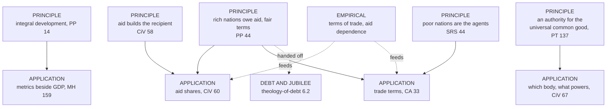

# Catholic Social Teaching · Lesson 6.2: Integral human development and the international order

> ⏱ ~15 min · Module 6: Creation, development, and the arguments among Catholics · Builds on: [2.3](02-03-mater-et-magistra-and-pacem-in-terris.md), [2.4](02-04-gaudium-et-spes-to-justice-in-the-world.md), [5.5](05-05-migration.md), [6.1](06-01-integral-ecology-laudato-si.md) · Unlocks: [6.4](06-04-three-readings-catholic-liberal-integralist-progressive.md)

## Why this matters

In the invented rich country of Ostmoor, parliament debates an aid cut and a trade agreement with its poor neighbour, Pradova. A campaigner reads *Populorum Progressio* as if it settled the tariff schedule; a minister replies that the development encyclicals are 1960s economics. Both misjudge the text: a few principles taught with real authority, carrying many judgments about trade, aid and institutions that the documents themselves offer as applications.

## The idea

A doctor's standard of health is the whole person doing well; it holds while prescriptions change with the diagnosis. The corpus treats development so. It is a people's passage from less human to more human conditions: from destitution to life's necessities, then to education and culture, an active share in the common good, and openness to God ([*Populorum Progressio*](../reference.md#populorum-progressio) 20–21). Output belongs to it and is not its measure. Five principles sit at the top of this lesson; beneath them lie many judgments resting on facts the sciences supply.

[2.4](02-04-gaudium-et-spes-to-justice-in-the-world.md) gave PP 14 and development as the new name for peace, [2.3](02-03-mater-et-magistra-and-pacem-in-terris.md) gave *Pacem in Terris* 137–141, and [3.4](03-04-solidarity.md) gave solidarity and structures of sin; this lesson uses them. **International debt is not taught here.** *Centesimus Annus* 35, *Sollicitudo Rei Socialis* 19, *Laudato Si'* 51–52, CCC 2439, the Jubilee appeals and [*Magnifica Humanitas*](../reference.md#magnifica-humanitas) 172 on structural indebtedness belong to [`theology-of-debt` 6.2](../../theology-of-debt/lessons/06-02-international-debt-and-the-jubilee-call.md), which cites the economics and the history ([`economics-of-debt`](../../economics-of-debt/syllabus.md); [`history-of-debt` 5.5](../../history-of-debt/lessons/05-05-jubilee-2000-and-hipc.md)).

## The teaching

**T1. [Integral development](../reference.md#integral-human-development)** (PP 14, 20–21; [*Caritas in Veritate*](../reference.md#caritas-in-veritate) 18; MH 82–83). Development cannot be reduced to economic growth: to be authentic it must promote each person and the whole person (PP 14; CiV 18). MH 83 calls development a duty and a right of individuals and of peoples, truly human only when it puts people, not accumulated wealth, at the centre. *In words:* development is measured by persons, not by output.

**T2. [Superdevelopment](../reference.md#superdevelopment)** (SRS 28). Beside underdevelopment stands a superdevelopment, an excess of goods for some groups that enslaves people to possession, and it is equally inadmissible. Having perfects no one unless it serves being; the evil is possessing without regard to the order of goods. Development has a necessary economic dimension but is not limited to it. *In words:* a rich country can be badly developed too.

**T3. What rich nations owe** ([the duty of rich nations](../reference.md#the-duty-of-rich-nations)). It falls first on the wealthier nations and is threefold: aid (solidarity), fairer trade between strong and weak (social justice), and a world community where no one's progress is bought at another's expense (universal charity; PP 44). Their superfluous goods ought to go to poorer nations (PP 49), and the duty binds nations, not only individuals (SRS 32). CA 52, calling development another name for peace, adds a collective responsibility for it, which may cost rich economies positions of income and power. *In words:* the rich owe help, fair terms and a share in the work.

**T4. What poor nations owe** ([agents of their own development](../reference.md#agents-of-their-own-development)). Nations are the architects of their own development, though not in isolation (PP 77). It demands above all their own initiative, not waiting on the favoured countries; some must replace corrupt and dictatorial government with participatory government, and literacy is a direct contribution to development (SRS 44). Poor nations owe solidarity to one another (SRS 45), and a programme's beneficiaries should help plan and run it (CiV 47). *In words:* the poor are subjects of development, never its objects.

**T5. [Aid and subsidiarity](../reference.md#aid-and-subsidiarity)** (CiV 22, 47, 58, 60). [Subsidiarity](../reference.md#subsidiarity) and [solidarity](../reference.md#solidarity) stay joined, and the rule governs aid (CiV 58; [the pairing](../reference.md#subsidiarity-and-solidarity)). Aid can lock people into dependence and feed local oppression (58), and it is diverted in donor and recipient chains alike (22). It must not serve secondary aims, and should involve the receiving government and also local economic agents and civil society, local Churches included; its real capital is human (58). Agencies should publish what reaches the programmes (47). Rich nations should give a larger share of national product, as the international community has undertaken, and letting taxpayers direct part of their taxes is one possible means (60). *In words:* aid that does not build the recipient's own capacity fails its purpose.

**T6. [Trade between unequal partners](../reference.md#trade-between-unequal-partners)** (PP 57–61; CA 33; CiV 58; MH 161). Free trade works between roughly equal economies (58), but *Rerum Novarum*'s rule that the consent of very unequal parties does not by itself make a contract fair holds between nations too: unchecked competition can create an [economic dictatorship](../reference.md#economic-dictatorship), and free trade is just only when it meets social justice (59). Competition is to be limited, not abolished, by one standard for all: the protection rich nations give their own farms (60) counts in their trade with the poor (61). CA 33 judges that the chief problem seems to be fair access to the world market, since closed economies stagnated; CiV 58 calls market access the principal help poor countries need. Technology too: SRS 43 notes forms denied or useless, and MH 161 makes access to innovation's benefits a matter of justice. *In words:* trade is judged by whether the weaker partner can really share in it.

**T7. Blocs and [structures of sin](../reference.md#structures-of-sin)** (SRS 20–22, 36). The East–West rivalry of two imperfect concepts of development, liberal capitalism and Marxist collectivism, held the South back (20–22); a world of blocs and imperialisms is subject to structures of sin, rooted in persons' acts (36; the category is [`moral-theology` 3.5](../../moral-theology/lessons/03-05-social-sin-and-cooperation-in-the-sins-of-others.md)'s). *In words:* unjust structures between nations are built and kept by persons.

**T8. The [universal common good](../reference.md#universal-common-good) and its authority** (PT 137–141; PP 78; CA 58; CiV 67; LS 175; *Fratelli Tutti* 172–173; MH 64, 226). World problems need a world-competent [authority](../reference.md#international-authority), set up by consent, not force, and bound by subsidiarity (PT 138–141). PP 78 hopes for a world authority able to act in law and politics; CA 58, for effective international agencies to match a globalizing economy. CiV 67 asks for reform of the UN and of economic and financial institutions, and for a world political authority regulated by law, observing subsidiarity and solidarity, universally recognized, with power to secure compliance. *Laudato Si'* 175 wants institutions empowered to impose sanctions; FT 172–173 add that this need not be a personal authority and must be legally limited against capture by a few. MH 64 wants more effective institutions that respect peoples' diversity; MH 226 calls the UN essential and in need of profound reform. *In words:* a world problem needs an authority equal to it, built by law and consent, serving the nations.

**Mark the levels.** ([the ladder](../../fundamental-theology/lessons/04-04-the-ladder-of-doctrinal-authority.md); [levels of authority](../reference.md#levels-of-authority)) Every act behind T1–T8 is an encyclical: PP (Paul VI, 26 March 1967); [SRS](../reference.md#sollicitudo-rei-socialis) (John Paul II, dated 30 December 1987); CA (John Paul II, 1991); CiV (Benedict XVI, 2009); PT (John XXIII, 1963); LS and FT (Francis, 2015, 2020); MH (Leo XIV, signed 15 May 2026). None defines, so default down (can. 749 §3).

- **Rung 3**, owed religious submission: integral development (T1), repeated from PP 14 to MH 82, which raises its grade within the rung (LG 25); T2's ordering of having to being; the duties of T3–T4; aid serving the recipients' own agency (T5); PP 59's principle on unequal consent and PP 61's one standard (T6); the need for a world-competent authority on PT 138–141's conditions (T8).
- **Fixed elsewhere, not re-levelled:** T7's category (**rung 3**, `moral-theology` 3.5); the justice-duty where prosperity rests on unpaid-for resources (CCC 2439, **rung 3** in `theology-of-debt` 6.2). The Catechism locates; it fixes nothing.

**Principle or application.** The documents mark [the line](../reference.md#principle-and-application). SRS 3: the teaching is constant in its principles, ever new in its adaptations. SRS 43: each local situation shows which reforms come first. CiV 47: no solution is universally valid. Applications come hedged: CA 33 offers its trade judgment as how things seem, CiV 60 its tax device as one possible approach.

- **[Applications](../reference.md#prudential-judgment)**, owed [serious, respectful consideration](../reference.md#the-three-assents): PP 51's world fund from arms budgets; SRS 43's four reforms; CA 33's market-access judgment; CiV 60's aid share and fiscal subsidiarity; CiV 67's design and every UN reform (MH 64, 226); MH 159's metrics beside GDP ([1.1](01-01-the-social-doctrine-sources-genre-and-claim.md)); SRS's 1987 verdict on the blocs.
- **[Empirical premises](../reference.md#empirical-premise)**, decided by evidence: PP 57's terms of trade; CA 33's record of closed economies; CiV 58's dependence; MH 161's concentration of wealth.

A Catholic who weighs an application and judges otherwise dissents from nothing; he may not deny the principle, wave the application away unweighed, or claim the Church's authority for his own. [The two errors](../reference.md#the-two-symmetrical-errors): "PP 59 forbids this treaty" inflates; "integral development is 1960s economics" demotes.

**Where it stops.** The principles say who owes what to whom; they set no aid share, tariff, phase-in period or voting rule for a reformed UN. The Church has no technical solutions for underdevelopment and proposes no economic or political system (SRS 41; [the disclaimers](../reference.md#the-doctrines-disclaimers)). Those choices belong to governments, legislators and negotiators, lay Catholics among them (GS 43; CCC 2442), and their facts to economists.

## The ladder of claims

Principles are rung 3; the documents offer every box beneath them as revisable, and debt leaves for its own course.

## Worked examples

**Example 1 (clean): two health programmes in Sarrin.** Ostmoor funds care in Pradova's Sarrin province two ways. *Programme A*: an Ostmoor contractor builds clinics, staffs them with foreign doctors, buys every drug from Ostmoor firms and reports only to Ostmoor; when the grant ends, the clinics close. *Programme B* funds Sarrin's district health boards and a nursing college run with the diocese and a farmers' cooperative, with rising Pradovan co-funding and published accounts.

- **A fails CiV 58** on every count: a secondary aim (sales for Ostmoor's firms), no receiving government, no local agents, no human capital left behind.
- **B meets it:** Pradovans are the agents (PP 77; SRS 44), and its accounts are open (CiV 47).
- **Still application:** B's design and budget. Whether B saves more lives is empirical; CiV 47 wants results monitored.

**Example 2 (strain): the Pradova–Ostmoor agreement.** Ostmoor offers Pradova's coffee and cloth tariff-free entry if Pradova cuts its tariffs on Ostmoor's machinery and grain to zero within five years, while Ostmoor keeps subsidizing its own grain farmers. Pradova's exporters want to sign; its smallholder grain farmers, a third of the workforce, fear cheap grain.

- **Decided.** Between partners this unequal, consent alone does not make the terms fair (PP 59). Demanding open grain markets while protecting one's own grain breaks PP 61's one standard, and using Pradova's need to extract terms an equal would refuse is forbidden. Yet market access is real help (CA 33; CiV 58), so refusing all trade is not required.
- **Required.** The stronger answers for the weaker (SRS 39, applied to nations): terms the most exposed can bear.
- **Where it stops.** Whether Pradova's poor gain on net is an empirical premise about who gains from trade. Whether to sign, renegotiate grain or phase in slowly is for Pradova's government and parliament, its farmers heard, and for Ostmoor's negotiators.

## Watch out

- **You might think CiV 67 dropped PT's conditions by asking for real teeth.** Its authority can secure compliance, but under law, subsidiarity and solidarity, with universal recognition. Reading a superstate into it inflates an application; dismissing the need demotes a rung-3 principle.
- **You might think CA 33 made open markets doctrine, or PP 59 made them suspect.** CA 33 is a hedged application on an empirical record; PP 59 is a principle about unequal consent that settles no tariff. Liberal readers lean on one, progressive readers on the other ([6.4](06-04-three-readings-catholic-liberal-integralist-progressive.md)).

## One-liner

> Development is of the whole person and every people, owed by the rich and led by the poor, and nearly everything beneath that principle, from aid shares to UN reform, is revisable prudence.

## Problems

**P1 (🟢)** *(Exegetical)* Sort and weigh. Eight claims, paraphrased for this problem. For each, say whether it is a principle, an application or an empirical premise (or split it), give its level or "no rung", and name the assent it asks. **One line each.**

1. Authentic development carries a people from conditions unworthy of human beings to conditions worthy of them, ending in openness to God (PP 20–21).
2. The raw materials and crops poor countries sell swing sharply in price and do not share in the rising value of manufactured goods (PP 57).
3. Whatever the wealthier nations hold beyond their own needs should go to the poorer nations (PP 49).
4. Citizens could be allowed to decide how part of their taxes is spent, as one way of funding development aid (CiV 60).
5. Countries that cut themselves off from the world market stagnated, while those that joined international exchange developed (CA 33).
6. Developing nations must act on their own responsibility and initiative, not expecting everything from the more favoured countries (SRS 44).
7. Superdevelopment, an excess of goods that enslaves people to possession, is as inadmissible as underdevelopment (SRS 28).
8. Aid should be handed out with local economic agents and civil society taking part, local Churches among them, and not through the receiving government alone (CiV 58).

**P2 (🟡)** *(Exegetical)* Diagnose. Two invented texts, written for this problem and not the words of any real person:

> ***Harvest Bell*** (newsletter of an invented mission society): "Paul VI taught that free trade between rich and poor nations is unjust (*Populorum Progressio* 58–59). So Catholics must oppose Ostmoor's Open Markets Bill, which removes our tariffs on goods from the poorest countries, and members who vote for it dissent from an encyclical. Benedict XVI added that rich nations must give more aid (*Caritas in Veritate* 60), so Ostmoor's pledge of one per cent of national income is now Church teaching."

> ***Ketterly Forum memo*** (an invented think tank): "Development is growth in output; 'integral development' is a pious gloss with no bearing on policy. Aid is charity, which the Church recommends and no nation owes. And the trade chapter of *Populorum Progressio* (56–61) is dependency economics that history has refuted, so Catholics may set it aside."

Name **two** errors in each text. Correct each from the documents, and give the right level wherever a level is at issue. Do not judge whether the bill or the pledge is wise. **150 words or fewer.**

**P3 (🔴)** *(Exegetical (a) · Evaluative (b))* Apply to a hard case. An invented case: a year after officials of Pradova's health ministry were convicted of diverting aid money, Ostmoor's government proposes two measures. **Measure 1:** cut the aid budget by a third for three years while Ostmoor is in recession. **Measure 2:** route all remaining aid to Pradova through Ostmoor-based charities running their own clinics, with no money passing through Pradova's government or its district health boards.

(a) For each measure, say what this lesson's principles require, forbid and leave open, and name one duty the documents place on Pradova's government. **120 words or fewer.**

(b) Should Ostmoor adopt Measure 2? Any verdict passes if it is tied to CiV 58's rule and to the corruption, states the strongest case for the other side, and names the empirical premise it rests on. **100 words or fewer.**

Solutions

**P1** *(Exegetical)*

**Must hit, strict:**

1. **Principle**, **rung 3**, owed religious submission. Repetition (PP 14, CiV 18, MH 82) raises its grade within rung 3, not to a definition.
2. **Empirical premise**, **no rung**: it stands or falls with the price evidence. If it proved false, PP 59's principle would be untouched.
3. **Principle**, **rung 3**: the duty about superfluous goods, applied to nations. What counts as superfluous, and by what channel it moves, is application.
4. **Application**, owed **serious, respectful consideration**. CiV 60 offers it as one possible approach, on the condition that it not turn into a tool of special interests.
5. **Empirical premise**, **no rung**. CA 33 draws an application from it (fair access to markets as the chief problem).
6. **Principle**, **rung 3**, religious submission.
7. **Principle**, **rung 3**, religious submission.
8. **Split.** That aid must build up the recipients' own agents rather than bypass them is **principle, rung 3** (subsidiarity applied, the general rule CiV 58 names). Which agents, in what mix, is **application**.

**Wrong turns:** calling 1 or 7 a pope's opinion (demotion). Calling 4 binding (inflation). Calling 2 or 5 Church teaching, or arguing that a refuted 2 refutes the trade principle. Levelling 8 whole, either as binding policy or as mere counsel.

**Model answer:** (1) Principle, rung 3, submission. (2) Empirical premise, no rung, evidence. (3) Principle, rung 3; amounts and channels are application. (4) Application, serious consideration. (5) Empirical premise, no rung. (6) Principle, rung 3. (7) Principle, rung 3. (8) Split: building up local agents is principle, rung 3; the channel list is application.

---

**P2** *(Exegetical)*

**Must hit, strict (any two per text):**

- ***Harvest Bell*:**
  - **Misreads PP 58–59.** Free trade is no longer adequate by itself, works between roughly equal parties, and is just when it meets social justice. PP 61 keeps competition within limits rather than abolishing it, and CiV 58 calls access to rich markets the principal help poor countries need (CiV 33 blames rich countries' tariffs). Nothing here condemns opening Ostmoor's own market.
  - **"Dissent."** Whether a bill meets social justice is an application. The principle is rung 3; the verdict on the bill is the legislator's. No one may claim the Church's authority for his own solution (GS 43).
  - **"Church teaching."** CiV 60 names no figure. It asks for a larger share, keeping the commitments the international community has made. That rich nations owe aid is rung 3 (PP 44, 49); a share is application.
- ***Ketterly Forum*:**
  - **Development as output** contradicts PP 14 and SRS 28 (rung 3). SRS 28 grants development a necessary economic dimension and denies that it is the whole.
  - **"No nation owes aid."** PP 44 makes aid a duty of solidarity falling first on the wealthier nations; PP 49 says superfluous goods ought to go to poorer nations; SRS 32 makes the duty bind nations. Rung 3, not counsel.
  - **Half right on trade.** PP 57's terms-of-trade claim is an empirical premise and may be revised. But PP 59's principle, carried over from *Rerum Novarum*, that consent between very unequal parties does not by itself make a contract fair, is rung 3 and survives any revision of the prices.

**Wrong turns:** "correcting" *Harvest Bell* by saying the Church endorses free trade without condition (PP 59 and 61 condition it). "Correcting" the memo by calling growth suspect (SRS 28; CiV 21 credits growth with lifting billions out of misery). Settling the dependency-economics dispute in the answer, which is economics.

**Model answer:** *Harvest Bell* misreads PP 58–59. Free trade is inadequate by itself and just only within social justice; PP 61 keeps competition within limits, and CiV 58 calls market access the chief help poor countries need. Whether the bill serves social justice is an application, so members who vote for it, having weighed it, dissent from nothing (GS 43). CiV 60 names no figure: the duty to aid is rung 3, the pledge is application. The memo demotes rung-3 teaching. Development is not output alone (PP 14; SRS 28), and aid is a duty binding nations (PP 44, 49; SRS 32). Its trade point is half right: PP 57's facts are revisable, but PP 59's principle on unequal consent stands.

---

**P3** *(Exegetical (a) · Evaluative (b))*

**Must hit, strict (a):**

- **Measure 1.** Requires: the duty to aid binds Ostmoor as a nation (PP 44, 49; SRS 32, rung 3). Forbids: treating that duty as optional charity that may lapse to nothing. Leaves open: the size and length of a cut. The share is application (CiV 60's own call is one), and what counts as superfluous (PP 49) depends on what a nation actually has.
- **Measure 2.** Requires: aid that builds Pradovan capacity, with local agents involved (CiV 58; PP 77; SRS 44). Forbids: aid serving the donor's secondary aims, or making recipients subordinate to the aid-givers' bureaucracies (CiV 47). Leaves open: which channels and what safeguards. CiV 58 names the receiving government first, but CiV 22 admits aid is diverted in donor and recipient chains alike, so the corruption is a real reason for caution.
- **Pradova's duty:** to reform corrupt structures and take responsibility for its own development (SRS 44), with transparency (CiV 47).
- **Where it stops:** whether charity clinics deliver more care than reformed district boards is an empirical premise.

**Must hit, any verdict (b):** a verdict tied to CiV 58's rule that aid involve the receiving government and also local agents, *and* to the convictions; the strongest case for the other side stated (protect the poor from diversion now, or build the state that must outlast the aid); the empirical premise named; acknowledgement that a Catholic who concludes otherwise dissents from nothing.

**Wrong turns:** saying any cut breaks Church teaching, or that the absence of a figure means no duty. Saying CiV 58 forbids bypassing a government in every case (it states a rule for involvement, not a ban on safeguards), or that corruption cancels the subsidiarity rule. Leaving Pradova's own duties out.

**Model answer (a):** Measure 1: the duty to aid binds Ostmoor as a nation (PP 44, 49; SRS 32), so it may not be treated as optional; how large a cut, and for how long, is prudence, since CiV 60's call for more is itself an application. Measure 2: aid must build Pradovan capacity with local agents and must not serve the donor's own aims (CiV 47, 58). Routing everything through Ostmoor's charities risks the dependence CiV 58 warns of, though the convictions are a real reason for safeguards (CiV 22). Pradova must reform its corrupt structures and account openly (SRS 44; CiV 47). Whether charity clinics outperform reformed boards is empirical.

**Model answer (b), one of several:** No, not all of it. CiV 58 names the receiving government and local agents, and clinics run from abroad leave nothing behind when the grant ends. The strongest case for Measure 2 is that money diverted now never reaches the sick. So I would route most of the aid through Sarrin-style district boards under external audit, with charity clinics only where the boards cannot yet operate. My premise is that audited local channels can be made to deliver. If they cannot, Measure 2 may be the better prudence, and a Catholic who judges so dissents from nothing.

## Flashback

**From Lesson [5.5](05-05-migration.md) (Migration):** *(Exegetical: diagnose (a) · sort and weigh (b).)* Invented, written for this problem; no real person said these words. A hundred and forty people fleeing a militia that is massacring their community reach Velasca, an invented country that never signed the 1951 Refugee Convention.

> **Velasca's interior minister:** "We never signed the Convention, so we owe these people nothing. Those who can pay for a residence permit may stay; the rest go back."
>
> **A visiting campaigner:** "Non-refoulement is Catholic doctrine, and so is the Convention's definition of a refugee."

(a) What does the teaching require of Velasca though it never signed, what in the minister's plan does it forbid, and what does it leave open? **Three sentences.**

(b) Give the status (principle, application, empirical premise or law) and level of each thing the campaigner calls doctrine, and what he gets right. **80 words or fewer.**

Solution

**Must hit, strict (a):**

- **Requires** protection. The refugee keeps his rights as a person (PT 105), and a guest is under his hosts' protection by a *natural* right (CCC 2241), **rung 3**, binding by the moral law, not by treaty; here the claim presses hardest ([refugees](../reference.md#refugees)).
- **Forbids** returning anyone to the militia, which would cooperate in the persecution (5.5, Example 1), and sparing only those who can pay (FT 39). With 140 people, "to the extent they are able" is no cover.
- **Leaves** registration, conditions on stay, housing and duration to Velasca's authorities, for the common good (CCC 2241).

**Must hit, strict (b):**

- The Convention's non-refoulement rule is **law, no rung**. Its moral core, not returning a person to persecution, is a **principle applied, rung 3** (PT 105; CCC 2241), binding signed or not: that much he gets right.
- The definition is **law, no rung**, and narrower than the Church's category: those driven out by persecution *or by want* (*Exsul Familia*).

**Wrong turns:** making the Convention doctrine, or saying nothing binds without a treaty. Treating the fee as an ordinary juridical condition: conditions govern entry and stay, not who is sent back to be killed. Arguing whether Velasca should sign.

**Model answer (a):** The refugee's rights as a person (PT 105) and the natural right that puts a guest under his hosts' protection (CCC 2241) bind Velasca at rung 3, treaty or no treaty, and 140 people hardly test its capacity. It may not send anyone back to the militia, still less spare only those who can pay, which treats the rest as less than persons (FT 39). Registration, conditions on stay, housing and duration are for its authorities to judge for the common good.

**Model answer (b):** The Convention's non-refoulement rule is law, with no rung; but its moral core, not returning anyone to persecution, is a rung-3 principle applied (PT 105; CCC 2241) that binds Velasca anyway, as the campaigner says. The definition is law too, and narrower than the Church's category, which counts those driven out by persecution or by want (*Exsul Familia*).

## Connections

- **Backward:** [2.4](02-04-gaudium-et-spes-to-justice-in-the-world.md) gave PP 14 and development as peace, and [2.3](02-03-mater-et-magistra-and-pacem-in-terris.md) the conditions of PT 137–141. [3.4](03-04-solidarity.md) supplied solidarity, structures of sin and CiV 58's pairing, and [3.3](03-03-subsidiarity.md) the principle it pairs. [3.5](03-05-the-universal-destination-of-goods-and-private-property.md) gave the universal destination of goods, which SRS 39 makes the ground of solidarity between nations. [4.2](04-02-the-just-wage.md) owns the *Rerum Novarum* principle on unequal consent that PP 59 carries from the wage to trade. [5.5](05-05-migration.md) gave the right to remain in one's homeland and FT 132's call to develop the countries people leave, and [6.1](06-01-integral-ecology-laudato-si.md) integral ecology, which MH 84 evaluates by the standard of integral development.
- **Forward:** [6.4](06-04-three-readings-catholic-liberal-integralist-progressive.md) sets the Catholic liberal reading, which leans on CA 33 and 42, beside the progressive reading, which leans on PP 59 and structures of sin, and asks what the Church's refusal to propose a system costs each. The debts of nations, CA 35 and the Jubilee go to [`theology-of-debt` 6.2](../../theology-of-debt/lessons/06-02-international-debt-and-the-jubilee-call.md), with MH 172.
- **Sideways:** [`political-philosophy` 6.1](../../political-philosophy/lessons/06-01-global-justice-cosmopolitans-and-statists.md) states this teaching as one position between cosmopolitans (Beitz, Pogge) and statists, and argues the secular case. [`philosophy-of-economics` 1.3](../../philosophy-of-economics/lessons/01-03-capabilities-as-a-welfare-metric.md) gives Sen's capabilities, the secular cousin of integral development and of MH 159's metrics beside GDP: both refuse output as the measure, but only the corpus orders development to the person's end in God (PP 21). Whether aid works is [`institutions-and-development`](../../institutions-and-development/syllabus.md) 5.4's empirical question. The UN's design, the politics of who gains from trade, and the governance of the IMF, World Bank and WTO are [`international-relations`](../../international-relations/syllabus.md) 5.1, 5.4 and 5.5.
