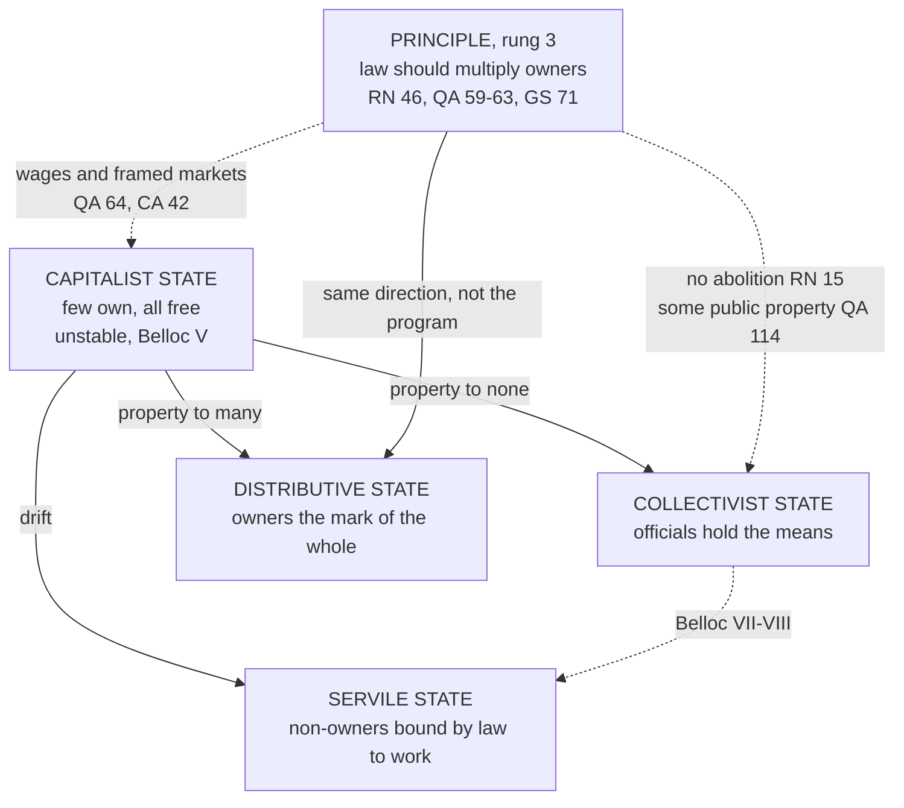

# Catholic Social Teaching · Lesson 6.3: Distributism and the alternative proposals

> ⏱ ~15 min · Module 6: Creation, development, and the arguments among Catholics · Builds on: [2.1](02-01-rerum-novarum.md), [2.2](02-02-quadragesimo-anno-and-the-interwar-proposals.md), [4.3](04-03-socialism-and-liberal-capitalism-each-judged.md), [4.4](04-04-enterprise-consumption-and-the-economy-of-gift.md) · Unlocks: [6.4](06-04-three-readings-catholic-liberal-integralist-progressive.md)

## Why this matters

A parish flyer advertises an evening on "distributism, the Church's own economics". A business columnist replies that it is nostalgia for three acres and a cow, with no standing in Catholic teaching. Both are wrong, in opposite directions. Leo XIII told lawmakers to make as many people owners as they could, but not how; two English laymen's answer to "how" is a proposal, not a doctrine.

## The idea

Picture a town where one mill owns nearly everything and everyone else draws a wage. One remedy says the trouble is ownership, so let the town own the mill. The other says the trouble is that so few own anything, so help the many to own. Hilaire Belloc (*The Servile State*, 1912) and G. K. Chesterton (*The Outline of Sanity*, 1926) took the second side and called it [distributism](../reference.md#distributism). Belloc added a forecast: without that, unstable capitalism will settle into [the servile state](../reference.md#the-servile-state), where the propertyless are bound by law to work for owners in return for security.

The Church's documents share the direction, not the program. [*Rerum Novarum*](../reference.md#rerum-novarum) 46 wants law to multiply owners ([widening ownership](../reference.md#widening-ownership), taught in [2.1](02-01-rerum-novarum.md)), and [*Quadragesimo Anno*](../reference.md#quadragesimo-anno) repeats it ([2.2](02-02-quadragesimo-anno-and-the-interwar-proposals.md)). Yet the same documents accept the wage contract, allow some public ownership, and set conditions on markets rather than reject them ([4.3](04-03-socialism-and-liberal-capitalism-each-judged.md)). So ask of every distributist claim: is it **taught**, or **proposed**?

## Source

G. K. Chesterton, *The Outline of Sanity* (London: Methuen, 1926), Part I, ch. 1, "The Beginning of the Quarrel", from the Dodd, Mead edition (New York, 1927; public domain in the US):

> "Now I am one of those who believe that the cure for centralization is decentralization. It has been described as a paradox. There is apparently something elvish and fantastic about saying that when capital has come to be too much in the hand of the few, the right thing is to restore it into the hands of the many. The Socialist would put it in the hands of even fewer people; but those people would be politicians, who (as we know) always administer it in the interests of the many. … The truth is that what we call Capitalism ought to be called Proletarianism. The point of it is not that some people have capital, but that most people only have wages because they do not have capital."

It runs diagnosis, remedy, rival. "Too much in the hand of the few" puts the evil in concentration, not ownership. "Restore" claims a return to widely held property. "(As we know)" is irony: collectivism concentrates control further, in officials. The last sentence redefines the enemy. In the elided lines Chesterton says that if capitalism means private property, he is a capitalist.

## The teaching

**T1. Belloc's thesis** (*The Servile State*, T. N. Foulis, 1912). Capitalism, ownership by a few joined to freedom for all, cannot last. A reformer who keeps freedom must give property to many or to none: "The first model we call *Socialism* or the Collectivist State; the second we call the Proprietary or Distributive State" (Section VI). Collectivism, he predicts, will yield instead a society where many "are constrained by positive law to labour for the advantage of other families" (Section I). *In words:* restore property or drift into servitude.

**T2. Chesterton's proposal** (from his *G. K.'s Weekly* notes): "small distributed property" against "the two extremes of Capitalism and Communism". He means the family shop and farm, and local trade over big shops; where a business cannot be small, profit-sharing or guild ownership. The book is an outline with "many varieties", to be achieved "by people", not "to people". The Distributist League followed in 1926. *In words:* spread property, by free and varied means.

**T3. *Rerum Novarum* 46–47** (Leo XIII, 1891; Benziger 1903 English): "The law, therefore, should favor ownership, and its policy should be to induce as many as possible of the humbler class to become owners" (§46). The right "is derived from nature, not from man", and taxation must not drain it (§47). *In words:* law should multiply owners.

**T4. *Quadragesimo Anno*** (Pius XI, 1931; paraphrased). The [redemption of the proletariat](../reference.md#redemption-of-the-proletariat) (*redemptio proletariorum*; on vatican.va, of the non-owning workers) is Leo's goal (59). Wages must let workers save and acquire modest property, without which his principles cannot be realized (61–63). Where possible, a partnership contract should modify the wage contract, giving workers a share in ownership, management or profits (65). Yet the wage contract is not unjust (64), and property with too great a power may be reserved to the State (114). *In words:* the propertyless should become owners.

**T5. Restated** (*Mater et Magistra* 113–115, 1961; *Gaudium et Spes* 71, 1965). The right must be extended in practice to all classes, and policy should spread homes, land, tools and shares in medium and large firms (MM 113, 115). Access to ownership should be fostered, since property gives a sphere of autonomy and is a condition of civil liberties; its forms multiply, down to professional skills, and public property is not excluded (GS 71). *In words:* ownership for everyone, in many forms.

**T6. No model** (*Laborem Exercens* 14, 1981; *Centesimus Annus* 6, 32, 43, 1991). Owning the means of production, privately or publicly, is legitimate only as it serves labour. Joint ownership, profit-sharing and shareholding by labour matter whether or not each proves workable, and each worker should be part-owner of the common workbench (LE 14). Leo's reasons hold whatever form property takes; know-how now rivals land (CA 6, 32). The Church offers no model (CA 43). *In words:* the direction is fixed; the institutions are not.

**T7. Modern forms** ([cooperatives and worker ownership](../reference.md#cooperatives-and-worker-ownership)). Pupils of the Basque priest José María Arizmendiarrieta founded Mondragón's first cooperative, Ulgor, in 1956. Chiara Lubich launched the Focolare [economy of communion](../reference.md#economy-of-communion) in 1991, which CiV 46 names. Louis Kelso designed the first US employee stock ownership plan (1956), given statutory form in 1974. *Magnifica Humanitas* 155 (2026) credits cooperatives with better labour law but judges them no longer sufficient alone. *In words:* the proposal has institutions.

**Mark the levels.** Find the act ([the ladder](../../fundamental-theology/lessons/04-04-the-ladder-of-doctrinal-authority.md); [levels of authority](../reference.md#levels-of-authority)). Belloc, Chesterton and the League: lay proposals, **no magisterial level**. No encyclical defines anything here (can. 749 §3). **Rung 3**: *Rerum Novarum* (Leo XIII, 15 May 1891) §46, a direction for law stated as principle, and §47's natural right; *Quadragesimo Anno* (Pius XI, 15 May 1931) 59–63, whose repetition adds weight within the rung (LG 25); *Mater et Magistra* 113 (John XXIII, 15 May 1961); LE 14's principle (John Paul II, 14 September 1981); CA 43's disclaimer (1 May 1991); *Gaudium et Spes* 71 (pastoral constitution, Vatican II, 7 December 1965). Whether distributism is the natural implementation is **rung 5**.

**Principle or application.** [Principles](../reference.md#principle-and-application), owed religious submission: [private property](../reference.md#private-property) as a natural right under the [universal destination of goods](../reference.md#universal-destination-of-goods) ([3.5](03-05-the-universal-destination-of-goods-and-private-property.md)); ownership spread as widely as possible; productive property legitimate as it serves work; no model. Applications, owed serious and respectful consideration: Belloc's distributive state, Chesterton's boycotts, RN 47's land, QA 65's partnership (tied to present conditions), LE 14's list, MM 115's menu, CiV 46's praise, MH 155's verdict. [Empirical premises](../reference.md#empirical-premise): Belloc's instability thesis and forecast; whether small property stays small (Chesterton reports Bernard Shaw denying it); every claim about worker-owned firms' efficiency. [The three assents](../reference.md#the-three-assents), in order: the rung belongs to each document, submission to its principles, serious consideration to its applications (*Donum Veritatis* 24; GS 43). A Catholic who weighs distributism and prefers employee shares dissents from nothing; he may not deny that ownership should be spread, treat the papal proposals as weightless, or claim the Church's authority for his scheme. [The two symmetrical errors](../reference.md#the-two-symmetrical-errors): "distributism is Catholic economics" inflates; "RN 46 is a Victorian aside" demotes.

**Where it stops.** The principle wants many owners. It does not prefer small firms to large, since CA 43 accepts ownership that serves useful work, nor adopt Belloc's "no third course", since the documents combine wages, partnership, public and private property. It parts from his applications too: he counted the Insurance Act among the first signs of servility (Section IX), while the documents list insurance for old age and accidents among workers' rights (LE 19; CA 34). Which forms to foster, how, and at what cost is prudence for owners, workers and legislators, informed by economists. [The doctrine's disclaimers](../reference.md#the-doctrines-disclaimers) say so: no models (CA 43), no "third way" (SRS 41).

## The map

The principle points where the Distributive State points, but permits what Belloc's scheme excludes.

## Worked examples

**Example 1 (clean): Ambleford's rate relief.** The invented town of Ambleford proposes a 30% cut in business rates for firms at least half owned by their employees, paid for by a small rise on other commercial property.

- **The aim** is commended: law should favour ownership (RN 46) and spread shares in firms (MM 115). No councillor may wave it away as nostalgia.
- **The instrument** (the 30%, the threshold, the funding) is an application, owed serious consideration, not assent.
- **The empirical premise**, whether relief creates employee ownership or only rewards firms that have it, is for economists.
- **The limit** is RN 47: a rise that falls on small shops drains the very owners §46 favours.

The teaching requires that the aim be weighed, permits this instrument or another, and forbids claiming Catholics must back this bill (GS 43). A councillor preferring a buy-out loan fund dissents from nothing.

**Example 2 (strain): the Larkspur Mills cooperative.** In Ambleford, 140 worker-members own a woollen mill. Vellmont Textiles, an invented automated rival, sells cloth 20% cheaper. The members can sell to Vellmont, which would keep 90 as employees; admit outside investors with votes; cut pay below a family wage; or seek a public loan.

Widely held ownership favours saving the cooperative (RN 46; LE 14), but the wage answers to the firm's condition and to employment (QA 72, 74), and a large firm's ownership is legitimate if it serves useful work (CA 43). Economists object on scale (some goods are cheapest from large plants), capital (worker-owned firms struggle to raise equity without ceding control) and risk (members hold wages and savings in one firm). Defenders cite Mondragón's seven decades; critics cite the 2013 bankruptcy of Fagor Electrodomésticos, Ulgor's descendant. Those disputes are empirical, and here the doctrine stops. Worker ownership is worth some cost, but nothing says the mill must survive at any price, or that the market's verdict settles its worth. The members, as owners, judge first; the council judges any loan, on evidence of whether the gap is lasting scale or curable management.

## Watch out

- **You might think RN 46 makes distributism doctrine.** It teaches a direction at rung 3 and leaves the means; preferring small property to large, and Belloc's "no third course", are lay proposals with no magisterial level. The opposite error demotes a principle QA 59–63, MM 113 and GS 71 restate.
- **You might think Chesterton's "Capitalism" is what CA 42 accepts.** He means wage-dependence on a small owning class. [*Centesimus Annus* 42](../reference.md#centesimus-annus-42) accepts a market economy only within a strong juridical framework serving a freedom whose core is ethical and religious.
- **You might quote "too much capitalism does not mean too many capitalists, but too few capitalists".** The tag is not in *The Outline of Sanity*, which says "too much capitalism in the one sense or too little capitalism in the other". Treat it as a later summary.
- **You might think QA 65 or LE 14 requires co-ownership.** That drops their conditions: QA 65 ties partnership to present conditions and to what is possible, and LE 14 leaves open whether each proposal can be applied.

## One-liner

> Widely spread ownership is taught at rung 3; distributism is one serious lay program for it, with no magisterial level, which a Catholic may weigh and decline without dissent.

## Problems

**P1 (🟢)** *(Exegetical)* Close reading of the Chesterton passage in the Source.

(a) State the proposal in one sentence, and the premise about property it rests on in one sentence.

(b) Classify each claim as principle, application or empirical premise, and give its level. Where a claim must be split, split it. **One line each.**

1. "When capital has come to be too much in the hand of the few, the right thing is to restore it into the hands of the many."
2. "The Socialist would put it in the hands of even fewer people."
3. "Most people only have wages because they do not have capital."

**P2 (🟡)** *(Exegetical)* Diagnose. Both texts are **invented, written for this problem**, and not the words of any real person.

> (i) From the newsletter of the invented Halvane Distributist Circle: "Distributism is the Church's official economics. Leo XIII defined it in *Rerum Novarum* 46, and Pius XI made small property binding on every Catholic as the redemption of the proletariat. A Catholic who backs an employee-share scheme in a large firm, rather than small property, is in dissent."

> (ii) From a column in the invented *Grenmoor Business Weekly*: "Distributism has nothing to do with Catholic teaching. *Rerum Novarum* 46 was a Victorian aside about smallholdings, and *Centesimus Annus* replaced it when it said the Church has no models to offer. Whether workers own anything is none of the Church's business."

Name **two** errors in each. For each, give the correct claim with its text and level, and say whether it inflates an application, demotes a principle, misstates a level or misreads a document. **150 words or fewer.**

**P3 (🔴)** *(Evaluative)* Is distributism the teaching's natural implementation, or one contingent proposal among many? **150 words or fewer.** Any verdict passes if you draw the principle/program distinction with levels, state the strongest case for the side you reject, and report the economic objections fairly without treating them as doctrine.

Solutions

**P1** *(Exegetical)*

**Must hit, strict:**

- (a) **Proposal:** decentralize ownership, putting capital back into many hands rather than into the state's. **Premise:** the evil is the concentration of property and the wage-dependence it produces, not property itself, so ownership widely held is good for persons.
- (b)1 **Split.** As Chesterton's program it is an application with **no magisterial level**. Its direction, that the many should own, matches a **rung-3** principle (RN 46; QA 59–63; GS 71). "Restore" adds a historical claim that is his own.
- (b)2 **Empirical premise**, a prediction about collectivism, stated with irony. **No rung.** LE 14's point that state ownership is not true socialization is the documents' nearest parallel, and there it is a principle about what socialization means, not a forecast.
- (b)3 **Empirical premise** carrying a stipulated definition of "Capitalism". **No rung.**

**Wrong turns:** giving (b)1 rung 3 because RN 46 agrees with it; the act is Chesterton's, and agreement in direction transfers no level. Calling (b)1 merely Chesterton's opinion, which loses the principle beneath it. Reading "(as we know)" as sincere.

**Model answer:** (a) Spread capital back to the many instead of concentrating it in officials. The premise is that the evil is concentration and wage-dependence, not ownership, which is good when widely held. (b)1 Split: as a program, no magisterial level; its direction is the rung-3 principle of RN 46 and GS 71. (b)2 An empirical prediction, ironically put; no rung. (b)3 An empirical description with a stipulated definition; no rung.

---

**P2** *(Exegetical)*

**Must hit, strict (two per text):**

- (i) **"The Church's official economics … defined it in *Rerum Novarum* 46":** a level misstated and a document misread. RN 46 is **rung 3** and defines nothing; it sets a direction for law, not a program, and the Church offers no model (CA 43).
- (i) **"Made small property binding … is in dissent":** an application inflated. The goal of QA 59–63 is rung 3, but its means are plural: QA 65 favours partnership in large firms, and MM 115 names shares in medium and large firms. Distributism has **no magisterial level**, and preferring another scheme is not dissent (GS 43).
- (ii) **"A Victorian aside about smallholdings … none of the Church's business":** a principle demoted. RN 46 is **rung 3**, restated in QA 59–63, MM 113 and GS 71, which wants access to ownership fostered. Distributism applies that principle and is owed serious consideration, so "nothing to do with Catholic teaching" also understates it.
- (ii) **"*Centesimus Annus* replaced it":** a document misread. CA 6 keeps Leo's reasons for property whatever form it takes, and CA 43, the section that offers no model, asks for workers' wider participation.

**Wrong turns:** correcting (i) by calling distributism un-Catholic, or (ii) by calling RN 46 infallible. Treating the "third way" disclaimer as the whole answer to (i).

**Model answer:** (i) misstates a level: RN 46 is rung-3 teaching that defines nothing and sets a direction for law, not a program; the Church offers no model (CA 43). It then inflates an application. QA's redemption of the propertyless binds as a goal, but QA 65 and MM 115 themselves favour partnership and shares in large firms, and distributism, a lay program, has no magisterial level. (ii) demotes a principle: RN 46 is rung 3, restated in QA 59–63, MM 113 and GS 71, which wants access to ownership fostered. It also misreads CA, which keeps Leo's reasons for property whatever its form (CA 6) and, while offering no model, asks for workers' wider participation (CA 43).

---

**P3** *(Evaluative)*

**Must hit, any verdict:**

- **The distinction, with levels.** The principle of widely spread ownership is rung 3 (RN 46; QA 59–63; MM 113; GS 71). Distributism as a program has no magisterial level. The question itself is rung 5.
- **The other side at full strength.** For "natural implementation": the documents' first remedy is owners, not transfers (RN 46–47; QA 63), and GS 71 ties property to autonomy and civil liberty. For "one among many": the same documents accept the wage contract (QA 64), public property (QA 114), shares in large firms (MM 115) and no model (CA 43).
- **The objections reported, not ruled on.** Scale, capital formation and concentrated risk are empirical claims, with evidence on both sides (Mondragón, Fagor), not doctrine either way.

**Wrong turns:** treating either verdict as what the Church teaches. Using the efficiency objection to "refute" RN 46, or the principle to dismiss the evidence. Arguing that the doctrine underdetermines every economic system, which is a different and larger question ([6.4](06-04-three-readings-catholic-liberal-integralist-progressive.md)).

**Model answer, one of several:** One contingent proposal, though the closest to the text. The principle is rung 3: law should multiply owners (RN 46), restated in QA 59–63, MM 113 and GS 71. Distributism, a lay program, has no level, and whether it is the natural implementation is freely disputed. Its best case is strong. The documents' remedy is ownership, not relief, and GS 71 ties property to autonomy and civil liberty, which only widely spread property secures. But the same documents commend partnership and shares in large firms (QA 65; MM 115), allow some property to be public (QA 114) and give no model (CA 43). The objections are empirical. Scale economies, cooperatives' difficulty raising capital and workers' concentrated risk may hold in some industries and not others, as Mondragón's record and Fagor's failure both suggest. So distributism is one serious answer among several.

## Flashback

**From Lesson [6.1](06-01-integral-ecology-laudato-si.md) (Integral ecology: *Laudato Si'* (2015)):** *(Exegetical (a) · Evaluative (b).)* An invented case, written for this problem. Overgrazing has stripped the moor on the Brennock hills, silting the river below. Two hundred of the region's poorest families graze sheep there by right, beside their small freeholds. The regional authority would buy out the rights and fence the moor as a reserve: recovery in six years. The farmers' association proposes fewer sheep under limits it polices, paid by a grant per restored hectare: twelve years, if the limits hold. The authority's planner writes: "*Laudato Si'* is about the earth; who grazes the moor is a separate, social question. The reserve heals it twice as fast, so ecology favours it."

(a) What does *Laudato Si'* say to the planner's first sentence, at what level? Is "twice as fast" a principle, an application or an empirical premise, at what level? **Two sentences.**

(b) Advise the authority, marking principle apart from prudence and naming the fact your verdict turns on. Any verdict passes. **100 words or fewer.**

Solution

**Must hit, strict (a):**

- The first sentence splits what LS 139 joins: **one complex crisis, social and environmental**, met by fighting poverty and protecting nature together; every ecological approach must weigh the rights of the poor (LS 93). [Integral ecology](../reference.md#integral-ecology) is a **rung-3 principle** (Francis's encyclical of 24 May 2015; restated in MH 84).
- "Twice as fast" is an [empirical premise](../reference.md#empirical-premise), **no doctrinal rung**, worth what the survey is worth (LS 188). Even if true it cannot make the reserve "the ecological choice", since the families belong to the same judgment.

**Must hit, any verdict (b):**

- A definite plan, saying what becomes of the families.
- Principle (moor and families weighed together, the poorest first: LS 139, 158) marked off from prudence (plan, grant, timing, price).
- The fact named: whether the limits will hold, or what six more years of silt cost.

**Wrong turns:** "*Laudato Si'* forbids the buy-out", which claims the Church's authority for a plan (GS 43). "The speed settles it", which hears one cry only. "Their rights make the moor untouchable": all property is subordinate to the universal destination (LS 93). Making RN 46 a veto: its rung-3 direction to multiply owners weighs against stripping 200 small holdings, but fixes no plan.

**Model answer (a):** LS 139 calls this one complex crisis, social and environmental, so who grazes the moor is part of the ecological question: a rung-3 principle of the 2015 encyclical. "Twice as fast" is an empirical premise with no doctrinal rung, worth what the survey is worth, and it cannot settle the choice alone.

**Model answer (b), one of several:** Back the grazing plan with a trigger: if recovery lags after four years, fence the worst slopes, buying those rights at a price that keeps the families farming. Principle: moor and families are one question, the poorest first (LS 139, 158). Prudence: the plan, the trigger, the price. The verdict turns on whether the limits hold; an authority that doubted it could fence the moor under the same principle.

## Connections

- **Backward:** [2.1](02-01-rerum-novarum.md) taught RN 46–47 as a direction for law, and [2.2](02-02-quadragesimo-anno-and-the-interwar-proposals.md) QA's partnership contract and vocational orders. [3.5](03-05-the-universal-destination-of-goods-and-private-property.md) set property under the universal destination, and [4.1](04-01-work-and-the-worker-laborem-exercens.md) read LE 14. [4.3](04-03-socialism-and-liberal-capitalism-each-judged.md) judged both systems and ran Maresh's cooperatives, and [4.4](04-04-enterprise-consumption-and-the-economy-of-gift.md) placed the economy of communion in CiV 46's civil economy.
- **Forward:** [6.4](06-04-three-readings-catholic-liberal-integralist-progressive.md) puts distributism on one map beside the Catholic liberal, integralist and progressive readings.
- **Sideways:** Rawls's property-owning democracy, which he took from James Meade, is widened ownership argued secularly ([`political-philosophy` 6.4](../../political-philosophy/lessons/06-04-welfare-property-and-subsidiarity.md)). Paine's endowment and the Jubilee's limit on permanent dispossession are its cousins in [`philosophy-of-debt` 5.4](../../philosophy-of-debt/lessons/05-04-jubilee-as-a-moral-principle.md). The left's case against a smallholder society, Marx's peasants, like potatoes in a sack, is in [`history-of-political-thought` 6.6](../../history-of-political-thought/lessons/06-06-marx-the-state-revolution-and-after.md). The scale objection's vocabulary is returns to scale ([`micro-refresher` 3.1](../../micro-refresher/lessons/03-01-technology-production.md)). How to test a claim about why cooperatives survive is [`social-theory` 1.4](../../social-theory/lessons/01-04-testing-a-social-explanation.md), and common property as an institution is [`political-economy` 3.3](../../political-economy/lessons/03-03-the-commons-and-common-pool-resources.md).
