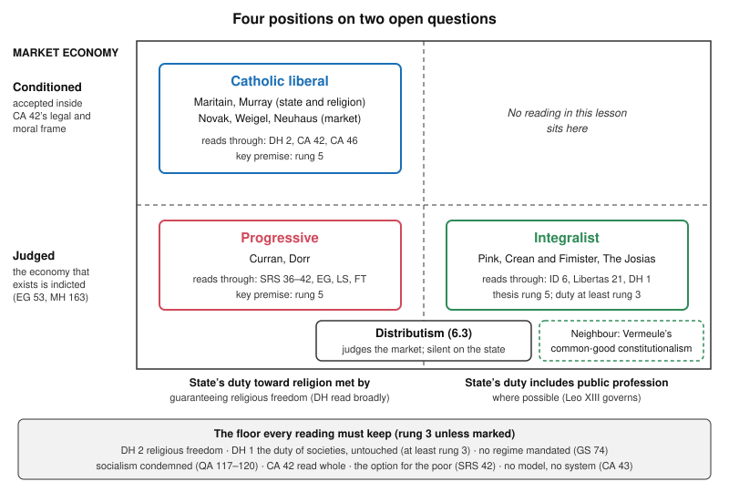

# Catholic Social Teaching · Lesson 6.4: Three readings: Catholic liberal, integralist, progressive

> ⏱ ~15 min · Module 6: Creation, development, and the arguments among Catholics · Builds on: [4.3](04-03-socialism-and-liberal-capitalism-each-judged.md), [5.2](05-02-religious-liberty-dignitatis-humanae.md), [6.2](06-02-integral-human-development-and-the-international-order.md), [6.3](06-03-distributism-and-the-alternative-proposals.md) · Unlocks: —

## Why this matters

Three Catholic magazines review the same new encyclical. One hails the free society rightly ordered, one the confessional state's patient return, one the Church at last siding with the poor against the market. Each quotes real sentences. This last lesson maps the arguments Catholics actually have about this corpus, and the one test every reading must pass: say what level your own key premise carries.

## The idea

Picture a long family correspondence read by three heirs. Each has a favourite letter and reads the rest through it, and none may burn a letter. The social doctrine is that correspondence. The [Catholic liberal reading](../reference.md#catholic-liberal-reading) reads it through *Dignitatis Humanae* and *Centesimus Annus*. [Political integralism](../reference.md#integralism) (not the anti-modernist "integralism" of [`church-history` 8.3](../../church-history/lessons/08-03-leo-xiii-and-the-modernist-crisis.md)) reads it through Leo XIII. The [progressive reading](../reference.md#progressive-reading) reads it through *Sollicitudo Rei Socialis* and Francis. Serious Catholics hold each; none is magisterial; all must keep every letter. That shared remainder is **the floor**.

The material is reloaded, not re-taught: [4.3](04-03-socialism-and-liberal-capitalism-each-judged.md) set up the fight over *Centesimus Annus* (CA) 42, [2.3](02-03-mater-et-magistra-and-pacem-in-terris.md) introduced Maritain, [5.2](05-02-religious-liberty-dignitatis-humanae.md) taught what *Dignitatis Humanae* (DH) declares and how Pink and Murray read it, and [6.3](06-03-distributism-and-the-alternative-proposals.md) taught distributism. The secular frames are argued in [`political-philosophy` 4.1](../../political-philosophy/lessons/04-01-political-liberalism.md) and [4.3](../../political-philosophy/lessons/04-03-perfectionism-and-the-common-good.md).

## The teaching

**T1. The floor.** Every reading must keep: the right to religious freedom, a civil immunity from coercion within due limits (DH 2); the moral duty of persons and societies toward the true religion, which DH 1 leaves untouched (CCC 2105); that the choice of regime is left to citizens (*Gaudium et Spes* 74), no form of government being in itself condemned (*Immortale Dei* 36); the condemnation of socialism as doctrine (*Quadragesimo Anno* 117–120; CA 13) and of economic freedom outside a strong juridical frame ([CA 42](../reference.md#centesimus-annus-42), read whole); the [preferential option for the poor](../reference.md#preferential-option-for-the-poor), never exclusive (*Sollicitudo Rei Socialis* 42; CA 57); and the [disclaimers](../reference.md#the-doctrines-disclaimers): no models (CA 43), no "third way" (SRS 41), no particular system (*Libertatis Conscientia* 74), no tie to any political system (GS 76). *In words:* a reading may stress; it may not delete.

**T2. The Catholic liberal reading.** [Jacques Maritain](../reference.md#maritain)'s *Integral Humanism* (1936) proposed a "new Christendom", pluralist and secular rather than sacral; *Man and the State* (1951) made the state an instrument of the body politic, with citizens of different creeds agreeing in practice on a charter of rights. Postwar Christian democratic movements drew on him. [John Courtney Murray](../reference.md#john-courtney-murray) (*We Hold These Truths*, 1960) read the American religion clauses as "articles of peace", not articles of faith; read Leo XIII's confessional teaching as shaped by the paternal states and anticlerical liberalism of his century; and argued that limited constitutional government has no competence to judge religious truth. Michael Novak, George Weigel and Richard John Neuhaus read CA 42 as accepting democratic capitalism: a market economy, a democratic polity and a moral-cultural order. Maritain was himself a sharp critic of bourgeois capitalism, so the reading's economic half is Novak's, not his. *In words:* the free society, rightly grounded, is where the corpus has been heading.

**T3. The integralist reading.** *The Josias*, an integralist journal once edited by the Cistercian Edmund Waldstein, put it in three sentences (2016): political rule must order man to his final end; man has a temporal and an eternal end, so two powers rule him; the temporal end is subordinate to the eternal, so the temporal power is subordinate to the spiritual. Leo XIII still governs: the state is bound to God "by the public profession of religion" (*Immortale Dei* 6, in the 1903 Benziger English), and to say it has no duties toward God is false (*Libertas* 21). DH is read narrowly or as rupture. On [Thomas Pink](../reference.md#thomas-pink)'s narrow reading ("Conscience and Coercion", *First Things*, 2012), DH denies coercive authority in religion to the state as a civil power, and changed the Church's policy, not her doctrine. Thomas Crean and Alan Fimister's *Integralism: A Manual of Political Philosophy* (2020) systematizes it. Adrian Vermeule's [common-good constitutionalism](../reference.md#common-good-constitutionalism) (2022) is a neighbour, not the same thing: a theory of how judges in a secular constitutional order should read law, in the classical legal tradition, toward peace, justice and abundance. It does not rest on the two powers. *In words:* the confessional order was principle, and principles do not lapse.

**T4. The progressive reading.** Its centre is the option for the poor read as a structural critique: sin takes shape in [structures](../reference.md#structures-of-sin) (SRS 36), and an economy is judged by those it excludes (*Evangelii Gaudium* 53). Charles Curran (*Catholic Social Teaching, 1891–Present*, 2002) traces a shift from a classicist to a historically conscious method, with DH its best conciliar instance; Donal Dorr (*Option for the Poor*, 1983, revised 1992) traces a century of Vatican teaching moving toward the poor. Francis is read as recovering the centre: the option is a theological category (EG 198), and the cry of the earth and the cry of the poor are heard together (*Laudato Si'* 49). *In words:* the poor are the key, and the corpus has been learning to read itself by them.

**T5. A fourth position.** [Distributism](../reference.md#distributism) shares the progressive's and the integralist's judgment of the market, proposes widely spread small property as the remedy, and as a programme is silent on the state's duty toward religion.

**T6. The cruxes.** (i) *What DH settles:* whether the duty of societies it leaves untouched is met by guaranteeing freedom (liberal, progressive) or still asks public profession of the faith where a Catholic people can achieve it (integralist). (ii) *Political forms:* the texts answer that no regime is mandated; what stays open is what the duty asks within a chosen form. (iii) *The market:* the liberal reads CA 42's yes as acceptance with conditions; the progressive and the integralist read its conditions as a verdict on the economy that exists. (iv) *"No system":* it costs every reading its programme (democratic capitalism, the confessional polity, a structural agenda, the distributive state), which becomes an application. *In words:* they may disagree where the texts leave room, and must agree everywhere else.

**Mark the levels.** On [the ladder](../../fundamental-theology/lessons/04-04-the-ladder-of-doctrinal-authority.md) ([levels of authority](../reference.md#levels-of-authority)), every reading has **no magisterial level**. Each reading's distinctive premise is **rung 5**: the [confessional state](../reference.md#confessional-state) as the ideal today; whether CA 42 endorsed or only conditionally accepted the market economy; whether the option is the corpus's key. The floor is **rung 3**, owed religious submission: DH 2 (a conciliar declaration; that its core is definitive is not manifest, so default down), GS 74, CA 42–43, SRS 41–42, and *Quadragesimo Anno* 117–120 at a heavy grade, not a definition. The duty of societies in DH 1 is **at least rung 3**; CCC 2105 is its locator. Leo XIII's teaching on the state (*Immortale Dei* 6; *Libertas* 21) was **rung 3 at its date, at a heavy grade**, never defined; *Quanta Cura* is a disputed candidate *ex cathedra* act, **not manifestly defined**. The temporal subjection of rulers to the pope was never defined ([`ecclesiology-and-mariology` 4.4](../../ecclesiology-and-mariology/lessons/04-04-infallibility-in-exercise-and-the-ordinary-universal-magisterium.md)). Leo XIV's addresses that readings quote are **rung 3 lightest** at most; *Magnifica Humanitas* (encyclical, 2026) is rung 3 and takes no reading's side.

**Principle or application.** ([principle and application](../reference.md#principle-and-application); [the three assents](../reference.md#the-three-assents)) The floor's items are **principles**. Each reading's programme is an **application**, owed serious, respectful consideration: a Catholic who weighs Novak's democratic capitalism, Crean and Fimister's confessional polity or a structural agenda and judges otherwise dissents from nothing (GS 43). The [empirical premises](../reference.md#empirical-premise) belong to evidence: that markets lift the poor fastest, that pluralist societies hold together without a shared faith, that establishment protects or corrodes belief. [The two symmetrical errors](../reference.md#the-two-symmetrical-errors) threaten each reading: "the Church endorsed democratic capitalism", "integralism is the real teaching" and "the option is the whole of it" inflate; "DH binds no one's mind", "CA 42 was a pope's opinion" and "the option is a slogan" demote.

**Where it stops.** The principles stop before choosing among readings. DH 1 gives each side a clause (the duty left untouched; the doctrine of recent popes developed), *Magnifica Humanitas* 45's harmonious but not always linear development gives each a phrase, and no act settles which governs. The rest is theologians' argument and citizens' prudence, and GS 43 forbids anyone to claim the Church's authority for his opinion. Leo XIV's texts belong here as texts each reading quotes, never as the Pope taking sides. The liberal and the integralist both cite his Élysée address (25 September 2026: authentic secularity keeps religion in public life, with state and religious bodies working together); the progressive cites his address to the popular movements (23 October 2025: land, housing and work as sacred rights).

## The map

The readings part only on the open axes; the floor is shared.

## Worked examples

**Example 1 (clean): Castrel's Equal Schools Bill.** The parliament of Castrel, an invented country, debates a bill funding every accredited school, state or religious, at the same rate per pupil.

- **The principle decides.** Government must acknowledge parents' right to a genuinely free choice of schools without unjust burdens (DH 5); public subsidies, in distributive justice, should leave parents truly free to choose, and there should be no school monopoly (*Gravissimum Educationis* 6, 1965). Both are rung 3.
- **Each reading backs it for its own reason.** The liberal for civil society and religious freedom; the integralist because DH 6 also asks government to foster conditions for religious life; the progressive because without public funding only the well-off can choose.
- **Where it stops.** The rate, admissions and accountability are for Castrel's legislators; Catholics may differ on the design (GS 43).

**Example 2 (strain): the confessional amendment.** A petition asks Castrel's parliament to add: "The Catholic religion is the religion of the nation; the State honours it in public life; every religious community enjoys freedom of worship, teaching and association within public order." Unlike [5.2](05-02-religious-liberty-dignitatis-humanae.md)'s Monteral, it forbids no one's worship.

- **The floor.** DH 6 permits special civil recognition on its conditions: everyone's religious freedom effective in practice, and equality before the law. A statute under the amendment that penalized another faith's worship beyond just public order (DH 7) would breach DH 2. That binds all three readings.
- **The readings part.** The integralist sees the duty of societies honoured (*Immortale Dei* 6; DH 1), the ideal a Catholic people should tend toward. The liberal sees a circumstantial permission and, with Murray, doubts a government's competence to honour religious truth. The progressive cites GS 76: the Church does not rest her hope on privileges from civil authority, and will give up legitimately acquired rights whose use casts doubt on her witness.
- **Where it stops.** Whether a Catholic people should tend toward such a clause is rung 5; whether Castrel adopts it is its citizens' prudence. A Catholic may vote either way without dissent, if he keeps the floor and claims no Church authority for his vote.

## Watch out

- **You might think DH condemned integralism, or that DH binds no one's mind.** DH 1 affirms the duty of societies and DH 6 permits recognition; what DH excludes is coercion beyond public order (rung 3). Pink's reading claims to keep DH's teaching; a reading that refuses DH 2 any assent demotes a rung-3 act.
- **You might quote Benedict XVI's "hermeneutic of continuity", but** his address to the Curia (22 December 2005) set a hermeneutic of discontinuity and rupture against a [hermeneutic of *reform*](../reference.md#hermeneutic-of-reform), renewal in the continuity of the one subject-Church, and said the Council had reviewed or even corrected certain historical decisions while keeping their principles. It is an address (rung 3 lightest at most), and each reading quotes half of it.
- **You might sort an encyclical by who drafted it, but** the act is the Pope's. Weigel proposed marking *Caritas in Veritate*'s passages gold (Benedict's) and red (the Pontifical Council's) (*National Review Online*, 2009); a passage's weight comes from what it proposes and how. The mirror error is "Francis replaced John Paul II": *Magnifica Humanitas* 39 (2026) restates CA's conditional acceptance of the market.

## One-liner

> Three readings, each with a favourite letter and none with a magisterial level, stand on one rung-3 floor: they may disagree where the texts leave room, and each must admit its own key premise is rung 5.

## Problems

**P1 (🟢)** *(Exegetical)* **Sort and weigh.** Eight claims, written for this problem. Say who holds each: the Catholic liberal, integralist, progressive or distributist reading; **the floor** (every reading must hold it); **a neighbour**; or **none** (no reading may hold it as stated). Then say whether its key premise is a principle, an application or a reading, give its real level, and flag any claim that states more than its level. **One line each.**

1. *Centesimus Annus* 42 accepted, with conditions, the economy of the free societies; the corpus's work now is to keep that economy morally anchored.
2. Political rule must order citizens to their final end, so the temporal power is subordinate to the spiritual.
3. The preferential option for the poor is the key in whose light every earlier document, Leo XIII's included, is to be read.
4. No form of government is in itself condemned; the choice of regime is left to the citizens.
5. Since the Council, a Catholic may hold that society owes no duty of any kind toward the true religion.
6. *Quanta Cura* (1864) infallibly defined that liberty of conscience and worship is no right of man.
7. Judges should read the written law in the light of the classical legal tradition, toward peace, justice and abundance.
8. Widely spread small ownership is the economic order the encyclicals teach, not one proposal among others.

**P2 (🟡)** *(Exegetical)* **Find the crux.** Two Catholics, invented and written for this problem; neither speaks the words of any real person. Both accept DH 2 and the option for the poor, and both distrust the liberal market.

> **Iolo Dacre, an integralist:** "*Magnifica Humanitas* 176 says the Apostolic See once regulated and legitimized subjugation, in some cases enslavement, at the request of sovereigns, while the dignity of every person was affirmed throughout. So practice changed and the principle never did. Leo XIII taught the state's public profession of religion as principle, so it stands, and later texts must be read in its light."
>
> **Rhiannon Kestle, a progressive:** "The same section says it took eighteen centuries to see that dignity is wholly incompatible with slavery, and calls that a growth in understanding. What popes once taught can later prove historically conditioned. Leo XIII's confessional teaching was conditioned in the same way, and the later corpus is the lens for reading him."

(a) Name the single premise one of them must deny, and give its level. **Two sentences.**

(b) Say what should give each speaker pause: a text or a rule of the ladder for each. **80 words or fewer.**

**P3 (🔴)** *(Exegetical)* **Diagnose.** A manifesto of the Quennell Circle, an invented Catholic study group in Castrel, **invented and written for this problem**; no real person or group said it. It calls itself "simply what the Church teaches".

> (1) The preferential option for the poor binds every Catholic.
>
> (2) Since *Evangelii Gaudium* the Church has judged that the market economy as such kills, and *Centesimus Annus* 42's yes has lapsed.
>
> (3) When Leo XIV told the popular movements that land, housing and work are sacred rights, he taught it as a doctrine of the faith.
>
> (4) *Libertatis Nuntius* belonged to the Cold War, and its warnings no longer bind.
>
> (5) The Council ruled out any special civil recognition of one religion, so every establishment clause is now against Catholic teaching.
>
> (6) Leo XIV's encyclical says the corpus has not developed in a straight line, which confirms that Francis corrected John Paul II.

For each sentence, say whether it is right, and give its real level (or "no magisterial level") with the text that fixes it. Then name, in one sentence, the overreach that runs through the manifesto. **150 words or fewer.**

Solutions

**P1** *(Exegetical)*

**Must hit, strict:**

1. **Catholic liberal** (Novak, Weigel). CA 42's conditional yes is rung 3, read whole; that it *accepted* the economy of the free societies is a reading: what CA conceded is **rung 5**.
2. **Integralist** (*The Josias*'s three sentences). A reading, **no magisterial level**: no act defines the temporal power's subordination (the temporal subjection of rulers was never defined). The duty of societies it builds on is at least rung 3 (DH 1).
3. **Progressive.** The option is a principle, **rung 3** (SRS 42; CA 57; LC 68); "the key to every document" is a reading, **rung 5**. It states more than its level.
4. **The floor.** Principle, **rung 3** (GS 74; *Immortale Dei* 36; CCC 1901 locates it).
5. **None.** It contradicts DH 1 and CCC 2105: the duty of societies is **at least rung 3**. A liberal overreach.
6. **None as stated**, an integralist overstatement. *Quanta Cura* is a disputed candidate *ex cathedra* act, at least rung 3 at a heavy grade, **not manifestly defined** (can. 749 §3); what its §3 condemns exactly is rung 5.
7. **A neighbour:** Vermeule's common-good constitutionalism. A theory of law, **no magisterial level**.
8. **Distributist, overstated.** That ownership should be spread widely is a principle, rung 3 (*Rerum Novarum* 46); the distributist programme is an application with **no magisterial level** ([6.3](06-03-distributism-and-the-alternative-proposals.md)).

**Wrong turns:** calling 5 "the liberal reading" without flagging it below the floor. Calling 2 "taught" because DH 1 mentions the duty of societies. Calling 4 one reading's view. Treating 7 as integralism. Calling 6 simply "false" without the level: the act is weighty, only "defined" is wrong.

**Model answer:** as above, one line each.

---

**P2** *(Exegetical)*

**Must hit, strict (a):**

- The premise: **whether a teaching popes proposed as doctrine, not just a practice, can later prove historically conditioned in its content, so that later teaching may revise it.** Dacre denies it (only practice and applications change); Kestle affirms it.
- **Rung 5.** No act settles it in general or for Leo XIII's teaching on the state.

**Accept:** "which governs, the earlier text or the later" or "whether Leo XIII's confessional teaching was principle or conditioned application", if tied to the general premise.

**Must hit (b):**

- **Dacre:** MH 176 itself calls the change growth in understanding of perennial truth, not mere changed practice. Rung-3 teaching is non-definitive and can in principle be refined ([`fundamental-theology` 4.4](../../fundamental-theology/lessons/04-04-the-ladder-of-doctrinal-authority.md)), so "principles do not lapse" overstates for anything below rung 2.
- **Kestle:** find the act and ask what it proposed the claim *as*. MH 176's interventions were acts of government at sovereigns' request, unlike Leo's encyclicals, so the case is no precedent by itself. "Can be refined" is not "has been": no act calls Leo historically conditioned, and DH 1 leaves the duty of societies untouched.

**Wrong turns:** naming the market or the option (they agree). Asking whether MH 176 binds (both accept it). The Pink–Murray question of whose authority DH addresses (neither raises it). Declaring a winner: the problem asks for the crux.

**Model answer:** (a) They split on whether doctrine a pope taught, not just a practice he permitted, can later prove historically conditioned and be revised. That is rung 5. (b) Dacre: MH 176 calls the change a growth in understanding, and rung-3 teaching can in principle be refined, so his "never" overstates. Kestle: MH 176 describes acts of government at sovereigns' request, not doctrine; refinable is not refined; and DH 1 keeps the duty untouched.

---

**P3** *(Exegetical)*

**Must hit, strict:**

1. **Right.** Rung 3 (SRS 42; CA 57; LC 68). Credit it.
2. **Wrong.** EG 53 says no to an economy of exclusion and inequality: a principle (rung 3) with a diagnosis of present conditions. No act withdraws CA 42, and *Magnifica Humanitas* 39 (2026) restates its conditional acceptance.
3. **Wrong level.** An address is **rung 3 lightest** at most, nowhere near a doctrine of the faith. The rights to work and to the means of a decent life, shelter included (*Pacem in Terris* 11), are rung 3 by the encyclicals; how to secure them is application.
4. **Wrong (demotion).** A CDF doctrinal instruction approved in ordinary form: rung 3 at a light grade, plus the weight of what it restates. *Dilexi Te* 98 (2025) quotes it as still timely, as *Evangelii Gaudium* 194 (2013) had quoted the same sentence.
5. **Wrong.** DH 6 allows special civil recognition on its conditions (everyone's religious freedom effective in practice; equality before the law): a **rung-3** text, the permission an application ([5.2](05-02-religious-liberty-dignitatis-humanae.md)). Only the confessional state as the ideal is rung 5.
6. **Misread.** MH 45 says harmonious though not always linear, with changes of perspective that do not break with the past. It takes no reading's side; "Francis corrected John Paul II" is rung 5.

**The overreach:** a rung-5 reading presented as the Church's teaching, inflating its own premises (2, 3, 6) and demoting or misreading texts in its way (4, 5), which GS 43 forbids.

**Wrong turns:** flagging (1). Calling (3)'s content false (the rights are taught; the level is wrong). Calling (4) or (5) a fair difference of opinion. Reading MH 45 as backing the integralist instead.

**Model answer:** (1) Right, rung 3 (SRS 42; CA 57). (2) Wrong: EG 53 judges an economy of exclusion; nothing withdrew CA 42, which MH 39 restates. (3) An address, rung 3 lightest at most; the rights are rung 3 by PT 11, their design application. (4) Wrong: LN is rung 3 at a light grade, and EG 194 and DT 98 quote it. (5) Wrong: DH 6 permits recognition on conditions, an application in a rung-3 text. (6) MH 45 backs no reading and says the changes do not break with the past. The overreach: a rung-5 reading claiming the Church's authority, inflating its own premises and demoting or misreading texts in its way (GS 43).

## Flashback

**From Lesson [6.2](06-02-integral-human-development-and-the-international-order.md) (Integral human development and the international order):** *(Exegetical: apply to a hard case (a) · Evaluative (b).)* A case invented, written for this problem. Negotiators draft a treaty for an Orbital Commons Authority to clear debris from low orbit. Its preamble: "No state can clear the debris alone, so the moral order demands this Authority." The Authority:

1. binds only the states that ratify the treaty;
2. may fine a state for debris it leaves, and bar it from launching until it pays;
3. weights board votes by tonnage in orbit, giving three states a majority;
4. approves the site of every national ground station.

(a) Which condition the documents set for an [authority](../reference.md#international-authority) serving the universal common good does each clause meet or strain, and where? Then split the preamble into principle, empirical premise and application, with levels. **One line each.**

(b) Should the negotiators accept clause 3 to bring the largest launchers in? Any verdict passes if the moves are made. **80 words or fewer.**

Solution

**Must hit, strict (a):**

1. Meets **consent, not force** (PT 138); strains **universal recognition** (CiV 67) if the main launchers stay out.
2. Meets the **power to secure compliance** (CiV 67; LS 175's sanctions), if exercised under law.
3. Strains the **legal limits against capture by a few** (FT 172–173).
4. Breaks **subsidiarity** (PT 140–141): states can site their own stations, and the Authority exists for what they cannot do.

**Preamble:** that a problem beyond the states needs *some* competent authority, on these conditions, is **principle, rung 3** (PT 137–141). That no state can clear the debris alone is an **empirical premise**, no rung. That *this* Authority is demanded is **application**, no magisterial level, for governments and negotiators to judge: "demands this Authority" inflates.

**Must hit, any verdict (b):** a verdict; the tension between recognition (CiV 67) and the limits against capture (FT 172–173); an empirical premise (will the largest launchers ratify without it?); a safeguard weighed; and that a Catholic who judges otherwise dissents from nothing (GS 43).

**Wrong turns:** "the Church teaches this treaty must be ratified" (inflation); "the documents only hope for such bodies" (demotion). Faulting clause 1 because the Authority should be universal at any price: PT 138 forbids imposing it. Approving clause 4 because CiV 67 wants teeth: the teeth serve what states cannot do.

**Model answer (a):** (1) Meets consent; strains recognition. (2) Meets CiV 67's compliance and LS 175's sanctions, under law. (3) Strains FT 172–173's limits against capture. (4) Breaks subsidiarity. (5) Some competent authority is principle, rung 3; the states' inability is empirical; this Authority is application.

**Model answer (b), one of several:** Yes, with safeguards. Without the three largest launchers the Authority cannot clear most of the debris, and recognition is one of CiV 67's conditions. But a permanent majority for three is the capture FT 172–173 warns against, so I would add a double majority, counting states as well as tonnage, and a ten-year review. My premise is that they will not ratify otherwise; if they would, drop the weighting. A Catholic who refuses the bargain dissents from nothing.

## Connections

- **Backward:** [1.2](01-02-permanent-principles-and-contingent-applications.md) drew the line between principle and application that this lesson runs on whole readings. [4.3](04-03-socialism-and-liberal-capitalism-each-judged.md) staged Novak against Schindler, [2.3](02-03-mater-et-magistra-and-pacem-in-terris.md) introduced Maritain, [3.6](03-06-the-preferential-option-for-the-poor.md) taught the option and what the 1984 and 1986 instructions affirmed and criticized, [5.2](05-02-religious-liberty-dignitatis-humanae.md) taught DH and the Pink and Murray readings, [6.2](06-02-integral-human-development-and-the-international-order.md) showed why most claims about the international order are applications, and [6.3](06-03-distributism-and-the-alternative-proposals.md) taught distributism.
- **Forward:** Boss 6(c)–(d) asks for the three readings at full strength, two of the cruxes this map locates, and an argued case for one reading with every premise levelled.
- **Sideways:** Whether Catholic acceptance of religious liberty is principled or a truce while outnumbered is the modus vivendi question of [`political-philosophy` 4.1](../../political-philosophy/lessons/04-01-political-liberalism.md), and its [4.3](../../political-philosophy/lessons/04-03-perfectionism-and-the-common-good.md) states the perfectionism the integralist radicalizes. The progressive's structural critique meets Young's structural injustice in [4.4](../../political-philosophy/lessons/04-04-feminist-political-philosophy.md); the liberal's market meets Hayek in [`philosophy-of-economics` 5.5](../../philosophy-of-economics/lessons/05-05-hayek-knowledge-order-and-the-mirage-of-social-justice.md). The continuity question is [`fundamental-theology`](../../fundamental-theology/syllabus.md) Boss 5's development case, with Newman in its [5.2](../../fundamental-theology/lessons/05-02-newmans-theory-of-development.md). Maritain the metaphysician is [`thomistic-synthesis` 6.3](../../thomistic-synthesis/lessons/06-03-strict-observance-and-existential-thomism.md)'s; this course owns his political thought only. Murray's "articles of peace" meet the religion clauses in [`constitutional-law`](../../constitutional-law/syllabus.md) Module 7, and religious parties as political actors are [`comparative-politics`](../../comparative-politics/syllabus.md) 6.4's.

## Closing the course

The course began by asking what this corpus is and how it weighs its own claims: a body of moral teaching whose principles carry the authority of the ordinary magisterium and whose applications ask serious consideration, not assent. The founding documents, from *Rerum Novarum* to *Justice in the World*, showed those principles forming under pressure from the factory, the totalitarian state and the poor nation. Module 3 stated the principles themselves: dignity, the common good, subsidiarity, solidarity, the universal destination of goods and the option for the poor. Module 4 ran them through work, the wage, the two critiques and the new things of artificial intelligence; Module 5 through the state, religious liberty, war and the stranger; Module 6 through creation, development and, last, the arguments Catholics have with one another. What binds is a short list taught at rung 3, with a few moral truths beneath it taught higher still; what is left to prudence is almost every figure, institution, policy and programme, including each reading's own. The distinction is the course because both ways of erasing it, inflating an application into dogma or demoting a principle into opinion, end by making the doctrine say what its reader already thought.
