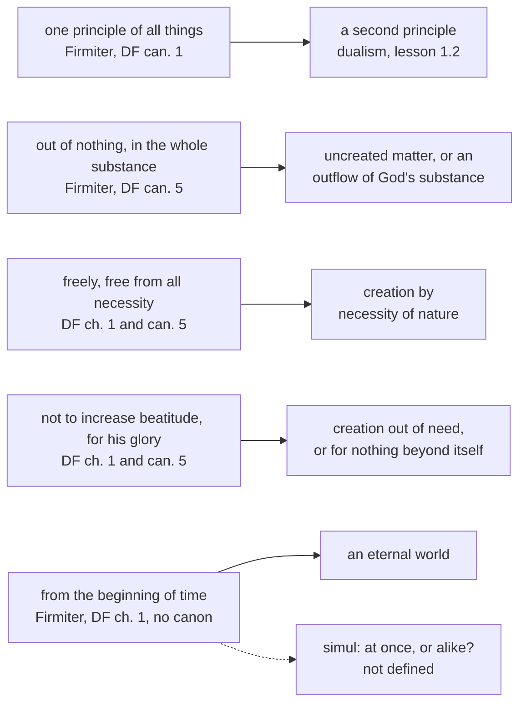

# Creation, Grace & the Last Things · Lesson 1.1: Creation out of nothing

> ⏱ ~15 min · Module 1: Creation · Builds on: [`trinity-and-god` 1.2](../../trinity-and-god/lessons/01-02-the-one-true-god-and-what-reason-can-reach.md), [`thomistic-synthesis` 5.1](../../thomistic-synthesis/lessons/05-01-creation-and-conservation.md) · Unlocks: [1.2](01-02-and-god-saw-that-it-was-good.md), [1.3](01-03-the-angels.md), [1.4](01-04-creation-and-evolution-in-church-teaching.md)

## Why this matters

Ask where the Church defined that the world had a beginning and many will answer "Vatican I". The level is right and the act is wrong: Vatican I's canons on creation never mention time. This lesson states the dogma of creation from its two defining texts, says what each clause excludes, and fixes how the course reads a chapter that no canon stands behind.

## The idea

The manuals split this course into four treatises, *De Deo Creante*, *De Deo Elevante*, *De Gratia* and *De Novissimis* ([the four treatises](../reference.md#the-four-treatises)). Here they run as one story: creation, elevation, fall, grace, glory. The last things belong in it because the first already points at them: Vatican I says the world was made for God's glory, so it was made *for* something, and the [new creation](../reference.md#new-creation) of Module 7 is that end reached. Every later treatise presupposes a world that is God's from the ground up.

That is the doctrine of [creation out of nothing](../reference.md#creation-out-of-nothing). A potter needs clay; God needs no material, no helper, and nothing he lacks. Augustine says of God's works that they "were made from nothing by Thee, not of Thee, nor of any matter not Thine" (*Confessions* XIII.33.48, tr. Pilkington, NPNF1 vol. 1): not out of a material, not out of God's own substance. The metaphysics (creation is not a change; conservation is the same act still given) is [`thomistic-synthesis` 5.1](../../thomistic-synthesis/lessons/05-01-creation-and-conservation.md)'s, assumed here.

The councils add a claim reason cannot reach: this dependent world also *began*. Keep *depends* and *began* apart; the texts fix them differently.

## Source

[*Firmiter*](../reference.md#firmiter), the first constitution of the Fourth Lateran Council (1215), its creation clause, whose subject is the Trinity (lesson's translation of the Latin in Denzinger):

> one principle of all things (*unum universorum principium*), creator of all things visible and invisible, spiritual and corporeal, who by his almighty power made together (*simul*), from the beginning of time (*ab initio temporis*), each creature out of nothing (*utramque de nihilo condidit creaturam*), the spiritual and the corporeal, that is, the angelic and the earthly; and then (*deinde*) the human, as it were common to both, constituted of spirit and body. For the devil and the other demons were indeed created by God good in nature, but became evil of themselves.

Read the shape. *Unum universorum principium*: one source, no second principle for matter, the dualism the council attributed to the [Cathars](../reference.md#cathars) ([1.2](01-02-and-god-saw-that-it-was-good.md) takes it, with the demons' sentence). *Omnium*: nothing outside the act. *De nihilo*: no material. *Ab initio temporis*: no eternal world. *Utramque*, "each": spirit too is made out of nothing. *Simul*, never explained, is Ex 2's. The council's third constitution anathematizes every heresy against the faith set out here.

## The doctrine

1. **One principle, creator of all.** *Firmiter*, above. [*Dei Filius*](../reference.md#dei-filius) (Vatican I, 24 April 1870), canon 1 on God the Creator, condemns anyone who denies "one true God, Creator and Lord of things visible and invisible" (Schaff, *Creeds* vol. 2, Manning's translation). *In words:* there is exactly one source of everything that is not God.

2. **Out of nothing, in the whole substance.** Canon 5 condemns anyone who does not confess that the world and all it contains, "both spiritual and material, have been, in their whole substance, produced by God out of nothing". "Whole substance" shuts the Platonist exit, God as craftsman of uncreated matter: the stuff is made, not only its shape. "Out of" names no material: "it is not made from anything" (ST I q.45 a.1 ad 3). Canons 2–4 (materialism, one substance, emanation) are read in [`trinity-and-god` 1.2](../../trinity-and-god/lessons/01-02-the-one-true-god-and-what-reason-can-reach.md). *In words:* even the matter is God's work.

3. **Freely.** The chapter says God created *liberrimo consilio*, in Schaff's English "with absolute freedom of counsel"; canon 5 condemns saying God created "not by his will, free from all necessity, but by a necessity equal to the necessity whereby he loves himself" ([freedom of creation](../reference.md#freedom-of-creation)). *In words:* God must love himself; he did not have to make the world.

4. **Not out of need, and for his glory.** The chapter: God made the world "not for the increase or acquirement of his own happiness, but to manifest his perfection by the blessings which he bestows on creatures" (*non ad augendam suam beatitudinem, nec ad acquirendam*). Canon 5 condemns denying "that the world was made for the glory of God". The chapter reads the canon: [glory](../reference.md#glory-of-god-as-end) is perfection shown in giving, nothing a God *in se et ex se beatissimus* could gain ([`trinity-and-god` 1.2](../../trinity-and-god/lessons/01-02-the-one-true-god-and-what-reason-can-reach.md)). *In words:* God made the world to give, and the giving is his glory.

5. **From the beginning of time.** *Firmiter*'s *ab initio temporis*, which *Dei Filius* chapter 1 repeats word for word ("from the very first beginning of time"). **No canon of Vatican I contains it**: canon 5 has three clauses, out of nothing, freely, for God's glory, and no fourth ([beginning in time](../reference.md#beginning-in-time)). Aquinas: "By faith alone do we hold, and by no demonstration can it be proved, that the world did not always exist" (ST I q.46 a.2). Bonaventure, on the second book of the *Sentences*, held it demonstrable ([`ancient-medieval-philosophy` 7.3](../../ancient-medieval-philosophy/lessons/07-03-the-five-ways-as-text.md), P3). And "out of nothing" is not "after nothing": eternalists could say the world was made "from nothing, not … after nothing" (q.46 a.2 ad 2). Why no cosmology settles it is [`apologetics-foundations` 4.3](../../apologetics-foundations/lessons/04-03-cosmology-what-a-beginning-would-and-would-not-show.md)'s. *In words:* the world is not eternal, and we know it by faith.

6. **Both orders, then the human.** *Utramque … spiritualem et corporalem*, then *deinde humanam*, "constituted of spirit and body", the datum [2.2](02-02-body-and-soul-one-substance.md) builds on. *In words:* angels and matter are creatures alike, and man is where both meet.

**Genesis, read as the Church reads it.** The text is [`old-testament` 2.1](../../old-testament/lessons/02-01-two-accounts-of-creation.md)'s. From its first verse the Church draws that the eternal God gave a beginning to all that is not himself, that he alone creates, and that everything depends on him (CCC 290, paraphrased). But Genesis 1:1–2 does not itself say "out of nothing"; Wisdom 11:17 [DR 11:18] has the world made "of matter without form" (DR); and whether 2 Maccabees 7:28 means absolute nothing is disputed ([`old-testament` 6.2](../../old-testament/lessons/06-02-tobit-judith-baruch-and-the-maccabees.md)). The doctrine rests on the whole canon read in the Church (John 1:3; Romans 4:17; Hebrews 11:3) and on the councils.

**Said plainly.** On Gerhard May's account (1978, cited in OT 6.2), the technical formula took shape among second-century Christian writers. Vatican I, the council usually cited for the beginning of time, attached no anathema to it. The Church's common doctor held that the beginning, though true, cannot be proved.

**The rule for chapter text** ([chapters and canons](../reference.md#chapters-and-canons)). *Dei Filius*'s canons carry its anathemas: they are where it defines. A chapter clause no canon repeats is the council's own solemn teaching: **at least rung 3** on that act alone, and **rung 1** when you can name another act proposing the same content as revealed (an earlier definition, or the ordinary universal magisterium). Default-down (can. 749 §3) keeps the course from leaning on the chapter's "believes and confesses". Trent's chapters get the same rule. So the beginning in time is rung 1 through *Firmiter*, and `trinity-and-god` 1.2's rung 1 for the attributes stands because *Firmiter* professes them too.

| Defined or taught (with level) | A school's explanation or an opinion (no magisterial level) |
|---|---|
| All things made out of nothing, in their whole substance: **rung 1** | Creation as a relation of dependence, not a change (ST I q.45 a.2 ad 2, a.3): theology |
| The world began, *ab initio temporis*: **rung 1** | That the beginning cannot be demonstrated (Aquinas) or can (Bonaventure): **rung 5** |
| Both orders made *simul* out of nothing: **rung 1** for "both, out of nothing" | *Simul* as "at once", angels made with the world: undefined, common teaching, **rung 4** ([1.3](01-03-the-angels.md)) |
| God created freely, free from all necessity: **rung 1** | How a free act squares with simplicity (ST I q.19 a.3; [`philosophy-of-religion` 1.4](../../philosophy-of-religion/lessons/01-04-eternity-immutability-and-simplicity.md)) |
| For God's glory: **rung 1**; not out of need: **at least rung 3** | Glory as goodness shown and shared, Bonaventure's gloss (quoted in CCC 293) |

**Mark the levels** ([the ladder](../../fundamental-theology/lessons/04-04-the-ladder-of-doctrinal-authority.md); [levels of authority](../reference.md#levels-of-authority)). **Rung 1**, by solemn conciliar judgment: one principle of all things (*Firmiter*; DF can. 1); creation out of nothing of both orders, in their whole substance (*Firmiter*; DF can. 5); freely and for God's glory (DF can. 5); the beginning in time (*Firmiter*, restated in DF ch. 1). **At least rung 3**: that God created not to increase or acquire his beatitude (DF ch. 1 alone); its denial would also contradict *Firmiter*'s *incommutabilis*, which is the argument for more. **Rung 5**: whether the beginning is demonstrable. *Simul*'s sense is undefined; the "at once" reading is common teaching (rung 4, [1.3](01-03-the-angels.md)). **No magisterial level**: Aquinas's analysis and every author cited. The Catechism (CCC 290, 296, 327) locates these claims and fixes none.

## The map

Each predicate shuts out a different error; the dashed edge is the word the councils left open.

## Worked examples

**Ex 1 (clean): run the clauses on Plotinus.** [`ancient-medieval-philosophy` 4.4](../../ancient-medieval-philosophy/lessons/04-04-plotinus-the-one-intellect-and-soul.md) gives the procession from the One: not by choice but as light from the sun (*Enneads* V.1.6), from a source "lacking nothing" (V.2.1), with no "generation in time" (V.1.6). *One principle*, *not out of need* and *no prior material* all pass (on AMP 4.4's reading even matter comes at the procession's end). *Freely:* fails, since proceeding as necessarily as light is what canon 5's "free from all necessity" rules out. *From the beginning of time:* fails. A monist, generous, material-free picture is not yet creation, which is why *Dei Filius* needs both *non ad augendam* and *liberrimo consilio*: Plotinus would sign the first and refuse the second.

**Ex 2 (strain): what does *simul* mean?** *Firmiter* says God made both creatures *simul ab initio temporis*. Read *simul* as **at once**: angels and world were created together, no angel before the world. Read it as **alike**: both were made the same way, out of nothing, in whatever order. Its scriptural ancestor is the Vulgate's Sirach 18:1, *creavit omnia simul*, "created all things together" (DR), where the Greek has *koinē*, "in common". The first reading has weighty opponents: Aquinas reports that the Greek Fathers, "all of whom", held the angels created before the corporeal world; he judges simultaneity "more probable" and the contrary "not to be deemed erroneous" (ST I q.61 a.3 and ad 1). Translations split too: Schaff's English of *Dei Filius* has no word for *simul* ("from the very first beginning of time"), while the Catechism's says "at once" (CCC 327). Where the doctrine stops: it fixes that both orders are made out of nothing and are not eternal, not whether the angels came first; no translator's choice defines a sense. [1.3](01-03-the-angels.md) levels the claim that the angels were created with the world.

## Watch out

- **You might think Vatican I defined the beginning of time** (siblings write "ch. 1 with its canons"). The rung is 1, but the act is *Firmiter*; canon 5 does not say it.
- **You might think *simul* defines simultaneous creation, because the Catechism's English says "at once".** A translation picks a sense; the council did not. Promoting a common opinion (rung 4) to dogma is the same error as demoting *de nihilo*.
- **You might think "emanation" is the condemned word.** Aquinas calls creation "the emanation of all being from the universal cause" (ST I q.45 a.1); canon 4 condemns things having "emanated from the divine substance" ([emanation](../reference.md#emanation)). The difference is Augustine's preposition: *by* God, not *of* God.

## One-liner

> All that is not God has its whole being from his free, unneeding act, and the world began: both defined; when the angels were made, and whether reason can prove the beginning, are not.

## Problems

**P1 (🟢)** *(Exegetical)* **Diagnose.** Three slides from an adult-formation evening at St Hilda's, Breckmoor, **invented** for this problem:

> (1) "Genesis 1:2 starts with a formless void that is already there, and Wisdom says God made the world 'of matter without form'. So the God of the Bible shapes existing stuff; 'creation out of nothing' was invented later by philosophers."
>
> (2) "Anyway, 'out of nothing' can't be meant literally, since nothing isn't a material. It's a pious way of saying 'out of almost nothing'."
>
> (3) "Only matter was made out of nothing. Spirit is different: the angels are God's own spirit, parted off like drops from the sea."

For each slide, name the error and give the correction with the text that makes it; for slide (1), also say what true thing it is reaching for. **Two sentences per slide (three for slide 1).**

**P2 (🟡)** *(Exegetical)* **Reconstruct.** Theophilus of Antioch, *To Autolycus* II.4 (late second century; tr. Marcus Dods, *Ante-Nicene Fathers* vol. 2):

> But Plato and those of his school acknowledge indeed that God is uncreated, and the Father and Maker of all things; but then they maintain that matter as well as God is uncreated, and aver that it is coeval with God. But if God is uncreated and matter uncreated, God is no longer, according to the Platonists, the Creator of all things, nor, so far as their opinions hold, is the monarchy of God established. And further, as God, because He is uncreated, is also unalterable; so if matter, too, were uncreated, it also would be unalterable, and equal to God; for that which is created is mutable and alterable, but that which is uncreated is immutable and unalterable.

(a) The passage holds two arguments against uncreated matter. Put each in numbered premises (P1, P2, … ∴ C), supplying any premise left unstated, and name the premise of the second that the passage asserts without support.

(b) Suppose both arguments sound. Do they also exclude a world that God made out of nothing and from eternity? Answer with the reason, using ST I q.46 a.2. **Two sentences for (b).**

**P3 (🔴)** *(Exegetical)* **Find the crux.** Two hosts of the St Hilda's, Breckmoor, parish podcast, **invented** for this problem:

> **Kobina:** "That the world had a beginning is defined dogma. Vatican I put *ab initio temporis* into a dogmatic constitution, so a Catholic must believe it as revealed."
>
> **Marguerite:** "It isn't defined. Vatican I defines in its canons, and canon 5 on creation says nothing about time; the chapters only expound. So it's authentic teaching at rung 3, and a Catholic cosmologist may hold, with due respect, that the universe had no beginning."

(a) Both hosts make the same assumption about where the level must come from. Name it, say why it fails, and say what settles the level.

(b) Say what each host gets right and wrong, including what Marguerite's cosmologist may and may not hold.

**150 words or fewer in all.**

Solutions

**P1** *(Exegetical)*

**Must hit, strict:**

- **(1)** The doctrine is not read off one verse: the Church holds it from the whole canon read in the Church (John 1:3; Romans 4:17; Hebrews 11:3; 2 Maccabees 7:28 as a witness) and defined it in 1215, *Firmiter*'s *de nihilo*, **rung 1**. *Dei Filius* can. 5's "in their whole substance" makes even formless matter God's work, and Wisdom 11:17 [DR 11:18] says the world was made *of* such matter, not that the matter was uncreated (Augustine: "matter at the same time created by Thee", *Confessions* XIII.33.48). The true thing: Genesis 1:1–2 alone does not state "out of nothing", 2 Maccabees 7:28's sense is disputed, and the technical formula took shape in the second century (`old-testament` 6.2), so "later" is right about the formula.
- **(2)** "Out of nothing" is meant strictly, as a negation of any material: "it is not made from anything" (ST I q.45 a.1 ad 3). "Out of almost nothing" puts a material back, which is exactly what *de nihilo* and canon 5's "whole substance" deny (**rung 1**).
- **(3)** *Firmiter* says God made *each* creature, "the spiritual and the corporeal, that is, the angelic and the earthly", out of nothing (**rung 1**). *Dei Filius* can. 4 condemns saying that finite things, "both corporeal and spiritual, or at least spiritual, have emanated from the divine substance", which names the slide's error ("or at least spiritual"): the angels are made *by* God, not *of* him.

**Wrong turns:** correcting (1) by claiming Genesis 1:1 itself teaches creation out of nothing, which overclaims the text; dating the doctrine's definition to Vatican I rather than Lateran IV; in (2), citing Pilkington's "Thou hast made the matter indeed of almost nothing" (*Confessions* XIII.33.48) as support, when Augustine's Latin says *de omnino nihilo*, "from altogether nothing"; in (3), treating Aquinas's word "emanation" as the error, or correcting from the Catechism alone, which locates teaching but fixes no level.

**Model answer:** (1) The doctrine rests on the whole canon read in the Church and was defined at Lateran IV in 1215 (*de nihilo*, rung 1), with *Dei Filius* can. 5 adding that things are made "in their whole substance", so even formless matter is created. Wisdom 11:17 says the world was made of formless matter, not that the matter was uncreated. The slide is right that Genesis 1:1–2 alone does not say "out of nothing" and that the formula itself is second-century. (2) "Out of nothing" is a strict negation, "not made from anything" (ST I q.45 a.1 ad 3), not a figure. "Almost nothing" brings back the material that *de nihilo* and canon 5 exclude. (3) *Firmiter* has God make "each" creature, spiritual and corporeal, out of nothing (rung 1). *Dei Filius* can. 4 condemns saying that finite things, "or at least spiritual" ones, emanated from the divine substance.

---

**P2** *(Exegetical)*

**Accept:** any wording of the premises that keeps the logical shape below; the implicit premises may be phrased differently.

**Must hit, strict (a):**

- **The first argument (creator of all).** P1: if matter is uncreated, something exists that God did not make. P2: if something exists that God did not make, God is not the Creator of all things, and his sole rule (the "monarchy") fails. P3: the Platonists themselves call God "the Father and Maker of all things". ∴ C: by their own premise, matter is not uncreated. The argument convicts the Platonists of inconsistency.
- **The second argument (equality).** P1: whatever is uncreated is unalterable, and whatever is created is alterable. P2: God is unalterable because uncreated. P3: so uncreated matter would be unalterable, and equal to God. P4 (unstated): nothing is equal to God. ∴ C: matter is not uncreated.
- **The unsupported premise:** P1 of the second argument, "that which is uncreated is immutable and unalterable". It is asserted with "for" and never argued, and everything rests on it. Also credit naming P4 as unstated.

**Must hit, strict (b):**

- **No.** The conclusion of both is that matter is *created*, not that it *began*. A world made by God out of nothing from eternity is still created, still God's alone, and still mutable. Aquinas: those who held the world eternal "would say that the world was made by God from nothing, not that it was made after nothing" (q.46 a.2 ad 2). The ad 5 adds that even an always-existing world would not equal God in eternity, since it has succession and God does not.
- The beginning is a separate clause, *ab initio temporis*, held by faith (q.46 a.2).

**Wrong turns:** collapsing the two arguments into one; making "matter is changeable" a premise, when the second argument runs the other way (uncreated would mean *un*changeable); in (b), answering yes because "out of nothing" seems to imply "after nothing", which is the confusion ad 2 removes.

**Model answer:** (a) First: P1 if matter is uncreated, something exists that God did not make; P2 then God is not the Creator of all, and his monarchy fails; P3 the Platonists call God "Maker of all things"; ∴ C on their own terms matter is created. Second: P1 whatever is uncreated is unalterable; P2 God is unalterable because uncreated; P3 so uncreated matter would be unalterable, equal to God; P4 (unstated) nothing equals God; ∴ C matter is created. The passage asserts P1 of the second argument without support. (b) No: both conclude only that matter is created, and a world made out of nothing from eternity is created, dependent and mutable. Aquinas notes that the eternalists said the world was made "from nothing, not … after nothing" (q.46 a.2 ad 2), so the beginning needs its own warrant, which is faith.

---

**P3** *(Exegetical)*

**Must hit, strict (a):**

- **The shared assumption:** *Dei Filius* is the act that fixes the level, so the answer depends on what its chapter can carry.
- **Why it fails:** an earlier act states it. *Firmiter* (Lateran IV, 1215), an ecumenical council's profession of faith, says God made all things *ab initio temporis*, and the council's third constitution anathematizes every heresy against that faith. That settles it at **rung 1**; *Dei Filius* ch. 1 restates it.

**Must hit, strict (b):**

- **Kobina:** right that it is rung 1; wrong about the act, since no canon of Vatican I mentions time and the chapter alone, on the course's rule, gives at least rung 3.
- **Marguerite:** right that canon 5 has no temporal clause and that the chapter alone is not a definition; wrong to conclude rung 3, since she never looked behind *Dei Filius*.
- **The cosmologist** may work with beginningless models as physics, and may hold that neither a beginning nor its absence can be demonstrated (Aquinas, q.46 a.2; that question is rung 5). He may not hold as true that the world had no beginning. "With due respect" is the language of rung 3 and does not apply.

**Wrong turns:** siding with Kobina because "dogmatic constitution" sounds definitive (the genre does not fix the level); siding with Marguerite because "chapters only expound"; making the indemonstrability of the beginning the defined claim; citing CCC 338 as the act.

**Model answer:** (a) Both assume *Dei Filius* must fix the level. It need not: *Firmiter* (Lateran IV, 1215), a conciliar profession of faith guarded by the council's anathema on heresies against it, says God created *ab initio temporis*, so the beginning is rung 1, and Vatican I's chapter only restates it. (b) Kobina has the right rung and the wrong act: no canon of Vatican I mentions time, and its chapter alone would give at least rung 3. Marguerite reads canon 5 correctly but stops at Vatican I. Her cosmologist may use beginningless models and may hold, with Aquinas, that the beginning cannot be demonstrated, but may not hold that the world in fact had no beginning; "due respect" is rung-3 language and misplaces the claim.

## Connections

- **Backward:** [`trinity-and-god` 1.2](../../trinity-and-god/lessons/01-02-the-one-true-god-and-what-reason-can-reach.md) read the opening confession of *Dei Filius* ch. 1, *Firmiter*'s Trinitarian clause and the canons against one substance and emanation; this lesson read the creation sentences that follow. [`thomistic-synthesis` 5.1](../../thomistic-synthesis/lessons/05-01-creation-and-conservation.md) gave the metaphysics of creation and conservation. The ladder is [`fundamental-theology` 4.4](../../fundamental-theology/lessons/04-04-the-ladder-of-doctrinal-authority.md). Plotinus is [`ancient-medieval-philosophy` 4.4](../../ancient-medieval-philosophy/lessons/04-04-plotinus-the-one-intellect-and-soul.md) and Bonaventure's argument its [7.3](../../ancient-medieval-philosophy/lessons/07-03-the-five-ways-as-text.md); Genesis as text is [`old-testament` 2.1](../../old-testament/lessons/02-01-two-accounts-of-creation.md).
- **Forward:** [1.2](01-02-and-god-saw-that-it-was-good.md) takes *Firmiter*'s next sentence, the demons created good, and the goodness of all God made. [1.3](01-03-the-angels.md) levels what the council says of the angelic creature, *simul* included. [1.4](01-04-creation-and-evolution-in-church-teaching.md) asks what this doctrine says about evolution. A world "made for the glory of God" reaches its end in [7.2](07-02-the-parousia-the-last-judgment-and-the-new-creation.md)'s new creation.
- **Sideways:** creation out of nothing and the resurrection of the body are one argument in 2 Maccabees 7, which runs from the God who made all things from nothing to the God who will give the martyrs back ([`old-testament` 6.2](../../old-testament/lessons/06-02-tobit-judith-baruch-and-the-maccabees.md); CCC 297–298); [7.1](07-01-the-resurrection-of-the-body.md) takes the resurrection. The physics is [`apologetics-foundations` 4.3](../../apologetics-foundations/lessons/04-03-cosmology-what-a-beginning-would-and-would-not-show.md), the kalam is [`philosophy-of-religion` 2.5](../../philosophy-of-religion/lessons/02-05-cosmological-arguments-the-kalam.md), and whether a free creation squares with divine simplicity is [`philosophy-of-religion` 1.4](../../philosophy-of-religion/lessons/01-04-eternity-immutability-and-simplicity.md)'s modal-collapse question.
