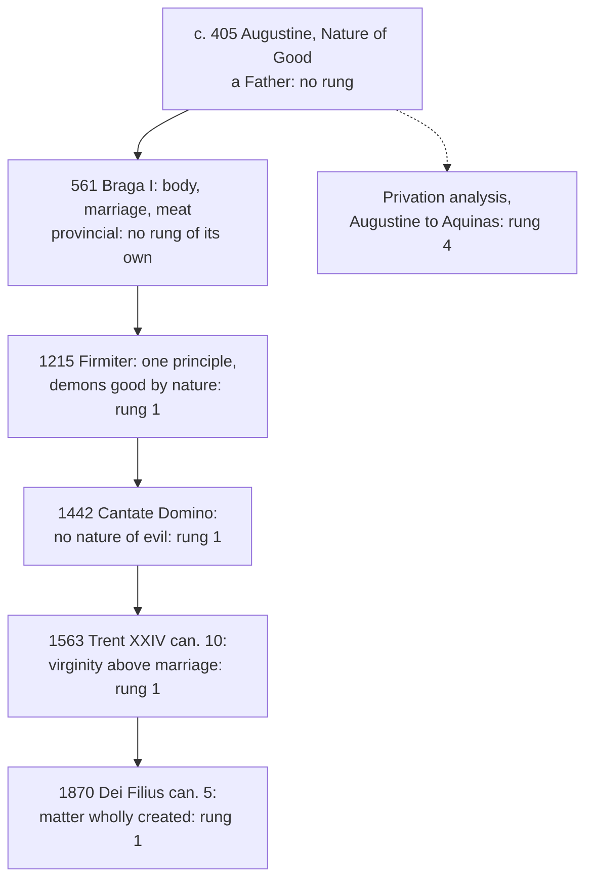

# Creation, Grace & the Last Things · Lesson 1.2: "And God saw that it was good"

> ⏱ ~15 min · Module 1: Creation · Builds on: [1.1](01-01-creation-out-of-nothing.md), [`thomistic-synthesis` 2.4](../../thomistic-synthesis/lessons/02-04-the-transcendentals.md) · Unlocks: [1.3](01-03-the-angels.md), [7.2](07-02-the-parousia-the-last-judgment-and-the-new-creation.md)

## Why this matters

Genesis says it seven times before it mentions sin. Councils have repeated it against opponents who were no fools: the dualists had the shortest answer ever given to the problem of evil, and ascetics who shamed lax Christians. This lesson says what the doctrine commits a Catholic to, why dualism was condemned rather than tolerated, and where doctrine stops and the schools' explanation of evil begins.

## The idea

In the Douay–Rheims, "God saw that it was good" falls six times: on light, dry land and seas, plants, the lights, sea creatures and birds, and land animals (Gen 1:4, 10, 12, 18, 21, 25). The seventh covers everything: "God saw all the things that he had made, and they were very good" (1:31). Day two has none in the Hebrew, the Vulgate or the Douay (the Septuagint adds one at 1:8), and man gets no verdict of his own. The text as text is [`old-testament` 2.1](../../old-testament/lessons/02-01-two-accounts-of-creation.md)'s.

The Church draws from it a claim about **what things are**. Picture a wrong note in the Wexmoor choir. A dualist posits a second composer who writes discords. The Catholic says there is one composer and all he wrote is good: the wrong note is a good sound out of its place, and nobody composed it.

Keep two claims apart. **The doctrine** ([goodness of creation](../reference.md#goodness-of-creation)): one source of everything, and nothing from it evil in what it is, matter, body, sex and food included, even the devil's nature. **The grammar** that explains it: evil is a lack in something good ([evil as privation](../reference.md#evil-as-privation)), resting on the convertibility of good and being, assumed from [`thomistic-synthesis` 2.4](../../thomistic-synthesis/lessons/02-04-the-transcendentals.md). The first is defined; the second is not.

Why was [dualism](../reference.md#dualism) condemned rather than tolerated? Schools dispute how to explain a doctrine they share; dualism denies the Creed's first article. Nor was it idle: 1 Timothy 4:3–4 names its practices, "Forbidding to marry, to abstain from meats", and answers, "every creature of God is good" (DR). It recurs, down to modern talk of the body as a cage.

## Source

Augustine, *Concerning the Nature of Good, Against the Manichaeans*, chs. 1 and 4 (about 405; tr. A. H. Newman, NPNF1 vol. 4, 1887):

> The highest good, than which there is no higher, is God, and consequently He is unchangeable good … All other good things are only from Him, not of Him. For what is of Him, is Himself. And consequently if He alone is unchangeable, all things that He has made, because He has made them out of nothing, are changeable. … every nature, so far as it is nature, is good … When accordingly it is inquired, whence is evil, it must first be inquired, what is evil, which is nothing else than corruption, either of the measure, or the form, or the order, that belong to nature. Nature therefore which has been corrupted, is called evil, for assuredly when incorrupt it is good; but even when corrupt, so far as it is nature it is good, so far as it is corrupted it is evil.

Read its shape. "From Him, not of Him": creatures are made, not portions of God. Good because from the highest good, changeable because made from nothing: both traits come from the two ends of creation ([1.1](01-01-creation-out-of-nothing.md)). Then *what* evil is before *whence* it comes. The answer makes evil parasitic, a corruption *of* a nature, and the double "so far as" puts good and evil in one thing under two respects. Florence will profess the first half and leave the second to the theologians.

## In their own words

Faustus of Milevis, a Manichaean bishop, put the case at its strongest (*Reply to Faustus* XXI.1, tr. Stothert, NPNF1 vol. 4). Not two gods: "It is true, we believe in two principles; but one we call God, and the other Hyle, or, to use common popular language, the devil." Two principles are no more two gods than health and sickness are two healths. The gain is God's innocence: "all the power of evil" belongs to Hyle, "all the power of good to God". No evil comes from the good God, so no theodicy is needed.

The ethic follows. Faustus has left family and money, and asks whether his poverty and meekness are not the gospel itself (V.1). He eats no meat: "I think all flesh unclean" (VI.1).

## The doctrine

1. **One principle, and no evil nature.** Lateran IV's *[Firmiter](../reference.md#firmiter)* (1215, const. 1) confesses "one principle of all things (*unum universorum principium*), creator of all things visible and invisible, spiritual and corporeal" (lesson's translation); const. 3 anathematizes every heresy against that faith. Florence's *Cantate Domino*, the [Decree for the Jacobites](../reference.md#decree-for-the-jacobites) (4 February 1442), says God made all creatures "good, because made by the highest good, but changeable, because made from nothing", and "asserts there is no nature of evil, since every nature, so far as it is a nature, is good" (lesson's translation; *nullamque mali asserit esse naturam*). Its clauses follow Augustine's first chapter. It anathematizes the [Manichees](../reference.md#manichaeism)' two first principles. Vatican I never calls creatures good, but [*Dei Filius*](../reference.md#dei-filius) can. 5 (1870) has all things "spiritual and material" produced "in their whole substance" out of nothing (Schaff), leaving a dualist no uncreated stuff. *In words:* one source of everything, and nothing from it bad in what it is.

2. **The demons: good by nature, evil by their own doing.** *Firmiter* continues: *Diabolus enim et alii daemones a Deo quidem natura creati sunt boni, sed ipsi per se facti sunt mali*, "For the devil and the other demons were created by God good by nature, but they became evil through themselves" (lesson's translation). Braga I (561) had condemned making the devil "the principle and substance of evil" (can. 7, lesson's translation). How they fell is [1.3](01-03-the-angels.md)'s ([fall of the angels](../reference.md#fall-of-the-angels)). *In words:* the worst creature there is was made good; his evil is his own doing.

3. **Matter, body, marriage, food.** Braga's canons against the [Priscillianists](../reference.md#priscillianists) condemn calling the body's formation the devil's work (can. 12), condemning marriage (can. 11), and holding meat unclean (can. 14), but this last only of one who abstains "not for the affliction of his body, but as thinking it uncleanness" (lesson's translation; *quasi immunditiam putans*). *Firmiter* closes by professing that the married, not only virgins, can reach eternal beatitude. Florence lets much be given up "for the exercise of virtue" (lesson's translation), and Trent defines virginity better than marriage (Session XXIV, can. 10, 1563). GS 14 calls the body "good and honorable"; GS 49 calls conjugal acts "noble and worthy". *In words:* the Church ranks goods and asks you to give some up; she never lets you call one evil ([renunciation, not contempt](../reference.md#renunciation-not-contempt)).

4. **Privation: the grammar, not the dogma.** Augustine's corruption of measure, form and order and Aquinas's absence of a due good (ST I q.48 aa.1, 3; [`thomistic-synthesis` 2.4](../../thomistic-synthesis/lessons/02-04-the-transcendentals.md)) say what evil *is*. No act defines that; Florence's "no nature of evil" is only its negative half. Why God permits privations is [`philosophy-of-religion` 4.1](../../philosophy-of-religion/lessons/04-01-the-logical-problem-of-evil.md)–[4.3](../../philosophy-of-religion/lessons/04-03-theodicies.md)'s; how he governs through defectible causes, [`thomistic-synthesis` 5.2](../../thomistic-synthesis/lessons/05-02-providence-and-secondary-causes.md)'s. *In words:* the Church binds you to "no evil nature"; the schools say what evil then is.

**Said plainly.** The dualism condemned in 1215 was fought with a crusade and inquisitors, and historians dispute whether the dualist church its prosecutors described existed ([`church-history` 5.3](../../church-history/lessons/05-03-heresy-inquisition-and-the-jews.md)). *Firmiter* names no one; "against the Albigensians" is a heading Denzinger's editors added ([Cathars](../reference.md#cathars)).

| Defined or taught (with level) | A school's explanation or an opinion (no magisterial level) |
|---|---|
| One principle; no nature of evil: **rung 1** | Evil as the privation of a due good (Augustine; ST I q.48): common teaching, **rung 4** |
| The demons good by nature, evil through themselves: **rung 1** | Why and when they fell: [1.3](01-03-the-angels.md) |
| Every creature good, matter and body included: **rung 1** | Measure, form and order; spirit ranked above body: a Father's analysis |
| The married can reach beatitude, and virginity is better: **rung 1**; conjugal acts "noble and worthy" (GS 49): **rung 3** | Augustine's reserve about intercourse not sought for offspring: a Father's view |
| Human death came through sin (Trent V can. 1): **rung 1**, read in [3.1](03-01-original-justice-and-the-fall.md) | Aquinas: Wis 1:13, "God made not death" (DR), means human death (ST I-II q.85 a.6), and sin changed no animal's nature, so the lion would not "then have lived on herbs" (I q.96 a.1 ad 2); a cosmic fall read from Rom 8:20–22: **no act**; open |

**Mark the levels** ([the ladder](../../fundamental-theology/lessons/04-04-the-ladder-of-doctrinal-authority.md); [levels of authority](../reference.md#levels-of-authority)). **Rung 1:** one principle, no nature of evil, every creature good, the demons' natural goodness and the married clause (*Firmiter*, sealed by const. 3's anathema; Florence, with its anathema); matter wholly created (*Dei Filius* can. 5, silent on goodness); virginity's precedence (Trent XXIV can. 10). Braga I, a provincial council, has **no rung of its own**; its canons stand at rung 1 through those acts. GS 14 restates a rung-1 claim in a **rung-3** act; GS 49 is **rung 3**. The privation analysis is **rung 4**. Augustine and Faustus as authors, and the Cathar question as history, carry **no magisterial level**.

## The timeline

Read down for the acts; the dashed box explains and binds no one.

## Worked examples

**Ex 1 (clean): the question box.** Invented: a card in the confirmation class's question box at Our Lady of the Fields, Wexmoor, asks, "Is a demon better than a dog?" *As a nature*, the demon is a spirit created good (*Firmiter*, **rung 1**), and for Augustine a rational spirit "even corrupted through an evil will is better than an irrational though incorrupt" one (*Nature of Good* 5, a Father's ranking). *As an agent*, the demon is evil and the dog cannot be. Better as a nature, worse as a will: the Source's double "so far as".

**Ex 2 (strain): who is the Manichee?** Invented: the parish's Lent reading group sets Faustus beside Augustine's *Morals of the Catholic Church* 20.37 (388, tr. Stothert), where all sensible things "are to be despised,--while, however, they are to be used as this life requires." Both renounce; Braga can. 14 asks why. Faustus abstains because flesh is unclean, a verdict on a nature: condemned. Augustine's "despised" orders love (use the world, enjoy God), and *Nature of Good* 36 keeps the nature good: "it is evil to use amiss that which is good." He passes.

The strain: the doctrine fixes a floor, no evil nature, but not how warmly devotion must speak of bodily goods. Augustine counted intercourse not sought for offspring a venial sin ([`moral-theology` 6.2](../../moral-theology/lessons/06-02-humanae-vitae-the-argument.md)), and that reserve was never condemned. In 1679 the Holy Office condemned, as at least scandalous, the laxist claim that the marital act done for pleasure alone is free of all venial fault (**rung 3**, a global censure: [`moral-theology` 4.1](../../moral-theology/lessons/04-01-casuistry-and-the-probabilism-controversy.md)). GS 49 calls conjugal acts "noble and worthy". None of the three calls a nature evil; they differ over how a good is ordered. There the doctrine stops: it settles what things are, and leaves the tone of devotion to prudence.

## Watch out

- **You might think "evil is a privation" is dogma, or a mere opinion.** Florence defines only its negative half (**rung 1**). The positive analysis is common teaching (**rung 4**): imposed by no act, yet not one free option among equals.
- **You might think fasting and celibacy deny creation's goodness.** Renouncing a good for a better presupposes it is good; Braga condemns only abstaining *as* from something unclean.
- **You might think *Firmiter* stands or falls with the historians' Cathars.** It names no one; the level is the act's, not the target's.

## One-liner

> Nothing God made is evil in what it is, not matter, not the body, not even the devil's nature: that is defined; "evil is a lack" is how the schools explain it.

## Problems

**P1 (🟢)** *(Exegetical)* **Close reading.** Augustine, *Concerning the Nature of Good* 18 (tr. Newman, NPNF1 vol. 4):

> For neither is that material, which the ancients called Hyle, to be called an evil. I do not say that which Manichæus … denominates Hyle, namely, the former of corporeal beings; whence it is rightly said to him, that he introduces another god. For nobody can form and create corporeal beings but God alone … But by Hyle I mean a certain material absolutely formless and without quality, whence those qualities that we perceive are formed, as the ancients said. … For this has also a capacity of forms … Hence if form is some good, … even the capacity of form is undoubtedly something good. … And because every good is from God, no one ought to doubt that even matter, if there is any, has its existence from God alone.

(a) Augustine uses "Hyle" for two different things. Name each, say what he says of each, and quote the words that show it.

(b) How does he argue that formless matter is good? What does "if there is any" show about which part of the passage the doctrine of this lesson needs?

**Two sentences per part.**

**P2 (🟡)** *(Exegetical)* **Diagnose.** Four slides from a catechist's presentation for an adult formation evening at Our Lady of the Fields, Wexmoor (invented, written for this problem):

> (1) "Everything God made is good, so evil is just an absence: literally nothing. And nothing can't hurt you."
>
> (2) "The Church made this official at the First Vatican Council, in 1870."
>
> (3) "That is why the old Lenten fasts and vows of celibacy have had their day: giving up good things insults the Creator."
>
> (4) "Genesis makes the point on every day of creation: God calls each day's work good, and gives the man and woman a verdict of their own."

Correct each slide, naming the act or text that settles it. **Two sentences per slide.**

**P3 (🔴)** *(Exegetical)* **Assign the level.** Place each claim on the ladder, say that it carries no magisterial level, or say which defined truth it contradicts; name the act that fixes it.

(a) There is no nature of evil.

(b) Evil is the privation of a good that ought to be present.

(c) The devil and the other demons are evil by nature.

(d) Married people, and not only virgins and the continent, can attain eternal beatitude.

(e) The human body is good and worthy of honour, because God made it and will raise it at the last day.

(f) The Cathars of Languedoc formed an organized dualist church.

**One sentence each.**

Solutions

**P1** *(Exegetical)*

**Must hit, strict (a):**

- **Mani's Hyle** is "the former of corporeal beings", an active maker of bodies. Augustine rejects it because only God can "form and create corporeal beings", so calling it Hyle "introduces another god": it is the second principle.
- **The ancients' hyle** is "a certain material absolutely formless and without quality", from which perceived qualities are formed. Augustine says it is not "to be called an evil" and that it exists, if at all, "from God alone".

**Must hit, strict (b):**

- **The argument:** formless matter has "a capacity of forms"; form is a good, so the capacity for a good is a good; every good is from God; so matter is from God.
- **"If there is any"** shows that Augustine does not stake the point on prime matter's existence, which is a philosophical thesis. The doctrine needs only that whatever matter there is comes wholly from God and is good. *Dei Filius* can. 5 (all things material produced "in their whole substance" out of nothing) and *Firmiter*'s "creator of all things … corporeal" bind that; the theory of prime matter stays with the philosophers.

**Wrong turns:** reading the two Hyles as one, so that Augustine seems to concede an evil matter; treating "if there is any" as doubt about whether bodies exist; giving hylomorphism a doctrinal level because Augustine uses it here.

**Model answer:**

(a) Mani's Hyle is "the former of corporeal beings", an active maker of bodies, and Augustine rejects it because only God can "form and create corporeal beings", so positing it "introduces another god". The ancients' hyle is "material absolutely formless and without quality", and of that he says it is not "to be called an evil" and has its existence "from God alone".

(b) Formless matter has "a capacity of forms", and since form is a good the capacity for it is a good, which must come from God, the source of every good. "If there is any" shows he does not rest the point on prime matter's existence: the doctrine needs only that all matter, whatever it is, is wholly God's and good (*Dei Filius* can. 5; *Firmiter*), and prime matter belongs to the philosophers.

---

**P2** *(Exegetical)*

**Must hit, strict:**

- **(1)** A privation is not nothing at all. It is a real lack in a real thing, and what is corrupted is evil "so far as it is corrupted" (*Nature of Good* 4); pain itself exists only in good natures (ch. 20). The defined claim is only that no nature is evil (**rung 1**); "evil is an absence" is the schools' account (**rung 4**), and it never makes harm unreal.
- **(2)** Wrong act. The goodness of creation is professed at Lateran IV (*Firmiter*, 1215) and stated outright at Florence (*Cantate Domino*, 1442), both **rung 1**, with Braga (561) earlier. Vatican I never says creatures are good; its can. 5 excludes uncreated matter.
- **(3)** Renunciation presupposes the good renounced. Braga can. 14 condemns only abstaining from meat "as thinking it uncleanness", not for discipline; Florence allows much to be given up "for the exercise of virtue"; and Trent XXIV can. 10 defines that virginity is better than marriage (**rung 1**), a ranking of goods, not a condemnation of one.
- **(4)** In the Hebrew, the Vulgate and the Douay–Rheims day two has no verdict (1:8); the Septuagint supplies one. Man and woman get no verdict of their own: the "very good" of 1:31 is said over "all the things that he had made". (The Catechism rounds the same way, CCC 339; a compendium's summary does not change what the text says.)

**Wrong turns:** correcting (1) by saying evil is a positive force, which swaps one error for the dualist one; correcting (2) with "Vatican II" or "the Catechism"; correcting (3) by saying the Church *prefers* renunciation to the goods renounced *because* they are lesser evils; in (4), counting the Septuagint's verse as the Hebrew's.

**Model answer:**

(1) Evil is a privation, a real lack in something good, not "nothing at all": a nature is evil "so far as it is corrupted", and pain exists only in good natures. What is defined is only that no nature is evil (rung 1); the privation account is common teaching (rung 4), and it never makes harm unreal.

(2) The acts are Lateran IV's *Firmiter* (1215) and Florence's *Cantate Domino* (1442), both rung 1, after the provincial Braga (561). Vatican I never says creatures are good, though its can. 5 rules out uncreated matter.

(3) Giving up a good for a better one assumes it is good: Braga can. 14 condemns only abstaining "as thinking it uncleanness", and Florence allows much to be given up for virtue and discipline. Trent XXIV can. 10 even defines virginity above marriage (rung 1), a ranking of goods, not a condemnation.

(4) Day two has no verdict in the Hebrew, Vulgate or Douay (1:8); only the Greek adds one. Man and woman get no verdict of their own, since the "very good" of 1:31 covers everything God made.

---

**P3** *(Exegetical)*

**Must hit, strict:**

- **(a) Rung 1.** Florence, *Cantate Domino* (1442), asserts it outright, anathematizing two first principles, and Lateran IV's *Firmiter* (1215) confesses one principle of all things under const. 3's anathema.
- **(b) Rung 4**, common teaching (Augustine; ST I q.48 aa.1, 3). No act defines the positive analysis; Florence defines only its negative half. Not rung 1 (overstatement), and not rung 5 (understatement: it is the schools' common teaching).
- **(c) Contrary to rung 1.** *Firmiter* defines that they were created good by nature (*natura creati boni*) and became evil "through themselves"; their evil is of the will, not of the nature.
- **(d) Rung 1.** The closing sentence of *Firmiter* (1215) professes it. It is not a discovery of Vatican II.
- **(e) Rung 1 by the earlier acts:** *Firmiter* (creator of all things corporeal; all will rise "with their own bodies which they now bear", lesson's translation) and Florence (corporeal creatures good). The wording echoes GS 14, a rung-3 act; find the act that fixes the claim, not the book you read it in.
- **(f) No magisterial level.** It is a historians' question ([`church-history` 5.3](../../church-history/lessons/05-03-heresy-inquisition-and-the-jews.md)), not a dogmatic fact, since no act proposes it; and *Firmiter*, which names no one, keeps its level either way.

**Wrong turns:** promoting (b) to rung 1 because Florence says "no nature of evil"; marking (c) "rung 1" as if the claim itself were defined, when its contradictory is; putting (e) at rung 3 because the sentence comes from *Gaudium et Spes*; calling (f) a rung-2 dogmatic fact, or saying the answer would lower *Firmiter*.

**Model answer:**

(a) Rung 1: Florence's *Cantate Domino* (1442) asserts it with an anathema on two first principles, and *Firmiter* (1215) confesses one principle of all things.

(b) Rung 4: the common teaching of Augustine and Aquinas (ST I q.48), defined by no act, since Florence fixes only the negative half.

(c) False, and contrary to rung 1: *Firmiter* defines that the demons were created good by nature and became evil through themselves.

(d) Rung 1: the closing sentence of *Firmiter*.

(e) Rung 1 through *Firmiter* and Florence, though the wording echoes GS 14, a rung-3 act.

(f) No magisterial level: a historians' dispute that no act proposes, and whose answer leaves *Firmiter*'s level untouched.

## Connections

- **Backward:** [1.1](01-01-creation-out-of-nothing.md) gave the two ends of creation, from God and from nothing; Florence derives goodness from the first and changeableness from the second. The convertibility of good and being and the privation analysis are [`thomistic-synthesis` 2.4](../../thomistic-synthesis/lessons/02-04-the-transcendentals.md). Augustine's escape from the Manichees and *Confessions* VII are [`ancient-medieval-philosophy` 5.2](../../ancient-medieval-philosophy/lessons/05-02-augustine-evil-and-the-will.md); the "not my fault" comfort they offered him is [`patristics` 4.3](../../patristics/lessons/04-03-augustine-confessions.md).
- **Forward:** [1.3](01-03-the-angels.md) takes the demons from their created goodness to their fall. [1.4](01-04-creation-and-evolution-in-church-teaching.md)'s two-questions frame, with this lesson's last table row, is what Boss 1 needs on animal death before sin; the exegesis of Romans 8:20–22 is [`new-testament`](../../new-testament/syllabus.md)'s. [7.1](07-01-the-resurrection-of-the-body.md) raises the body this lesson calls good, and [7.2](07-02-the-parousia-the-last-judgment-and-the-new-creation.md) renews the creation rather than discarding it.
- **Sideways:** the problem of evil as philosophy is [`philosophy-of-religion` 4.3](../../philosophy-of-religion/lessons/04-03-theodicies.md). Irenaeus's answer to the Gnostics' contempt for flesh is [`patristics` 2.2](../../patristics/lessons/02-02-irenaeus-recapitulation.md). Aquinas on the sexual act as a good ordered by reason is [`moral-theology` 6.1](../../moral-theology/lessons/06-01-the-theology-of-the-body-and-chastity.md); Aquinas's lions-and-martyrs line on permitted defect (ST I q.22 a.2 ad 2) is worked in [`thomistic-synthesis` 5.2](../../thomistic-synthesis/lessons/05-02-providence-and-secondary-causes.md).
