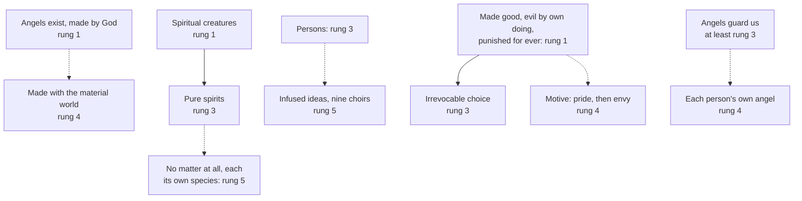

# Creation, Grace & the Last Things · Lesson 1.3: The angels

> ⏱ ~15 min · Module 1: Creation · Builds on: [1.1](01-01-creation-out-of-nothing.md) · Unlocks: [1.4](01-04-creation-and-evolution-in-church-teaching.md), [6.4](06-04-hell.md)

## Why this matters

Ask a class about angels and you will hear of nine choirs, a rebel who would not bow, and a guardian at every shoulder. Almost none of it is defined. The course's discipline shows clearest here: a small defined core, a thin layer of ordinary teaching, and around it centuries of fine school theology constantly mistaken for dogma. Sort them, then ask what demythologizing the core would cost.

## The idea

Picture an old map. The coastline is surveyed and inked: what the Church defines. A few inland towns are marked from reliable report: her ordinary teaching. The interior is filled in by explorers, some brilliant, with roads that may not be there: the schools.

For the [angels](../reference.md#angels) the coastline is short. They exist; God made them; they are spiritual creatures; some, made good, became evil by their own choice, for ever. The towns: they are pure spirits and persons; their choice is final by its own character, not by any limit to mercy; they watch over us. The rest is interior: their knowledge, species and ranks, the when and why of the fall, your own angel.

The rule cuts both ways: a school's account never borrows the doctrine's weight, and a doctrine is never demoted because its explanation is disputed. Origen saw its shape around 230.

## Source

Origen, *On First Principles*, Preface 6 and 10, in Frederick Crombie's translation of Rufinus's Latin (*Ante-Nicene Fathers* vol. 4, 1885):

> Regarding the devil and his angels, and the opposing influences, the teaching of the Church has laid down that these beings exist indeed; but what they are, or how they exist, it has not explained with sufficient clearness. This opinion, however, is held by most, that the devil was an angel, and that, having become an apostate, he induced as many of the angels as possible to fall away with himself … This also is a part of the teaching of the Church, that there are certain angels of God, and certain good influences, which are His servants in accomplishing the salvation of men. When these, however, were created, or of what nature they are, or how they exist, is not clearly stated.

Read the verbs. "Laid down" and "part of the teaching": these beings exist, and the good serve our salvation. "Held by most": the devil a fallen angel, still an opinion. "Not clearly stated": their nature, mode of being and date. Three grades, a millennium before the ladder. Lateran IV later professed the devil's self-made evil and called the angels the spiritual creature; how they exist is still undefined. The irony: Origen filled the gaps himself, with pre-existent souls and a restoration perhaps reaching the devil, and that was condemned ([`patristics` 2.5](../../patristics/lessons/02-05-clement-of-alexandria-and-origen.md), which also warns that Rufinus bent him toward orthodoxy).

## The doctrine

1. **They exist, and God made them.** [*Firmiter*](../reference.md#firmiter) (Lateran IV, 1215, const. 1) confesses that God made [out of nothing](../reference.md#creation-out-of-nothing) (*de nihilo*) both creatures, *spiritualem et corporalem, angelicam videlicet et mundanam*, "the angelic and the earthly", and then the human, "made up of spirit and body" (lesson's translation). [*Dei Filius*](../reference.md#dei-filius) ch. 1 (1870) repeats the clause; CCC 328 calls their existence a truth of faith. *In words:* there are creatures we never see, and God made them as he made us.

2. **When.** God made both *simul ab initio temporis*; [1.1](01-01-creation-out-of-nothing.md) reads *simul*'s two senses. The temporal one, angels made together with the material world, is not defined. Aquinas, fifty years after the council, calls it "the more probable" opinion and the contrary "not to be deemed erroneous", since the Greek Fathers put the angels first (ST I q.61 a.3); Ludwig Ott calls it common teaching. *In words:* that they were made is defined; when is not.

3. **Spiritual, and how far "pure spirit" is defined.** *Firmiter* calls the angelic creature the spiritual one, against man, made of spirit and body (Ott: *de fide*). What "spiritual" excludes, it does not say. Many Fathers gave angels a fine, airy body (Ott; ST I q.51 a.1); after 1215 the Franciscans still composed them of matter and form (rejected in q.50 a.2). Paul VI's *Credo of the People of God* (1968) §8 calls them "pure spirits", CCC 330 "purely spiritual"; the *Credo* disclaims being strictly a definition (§3). *In words:* not bodily like us is defined; no body at all is taught; a form with no matter whatever, the Thomist [pure spirit](../reference.md#pure-spirit), is a school's.

4. **Persons.** CCC 330 calls them personal creatures with intelligence and will, citing [*Humani Generis*](../reference.md#humani-generis) §26 (1950), which counts doubting "whether angels are personal beings" among the day's errors. *In words:* angels are someones, not forces.

5. **Made good, evil by their own doing: the [fall of the angels](../reference.md#fall-of-the-angels).** *Firmiter* goes on: *Diabolus enim et alii daemones a Deo quidem natura creati sunt boni, sed ipsi per se facti sunt mali*, "the devil and the other demons were created by God good in nature, but became evil through themselves" (lesson's translation; [1.2](01-02-and-god-saw-that-it-was-good.md) reads it against dualism). Scripture's direct witness is "the angels that sinned" (2 Pet 2:4; Jude 6). The name comes late: Job's *ha-satan* is a court title ([`old-testament` 5.3](../../old-testament/lessons/05-03-job.md)), and Wisdom 2:24 and Revelation 12:9 first tie Eden's serpent to the devil ([`old-testament` 2.3](../../old-testament/lessons/02-03-the-primeval-history.md); [`new-testament` 6.5](../../new-testament/lessons/06-05-revelation.md)). *In words:* nothing God made is evil; the demons did it to themselves.

6. **For ever.** The reprobate receive *cum diabolo poenam perpetuam*, "perpetual punishment with the devil" (*Firmiter*), the fire "prepared for the devil and his angels" (Matt 25:41). Justinian's canons of 543, adopted by a synod at Constantinople, condemned the demons' restoration ([apokatastasis](../reference.md#apokatastasis)). CCC 393 puts the cause in the choice, not in mercy, quoting John Damascene, *Exact Exposition* II.4 (Salmond, NPNF2 vol. 9):

   > what in the case of man is death is a fall in the case of angels. For after the fall there is no possibility of repentance for them, just as after death there is for men no repentance.

   *In words:* the angels chose once, and the choice stands.

7. **[Guardian angels](../reference.md#guardian-angels).** "Their angels in heaven always see the face of my Father" (Matt 18:10, DR). CCC 336 surrounds human life with their care and quotes Basil: each believer has an angel beside him. The Roman Catechism (1566, Part IV) has angels "accompanying every human being" (McHugh and Callan); Aquinas gives each person a guardian from birth, not baptism (ST I q.113 aa.2, 5). The memorial is 2 October; devotion is commended, never imposed. *In words:* angels are sent to help us; that each has his own is the tradition's reading of Matthew 18:10.

**Said plainly.** The account of why they fell is thin. Scripture hints at pride (1 Tim 3:6); Wisdom 2:24 tells how death entered, not why the devil sinned. Several early Fathers made the sin lust, reading the "sons of God" of Genesis 6:2 as angels (Ott names Justin and Tertullian). Augustine settled on pride, then said the first evil will has no efficient cause: seeking one "is as if some one sought to see darkness, or hear silence" (*City of God* XII.7, Dods). No council has said when or why.

| Defined or taught (with level) | A school's explanation or an opinion (no magisterial level) |
|---|---|
| Angels exist, created by God: **rung 1** | Made with the material world (q.61 a.3): rung 4 |
| Spiritual: **rung 1**; "pure spirits": **rung 3** | Forms with no matter, each its own species (q.50 aa.2, 4), against spiritual matter, or several of one species (Scotus) |
| Persons with intellect and will: **rung 3** | Knowledge by infused ideas (qq.54–58); [nine choirs](../reference.md#nine-choirs) in three triads (Pseudo-Dionysius) |
| Made good, evil by own doing, punished for ever: **rung 1**; unforgivable because irrevocable: **rung 3** | First sin pride, envy after (q.63 a.2); fixed because an angel grasps all at once (q.64 a.2), or has no body to repent with (Damascene II.3) |
| Angels guard human beings: **at least rung 3** | Each person's own angel: rung 4; from birth, not baptism: rung 5 |

**Mark the levels** ([the ladder](../../fundamental-theology/lessons/04-04-the-ladder-of-doctrinal-authority.md); [levels of authority](../reference.md#levels-of-authority)). **Rung 1** rests on *Firmiter*, a council's profession of faith repeated in *Dei Filius*, with Matthew 25:41. **Rung 3** rests on the *Credo* (a papal profession that disclaims definition), HG §26 (an encyclical), the Roman Catechism and CCC 330, 336, 352 and 393. Ott's *de fide* for guardianship is a defensible rung-1 reading through the ordinary universal magisterium, but no act manifestly proposes it as revealed: default down. **Rung 4** is the manuals' common teaching (Ott: each believer's angel certain, everyone's from birth the general view); CCC 336 gives the individual angel only in Basil's words. Each angel its own species is **rung 5** ([`ancient-medieval-philosophy` 8.3](../../ancient-medieval-philosophy/lessons/08-03-scotus-common-nature-and-haecceity.md)), as are matter in angels, the choirs and the moment of the fall. Aquinas, the Damascene, Origen and Ott as authors: **no magisterial level**. Exorcism: **law and liturgical law, no rung** ([`sacraments-and-liturgy` 7.3](../../sacraments-and-liturgy/lessons/07-03-sacramentals-and-popular-devotion.md)).

## The map

Solid arrows mark teaching built on the defined core; dashed ones, school additions that weigh what their arguments weigh.

## Worked examples

**Ex 1 (clean): "Why can't the devil be forgiven?"** Invented: at St Raphael's, Tollbridge, Maialen Etxeberria asks her confirmation group why infinite mercy cannot reach the devil. *Defined:* he made himself evil and his punishment is perpetual (*Firmiter*; Matt 25:41), so "he may yet be saved" is excluded at **rung 1**. *Taught:* the cause is the choice's irrevocable character, not a defect of mercy (CCC 393, **rung 3**). *School:* why it is irrevocable. Aquinas: a man reasons step by step and can turn back, while an angel grasps at once and adheres "fixedly and immovably" (q.64 a.2). The Damascene: man's repentance comes of his body's weakness (II.3). Maialen may reject both and lose nothing defined; Aquinas's reply fits her: "God's mercy delivers from sin those who repent" (ad 2).

**Ex 2 (strain): the demythologized devil.** Invented: Gwenaëlle Le Bihan, in a certificate paper, follows Rudolf Bultmann's 1941 essay "New Testament and Mythology": no one who uses electric light, the radio and modern medicine can also believe in the New Testament's world of spirits and miracles ([demythologizing](../reference.md#demythologizing)). She reads the demons as a pre-scientific name for illness and enslaving powers. Her due: much the Gospels call possession we treat medically, and an exorcist must first rule out illness (CCC 1673). Where the doctrine bites: *Firmiter* gives the devil a nature God made good and an evil he made himself. A symbol has neither, so "no one fell" denies a **rung-1** clause, not a scholastic gloss. Paul VI's general audience of 15 November 1972 said as much: evil is not merely a lack but a living spiritual agent, perverted and perverting; denying it leaves biblical and Church teaching, and so does making it a principle of its own. That is ordinary teaching, **rung 3** at most. Where the doctrine stops: it names no event, illness or temptation as demonic (the exorcisms as history are [`new-testament` 3.3](../../new-testament/lessons/03-03-what-historians-broadly-agree-on.md)'s). A Catholic may attribute almost nothing in particular to demons; he may not hold that nobody is there.

## Watch out

- **You might think the nine choirs, the motive of the fall or the angels' way of knowing are Church teaching.** No act proposes them. The choirs come from Pseudo-Dionysius, about 500 ([`patristics` 5.4](../../patristics/lessons/05-04-maximus-and-john-of-damascus.md)), and Gregory the Great ranks them differently (q.108 a.6).
- **You might think that because so much about the devil is disputed, belief in him is optional.** That demotes a doctrine for its disputed explanations: that he exists, was created good and fell by his own act is **rung 1**.
- **You might think "everyone has a guardian angel" is defined, or a nursery story.** It is common teaching, **rung 4**; that angels guard us is **at least rung 3**.

## One-liner

> Defined: the angels exist, God made them spiritual, and some made themselves evil past undoing; nearly everything else belongs to the schools.

## Problems

**P1 (🟢)** *(Exegetical)* **Close reading.** John Damascene, *Exact Exposition of the Orthodox Faith* II.3 (tr. S. D. F. Salmond, NPNF2 vol. 9, 1899):

> An angel, then, is an intelligent essence, in perpetual motion, with free-will, incorporeal, ministering to God, having obtained by grace an immortal nature: and the Creator alone knows the form and limitation of its essence. But all that we can understand is, that it is incorporeal and immaterial. For all that is compared with God Who alone is incomparable, we find to be dense and material. For in reality only the Deity is immaterial and incorporeal.

(a) The passage calls the angel incorporeal, then says "only the Deity is immaterial and incorporeal". Is it contradicting itself? Name the words that decide.

(b) Does the passage put the Damascene at odds with the teaching that angels are "pure spirits"? Give that teaching's level, and name one claim in the passage that carries no magisterial weight.

**Two sentences per part.**

**P2 (🟡)** *(Exegetical)* **Diagnose.** From an episode of the parish podcast at St Raphael's, Tollbridge, recorded for the feast of the archangels. The episode and its host are **invented** for this problem:

> (1) "The Church has defined that there are nine choirs of angels in three hierarchies, just as St Paul's own convert Dionysius recorded them."
>
> (2) "We even know why Lucifer fell: he was jealous of us, because God planned to become man. Wisdom says so: 'by the envy of the devil, death came into the world.'"
>
> (3) "But his fall needn't be final. God's mercy is bigger than any sin, so a Catholic is free to hope Satan will be won back at the end."
>
> (4) "And when we die we join them: Grandad is an angel now."

Correct each item. Where a level is involved, give it and name the act that fixes it. **Two sentences per item.**

**P3 (🔴)** *(Exegetical)* **Reconstruct.** ST I q.63 a.2, *respondeo* (English Dominican Province translation):

> As to affection only those sins can be in the demons which can belong to a spiritual nature. Now a spiritual nature cannot be affected by such pleasures as appertain to bodies, but only by such as are in keeping with spiritual things … But there can be no sin when anyone is incited to good of the spiritual order; unless in such affection the rule of the superior be not kept. Such is precisely the sin of pride—not to be subject to a superior when subjection is due. Consequently the first sin of the angel can be none other than pride.

(a) Put the argument as P1, P2, … ∴ C, and flag the premise that does the most work and is most open to challenge.

(b) Give the level of C, and of the doctrine the article explains, naming the act for the second.

**Numbered premises, then two sentences per part.**

Solutions

**P1** *(Exegetical)*

**Must hit, strict (a):**

- **No contradiction: two measures.** "All that we can understand is, that it is incorporeal and immaterial" measures the angel against bodies and against our knowledge. "All that is compared with God … we find to be dense and material" and "in reality only the Deity" measure it against God, who alone is absolutely simple.
- Aquinas reads the same comparison the same way: compared to God, angels seem material and corporeal, "not, however, as if anything corporeal existed in them" (ST I q.50 a.1 ad 1).

**Must hit, strict (b):**

- **Not at odds.** That angels are spiritual creatures is **rung 1** (*Firmiter*); that they are "pure spirits" is **rung 3** (Paul VI's *Credo* §8, which disclaims being a definition; CCC 330). The passage affirms both and adds only that no creature is as simple as God, which the teaching nowhere denies.
- **No magisterial weight**, any one: that immortality is "by grace" rather than natural (Ott calls it unsound; Aquinas holds angels incorruptible by nature, q.50 a.5; CCC 330 says only "immortal"); "in perpetual motion"; that the Creator alone knows the angel's essence. A Father as author carries no level.

**Wrong turns:** reading the Damascene as giving angels a fine body, when he says "incorporeal and immaterial" outright and his reserve concerns comparison with God. Promoting "pure spirit" to rung 1 because a pope professed it. Demoting the angels' spirituality to opinion because some Fathers gave them bodies.

**Model answer:** (a) No: "all that we can understand is, that it is incorporeal" measures the angel against bodies, while "compared with God … dense and material" and "in reality only the Deity" measure it against God, who alone is wholly simple. Aquinas reads the comparison the same way, saying angels seem material beside God "not, however, as if anything corporeal existed in them". (b) No: that angels are spiritual is rung 1 (*Firmiter*) and that they are pure spirits rung 3 (*Credo* §8, CCC 330), and the passage affirms both while reserving absolute immateriality to God. Its claim that angels are immortal "by grace" carries no magisterial weight, and Ott judges it unsound.

---

**P2** *(Exegetical)*

**Must hit, strict:**

- **(1)** No act defines the choirs: the system comes from Pseudo-Dionysius, an anonymous author of about 500, not Paul's convert, and Gregory the Great orders them differently (ST I q.108 a.6). The names are scriptural (Col 1:16; Eph 1:21), the nine-rank system a free theological opinion, **rung 5** (Ott: not a truth of faith).
- **(2)** The motive is undefined: *Firmiter* fixes only that the demons became evil by their own doing (**rung 1**). Wisdom 2:24 says how death entered the world, not why the devil fell; the main line (Augustine, *City of God* XII.6; Aquinas q.63 a.2) puts pride first and envy after, common teaching, **rung 4**, and envy of the Incarnation is a later proposal, **rung 5**.
- **(3)** The devil's punishment is perpetual (*Firmiter*, *cum diabolo poenam perpetuam*; Matt 25:41): **rung 1**, and the demons' restoration was condemned in 543. The sin is unforgivable because the choice is irrevocable, not because mercy is small (CCC 393, **rung 3**); the freely disputed hope that all may be saved concerns human beings ([7.3](07-03-hope-for-all.md)).
- **(4)** *Firmiter* distinguishes the angelic creature from the human one, "made up of spirit and body" (**rung 1**), so the dead do not become angels. They remain human, the soul awaiting its body ([2.3](02-03-the-soul-immediately-created-and-immortal.md), [7.1](07-01-the-resurrection-of-the-body.md)); joining the angels' company (CCC 336) is not sharing their nature.

**Wrong turns:** calling the choirs heretical (they are a permitted opinion). Correcting (2) by asserting pride as defined. Correcting (3) with "God cannot forgive him", which puts the cause in mercy instead of in the choice. Treating (4) as harmless figure without saying what it asserts.

**Model answer:** (1) No act defines nine choirs; the system is Pseudo-Dionysius's, about 500, and Gregory the Great ranks them differently. The names are scriptural, the system a free opinion (rung 5). (2) The Church defines only that the demons made themselves evil (*Firmiter*, rung 1), not why. Wisdom 2:24 explains how death entered the world, and the common view (Augustine, Aquinas) puts pride first and envy after (rung 4). (3) The devil's punishment is perpetual (*Firmiter*; Matt 25:41, rung 1), and his restoration was condemned in 543. Mercy is not outmatched; his choice is irrevocable (CCC 393), and the hope for all concerns human beings. (4) *Firmiter* sets angels apart from human beings, who are "made up of spirit and body" (rung 1). Grandad remains a human soul awaiting the resurrection, in the angels' company but not of their kind.

---

**P3** *(Exegetical)*

**Must hit, strict (a):**

- **P1.** Only sins that suit a spiritual nature can be in a demon as affection.
- **P2.** A spiritual nature is affected only by spiritual goods, since a thing is affected only by what suits its nature.
- **P3.** Desiring a spiritual good is sinless unless the rule of the superior is not kept.
- **P4.** Not keeping the superior's rule when subjection is due is pride.
- **∴ C.** The first sin of an angel can be none other than pride.
- **The load-bearing premise:** P3, which makes every disorder in desiring a spiritual good a failure of subjection. The reply to objection 2 has to fold avarice into pride and deny sloth to spirits to keep it. **Also accept** the purely spiritual nature presupposed in P1–P2, with the reason: Fathers who gave angels bodies made the sin lust (Genesis 6:2).

**Must hit, strict (b):**

- **C:** no magisterial level. It is a deduction from the nature of spirit, with scripture offering only hints (1 Tim 3:6), and as common teaching since Augustine it stands at **rung 4**.
- **The doctrine explained:** that the angels, created good, sinned by their own free choice. That is **rung 1**, fixed by *Firmiter* (Lateran IV, 1215).

**Wrong turns:** listing "the devil was proud" as a premise, which assumes C. Promoting C because CCC 392 hears the rebellion in "You will be like God", which it offers as "a reflection". Demoting the fall itself because its motive is only deduced.

**Model answer:** (a) P1: only sins suited to a spiritual nature can be in a demon as affection. P2: a spirit is affected only by spiritual goods. P3: desiring a spiritual good is sinless unless the superior's rule is not kept. P4: refusing due subjection is pride. ∴ C: the angel's first sin can only be pride. P3 carries the weight: it folds every spiritual disorder into insubordination, which is why reply 2 must absorb avarice and exclude sloth. (b) C is a theologian's deduction from the nature of spirit, with scripture only hinting (1 Tim 3:6): common teaching, rung 4, with no magisterial act behind it. The doctrine it explains, that the angels were created good and became evil by their own doing, is rung 1, fixed by Lateran IV's *Firmiter*.

## Flashback

**From Lesson [1.1](01-01-creation-out-of-nothing.md) (Creation out of nothing):** *(Exegetical.)* Assign the level. Place each claim on [the ladder](../../fundamental-theology/lessons/04-04-the-ladder-of-doctrinal-authority.md) and name the act that fixes it, or say why no rung applies.

(a) The matter of the world, and not only its shape, was made by God out of nothing.

(b) God did not create in order to increase or to acquire his own beatitude.

(c) Creation is no change in the creature, only its relation to God as the principle of its being.

(d) "Out of nothing" is a second-century formula, so the doctrine it names stands below rung 1.

**One sentence each.**

Solution

**Must hit, strict:**

- **(a) Rung 1.** *Dei Filius* can. 5 (1870): all things "in their whole substance, produced by God out of nothing" (Schaff), after *Firmiter*'s *de nihilo* (1215).
- **(b) At least rung 3.** *Non ad augendam suam beatitudinem, nec ad acquirendam* is in *Dei Filius* ch. 1 and no canon repeats it, so on the [chapter rule](../reference.md#chapters-and-canons) it is the council's own solemn teaching, and default-down (can. 749 §3) stops it short of rung 1 unless another act is named. Credit the argument for more: its denial contradicts *Firmiter*'s *incommutabilis*.
- **(c) No magisterial level.** Aquinas's analysis (ST I q.45 a.2 ad 2, a.3; [`thomistic-synthesis` 5.1](../../thomistic-synthesis/lessons/05-01-creation-and-conservation.md)): it explains (a) and borrows none of its weight. Accept "rung 4" if no act is claimed.
- **(d) A true premise with no magisterial level, and a false conclusion.** The formula's dating is a historian's (Gerhard May, in [`old-testament` 6.2](../../old-testament/lessons/06-02-tobit-judith-baruch-and-the-maccabees.md)); the doctrine is rung 1 by *Firmiter* and can. 5, and a word's date fixes no level.

**Wrong turns:** (b) at rung 1 because the chapter "believes and confesses", or rung 5 because no canon has it; (c) at rung 1 because it explains a dogma; (d) granting that a late formula means unrevealed content.

**Model answer:**

(a) Rung 1: *Dei Filius* can. 5, "in their whole substance", after *Firmiter*'s *de nihilo*.

(b) At least rung 3: *Dei Filius* ch. 1 alone, with default-down stopping it short of rung 1.

(c) No magisterial level: Aquinas's analysis, explaining the dogma without its rung.

(d) The dating has no level and the inference fails: the doctrine is rung 1 by *Firmiter* and can. 5.

## Connections

- **Backward:** [1.1](01-01-creation-out-of-nothing.md) read *Firmiter*'s creation clause and *simul*; [1.2](01-02-and-god-saw-that-it-was-good.md) read its demons clause against dualism, with the convertibility of good and being from [`thomistic-synthesis` 2.4](../../thomistic-synthesis/lessons/02-04-the-transcendentals.md). The metaphysics of a subsisting form, and of a creature whose essence is not its existence, is [`thomistic-synthesis` 2.1](../../thomistic-synthesis/lessons/02-01-act-and-potency-extended.md) and [2.2](../../thomistic-synthesis/lessons/02-02-esse-and-essence-the-real-distinction.md).
- **Forward:** [1.4](01-04-creation-and-evolution-in-church-teaching.md) turns from the invisible creation to the history of the visible one. The Damascene's parallel returns in [6.1](06-01-death-and-the-particular-judgment.md), where death fixes a human will as the fall fixed an angel's; the fire "prepared for the devil and his angels" is the doctrine of [hell](../reference.md#hell) in [6.4](06-04-hell.md); and [3.3](03-03-trent-session-v-the-definition.md) reads Trent's "captivity under his power who thenceforth had the empire of death, that is to say, the devil" (Session V, can. 1).
- **Sideways:** whether two angels can share a species is the test case for Scotus's haecceity in [`ancient-medieval-philosophy` 8.3](../../ancient-medieval-philosophy/lessons/08-03-scotus-common-nature-and-haecceity.md). Plantinga's free-will defence uses fallen angels only as a possibility ([`philosophy-of-religion` 4.1](../../philosophy-of-religion/lessons/04-01-the-logical-problem-of-evil.md)); the devil's supposed rights in redemption are [`christology` 5.2](../../christology/lessons/05-02-ransom-christus-victor-and-sacrifice.md)'s; exorcism is [`sacraments-and-liturgy` 7.3](../../sacraments-and-liturgy/lessons/07-03-sacramentals-and-popular-devotion.md)'s; and Raphael's own book is read as an edifying tale in [`old-testament` 6.2](../../old-testament/lessons/06-02-tobit-judith-baruch-and-the-maccabees.md).
