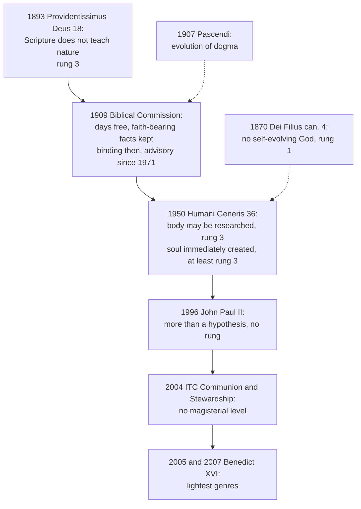

# Creation, Grace & the Last Things · Lesson 1.4: Creation and evolution in Church teaching

> ⏱ ~15 min · Module 1: Creation · Builds on: [1.1](01-01-creation-out-of-nothing.md), [`thomistic-synthesis` 5.2](../../thomistic-synthesis/lessons/05-02-providence-and-secondary-causes.md) · Unlocks: [2.2](02-02-body-and-soul-one-substance.md), [2.3](02-03-the-soul-immediately-created-and-immortal.md), [3.4](03-04-monogenism-polygenism-and-the-modern-reinterpretations.md)

## Why this matters

Ask what the Church teaches about evolution and you will hear that she condemned it, tolerates it under protest, or made it official in 1996. All three hear one voice where there is a stack of documents of different kinds. [`apologetics-foundations` 4.2](../../apologetics-foundations/lessons/04-02-evolution-design-and-the-human-person.md) used them in the design debate; this lesson weighs them act by act, and lists what none has taught.

## The idea

Start with the [two questions](../reference.md#two-questions-frame). The sciences ask how living bodies came from earlier bodies; the doctrine asks why there is anything at all, and who wills it. They do not compete, because God is the cause of every cause's acting, not one more cause beside them: "one action does not proceed from two agents of the same order" (ST I q.105 a.5 ad 2, from [`thomistic-synthesis` 5.2](../../thomistic-synthesis/lessons/05-02-providence-and-secondary-causes.md)). The Catechism calls the meaning of origins "a question of another order" (CCC 284). So the Church has said almost nothing about biology: only how Scripture speaks of nature, what in us no biology makes, and what no process escapes.

In a court file, the same sentence weighs differently in a statute, a ruling, an expert's report and the judge's after-dinner speech. So when a sixth-former at Holy Cross School, Ellisford, asks whether Catholics have had to believe in evolution since 1996, the answer is no. One act permits research into the body's origin, one obliges belief that each soul is God's direct work, and a pope later judged the science strong. None of that puts biology on the [ladder](../reference.md#levels-of-authority).

## Source

[*Providentissimus Deus*](../reference.md#providentissimus-deus) (Leo XIII, 18 November 1893), §18, the lesson's translation of the Latin. The rule defended is Augustine's: what is truly demonstrated about nature can be shown not to contradict Scripture.

> On the fairness of this rule, consider first that the sacred writers, or more truly "the Spirit of God who spoke through them, did not will to teach men these things" (that is, the inner constitution of visible things), "which profit no one for salvation". So, rather than pursuing the exploration of nature directly, they sometimes describe and handle things either in a kind of figurative way or as common speech bore in those times, and still bears … even among the most learned. And since ordinary speech first and properly expresses what falls under the senses, the sacred writer likewise (as the Angelic Doctor also noted) "followed what sensibly appears".

Inside are two quotations: Augustine (*On the Literal Meaning of Genesis* II.9.20), and Aquinas, whom the Dominican translation renders "Moses describes what is obvious to sense, out of condescension to popular ignorance" (ST I q.70 a.1 ad 3). The claim concerns *intention*, what the Spirit willed to teach; it does not confine Scripture's truth to faith and morals, which Leo rejects in §20 ([`fundamental-theology` 3.2](../../fundamental-theology/lessons/03-02-inerrancy.md)). It names neither Darwin nor Galileo. Whether human origins fall under "the inner constitution of visible things" is what the later acts answer.

## The doctrine

1. **Scripture does not teach the inner constitution of nature** (*Providentissimus Deus* §18, 1893). On 30 June 1909 the [Biblical Commission](../reference.md#biblical-commission-1909) applied Leo's very words to Genesis 1 (Response VII) and left the "days" free (VIII), while Response III kept a list of facts touching "the foundations of the Christian religion", among them "the special creation of man" and "the unity of the human race" (lesson's translation, read in P3). The responses' weight is [`old-testament` 2.1](../../old-testament/lessons/02-01-two-accounts-of-creation.md)'s: binding when issued (*Praestantia Scripturae*, 1907), the Commission advisory since 1971. Not on this list: *Pascendi* (1907), whose "evolution" is of dogma ([`church-history` 8.3](../../church-history/lessons/08-03-leo-xiii-and-the-modernist-crisis.md)), and [*Dei Filius*](../reference.md#dei-filius) can. 4 (1870), against saying "the divine essence by the manifestation and evolution of itself becomes all things" (Schaff): pantheism ([`trinity-and-god` 1.2](../../trinity-and-god/lessons/01-02-the-one-true-god-and-what-reason-can-reach.md)). *In words:* the Bible is no rival textbook of nature, and the one conciliar anathema containing "evolution" is about God, not species.

2. **The body may be investigated; each soul is created immediately.** [*Humani Generis*](../reference.md#humani-generis) (Pius XII, 12 August 1950) §36, paraphrased: the Magisterium *does not forbid* (*non prohibet*) experts in science and theology to research and discuss evolution as it inquires into the human body's origin from pre-existing living matter, if the reasons on both sides are weighed seriously and all stand ready to submit to the Church's judgment. It rebukes those who treat that origin as proved. A parenthesis says the Catholic faith "obliges us to hold" that souls are immediately created by God (*animas enim a Deo immediate creari catholica fides nos retinere iubet*). §5 rejects evolution as the monist explanation of *all* things, a philosophy rather than a science; §37 ([polygenism](../reference.md#monogenism-and-polygenism)) is stated in AF 4.2 and [`fundamental-theology` 4.3](../../fundamental-theology/lessons/04-03-religious-submission.md) Ex 2, its doctrine [3.4](03-04-monogenism-polygenism-and-the-modern-reinterpretations.md)'s. Read with [`fundamental-theology` 4.5](../../fundamental-theology/lessons/04-05-reading-a-documents-weight.md): an encyclical, so authentic ordinary magisterium by default, whose three operative verbs do three jobs. *Non prohibet* permits; *retinere iubet* states an obligation it attributes to the faith, not to itself; the rebuke judges the evidence of 1950. *In words:* follow the evidence about the body without overstating it, and hold that every soul is God's direct work.

3. **A pope's estimate of a science.** [John Paul II's message](../reference.md#john-paul-ii-1996-message) to the plenary of the Pontifical Academy of Sciences (22 October 1996) is French; vatican.va has no English. §4: almost half a century after the encyclical (*près d'un demi-siècle*; the English says "more than"), new knowledge leads to recognizing in the theory of evolution "plus qu'une hypothèse", by the unsought convergence of independent results. (AF 4.2 has the English "more than one hypothesis" misprint.) There are *theories* of evolution, read in materialist or spiritualist ways, and judging them is for philosophy and theology. §5 quotes Pius XII's Latin on the soul and rejects theories making spirit emerge from living matter or a mere epiphenomenon of it; §6 speaks of an "ontological leap" observation cannot reach. *In words:* he revised the 1950 *estimate*, not the 1950 *doctrine*.

4. **Benedict XVI, in three genres.** His inaugural homily (24 April 2005): we are not "some casual and meaningless product of evolution", but each a thought of God. A question-and-answer meeting with clergy at Auronzo di Cadore (24 July 2007): the supposed antithesis of "creationism" and evolutionism is "absurd", since much evidence favours evolution and evolution cannot say where everything comes from. A closed seminar with his former students at Castel Gandolfo (September 2006), published as *Schöpfung und Evolution* (2007). *In words:* the homily denies meaninglessness, not evolution.

5. **The International Theological Commission, [*Communion and Stewardship*](../reference.md#communion-and-stewardship) (2004), §§62–70.** §63 summarizes "the widely accepted scientific account": a universe 15 billion years old (now about 13.8) and common descent "virtually certain". §64: the 1996 message does not bless theories denying providence any causal role. §69: design against chance "cannot be settled by theology"; true contingency fits a purposeful providence; and an "unguided evolutionary process" outside providence "simply cannot exist". §70: the first humans' emergence, "whether as individuals or in populations", has no purely natural explanation. *In words:* careful commentary, and only commentary.

6. **What has never been taught.** No act teaches an age of the earth or universe, a mechanism, that evolution is true or false as biology, a design inference (AF 4.2), or when the first soul was created. The one origins question an act has closed head-on, polygenism, concerns original sin: 3.4. *In words:* timetable, mechanism and design are left to the sciences and philosophy.

**Said plainly.** The acts moved from caution to openness, never to endorsement. In 1909 "the special creation of man" could not be doubted; in 1950 the permission came with a rebuke for calling the body's evolution proved, and a demand to weigh the case against as seriously as the case for. No act since has said that the human body evolved.

| Defined or taught (with level) | A school's explanation or an opinion (no magisterial level) |
|---|---|
| God created all things out of nothing and governs all by providence: **rung 1** (*Firmiter*; *Dei Filius* ch. 1, can. 5; providence by the ordinary universal magisterium) | God as first cause of every secondary cause, not their rival: common teaching, **rung 4**; the ITC's argument from it (§§68–69) |
| Each soul is [immediately created](../reference.md#immediate-creation-of-the-soul) by God: **at least rung 3** (HG §36; CCC 366), argued in 2.3 | The "ontological leap" (JPII §6); "whether as individuals or in populations" (ITC §70) |
| The body's origin from pre-existing living matter may be researched: **rung 3**, a permission | That it happened, and how: science; "more than a hypothesis": an estimate, **no rung** |
| Scripture does not teach the inner constitution of nature: **rung 3** (PD §18) | The six days as periods or as a literary frame: **rung 5**, left free in 1909 |

**Mark the levels** ([the ladder](../../fundamental-theology/lessons/04-04-the-ladder-of-doctrinal-authority.md); [levels of authority](../reference.md#levels-of-authority)). [Creation out of nothing](../reference.md#creation-out-of-nothing) and universal providence: **rung 1** (*Dei Filius* ch. 1 with the ordinary universal magisterium). HG §5's rejection of evolution as a monist philosophy of everything rides on that dogma: **rung 1**. Inerrancy: **rung 1** (FT 4.4 Ex 1); Leo's principle: **rung 3**. HG §36's permission: **rung 3**; its soul clause **at least rung 3**, rung 1 by the ordinary universal magisterium when so argued (2.3). The 1909 responses: binding then, neither dogma nor dead letter now. The 1996 message: the lightest grade of **rung 3** for the doctrine it restates; its estimate of the science, **no rung**. Benedict's homily weighs what it restates; Auronzo and the seminar add nothing. The ITC: **no magisterial level**.

## The timeline

The main line, and two texts often mistaken for part of it: the weight never rises with the date.

## Worked examples

**Ex 1 (clean): may, and must?** Invented: in the Ellisford class, Marguerite Szabo asks Ms Rhoswen Adeyemi whether a Catholic may hold that the human body descends from earlier primates, and whether she must. *May:* yes; HG §36 permits it (**rung 3**), and nothing has withdrawn it. *Must:* no act proposes a biological theory for assent, and John Paul II's estimate fixes no rung, so she may doubt the science without contradicting any doctrine, though not in the Church's name. She must hold that God created and governs every process (**rung 1**) and that her soul was created immediately by God (**at least rung 3**): neither is a claim about anatomy.

**Ex 2 (strain): when, and how many?** Invented: Ishaan Treloar reads ITC §70 and asks when God created the first human soul, and in how many. The doctrine settles that wherever there is a human being there is a soul God created directly. It settles nothing about *when*, or by what biological marker: John Paul II's §6 says observation cannot reach that moment, and the soul's creation is no gap a fossil could open or close (ITC §70). Here the doctrine stops. One pair or a population is HG §37's question, about original sin: [3.4](03-04-monogenism-polygenism-and-the-modern-reinterpretations.md). The ITC's parenthesis settles nothing.

## Watch out

- **You might think 1996 made evolution Church teaching, or that 1950 condemned it.** Both overstate: 1950 is a permission (**rung 3**), 1996 an estimate of a science (**no rung**). Neither binds a Catholic to a biological theory or forbids one.
- **You might think "approved *in forma specifica*" makes *Communion and Stewardship* papal teaching.** Its preliminary note means the Commission's own written ballots; its president, Cardinal Ratzinger, then permitted publication. Papal approval *in forma specifica* of a dicastery's act ([`fundamental-theology` 4.5](../../fundamental-theology/lessons/04-05-reading-a-documents-weight.md)) is another thing. **No magisterial level.**
- **You might think the 1909 responses are void because the Commission is now advisory.** That understates: they bound when issued, were never revoked, and Response III's facts keep their weight through other acts. "They still bind as in 1909" overstates.

## One-liner

> The Church lets the body's history be studied, teaches that each soul is God's direct work and nothing escapes providence, and has never taught a timetable, a mechanism or a design inference.

## Problems

**P1 (🟢)** *(Exegetical)* **Diagnose.** A closing speech in a sixth-form class debate at Holy Cross School, Ellisford, **invented** for this problem:

> "The Church has been running from Darwin for a century. Pius XII only tolerated evolution until the science came in, and in 1996 John Paul II gave in: since then Catholics have been taught that the body evolved. Benedict XVI tried to take it back at his inauguration, when he said we are 'not the product of evolution'. And the Vatican's own Theological Commission, in a 2004 document approved *in forma specifica*, officially teaches that the universe is fifteen billion years old, which shows how out of date Church teaching is."

Find **four** errors. Correct each, and where a level is involved name the act and its weight. **150 words or fewer.**

**P2 (🟡)** *(Exegetical)* **Assign the level.** Place each claim on the ladder and name the act that fixes it, or say why no rung applies.

(i) The sacred writers did not set out to teach the inner constitution of the visible world.

(ii) New knowledge has made the theory of evolution more than a hypothesis.

(iii) The "days" of Genesis 1 may be read either as natural days or as periods of time.

(iv) An evolutionary process that falls outside divine providence cannot exist.

**Two sentences per item.**

**P3 (🔴)** *(Exegetical)* **Close reading.** The Pontifical Biblical Commission, Response III of 30 June 1909, the lesson's translation of the Latin:

> Question 3: Whether in particular the literal historical sense can be called into doubt where it is a matter of facts narrated in the same chapters which touch the foundations of the Christian religion: such as, among others, the creation of all things by God at the beginning of time; the special creation of man; the formation of the first woman from the first man; the unity of the human race; the original happiness of our first parents in the state of justice, integrity and immortality; the command given by God to man to test his obedience; the transgression of the divine command at the devil's persuasion under the form of a serpent; the casting down of our first parents from that primeval state of innocence; and the promise of a future Redeemer. Answer: In the negative.

(a) What exactly does the response exclude, and what does it not require? Name the words that decide each. **Two sentences.**

(b) Does *Humani Generis* §36's permission contradict "the special creation of man"? Say what the response leaves unspecified, how the 1950 and 2004 texts locate what is special, and what weight the response has today. **Three sentences.**

Solutions

**P1** *(Exegetical)*

**Accept:** the four errors below; "running from Darwin" is rhetoric, not an error to grade.

**Must hit, strict:**

- **"Taught that the body evolved."** No act teaches it. HG §36 (1950) permits research into the body's origin, with conditions; it is not a toleration awaiting the science. John Paul II (1996) revised the estimate of the science, which fixes **no rung**, and left the permission a permission.
- **The misquotation.** Benedict said we are not "some casual and meaningless product of evolution" (homily, 24 April 2005). He denied meaninglessness, not evolution, and in 2007 he called the supposed antithesis of "creationism" and evolutionism absurd.
- ***In forma specifica*.** Here it means the Commission's own written ballots. The ITC is advisory, so its text has **no magisterial level** and "officially teaches" is false.
- **The age of the universe.** The figure is §63's summary of "the widely accepted scientific account". The Church teaches no timetable at all; a revised estimate (now about 13.8 billion years) is science correcting itself, not a doctrine going out of date.

**Wrong turns:** correcting the first error by saying the Church now *forbids* doubting evolution (an overstatement the other way); calling the ITC text "only rung 3"; treating the 15-billion figure as an error the Church must retract.

**Model answer:** No act teaches that the body evolved. *Humani Generis* §36 permits research into its origin, and John Paul II's 1996 message only judged the science "more than a hypothesis", which is an estimate with no rung. Benedict said we are not "some casual and meaningless product of evolution": he denied meaninglessness, not evolution, and in 2007 he called the antithesis of creationism and evolutionism absurd. *In forma specifica* there means the Commission's own vote; an ITC study is advisory, with no magisterial level. Its fifteen billion years summarized the science of the day. The Church teaches no age of the universe, so a revised figure dates the science, not the doctrine.

---

**P2** *(Exegetical)*

**Must hit, strict:**

- **(i) Rung 3.** *Providentissimus Deus* §18 (1893), an encyclical, teaches it; the Biblical Commission applied it to Genesis 1 in 1909. It is not rung 1: inerrancy is **rung 1**, but this hermeneutical principle about the writers' intention was never defined or proposed as revealed.
- **(ii) No rung.** John Paul II's message to the Pontifical Academy of Sciences (22 October 1996, §4) judges the state of a science and proposes it to no one as faith or morals. The act is the lightest grade of rung 3 for the doctrine it restates (the soul, the rejection of materialism), but the estimate itself is not teaching.
- **(iii) Rung 5, freely disputed, and an act says so.** Response VIII of the Biblical Commission (30 June 1909) answered that the question may be freely discussed among exegetes, and no later act has closed it. "Rung 3 because the Commission ruled" mistakes a ruling that the question is free for a ruling on its answer.
- **(iv) Rung 1, but not by the act that phrased it.** The sentence is ITC, *Communion and Stewardship* §69 (2004), which has **no magisterial level**. Its content is the dogma that God governs by providence all that he made (*Dei Filius* ch. 1, 1870), applied to one more set of creatures.

**Wrong turns:** (i) rung 1 by confusing the principle with inerrancy; (ii) rung 3 "because a pope said it", or the opposite slip of calling a formal papal message an interview; (iii) "the Church requires 24-hour days", or rung 3; (iv) "no level, so a Catholic may deny it", which mistakes the document's weight for the doctrine's. A further slip in (iv): reading "unguided" as "random with respect to fitness". That is a biological claim, compatible with providence ([`apologetics-foundations` 4.2](../../apologetics-foundations/lessons/04-02-evolution-design-and-the-human-person.md) Ex 2).

**Model answer:** (i) Rung 3: Leo XIII taught it in *Providentissimus Deus* §18 (1893), and the Biblical Commission applied it to Genesis 1 in 1909. Inerrancy is rung 1, but this principle about what the writers meant to teach was never defined. (ii) No rung: in his 1996 message John Paul II judged the state of a science, which is not a proposition of faith or morals. The message weighs, at the lightest grade of rung 3, only for the doctrine it restates. (iii) Rung 5: the Biblical Commission's 1909 Response VIII declared the length of the days free for exegetes, and nothing has closed it. Here an act has spoken, and what it said is that the question is open. (iv) The sentence comes from the ITC's 2004 study, which has no magisterial level. What it says is rung 1 all the same, because *Dei Filius* ch. 1 teaches that God governs by providence everything he has made.

---

**P3** *(Exegetical)*

**Must hit, strict (a):**

- **Excluded:** calling into doubt the **"literal historical sense"**, and only **"where it is a matter of facts ... which touch the foundations of the Christian religion"**. The object is *facts* and their reality, listed "among others".
- **Not required:** that every word or detail of the telling be literal. The response asks about facts, not wording, and the same set's Response V denies that every word must be taken in its proper sense where it is plainly figurative. Nor does it require any picture of nature: Responses VII and VIII free the cosmology and the days.

**Must hit, strict (b):**

- **Unspecified:** the response does not say whether "the special creation of man" covers the body, or how.
- **How the later texts locate it:** HG §36 permits research into the body's origin and keeps as what the faith obliges that **souls are immediately created by God**. *Communion and Stewardship* §§65 and 70 speak of the **special creation of the soul**. So no contradiction is forced, but after 1950 what is "special" is placed in the soul.
- **Weight today:** binding in conscience when issued (*Praestantia Scripturae*, 1907); the Commission advisory since 1971; never revoked. The list's content keeps its own weight through other acts: the soul (HG §36; 2.3), the unity of the race (HG §37, 3.4), the original state and the fall (Trent V, 3.1). "Neither dogma nor a dead letter."

**Wrong turns:** "HG revoked the 1909 response" (it does not mention it on this point); "special creation means the body was formed directly from dust, and that still binds" (the response does not say so, and HG permits the inquiry); calling the response a definition; calling it void; making the ITC's reading binding.

**Model answer:** (a) The response excludes doubting the "literal historical sense" only where the narrated "facts ... touch the foundations of the Christian religion", so its object is the reality of listed facts, "among others". It does not require every word or detail to be literal: it asks about facts, not wording, and the companion Responses V, VII and VIII free figurative language, the cosmology and the length of the days. (b) The response never says whether "the special creation of man" includes the body, so HG §36 can permit research into the body's origin without contradicting it, while holding, as the Catholic faith obliges, that souls are immediately created. The ITC's 2004 text accordingly speaks of the special creation of the soul, so after 1950 what is special is located there. The response bound in conscience under *Praestantia Scripturae* (1907), comes from a body advisory since 1971, and was never revoked; its facts keep their weight through other acts, so it is neither dogma nor a dead letter.

## Flashback

**From Lesson [1.2](01-02-and-god-saw-that-it-was-good.md) ("And God saw that it was good"):** *(Exegetical.)* Reconstruct. ST I q.49 a.3, *respondeo* (English Dominican Province translation):

> … there is no one first principle of evil, as there is one first principle of good. First, indeed, because the first principle of good is essentially good … But nothing can be essentially bad. For it was shown above that every being, as such, is good …; and that evil can exist only in good as in its subject (Q. 48, A. 3).

(a) Put the argument as P1, P2, … ∴ C, supplying the unstated premise.

(b) Give the level of C and of the premise taken from q.48 a.3, with the act or why none applies; then say what refuting that premise would topple and what it would leave. **Two sentences.**

Solution

**Must hit, strict (a):**

- P1: the first principle of good is essentially good. **P2 (unstated):** so a first principle of evil would have to be essentially evil. P3: every being, as such, is good. P4: evil exists only in a good as its subject. So (P3, P4) nothing can be essentially evil; ∴ C (with P2): there is no first principle of evil.

**Must hit, strict (b):**

- **C, rung 1:** *Firmiter* (1215) confesses one principle of all things under const. 3's anathema, and Florence's [Decree for the Jacobites](../reference.md#decree-for-the-jacobites) (1442) anathematizes two first principles. **P4, rung 4:** the positive half of the [privation](../reference.md#evil-as-privation) analysis, common teaching no act defines; Florence asserts only the negative half, "no nature of evil".
- **Topples:** this proof. **Leaves:** the doctrine, which the acts fix without Aquinas's route. Nor would the proof's success lift P4 above rung 4.

**Wrong turns:** promoting P4 to rung 1 because it yields a defined conclusion; demoting C because a premise is only rung 4; naming Aquinas as the act; omitting P2, without which "nothing is essentially bad" never reaches "no first principle of evil".

**Model answer:**

(a) P1: the first principle of good is essentially good. P2 (unstated): a first principle of evil would be essentially evil. P3: every being, as such, is good. P4: evil exists only in a good. So nothing is essentially evil, and ∴ C: there is no first principle of evil.

(b) C is rung 1, fixed by *Firmiter*'s one principle and Florence's anathema on two first principles, while the q.48 premise, the positive privation analysis, is common teaching at rung 4 with no act behind it. Refuting it would topple this proof and leave the doctrine standing, since the acts define the conclusion, not the route to it.

## Connections

- **Backward:** [1.1](01-01-creation-out-of-nothing.md) gave the dogma of creation that every act here presupposes; [`thomistic-synthesis` 5.1](../../thomistic-synthesis/lessons/05-01-creation-and-conservation.md) and [5.2](../../thomistic-synthesis/lessons/05-02-providence-and-secondary-causes.md) gave the metaphysics of a creator who is not a rival cause. [`apologetics-foundations` 4.2](../../apologetics-foundations/lessons/04-02-evolution-design-and-the-human-person.md) argued the design question and the 1996 mistranslation; [`fundamental-theology` 3.2](../../fundamental-theology/lessons/03-02-inerrancy.md) read *Providentissimus Deus* as doctrine of inerrancy, and [`old-testament` 2.1](../../old-testament/lessons/02-01-two-accounts-of-creation.md) applied it to the firmament and weighed the 1909 responses.
- **Forward:** [2.2](02-02-body-and-soul-one-substance.md) states what the soul is to the body; [2.3](02-03-the-soul-immediately-created-and-immortal.md) argues the level of its immediate creation; [3.1](03-01-original-justice-and-the-fall.md) takes the original state named in Response III; [3.4](03-04-monogenism-polygenism-and-the-modern-reinterpretations.md) takes HG §37 and the unity of the race.
- **Sideways:** the biology itself is [`evolution-ecology`](../../evolution-ecology/lessons/02-04-macroevolution-history-of-life.md); whether a science can rule a cause in or out is [`philosophy-of-science`](../../philosophy-of-science/syllabus.md)'s. The same two-questions move was first fought over the earth's motion: Bellarmine, Galileo and John Paul II's 1992 address are [`church-history` 7.3](../../church-history/lessons/07-03-the-galileo-affair.md), and the 1996 message recalls that address (§3).
