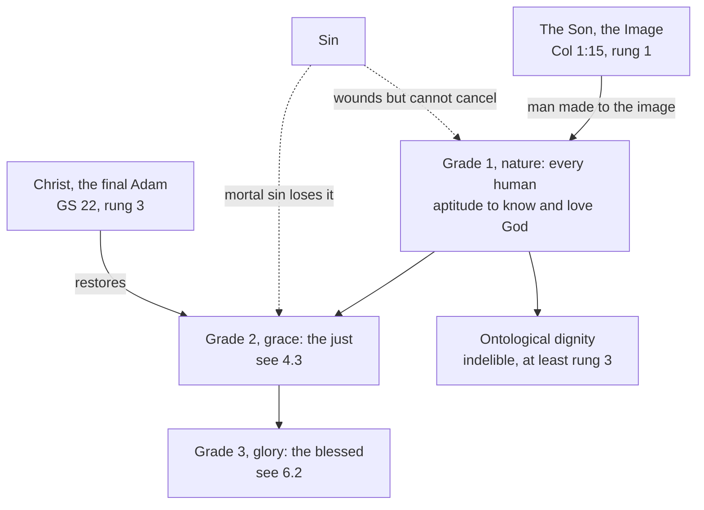

# Creation, Grace & the Last Things · Lesson 2.1: The image of God

> ⏱ ~15 min · Module 2: The human person · Builds on: [1.1](01-01-creation-out-of-nothing.md), [1.4](01-04-creation-and-evolution-in-church-teaching.md) · Unlocks: [2.2](02-02-body-and-soul-one-substance.md), [4.3](04-03-sanctifying-grace-the-indwelling-and-divinization.md)

## Why this matters

Genesis 1:26–27 names the image three times in two verses and never says what it is. Dignity, equality, the ban on killing the innocent and Christ as the new Adam all hang from that silence. This lesson sorts what is revealed from what Irenaeus, Augustine and Aquinas built on it.

## The idea

An image is a copy that points back to its original: one egg exactly like another is not its image, Aquinas says, not having been copied from it (ST I q.93 a.1). A king has two kinds of image. His son is his image in the same nature; a silver coin carries it in an alien nature (a.1 ad 2). The Son of God is the first kind: he *is* the Image. We are the second, made "to" the image, at an infinite distance.

Keep the coin. Worn smooth, it is still the king's; it can be restruck; one day it may shine. Every human being bears the [image of God](../reference.md#image-of-god) by being human, and sin cannot rub it out; grace restores what sin defaced, and glory completes it. Only the one who *is* the Image knows what the original looks like, which is why the Church says Christ shows man what man is.

## Source

Aquinas, ST I q.93 a.4, *respondeo* (English Dominican Province translation, 2nd rev. ed., 1920), after saying that man is God's image by his intellectual nature:

> Now the intellectual nature imitates God chiefly in this, that God understands and loves Himself. Wherefore we see that the image of God is in man in three ways. First, inasmuch as man possesses a natural aptitude for understanding and loving God; and this aptitude consists in the very nature of the mind, which is common to all men. Secondly, inasmuch as man actually and habitually knows and loves God, though imperfectly; and this image consists in the conformity of grace. Thirdly, inasmuch as man knows and loves God perfectly; and this image consists in the likeness of glory. [...] The first is found in all men, the second only in the just, the third only in the blessed.

Read the shape: one image in [three grades](../reference.md#three-grades-of-the-image), measured by one act, knowing and loving God. The first is an *aptitude* in "the very nature of the mind": a newborn has it whole, since it belongs to what she is, not to what she can yet do. The second is [sanctifying grace](../reference.md#sanctifying-grace) ([4.3](04-03-sanctifying-grace-the-indwelling-and-divinization.md)), the third the [beatific vision](../reference.md#beatific-vision) ([6.2](06-02-heaven-and-the-beatific-vision.md)). The familiar labels "creation", "re-creation" and "likeness" are not his but those of the gloss on Psalm 4:6 [DR 4:7], cited in the omitted sentence. To the objection that sin makes us unlike God he answers that it concerns only "the image consisting in the conformity of grace and glory" (ad 2–3). Sin reaches the second and third grades, never the first.

## The doctrine

1. **Made in the image.** The words, *tselem* (a carved figure) and *demut* (likeness), and their readings are [`old-testament` 2.1](../../old-testament/lessons/02-01-two-accounts-of-creation.md)'s: the royal statue, Irenaeus's split of [image and likeness](../reference.md#image-and-likeness), the modern near-synonyms. Augustine's triad of memory, understanding and will is [`trinity-and-god` 4.2](../../trinity-and-god/lessons/04-02-augustine-the-image-in-the-mind.md)'s, "Let us" its 2.1's. Vatican II reports it as Scripture's teaching: man, made to God's image, can know and love his Creator and is set over earthly creatures (*Gaudium et Spes* 12, 1965; CCC 355–357). *In words:* to be human is to be a copy of God, made to point back to him.

2. **In every human being, and not erased by sin.** Scripture says it of fallen men: Adam "begot a son to his own image and likeness" (Gen 5:3), and after the flood murder is forbidden "for man was made to the image of God" (9:6; cf. Jas 3:9). The image "is present in every man" (CCC 1702); disfigured by sin, man remains in it, though deprived of God's glory, his "likeness" (CCC 705). Trent fixes the floor: free will, which GS 17 calls an exceptional sign of the image, was not "lost and extinguished" by Adam's sin (Session VI, can. 5, 1547, Waterworth). *In words:* the coin is worn, never melted.

3. **Where it lies.** The Church names faculties, not a location: the soul is that by which man is most especially in God's image (CCC 363), and freedom, through intellect and will, is its outstanding manifestation (CCC 1705). For Aquinas an image needs likeness *in species* (q.93 a.2), so only the mind images God; the rest of us, like a dog or a star, is a [trace](../reference.md#image-and-trace), as ashes are of fire (a.6). So the angels are, absolutely, more in God's image than we are (a.3; [1.3](01-03-the-angels.md)). Irenaeus put it in the moulded flesh too (*Against Heresies* V.6.1), and the International Theological Commission will not confine it to the intellect (*Communion and Stewardship*, 2004, §9). The magisterium says only that the body "shares in the dignity" of the image (CCC 364; *Dignitas Infinita* §18). *In words:* the image shows in knowing and free loving; whether the body belongs to it is the schools' question.

4. **The ground of dignity and equality.** Dignity is rooted in the image (CCC 1700) and equal in all (GS 29; CCC 1934). The Dicastery for the Doctrine of the Faith's [*Dignitas Infinita*](../reference.md#dignitas-infinita) (2 April 2024, approved by Francis on 25 March) distinguishes [four senses of dignity](../reference.md#four-senses-of-dignity) (§§7–8): *ontological*, the person's because God wills and loves her, and indelible; *moral*, how freedom is used, which can in fact be "lost"; *social* and *existential*, one's conditions and experience of life. No judgement of ability to understand and choose can condition it (§24). The ban on killing the innocent is [`moral-theology` 5.1](../../moral-theology/lessons/05-01-the-inviolability-of-innocent-life.md)'s (*Evangelium Vitae* 57); Genesis 9:6 gives the image as reason ([`moral-theology` 5.4](../../moral-theology/lessons/05-04-the-death-penalty-and-ccc-2267.md)). Philosophy reaches *a person may not be used* without it ([`phenomenology-and-personalism` 5.2](../../phenomenology-and-personalism/lessons/05-02-the-personalistic-norm.md)); the image adds a ground beneath every capacity, and a destiny (GS 24). *In words:* dignity is received, not earned, so it is neither measured nor forfeited.

5. **Restored in [Christ, the Image](../reference.md#christ-the-image).** Christ is "the image of the invisible God" (Col 1:15, DR; 2 Cor 4:4), Image being the Son's proper name (I q.35 a.2; [`trinity-and-god` 4.5](../../trinity-and-god/lessons/04-05-common-proper-appropriated.md)). We are to be "conformable to the image of his Son" (Rom 8:29). For Irenaeus the image went unshown until the Word, after whose image man was made, became flesh (V.16.2). In GS 22, Christ, the final Adam, "fully reveals man to man himself" and restores the likeness disfigured since the first sin (CCC 1701). *In words:* Christ is the original we were copied from, and the restorer of the copy.

6. **Communion and stewardship.** The partnership of man and woman is the first form of communion between persons (GS 12). Christ's "that all may be one" implies "a certain likeness" between the divine Persons' union and the unity of God's children, so man, the one creature *on earth* God willed for itself, finds himself only by a sincere gift of self (GS 24). The image "shines forth in the communion of persons" (CCC 1702), at an immeasurable distance: an image, not a constitution ([`trinity-and-god` 6.4](../../trinity-and-god/lessons/06-04-social-trinitarianism-and-its-critics.md)). And man subdues the earth as God's steward, sharing his providence (CCC 373; [stewardship](../reference.md#stewardship)). [*Communion and Stewardship*](../reference.md#communion-and-stewardship) calls these "the two great strands" of the doctrine (§25). *In words:* we image God by communion, and by ruling creation for him.

**Said plainly.** The tradition did not always draw today's equalities: Aquinas gave the image "in its principal signification" to both sexes, yet put a secondary sense of it in the man and not the woman, reading 1 Corinthians 11:7 (I q.93 a.4 ad 1); the Catechism teaches one and the same dignity for both (CCC 369). Ex 2 meets his other hard sentence.

| Defined or taught (with level) | A school's explanation or an opinion (no magisterial level) |
|---|---|
| Every human being is made in God's image: **rung 1** | Royal statue; image and likeness as two gifts (exegesis) |
| The image survives sin: **at least rung 3**; free will survives: **rung 1** | Three grades, nature, grace, glory (q.93 a.4): rung 4 |
| Intellect and freedom manifest it; the body shares its dignity: **rung 3** | The mind alone, the body a trace (q.93 a.6): rung 5 |
| Equal, indelible ontological dignity: **at least rung 3** | The personalistic norm: philosophy |
| Christ is the Image: **rung 1**; he restores it, revealing man to himself: **rung 3** | Image as the Son's proper name (q.35 a.2): rung 4 |

**Mark the levels** ([the ladder](../../fundamental-theology/lessons/04-04-the-ladder-of-doctrinal-authority.md); [levels of authority](../reference.md#levels-of-authority)). **Rung 1:** that every human being is made in God's image and that Christ is the image of the invisible God, which Scripture asserts formally and the ordinary universal magisterium has always proposed as revealed (GS 12 reports it; no definition was needed); free will's survival, by Trent VI can. 5; and *Evangelium Vitae* 57's norm (`moral-theology` 5.1). **Rung 3:** the rest of items 2–6, since a pastoral constitution and the Catechism keep the weight of what they restate ([`fundamental-theology` 4.5](../../fundamental-theology/lessons/04-05-reading-a-documents-weight.md)), and indelible ontological dignity, taught by a papally approved declaration: at least rung 3, not freely disputed. **Rung 4:** Aquinas's three grades. **Rung 5:** the mind alone. The ITC, the Fathers and Aquinas as authors: **no magisterial level**.

## The map

The first arrow is revealed; the grades are Aquinas's account of what sin can touch.

## Worked examples

**Ex 1 (clean): the sheepdog.** Invented: at St Irenaeus, Brackenholt, an inquirer, Thandeka Rowse, asks whether her old sheepdog bears God's image. *Taught:* of visible creatures only man can know and love his Creator (GS 12; CCC 356, **rung 3**). *School:* an image needs likeness in species, which only an intellectual nature has (q.93 a.2), so the dog is a trace of God, like every creature (a.6). *Not implied:* that the dog is worthless: it is good because God made it ([goodness of creation](../reference.md#goodness-of-creation), **rung 1**; [1.2](01-02-and-god-saw-that-it-was-good.md)), and the image-bearer owes it a steward's care (CCC 373). Verdict: a trace, not an image, and no insult.

**Ex 2 (strain): "Have I thrown it away?"** Invented: a man serving life for murder asks Lucan Abernethy, a prison visitor from the parish, whether he has thrown away God's image. Aquinas seems to answer both ways. The image of nature is "found in all men", and sin touches only grace and glory (q.93 a.4). Yet by sin a man "falls away from the dignity of his manhood" and may be killed "even as it is to kill a beast" (II-II q.64 a.2 ad 3). *Dignitas Infinita* separates what he ran together: moral dignity can in fact be lost, ontological dignity never (§7); sin cannot cancel creation in the image (§22). So Lucan can say plainly: no. Where the doctrine stops: it settles his question, not the penal one. Both sides of the death-penalty debate cite Genesis 9:6; reaching indelible dignity to "inadmissible" took a further judgement about what punishment is for ([`moral-theology` 5.4](../../moral-theology/lessons/05-04-the-death-penalty-and-ccc-2267.md)).

## Watch out

- **You might think the Church has defined what the image is.** Only *that* we bear it is rung 1; intellect and freedom as its signs are rung 3; the mind alone is a school thesis.
- **You might think indelible dignity open because Aquinas let sin forfeit it, or defined because it rests on Genesis.** A rung-3 act has spoken, so it is not rung 5; none proposes it as revealed, so it is not rung 1.
- **You might think "image" means the same of Christ and of us.** The Son *is* the Image, in the same nature; we are made *to* it, like the coin (q.93 a.1 ad 2). Grace makes us sharers in the divine nature ([4.3](04-03-sanctifying-grace-the-indwelling-and-divinization.md)), never one substance with God (*Dei Filius* can. 3, rung 1).

## One-liner

> That every human being bears God's image is revealed, and no sin erases it; where it lies is the schools' question, and Christ, the Image, shows what it is for.

## Problems

**P1 (🟢)** *(Exegetical)* **Assign the level.** Give each claim its rung, or say it has no magisterial level, and name the act that fixes it.

(a) Every human being is made in the image of God.

(b) Adam's sin did not extinguish human free will.

(c) The image of God exists in three grades: of nature in all, of grace in the just, of glory in the blessed.

(d) No crime, however grave, can take away a human being's ontological dignity.

(e) Communion and stewardship are the two great strands of the doctrine of the image.

**One or two sentences per item.**

**P2 (🟡)** *(Exegetical)* **Diagnose.** A Lenten retreat talk at St Irenaeus, Brackenholt, **invented** for this problem:

> "Genesis says we are made in God's image, and the Church has defined exactly what that means: the image is our reason. That is why we matter more than animals. The angels, having no bodies, image God less than we do, because we have bodies to love with. Being in God's image also means that God is like us, which is why he could become one of us. And the deepest sign of the image is that we can relate to others: someone who cannot relate at all, a newborn or a patient in a deep coma, shows us the image only as a hope."

Find **four** errors. For each, give the correction, and where a level is involved name the act that fixes it. **150 words or fewer.**

**P3 (🔴)** *(Exegetical)* **Find the crux.** Irenaeus, who says the perfect man includes "that fleshly nature which was moulded after the image of God" (*Against Heresies* V.6.1), writes in V.16.2 (ANF vol. 1, tr. W. H. Rambaut):

> For in times long past, it was said that man was created after the image of God, but it was not [actually] shown; for the Word was as yet invisible, after whose image man was created ... When, however, the Word of God became flesh, He confirmed both these: for He both showed forth the image truly, since He became Himself what was His image.

Aquinas, ST I q.93 a.6 (English Dominican Province):

> An "image" represents something by likeness in species, as we have said; while a "trace" represents something by way of an effect, which represents the cause in such a way as not to attain to the likeness of species. ... So we find in man a likeness to God by way of an "image" in his mind; but in the other parts of his being by way of a "trace."

In a.5 ad 4, following Augustine against those who held man to be the image "of the Son only", he concludes that "the Divine Trinity made man to Its image".

(a) The two disagree about whether the body belongs to the image. Name the single premise behind that disagreement which one side must deny, and say which side denies it.

(b) Does an act of the Magisterium decide between them? Say what CCC 364 and *Dignitas Infinita* §18 assert, at what level, and whether each side can accept it.

**Two sentences per part.**

Solutions

**P1** *(Exegetical)*

**Must hit, strict:**

- **(a) Rung 1.** Scripture asserts it formally (Gen 1:27; 5:1; 9:6), and the ordinary universal magisterium has always proposed it as revealed; GS 12 and CCC 355 report it as Scripture's teaching. No definition exists, and none is needed.
- **(b) Rung 1.** Trent, Session VI (1547), can. 5 condemns saying that since Adam's sin free will is "lost and extinguished".
- **(c) Rung 4.** The scheme is Aquinas's (ST I q.93 a.4), the common teaching of the schools; no act proposes it. The realities it orders, grace and the vision of God, carry their own levels elsewhere.
- **(d) At least rung 3.** *Dignitas Infinita* §§7 and 22 (DDF, 2024, approved by the pope in the ordinary way) teach that ontological dignity can never be lost, as does CCC 2267 as revised in 2018. It is not rung 1, since no act proposes it as revealed (its root, (a), is), and not rung 5, since a rung-3 act has spoken.
- **(e) No magisterial level.** The formula is the International Theological Commission's (*Communion and Stewardship* §25, 2004), an advisory body. What it gathers keeps its own level: stewardship (CCC 373) and communion (GS 12, 24; CCC 1702) are rung 3.

**Wrong turns:** demoting (a) to rung 3 "because only Vatican II teaches it", which mistakes the witness for the act ("never defined" is not an argument, [`fundamental-theology` 4.4](../../fundamental-theology/lessons/04-04-the-ladder-of-doctrinal-authority.md)); calling (a) "defined at Vatican II"; giving (b) rung 3 by way of GS 17; raising (c) because the ITC reports it (§16), when a report adds no weight; putting (d) at rung 5 because Aquinas wrote II-II q.64 a.2 ad 3, or at rung 1 because it rests on Genesis; giving (e) papal weight because the ITC approved it *in forma specifica*, which there means its own ballots ([1.4](01-04-creation-and-evolution-in-church-teaching.md)).

**Model answer:** (a) Rung 1: Scripture asserts it, and the ordinary universal magisterium proposes it as revealed; GS 12 and CCC 355 report the teaching without defining it. (b) Rung 1: Trent VI can. 5 condemns the claim that Adam's sin left free will lost and extinguished. (c) Rung 4: it is Aquinas's scheme (q.93 a.4), common teaching of the schools, proposed by no act. (d) At least rung 3: *Dignitas Infinita* §§7 and 22 teach that ontological dignity is indelible; it is taught, not defined, and not open. (e) No magisterial level: it is the ITC's formula (*Communion and Stewardship* §25); stewardship and communion themselves are rung 3 (CCC 373, 1702).

---

**P2** *(Exegetical)*

**Accept:** the four below; a fifth correct point does not replace a missing one.

**Must hit, strict:**

- **"Defined: the image is our reason."** That we bear the image is rung 1, but what it consists in has never been defined. That intellect and freedom manifest it is rung 3 (GS 12, 17; CCC 1705); reason alone, with the body excluded, is a school thesis (q.93 a.6), rung 5, and the body shares in the image's dignity (CCC 364).
- **The angels.** Inverted. For Aquinas the angels are absolutely more in God's image, their intellectual nature being more perfect; man is more like God only in secondary respects, as man comes from man and the soul is whole in the whole body (q.93 a.3). That much is what the talk reaches for. All of it is school theology, no magisterial level.
- **"God is like us."** The likeness runs one way, a copy from its exemplar without equality (q.93 a.1; CCC 370 says the same: "in no way is God in man's image"; either citation suffices). The Incarnation's fittingness runs the other way: man was made after the Word (CCC 359; Irenaeus V.16.2).
- **The capacity to relate.** The image "is present in every man" (CCC 1702), and dignity cannot depend on ability to understand and choose (*Dignitas Infinita* §24, rung 3). Aquinas's first grade is an aptitude in the very nature of the mind, common to all (q.93 a.4). What the talk reaches for is true: the image shines forth in communion (CCC 1702; GS 24), which is where it shows, not what it is.

**Wrong turns:** correcting the first sentence with "the image is the soul, defined at Vienne" (Vienne defines the soul as the body's form, [2.2](02-02-body-and-soul-one-substance.md), not the image); rejecting the relational reading itself, when the error is using it as a test; "correcting" the angels sentence by giving the Thomist ranking a magisterial level.

**Model answer:** (1) Only *that* we bear the image is rung 1; what it is has never been defined. Intellect and freedom manifest it (GS 12, 17; CCC 1705, rung 3); reason alone is Aquinas's thesis (q.93 a.6, rung 5), and the body shares the image's dignity (CCC 364). (2) Aquinas holds the reverse: the angels are absolutely more in God's image, man more like God only in some respects (q.93 a.3), and that is school theology. (3) The likeness runs from exemplar to copy, never back; "in no way is God in man's image" (CCC 370). Man was made after the Word, not the Word after man (CCC 359). (4) The image is present in every human being (CCC 1702) and dignity does not wait on ability (*Dignitas Infinita* §24); communion is where the image shines, not a test for having it.

---

**P3** *(Exegetical)*

**Must hit, strict (a):**

- Both agree that an image is a likeness copied from an exemplar. They disagree over **what the exemplar is**. For Aquinas, man is made to the image of the whole Trinity, the divine nature the three share (a.5 ad 4); since that nature is bodiless, only the mind can be like it in species, and the body is a trace.
- For Irenaeus, man was made "after the image" of the **Word**, the one who would become visible in flesh and "became Himself what was His image"; so the moulded flesh can be after the image too. The crux premise: *man's exemplar is the Word who was to take flesh, not the bodiless nature common to the three*. Irenaeus affirms it (V.16.2); Aquinas, with Augustine, denies it (a.5 ad 4), and with his premise that an image is a likeness in species he arrives at the mind alone. (Stating the same premise from Aquinas's side, that the exemplar is the common nature and Irenaeus must deny it, is equally correct.)

**Must hit, strict (b):**

- CCC 364 says the body "shares in the dignity of 'the image of God'", since it is human by being animated by a spiritual soul. *Dignitas Infinita* §18 says the body "participates in its own way" in being in God's image. Both are **rung 3**: the Catechism keeps the weight of what it restates, and the declaration has ordinary papal approval.
- Neither says the body *is* the image or that the image is in the mind alone, so both sides can sign them. Aquinas can, since the body's upright shape represents the image in the soul by way of a trace (a.6 ad 3) and the soul is the body's form ([2.2](02-02-body-and-soul-one-substance.md)); Irenaeus can, a fortiori. The location stays **rung 5**; what is fixed is a floor, that no reading may deny the body's share in the image's dignity.

**Wrong turns:** naming the disagreement (body or mind) as the crux, when the problem asks for the premise beneath it; using Irenaeus's split of image and similitude, which is a different question; "CCC 364 settles it for Irenaeus", which overstates "shares in the dignity"; saying that Aquinas despised the body; giving the ITC's §9, which sides with Irenaeus, a magisterial level.

**Model answer:** (a) Both take an image to be a copied likeness, but Aquinas makes the exemplar the whole Trinity's bodiless nature (a.5 ad 4), which only a mind can resemble in species, while Irenaeus makes it the Word who would take flesh and become "what was His image", so the moulded flesh too is after the image. The crux is the premise that man's exemplar is the Word who was to take flesh, which Irenaeus affirms and Aquinas denies in a.5 ad 4. (b) CCC 364 and *Dignitas Infinita* §18, both rung 3, teach that the body shares in the image's dignity, participating in its own way, without saying that it is the image or that the image is in the mind alone. Aquinas can accept that through the body as a trace and the soul as its form, Irenaeus all the more, so the location remains a school question (rung 5) above a fixed floor.

## Flashback

**From Lesson [1.3](01-03-the-angels.md) (The angels):** *(Exegetical.)* Close reading. Augustine, *City of God* XI.15 (tr. Marcus Dods, *NPNF* first series, vol. 2, 1887), on 1 John 3:8; "they" are the Manichees:

> As for what John says about the devil, "The devil sinneth from the beginning" they who suppose it is meant hereby that the devil was made with a sinful nature, misunderstand it; for if sin be natural, it is not sin at all. … And from this passage, "The devil sinneth from the beginning," it is not to be supposed that he sinned from the beginning of his created existence, but from the beginning of his sin, when by his pride he had once commenced to sin. … His beginning, then, is the handiwork of God.

(a) Which defined clause does this reading protect? Name the words in the passage that do the protecting. **Two sentences.**

(b) An invented study guide infers from the passage that the Church holds some time passed between the devil's creation and his sin. Weigh that against XI.13, where Augustine grants that saying the devil "from the time he was created … refused righteousness" at least disagrees with the Manichees, and ST I q.63 a.5, where Aquinas calls that view "reasonably rejected by the masters as erroneous" (English Dominican Province). Give the level of the moment of the fall, and say what the defined clause does and does not require. **Two sentences.**

Solution

**Must hit, strict (a):**

- [*Firmiter*](../reference.md#firmiter) (Lateran IV, 1215): the demons "were created by God good in nature, but became evil through themselves" (*per se facti sunt mali*), **rung 1**. The Manichees gave the devil an evil nature ([1.2](01-02-and-god-saw-that-it-was-good.md)).
- "If sin be natural, it is not sin at all" makes the evil his own act; "His beginning … is the handiwork of God" keeps the nature good; so "beginning" must mean "the beginning of his sin".

**Must hit, strict (b):**

- **The moment of the [fall](../reference.md#fall-of-the-angels): rung 5.** No council has said when. Augustine and Aquinas as authors carry **no magisterial level**, and "the masters" are theologians, so "erroneous" is a school's note, not an act. (Accept rung 4 for "not in the very first instant" if no act is claimed.)
- *Firmiter* requires a nature made good and an evil self-made. A sin of the will in the first instant would still be "through themselves", which is why XI.13 can say that view at least disagrees with the Manichees. Excluding it takes Aquinas's premise that an act beginning with a thing's existence comes from the cause of its nature (a.5), and even he calls a sin "at once after the first instant" only "the more probable" of "a twofold opinion" (a.6).

**Wrong turns:** treating Augustine or the masters as the act; demoting the fall itself because its timing is disputed; calling "by his pride" defined, when 1.3 gives it rung 4.

**Model answer:**

(a) *Firmiter*'s clause that the demons were created good in nature and became evil through themselves (rung 1): "if sin be natural, it is not sin at all" makes the evil his act, and "his beginning … is the handiwork of God" keeps the nature good.

(b) The moment is rung 5: no council has spoken, "the masters" are theologians, and the guide promotes one side of what Aquinas calls "a twofold opinion". *Firmiter* needs a good nature and a self-made evil, which even a first-instant sin of the will would satisfy; ruling that out takes Aquinas's argument that such a sin would come from the nature's cause, God.

## Connections

- **Backward:** [1.1](01-01-creation-out-of-nothing.md) gave the creature made of spirit and body that *Firmiter* names last, and [1.4](01-04-creation-and-evolution-in-church-teaching.md) weighed *Communion and Stewardship* and the immediately created soul. The text is [`old-testament` 2.1](../../old-testament/lessons/02-01-two-accounts-of-creation.md)'s, Augustine's triad [`trinity-and-god` 4.2](../../trinity-and-god/lessons/04-02-augustine-the-image-in-the-mind.md)'s, and Damascene's image as intelligence with free will opens the *Prima Secundae* in [`thomistic-synthesis` 5.4](../../thomistic-synthesis/lessons/05-04-a-map-of-the-second-and-third-parts.md). Athanasius's version of the restored image, that only its maker can remake it, is [`patristics` 3.1](../../patristics/lessons/03-01-athanasius.md)'s.
- **Forward:** [2.2](02-02-body-and-soul-one-substance.md) says what it means for the body to share the image's dignity, since the soul is its [form](../reference.md#soul-as-form-of-the-body), and [2.3](02-03-the-soul-immediately-created-and-immortal.md) why each soul comes from God directly. The second grade is [4.3](04-03-sanctifying-grace-the-indwelling-and-divinization.md)'s [divinization](../reference.md#divinization), the third [6.2](06-02-heaven-and-the-beatific-vision.md)'s vision; Boss 2(a) tests the readings of Genesis 1:26–27 against the verses.
- **Sideways:** the bridge from the image to ethics runs through [`moral-theology` 5.1](../../moral-theology/lessons/05-01-the-inviolability-of-innocent-life.md) and [5.4](../../moral-theology/lessons/05-04-the-death-penalty-and-ccc-2267.md), and to the social order through [`catholic-social-teaching`](../../catholic-social-teaching/syllabus.md). The personalistic norm of [`phenomenology-and-personalism` 5.2](../../phenomenology-and-personalism/lessons/05-02-the-personalistic-norm.md) is philosophy reaching the same floor from below; the image is theology giving it a ground from above, and [`trinity-and-god` 6.4](../../trinity-and-god/lessons/06-04-social-trinitarianism-and-its-critics.md) keeps the communion reading inside its limits. Relational readings of the image are taught only here: the love as self-gift of [`phenomenology-and-personalism` 5.3](../../phenomenology-and-personalism/lessons/05-03-the-anatomy-of-love.md) never mentions it. Colossians 1:15–20 read for Christ's primacy is [`christology` 1.3](../../christology/lessons/01-03-why-the-incarnation.md)'s.
