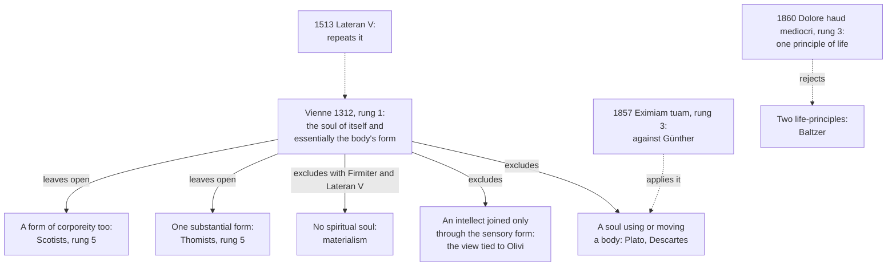

# Creation, Grace & the Last Things · Lesson 2.2: Body and soul: one substance

> ⏱ ~15 min · Module 2: The human person · Builds on: [2.1](02-01-the-image-of-god.md), [`thomistic-synthesis` 5.3](../../thomistic-synthesis/lessons/05-03-the-human-soul-in-the-system.md) · Unlocks: [2.3](02-03-the-soul-immediately-created-and-immortal.md), [7.1](07-01-the-resurrection-of-the-body.md)

## Why this matters

In 1312 a council ruled that whoever obstinately denied one technical sentence was to be regarded as a heretic: the rational soul is of itself and essentially the form of the human body. It is the Church's only definition of *how* soul and body are joined, and it excludes a spirit living in a body as firmly as materialism. Here: what the [Council of Vienne](../reference.md#council-of-vienne) defined, against whom, at what level, and what it left open.

## The idea

We tend to picture the self as a tenant: the real me lives behind the eyes, in a body I will one day leave. The Athanasian Creed said otherwise: "the reasonable soul and flesh is one man" (Schaff, *Creeds of Christendom* vol. 2). Vienne says how. The soul makes this matter a living human body, so that what the body does, bleeding, seeing, I do. Aquinas reverses the tenant's containment: spiritual things "contain those things in which they are; as the soul contains the body" (ST I q.8 a.1 ad 2, English Dominican Province translation).

That is the [soul as form of the body](../reference.md#soul-as-form-of-the-body), and it cuts both ways: you are not a soul using a body, and what makes the matter human is a spiritual soul, not an arrangement of matter. The council did *not* say whether lower forms lie beneath the soul.

## Source

The soul clause of *Fidei catholicae* (Clement V at the Council of Vienne, 1311–1312), handed down in the *Clementines*; the lesson's translation of the Latin:

> Moreover, with the approval of the aforesaid sacred council, we reject as erroneous and hostile to the truth of the Catholic faith every doctrine or position rashly asserting, or calling into doubt, that the substance of the rational or intellective soul is not truly and of itself (*vere ac per se*) the form of the human body. And so that the truth of the pure faith may be known to all, and the way be closed to every error lest it creep in, we define that whoever henceforth presumes to assert, defend or hold obstinately that the rational or intellective soul is not the form of the human body of itself and essentially (*forma corporis humani per se et essentialiter*) is to be regarded as a heretic.

Two acts, one sentence. The first *rejects* (*reprobamus*) as erroneous any doubt that the soul's very *substance*, not a power or part of it, informs the body; the second *defines* (*definientes*), for "the truth of the pure faith". *Per se*: of itself, not through another form between. *Essentialiter*: by what it is, not by an operation, as a mover is joined to what it moves. Obstinacy, from now on (*deinceps*), is heresy. Absent: any name, argument, or word on other forms. The decree opens with Christ's soul (P2).

## In their own words

The decree names no one. Historians match its wording to a position of the Franciscan [Peter John Olivi](../reference.md#peter-john-olivi) (about 1248–1298); the 1911 Denzinger's heading "Errors of Peter John Olivi" is an editor's, and Juhana Toivanen and Robert Pasnau (*Stanford Encyclopedia of Philosophy*) find his view "far more nuanced" than the decree's wording. His case, from his questions on *Sentences* II (q.51), paraphrased:

Intellect and will must be spiritual and incorporeal, or they could not be immortal, intellectual and free, and no form of corporeal matter is that. So the soul has its own spiritual matter and several forms: its sensory and nutritive part informs the body, and its intellective part is joined to the body substantially through that part, not as form to matter. The whole soul may be called the body's form, as we say a person talks, not a tongue. To call the intellective part itself the body's form is "not only contrary to reason but also dangerous to the faith" (their rendering).

## The doctrine

1. **The definition, and its reception.** Vienne, *Fidei catholicae* (1312), above. [Lateran V](../reference.md#apostolici-regiminis) (19 December 1513) repeats "truly, of itself and essentially the form of the human body" as Clement V's canon at Vienne (lesson's translation). GS 14: "Though made of body and soul, man is one" (vatican.va translation); CCC 365, citing Vienne, glosses "form": by the spiritual soul matter becomes a living human body, one nature, not two (paraphrased). *In words:* the soul itself, by what it is, makes the body a human body.

2. **What it excludes.** A soul joined to a body by operation, not essence: Plato's soul using a body (as Aquinas reports him, ST I q.75 a.4), or Descartes's two complete substances. An intellect joined only through a sensory form, the view tied to Olivi. And, with [*Firmiter*](../reference.md#firmiter)'s human "constituted of spirit and body" ([1.1](01-01-creation-out-of-nothing.md)) and Lateran V ([2.3](02-03-the-soul-immediately-created-and-immortal.md)), a human with no spiritual soul. Pius IX applied it to Anton Günther, who made man a synthesis of spirit and a natural soul: his books, says *Eximiam tuam* (15 June 1857), injure the doctrine that the rational soul is "the true, per se and immediate form of the body" (lesson's translation). *In words:* not a passenger, and not a body without spirit.

3. **What it leaves open.** *Per se* excludes a soul informing *through* another form, not the existence of other forms. Aquinas held the rational soul the body's only substantial form ([unicity](../reference.md#unicity-and-plurality-of-forms), ST I q.76 a.4); Scotus and his school held a form of corporeity beneath it, uncensured after 1312. Against Johann Baptist Baltzer, a Güntherian who gave the body a life-principle of its own, Pius IX wrote that [one principle of life](../reference.md#one-principle-of-life), the rational soul, "seems so joined with the Church's dogma that it is its legitimate and only true interpretation" (*Dolore haud mediocri*, 30 April 1860, lesson's translation). A form of corporeity is no life-principle. The 1914 Thomistic Theses state unicity (thesis 16) as a safe directive norm ([`thomistic-synthesis` 6.2](../../thomistic-synthesis/lessons/06-02-leo-xiii-and-the-thomist-revival.md)). *In words:* the soul is the body's form and only life; whether its only form, the schools dispute.

4. **"Soul" in Scripture.** "Man became a living soul" (Gen 2:7, Douay–Rheims) renders *nefesh ḥayyah*, a living being. The word often names the whole living person (CCC 363; [`old-testament` 4.4](../../old-testament/lessons/04-04-jeremiah-and-ezekiel.md) P1), so reading Descartes into it is a mistake. So is the reverse: "fear ye not them that kill the body, and are not able to kill the soul" (Matt 10:28, DR), and the CDF's 1979 letter keeps "soul" for the conscious element that survives death ([2.3](02-03-the-soul-immediately-created-and-immortal.md)). *In words:* the biblical soul is usually the living person, which does not make Scripture materialist.

5. **What follows.** A [separated soul](../reference.md#separated-soul) is what remains of a human being, not one (TS 5.3): hence the [resurrection of the body](../reference.md#resurrection-of-the-body). Aquinas on 1 Corinthians 15:19: "my soul is not I; so even if the soul attains salvation in another life, still not I, nor any man" (*anima mea non est ego*; *Super I Cor.* 15, lect. 2, lesson's translation; [7.1](07-01-the-resurrection-of-the-body.md)). In bioethics it says what death and ensoulment *are*, not *when*: [immediately created](../reference.md#immediate-creation-of-the-soul) does not mean infused at conception ([`moral-theology` 5.2](../../moral-theology/lessons/05-02-abortion.md)); burial and cremation are 7.1's. *In words:* a body's form needs a resurrection, and leaves the clock to others.

**Said plainly.** The council's acts are lost. Its last session (6 May 1312) promulgated constitutions whose text and number we do not know; Clement V and then John XXII corrected them before their publication in 1317, and which are the council's own is uncertain (Tanner's introduction, paraphrased). This one's standing rests on its "with the approval of the sacred council" and on Lateran V. And the man whose view it matches called the defined doctrine dangerous to the faith.

| Defined or taught (with level) | A school's explanation or an opinion (no magisterial level) |
|---|---|
| The rational soul is of itself and essentially the form of the body: **rung 1** (Vienne, 1312) | One substantial form (Thomists) or a form of corporeity too (Scotists): **rung 5** |
| One principle of life, the rational soul: **rung 3** (*Dolore haud mediocri*, 1860) | The rational soul "virtually contains" the lower souls (q.76 a.4): **rung 5** |
| Body and soul one nature, not two: **at least rung 3** as worded (GS 14; CCC 365) | One act of existing for soul and body (q.76 a.1 ad 5): **rung 5** |
| [Death](../reference.md#death) is the soul's separation from the body: **at least rung 3** (CCC 1005; [6.1](06-01-death-and-the-particular-judgment.md)) | That total brain death marks it: **no level** (Ex 2) |

**Mark the levels** ([the ladder](../../fundamental-theology/lessons/04-04-the-ladder-of-doctrinal-authority.md); [levels of authority](../reference.md#levels-of-authority)). The form clause is **rung 1**: an ecumenical council's act ("with the approval of the sacred council") proposing it as of faith, *definientes*, for "the truth of the pure faith". The heresy formula alone does not settle it: the same council *decreed* (*decernimus*) a heretic's punishment for denying that usury is sinful, which [`fundamental-theology` 5.5](../../fundamental-theology/lessons/05-05-the-loci-theologici.md) caps at "certain". The verb, its object and Lateran V's reception do, so [`thomistic-synthesis` 6.5](../../thomistic-synthesis/lessons/06-05-what-the-church-has-said-about-thomism.md)'s rung 1 stands. *Firmiter*'s spirit and body: **rung 1**. The baptism clause chose an opinion "as more probable" and defines nothing ([`sacraments-and-liturgy` 2.3](../../sacraments-and-liturgy/lessons/02-03-confirmation.md)). Pius IX's letters: **rung 3**, the second's *videri* ("seems") a reason to default down; CCC 365 locates. Unicity, plurality, spiritual matter: **rung 5**. Olivi as the target: a historians' judgment, **no level**, and no [dogmatic fact](../reference.md#dogmatic-fact), since no act attributes the sense to him as one did to Jansen ([5.6](05-06-jansenism.md)); Olivi and Aquinas as authors: **no magisterial level**. The 1979 letter: **rung 3** (2.3); the 2000 address: rung 3 at its lightest.

## The map

Three exclusions and one open quarrel, which no later act closes.

## Worked examples

**Ex 1 (clean): where was I?** Invented: at St Monica's Hospital, Quarry Hill, Gideon Ssemakula wakes from three hours under general anaesthesia and asks the chaplain, Sister Clodagh Nyirenda, where he was. On the tenant picture, elsewhere or switched off. On Vienne's, his body's form all along was his rational soul itself, not a lower form minding the flesh while the real Gideon was away. Consciousness is an operation, something he does; the soul informs a sleeping body as fully as a waking one. He was on the table, unconscious; nothing left or came back. *How* the drug stops awareness is pharmacology's question; Vienne has no rival answer.

**Ex 2 (strain): the ventilator.** Invented: Agathe Mwangi has been declared dead by neurological criteria; the ventilator still moves her chest, and her son Kester asks whether her soul has gone. The doctrine fixes the question: if her soul still informs this body she is alive; if not, this is a ventilated corpse. It cannot say which. John Paul II (to the Transplantation Society, 29 August 2000, §§4–5, paraphrased): death, the separation of the life-principle or soul, is an event no empirical method identifies directly, only its signs; "the Church does not make technical decisions"; and the irreversible cessation of all brain activity, rigorously applied, does not seem to conflict with a sound anthropology. Whether that cessation ends the organism's integration is argued by physicians and philosophers, Catholics included. There the doctrine stops.

## Watch out

- **You might think Vienne made Aquinas's psychology dogma.** It defined the soul as the body's form of itself and essentially (**rung 1**); that it is the *only* form is a school thesis (**rung 5**). Demoting the definition for its scholastic vocabulary is the opposite error.
- **You might think the soul sits in the brain, so brain death is the soul leaving the head.** It informs every living part; the criterion treats the brain as evidence of integration, not as the soul's address.

## One-liner

> The soul is not the body's passenger but its form, and that is defined; whether it is the body's only form, the schools still argue.

## Problems

**P1 (🟢)** *(Exegetical)* **Diagnose.** From a training evening for new chaplaincy volunteers at St Monica's Hospital, Quarry Hill, **invented** for this problem:

> "Our Church's view of the person was fixed in 1312, when the Council of Vienne condemned the Franciscan Peter Olivi for teaching that we have two souls. From then on Catholics had to hold Aquinas's philosophy of the soul, including his view that the soul is the body's only substantial form. The same decree defined that every baby receives all the virtues at baptism. Today, of course, the Catechism puts 'form' in inverted commas, so we can treat the old word as a figure of speech for the unity of the person."

Find **four** errors. For each, give the correction, and where a level is involved name the act that fixes it. **150 words or fewer.**

**P2 (🟡)** *(Exegetical)* **Close reading.** The opening sentence of *Fidei catholicae* (Council of Vienne, 1312), the lesson's translation of the Latin:

> Firmly adhering to the foundation of the Catholic faith, beside which, as the Apostle testifies, no one can lay another, we openly confess (*confitemur*) with holy mother Church that the only-begotten Son of God, subsisting eternally with the Father in all in which God the Father exists, assumed in time, in the Virgin's bridal chamber, into the unity of his hypostasis and person (*ad unitatem suae hypostasis et personae*), the parts of our nature united together (*partes nostrae naturae simul unitas*), from which he, existing in himself true God, might become true man (*ex quibus … fieret verus homo*): namely, a human body capable of suffering, and an intellective or rational soul truly informing that very body of itself and essentially.

(a) The sentence names two unions. Which words name each, and what is united in each?

(b) What does the verb tell you about what this sentence does, compared with the definition read in Source? And what does *ex quibus … fieret verus homo* make the participle "informing" do for the Incarnation?

**Two sentences per part.**

**P3 (🔴)** *(Exegetical)* **Find the crux.** Set Olivi's case, as given in "In their own words", beside Aquinas, ST I q.76 a.1, from the *respondeo* (English Dominican Province translation):

> But we must observe that the nobler a form is, the more it rises above corporeal matter, the less it is merged in matter, and the more it excels matter by its power and its operation … Now the human soul is the highest and noblest of forms. Wherefore it excels corporeal matter in its power by the fact that it has an operation and a power in which corporeal matter has no share whatever. This power is called the intellect.

(a) Name the single premise Olivi needs that this passage denies, the words that deny it, and one conviction the two men share.

(b) Vienne defined a conclusion. Did it settle this crux? Say what a Catholic must now deny, what he remains free to hold, and what kind of consideration could move an Olivian.

**Two sentences per part.**

Solutions

**P1** *(Exegetical)*

**Accept:** any four of the five below, each corrected.

**Must hit, strict:**

- **"Condemned Olivi … two souls."** The decree names no one. Historians match its wording to a position of Olivi's, and his view was not two souls but one soul whose intellective part is joined to the body through the sensory part, not as its form. No act attributes the condemned sense to him, so this is not even a dogmatic fact.
- **"Aquinas's philosophy … only substantial form."** Vienne defined that the rational soul is of itself and essentially the form of the body (**rung 1**), not unicity, which is a school thesis (**rung 5**): Scotists held a form of corporeity after 1312 uncensured, and the 1914 theses were proposed in 1916 as safe directive norms, not defined.
- **"Defined that every baby receives all the virtues."** The baptism clause chose that opinion only "as more probable" (*tanquam probabiliorem*), so it defined nothing; the claim's present level is graded in `sacraments-and-liturgy` 2.3.
- **"Inverted commas … figure of speech."** This understates. CCC 365 marks a technical term, cites Vienne and glosses it (by the spiritual soul matter becomes a living human body; one nature, not two); a catechism locates a teaching and cannot lower it, and the definition stays **rung 1**.
- **"Fixed in 1312"** (bonus). The unity was confessed long before (the Athanasian Creed; *Firmiter*'s human "constituted of spirit and body", 1215, **rung 1**); Vienne defined *how* soul and body are joined.

**Wrong turns:** correcting the second error by calling the form doctrine "only Aquinas's opinion" (understates rung 1); treating the 1911 Denzinger heading as the council's words; reading the quotation marks as the Church's withdrawal of the term.

**Model answer:** Vienne named no one; historians link its wording to Olivi, who taught not two souls but one soul whose intellective part joins the body through the sensory part, and no act pins the condemned sense on him. The council defined that the rational soul is of itself and essentially the body's form (rung 1), not Aquinas's unicity, which stays a school thesis (rung 5): Scotists kept a form of corporeity, and the 1914 theses are safe directive norms. The baptism clause chose its opinion "as more probable" and defined nothing. And CCC 365's inverted commas mark a technical term it then explains while citing Vienne; the doctrine remains defined.

---

**P2** *(Exegetical)*

**Must hit, strict (a):**

- **The union of nature:** "the parts of our nature united together" (*partes nostrae naturae simul unitas*), then listed: a body and a rational soul "truly informing that very body of itself and essentially". Soul and body make a nature, ours.
- **The union of person:** "into the unity of his hypostasis and person" (*ad unitatem suae hypostasis et personae*). What is united is that whole nature with the Word, who was already "subsisting eternally" and is its only subject. The soul-body union does not produce a second, human person.

**Must hit, strict (b):**

- The verb is *confitemur*, "we confess": the sentence professes what the Church already holds about Christ, that he assumed a rational soul and a body (**rung 1** since Chalcedon, "of a reasonable soul and [human] body consisting", Percival). It is not itself the definition, which comes with *definientes* in the soul clause. That definition speaks of every rational soul, and so covers Christ's.
- *Ex quibus … fieret verus homo* makes the informing part of what it is for the Word to become "true man". He took a body informed by its rational soul as ours is informed, so the form doctrine is confessed first as Christology. A humanity whose mind was only attached to an otherwise animated body would not be "our nature".

**Wrong turns:** reading "unity of his hypostasis" as the union of soul and body; making soul and body a human person whom the Word then joins (Nestorian); calling this sentence the definition because of its clause about informing; saying the confession is "only a confession", so of no weight.

**Model answer:** (a) "The parts of our nature united together" name a nature: a body and a rational soul that informs it of itself and essentially. "Into the unity of his hypostasis and person" names the union of that whole nature with the Word, who is its only subject, so no human person results.

(b) *Confitemur* makes this a confession of what the Church already holds, that Christ assumed a rational soul and body (rung 1 since Chalcedon); the definition proper is the later clause's *definientes*, which covers every rational soul, Christ's included. *Ex quibus … fieret verus homo* makes the soul's informing part of his being true man: the Word took our nature as it is in us, so the doctrine appears first inside the Incarnation.

---

**P3** *(Exegetical)*

**Must hit, strict (a):**

- **Olivi's premise:** to be the form of corporeal matter is incompatible with being spiritual, so an intellect that informed the body by its own essence could not be immortal, intellectual and free.
- **The denial:** "the nobler a form is, the more it rises above corporeal matter … and the more it excels matter by its power and its operation", and the soul "has an operation and a power in which corporeal matter has no share whatever". A form can inform matter and exceed it.
- **Shared:** both hold that the intellect is spiritual, has an operation no body shares, and is free and immortal. The quarrel is over what being a form allows.

**Must hit, strict (b):**

- **Must deny:** Olivi's conclusion, that the intellective soul is not of itself the body's form (**rung 1**, Vienne). And since the soul's spirituality and immortality are also held (*Firmiter*; Lateran V), a Catholic must deny his premise: informing matter cannot make every operation of a form bodily.
- **Free to hold:** how a form can exceed its matter. Aquinas's gradation of forms, the one act of existing shared with the body (q.76 a.1 ad 5), and unicity are school theses (**rung 5**); a plurality of forms beneath the soul remains permitted. The council gave no argument and adopted no metaphysics. So what could move an Olivian *as a philosopher* is an account of such a form, which is argument, not authority. As a Catholic after 1312 he must reject the conclusion either way.

**Wrong turns:** saying Vienne refuted Olivi, when councils define and do not argue; saying Vienne adopted Aquinas's argument or unicity; stating Olivi's premise as "the soul is not the form of the body at all", which he denied; reading Olivi as a materialist about the intellect.

**Model answer:** (a) Olivi needs the premise that whatever is the form of corporeal matter cannot be spiritual, so an intellect informing the body could not be immortal and free. Aquinas denies it: "the nobler a form is, the more it rises above corporeal matter", and the human soul "has an operation and a power in which corporeal matter has no share whatever". Both men agree that the intellect is spiritual and free.

(b) Vienne binds the conclusion: a Catholic must hold that the intellective soul is of itself the body's form, and so, keeping its spirituality, must deny Olivi's premise. It left the account open: Aquinas's gradation of forms and one act of existing, or a plurality of forms beneath the soul, are school positions, and only an argument for how a form can exceed its matter could move an Olivian's reason.

## Flashback

**From Lesson [1.4](01-04-creation-and-evolution-in-church-teaching.md) (Creation and evolution in Church teaching):** *(Exegetical.)* Close reading. Aquinas, ST I q.68 a.1, "Whether the firmament was made on the second day?", from the *respondeo* (English Dominican Province translation):

> In discussing questions of this kind two rules are to be observed, as Augustine teaches (Gen. ad lit. i, 18). The first is, to hold the truth of Scripture without wavering. The second is that since Holy Scripture can be explained in a multiplicity of senses, one should adhere to a particular explanation, only in such measure as to be ready to abandon it, if it be proved with certainty to be false; lest Holy Scripture be exposed to the ridicule of unbelievers, and obstacles be placed to their believing.

The article then reads the firmament on the physics of Empedocles, Plato and Aristotle (on Aristotle's, a body "naturally incorruptible"), and as the cloudy air.

(a) What does each rule bind the reader to, which words mark the difference in firmness, and how does the rest of the article keep the second? **Two sentences.**

(b) Aristotle's heavens fell long ago. Was Scripture's truth safe only because Aquinas held his firmament loosely? Answer from the claim on which *Providentissimus Deus* §18 rests Augustine's rule, and say what that claim does not license. **Two sentences.**

Solution

**Must hit, strict (a):**

- **Rule one** binds to "the truth of Scripture", held "without wavering": inerrancy, **rung 1**. **Rule two** binds to "a particular explanation", held "only in such measure as to be ready to abandon it", because Scripture "can be explained in a multiplicity of senses", so no one explanation is the text's truth.
- The article stakes the verse on no single physics: it reads it on each, and on the air, so the fall of any one leaves the verse standing.

**Must hit, strict (b):**

- **No: the cosmology was never taught.** Leo rests the rule on intention: the Spirit "did not will to teach men these things", the inner constitution of visible things (1.4's translation), so the writers described what appears; Moses "describes what is obvious to sense" (q.70 a.1 ad 3). The fifth body was Aristotle's physics, never Scripture's assertion: its fall cost an explanation, not a truth.
- **Not licensed:** confining Scripture's truth to faith and morals, which Leo rejects in §20.

**Wrong turns:** attaching "ready to abandon it" to Scripture's truth; taking "the ridicule of unbelievers" for the rule's ground rather than its motive; saying Aquinas taught the incorruptible heavens as Scripture's sense; in (b), "Scripture is true only about salvation", the restricted inerrancy §20 rejects; giving the rules magisterial weight because a Doctor states them.

**Model answer:**

(a) The first rule binds the reader to the truth of Scripture "without wavering", which is inerrancy; the second binds him to a particular explanation only "in such measure as to be ready to abandon it", since Scripture "can be explained in a multiplicity of senses". The article keeps the second by making the verse depend on no one physics, reading the firmament on each cosmology and on the air.

(b) No: *Providentissimus Deus* §18 rests the rule on the claim that the Spirit "did not will to teach" the inner constitution of visible things, so the writers described what appears, and the incorruptible heavens were Aristotle's physics, never Scripture's teaching. The claim concerns what the writers willed to teach; it does not confine Scripture's truth to faith and morals, which Leo rejects in §20.

## Connections

- **Backward:** [2.1](02-01-the-image-of-god.md) found the [image of God](../reference.md#image-of-god) chiefly in the soul's intellect and will; this lesson adds that the soul is the body's form, which is why the body shares the image's dignity (CCC 364). [1.1](01-01-creation-out-of-nothing.md) read *Firmiter*'s human "constituted of spirit and body". The metaphysics of a subsistent form, one *esse* and the separated soul's inclination is [`thomistic-synthesis` 5.3](../../thomistic-synthesis/lessons/05-03-the-human-soul-in-the-system.md); the Twenty-Four Theses' weight is its [6.2](../../thomistic-synthesis/lessons/06-02-leo-xiii-and-the-thomist-revival.md).
- **Forward:** [2.3](02-03-the-soul-immediately-created-and-immortal.md) takes Lateran V's definition of the immortal, individually multiplied soul and the 1979 letter; [6.1](06-01-death-and-the-particular-judgment.md) takes death as separation; [7.1](07-01-the-resurrection-of-the-body.md) takes "my soul is not I" to the resurrection of the body and the sameness question.
- **Sideways:** whether the arguments for an immaterial intellect succeed, and hylomorphism against dualism and functionalism, are [`philosophy-of-mind`](../../philosophy-of-mind/syllabus.md) 5.1–5.3's; whether the separated soul is *you* is the survivalist–corruptionist dispute of [`metaphysics` 6.5](../../metaphysics/lessons/06-05-what-a-person-is.md), which no doctrine decides. P2's two unions meet in the tomb in [`christology` 6.1](../../christology/lessons/06-01-he-descended-into-hell.md): soul and body apart, neither apart from the Word. Olivi and the Spiritual Franciscans as an episode are [`church-history` 5.2](../../church-history/lessons/05-02-friars-and-universities.md).
