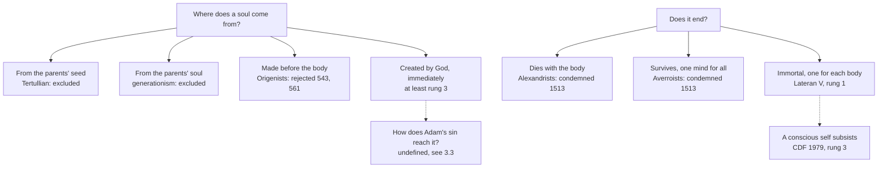

# Creation, Grace & the Last Things · Lesson 2.3: The soul: immediately created, and immortal

> ⏱ ~15 min · Module 2: The human person · Builds on: [2.2](02-02-body-and-soul-one-substance.md), [1.4](01-04-creation-and-evolution-in-church-teaching.md) · Unlocks: [3.3](03-03-trent-session-v-the-definition.md), [6.1](06-01-death-and-the-particular-judgment.md), [7.1](07-01-the-resurrection-of-the-body.md)

## Why this matters

Every soul raises two questions: where it came from, and whether it ends. Christians gave tempting wrong answers: souls inherited from the parents, which would explain [original sin](../reference.md#original-sin) at a stroke; souls existing before birth; one mind for all; a soul that dies with its body. The Church answered both, by different acts at different weights, and left open a third: when the soul arrives.

## The idea

[2.2](02-02-body-and-soul-one-substance.md) made the soul the [form of the body](../reference.md#soul-as-form-of-the-body), and its understanding is no bodily process ([`thomistic-synthesis` 5.3](../../thomistic-synthesis/lessons/05-03-the-human-soul-in-the-system.md)).

A bodily process cannot *make* such a soul. Parents give all that generation gives, and beget a human being, not a body awaiting a tenant; but seed and cells do not produce a mind. So God creates each soul himself, with no created cause between: that is all **immediately** means. It names no moment in pregnancy and no gap in embryology ([1.4](01-04-creation-and-evolution-in-church-teaching.md)).

Nor can dissolution *unmake* it: having no parts to come apart, it survives death, and each person's does, since my understanding is *my* act, not a share in one world-mind. Yet it is a gift that cannot wear out and is given at every moment: immortal by nature, held in being by God.

## Source

Fifth Lateran Council, Leo X's bull [*Apostolici regiminis*](../reference.md#apostolici-regiminis), Session VIII (19 December 1513), as Denzinger excerpts it; lesson's translation of the Latin.

> Since the sower of tares … has dared to sow and spread in the Lord's field certain most pernicious errors … above all about the nature of the rational soul, namely that it is mortal, or one in all human beings, and some, philosophizing rashly, assert that this is true at least according to philosophy (*secundum saltem philosophiam*): … with the approval of this sacred council we condemn and reprobate all who assert that the intellective soul is mortal, or one in all human beings, and those who call these things into doubt; since it is not only truly, of itself and essentially (*per se et essentialiter*) the form of the human body … but also immortal (*immortalis*), and individually multipliable (*singulariter multiplicabilis*) according to the number of bodies into which it is infused. … And since truth in no way contradicts truth, we define (*definimus*) that every assertion contrary to the truth of enlightened faith is altogether false.

Read the shape. Two errors are named, and a stance. The doctrine comes as the *since* clause grounding the condemnation, stacking two clauses on [Vienne](../reference.md#council-of-vienne)'s; the one *definimus* falls on the logic. A penal clause follows, then provisions Denzinger omits: philosophy teachers must make the faith's truth plain and answer contrary arguments, and clerics may not study philosophy past five years without theology or canon law.

## In their own words

[Traducianism](../reference.md#traducianism) (*tradux*, a vine-shoot) hands the soul on with the body. Tertullian (*On the Soul*, early third century; tr. Peter Holmes, *ANF* 3) held the soul a subtle body sown with the flesh (ch. 27): "Every soul, then, by reason of its birth, has its nature in Adam until it is born again in Christ" (ch. 40). Its power: a shoot of Adam's soul carries his sin as a branch carries sap.

In 415 Augustine, who rejected a bodily soul, pressed Jerome, who held that God makes each soul at birth (Letter 166 §10, tr. J. G. Cunningham, *NPNF* I/1):

> … if souls are from day to day made for each individual separately at birth, where, in the case of infant children, is sin committed by these souls …?

Four years on, Scripture still did not tell him "whether by inbreathing them as new, or by deriving them from the parents" (*On the Soul and its Origin* IV.15, tr. Holmes and Wallis, *NPNF* I/5); his *Retractations* (II.45) note that the letter gave no answer of his own.

## The doctrine

1. **Each soul is created by God, immediately.** Anastasius II (*Bonum atque iucundum*, 23 August 498) rejected the claim that parents pass on the soul with the body; Leo IX professed the soul "not a part of God but created from nothing" (*Congratulamur vehementer*, 13 April 1053; lesson's translation). [*Humani Generis*](../reference.md#humani-generis) §36 (12 August 1950) says the Catholic faith "obliges us to hold" it (*animas enim a Deo immediate creari catholica fides nos retinere iubet*). Paul VI's *Credo* (30 June 1968, §8) confesses God creator of each man's soul, without "immediately"; CCC 366 has the word, adding that the soul is not "produced" by the parents. It excludes created producers and fixes no moment: Aquinas put the soul's creation "at the end of human generation" (ST I q.118 a.2 ad 2), and [the timing](../reference.md#time-of-ensoulment) is left open ([`moral-theology` 5.2](../../moral-theology/lessons/05-02-abortion.md)). *In words:* parents beget a human being; no creature makes his soul.

2. **Not before the body.** Justinian's [edict of 543](../reference.md#origenist-anathemas), endorsed by a synod at Constantinople, anathematized the Origenist claim that souls pre-existed, grew sated with God and were embodied as punishment (can. 1); the fifteen anathemas associated with 553 repeat it, their standing disputed ([`patristics` 2.5](../../patristics/lessons/02-05-clement-of-alexandria-and-origen.md); [6.4](06-04-hell.md) owns 553). The local council of Braga I (561, can. 6) condemned the claim that souls sinned in heaven and fell into bodies. *In words:* the soul begins with its body, and embodiment is no penalty.

3. **Not generated.** A bodily soul contradicts spirituality, and [generationism](../reference.md#generationism), the parents' soul producing the child's, fails: a spiritual substance "cannot be caused through generation, but only through creation by God" (q.118 a.2). Anastasius had said that what parents hand on *per traducem* is guilt and penalty (*culpa poenaque peccati*), not the soul. So [3.3](03-03-trent-session-v-the-definition.md) inherits a problem: Trent defines that Adam's sin passes "by propagation, not by imitation" ([Session V](../reference.md#trent-session-v), can. 3; [propagation](../reference.md#propagation-not-imitation)) and never says [how](../reference.md#transmission-of-original-sin). *In words:* the soul is new from God, so sin reaches it some other way.

4. **Immortal, and one for each.** The bull condemns what historians call [monopsychism](../reference.md#monopsychism), Averroes's one separate receiving intellect for all ([`ancient-medieval-philosophy` 3.5](../../ancient-medieval-philosophy/lessons/03-05-soul-and-intellect.md)), and Alexandrist [mortalism](../reference.md#mortalism): with Alexander of Aphrodisias, the soul a perishable form of the body, the undying intellect God's alone. The CDF's 1998 *Doctrinal Commentary* on the *Professio fidei* (§11) lists immortality among truths to be believed as revealed. *In words:* each human has his own soul, and it does not die.

5. **Immortal by nature, held by gift.** "It is impossible for a subsistent form to cease to exist" (ST I q.75 a.6); and reduction to nothing implies "not in the creature a potentiality to non-existence, but in the Creator the power of ceasing to sustain existence" (ad 2). So [immortality](../reference.md#immortality-of-the-soul) is natural, not a [preternatural gift](../reference.md#preternatural-gifts) like the [bodily immortality](../reference.md#immunity-from-death) Adam lost ([3.1](03-01-original-justice-and-the-fall.md)), nor the independent title of the *Phaedo*'s soul, deathless as kin to the divine and pre-existent ([`ancient-medieval-philosophy` 2.3](../../ancient-medieval-philosophy/lessons/02-03-the-soul-its-parts-and-immortality.md)). *In words:* nothing in the soul tends to die, and it exists because God keeps it in being.

6. **The separated soul.** Parted from the body, it keeps "a natural inclination to be united to the body" (q.76 a.1 ad 6) and is no person (q.75 a.4 ad 2): the schools' incomplete substance, the [separated soul](../reference.md#separated-soul). The CDF's *Letter on Certain Questions Concerning Eschatology* (17 May 1979, point 3) affirms that a spiritual element endowed with consciousness and will survives and subsists, so that the "human self" subsists; the Church calls it the soul. *In words:* someone is there to be judged and prayed for before the body rises ([6.1](06-01-death-and-the-particular-judgment.md)).

**Said plainly.** Pietro Pomponazzi's *Tractatus de immortalitate animae* (Bologna, 1516) came three years after the bull, which names no one; it struck positions already argued in Italian universities. And the bull took from philosophers the leave to call a conclusion true in philosophy while the faith taught its opposite. No Latin master is known to have taught ["double truth"](../reference.md#double-truth) as a doctrine; it names a charge ([`ancient-medieval-philosophy` 7.1](../../ancient-medieval-philosophy/lessons/07-01-faith-reason-and-the-paris-crisis.md)), whose denial the bull defined.

| Defined or taught (with level) | A school's explanation or an opinion (no magisterial level) |
|---|---|
| Each soul immediately created by God: **at least rung 3** (HG §36; CCC 366) | No spirit can be generated (q.118 a.2): **rung 4**. When it is infused: **rung 5** |
| The soul is immortal, one for each body: **rung 1** (Lateran V; CDF 1998) | That reason proves it (Aquinas) or cannot (Scotus): **rung 5** |
| A conscious "human self" subsists after death: **rung 3** (CDF 1979) | An incomplete substance, not a person: **rung 4**; whether I survive in it: **rung 5** ([`metaphysics` 6.5](../../metaphysics/lessons/06-05-what-a-person-is.md)) |
| Adam's sin passes by propagation: **rung 1** (Trent V, can. 3) | How it reaches a created soul (with the nature: I-II q.81 a.1 ad 2): **rung 5** |

**Mark the levels** ([the ladder](../../fundamental-theology/lessons/04-04-the-ladder-of-doctrinal-authority.md); [levels of authority](../reference.md#levels-of-authority)). **Immortality and one soul per body: rung 1**: an ecumenical council condemns the contrary as heresy, on a truth of faith (unlike the *monti* of [`theology-of-debt` 5.1](../../theology-of-debt/lessons/05-01-the-monti-di-pieta-and-lateran-v.md)), and the CDF in 1998 classes it as revealed. **The two-truths claim: its denial rung 1** (the *definimus*, repeated in *Dei Filius* ch. 4). **[Immediate creation](../reference.md#immediate-creation-of-the-soul): at least rung 3**; nothing defines it. For **rung 1 by the ordinary universal magisterium**: HG ascribes the obligation to "the Catholic faith", *retinere* means keeping what is held, and the teaching is constant since 498 and follows from defined truths. Against: no act proposes it as revealed, HG says it in a parenthesis, the 1998 examples omit it, and can. 749 §3 defaults down. So: **at least rung 3**, rung 1 when so argued. **[Pre-existence](../reference.md#pre-existence-of-souls): its denial at least rung 3**: 543 and Braga I are local, 553 contested, though the rejection is universal and follows from Vienne (**rung 4**). **Conscious self: rung 3. Incomplete substance: rung 4. Timing, demonstrability: rung 5.** The bull's rules for teachers: **law, no rung**; Fathers and Aquinas as authors: **no magisterial level**.

## The map

One answer from each list; each choice left a door open.

## Worked examples

**Ex 1 (clean): the laboratory.** Invented: at an inquirers' evening at Christ the King, Saltmarsh, Tendai Marchetti-Oyo asks whether the embryologist who conceived her son by IVF made his soul, or his parents did. They are his parents: "man begets his like" by disposing matter for its form (q.118 a.2 ad 4), and the laboratory serves that bodily process. The soul is from God alone, wherever a human being is (CCC 366). Whether IVF is licit is [`moral-theology` 5.5](../../moral-theology/lessons/05-05-assisted-reproduction-and-the-embryo.md)'s question.

**Ex 2 (strain): the unproved conclusion.** Invented: Yaroslav Quint, a philosophy student, finds no working argument for immortality. The bull condemns asserting mortality true "at least according to philosophy"; he denies only that a proof exists. Scotus judged no philosophical argument compelling and held survival by faith; Cajetan doubted that Aristotle proves it; the theses put to Augustin Bonnetty (1855) claim proof of the soul's *spirituality*, not its immortality. So he holds the conclusion (**rung 1**) and is free on the proof (**rung 5**). Were he to add "and philosophy shows it mortal", he would stand near Pomponazzi's line of 1516, the assertion the *definimus* calls false. The doctrine stops there: it binds conclusion and logic, not arguments.

## Watch out

- **You might think the Church teaches that the soul is created at conception.** *Immediately* excludes created causes, not a moment: the timing is **rung 5** (MT 5.2).
- **You might think immediate creation is defined dogma, or an encyclical's passing opinion.** Nothing defined it, and **at least rung 3** is the floor.
- **You might think "gift of the creator" makes immortality supernatural, like grace.** It is natural to a subsistent form, a gift only as all existence is (q.75 a.6 ad 2).

## One-liner

> God makes each soul himself, through no creature, and it never dies, though it lives on being he gives; when he makes it, and how Adam's sin reaches it, the Church has not said.

## Problems

**P1 (🟢)** *(Exegetical)* **Reconstruct.** Aquinas, ST I q.118 a.2, from the *respondeo* (English Dominican Province translation):

> Again, since the intellectual soul has an operation independent of the body, it is subsistent, as proved above (Q. 75, A. 2): therefore to be and to be made are proper to it. Moreover, since it is an immaterial substance it cannot be caused through generation, but only through creation by God. Therefore to hold that the intellectual soul is caused by the begetter, is nothing else than to hold the soul to be non-subsistent and consequently to perish with the body. It is therefore heretical to say that the intellectual soul is transmitted with the semen.

(a) Put the argument into numbered premises and a conclusion (P1, P2, … ∴ C), and flag the premise that carries the most weight.

(b) Aquinas calls the contrary "heretical". By his own argument, which doctrine would a traducianist be denying, and what kind of judgment is Aquinas's word? **Two sentences for (b).**

**P2 (🟡)** *(Exegetical)* **Find the crux.** Justinian's first anathematism against Origen (543), in Percival's translation (*NPNF* II/14):

> Whoever says or thinks that human souls pre-existed, i.e., that they had previously been spirits and holy powers, but that, satiated with the vision of God, they had turned to evil … and had been condemned to punishment in bodies, shall be anathema.

Aquinas, ST I q.118 a.3, from the *respondeo* (English Dominican Province translation):

> For if it were accidental to the soul to be united to the body, it would follow that man who results from this union is a being by accident; or that the soul is a man … Moreover, that the human soul is not of the same nature as the angels, is proved from the different mode of understanding …: for man understands through receiving from the senses, and turning to phantasms …

(a) Name the single premise about the soul and its body that the condemned position needs and Aquinas denies, and give his two reasons for denying it.

(b) An Origenist replies: "You admit the soul exists without a body after death, so a bodiless soul is no contradiction." Answer from what this lesson teaches about the separated soul, and say what the answer implies about the soul between death and resurrection.

**Two sentences per part.**

**P3 (🔴)** *(Exegetical)* **Diagnose.** Slides for the confirmation programme at Christ the King, Saltmarsh, **invented** for this problem:

> (1) "Your parents really made you, not just a body for you to live in."
>
> (2) "The Church teaches that God creates your soul at the very moment of conception."
>
> (3) "Your soul is a spark of God himself, which is why nothing, not even God, could ever end it."
>
> (4) "St Augustine, the great teacher of original sin, taught that your soul comes from your parents' souls: that's how Adam's sin reaches you."
>
> (5) "In 1513 the Fifth Lateran Council condemned Pomponazzi's famous book denying immortality."

One slide is correct. Say which, and correct the other four, naming the concept that does the work and, where a source decides it, the source. **150 words or fewer.**

Solutions

**P1** *(Exegetical)*

**Must hit, strict (a):**

- P1: The intellectual soul has an operation independent of the body. P2: What operates independently of the body subsists (q.75 a.2). P3: What subsists is itself what comes to be and ceases to be ("to be and to be made are proper to it"). P4: An immaterial subsistent cannot come to be by generation, only by creation by God. ∴ C1: The intellectual soul is created by God, not caused by the begetter. Then the reverse: P5: if it were caused by the begetter, it would be a non-subsistent form produced through the body. P6: such a form perishes with the body. ∴ C2: to hold it generated is to hold it mortal.
- Flag P2/P3 (subsistence, and that a subsistent is made and unmade *per se*): the whole argument, including C2, runs through subsistence. P4 is acceptable as the flagged premise if the answer says why generation, a bodily power, cannot reach an immaterial effect (the first paragraph of the *respondeo*).

**Must hit, strict (b):**

- The traducianist would, by Aquinas's chain, be denying the soul's subsistence and so its **immortality** (C2): that is the doctrine his "heretical" leans on, the one Lateran V later condemned the contrary of.
- "Heretical" here is **a theologian's censure**, Aquinas's judgment about what the view entails, with **no magisterial level** of its own: it shows how firmly the schools held immediate creation, not what an act defined.

**Wrong turns:** reconstructing only C1 and missing the move from "generated" to "perishes with the body"; treating Aquinas's "heretical" as a conciliar condemnation; saying the argument is about *when* the soul arrives (it is about by whom).

**Model answer:**

(a) P1: The intellectual soul acts independently of the body. P2: What acts independently subsists. P3: What subsists is what comes to be and ceases to be in its own right. P4: An immaterial subsistent can come to be only by creation, not by generation. ∴ C1: God creates it; the parents do not. P5: A soul caused by the begetter would be a non-subsistent form of the body. P6: Such forms perish with their bodies. ∴ C2: To hold the soul generated is to hold it mortal. The weight is on P2–P3: everything turns on subsistence.

(b) He would be denying the soul's subsistence and so its immortality, since a generated soul would perish with the body. "Heretical" is Aquinas's own censure, a theologian's judgment with no magisterial level, not an act of the Church.

---

**P2** *(Exegetical)*

**Must hit, strict (a):**

- The crux: **whether union with a body is accidental to the human soul.** The anathematized view needs souls that existed as complete "spirits and holy powers" and became embodied only as a "punishment"; Aquinas denies that the union is accidental.
- Reason 1: if union were accidental, the human being would be a being by accident, or the soul would be the man, which q.75 a.4 refutes. Reason 2: the human soul is not of the angels' nature, since it understands by receiving from the senses and turning to phantasms, so it needs the body.

**Must hit, strict (b):**

- Existing without a body is possible for the soul but **not its natural state**: separated, it keeps "a natural inclination to be united to the body" (q.76 a.1 ad 6) and is not a person (q.75 a.4 ad 2). So the after-death case shows that a soul *can* subsist alone, not that it was *made* alone. Aquinas's own reply in the same article (ad 3): the soul is without its body only because the body was corrupted, a result of sin, and God would not begin his work with something unnatural.
- So between death and resurrection the soul exists **incompletely**, inclined to its body and awaiting it: the separated soul supports natural union rather than refuting it, and makes the resurrection fitting ([7.1](07-01-the-resurrection-of-the-body.md)).

**Wrong turns:** naming the crux as "whether souls are immortal" (both sides agree souls survive); answering (a) with the 543 or 553 decrees instead of the premise; saying in (b) that the separated soul is a complete person or angel-like.

**Model answer:**

(a) The condemned position needs the premise that union with a body is accidental, even penal, to a soul that is already a complete spirit; Aquinas denies it. If the union were accidental, a man would be a being by accident or simply his soul, and the human soul, unlike an angel, understands through the senses and phantasms, so it needs a body.

(b) The separated soul shows only that a soul can subsist alone, not that it was made alone: it keeps a natural inclination to its body and is not a person, and Aquinas adds that it is bodiless only because death, a result of sin, corrupted the body. So between death and resurrection it exists incompletely, awaiting its body, which supports natural union rather than refuting it.

---

**P3** *(Exegetical)*

**Accept:** any order; the correct slide must be identified as correct, not "fixed".

**Must hit, strict:**

- **(1) Correct.** Parents beget a human being, the whole child, by disposing matter for its form (q.118 a.2 ad 4); only the soul is from God alone. "Correcting" (1) into "parents make only the body" is an error.
- **(2) Overstated.** *Immediately* means with no created cause between, not at a stated moment. When the soul is infused is **freely disputed, rung 5** (MT 5.2); Aquinas held it came at the end of generation.
- **(3) Two errors.** The soul is not a part of God but created from nothing (Leo IX, 1053), and its immortality is no independent title: it has no potency to non-being, but God could cease to sustain it (q.75 a.6 ad 2). Natural incorruptibility, held by gift.
- **(4) False history.** Augustine never decided between creationism and traducianism: he asked Jerome to teach him (Letter 166, 415) and records in the *Retractations* (II.45) that the letter gave no answer of his own.
- **(5) Wrong date and target.** Pomponazzi's *Tractatus* appeared in 1516, after the bull of 19 December 1513, which names no one and condemned positions already argued.

**Wrong turns:** calling (1) dualism, or (2) correct because CCC 366 says "immediately"; correcting (3) by making immortality a supernatural gift; calling Augustine a traducianist on the strength of his dilemma.

**Model answer:** Slide 1 is correct: parents beget the whole child (q.118 a.2 ad 4), and only the soul is from God alone. Slide 2 confuses "immediately" (no created cause) with a moment; when the soul is infused is freely disputed, and Aquinas put it late. Slide 3 errs twice: the soul is created from nothing, not part of God (Leo IX), and it is immortal by nature yet held in being by God, who could cease to sustain it (q.75 a.6 ad 2). Slide 4 is false: Augustine asked Jerome for an answer and never gave his own (Letter 166; *Retractations* II.45). Slide 5 misdates the book: Pomponazzi published in 1516, three years after the bull, which names no one.

## Flashback

**From Lesson [2.1](02-01-the-image-of-god.md) (The image of God):** *(Exegetical.)* Assign the level. Give each claim its rung, or say why none applies, and name the act or source that fixes it.

(a) Christ is the image of the invisible God.

(b) "Image" is a name proper to the Son, so the Holy Spirit is not the Image.

(c) Christ, the final Adam, fully reveals man to himself.

(d) The Council of Trent defined that the image of God survived Adam's sin.

**One or two sentences per item.**

Solution

**Must hit, strict:**

- **(a) Rung 1.** Scripture asserts it formally (Col 1:15; 2 Cor 4:4), and the ordinary universal magisterium has always proposed it as revealed; *Gaudium et Spes* 22 cites it, and no definition is needed.
- **(b) Rung 4.** The Latin schools' common teaching (ST I q.35 a.2), argued from the Son's proceeding as word, like in species to its source. No act proposes it, and Aquinas reports that the Greek Doctors commonly call the Spirit an image, reading them as meaning "a perfect similitude" (ad 1).
- **(c) Rung 3.** *Gaudium et Spes* 22 (1965) teaches it and CCC 1701 restates it; no act proposes it as revealed.
- **(d) Misattributed.** Trent VI can. 5 (1547) defines only that free will was not "lost and extinguished" (**rung 1**). Free will is a sign of the image (GS 17), but the image's own survival is **at least rung 3** (CCC 705, 1702), not defined.

**Wrong turns:** demoting (a) to rung 3 because a pastoral constitution and a catechism state it, when they report what Scripture asserts; lifting (b) to rung 1 because (a) is, or because Scripture gives the name only to the Son; putting (c) at rung 1 because a council said it, or below rung 3 because the constitution is "pastoral"; in (d), accepting the attribution, or overcorrecting to "not taught at all".

**Model answer:**

(a) Rung 1: Scripture asserts it (Col 1:15; 2 Cor 4:4) and the ordinary universal magisterium proposes it as revealed.

(b) Rung 4: the Latin schools' teaching, argued in ST I q.35 a.2 from the Son's procession as word; no act fixes it, and the Greek Doctors commonly called the Spirit an image too.

(c) Rung 3: *Gaudium et Spes* 22 teaches it, restated in CCC 1701.

(d) False as an attribution: Trent VI can. 5 defines only that free will survived (rung 1); the image's survival is at least rung 3 (CCC 705, 1702).

## Connections

- **Backward:** [2.2](02-02-body-and-soul-one-substance.md) fixed Vienne's form clause, which Lateran V builds on, and [1.4](01-04-creation-and-evolution-in-church-teaching.md) read *Humani Generis* §36 as an act and sent its soul clause here. The metaphysics of the subsistent soul and its shared *esse* is [`thomistic-synthesis` 5.3](../../thomistic-synthesis/lessons/05-03-the-human-soul-in-the-system.md); Averroes and the Paris quarrel are [`ancient-medieval-philosophy` 3.5](../../ancient-medieval-philosophy/lessons/03-05-soul-and-intellect.md) and [7.1](../../ancient-medieval-philosophy/lessons/07-01-faith-reason-and-the-paris-crisis.md); Origen and the anathemas are [`patristics` 2.5](../../patristics/lessons/02-05-clement-of-alexandria-and-origen.md).
- **Forward:** [3.3](03-03-trent-session-v-the-definition.md) takes the problem traducianism's failure left: how a sin of origin reaches a soul God creates. The separated soul opens Module 6 ([6.1](06-01-death-and-the-particular-judgment.md)), its inclination to the body returns in [7.1](07-01-the-resurrection-of-the-body.md), and the 553 anathemas with [*apokatastasis*](../reference.md#apokatastasis) are [6.4](06-04-hell.md)'s.
- **Sideways:** the timing of ensoulment and its moral weight are [`moral-theology` 5.2](../../moral-theology/lessons/05-02-abortion.md); whether the separated soul is *you* is the survivalist and corruptionist dispute of [`metaphysics` 6.5](../../metaphysics/lessons/06-05-what-a-person-is.md); the philosophical case for an immaterial intellect is [`philosophy-of-mind`](../../philosophy-of-mind/syllabus.md)'s, and Kant's attack on the rational proof of the soul is [`modern-philosophy` 6.2](../../modern-philosophy/lessons/06-02-the-soul-and-the-antinomies.md). [`fundamental-theology` 5.5](../../fundamental-theology/lessons/05-05-the-loci-theologici.md) Ex 1 showed that a weak argument for immortality leaves the conclusion where Lateran V put it.
