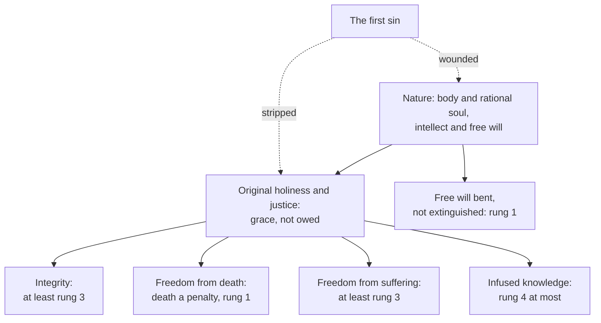

# Creation, Grace & the Last Things · Lesson 3.1: Original justice, and the fall

> ⏱ ~15 min · Module 3: Original sin · Builds on: [2.1](02-01-the-image-of-god.md), [2.3](02-03-the-soul-immediately-created-and-immortal.md) · Unlocks: [3.2](03-02-pelagius-augustine-and-the-councils.md), [3.3](03-03-trent-session-v-the-definition.md), [4.4](04-04-nature-and-grace-the-gratuity-of-the-supernatural.md)

## Why this matters

[Original sin](../reference.md#original-sin) is defined by what it lost, so you cannot say what it is until you say what Adam had. The tradition's answer is generous: grace, a body that need not die, desire that obeyed reason. Most of that portrait is theology; only two lines of it are defined, and this lesson keeps them apart.

## The idea

Picture a house on rock, with a second storey added as a gift by the owner's friend. An earthquake brings the gift storey down whole and cracks the first. Nothing of the gift is left; the house stands, letting in the wind.

On the Church's teaching the first man was made a nature, body and rational soul ([2.1](02-01-the-image-of-god.md), [2.3](02-03-the-soul-immediately-created-and-immortal.md)), and given more: [original justice](../reference.md#original-justice). Its root is [grace](../reference.md#sanctifying-grace), friendship with God and a share in his life, which orders the race to a supernatural end from the start. From the root hang the [preternatural gifts](../reference.md#preternatural-gifts), beyond what nature can claim but perfecting it in its own line. The manuals count four: [integrity](../reference.md#gift-of-integrity) (desire held under reason), [freedom from death](../reference.md#immunity-from-death), freedom from suffering, and infused knowledge. None was owed.

The fall, the first man's free disobedience, brought the gift storey down whole and cracked the nature beneath: in the gloss Aquinas cites, man was "stripped of his gifts, and wounded in his nature". Module 3 asks how that loss reaches us.

## Source

Aquinas, *Summa Theologiae* I q.95 a.1, "Whether the first man was created in grace?", from the *respondeo* (Fathers of the English Dominican Province, 1920). He has just reported that "some say" grace came after creation:

> But the very rectitude of the primitive state, wherewith man was endowed by God, seems to require that, as others say, he was created in grace … For this rectitude consisted in his reason being subject to God, the lower powers to reason, and the body to the soul: and the first subjection was the cause of both the second and the third … Now it is clear that such a subjection of the body to the soul and of the lower powers to reason, was not from nature; otherwise it would have remained after sin … Hence it is clear that also the primitive subjection by virtue of which reason was subject to God, was not a merely natural gift, but a supernatural endowment of grace

The argument runs backward from the loss: what sin destroyed cannot have been nature, which survives sin even in the demons, and an effect cannot outrun its cause, so the root was grace. Integrity stood or fell with grace, which is why the gifts fell together. Note the hedge, "seems to require … as others say": the better opinion, not faith.

## The doctrine

1. **Holiness and justice, had and lost.** Trent, [Session V](../reference.md#trent-session-v) (17 June 1546), can. 1: Adam "immediately lost the holiness and justice wherein he had been constituted" (Waterworth); can. 2 condemns saying he lost it "for himself alone, and not for us also". The verb is *constitutus*, not *creatus*. Pohle–Preuss (1912), citing Pallavicino's history, report that the draft read "created" and was changed [so as not to decide](../reference.md#constitutus-not-creatus) between Aquinas (created in grace) and Peter Lombard, Bonaventure and the Scotists (grace given later). CCC 375 keeps "constituted" and calls this grace a share in divine life, known backward from Christ: we know Adam as the source of sin only by knowing Christ as the source of grace (CCC 388). *In words:* the race began in friendship with God, and lost it for all.

2. **Death came as the threatened penalty.** [Carthage (418)](../reference.md#council-of-carthage-418) can. 1 (African Code can. 109, Latin numbering) condemns saying "that Adam, the first man, was created mortal, so that whether he had sinned or not, he would have died in body … by natural necessity" (Percival, NPNF2 vol. 14). Trent V can. 1: he incurred "death, with which God had previously threatened him" (Genesis 2:17). The immunity was a gift, not a property of the body: "the first immortality was to be able not to die" (Augustine, *Rebuke and Grace* 12.33, NPNF1 vol. 5), and for Aquinas the body was kept "by reason of a supernatural force given by God to the soul" (I q.97 a.1). *In words:* Adam's death was a sentence, not a flaw built into him.

3. **Integrity, and freedom from suffering.** Trent V can. 5 says Paul calls [concupiscence](../reference.md#concupiscence) sin, not as truly sin in the reborn, "but because it is of sin, and inclines to sin" (Waterworth); can. 1, borrowing [Orange II](../reference.md#orange-ii) can. 1, has "the entire Adam … changed, in body and soul, for the worse". If disordered desire is *of* sin, the first man before sin was without it: naked and "not ashamed" (Genesis 2:25), then sewing aprons (3:7). CCC 377 calls him free of the triple concupiscence (1 John 2:16); for CCC 376 he need not have suffered or died, and Paul VI's *Credo of the People of God* (30 June 1968) §16 says man then knew neither evil nor death. *In words:* before sin, desire followed reason as reason followed God.

4. **None of it owed.** Pius V's *Ex omnibus afflictionibus* (1 October 1567) condemned propositions drawn from Michael [Baius](../reference.md#baius), among them (lesson's translations): "The integrity of the first creation was not an unowed exaltation of human nature, but its natural condition" (prop. 26), and "The immortality of the first man was not a benefit of grace, but a natural condition" (prop. 78). Prop. 21 made the elevation to grace itself owed ([4.4](04-04-nature-and-grace-the-gratuity-of-the-supernatural.md)). *In words:* God could have withheld every gift without wronging the nature he made.

5. **Infused knowledge.** Aquinas holds that the first man knew, "by divinely infused species", all that man can naturally know, since he was made in a perfect state to teach and govern others (I q.94 a.3 and ad 1). No council speaks of it. *In words:* a school's portrait of Adam the teacher.

6. **The fall: what went and what stayed.** Genesis 3, read as text in [`old-testament` 2.3](../../old-testament/lessons/02-03-the-primeval-history.md), gives dogmatically a command (2:17), a disobedience and a sentence (3:19), in figurative language affirming "a primeval event" (CCC 390), the hinge of [3.4](03-04-monogenism-polygenism-and-the-modern-reinterpretations.md). Romans 5:18–19's Adam–Christ parallel is [`new-testament` 5.3](../../new-testament/lessons/05-03-romans-5-11-adam-spirit-israel.md)'s. Aquinas sorts the damage (I-II q.85 a.1): original justice "was entirely destroyed"; nature's principles and powers were "neither destroyed nor diminished"; the inclination to virtue was diminished. His *sed contra* gives the gloss on Luke 10:30: the traveller "was stripped of his gifts, and wounded in his nature" ([*expoliatur gratuitis et vulneratur in naturalibus*](../reference.md#stripped-and-wounded)). He credits Bede; the English Dominicans' note traces it to the *Glossa Ordinaria*. Free will is "by no means extinguished" (Trent VI ch. 1 and can. 5, read in [4.2](04-02-the-necessity-of-grace.md)), and the *Credo* §16 restates the gloss in its own words. *In words:* the gifts went whole; the nature stayed, hurt.

**Said plainly.** Scripture never names a preternatural gift, and the list of four is the manuals'. Trent defines two lines about the first state: holiness and justice possessed and lost, and death incurred as the threatened penalty.

| Defined or taught (with level) | A school's explanation or an opinion (no magisterial level) |
|---|---|
| Adam constituted in holiness and justice, lost for himself and us: **rung 1** (Trent V cann. 1–2) | Created in grace (Aquinas, I q.95 a.1), or given grace later (Lombard, Bonaventure, Scotus): **rung 5** |
| Death the penalty of sin, not natural necessity: **rung 1** (Carthage 418 can. 1; Trent V can. 1) | Kept alive by a power given to the soul (I q.97 a.1) |
| Integrity before sin: **at least rung 3** (inferred from Trent V can. 5; presupposed in 1567; CCC 377) | The gifts hang on reason's subjection to God (I q.95 a.1) |
| Integrity and immortality not owed to nature: **at least rung 3** (Pius V, props. 26, 78) | "Preternatural": the manuals' category between natural and supernatural |
| Free will not extinguished: **rung 1** (Trent VI can. 5) | Stripped of the gifts, wounded in nature; the four wounds (I-II q.85 a.3) |

**Mark the levels** ([the ladder](../../fundamental-theology/lessons/04-04-the-ladder-of-doctrinal-authority.md); [levels of authority](../reference.md#levels-of-authority)). Beyond the table: Carthage's canon is **rung 1** by confirmation and reception ([3.2](03-02-pelagius-augustine-and-the-councils.md)). That the holiness lost was supernatural grace is **at least rung 3** (Pius V against props. 21 and 23; CCC 375). Integrity is not rung 1: it is inferred from "of sin", the council's reason for Paul's word, and whether the closing anathema reaches the reason is [3.3](03-03-trent-session-v-the-definition.md)'s question. That suffering, like death, entered by sin is **at least rung 3**: Trent V can. 2 presupposes that "pains of the body" passed from Adam, and the *Credo* and CCC 376 teach it; what impassibility was (I q.97 a.2) is **rung 4**. Infused knowledge has no act behind it: **rung 4 at most**, its extent **rung 5**. Pius V's censure falls [*in globo*](../reference.md#in-globo-censure), so the contraries of props. 26 and 78 are **rung 3** with no precise note. The *Credo*, by its own account not strictly a definition (§3), is **rung 3** for what it adds. Pohle–Preuss grade paradisal immortality "strictly of faith" and the gratuity of integrity and immortality *fidei proximum*: a manual's notes, **no magisterial level**, like the Fathers and Aquinas.

## The map

Grace held the gifts in place, so the sin that removed grace removed them with it; the nature beneath was wounded and kept.

## Worked examples

**Ex 1 (clean): "Would Adam still be alive?"** Invented: at an inquirers' evening at St Joachim's, Ferncastle, Torvald Amadi asks the catechist, Ione Fairweather, "If Adam hadn't sinned, would he be alive today?" *Would he have died?* No: death "by natural necessity" whether he sinned or not is condemned (Carthage can. 1, **rung 1**). *Was his body immortal by nature?* No: that is Baius's prop. 78, whose contrary is **rung 3**; he was able not to die, not unable. *How was he kept?* By a power given his soul, says Aquinas (**rung 4**). *Would he be walking about now?* Aquinas thinks he would have been "transferred thence to heaven" (I q.102 a.4): **rung 5**, no act speaks to it.

**Ex 2 (strain): the infant and the sage.** Invented: in the same group Ksawery Pike has read [`patristics` 2.2](../../patristics/lessons/02-02-irenaeus-recapitulation.md): for Irenaeus, Adam was "as yet an infant", unable to receive perfection (*Against Heresies* IV.38.1, ANF). Aurelia Mbatha has read Aquinas: "perfection comes before imperfection", so the first man was made "in his perfect state" (I q.94 a.3). Both hold the defined line: Irenaeus's Adam too "did easily lose the similitude" (V.16.2), which comes through the Spirit (V.6.1), and neither makes the first state glory (CCC 374). The strain is the portrait: no act fixes Adam's maturity, knowledge or how long his innocence lasted. Integrity (**rung 3**) requires that disordered desire came after sin; it requires the sage no more than it excludes the infant. Choosing between them is **rung 5**.

## Watch out

- **You might think Trent defined that Adam was created in grace.** It wrote *constitutus*, not *creatus*, so as not to decide: **rung 5**.
- **You might think the preternatural gifts are all dogma, or all decoration.** Death as penalty is **rung 1**, integrity **at least rung 3**, infused knowledge without any act; a manual's *fidei proximum* is not a rung.
- **You might think Adam "could not die".** He was able not to die (Augustine); immortality by nature is the condemned proposition.
- **You might think the Church denies that fallen nature is "corrupt".** Aquinas calls it "corrupt nature" (I-II q.109 a.2). What is denied is *total* corruption (CCC 405) and an extinguished will (Trent VI can. 5, **rung 1**); "wounded, not corrupted" is a slogan, not a text.

## One-liner

> That Adam had holiness and justice and lost them for all, and that death came as the sentence on sin, is defined; the rest of the paradise portrait is the schools' painting on that frame.

## Problems

**P1 (🟢)** *(Exegetical)* **Assign the level.** For each claim, give its rung, or say it has none, and name the act that fixes it. **One line per claim.**

(a) The first man, Adam, lost by his sin the holiness and justice in which he had been constituted, and lost it for us as well.

(b) Adam received grace in the first instant of his creation.

(c) Had Adam not sinned, he would have been taken to heaven without dying.

(d) The first man's freedom from death belonged to human nature as such.

(e) Before the first sin, the first man's sense appetite never resisted his reason.

(f) Adam knew by infused knowledge everything naturally knowable.

**P2 (🟡)** *(Exegetical)* **Close reading.** Athanasius, *On the Incarnation* 3.4 and 4.6 (Archibald Robertson, *Nicene and Post-Nicene Fathers*, 2nd series, vol. 4). God has placed the first humans in his garden under a law:

> so that, if they kept the grace and remained good, they might still keep the life in paradise without sorrow or pain or care besides having the promise of incorruption in heaven; but that if they transgressed and turned back, and became evil, they might know that they were incurring that corruption in death which was theirs by nature … For man is by nature mortal, inasmuch as he is made out of what is not; but by reason of his likeness to Him that is (and if he still preserved this likeness by keeping Him in his knowledge) he would stay his natural corruption, and remain incorrupt

(a) Sort what the passage assigns to nature and what to grace, naming the words that do it.

(b) Carthage (418) can. 1 condemns saying that Adam was "created mortal, so that whether he had sinned or not, he would have died". Does "man is by nature mortal" fall under the condemnation? Say which words decide it.

(c) What does "corruption" name here? Is it what CCC 405 denies when it says human nature has not been totally corrupted?

**Two sentences per part.**

**P3 (🔴)** *(Exegetical)* **Diagnose.** From a talk at an inquirers' evening, **invented**, written for this problem:

> "Before the fall Adam and Eve had it all. They couldn't die, couldn't suffer, knew everything there is to know, and couldn't sin, and every one of those is defined dogma. That's what the preternatural gifts are. And of course God owed them all that: he made them in his image, and a good father gives his children what their nature needs. The Council of Trent tells us Adam was created in grace. Then the fall wrecked the lot, gifts and nature alike, which is why since Adam none of us can really choose the good at all."

Find **four** errors (there are more). For each, give the correction, and where a level is involved, name the act that fixes it. **150 words or fewer.**

Solutions

**P1** *(Exegetical)*

**Must hit, strict:**

- **(a) Rung 1.** Trent V can. 1 (lost the holiness and justice "wherein he had been constituted") and can. 2 (lost it for us, not for himself alone), 1546.
- **(b) Rung 5.** No act fixes it. Trent wrote *constitutus*, not *creatus*, deliberately leaving the Thomist (created in grace) and Franciscan (grace given later) views open; Aquinas offers his view as what the original rectitude "seems to require" (I q.95 a.1).
- **(c) Rung 5.** It is Aquinas's opinion (I q.102 a.4: "transferred thence to heaven"), and no act speaks to it. The defined claim beneath it is only that death came as the penalty of sin and not by natural necessity (Carthage 418 can. 1; Trent V can. 1, rung 1), which does not say what would have happened instead.
- **(d) Condemned; its contrary is rung 3.** Pius V, *Ex omnibus afflictionibus* (1567), Baius's prop. 78, condemned *in globo*, so the contrary has no precise note. Not rung 1, since no canon defines the gratuity of immortality.
- **(e) At least rung 3.** It is the gift of integrity, inferred from Trent V can. 5's reason clause, that concupiscence is "of sin" (with can. 1's "changed … for the worse"); an inference from a reason is not itself defined. Pius V's condemnation of prop. 26 presupposes the gift and fixes its gratuity (rung 3), and CCC 377 teaches it.
- **(f) Rung 4 at most.** It is Aquinas's thesis (I q.94 a.3) and the old schools' common teaching; no magisterial act mentions it, and its extent is rung 5.

**Wrong turns:** calling (b) defined because Trent speaks of Adam's holiness; promoting (c) to rung 1 because Carthage and Trent make death a penalty; calling the denial of (d) heresy (overstating a global censure); putting (e) at rung 1 as if the inference were itself defined, or at rung 4 as mere theology; giving (f) a magisterial level because the manuals list it.

**Model answer:** (a) Rung 1: Trent V cann. 1–2. (b) Rung 5: Trent chose *constitutus* so as not to decide, and no act settles it. (c) Rung 5: Aquinas's opinion (I q.102 a.4); Carthage 418 can. 1 and Trent V can. 1 define only that death came as penalty (rung 1). (d) Condemned among Baius's propositions (prop. 78, 1567), *in globo*, so the contrary is rung 3. (e) At least rung 3: inferred from Trent V can. 5's "of sin", presupposed by the 1567 condemnation, taught in CCC 377. (f) Rung 4 at most: Aquinas's thesis, with no act behind it.

---

**P2** *(Exegetical)*

**Must hit, strict (a):**

- **Nature's:** mortality and "that corruption in death which was theirs by nature", because man is "made out of what is not".
- **Grace's:** life "without sorrow or pain or care", "the promise of incorruption", and the power to "stay his natural corruption", given "if they kept the grace" and through "his likeness to Him that is", kept by knowing God. Freedom from death and from pain are conditional gifts, lost by transgression.

**Must hit, strict (b):**

- **No.** Carthage condemns a mortality that would have killed Adam "whether he had sinned or not … by natural necessity". Athanasius says the opposite: had he kept the grace, he "would stay his natural corruption, and remain incorrupt". The deciding words are the two conditionals, "if they kept the grace" and "if he still preserved this likeness".
- "By nature mortal" is the claim that immortality was not nature's own. That is the contrary of Baius's condemned prop. 78, and it matches Aquinas's "not by reason of any intrinsic vigor of immortality" (I q.97 a.1).

**Must hit, strict (c):**

- "Corruption" here is physical: dissolution and death, the drift of what was made from nothing back toward nothing (as [`patristics` 3.1](../../patristics/lessons/03-01-athanasius.md) reads it).
- CCC 405's claim that nature "has not been totally corrupted" concerns its powers, which are wounded but not destroyed, with free will kept (Trent VI can. 5). The two uses differ, so Athanasius neither affirms nor denies what CCC 405 denies.

**Wrong turns:** reading "by nature mortal" as falling under Carthage's anathema; reading Athanasius's "corruption" as total moral depravity, or as the "state of corrupt nature" of the Latin schools; treating Athanasius as defining anything (a Father's text carries no rung).

**Model answer:** (a) Mortality and "that corruption in death which was theirs by nature" belong to man as made from nothing. Life without sorrow or pain, the promise of incorruption and the power to "stay his natural corruption" come from grace and the likeness to God, on the condition that they "kept the grace". (b) No: Carthage condemns a death that would have come whether Adam sinned or not, and Athanasius makes incorruption conditional on keeping the grace ("if they kept the grace", "if he still preserved this likeness"). "By nature mortal" denies only that immortality was nature's own, which is exactly what the condemnation of Baius's prop. 78 requires. (c) Here "corruption" is bodily dissolution, the return of a thing made from nothing toward nothing. CCC 405 denies a total corruption of nature's powers, a different claim, so the passage does not touch it.

---

**P3** *(Exegetical)*

**Accept:** any four of the six below.

**Must hit, strict:**

- **"Couldn't die."** He was able not to die, not unable to die (Augustine, *Rebuke and Grace* 12.33). What is defined is that death came as the penalty of sin, not by natural necessity (Carthage 418 can. 1; Trent V can. 1, **rung 1**).
- **"Couldn't sin."** He did sin. He was able not to sin, not unable to sin (same passage).
- **"Every one … defined dogma."** Only the loss of holiness and justice and death as penalty are defined (**rung 1**). Integrity and freedom from suffering are **at least rung 3**; infused knowledge has no act behind it (**rung 4 at most**).
- **"God owed them."** Pius V condemned making integrity and immortality nature's due (Baius's props. 26 and 78, 1567, *in globo*: the contrary is **rung 3**). The image is not a title to the gifts.
- **"Trent says created in grace."** Trent wrote "constituted" so as not to decide: **rung 5**.
- **"Wrecked … nature."** The gifts were lost whole, and nature was wounded, not destroyed. Free will is "by no means extinguished" (Trent VI ch. 1; can. 5, **rung 1**), and the claim that free will avails only for sinning is Baius's condemned prop. 27.

**Wrong turns:** correcting "couldn't die" by saying death is natural and was always coming, which denies Carthage can. 1; correcting "owed" by calling the gifts unreal; "correcting" the levels by making everything rung 5.

**Model answer:** Adam was able not to die, not unable to die; what is defined is only that death came as the penalty of his sin (Carthage 418 can. 1; Trent V can. 1, rung 1). The gifts are not all dogma: integrity is at least rung 3, and infused knowledge has no magisterial act behind it. Nothing was owed, since Pius V condemned calling integrity and immortality nature's due (1567, props. 26 and 78; rung 3 for the contrary). Trent wrote "constituted", not "created", leaving the moment of grace open. And the fall stripped the gifts and wounded nature without destroying it: free will is "by no means extinguished" (Trent VI can. 5, rung 1).

## Flashback

**From Lesson [2.3](02-03-the-soul-immediately-created-and-immortal.md) (The soul: immediately created, and immortal):** *(Exegetical.)* Reconstruct. Anastasius II, *Bonum atque iucundum* (23 August 498), against some in Gaul who said parents give the soul as they give the body; lesson's translation of the Latin (Denzinger, 1911):

> How then … with too carnal an understanding, do they think the soul made to the image of God is spread by human intermingling, when the action of him who did this from the beginning does not cease even today, as he said: "My Father worketh until now; and I work"? … They think it pious to say that souls are handed on by the parents, since souls are entangled in sins; … nothing else can be handed on by the parents than what their own evil presumption committed, the guilt and penalty of sin, which the offspring following *per traducem* plainly shows.

The quotation is John 5:17 (DR). Between the excerpts, God's creating "all things together" (Ecclus 18:1) is called potential and causal, his work now visible.

(a) Put the letter's two moves as P1, P2, … ∴ C1 and C2, supplying the unstated premise behind "too carnal an understanding".

(b) The letter itself says guilt and penalty pass *per traducem*. Why is that no concession to [traducianism](../reference.md#traducianism), and what does it leave open? **Two sentences.**

Solution

**Must hit, strict (a):**

- P1: the soul is made to the image of God. **P2 (unstated):** what is made to God's image is spiritual, and nothing spiritual is spread by bodily mingling; to think so is to think of the soul as a body. P3: God's making has not ceased (John 5:17); the creation of all things together was potential and causal. ∴ C1: God infuses each soul; the parents do not hand it on.
- P4 (the opponents'): souls are entangled in sins, so they come from the sinful parents. P5: parents can hand on only what evil presumption committed, sin's guilt and penalty; the soul is God's work (C1). P6: the offspring shows that these pass. ∴ C2: guilt and penalty pass by descent, not the soul.

**Must hit, strict (b):**

- **No concession.** The traducianist's *tradux* is the soul itself, so that every soul "has its nature in Adam" (Tertullian); Anastasius uses the word only of guilt and penalty, granting the inherited sinfulness traducianism claimed to explain and refusing its explanation.
- **Open:** how a guilt that passes by descent reaches a soul God makes directly. The letter says *that* guilt passes and *what* does not, never *how*: [3.3](03-03-trent-session-v-the-definition.md)'s problem.

**Wrong turns:** reading "nothing else can be handed on" as denying that parents give the body or beget the child (2.3 Ex 1); reading "infuses" as fixing a moment of ensoulment, when the letter names a cause, not a time; taking *per traducem* as surrender to traducianism; reading C2 as a mechanism.

**Model answer:**

(a) P1: the soul is made to God's image. P2 (unstated): what is so made is spiritual and is not spread by bodily mingling. P3: God's making has not ceased (John 5:17). ∴ C1: God infuses each soul. P4 (the opponents'): sinful souls must come from sinful parents. P5: parents hand on only what evil presumption committed, guilt and penalty. P6: the offspring shows these pass. ∴ C2: guilt and penalty pass by descent; the soul does not.

(b) Anastasius applies *per traducem* to guilt and penalty, not to the soul, so he grants the inherited sinfulness traducianism appealed to and denies that it needs an inherited soul. He says that guilt passes and the soul does not, but not how guilt reaches a soul God creates, the question 2.3 hands to 3.3.

## Connections

- **Backward:** [2.1](02-01-the-image-of-god.md) gave the image that grace perfected and the fall did not erase, and [2.3](02-03-the-soul-immediately-created-and-immortal.md) the soul's immortality, which belongs to the soul as created, where the body's in paradise was an added gift. [`old-testament` 2.3](../../old-testament/lessons/02-03-the-primeval-history.md) read Genesis 3 as text; [`patristics` 2.2](../../patristics/lessons/02-02-irenaeus-recapitulation.md) and [3.1](../../patristics/lessons/03-01-athanasius.md) gave the infant Adam and the drift toward nothing.
- **Forward:** [3.2](03-02-pelagius-augustine-and-the-councils.md) weighs Carthage and Orange, and [3.3](03-03-trent-session-v-the-definition.md) reads Session V whole: what is transmitted, how, and what baptism removes. [3.4](03-04-monogenism-polygenism-and-the-modern-reinterpretations.md) asks what CCC 390's "primeval event" and Trent's "first man, Adam" require. [4.2](04-02-the-necessity-of-grace.md) runs the wounded nature through I-II q.109, and [4.4](04-04-nature-and-grace-the-gratuity-of-the-supernatural.md) asks whether the vision itself was owed, where Baius returns.
- **Sideways:** integrity has a Christological twin. Christ had no *fomes* ([`christology` 3.4](../../christology/lessons/03-04-the-grace-of-the-head.md)) and still suffered and died, so sinlessness does not entail exemption from death, as [`ecclesiology-and-mariology` 6.4](../../ecclesiology-and-mariology/lessons/06-04-the-assumption.md) argues for Mary. What the first state implies about animal death before sin is Boss 1(d)'s question ([syllabus](../syllabus.md)); fall theodicies of natural evil are [`philosophy-of-religion` 4.3](../../philosophy-of-religion/lessons/04-03-theodicies.md)'s. How far sin wounded reason is the nature-and-grace seam [`apologetics-foundations` 1.2](../../apologetics-foundations/lessons/01-02-three-strategies.md) works from the other side.
