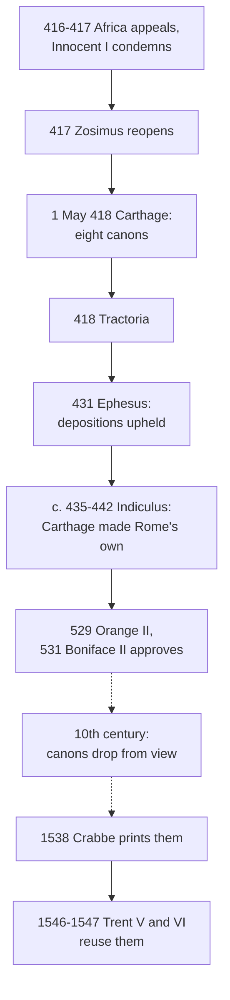

# Creation, Grace & the Last Things · Lesson 3.2: Pelagius, Augustine, and the councils

> ⏱ ~15 min · Module 3: Original sin · Builds on: [3.1](03-01-original-justice-and-the-fall.md), [`patristics` 4.5](../../patristics/lessons/04-05-augustine-against-the-pelagians.md) · Unlocks: [3.3](03-03-trent-session-v-the-definition.md), [4.2](04-02-the-necessity-of-grace.md), [5.1](05-01-trent-session-vi-justification.md), [5.4](05-04-predestination.md)

## Why this matters

Every later quarrel about grace (Trent against Luther, Báñez against Molina, Rome against the Jansenists) is fought inside a fence built between 418 and 531 by an African council and a Gallic synod of fourteen bishops. This lesson says what they settled, at what weight, and why a synod whose canons vanished for six centuries binds you.

## The idea

Pelagius and Augustine both said free will is real and grace necessary; they disagreed about what grace *does* (`patristics` 4.5: whether God's help reaches the willing itself or only the power to will). The councils did not settle that by adopting a theologian; they condemned a short list of sentences.

Think of a fence, not a map. In 418 Carthage drove posts on the Pelagian side: Adam's death was a penalty; infants are born needing what baptism gives; grace is more than forgiveness, more than instruction, more than an easier road. Then monks in southern Gaul asked what those posts did not reach: granted grace is needed, might the *first step*, the [beginning of faith](../reference.md#beginning-of-faith) (*initium fidei*), be ours, with grace answering it? In 529 Orange drove a post there too: even the first stirring is grace. Inside the fence, how grace moves the will and why one receives it and another not were left open. The posts are rung 1, but not because of who drove them in.

## In their own words

**Pelagius.** A moral reformer before he was a heretic, a lay ascetic at Rome who would not let Christians excuse sin by human weakness; `patristics` 4.5 gives his case at full strength, with his triad of ability, volition and actuality ([Pelagianism](../reference.md#pelagianism)). His confession to Pope Innocent holds that "man is always able both to sin and not to sin". Universal sin he put down to habit; to Demetrias (both in B. B. Warfield's translation, *NPNF* first series, vol. 5, Introductory Essay):

> Nothing makes well-doing so hard … as the long custom of sins which begins from childhood and gradually brings us more and more under its power until it seems to have in some degree the force of nature.

Grace, so understood, is everywhere: the nature God made able, the law, Christ's teaching and example, forgiveness. It is not a power working on the will, which would then no longer author its own goodness.

**The Massilians.** The monks of Marseilles and Lérins accepted Carthage but resisted Augustine's late books (`patristics` 4.5, Ex 2), which seemed to make exhortation idle. John Cassian, *Conference* XIII.8 (tr. Edgar Gibson, *NPNF* second series, vol. 11):

> when He sees in us some beginnings of a good will, He at once enlightens it and strengthens it and urges it on towards salvation, increasing that which He Himself implanted or which He sees to have arisen from our own efforts.

The weight is on "or": sometimes grace plants the beginning (Paul, Matthew), sometimes the will does and grace meets it: Zacchaeus and the good thief (XIII.11), and Cornelius, shown the way "by way of recompense" for prayers and alms (XIII.15). Faustus of Riez defended the same line in his *On Grace*. Cassian is venerated as a saint; later polemic named the position [semi-Pelagianism](../reference.md#semi-pelagianism).

## The doctrine

1. **Carthage, 1 May 418: the Pelagian side.** Africa's plenary council (eight canons; cann. 109–116 of the African code in Percival, *NPNF* second series, vol. 14) condemned saying that Adam would have died "not by the desert of sin but by necessity of nature" (*non peccati merito, sed necessitate naturae*, can. 1); that infants baptized "for the remission of sins" draw no original sin from Adam (can. 2); that grace only remits past sins (can. 3), or only shows us what to seek and avoid, and not so that what we know we should do "we may also love to do and be able to do" (*diligamus atque valeamus*, can. 4), or only makes the commandments easier (can. 5, read in [4.2](04-02-the-necessity-of-grace.md)); and that the saints confess their sins humbly but not "truly" (*veraciter*, cann. 6, 8), or pray "forgive us" only for others (can. 7) (lesson's translations). A canon on a "middle place" for unbaptized infants, in some manuscripts only, is [7.4](07-04-limbo.md)'s. *In words:* death is a penalty, infants need baptism, and grace gives the will love and strength, not just the mind a lesson ([Carthage](../reference.md#council-of-carthage-418)).

2. **Rome and Ephesus receive it.** Zosimus, who had reopened the case in Caelestius's favour in 417, condemned him and Pelagius in his circular [*Tractoria*](../reference.md#tractoria) (summer 418, surviving in fragments); eighteen Italian bishops, Julian of Eclanum among them, refused it and were deposed (Percival). Ephesus (431) deposed clergy holding "the doctrines of Celestius" (cann. 1, 4) and, writing to Pope Celestine, upheld the Western depositions; it defined nothing about grace. The [*Indiculus*](../reference.md#indiculus), a Roman collection of about 435–442, probably Prosper's, embraces Carthage's cann. 3–5 "as the Apostolic See's own" (ch. 7) and declines to assert "the deeper and more difficult parts" of the questions (ch. 10) (lesson's translations). *In words:* Africa's canons became the Church's by Rome's adoption, not Africa's rank.

3. **Orange, 3 July 529: the post at the beginning.** [Orange II](../reference.md#orange-ii) met under Caesarius of Arles, working from "a few chapters sent to us by the Apostolic See" (prooemium, lesson's translation). Cann. 1–8 run "if anyone says" but end in other censures (he "resists the Holy Spirit"), never "let him be anathema"; cann. 9–25 are sentences of the Fathers, chiefly Augustine. Can. 5 is the beginning-of-faith canon: "as the increase, so also the beginning of faith" (*sicut augmentum, ita etiam initium fidei*) comes not "naturally" but from "the inspiration of the Holy Spirit correcting our will from unbelief to faith". The [prevenient grace](../reference.md#prevenient-grace) canons (3–8, 18) are read in 4.2. The conclusion takes Cassian's own examples, the thief, Cornelius and Zacchaeus: their faith "was not from nature but given by the bounty of divine grace". Its one anathema falls on predestination to evil ([5.4](05-04-predestination.md)). *In words:* the first stirring toward faith is God's gift, and nature has no claim on it.

4. **Boniface II, *Per filium nostrum*, 25 January 531.** Caesarius asked Rome to "confirm by the authority of the Apostolic See" his confession that right faith and "the beginning of all good will" come by prevenient grace. Boniface names Augustine above all the Fathers, marvels that some still labour under "the remnants of the old error", and approves the confession as "in agreement with the Catholic rules of the Fathers" (lesson's translations). What he approves is the confession; the letter as Denzinger prints it names no canon. *In words:* Rome confirmed what Orange confessed.

**Said plainly.** Orange was a provincial synod met for a church's dedication; nothing in its rank lets it define for the Church. Its weight comes from Rome, at both ends, and from reception, which has a hole. On the historians' standard account its canons dropped out of circulation in the tenth century and came back with Peter Crabbe's *Concilia omnia* (Cologne, 1538). Aquinas's *Summa* never cites it (only the *first* council of Orange, of 441, through Gratian: III q.80 a.9). He reached Orange's doctrine through Augustine and 2 Corinthians 3:5, ascribing to "the Pelagians" the thesis that "the beginning of doing well came from us" (I q.23 a.5).

| Defined or taught (with level) | A school's explanation or an opinion (no magisterial level) |
|---|---|
| Grace needed for every saving act, the beginning of faith included, and unowed: **rung 1** (Orange; Trent VI cans. 1–3) | How grace moves the will: premotion or foreseen consent, **rung 5** ([5.5](05-05-the-de-auxiliis-controversy.md)) |
| Adam's sin passed to all as sin, not death alone; infants baptized for its remission: **rung 1** (Carthage can. 2, Orange can. 2; Trent V cann. 2, 4) | How it passes, left undefined: **rung 5** ([3.3](03-03-trent-session-v-the-definition.md)) |
| Adam's death a penalty, not nature: **rung 1** (Carthage can. 1; Trent V can. 1) | Immortality as the soul's mastery over the body: the schools' account ([3.1](03-01-original-justice-and-the-fall.md)) |
| No one predestined to evil: **rung 1** (Orange's conclusion; Trent VI can. 17) | Election before or after foreseen merits: **rung 5** (5.4) |
| The just truly sin, lightly and daily: **rung 1** (Carthage cann. 6–8; Trent VI can. 23) | Why: the sense appetite not yet healed (I-II q.109 a.8), common teaching, **rung 4** |

**Mark the levels** ([the ladder](../../fundamental-theology/lessons/04-04-the-ladder-of-doctrinal-authority.md); [levels of authority](../reference.md#levels-of-authority)). Carthage's doctrine is **rung 1**, not by an African council's rank but through Zosimus, Rome's adoption and Trent: can. 1 through V can. 1 (3.1 fixes exactly what), can. 2 through V can. 4, can. 5 through VI can. 2, cann. 6–8 through VI can. 23. Orange's doctrine (grace prevenient to every salutary act, the beginning of faith included; unmerited; no predestination to evil) is **rung 1**: Rome sent its chapters and approved its confession, and Trent defines the same (VI cann. 1–3, 17). That Boniface's letter is itself *ex cathedra* is not manifest, so default down (can. 749 §3); nothing needs it. Ephesus's canons are **law and discipline, no rung**; its letter receives a sentence on persons. The *Indiculus*: **no magisterial level**, a witness to Rome's mind. The Massilian thesis is excluded: its contradictory is **rung 1**. Pelagius, Cassian, Faustus and Augustine as authors, and the doubtful infants' canon, carry **no magisterial level**.

## The timeline

Dashed: the six centuries in which the Church held Orange's doctrine without Orange's text.

## Worked examples

**Ex 1 (clean): Session V, stitched.** Trent's decree on [original sin](../reference.md#original-sin) ([3.3](03-03-trent-session-v-the-definition.md); [Trent Session V](../reference.md#trent-session-v)) is partly built from these texts, as Denzinger's quotation marks show. Can. 1's "the entire Adam … was changed, in body and soul, for the worse" (Waterworth) is Orange can. 1. Can. 2's "death, and pains of the body … but not sin also, which is the death of the soul" is Orange can. 2 with "pains" added. Can. 4 is Carthage can. 2, enlarged. Run the ladder: the act is Trent's canon, a solemn definition, so **rung 1**, as it would be had Orange stayed lost. Trent could take the old words as the Church's because they already were: confirmed, received, back in print eight years earlier.

**Ex 2 (strain): "nothing but falsehood and sin".** Orange can. 22 is Augustine word for word (*Tractates on John* 5.1, tr. John Gibb):

> No one has anything of his own except falsehood and sin. But if man has any truth and justice, it is from that fountain after which we ought to thirst in this desert …

Read flat, the first sentence makes every act of an unbeliever a sin, the thesis Pius V condemned in Baius ([4.2](04-02-the-necessity-of-grace.md)) and Trent VI can. 7 excludes. The second sentence blocks that: "of his own" means from man as source, and any truth and justice anyone has is from God. The canon's rung attaches to the doctrine so received, not to the hardest reading of an aphorism. Here the doctrine stops: whether an unbeliever's honest act draws on that fountain as grace or as God's ordinary help to nature, the canon does not say, and the schools divide (4.2).

## Watch out

- **You might think Orange II is an ecumenical council or a solemn papal definition.** The 1913 *Catholic Encyclopedia* credits it with "œcumenical authority"; it is a provincial synod whose doctrine is rung 1 through confirmation, reception and Trent. "Only a local council, so optional" understates it.
- **You might think "semi-Pelagian" names an ancient party.** The word is sixteenth-century: the Lutheran Formula of Concord (Epitome II, in the Book of Concord, 1580) rejects the error of the "half-Pelagians" (*Halbpelagianer*; Latin *Semipelagiani*), and the quarrel over Molina made it a Catholic charge (5.5).

## One-liner

> Between 418 and 531 the Church settled that grace goes before every saving act, faith's first stirring included, and that Adam left us sin, not death only; it binds because Rome made it its own and Trent defined it, not because the synods were great.

## Problems

**P1 (🟢)** *(Exegetical)* **Assign the level.** For each claim, give its rung (or say it is condemned and give its contradictory's rung, or say it has none) and name the act that fixes it. **Two sentences per claim.**

(a) Adam was created mortal, so that he would have died in the body whether he sinned or not.

(b) Infants are rightly baptized "for the remission of sins", but they contract nothing from Adam that needs remitting.

(c) Carthage was an African council, so its canons that the saints truly sin and truly pray "forgive us our trespasses" bind no one outside Africa.

(d) The *Indiculus* is Pope Celestine I's decree on grace, so its refusal in ch. 10 to assert "the deeper and more difficult parts" of the questions is a papal definition that they must stay open.

**P2 (🟡)** *(Exegetical)* **Close reading.** Pelagius, quoted by Augustine, *On the Grace of Christ* I.8 (tr. Peter Holmes, rev. B. B. Warfield, *NPNF* first series, vol. 5):

> "We are supposed by very ignorant persons to do wrong in this matter to divine grace, because we say that it by no means perfects sanctity in us without our will,—as if God could have imposed any command on His grace, without also supplying the help of His grace to those on whom he imposed His commands, so that men might more easily accomplish through grace what they are required to do by their free will." … "God helps us," says he, "by His teaching and revelation, whilst He opens the eyes of our heart; whilst He points out to us the future, that we may not be absorbed in the present; whilst He discovers to us the snares of the devil; whilst He enlightens us with the manifold and ineffable gift of heavenly grace." … "Does he not acknowledge both man's free will and God's grace?"

(a) Which clause does a canon of Carthage condemn almost word for word? Name the canon, say what its condemned proposition adds that turns the clause into an error, and name the canon of Trent Session VI that repeats the condemnation.

(b) Every help in Pelagius's list is of one kind. Name the kind and the Carthage canon that catches the list, quote the canon's words for what the list leaves out, and say why his last item, his best defence, still falls short.

**Two sentences per part.**

**P3 (🔴)** *(Exegetical)* **Diagnose.** Slides for an adult formation evening at St Prosper's, Calderwick, by the catechist Ottoline Varga, **invented** for this problem:

> **418:** Pope Zosimus backed the African bishops from the start, and his *Tractoria* closed the question for good.
>
> **431:** The ecumenical Council of Ephesus defined the Catholic doctrine of grace against Pelagius.
>
> **529:** The Council of Orange issued twenty-five anathemas.
>
> **1270s:** St Thomas built his treatise on grace on Orange's canons.

Correct each slide, and where a level is involved, give it and name the act. **150 words or fewer.**

Solutions

**P1** *(Exegetical)*

**Must hit, strict:**

- **(a) Condemned; its contradictory, that Adam's death is a penalty of sin, is rung 1.** Carthage can. 1 (418) condemns dying "not by the desert of sin but by necessity of nature"; Trent V can. 1 (1546) defines that Adam incurred death "through the offence of that prevarication", and is the act that fixes the level (3.1 says exactly what it defines).
- **(b) Condemned; its contradictory is rung 1.** This is Caelestius's position, condemned by Carthage can. 2. Trent V can. 4 takes the canon over almost word for word, so the act is Trent's definition.
- **(c) Understated: rung 1.** The council's rank is not the route. Trent VI can. 23 (1547) defines that no one can avoid all sins, even venial, through a whole life without special privilege, and ch. 11 calls the cry "Forgive us our trespasses" "both humble and true", Carthage's own pairing.
- **(d) Overstated twice: no magisterial level.** The *Indiculus* is a Roman compilation of about 435–442, probably Prosper's, headed pseudo-Celestine in Denzinger, so it is no papal act. Its ch. 10 declines to assert the deeper questions; declining defines nothing, either way.

**Wrong turns:** grading (a) or (c) by Carthage's rank, either up ("a council, so dogma") or down ("African, so local"); giving (c) rung 3 because ch. 11 is a chapter, when can. 23 defines the core; in (d), reading ch. 10 as a definition that predestination may not be taught, or giving it rung 5 "by papal decision".

**Model answer:** (a) Condemned at Carthage (can. 1), and Trent V can. 1 defines that Adam incurred death through his sin, so the contradictory is rung 1. (b) Condemned: Caelestius's view, rejected by Carthage can. 2 and defined against by Trent V can. 4, which copies it; rung 1. (c) Understated: Trent VI can. 23 defines that even the just cannot avoid all venial sin without a special privilege, and ch. 11 calls their prayer "humble and true", so rung 1. (d) Wrong on both counts: the *Indiculus* is a Roman compilation, probably by Prosper, with no magisterial level, and refusing to assert something is not a definition.

---

**P2** *(Exegetical)*

**Must hit, strict (a):**

- The clause is "so that men might more easily accomplish through grace what they are required to do by their free will", condemned by **Carthage can. 5** (*facilius possimus implere per gratiam*).
- What makes it an error is the canon's rider: "as if, even if grace were not given, we could fulfil the commandments, not easily but still without it" (lesson's translation). Against that the canon sets John 15:5, "without me you can do nothing", not "with more difficulty". **Trent VI can. 2** repeats it ("more easily … though hardly indeed and with difficulty").

**Must hit, strict (b):**

- Every help is **knowledge**: teaching, revelation, opening the eyes of the heart, pointing out the future, uncovering the devil's snares, illumination. **Carthage can. 4** condemns grace that helps only by revealing the commandments "so that we may know what we ought to seek and what to avoid" (lesson's translation). Its words for what is missing: "that what we know we should do, we may also love to do and be able to do" (*diligamus atque valeamus*).
- "Enlightens us with the manifold and ineffable gift of heavenly grace" sounds inward, but it is still *enlightening*: it informs the mind and gives the will neither love nor power. The canon's 1 Corinthians 8:1 argument is exactly this: knowledge puffs up and charity builds up, and both are God's gifts.

**Wrong turns:** pinning "more easily" on can. 4 or the list on can. 5; saying Pelagius denied grace, when the passage affirms it loudly; treating "heavenly grace" as proof that he held inward grace in Augustine's sense; quoting Percival's English of can. 4, which misplaces "and also that we should love to do so" inside the condemned proposition.

**Model answer:** (a) "So that men might more easily accomplish through grace what they are required to do by their free will" is condemned almost verbatim by Carthage can. 5, whose rider adds the error, that without grace we could still keep the commandments, only less easily, against John 15:5. Trent VI can. 2 repeats the condemnation. (b) Every item informs the mind, which is what Carthage can. 4 condemns as the whole of grace, since grace also makes us "love to do and be able to do" (*diligamus atque valeamus*) what we know. Even the "ineffable gift of heavenly grace" is an enlightening, so it leaves the will where it was.

---

**P3** *(Exegetical)*

**Must hit, strict:**

- **418, false.** In 417 Zosimus reopened the case in Caelestius's favour, and only after the African council of 1 May 418 did the *Tractoria* condemn both men. It closed nothing for good: eighteen Italian bishops refused it and were deposed, and the Gallic question about the beginning of faith was still to come.
- **431, overstated.** Ephesus's cann. 1 and 4 depose clergy holding "the doctrines of Celestius" (discipline, no rung), and its letter upholds the West's depositions; it defined no proposition on grace. The doctrine's acts are Carthage as Rome adopted it, and Trent: rung 1.
- **529, false.** Cann. 1–8 condemn without the anathema formula, cann. 9–25 are sentences of the Fathers, and the one anathema is in the conclusion, against predestination to evil (rung 1, with Trent VI can. 17).
- **Aquinas, false.** The *Summa* never cites Orange II; on the historians' account the canons were out of circulation until 1538. He reached its doctrine through Augustine and 2 Corinthians 3:5 (I q.23 a.5).

**Wrong turns:** "correcting" slide 3 to "twenty-five canons, all anathemas"; making Ephesus irrelevant, when it is ecumenical reception of the condemnation of persons; claiming Aquinas taught the Massilian view for want of the text.

**Model answer:** Zosimus first reopened the case for Caelestius in 417 and condemned both men only after Carthage's council of May 418; even then eighteen Italian bishops refused, and the Gallic question was still to come. Ephesus deposed clergy who held Caelestius's doctrines and upheld the Western sentences, but defined nothing about grace: its canons are discipline, and the doctrine is rung 1 through Carthage as Rome adopted it, and through Trent. Orange issued eight canons without the anathema formula and seventeen sentences of the Fathers; its single anathema, in the conclusion, falls on predestination to evil. Aquinas never cites Orange II, whose canons were out of circulation until 1538; he reached the same doctrine from Augustine and 2 Corinthians 3:5.

## Flashback

**From Lesson [3.1](03-01-original-justice-and-the-fall.md) (Original justice, and the fall):** *(Exegetical.)* Reconstruct. Aquinas, ST I-II q.85 a.3, *respondeo* (English Dominican Province translation, 1920), on why weakness, ignorance, malice and concupiscence are called the wounds of nature:

> As a result of original justice, the reason had perfect hold over the lower parts of the soul, while reason itself was perfected by God, and was subject to Him. Now this same original justice was forfeited through the sin of our first parent … so that all the powers of the soul are left, as it were, destitute of their proper order, whereby they are naturally directed to virtue; which destitution is called a wounding of nature.

He then takes the four powers that can be the subject of a virtue (reason, will, irascible, concupiscible) and names a wound in each: ignorance, malice, weakness, concupiscence.

(a) Put the argument as P1, P2, … ∴ C, and flag the premise that does the most work and is most open to challenge.

(b) Give C's level. Then say whether the wound of malice, the will "deprived of its order of good", collides with what Trent defines about the fallen will, naming the canon.

**Numbered premises, then two sentences per part.**

Solution

**Must hit, strict (a):**

- **P1.** By [original justice](../reference.md#original-justice) reason was subject to God, and the lower powers to reason.
- **P2.** Original justice was lost by the first sin (Trent V cann. 1–2, **rung 1**).
- **P3.** Without it the powers lack the order by which they are naturally directed to virtue.
- **P4.** That privation of order is a wound of nature.
- **P5.** Four powers can be subjects of virtue: reason, will, irascible, concupiscible.
- **∴ C.** Four wounds: ignorance, malice, weakness, concupiscence.
- **Load-bearing: P3–P4**, the step from [stripped of a gift to wounded in nature](../reference.md#stripped-and-wounded). [Integrity](../reference.md#gift-of-integrity) was never owed (Baius's prop. 26, condemned 1567), so its loss could look like a return to bare nature; Aquinas needs the order to be one the powers are "naturally directed to", a gift perfecting nature in its own line. Also accept P1, with the reason: it is I q.95 a.1's thesis that integrity hung on grace.

**Must hit, strict (b):**

- **C: no magisterial level**, a school's explanation (3.1's table); accept rung 4 as common teaching if no act is claimed. Its *sed contra* is "the authority of Bede", untraced by the translators.
- **No collision.** Malice is a will deprived of its order, not a will that can only sin. Trent VI ch. 1 calls free will "attenuated … and bent down" yet "by no means extinguished", and can. 5 condemns calling it "lost and extinguished" (**rung 1**); q.85 a.1 agrees, nature's powers "neither destroyed nor diminished".

**Wrong turns:** listing the four wounds as a premise; promoting C because Trent V can. 1 has the entire Adam "changed, in body and soul, for the worse", which names no wounds; reading malice as total depravity, or demoting free will's survival because the scheme is a school's.

**Model answer:**

(a) P1: original justice held reason under God and the lower powers under reason. P2: it was lost by the first sin. P3: the powers then lack the order by which they are naturally directed to virtue. P4: that privation is a wound of nature. P5: four powers can bear virtue. ∴ C: four wounds. P3–P4 carry the weight: they turn the loss of an unowed gift into damage to nature, and hold only because the lost order is one the powers are naturally directed to.

(b) C is a theologian's scheme with no magisterial level. The wound of malice is a will bent, not destroyed, which is Trent VI ch. 1's free will "attenuated … and bent down" yet "by no means extinguished", defined at rung 1 by can. 5.

## Connections

- **Backward:** [3.1](03-01-original-justice-and-the-fall.md) gave what Adam had and lost, which Carthage can. 1 and Orange cann. 1–2 presuppose. [`patristics` 4.5](../../patristics/lessons/04-05-augustine-against-the-pelagians.md) reads Augustine against Pelagius and states the crux behind every canon here; [`church-history` 2.3](../../church-history/lessons/02-03-the-desert-and-the-monastery.md) tells the Gallic quarrel as events.
- **Forward:** [3.3](03-03-trent-session-v-the-definition.md) reads the Session V that Ex 1 showed being stitched from Carthage and Orange. [4.2](04-02-the-necessity-of-grace.md) runs Orange's grace canons through Aquinas's q.109; [5.1](05-01-trent-session-vi-justification.md) reads Session VI, whose first canons restate them, and [5.4](05-04-predestination.md) Orange's conclusion on predestination. [5.5](05-05-the-de-auxiliis-controversy.md) is the fight inside the fence.
- **Sideways:** Rome's adopting Carthage "as its own" is [`fundamental-theology` 4.5](../../fundamental-theology/lessons/04-05-reading-a-documents-weight.md)'s first question, whose act is this, asked of a fifth-century text. Vincent of Lérins wrote his canon of antiquity in this Gallic quarrel ([`fundamental-theology` 5.1](../../fundamental-theology/lessons/05-01-vincent-of-lerins.md)), and the *Indiculus*'s ch. 8, "that the law of praying establish the law of believing" (lesson's translation), is [`sacraments-and-liturgy` 6.1](../../sacraments-and-liturgy/lessons/06-01-what-the-liturgy-is.md)'s *lex orandi*.
