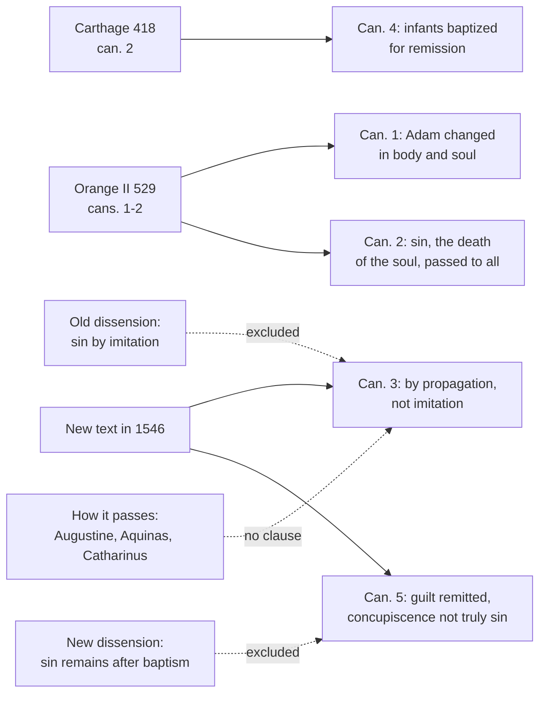

# Creation, Grace & the Last Things · Lesson 3.3: Trent Session V: the definition

> ⏱ ~15 min · Module 3: Original sin · Builds on: [3.1](03-01-original-justice-and-the-fall.md), [3.2](03-02-pelagius-augustine-and-the-councils.md), [2.3](02-03-the-soul-immediately-created-and-immortal.md) · Unlocks: [3.4](03-04-monogenism-polygenism-and-the-modern-reinterpretations.md), [4.1](04-01-what-grace-is.md), [`sacraments-and-liturgy` 2.1](../../sacraments-and-liturgy/lessons/02-01-baptism-the-rite-and-its-effects.md), [`ecclesiology-and-mariology` 6.3](../../ecclesiology-and-mariology/lessons/06-03-the-immaculate-conception.md)

## Why this matters

On 17 June 1546 the Council of Trent fixed in five canons what the Church means by [original sin](../reference.md#original-sin). The Immaculate Conception, infant baptism and every modern reinterpretation ([3.4](03-04-monogenism-polygenism-and-the-modern-reinterpretations.md)) are measured against them. The decree is exact about what was lost, what passes on and what baptism removes, and silent on how it passes.

## The idea

Start with what original sin is *not*: the first sin a child commits. A newborn has done nothing. Original sin is something she *lacks*: the holiness and justice God gave the first man for the whole family descending from him ([original justice](../reference.md#original-justice); [3.1](03-01-original-justice-and-the-fall.md)), which Adam threw away.

Picture a charter of citizenship granted to a founder on condition of loyalty and forfeited by his treason. His children are born outside the city, not for betraying it but for being his. The analogy limps: what the child lacks is [grace](../reference.md#sanctifying-grace) in the soul, not a status on paper, and the lack is really hers, "in each one as his own".

Two contrasts carry the decree. Original sin passes **by descent, not by example**. Baptism takes away **all that is truly sin**; the pull toward sin that remains, [concupiscence](../reference.md#concupiscence), is a wound left for the struggle.

## In their own words

Melanchthon's *Apology of the Augsburg Confession* (1531), answering the charge that Luther taught that original sin remains after baptism, says Luther

> always wrote thus, namely, that Baptism removes the guilt of original sin, although the material, as they call it, of the sin, i.e., concupiscence, remains. (II.35, *Concordia Triglotta*, 1921)

And what remains is sin, as Paul calls it (Romans 7:7, 23): "Luther maintains that it is a sin" (II.38). Augustine, as it quotes him, says sin is remitted in baptism "not in such a manner that it no longer exists, but so that it is not imputed" (II.36). It is not counted against those in Christ, "although by nature it is a matter worthy of death where it is not forgiven" (II.40–41). Leo X had condemned Luther's thesis in 1520: to deny that sin remains in a child after baptism is to "trample on Paul and Christ together" (*Exsurge Domine*, prop. 2; lesson's translation of *Paulum et Christum simul conculcare*).

## The doctrine

[Trent Session V](../reference.md#trent-session-v), in Waterworth's translation (1848) as Schaff prints it with the Latin (*Creeds of Christendom* vol. 2). No chapters: a preamble, five numbered paragraphs, each a canon with its reasons, and a paragraph on Mary.

1. **Lost (can. 1).** Adam "immediately lost the holiness and justice wherein he had been constituted" ([what *constituted* leaves open](../reference.md#constitutus-not-creatus) is [3.1](03-01-original-justice-and-the-fall.md)'s), incurred wrath, death and captivity to the devil, who "had the empire of death" (Hebrews 2:14), and was "changed, in body and soul, for the worse". *In words:* the first sin cost Adam grace and life and harmed the whole man.

2. **Passed on (cans. 2 and 4).** Can. 2 condemns saying Adam's sin "injured himself alone, and not his posterity", or that he passed on only death and bodily pains, "but not sin also, which is the death of the soul". Can. 4 condemns denying that newborns, "even though they be sprung from baptized parents", are to be baptized, or saying they "derive nothing of original sin from Adam". *In words:* the sin, not just its penalty, reaches every child of Adam.

3. **The route (can. 3).** "This sin of Adam" is one

   > which in its origin is one, and being transfused into all by propagation, not by imitation, is in each one as his own

   (*propagatione, non imitatione transfusum omnibus, inest unicuique proprium*; [propagation, not imitation](../reference.md#propagation-not-imitation)). Can. 4: infants "contracted" it "by generation". *In words:* we are not sinners by copying Adam; we are born so, and the sin is ours.

4. **What it is (can. 4; Session VI ch. 3).** The infants of can. 4 "could not as yet commit any sin of themselves". [Session VI](../reference.md#trent-session-vi) (1547), ch. 3: by propagation men "contract through him, when they are conceived, injustice as their own". Aquinas: "original sin is concupiscence, materially, but privation of original justice, formally" (ST I-II q.82 a.3). The Catechism: "sin" only analogically, contracted and not committed, a state and not an act (CCC 404–405, paraphrased). *In words:* original sin is a missing holiness, ours by birth and not by deed.

5. **Taken away, and what stays (cans. 3 and 5).** Can. 3 condemns saying the sin is removed "by the powers of human nature, or by any other remedy than the merit of the one mediator", or denying that baptism applies that merit "both to adults and to infants". Can. 5 condemns denying that "the guilt of original sin is remitted", or saying that "the whole of that which has the true and proper nature of sin" is "only rased, or not imputed"; the reborn have "nothing whatever to retard their entrance into heaven". What stays is "concupiscence, or an incentive (to sin)" (*fomes*, tinder), left "for our exercise". Then:

   > This concupiscence, which the apostle sometimes calls sin, the holy Synod declares that the Catholic Church has never understood it to be called sin, as being truly and properly sin in those born again, but because it is of sin, and inclines to sin.

   A penal clause follows (Schaff; the Latin is *Si quis autem contrarium senserit, anathema sit*). Its grammar is Augustine's: concupiscence "is called sin, since it arose from sin, and, when it has the upper hand, produces sin" (*On Marriage and Concupiscence* I.23.25, tr. Holmes). The sacrament is [`sacraments-and-liturgy` 2.1](../../sacraments-and-liturgy/lessons/02-01-baptism-the-rite-and-its-effects.md)'s. *In words:* only Christ removes the sin, all of it; the inclination stays, a wound to fight.

6. **Romans 5:12, and Mary.** Cans. 2 and 4 quote the Vulgate's "in whom all have sinned"; can. 4 adds, after its condemnation, that the verse is understood only "as the Catholic Church spread every where hath always understood it". That reason binds the sense its condemned clause states, not the rendering of *eph' hō* ([`new-testament` 5.3](../../new-testament/lessons/05-03-romans-5-11-adam-spirit-israel.md); [`patristics` 4.5](../../patristics/lessons/04-05-augustine-against-the-pelagians.md)); the earlier Latin "in Adam" reading is Ambrosiaster's ([`patristics` 4.1](../../patristics/lessons/04-01-ambrose-of-milan.md)). The last paragraph leaves "the blessed and immaculate Virgin Mary" out of the decree ([`ecclesiology-and-mariology` 6.3](../../ecclesiology-and-mariology/lessons/06-03-the-immaculate-conception.md)). *In words:* Trent binds Paul's meaning, not his grammar.

**Said plainly.** No clause of Session V says how original sin passes. "Propagation", "generation" and "contracted" name the route and stop: the question is open by silence, not by a sentence leaving it open. Augustine [filled the silence](../reference.md#transmission-of-original-sin) with concupiscence in the marital act, by which "the bond of sin" passes "by means of natural birth" (I.23.25; I.24.27). Aquinas made the race "one man", each moved by Adam's will "by the movement of generation" as the hand by the soul (q.81 a.1). Ambrogio Catarino (Catharinus) and Albert Pighius put original sin in Adam's own act, [imputed](../reference.md#imputation-theory-of-original-sin) to his heirs with nothing inhering: "highly improbable", says Pohle's manual (1912), which finds De Lugo's milder form, Adam's act persisting morally in each with the lack of grace its penalty, "less objectionable". Nor is most of the decree new: against the [Pelagians](../reference.md#pelagianism), can. 2 re-issues [Orange II](../reference.md#orange-ii) can. 2 almost verbatim, can. 1 borrows Orange II can. 1's "in body and soul, for the worse", and can. 4 is [Carthage](../reference.md#council-of-carthage-418) can. 2 plus "from a tradition of the apostles" and the baptized parents ([3.2](03-02-pelagius-augustine-and-the-councils.md)). Trent's own text is cans. 3 and 5.

| Defined or taught (with level) | A school's explanation or an opinion (no magisterial level) |
|---|---|
| Sin, not only death, passes from Adam to all: **rung 1** (cans. 2, 4) | How descent passes on a lack in the soul (Augustine, Aquinas): **rung 5** |
| By propagation, not imitation, in each as his own: **rung 1** (can. 3); "injustice as their own": **at least rung 3** (VI ch. 3) | "His own" as Adam's act imputed (Catharinus, Pighius): rejected by the manuals, never condemned by name |
| Adam lost holiness and justice for us also: **rung 1** (cans. 1–2) | Formally the privation of original justice, materially concupiscence (q.82 a.3): **rung 4** |
| All that is truly sin taken away; concupiscence not truly sin in the reborn: **rung 1** (can. 5) | Augustine's languor after illness (I.25.28) |

**Mark the levels** ([the ladder](../../fundamental-theology/lessons/04-04-the-ladder-of-doctrinal-authority.md); [levels of authority](../reference.md#levels-of-authority)). Inside each paragraph ([chapters and canons](../reference.md#chapters-and-canons); [`fundamental-theology` 4.2](../../fundamental-theology/lessons/04-02-infallibility-and-its-conditions.md)), what a canon condemns has its contradictory at **rung 1**; the "for …" and "whereas …" reasons after it are conciliar teaching, not each a definition (can. 749 §3). The concupiscence declaration's penal clause condemns its contrary, that concupiscence is truly sin in the reborn, so the declaration is **rung 1**; whether it reaches the reason, "of sin, and inclines to sin", is not manifest, so that is **at least rung 3**, the footing [3.1](03-01-original-justice-and-the-fall.md) gives integrity. Can. 3's description of "this sin" is what the canon is about, and Paul VI's *Credo of the People of God* (30 June 1968, §16) professes it "with the Council of Trent": **rung 1**, though reading "as his own" is the theologians' task. Session VI ch. 3: **at least rung 3** ([5.1](05-01-trent-session-vi-justification.md)'s rule). The *Credo* itself, by Paul VI's account not strictly a dogmatic definition (§3), is **rung 3** for what it adds; the Marian paragraph states an intention; *Exsurge Domine* condemned its propositions "respectively", fitting no censure to any one ([in globo censure](../reference.md#in-globo-censure)). The schools, Pohle and the *Apology*: **no magisterial level**.

## The map

Solid lines: where each canon's text came from. Dashed: what it excludes, and the question no clause answers.

## Worked examples

**Ex 1 (clean): the child of saints.** Invented: at Immaculate Heart, Dunmere, Margit and Tadhg Ostrowski, daily communicants, ask the catechist Ottavia Kerslake why their newborn Rozalia must be baptized "for the remission of sins" when they are in grace. Can. 4 answers in so many words: "even though they be sprung from baptized parents". Can. 3 says why: the sin passes "by propagation", and generation hands on a human nature, not the parents' rebirth; her soul God creates ([2.3](02-03-the-soul-immediately-created-and-immortal.md)), and grace comes with neither. Augustine: "from the seed of the true olive springs also nothing but a wild olive" (I.19.21). She lacks the holiness meant for her, by no act of hers (**rung 1**), and baptism remits its guilt (can. 5).

**Ex 2 (strain): the clone.** Invented: in a sixth-form class at the parish school, Ifeanyi Lockhart asks whether a human cloned from a skin cell would have original sin. The universal words say yes: sin passes "into the whole human race" (can. 2), "transfused into all" (can. 3). But the route-words are "propagation" and "generation". Aquinas held that someone formed by God from human flesh "would not contract original sin", since the active power of generation would not derive from Adam (q.81 a.4); a clone resembles his case, and Augustine's account, tied to the act, is silent. Here the doctrine stops: it defines that the sin reaches all by propagation, and no clause says what propagation is. "The whole human race" most naturally includes her, but that is a reading.

## Watch out

- **You might think Trent defined how original sin passes, through the marital act.** That is Augustine's account; the decree names the route and stops. Every mechanism is **rung 5**.
- **You might think "propagation" makes original sin a genetic defect.** What passes is a privation in the soul (q.83 a.1); propagation names descent. Human origins are [3.4](03-04-monogenism-polygenism-and-the-modern-reinterpretations.md)'s.
- **Levels, both ways.** "The privation of original justice is dogma" overstates: no act defines what original sin formally is (**rung 4**). "Trent left it all open" understates: that sin passes to all by descent and is each one's own is **rung 1**.

## One-liner

> Adam's sin, not only its penalty, reaches every child of Adam by descent and is each one's own; only Christ's merit, applied in baptism, removes it, and what remains is not sin. How it passes, Trent never says.

## Problems

**P1 (🟢)** *(Exegetical)* **Diagnose.** From a talk at an inquirers' evening at Immaculate Heart, Dunmere, **invented** for this problem:

> "Don't let the phrase scare you. Original sin just means that we all make mistakes. We learn selfishness from the people around us, so a child brought up in a loving enough home can grow out of it, and baptism is really a welcome into the community rather than a cure. Anyway, the whole doctrine is a sixteenth-century Catholic reaction to Luther."

Find **four** of its errors. For each, give the correction and cite the canon, with its level where one is involved. **150 words or fewer.**

**P2 (🟡)** *(Exegetical)* **Assign the level.** For each claim, give its rung on [the ladder](../../fundamental-theology/lessons/04-04-the-ladder-of-doctrinal-authority.md) and name the act that fixes it, or say that none does.

(a) Original sin is formally the privation of original justice and materially concupiscence.

(b) What Adam handed on to his descendants was death and bodily suffering; "the death of the soul" is only a figure of speech.

(c) Because Trent calls original sin "one" in its origin, every human being has exactly as much of it as every other.

(d) That concupiscence in the baptized is not truly and properly sin has been dogma since 1520, when Leo X condemned Luther's contrary thesis as heresy.

**Two sentences per item.**

**P3 (🔴)** *(Exegetical)* **Close reading.** Trent, Session VI (13 January 1547), ch. 3, in Waterworth's translation (1848) as Schaff prints it:

> But, though He died for all, yet do not all receive the benefit of his death, but those only unto whom the merit of his passion is communicated. For as in truth men, if they were not born propagated of the seed of Adam, would not be born unjust,—seeing that, by that propagation, they contract through him, when they are conceived, injustice as their own,—so, if they were not born again in Christ, they never would be justified; seeing that, in that new birth, there is bestowed upon them, through the merit of his passion, the grace whereby they are made just.

(a) The sentence is built as a parallel. Set out its two halves term by term, and say what the parallel implies about what kind of thing original sin is. **Two sentences.**

(b) Two readers. One says this chapter settles that original sin *is* the privation of grace, as the Thomists hold. The other says Catharinus could sign it without strain, since "as their own" can mean "imputed to them". Correct both, and give the chapter's level. **Three sentences.**

Solutions

**P1** *(Exegetical)*

**Accept:** any four of the five below, each corrected with its text.

**Must hit, strict:**

- **"We all make mistakes."** That is personal sin. Original sin is contracted, not committed: infants who "could not as yet commit any sin of themselves" have it and are baptized for its remission (can. 4, **rung 1**; CCC 404).
- **"We learn selfishness."** That is imitation, the Pelagian account. It passes "by propagation, not by imitation" and is "in each one as his own" (can. 3, **rung 1**); sin and not only death passes to all (can. 2, **rung 1**).
- **"Can grow out of it."** It is not taken away "by the powers of human nature, or by any other remedy than the merit of the one mediator" (can. 3, **rung 1**).
- **"A welcome rather than a cure."** Christ's merit is applied by baptism "both to adults and to infants", who are baptized truly for remission (cans. 3–4, **rung 1**); can. 5 adds that the guilt is remitted.
- **"A reaction to Luther."** Cans. 1, 2 and 4 re-issue Orange II (529) and Carthage (418) against the Pelagians; only the new text, chiefly can. 5, answers the Reformers.

**Wrong turns:** correcting "mistakes" by saying the infant is personally guilty of Adam's act; treating formation as a second remedy alongside baptism; dating the doctrine to Trent, or calling the canons only sixteenth-century discipline.

**Model answer:** Original sin is not our mistakes: infants who could commit no sin of their own contract it and are baptized for its remission (can. 4, rung 1). It passes by propagation, not by imitation, and is each one's own, so example neither gives it nor explains it (can. 3, rung 1). No upbringing removes it, since nothing but Christ's merit does (can. 3, rung 1). That merit is applied to infants by baptism, which truly remits the guilt (cans. 3–5, rung 1), so baptism is a cure and not only a welcome.

---

**P2** *(Exegetical)*

**Accept:** in (c), rung 4 or rung 5 for the equality claim, provided no act is named for it.

**Must hit, strict:**

- **(a)** **No act; rung 4.** It is Aquinas's analysis (ST I-II q.82 a.3), and privation as the essence is the manuals' common teaching. What the acts fix is narrower: Adam lost holiness and justice for us also (can. 2, rung 1), and each contracts "injustice as their own" (VI ch. 3, at least rung 3). Both are compatible with the formula without defining it.
- **(b)** **Condemned** by can. 2, which re-issues Orange II can. 2: Adam passed on not only death and bodily pains "but … sin also, which is the death of the soul". Its contradictory is **rung 1**; "the death of the soul" names a real sin, not a figure.
- **(c)** **No act fixes the inference.** "One in its origin" (can. 3) names the source, one sin of Adam, and is taught with the canon. That original sin "cannot be more in one than in another" is Aquinas's conclusion (q.82 a.4): a school's, with no act behind it.
- **(d)** **The content is rung 1, but the act is wrong.** *Exsurge Domine* condemned forty-one propositions "respectively", in globo, so it named no note for prop. 2 and did not call it heresy. The act is Trent V can. 5 (1546), whose declaration on concupiscence carries its own penal clause.

**Wrong turns:** putting (a) at rung 1 "because it is the standard account", or at rung 5, which ignores how common it is; in (b), reading "the death of the soul" as Trent's metaphor for mortality; in (c), giving the equality claim the canon's rung; in (d), accepting 1520 as the date of definition, or demoting the doctrine because *Exsurge* fixes no note.

**Model answer:** (a) No act defines it, so it stays at rung 4: it is Aquinas's analysis, and privation as the essence is common teaching. The acts fix only that holiness and justice were lost for us (can. 2, rung 1) and that each contracts injustice as his own (VI ch. 3, at least rung 3). (b) Can. 2 condemns it, so its contradictory is rung 1. Adam passed on sin, "the death of the soul", and not only death and bodily pains. (c) "One in its origin" names one source, Adam's sin, and says nothing about degree. That it is equal in all is Aquinas's conclusion (q.82 a.4), a school's, fixed by no act. (d) The doctrine is rung 1, but through Trent V can. 5 (1546), whose declaration on concupiscence has its own penal clause. *Exsurge* condemned its propositions "respectively" and fixed no note for prop. 2, so it never said that this one was heresy.

---

**P3** *(Exegetical)*

**Accept:** in (b), citing Session VI can. 11 (inhering justice) as support for the second correction, though the passage's own "made just" suffices.

**Must hit, strict (a):**

- The halves match: born "propagated of the seed of Adam" / "born again in Christ"; "that propagation" / "that new birth"; "through him" / "through the merit of his passion"; "contract … injustice as their own" / "bestowed … the grace whereby they are made just".
- Implication: what is contracted is the lack of the very justice the new birth gives, and it belongs to the person as that justice will. Original sin is a state in each, contracted at conception, not a deed.

**Must hit, strict (b):**

- **The first reader overreads.** The chapter says each contracts injustice "as their own", but not whether the lack of grace is the essence of the sin or, as De Lugo held, the penalty of Adam's act persisting in them. The formal-essence thesis stays a school's, **rung 4**.
- **The second reader underreads.** The parallel puts the injustice where rebirth puts a justice by which people "are made just", not one merely reckoned. A merely imputed "own" breaks the parallel; that is the manuals' argument against Catharinus, a theologians' verdict, since no act condemns him by name.
- **Level:** chapter teaching no canon repeats, **at least rung 3**.

**Wrong turns:** reading "contract … when they are conceived" as defining a biological mechanism; calling the chapter rung 1 because it is Trent; declaring Catharinus a heretic; treating "as their own" as settling the dispute in either direction.

**Model answer:** (a) Birth from Adam's seed answers to rebirth in Christ, propagation to the new birth, "through him" to "through the merit of his passion", and contracted injustice to the grace "whereby they are made just". So original sin is the person's own lack of the justice rebirth gives, a state contracted at conception and not an act. (b) The chapter does not decide whether that lack is the sin's essence or, with De Lugo, the penalty of Adam's persisting act, so the Thomist thesis stays rung 4. But a merely imputed injustice breaks the parallel with a grace that makes people just, which is why the manuals reject Catharinus's reading, though no act condemns it by name. As chapter teaching no canon repeats, it is at least rung 3.

## Flashback

**From Lesson [2.2](02-02-body-and-soul-one-substance.md) (Body and soul: one substance):** *(Exegetical.)* Close reading. Aquinas, ST I q.76 a.7, "Whether the soul is united to the animal body by means of a body?", from the *respondeo* and from the reply to an objection that cited Augustine's soul that "administers the body by light" (English Dominican Province translation):

> If, however, the soul is united to the body as its form, … it is impossible for it to be united by means of another body. The reason of this is that a thing is one, according as it is a being. Now the form, through itself, makes a thing to be actual since it is itself essentially an act; nor does it give existence by means of something else.
>
> Augustine speaks there of the soul as it moves the body … It is true that it moves the grosser parts of the body by the more subtle parts.

(a) Which words answer to Vienne's *per se* and which to *essentialiter*, and what does each exclude? Two sentences.

(b) The reply grants something in between after all. Is it the go-between *per se* forbids, and does a Catholic who says the soul acts through the brain contradict the definition? Give the level of what Vienne fixes and of the "subtle parts". Two sentences.

Solution

**Must hit, strict (a):**

- ***Per se*** (of itself, not through another form between): "through itself" and "nor does it give existence by means of something else". It excludes a go-between in the informing: a lower form, as in the view tied to Olivi, or here a body.
- ***Essentialiter*** (by what it is, not by an operation): "itself essentially an act", the ground of "a thing is one". It excludes a soul joined as a mover to what it moves (Plato, Descartes).
- The match is of vocabulary: Aquinas died in 1274, and Vienne adopted no argument.

**Must hit, strict (b):**

- **Not that go-between.** The subtle parts serve the soul "as it moves the body", a body it already informs immediately; the motive power's act "presupposes the body to be already actualized by the soul" (a.4 ad 2). *Per se* governs informing, not the instruments of operating.
- **The brain** is the same case. Only a soul informing the body through the brain, or seated there, would contradict the definition; it informs every living part.
- **Levels:** the form doctrine, **rung 1** (Vienne, 1312); the subtle parts, Aquinas's medieval physiology, **no magisterial level**.

**Wrong turns:** reading *per se* as forbidding every instrument, so that a soul could not use organs; taking the subtle parts or the brain for the soul's seat or bond of union; saying Vienne canonized this article because the words match; treating the physiology as doctrine, so that neurology could refute it.

**Model answer:** (a) "Through itself" and "nor does it give existence by means of something else" answer to *per se*, excluding any form or body between soul and matter. "Itself essentially an act" answers to *essentialiter*, excluding a soul joined as a mover by an operation, Plato's or Descartes's.

(b) No: the subtle parts are instruments of a soul moving a body it already informs immediately, and a soul acting through the brain is the same case; only a soul informing through the brain, or seated there, would contradict the definition. The definition is **rung 1** (Vienne, 1312); the physiology is Aquinas's, with **no magisterial level**.

## Connections

- **Backward:** [3.1](03-01-original-justice-and-the-fall.md) gave original justice and what *constituted* leaves open; [3.2](03-02-pelagius-augustine-and-the-councils.md) gave Carthage and Orange II, which cans. 1, 2 and 4 re-issue; [2.3](02-03-the-soul-immediately-created-and-immortal.md) gave the immediate creation of each soul, which is why no account of transmission can make the parents hand on the soul (Aquinas rejects that route in q.81 a.1). Augustine's case against Pelagius is [`patristics` 4.5](../../patristics/lessons/04-05-augustine-against-the-pelagians.md); the Greek of Romans 5:12 is [`new-testament` 5.3](../../new-testament/lessons/05-03-romans-5-11-adam-spirit-israel.md).
- **Forward:** [3.4](03-04-monogenism-polygenism-and-the-modern-reinterpretations.md) tests polygenism and the modern reinterpretations clause by clause against this decree; [4.1](04-01-what-grace-is.md) says what the lost grace is; [5.1](05-01-trent-session-vi-justification.md) reads Session VI, and [5.2](05-02-the-1999-joint-declaration.md) measures the Joint Declaration's *simul* against can. 5; [7.4](07-04-limbo.md) takes those who die with original sin only. Baptism is [`sacraments-and-liturgy` 2.1](../../sacraments-and-liturgy/lessons/02-01-baptism-the-rite-and-its-effects.md) and [2.2](../../sacraments-and-liturgy/lessons/02-02-necessity-infants-and-baptism-of-desire-and-blood.md); the Marian paragraph is [`ecclesiology-and-mariology` 6.3](../../ecclesiology-and-mariology/lessons/06-03-the-immaculate-conception.md).
- **Sideways:** [`moral-theology` 3.5](../../moral-theology/lessons/03-05-social-sin-and-cooperation-in-the-sins-of-others.md) keeps original sin from becoming a model of collective guilt, and [`old-testament` 2.3](../../old-testament/lessons/02-03-the-primeval-history.md) keeps the rabbinic *yetser ha-ra* apart from concupiscence. Aquinas's "one man" borrows from civil life, where "all who are members of one community are reputed as one body" (q.81 a.1): the same corporate logic runs the Adam–Christ parallel, all implicated in Adam's sin as in Christ's justice (CCC 404). Trent as an event is [`church-history` 6.4](../../church-history/lessons/06-04-trent-and-catholic-reform.md).
