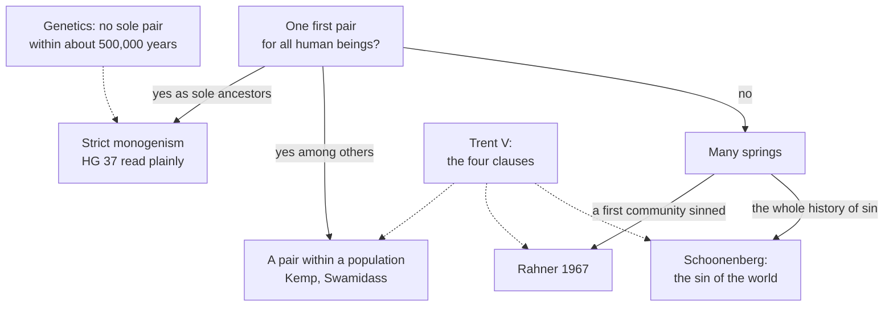

# Creation, Grace & the Last Things · Lesson 3.4: Monogenism, polygenism, and the modern reinterpretations

> ⏱ ~15 min · Module 3: Original sin · Builds on: [3.3](03-03-trent-session-v-the-definition.md), [1.4](01-04-creation-and-evolution-in-church-teaching.md), [`fundamental-theology` 4.3](../../fundamental-theology/lessons/04-03-religious-submission.md) · Unlocks: [4.1](04-01-what-grace-is.md), [Boss 3](../syllabus.md)

## Why this matters

In 1954 Karl Rahner argued that original sin needs one first man; in 1967, that it does not. Two pressures moved him and others: genetics, which finds a population where Genesis has a pair, and a philosophy of persons formed by their situation. This lesson says what each touches, and grades restatements against Trent's clauses, one at a time.

## The idea

Picture a river poisoned at its source. Every drop downstream carries the poison, not learned from its neighbours but drawn from the source, and in each drop the poison is its own: that is the doctrine. **Polygenism** asks whether there was one spring or many. The **reinterpretations** ask whether the poison is in the water or in the riverbed every drop must flow through.

*Humani Generis* (1950) answered the first, one spring; Rahner and Schoonenberg answered the second, the riverbed. Both answers face one test: do Trent's clauses still stand?

## In their own words

**Rahner, twice.** In 1954 ("Theologisches zum Monogenismus"; English in *Theological Investigations* I) Karl Rahner argued that a situation of damnation preceding every personal choice, yet arising in history, is inconceivable unless it began in one real individual's act. Monogenism, never infallibly taught, "must be affirmed with inner (but not in itself irreformable) assent" (quoted in Kevin McMahon, *The Thomist*, 2002). In "Evolution and Original Sin" (*Concilium* 26, 1967) he reversed himself. Biology finds genetic unity in a population, not an individual. God meant the first humans to hand grace on to one another, so a first sin in the first community, by one or several, tore that web for all, and he saw "no reason" for the Magisterium to intervene against polygenism. *Foundations of Christian Faith* (1976; English 1978, pp. 110–11) generalizes: every free act is co-determined by others' guilt, as a banana's buyer profits, unchosen, from injustice to the pickers. Original sin, on this account, is that [situation of guilt](../reference.md#situation-of-guilt), reaching back to the first sin.

**Schoonenberg.** For the Dutch Jesuit Piet Schoonenberg (*Man and Sin*, English 1965), the fall is not one catastrophic act but the whole history of sins from the first sinner on, which together are "the sin of the world" (John 1:29, DR; [sin of the world](../reference.md#sin-of-the-world)). To be human is to be situated, and the situation is an inner condition of freedom, there before any choice. It works by bad example, missing good example and missing grace others were meant to hand on, so each is born lacking grace. Birth alone puts one in this "world", so original sin passes by generation, and neither monogenism nor physical descent from Adam is required (James Connor's survey, *Theological Studies*, 1968). He first made the situation universal only through the world's rejection of Christ, and later dropped that.

## The doctrine

1. **What Trent fixes.** [Session V](../reference.md#trent-session-v) (17 June 1546; [3.3](03-03-trent-session-v-the-definition.md)): "the first man, Adam" lost the holiness and justice in which he was constituted (can. 1), for us too, passing sin into "the whole human race" (can. 2). The sin "in its origin is one, and being transfused into all by propagation, not by imitation, is in each one as his own" (can. 3, Waterworth; [propagation, not imitation](../reference.md#propagation-not-imitation)). Infants have "contracted by generation" what baptism cleanses (can. 4). How propagation transmits [original sin](../reference.md#original-sin), the decree never says. *In words:* an event, a loss, a passing-on by birth and not by copying, a state each has as his own.

2. **_Humani Generis_ §37.** [*Humani Generis*](../reference.md#humani-generis) (Pius XII, 12 August 1950), paraphrased. [Polygenism](../reference.md#monogenism-and-polygenism), "another conjectural opinion", lacks the freedom §36 gave research on the body ([1.4](01-04-creation-and-evolution-in-church-teaching.md)). The faithful cannot embrace the view (a) that after Adam there were true human beings not descended from him by natural generation as from the first parent of all, or (b) that "Adam" signifies a number of first parents. For "it is in no way apparent how" (*cum nequaquam appareat quomodo*) that squares with what revelation and the Magisterium propose: a sin truly committed by one Adam, passed to all by generation, in each as his own. *In words:* do not embrace polygenism, because no one can see how it fits original sin.

    Keep three things apart ([`fundamental-theology` 4.3](../../fundamental-theology/lessons/04-03-religious-submission.md) Ex 2 sorts two). **The act**: a deliberate encyclical judgment, never a definition, never withdrawn, still cited (CCC 390, n. 265). **The reason**: epistemic, a report of what could be seen, neither "polygenism contradicts the dogma" nor "permitted once a fit appears". **The science**: "conjectural", an estimate of 1950's evidence.

3. **Paul VI, 1966.** To a symposium on original sin (11 July 1966), [Paul VI](../reference.md#paul-vi-1966-address) called irreconcilable with Catholic doctrine explanations that start from polygenism, which *non è stato dimostrato* ("has not been demonstrated"), and deny that the sin was first the disobedience of Adam, "first man", at the beginning of history. A theory of evolution must keep each soul's immediate creation and the decisive weight of Adam's disobedience, *protoparente universale* ("universal first parent"). *In words:* after the Council, the 1950 line, with its evidential qualifier.

4. **The science, with its window.** Human genetic variation implies a long-term effective population of about ten thousand (Takahata, 1993), an average dominated by the smallest generations ([`evolution-ecology` 1.4](../../evolution-ecology/lessons/01-04-drift-ne-gene-flow.md)), not a floor. The tightest current case, from the age of the four most recent ancestral variants genome-wide, excludes a strict two-person bottleneck within roughly the last **500,000 years**, if no other lineage interbred, but not earlier (S. Joshua Swamidass, 2022). Ola Hössjer and Ann Gauger (*BIO-Complexity*, 2019), a minority, argue that a single couple that recent fits the data. And [genealogy is not genetics](../reference.md#genealogical-and-genetic-ancestry): in published models, someone who lived a few thousand years ago is a genealogical ancestor of everyone alive (Rohde, Olson and Chang, *Nature*, 2004). *In words:* [the genes](../reference.md#population-genetics-and-the-first-pair) exclude a recent pair who were our only ancestors, not an older pair, nor a pair among many.

5. **The Catholic positions.** (i) Monogenism is still required: the 1950 act stands until its authority says otherwise. (ii) A first pair within a population: Kenneth Kemp (*American Catholic Philosophical Quarterly*, 2011) separates the [biological species](../reference.md#biological-and-theological-species), a population, from the theological, beings with rational souls, which can begin with two; Swamidass (*The Genealogical Adam and Eve*, 2019) adds that such a couple could be everyone's genealogical ancestors. (iii) A first community, leaving no reason for the 1950 bar (Rahner, 1967). (iv) Neither monogenism nor descent from Adam is needed (Schoonenberg). *In words:* they differ on what "Adam" names and on whether 1950 still binds.

6. **The rule for grading.** Original sin is "contracted" and not "committed", "a state and not an act" (CCC 404). A reinterpretation is tested [clause by clause](../reference.md#clause-by-clause-test) against item 1's four points, neither waved through as modern nor dismissed as new, and each strained clause is named. *In words:* grade the proposal against the canons, one at a time.

**Said plainly.** The mechanism of transmission has never been defined. Pius XII's reason was that no one could see how polygenism fits: an epistemic judgment, not a definition and not a proof. It has never been withdrawn; Paul VI repeated it in 1966, and CCC 390's footnote cites both. And the theologian who argued hardest that the doctrine needs one first man reversed himself in thirteen years.

| Defined or taught (with level) | A school's explanation or an opinion (no magisterial level) |
|---|---|
| A first sin at the beginning of history by "the first man, Adam", with loss for all: **rung 1** (Trent V cans. 1–2) | What "Adam" names: one ensouled man in a population (Kemp); a genealogical ancestor (Swamidass); a first community (Rahner, 1967) |
| Propagation, not imitation; in each as his own: **rung 1** (can. 3) | [How](../reference.md#transmission-of-original-sin): one body moved by the first parent's will through generation (ST I-II q.81 a.1); co-determination by guilt (Rahner); being-situated (Schoonenberg): **rung 5** |
| The faithful cannot embrace polygenism, a fit being "in no way apparent": **rung 3** (HG §37; 1966) | That the 1950 reason has lapsed (Rahner, 1967): disputed among theologians |
| Original sin is contracted, not committed: **rung 1** (can. 4; the formula is CCC 404's) | Formally the privation of original justice, materially concupiscence (ST I-II q.82 a.3): **rung 4** |

**Mark the levels** ([the ladder](../../fundamental-theology/lessons/04-04-the-ladder-of-doctrinal-authority.md); [levels of authority](../reference.md#levels-of-authority)). Beyond the table: HG §37 is **rung 3**, an encyclical's deliberate judgment on a disputed matter (HG §20), not a definition (can. 749 §3), not withdrawn. Whether its reason still holds is disputed, but about a standing act, so monogenism is not **rung 5**. Paul VI's address is the lightest grade of **rung 3** for what it restates; "not demonstrated" and "conjectural" estimate a science, **no rung**, like the genetics. Identifying original sin with CCC 408's "sin of the world" is Schoonenberg's theology, at **no magisterial level**, as are Rahner, Kemp, Swamidass and the ITC (*Communion and Stewardship* §§63, 70).

## The map

Genetics presses only on the strict reading; every answer faces Trent's four clauses.

## Worked examples

**Ex 1 (clean): a pair among many.** Invented: at St Albert's Chaplaincy, Linthwaite University, Corisande Ngata, a biologist, proposes something of Kemp's kind. Of some ten thousand hominids, God gave two rational souls, and their descendants had children with the rest until every living human descended from the pair. *Event, loss, one origin*: the first true man's sin, lost for all his line. *Propagation, not imitation*: every later human descends from him; no one copies the state. *Each his own*: yes. HG §37: no true man after Adam lacks descent from him, since the others had no rational souls, and "Adam" names one man. No bottleneck is needed. Verdict: inside every clause and the 1950 act as worded. The cost: "true man" now means a rationally ensouled being ([2.3](02-03-the-soul-immediately-created-and-immortal.md)), not a biological kind, and the first humans had children with creatures who were not human, which the proposal must defend. An opinion, at no level.

**Ex 2 (strain): people outside the garden.** Invented: Jannik Obiora asks about a genealogical model: a specially created couple a few thousand years ago, amid a wider population, whose line reached everyone by early historical times. For the couple's descendants the clauses hold; the strain is everyone else before the lines met. If they were true human beings, HG §37's first disjunct names them, and they either lacked original sin, against can. 2's "whole human race", or had it without descent, against can. 3's propagation. If not, then something as visible as culture no longer marks a human being. Here the doctrine stops: no act defines what makes a "true man" at the edges of the record, or when the first soul was created ([1.4](01-04-creation-and-evolution-in-church-teaching.md) Ex 2). It settles only that whoever is human has original sin by birth, not by copying.

## Watch out

- **"Genetics has disproved Adam."** You might think the data exclude any first pair. They exclude only a pair who were our sole ancestors within roughly 500,000 years, on stated assumptions.
- **Over- and understating the level.** You might think monogenism defined because can. 1 says "the first man, Adam", or CCC 390 "our first parents". It rests on HG §37: **rung 3**. Nor is it free because undefined: an act has spoken and stands, so not **rung 5**.
- **"The Catechism adopted the sin of the world."** You might think CCC 408 took over Schoonenberg's theory. It uses John's phrase for the effects of original *and* personal sins, and for structures, which are not moral subjects ([`moral-theology` 3.5](../../moral-theology/lessons/03-05-social-sin-and-cooperation-in-the-sins-of-others.md)); CCC 404 keeps propagation.
- **"The reinterpretations deny the fall."** You might think so, but Rahner kept a first sin after 1967. The question is which clause a proposal strains.

## One-liner

> Trent defines an event, a loss and a state passed on by birth, not a headcount; *Humani Generis* bound the faithful to one Adam because no one could see how else, a rung-3 judgment never defined and never withdrawn.

## Problems

**P1 (🟢)** *(Exegetical)* **Diagnose.** An episode of the St Albert's Chaplaincy podcast, Linthwaite University, **invented** for this problem. The host, Peregrine Adu, says:

> "Here's where things stand. Genetics has shown that the human race never passed through a single couple, at any date. That's awkward, because the Council of Trent defined that we all descend from one pair: canon 1 says 'the first man, Adam'. Theologians have tried to rescue the doctrine. Karl Rahner, for one, always held that it never needed a first couple. And the Catechism now calls original sin 'the sin of the world', meaning the unjust structures we're born into, which is what Piet Schoonenberg argued."

Find **four** errors. Correct each, naming the act and its level where one is involved. **150 words or fewer.**

**P2 (🟡)** *(Exegetical)* **Find the crux.** Rahner's two positions, paraphrased:

> **1954.** A situation of damnation that precedes every personal choice, yet arose in history, can be conceived only if it began in the act of one real individual. So monogenism must be held, with inner though not irreformable assent.
>
> **1967.** Genetic unity is found in a population, not an individual. God meant the first humans to mediate grace to one another; a first sin within that community, by one or several, broke the medium for all. So the Magisterium has no reason to intervene against polygenism.

(a) Name the single premise the 1967 Rahner denies that the 1954 Rahner needed.

(b) Say what the 1967 position must supply in that premise's place, and what this costs. Then say what moved him, and whether that kind of evidence can settle the premise.

**Two sentences per part.**

**P3 (🔴)** *(Exegetical (a) · Evaluative (b))* Trent, Session V, can. 3, in Waterworth's translation: "this sin of Adam,--which in its origin is one, and being transfused into all by propagation, not by imitation, is in each one as his own". Can. 4 adds that infants are cleansed of what "they have contracted by generation".

(a) Name the view "not by imitation" was aimed at. Then state the strongest objection to Schoonenberg that these words suggest, and the reply his own terms allow. **Three sentences.**

(b) Does Schoonenberg's "sin of the world" keep "not by imitation" and "in each one as his own"? Any verdict. **150 words or fewer.**

Solutions

**P1** *(Exegetical)*

**Accept:** the four errors below, in any order.

**Must hit, strict:**

- **"At any date."** The tightest case excludes a strict two-person bottleneck within roughly the last 500,000 years, if no other lineage interbred (Swamidass, 2022). It does not exclude an older one, or a pair who were genealogical ancestors of all among a larger population (Rohde et al. 2004; Swamidass 2019). The estimate itself has **no rung**.
- **"Trent defined that we all descend from one pair."** Session V defines a first sin by "the first man, Adam", the loss of holiness and justice, and transmission by propagation (**rung 1**). It does not define descent of all from one pair; that rests on a later act that defines nothing (HG §37, **rung 3**).
- **"Rahner always held."** In 1954 he defended monogenism, to be held with inner though not irreformable assent. He reversed in 1967.
- **CCC 408.** "The sin of the world" there is the consequences of original sin and of all personal sins, extended to social structures. CCC 404 keeps a sin transmitted by propagation. The identification is Schoonenberg's, at **no magisterial level**.

**Wrong turns:** correcting the first error by saying the genetics confirms a single pair (an overstatement the other way); calling monogenism **rung 1** "because Trent presupposes it"; calling it free, **rung 5**, "because it was never defined"; treating the Catechism's use of the phrase as giving Schoonenberg's theory a level.

**Model answer:** Genetics excludes only a pair who were our sole ancestors within roughly the last 500,000 years, on stated assumptions; an older pair, or a pair among many who are everyone's genealogical ancestors, is not excluded, and none of this has a rung. Trent defines a first sin by Adam, a loss, and transmission by propagation (rung 1); that all descend from one pair is HG §37's judgment (rung 3), never defined. Rahner defended monogenism in 1954 and changed his mind in 1967. CCC 408 uses "the sin of the world" for the effects of original and personal sins, including structures; CCC 404 keeps propagation. The identification is Schoonenberg's opinion.

---

**P2** *(Exegetical)*

**Must hit, strict (a):** the premise that the oneness of the race in sin requires oneness of **descent from a single individual**: one historical origin of the situation must be one person's act. The 1967 Rahner keeps one origin and one history, but lets a first community's sin, by one or several, be that origin.

**Must hit, strict (b):**

- **Supplied:** a divine ordering of grace to the first community as a whole, so that grace was to pass between its members and one or more members' sin forfeits it for all.
- **The cost:** the universality now rests on God's stipulation rather than on the agency of one originator. He must also say why the members who stood firm could not restore the others (McMahon's objection: credit, not required). "One in origin" (can. 3) now names a community's first sin.
- **What moved him:** the biology of populations: "scientific anthropologists of today think in terms of polygenism" (*Concilium*, 1967, as quoted by McMahon). That evidence concerns bodies. Whether the unity original sin needs is a unity of descent is a theological premise the data cannot settle; they only remove the assumption that the two unities coincide.

**Wrong turns:** locating the crux in whether there was a first sin (both keep one); saying the 1967 Rahner denies propagation (he keeps entry by birth into one history); saying genetics refuted the 1954 premise (it refuted, at most, the biology attached to it); attributing either position to the Magisterium.

**Model answer:** (a) The 1954 Rahner needed the premise that a universal situation of sin with one historical origin must begin in one individual's act, so that the race's unity in sin is a unity of descent from one man; the 1967 Rahner denies it, letting a first community's sin be the single origin. (b) In its place he puts God's ordering of grace to the whole first community, so that one or several members' sin broke the medium for all, which makes universality rest on a divine stipulation rather than a first man's act. What moved him was the population biology of the 1960s, which bears on bodies; whether original sin needs a unity of descent is a theological premise that such evidence cannot decide.

---

**P3** *(Exegetical (a) · Evaluative (b))*

**Must hit, strict (a):**

- **The target:** the Pelagian view that Adam's sin reaches others only by bad example, which they copy ([3.2](03-02-pelagius-augustine-and-the-councils.md)).
- **The objection** (critics pressed it, as Connor reports): on Schoonenberg's account a person would not be conceived in sin but would *become* a sinner through influences, so original sin slides back toward imitation. A child raised by saintly parents would then seem to escape it.
- **His reply:** being situated is not outward influence but an inner condition of freedom, an "existential" there before any choice, and one enters the situation by generation alone. The situation includes the absence of grace others should have handed on, so that each is born lacking grace, and that no one imitates.

**Must hit, any verdict (b):**

- State the test exactly: "not by imitation" excludes acquiring the state by one's own copying; "in each one as his own" requires that it belong to the person, not merely surround him.
- Sort Schoonenberg's three channels: bad example and missing good example look like imitation; the absence of mediated grace is the strongest candidate for something received by birth.
- Face the saintly-parents case and universality, which he himself first secured only through the rejection of Christ.
- Say whether "one in origin" survives when the fall is the whole history of sins.
- Say which premises are defined (**rung 1**: propagation, not imitation; each his own) and which are theology (his account, **no magisterial level**). State the strongest case for the view you reject.

**Wrong turns:** dismissing the theory because it is modern, or passing it because it speaks of birth; treating Trent's silence on *how* as permission to drop *that* it is by propagation; ignoring his own revision on universality; arguing about genetics, which this clause does not turn on.

**Model answer (b), one of several:** Not fully. He keeps the words: original sin comes by birth, since only birth puts one in the "world", and it is each one's own, since the situation is an inner condition of freedom. His third channel, grace others should have handed on, is copied by no one, so there "not by imitation" holds. But two channels are example, and the infant of saintly parents shows the strain: holy surroundings would seem to lift the state, making it depend on one's milieu, close to what Trent excluded. Universality strained him too; he first secured it only through the rejection of Christ. "One in origin" strains, since the fall becomes the whole history of sins. The strongest case against me: being situated is a mechanism, which Trent left open, not a denial of propagation. Defined: propagation, not imitation, and each his own; the rest is opinion.

## Flashback

**From Lesson [3.2](03-02-pelagius-augustine-and-the-councils.md) (Pelagius, Augustine, and the councils):** *(Exegetical.)* Reconstruct. [Carthage](../reference.md#council-of-carthage-418) (1 May 418), can. 6, in the lesson's translation, scripture in the Douay–Rheims; the omitted middle argues from 1 John 1:9:

> … whoever thinks that John's words, "If we say that we have no sin, we deceive ourselves and the truth is not in us" (1 John 1:8), mean that we ought to say we have sin out of humility, not because it is truly so, [is condemned]. … For the Apostle could have said, "If we say we have no sin, we exalt ourselves, and humility is not in us." But when he says, "we deceive ourselves, and the truth is not in us", he shows well enough that whoever says he has no sin speaks not the truth but a falsehood.

(a) Reconstruct the argument from "For the Apostle could have said" (P1, P2, … ∴ C), supplying its two unstated premises.

(b) Can. 5 argues alike: the Lord "does not say: without me you can do it with more difficulty, but: without me you can do nothing". Name the shared move, and the Pelagian thesis that both readings it blocks were protecting. **Two sentences.**

Solution

**Accept:** the premises in another order.

**Must hit, strict (a):**

- P1: Had denying one's sin offended only humility, the words for that lay at hand: "we exalt ourselves, and humility is not in us".
- P2: John chose the words of falsehood: "we deceive ourselves, and the truth is not in us".
- P3 (unstated): Scripture's words are chosen exactly, so the fault named is the fault there is.
- P4 (unstated): John's "we" includes the apostle, and so the just.
- ∴ C: "We have no sin" is false even from the just, so their "we have sin" is true, not only humble.

**Must hit, strict (b):**

- **The move:** arguing from the weaker words Scripture had ready and passed over ("with more difficulty", "humility is not in us") to bar a reading that shrinks the stronger ones ("nothing", "the truth is not in us") into them.
- **The thesis:** that free will can keep the commandments and live without sin ("always able both to sin and not to sin", 3.2). Then "nothing" must mean "with difficulty", and a saint's confession mere modesty.

**Wrong turns:** dropping P4, which leaves the Pelagian free to say the saints speak for other sinners (the dodge can. 7 condemns); concluding that the just sin gravely or are not just, when Trent VI ch. 11 calls their sins "light and daily" and says "not therefore do they cease to be just"; saying the readings denied grace, which Pelagius affirmed loudly.

**Model answer:** (a) P1: Had denying sin offended only humility, John had the words for it. P2: He chose falsehood's words. P3: Scripture chooses exactly. P4: His "we" includes the just. ∴ C: Their confession is true, not merely humble. (b) Both canons argue from the weaker words Scripture passed over to bar a reading that softens the stronger. Both softenings protected the boast of Pelagius's letter: "a man is able to be without sin, and easily to keep the commandments of God, if he wishes" (Augustine, *On the Proceedings of Pelagius* 54, tr. Peter Holmes, rev. B. B. Warfield, *NPNF* first series, vol. 5).

## Connections

- **Backward:** [3.3](03-03-trent-session-v-the-definition.md) read Session V whole and is the list this lesson tests against. [1.4](01-04-creation-and-evolution-in-church-teaching.md) weighed HG §36 and the ITC's "whether as individuals or in populations". [`fundamental-theology` 4.3](../../fundamental-theology/lessons/04-03-religious-submission.md) Ex 2 separated the 1950 act from the dogma, and its P2 argued whether the act still closes the question. Romans 5:12 as exegesis is [`new-testament` 5.3](../../new-testament/lessons/05-03-romans-5-11-adam-spirit-israel.md); [`apologetics-foundations` 4.2](../../apologetics-foundations/lessons/04-02-evolution-design-and-the-human-person.md) handed the doctrine here.
- **Forward:** [4.1](04-01-what-grace-is.md) turns to what was lost, grace. Boss 3 ([syllabus](../syllabus.md)) runs the clause-by-clause test on a first-community proposal. Rahner's anthropology returns as the supernatural existential in [4.4](04-04-nature-and-grace-the-gratuity-of-the-supernatural.md).
- **Sideways:** the averages and bottlenecks behind the genetics are [`evolution-ecology` 1.4](../../evolution-ecology/lessons/01-04-drift-ne-gene-flow.md); what can be inferred from them is [`philosophy-of-science`](../../philosophy-of-science/syllabus.md)'s question. Social sin, which CCC 408 links to "the sin of the world", is [`moral-theology` 3.5](../../moral-theology/lessons/03-05-social-sin-and-cooperation-in-the-sins-of-others.md), where structures are not moral subjects. What makes a "true man" at the edge of the record is the soul doctrine of [2.3](02-03-the-soul-immediately-created-and-immortal.md).
