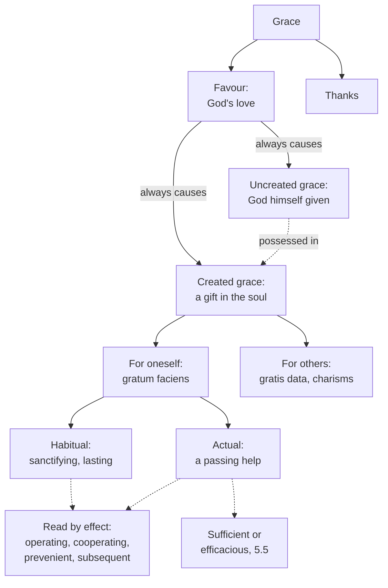

# Creation, Grace & the Last Things · Lesson 4.1: What grace is

> ⏱ ~15 min · Module 4: Grace · Builds on: [3.3](03-03-trent-session-v-the-definition.md), [`trinity-and-god` 6.1](../../trinity-and-god/lessons/06-01-the-missions-of-the-son-and-the-spirit.md) · Unlocks: [4.2](04-02-the-necessity-of-grace.md), [4.3](04-03-sanctifying-grace-the-indwelling-and-divinization.md), [4.4](04-04-nature-and-grace-the-gratuity-of-the-supernatural.md), [5.5](05-05-the-de-auxiliis-controversy.md), [`sacraments-and-liturgy` 1.1](../../sacraments-and-liturgy/lessons/01-01-what-a-sacrament-is.md)

## Why this matters

In one Sunday a Catholic hears "grace" used for God's favour, the state confession restores, a nudge to forgive, a gift of healing, and the prayer before lunch: five things, one word, and most errors in this treatise begin as a slide between them. [3.3](03-03-trent-session-v-the-definition.md) said what Adam lost and baptism gives back. This lesson says what the thing given is, so that the rest of the course and [`sacraments-and-liturgy`](../../sacraments-and-liturgy/syllabus.md) can use the word without equivocating.

## The idea

Take Aquinas's example: a soldier "in the good graces of the king". The sentence is about the king, who looks on him with favour; a king's favour answers to merit already there. Imagine instead a king whose favour *made* the soldier brave. That king is God: his love does not find good in us, it puts it there. So "God's [grace](../reference.md#grace)" can mean his favour, but never a favour that leaves us as we were.

Three plain questions sort the rest.

- **Who or what is given?** God himself, dwelling in the just ([uncreated grace](../reference.md#uncreated-and-created-grace)), or an effect God makes in the soul (created grace). Both, in fact.
- **For whom is the created gift?** For the one who receives it, to unite him to God, or for others, to help lead *them* to God (the [charisms](../reference.md#charisms)).
- **Does it last or pass?** A standing state ([sanctifying grace](../reference.md#sanctifying-grace)) or a help for this act ([actual grace](../reference.md#actual-grace)).

Three further pairs (operating and cooperating, prevenient and subsequent, sufficient and efficacious) are not more kinds: they name one grace by what it does at points of an act.

## Source

*Summa Theologiae* I-II q.110 a.1, "Whether grace implies anything in the soul?" (English Dominican Province):

> According to the common manner of speech, grace is usually taken in three ways. First, for anyone's love, as we are accustomed to say that the soldier is in the good graces of the king, i.e. the king looks on him with favor. Secondly, it is taken for any gift freely bestowed, as we are accustomed to say: I do you this act of grace. Thirdly, it is taken for the recompense of a gift given "gratis," inasmuch as we are said to be "grateful" for benefits. [...] since the creature's good springs from the Divine will, some good in the creature flows from God's love [...]. Therefore it is clear that every love of God is followed at some time by a good caused in the creature, but not co-eternal with the eternal love.

The three senses are **[favour, gift and thanks](../reference.md#three-senses-of-grace)**; Aquinas's Latin for the third is *agere gratias*, to give thanks. Greek *charis* carries all three: Mary "found grace with God" (Luke 1:30, DR); Paul's "diversities of graces" (1 Cor 12:4) are *charismata*, gifts; "thanks be to God" (1 Cor 15:57) is *charis*. Then the turn: man's love presupposes the good it loves, and God's causes it. "At some time" puts the gift in time and the love in eternity, the shape of a mission in [`trinity-and-god` 6.1](../../trinity-and-god/lessons/06-01-the-missions-of-the-son-and-the-spirit.md): nothing new in God, everything new in the creature.

## The doctrine

1. **Justifying grace inheres in the just and is not favour alone.** [Trent, Session VI](../reference.md#trent-session-vi) (13 January 1547), can. 11, condemns anyone who excludes from justification the grace and charity poured forth by the Holy Ghost "and is inherent in them", or says that justifying grace "is only the favour of God" (*tantum favorem Dei*). *In words:* God's favour comes first, and what it makes in us is real.

2. **Uncreated and created grace.** "The charity of God is poured forth in our hearts, by the Holy Ghost who is given to us" (Rom 5:5, DR): a gift, and the Giver. The Spirit's coming is the invisible mission of [`trinity-and-god` 6.1](../../trinity-and-god/lessons/06-01-the-missions-of-the-son-and-the-spirit.md), made "according to the gift of sanctifying grace" (I q.43 a.3), by which the creature can "enjoy also the divine person Himself" (ad 1). Leo XIII: the Spirit gives not only his gifts but himself, the supreme Gift (*Divinum Illud Munus* §9, 1897). Peter Lombard merged them, making our charity the Spirit himself (*Sentences* I d.17, in II-II q.23 a.2; answered in [`moral-theology` 3.2](../../moral-theology/lessons/03-02-faith-hope-and-charity.md)). *In words:* we receive the Giver and a gift, and neither replaces the other.

3. **[Grace that makes pleasing, and grace given for others](../reference.md#gratum-faciens-and-gratis-data).** Aquinas's first division is by purpose (I-II q.111 a.1): *gratia gratum faciens*, "whereby man himself is united to God", against *gratia gratis data*, by which "one man cooperates with another in leading him to God". The text is 1 Cor 12:7, the Spirit's manifestation "unto profit" (DR), of others. II-II q.177 adds the [grace of the word](../reference.md#grace-of-the-word), by which the Spirit makes speech teach, please and sway more excellently than art can. Grace that makes pleasing is nobler, uniting to the end itself (q.111 a.5, from 1 Cor 12:31). A charism can exist without it, as prophecy can without charity (II-II q.172 a.4, from Matt 7:22–23). The seven gifts are not charisms. They are in all the just, for their own salvation ([`moral-theology` 3.3](../../moral-theology/lessons/03-03-the-cardinal-virtues-and-the-gifts.md)), and where "wisdom" is on both lists, the gift makes the mind movable by the Spirit while the charism is the *word* of wisdom, for instructing others (q.111 a.4 ad 4). The Catechism orders charisms to sanctifying grace and the common good (CCC 2003); their discernment is [`ecclesiology-and-mariology` 3.3](../../ecclesiology-and-mariology/lessons/03-03-the-laity-charisms-and-the-sensus-fidei.md)'s. *In words:* one grace makes you holy, the other makes you useful to someone else's holiness, and you can have the second without the first.

4. **Habitual grace and actual grace.** God helps in two ways (q.110 a.2): by moving the soul, a help that "is not a quality, but a movement of the soul", and by infusing "a habitual gift". The Catechism: sanctifying grace is a habitual gift, a stable supernatural disposition, while actual graces are God's interventions in conversion and sanctification (CCC 1999–2000). The Dicastery for the Doctrine of the Faith agrees: blessings ask God for aids from his Spirit's impulses, "what classical theology calls 'actual grace'" (*Fiducia Supplicans* §31, 2023); Mary's intercession can ask for actual graces, which prepare even sinners for justification, while pouring in sanctifying grace is the Lord's work alone (*Mater Populi Fidelis* ¶69, 2025). *In words:* a state you are in, against a push you are given.

5. **Divisions by effect.** Grace is [operating](../reference.md#operating-and-cooperating-grace) where the mind is moved and God "is the sole mover", cooperating where the mind both moves and is moved (q.111 a.2, after Augustine as [`patristics` 4.5](../../patristics/lessons/04-05-augustine-against-the-pelagians.md) reads him). It is [prevenient](../reference.md#prevenient-grace) or subsequent along five effects: to heal, to will the good, to do it, to persevere, to reach glory (a.3). "Operating and cooperating grace are the same grace" (a.2 ad 4), divided "only in its effects" (a.3 ad 2). Trent's form: adults' justification begins from God's prevenient grace, with which the one called freely co-operates, being "also able to reject it" (VI ch. 5; cans. 3–4). [Sufficient and efficacious](../reference.md#sufficient-and-efficacious-grace) grace, giving the power or reaching the act, is argued in [5.5](05-05-the-de-auxiliis-controversy.md). *In words:* these pairs time-stamp one grace; they do not multiply graces.

**Said plainly.** The vocabulary is younger than the doctrine. Trent's decree on justification says that the charity and the justice of the justified *inhere* (can. 11, *inhaereat*; ch. 16) and never calls grace a habit or a quality. Aquinas's *Summa* speaks of God's help moving mind and will, never of "actual grace", a later schools' label the Catechism and the Dicastery use without defining.

| Defined or taught (with level) | A school's explanation or an opinion (no magisterial level) |
|---|---|
| Justifying grace inheres, not favour alone: **rung 1** (VI can. 11); a stable, habitual gift: **at least rung 3** (CCC 2000) | An accident of the soul in the category of quality (q.110 a.2): **rung 4** |
| The Spirit himself is given, not only his gifts: **at least rung 3** (*Divinum Illud Munus* §9) | How the indwelling and the created gift are ordered: **rung 5** ([4.3](04-03-sanctifying-grace-the-indwelling-and-divinization.md)) |
| Charisms, special graces for building up the Church: **at least rung 3** (LG 12; CCC 2003) | Aquinas's scheme; prophecy without charity (II-II q.172 a.4): **rung 4** |
| Prevenient help is needed, and the moved will can refuse it: **rung 1** (VI cans. 3–4; *Cum occasione*, 1653, prop. 2 condemned) | The divisions by effect and the name "actual grace": **rung 4**; how efficacious grace works: **rung 5** ([5.5](05-05-the-de-auxiliis-controversy.md)) |

**Mark the levels** ([the ladder](../../fundamental-theology/lessons/04-04-the-ladder-of-doctrinal-authority.md); [levels of authority](../reference.md#levels-of-authority)). Inherence and "not favour alone" are **rung 1** by VI can. 11, which ch. 7 expounds. The decree fences even its chapters, since whoever does not receive its doctrine "faithfully and firmly cannot be justified" (end of ch. 16), so a chapter no canon repeats teaches **at least rung 3**. Needed prevenient help and refusable consent are **rung 1** (cans. 3–4). The Catechism's divisions (CCC 1999–2003) keep the weight of what they summarize ([`fundamental-theology` 4.5](../../fundamental-theology/lessons/04-05-reading-a-documents-weight.md)): **at least rung 3**. *Divinum Illud Munus*, *Fiducia Supplicans* and *Mater Populi Fidelis* (approved by Leo XIV) are authentic ordinary teaching, **rung 3**, defining no term. "Quality", "habit", Aquinas's divisions and T&G 6.1's mission analysis are **rung 4**; the order of uncreated to created grace and the mechanics of efficacy, **rung 5**.

## The map

Created grace is cut by its end and by its mode; the dashed boxes name the same grace by what it does.

## Worked examples

**Ex 1 (clean): a retreat's opening.** Invented: Delphine Arkwright opens a retreat at St Thérèse of Lisieux, Ashgrove: "By God's grace you are here. Most of you are in a state of grace after this morning's confessions. Tonight, ask for the grace to forgive the person you have in mind. At supper we'll say grace." *God's grace* is favour, never idle in God: it caused whatever helps brought them (q.110 a.1). *A state of grace* is habitual, sanctifying grace (CCC 2000), operating as it justifies and cooperating as the source of what they do next (q.111 a.2). *The grace to forgive* is an actual grace for one act, prevenient to the consent; refused, it was sufficient, and reaching the act, efficacious. *Say grace* is thanks. None is a charism, given for others.

**Ex 2 (strain): "Was that grace?"** Invented: Perpetua Haldane tells Fr Casimir Ndlovu, her director at Ashgrove: "On Tuesday, out of nowhere, I could forgive my brother. Was that grace? Does it prove I'm in a state of grace?" The sort answers the second question: if from God, it was an actual grace, given even to sinners to dispose them (VI ch. 5; *Mater Populi Fidelis* ¶69), so it proves nothing about her state. The first question is where the doctrine stops. Grace escapes experience (CCC 2005); no one "can know with a certainty of faith, which cannot be subject to error, that he has obtained the grace of God" (VI ch. 9; [certainty of grace](../reference.md#certainty-of-grace)). Aquinas allows only imperfect conjecture from signs (I-II q.112 a.5). The taxonomy sorts kinds; no text certifies a case.

## Watch out

- **Two "sanctifying graces".** You might think the "sanctifying grace" of q.111 a.1 (English Dominican Province) is the Catechism's. It renders *gratum faciens*, a division by purpose, so God's help moving my own will falls on its side; CCC 2000 divides by duration, the habit against actual graces.
- **The level, both ways.** You might think the Catechism's "actual grace" makes the scholastic division dogma, or, the label being late, that transient helps are a school invention. Needed, refusable prevenient help is **rung 1** (VI cans. 3–4); the name and its subdivisions are **rung 4**.
- **Gift or Giver.** You might think "grace is God's self-gift" ([`trinity-and-god` 6.3](../../trinity-and-god/lessons/06-03-rahners-rule-and-the-immanent-trinity.md)) makes the created gift optional. Inherence is **rung 1** (can. 11), and I q.43 a.3 has the Spirit possessed in the gift; only their order is open.

## One-liner

> God's grace is a favour that always makes something: himself given, and a gift that sanctifies us or serves others, lasts or passes.

## Problems

**P1 (🟢)** *(Exegetical)* **Assign the level.** Place each claim on the ladder and name the act that fixes it, or say that none does. **One sentence per item.**

> (i) The grace by which we are justified is not only God's favour; it inheres in the just.
>
> (ii) Habitual grace is an accident of the soul in the category of quality, not a substance.
>
> (iii) Free will, moved and excited by God, can refuse its consent.
>
> (iv) Mary's intercession can obtain actual graces, but infusing sanctifying grace is the Lord's work alone.
>
> (v) A charism such as prophecy can be given to someone who is not in the state of grace.

**P2 (🟡)** *(Exegetical)* **Close reading.** The *Roman Catechism* (1566), Part II, on Baptism, "Third effect of Baptism: grace of regeneration", in McHugh and Callan's translation (1923):

> Now according to the definition of the Council of Trent, which under pain of anathema we are bound to believe, grace not only remits sin, but is also a divine quality inherent in the soul, and, as it were, a brilliant light that effaces all those stains which obscure the lustre of the soul, investing it with increased brightness and beauty. This is also a clear inference from the words of Scripture when it says that grace is poured forth, and also when it usually calls grace, the pledge of the Holy Ghost.

(a) Which words report what Trent defined, which word is the catechism's own, and at what level does each stand? Name the canon.

(b) Of the two scriptural grounds, which points to created grace and which to uncreated grace? What does that do to the claim that both are a "clear inference" to a quality in the soul?

**Two sentences per part.**

**P3 (🔴)** *(Exegetical)* **Diagnose.** An invented podcast segment, written for this problem: the parish podcast of St Thérèse of Lisieux, Ashgrove, episode "Grace 101".

> "Think of grace as spiritual energy. God keeps a vast reservoir of it, and every Mass and every rosary tops up your tank. The top grade is the charismatic gifts: if someone in your prayer group can heal or prophesy, that tells you how full their tank is. And remember, God helps those who help themselves. Make the first move, and he'll meet you with the grace to finish."

Name **three** errors. For each, say which distinction from this lesson it collapses, and give the text that corrects it with its level. **150 words or fewer.**

Solutions

**P1** *(Exegetical)*

**Accept:** for (v), "common teaching" or "theologically certain, no act"; any rung from 1 to 3 is wrong.

**Must hit, strict:**

- **(i) Rung 1.** Trent VI can. 11 (1547) condemns saying that justifying grace is "only the favour of God" and excluding the grace and charity "inherent in them".
- **(ii) Rung 4.** The category is the schools' account (ST I-II q.110 a.2), common teaching; Trent defined inherence and never says "quality", and CCC 2000's "habitual gift ... stable disposition" teaches permanence (at least rung 3), not the Aristotelian category.
- **(iii) Rung 1.** Trent VI can. 4 condemns saying the moved will "cannot refuse its consent, if it would"; *Cum occasione* (Innocent X, 1653) condemned as heretical the proposition that interior grace in fallen nature is never resisted (prop. 2).
- **(iv) Rung 3.** *Mater Populi Fidelis* ¶69, a doctrinal note of the Dicastery for the Doctrine of the Faith approved by Leo XIV (dated 4 November 2025): authentic ordinary teaching that defines nothing.
- **(v) Rung 4.** Common teaching, drawn from Matt 7:22–23 and 1 Cor 13:2 (II-II q.172 a.4); no magisterial act proposes it.

**Wrong turns:** putting (ii) at rung 1 because Trent made grace inherent, or at rung 3 because the Catechism says "habitual"; demoting (iii) to a Molinist opinion, when the refusable consent is defined and only the account of efficacious grace is disputed; calling (iv) "no level" because a dicastery issued it, or "defined" because it concerns Mary; giving (v) a rung because Aquinas is a Doctor of the Church.

**Model answer:** (i) Rung 1: Trent VI can. 11 condemns "only the favour of God" and the exclusion of inherent grace. (ii) Rung 4: the category is the Thomist and common account (q.110 a.2); Trent defines inherence and CCC 2000 a stable gift, neither the category. (iii) Rung 1: Trent VI can. 4, and *Cum occasione* condemned the contrary as heretical. (iv) Rung 3: *Mater Populi Fidelis* ¶69, an approved doctrinal note that defines nothing. (v) Rung 4: common teaching from Matt 7:22–23 (II-II q.172 a.4), with no act behind it.

---

**P2** *(Exegetical)*

**Must hit, strict (a):**

- "Not only remits sin" and "inherent in the soul" report Trent: VI can. 11 condemns justification "by the sole remission of sins" and the exclusion of grace and charity "inherent in them" (*inhaereat*), or grace as "only the favour of God": **rung 1**.
- "Quality" is the catechism's own word, from the schools (I-II q.110 a.2): **rung 4**. The decree never uses it, and a catechism keeps the weight of what it summarizes ([`fundamental-theology` 4.5](../../fundamental-theology/lessons/04-05-reading-a-documents-weight.md)), so crediting the word to "the definition" does not lift it. The light and lustre are imagery, at no level.

**Must hit, strict (b):**

- "Poured forth" is Rom 5:5, "the charity of God is poured forth in our hearts": a gift received and remaining, created grace, the verse Trent itself uses for inherence (VI ch. 7; can. 11's charity "poured forth").
- "The pledge" is the Spirit himself: God "hath given us the pledge of the Spirit" (2 Cor 5:5; cf. 1:22), the Spirit "who is the pledge of our inheritance" (Eph 1:14, DR). That is uncreated grace. It shows the Giver given, not a quality, so the "clear inference" holds for the first ground only; the second needs I q.43 a.3's both-and. Credit noticing that Trent's chapter 7 names the Spirit "the pledge of our inheritance" with the efficient cause, the God who sanctifies, not with what is received.

**Wrong turns:** saying Trent defined that grace is a quality, which repeats the catechism's slip; swinging to "the quality is a mere opinion", which forgets that it glosses a rung-1 inherence and is common teaching; reading "pledge" as a created token distinct from the Spirit, against Eph 1:14; treating "brilliant light" as doctrine.

**Model answer:** (a) "Not only remits sin" and "inherent in the soul" report Trent VI can. 11, which condemns "sole remission" and grace as "only the favour of God": rung 1. "Quality" is the schools' word (q.110 a.2), rung 4, which the decree never uses, so the attribution to "the definition" overreaches. (b) "Poured forth" (Rom 5:5) is charity received and remaining in the heart, created grace, the verse Trent uses for inherence. "The pledge of the Spirit" (2 Cor 1:22; Eph 1:14) is the Spirit himself, uncreated grace, so it proves the Giver given rather than a quality, and the "clear inference" fits only the first ground.

---

**P3** *(Exegetical)*

**Accept:** any three of the four errors below, each with the distinction, the text and the level.

**Must hit, strict:**

- **"Spiritual energy ... reservoir."** It drops uncreated grace: the Spirit gives himself, not only his gifts (*Divinum Illud Munus* §9, **rung 3**; I q.43 a.3 ad 1), and created grace exists only as God's love making something in a soul (q.110 a.1), not as a stock held apart from souls. Credit also *Mater Populi Fidelis* ¶68, which warns, of another title, against presenting graces as spiritual goods or energies apart from our relationship with Christ (**rung 3**).
- **"The top grade."** It inverts the ranking: charisms are ordered to sanctifying grace and the common good (CCC 2003; LG 12, **at least rung 3**), and grace that makes pleasing is the nobler (q.111 a.5, from 1 Cor 12:31, **rung 4**).
- **"How full their tank is."** A *gratia gratis data* is given for others and can exist without charity (II-II q.172 a.4; Matt 7:22–23, **rung 4**); and grace escapes experience (CCC 2005; Trent VI ch. 9, **at least rung 3**).
- **"Make the first move."** It inverts prevenient grace, the [semi-Pelagian](../reference.md#semi-pelagianism) shape: justification begins from God's prevenient grace, and no one believes, hopes, loves or repents as he ought without the Spirit's prevenient inspiration (Trent VI ch. 5; can. 3, **rung 1**). The true thing nearby is that cooperation is real and consent can be refused (can. 4).

**Wrong turns:** faulting "tops up", when Trent defines that received justice is increased by good works (VI can. 24, rung 1): the error is the picture, not the increase; correcting the last sentence into pure passivity, which can. 4 condemns; calling the whole segment Pelagian, when only the last sentence concerns the beginning of grace; saying charisms are not grace at all.

**Model answer:** (1) "Spiritual energy in a reservoir" drops uncreated grace: the Spirit gives himself, not only his gifts (*Divinum Illud Munus* §9, rung 3), and created grace exists only as God's love making something in a soul (q.110 a.1). (2) Charisms are not the top grade or a gauge of holiness: they are *gratis data*, for others, ordered to sanctifying grace (CCC 2003, at least rung 3), and prophecy can exist without charity (II-II q.172 a.4, rung 4). (3) "Make the first move" inverts prevenient grace: justification begins from God's prevenient grace, and without the Spirit's prevenient inspiration no one repents as he ought (Trent VI can. 3, rung 1). Cooperation is real (can. 4), but it answers God's first move.

## Flashback

**From Lesson [3.3](03-03-trent-session-v-the-definition.md) (Trent Session V: the definition):** *(Exegetical.)* Find the crux. The *Apology of the Augsburg Confession* (1531), II.43, on what remains of original sin after baptism, in the *Concordia Triglotta* (1921), whose square brackets render the German text:

> But in the schools they transferred hither from philosophy notions entirely different, that, because of passions, we are neither good nor evil, we are neither deserving of praise nor blame. Likewise, that nothing is sin, unless it be voluntary [inner desires and thoughts are not sins, if I do not altogether consent thereto]. These notions were expressed among philosophers with respect to civil righteousness, and not with respect to God's judgment.

Set it beside Session V, can. 5 (Waterworth): the [concupiscence](../reference.md#concupiscence) left in the baptized "cannot injure those who consent not, but resist manfully by the grace of Jesus Christ".

(a) Name two things the *Apology* and can. 5 both affirm about the baptized, and the single premise on which they part, with the words on each side that carry it. Two sentences.

(b) What does can. 5 define on that premise, and at what level? Does it thereby adopt the axiom the *Apology* ascribes to the schools? Two sentences.

Solution

**Must hit, strict (a):**

- **Shared:** baptism remits the guilt of original sin (the *Apology*, II.35, as 3.3 quotes it; can. 5's first clause), and concupiscence remains in the baptized, to be fought ("left for our exercise"). Credit a third: neither calls it indifferent, for the *Apology* refuses the fomes the name "adiaphoron" (II.42), and Trent calls it "of sin" and inclining to sin.
- **The crux:** whether a disordered desire the reborn does not consent to is sin before God. The *Apology* confines "nothing is sin, unless it be voluntary" to "civil righteousness", not "God's judgment"; can. 5 answers that in the reborn "there is nothing that God hates" and that concupiscence "cannot injure those who consent not".

**Must hit, strict (b):**

- **Defined:** that concupiscence is not "truly and properly sin in those born again" is **rung 1** (Session V, 1546), the declaration's penal clause condemning the contrary; the canon also condemns saying that what is truly sin is not taken away but "only rased, or not imputed". Credit noticing that "not imputed" is the phrase of the Augustine passage the *Apology* quotes (II.36).
- **No axiom:** the decree speaks only of concupiscence in the reborn and gives no general account of what makes anything sin; no clause of Session V fixes the axiom.

**Wrong turns:** making the crux whether concupiscence is bad, when neither side calls it indifferent; saying the *Apology* denies that baptism remits guilt; reading "cannot injure" as making concupiscence harmless; making Trent define that nothing is sin unless voluntary.

**Model answer:** (a) Both hold that baptism remits the guilt of original sin and that concupiscence remains in the baptized, to be resisted. They part on whether that desire, unconsented, is sin before God: the *Apology* confines "nothing is sin, unless it be voluntary" to civil righteousness, while can. 5 says concupiscence "cannot injure those who consent not" and is not truly and properly sin in the reborn.

(b) Can. 5 defines this at **rung 1**, and condemns saying that what is truly sin is "only rased, or not imputed". It speaks only of concupiscence in the reborn and adopts no general definition of sin, so the axiom the *Apology* attacks is fixed by no clause of Session V.

## Connections

- **Backward:** [3.3](03-03-trent-session-v-the-definition.md) read Trent on what Adam lost and baptism restores; this lesson names the gift. [`trinity-and-god` 6.1](../../trinity-and-god/lessons/06-01-the-missions-of-the-son-and-the-spirit.md) supplied the invisible mission, and [`christology` 3.4](../../christology/lessons/03-04-the-grace-of-the-head.md) the same vocabulary used of the Head: grace of union, habitual grace, capital grace. [`patristics` 4.5](../../patristics/lessons/04-05-augustine-against-the-pelagians.md) read Augustine on operating and cooperating grace, and [`moral-theology` 3.2](../../moral-theology/lessons/03-02-faith-hope-and-charity.md) answered Lombard.
- **Forward:** [4.2](04-02-the-necessity-of-grace.md) asks what grace is needed for; [4.3](04-03-sanctifying-grace-the-indwelling-and-divinization.md) what sanctifying grace is and how the indwelling relates to it; [4.4](04-04-nature-and-grace-the-gratuity-of-the-supernatural.md) why none of it is owed. [5.1](05-01-trent-session-vi-justification.md) reads Session VI's chapter 7 whole, and [5.5](05-05-the-de-auxiliis-controversy.md) argues sufficient and efficacious grace. [`sacraments-and-liturgy` 1.1](../../sacraments-and-liturgy/lessons/01-01-what-a-sacrament-is.md) makes a sacrament an instrumental cause of this grace, and its [1.3](../../sacraments-and-liturgy/lessons/01-03-ex-opere-operato-character-and-fruitfulness.md) adds sacramental grace.
- **Sideways:** [`new-testament` 5.4](../../new-testament/lessons/05-04-the-new-perspective-on-paul.md) reads Paul's *charis* through Barclay's six perfections of grace, an exegete's sort of the same word by how it is given rather than what is given. [`ecclesiology-and-mariology` 6.5](../../ecclesiology-and-mariology/lessons/06-05-mary-in-the-economy-in-the-church-and-in-devotion.md) applies this lesson's sort to "Mediatrix of all graces", and [`moral-theology` 3.3](../../moral-theology/lessons/03-03-the-cardinal-virtues-and-the-gifts.md) keeps the seven gifts apart from the charisms. The asymmetry of q.110 a.1, God's love causing what it loves, is the pattern of [`thomistic-synthesis` 4.3](../../thomistic-synthesis/lessons/04-03-the-names-of-god.md)'s relation of reason: the relation is real in the creature, and the newness is all on its side.
