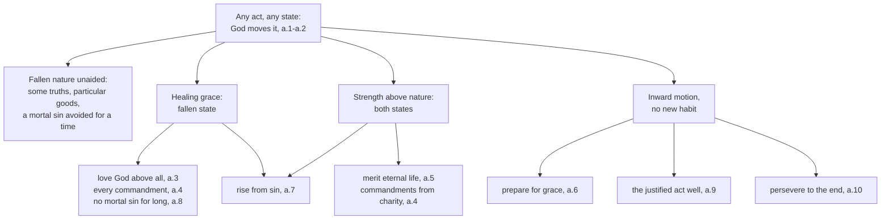

# Creation, Grace & the Last Things · Lesson 4.2: The necessity of grace

> ⏱ ~15 min · Module 4: Grace · Builds on: [4.1](04-01-what-grace-is.md), [3.2](03-02-pelagius-augustine-and-the-councils.md) · Unlocks: [4.4](04-04-nature-and-grace-the-gratuity-of-the-supernatural.md), [5.1](05-01-trent-session-vi-justification.md), [5.3](05-03-merit.md)

## Why this matters

"Without me you can do nothing" (John 15:5, DR). Read flat, it is false: unbelievers build houses and keep promises. Read as pious exaggeration, it is what the Church refused at Carthage in 418. The doctrine of the [necessity of grace](../reference.md#necessity-of-grace) says exactly *which* acts need grace and *why*, against two opposite errors.

## The idea

Ask three questions of any act.

**Is it an act at all?** Then God moves it, as [First Mover](../reference.md#the-three-helps) of every creature in every state: Adam before the fall, the saints in glory, the unbeliever planting a garden. How that motion squares with freedom is the whole [*de auxiliis*](../reference.md#de-auxiliis) quarrel ([5.5](05-05-the-de-auxiliis-controversy.md)).

**Does it reach for eternal life?** Then it needs a strength above nature, because the end is above nature. That was true of Adam too: a healthy runner still cannot run to the moon.

**Is it something nature should manage but, fallen, cannot fully?** Then it needs healing, like Aquinas's sick man, who can make some movements but not move as the healthy do until medicine cures him.

So the line runs between the **natural** and the **[salutary](../reference.md#salutary-act)**, not between good acts and sins. [Pelagius](../reference.md#pelagianism) made grace a help for what nature could do anyway ([3.2](03-02-pelagius-augustine-and-the-councils.md)); [Baius](../reference.md#baius) and the [Jansenists](../reference.md#jansenism) left fallen nature able only to sin ([5.6](05-06-jansenism.md)). Both were condemned.

## Source

Aquinas, *Summa Theologiae* I-II q.109 a.2, from the *respondeo* (Fathers of the English Dominican Province, 1920). It opens with God as First Mover in both states (a.1), then:

> … because human nature is not altogether corrupted by sin, so as to be shorn of every natural good, even in the state of corrupted nature it can, by virtue of its natural endowments, work some particular good, as to build dwellings, plant vineyards, and the like; yet it cannot do all the good natural to it, so as to fall short in nothing …
>
> And thus in the state of perfect nature man needs a gratuitous strength superadded to natural strength for one reason, viz. in order to do and wish supernatural good; but for two reasons, in the state of corrupt nature, viz. in order to be healed, and furthermore in order to carry out works of supernatural virtue, which are meritorious. Beyond this, in both states man needs the Divine help, that he may be moved to act well.

Count the needs: **three**. "For one reason … but for two" counts the superadded helps, elevation in both states and healing in the fallen one; "Beyond this" adds the First Mover's motion. And the first paragraph faces both errors: "not altogether corrupted", and "cannot do all the good natural to it".

## The doctrine

1. **Grace is necessary for every salutary act, the beginning included.** [Orange II](../reference.md#orange-ii) (529) can. 7 condemns saying that "by the vigour of nature" (*per naturae vigorem*) one can think or choose any good "that pertains to the salvation of eternal life", or consent to the gospel, without the Spirit's illumination (lesson's translation), citing John 15:5 and 2 Corinthians 3:5. Trent re-taught it ([Session VI](../reference.md#trent-session-vi), 13 January 1547): no justification by works "without the grace of God through Jesus Christ" (can. 1), and no one can "believe, hope, love, or be penitent as he ought" without the prevenient inspiration of the Holy Ghost (can. 3, Waterworth). *In words:* "salvation" and "as he ought" draw the line; nothing here says natural goods need grace.

2. **Grace is not a convenience.** [Carthage (418)](../reference.md#council-of-carthage-418) can. 5 condemned the view that grace lets us do *more easily* what free will could do anyway: the Lord "does not say: without me you can do it with more difficulty, but: without me you can do nothing" (lesson's translation). Trent VI can. 2 targets the same free will, able "though hardly indeed and with difficulty" (Waterworth). *In words:* grace is not a lift up a hill nature could climb on foot.

3. **Preparation is already grace, freely consented to.** Preparing for grace is being *turned* to God, which only God's motion, not a prior habit, can do (a.6; P3 reads it). Orange II teaches it in cann. 3–7: in can. 4 even the will to be cleansed is worked in us (citing Philippians 2:13), and can. 6 cites 1 Corinthians 4:7. Trent VI ch. 5 begins justification from prevenient grace "without any merits existing on their parts" and reads "Turn ye to me" (Zechariah 1:3) as admonishing our liberty and "Convert us, O Lord" (Lamentations 5:21) as confessing that "we are prevented by the grace of God" (Waterworth). Can. 4: the will so moved co-operates and can refuse ([prevenient grace](../reference.md#prevenient-grace); CCC 2001). *In words:* the first turn toward God is God turning you, and it is still you who turn.

4. **The justified still need help, and [final perseverance](../reference.md#final-perseverance) is a gift.** [Habitual grace](../reference.md#sanctifying-grace) heals the mind, not yet the flesh, so each good act of the justified needs [God's motion](../reference.md#actual-grace) (a.9, citing Romans 8:26). Christ's power "always precedes and accompanies and follows" their good works (Trent VI ch. 16), and God's help must be implored "even by the reborn and healed" (*etiam renatis ac sanatis*, Orange II can. 10, lesson's translation). Perseverance is a gift that "cannot be derived from any other but Him" (ch. 13), and can. 22 condemns saying the justified can persevere "without the special help of God", or cannot with it. Can. 16 on certainty is [`moral-theology` 3.2](../../moral-theology/lessons/03-02-faith-hope-and-charity.md)'s; why some receive the gift, [5.4](05-04-predestination.md)'s. *In words:* staying in grace to the end is itself given.

5. **Nature is not destroyed.** Orange's conclusion calls free will "bent and weakened" (*inclinatum et attenuatum*), so that no one can love or believe in God as he ought unless grace goes first (lesson's translation). Trent VI ch. 1 reuses both participles: free will, "attenuated as it was in its powers, and bent down, was by no means extinguished" (Waterworth). Cann. 5 and 7 condemn calling it "lost and extinguished" and all works before justification "truly sins". Pius V's *Ex omnibus afflictionibus* (1 October 1567) condemned propositions drawn from Michael Baius: prop. 25, "All works of unbelievers are sins, and the virtues of the philosophers are vices", and prop. 27, that free will without grace avails only for sinning. The Holy Office (7 December 1690, prop. 8: "an unbeliever must sin in every work") and [*Unigenitus*](../reference.md#unigenitus-1713) (8 September 1713, Quesnel's props. 38–40) condemned it again (lesson's translations). *In words:* fallen nature still does real good, but cannot reach God alone.

**Said plainly.** Rome condemned the claim that every work of an unbeliever is a sin in 1567, 1690 and 1713, each time [*in globo*](../reference.md#in-globo-censure), with censures from "rash" to "heretical" applied "respectively" (*respective*). No act has said which note it earns, and the error kept returning inside the Church for a century and a half.

| Defined or taught (with level) | A school's explanation or an opinion (no magisterial level) |
|---|---|
| Grace necessary for every salutary act, the beginning of faith included: **rung 1** (Trent VI cann. 1, 3) | Acts are proportioned to their end, which exceeds nature (a.5); only the First Mover turns the will to its end (a.6) |
| Grace not a mere facility: **rung 1** (can. 2) | Three needs: motion always, elevation in both states, healing after the fall (a.2) |
| Prevenient grace begins preparation; the will consents and can refuse: **rung 1** (cann. 3–4) | The help a motion, not a habit (a.6 ad 3); [premotion](../reference.md#physical-premotion) or simultaneous concurrence: **rung 5** ([5.5](05-05-the-de-auxiliis-controversy.md)) |
| Special help needed to persevere: **rung 1** (can. 22); Christ's power precedes and follows good works: **at least rung 3** (ch. 16) | Perseverance a guarding assistance, not a habit (a.10); no mortal sin avoided *for long* without healing grace (a.8) |
| Free will not extinguished, not every work before justification a sin: **rung 1** (cann. 5, 7); "all works of unbelievers are sins" condemned: **rung 3** | Fallen nature can "build dwellings, plant vineyards", but not all natural good (a.2) |

**Mark the levels** ([the ladder](../../fundamental-theology/lessons/04-04-the-ladder-of-doctrinal-authority.md); [levels of authority](../reference.md#levels-of-authority)). Trent VI cann. 1–5, 7 and 22 are **rung 1**. Chapters no canon repeats, like ch. 16's line, are **at least rung 3**, under a fence [5.1](05-01-trent-session-vi-justification.md) weighs: doctrine "which whoso receiveth not faithfully and firmly cannot be justified". Orange II and Carthage are **rung 1** by confirmation and reception, on the route [3.2](03-02-pelagius-augustine-and-the-councils.md) lays out. The condemnations of 1567, 1690 and 1713 are **rung 3**: a global censure fixes no note. Aquinas's q.109, the First Mover's motion and the a.8 thesis included, is **common teaching, rung 4**; premotion against concurrence, **rung 5**; the axiom of Ex 2, none. The Catechism locates and fixes nothing.

## The map

What grace adds to the First Mover's motion depends on whether the act is natural, above nature, or a repair.

## Worked examples

**Ex 1 (clean): the neighbour who does not believe.** Invented: at St Benedict's, Orrin Falls, a parishioner asks whether the goodness of Ysolde Farquhar, an unbeliever who has nursed her disabled brother Lachlan for twenty years, counts. *Are her acts sins?* No: fallen nature "can … work some particular good" (a.2), and calling all her acts sins is condemned (**rung 3**). *Do they [merit](../reference.md#merit) eternal life?* No: that needs strength above nature (a.5), and no one is justified by works without grace (Trent VI can. 1, **rung 1**). *Can she keep the whole law, alone, for life?* Not for long without healing grace (a.8, **rung 4**): a claim about unaided nature, not a verdict on her. *Is grace at work in her?* The doctrine cannot see; if she begins to pray, that beginning is grace (a.6).

**Ex 2 (strain): "I did what was in me."** Invented: Kwabena Ferrante, received at Easter, says, "I did what was in me, and God did the rest." It echoes [the axiom](../reference.md#facere-quod-in-se-est) Aquinas states as an objection: God does not deny grace to one who does what is in him (a.6 obj. 2). If natural effort earns grace, it meets Orange II can. 18, "grace, which is not owed, goes before" (*gratia, quae non debetur, praecedit*, lesson's translation), and Trent VI can. 3 (**rung 1**). Aquinas reads it otherwise: what is in us is in our power "according as he is moved by God" (ad 2). And Kwabena truly consented and could have refused (can. 4, **rung 1**). The strain is "the rest", which splits the credit. The doctrine forbids both "my part was mine alone" and "I did nothing", but not *how* one consent is wholly God's gift and wholly Kwabena's act. Báñez answers with premotion, Molina with God's [foreknowledge](../reference.md#middle-knowledge) of his free choice: **rung 5**, left open in 1607 ([5.5](05-05-the-de-auxiliis-controversy.md); freedom itself is [`metaphysics` 6.4](../../metaphysics/lessons/06-04-libertarianism-and-its-critics.md)'s).

## Watch out

- **You might think "without me you can do nothing" leaves the unbeliever only evil.** Carthage read it of "the fruits of the commandments" (can. 5, lesson's translation). Calling every unbeliever's work a sin is the condemned error, not stricter piety.
- **You might think the condemnations of Baius and Quesnel define the contrary, or settle nothing.** A global censure makes the contrary **rung 3**: binding, with no precise note. "Heresy" overstates; "open question" understates.
- **You might think grace is a repair kit for the fall.** Unfallen Adam needed the First Mover, and strength above nature to merit (a.2, a.5); the fall added healing.
- **You might think "nature is wounded, not destroyed" is a conciliar formula.** It summarizes Trent VI ch. 1, q.109 a.2 and CCC 405 (not totally corrupted, wounded in its natural powers); the gloss behind it is [3.1](03-01-original-justice-and-the-fall.md)'s.

## One-liner

> Fallen nature can still build and love its friends, which Rome teaches against its detractors, and cannot take one step toward eternal life unless God moves it first, which is defined.

## Problems

**P1 (🟢)** *(Exegetical)* **Assign the level.** For each claim, give its rung, or say it has none, and name the act that fixes it. **One line per claim.**

(a) No one can believe, hope, love or repent as he ought, so as to receive justifying grace, without the prevenient inspiration and help of the Holy Spirit.

(b) Since Adam's sin, human free will is lost and extinguished.

(c) Without the help of God's grace, free will avails only for sinning.

(d) Without healing grace, no one can avoid mortal sin for long.

(e) God does not deny grace to one who does what is in him.

**P2 (🟡)** *(Exegetical)* **Close reading.** ST I-II q.109 a.10, from the *respondeo* (English Dominican Province):

> Perseverance is taken in three ways. First, to signify a habit of the mind whereby a man stands steadfastly, lest he be moved by the assault of sadness from what is virtuous. … Secondly, perseverance may be called a habit, whereby a man has the purpose of persevering in good unto the end. And in both these ways perseverance is infused together with grace, even as continence and the other virtues are. Thirdly, perseverance is called the abiding in good to the end of life. And in order to have this perseverance man does not, indeed, need another habitual grace, but he needs the Divine assistance guiding and guarding him against the attacks of the passions … For to many grace is given to whom perseverance in grace is not given.

(a) Name the three senses of perseverance. Which are habits infused with grace, and what does the third need instead?

(b) Trent VI can. 22 condemns saying that the justified can persevere "without the special help of God". Which sense does the canon concern, and which words of the passage show that this help is not a further habit?

(c) What does the last sentence rule out about the justified, and what question does it raise without answering?

**Two sentences per part.**

**P3 (🔴)** *(Exegetical)* **Reconstruct.** ST I-II q.109 a.6 (English Dominican Province). The article has distinguished preparing the will to act rightly, which needs habitual grace, from preparing it to receive habitual grace itself. Of the second:

> … in order that man prepare himself to receive this gift, it is not necessary to presuppose any further habitual gift in the soul, otherwise we should go on to infinity. But we must presuppose a gratuitous gift of God, Who moves the soul inwardly … And that they are "turned" to God can only spring from God's having "turned" them. Now to prepare oneself for grace is, as it were, to be turned to God … Hence it is clear that man cannot prepare himself to receive the light of grace except by the gratuitous help of God moving him inwardly.
>
> *Reply Obj. 3:* This objection regards habitual grace, for which some preparation is required, since every form requires a disposition in that which is to be its subject. But in order that man should be moved by God, no further motion is presupposed since God is the First Mover.

Objection 3 had argued that if grace is needed to prepare for grace, the preparations run on to infinity.

(a) Reconstruct the argument of the first paragraph in numbered premises (P1, P2, … ∴ C).

(b) Using the reply, say why the regress stops for a motion but would not stop for a habit.

(c) Trent VI ch. 5 and cann. 3–4 teach the same conclusion. Name one claim of the passage that the council defines, with the canon and its rung, and one that it leaves to the schools.

**Numbered premises for (a); two sentences each for (b) and (c).**

Solutions

**P1** *(Exegetical)*

**Must hit, strict:**

- **(a) Rung 1.** Trent VI can. 3 (13 January 1547) defines it; Orange II cann. 5–7 taught it first, rung 1 through confirmation and reception.
- **(b) False; its denial is rung 1.** Trent VI can. 5 condemns calling free will "lost and extinguished"; ch. 1 says it was weakened and bent, "by no means extinguished".
- **(c) Condemned; the contrary is rung 3.** Pius V, *Ex omnibus afflictionibus* (1567), Baius's prop. 27, under a global censure that fixes no note (Quesnel's prop. 38, 1713, likewise). Not rung 1: can. 5 condemns a different claim (that free will no longer exists at all), and can. 7 condemns saying all works done before justification "are truly sins", which leaves room for (c) wherever such works are done under prevenient grace.
- **(d) Rung 4.** Aquinas, q.109 a.8, the common teaching of the schools; no magisterial act defines it.
- **(e) No magisterial level.** A scholastic axiom, which Aquinas states as an objection and accepts only if what is in us is in our power "according as he is moved by God" (a.6 ad 2). Read as natural effort that earns grace, it runs into Trent VI can. 3 and Orange II can. 18 (rung 1).

**Wrong turns:** demoting (a) to rung 3 because Orange II was a provincial council, when Trent defines it; promoting (c) to rung 1 through can. 5 or can. 7, or calling its denial heresy, or calling (c) an open question; citing can. 22 or can. 23 for (d), when both concern the justified; calling (e) defined, or condemned outright as semi-Pelagian.

**Model answer:** (a) Rung 1, Trent VI can. 3, with Orange II before it. (b) Its denial is rung 1: Trent VI can. 5, and ch. 1's "by no means extinguished". (c) Condemned by Pius V among Baius's propositions (prop. 27, 1567) and again in Quesnel (1713), each time by global censure, so the contrary is rung 3, with no precise note; Trent's cann. 5 and 7 condemn neighbouring claims, not this one. (d) Rung 4: Aquinas's q.109 a.8, common teaching, defined nowhere. (e) No level: a scholastic axiom, orthodox in Aquinas's sense (a.6 ad 2), and contrary to Trent VI can. 3 if it means that natural effort earns grace.

---

**P2** *(Exegetical)*

**Must hit, strict (a):**

- First, a habit of standing firm against the assault of sadness; second, a habit of purpose to persevere to the end. Both are "infused together with grace", like the other virtues.
- Third, actually "abiding in good to the end of life". It is not a habit at all, and needs "the Divine assistance guiding and guarding him".

**Must hit, strict (b):**

- The canon concerns the **third** sense: actually persevering in the justice received.
- The words "does not, indeed, need another habitual grace, but he needs the Divine assistance" make the special help God's continuing assistance, not a habit added to grace. Trent VI ch. 13 calls it a gift that "cannot be derived from any other but Him".

**Must hit, strict (c):**

- It rules out that justification carries perseverance with it, so that the truly justified could not fall and a lapse would prove one never justified (condemned in Trent VI can. 23's first clause, rung 1; losing grace is [`moral-theology` 3.4](../../moral-theology/lessons/03-04-sin-mortal-and-venial.md)'s).
- It raises why the gift is given to some of the justified and not to others: predestination, [5.4](05-04-predestination.md)'s. It does not say God withholds the gift in order that they fall; predestination to evil is condemned (Trent VI can. 17; Orange II's conclusion).

**Wrong turns:** treating the third sense as one more infused virtue, lost like the others; answering (b) with can. 16, which is about certainty of perseverance, not the help it needs; reading "not given" as God causing the fall; adding that perseverance can be merited (ST I-II q.114 a.9 denies it, [5.3](05-03-merit.md)).

**Model answer:** (a) Perseverance is a habit of standing firm against sadness, a habit of purpose to persevere to the end, and the actual abiding in good until death. The first two are infused with grace, like the virtues; the third is no habit, and needs God's assistance guiding and guarding against the passions. (b) The canon concerns the third sense, actually persevering in justice. "Does not … need another habitual grace, but … the Divine assistance" shows that the special help is God's continuing aid, not a further habit. (c) It rules out that the truly justified cannot fall, which Trent VI can. 23 also condemns. It raises, and leaves to the doctrine of predestination, why the gift is given to some and not others, without any suggestion that God brings about the fall of the rest.

---

**P3** *(Exegetical)*

**Accept:** in (a), P2 phrased through the order of ends and movers that the excerpt omits (the will is directed to its last end by the First Mover); P3 may come first.

**Must hit, strict (a):**

- P1: To prepare oneself for grace is to be turned to God.
- P2: A will is turned to God only by God's turning it.
- P3: The preparation cannot be a further habitual gift, or the preparations would run to infinity.
- ∴ C: No one can prepare himself to receive habitual grace except by God's gratuitous help moving him inwardly: a motion, not a habit.

**Must hit, strict (b):**

- A habit is a form, and "every form requires a disposition" in its subject, so a habit preparing for a habit would need its own prior disposition, and so on without end.
- A motion from God presupposes no further motion, "since God is the First Mover": the series ends in a mover that is not moved.

**Must hit, strict (c):**

- **Defined:** the conclusion itself, that no one prepares for justifying grace without God's prior help: no one can believe, hope, love or repent as he ought, so as to be justified, without the Spirit's prevenient inspiration and help (can. 3, rung 1), with ch. 5's prevenient grace, given "without any merits existing on their parts", behind it. (Can. 4's free consent is defined too, but it is a.6 ad 4's point, not this passage's.)
- **Left to the schools:** the habit-and-motion analysis and the First Mover argument that stops the regress (rung 4), and how that motion relates to the will's consent, premotion or concurrence (rung 5, [5.5](05-05-the-de-auxiliis-controversy.md)). Trent speaks of "quickening and assisting grace" (ch. 5) without the metaphysics.

**Wrong turns:** making the preparing help a habit, sanctifying grace before sanctifying grace; reading the article as making the will passive, which can. 4 condemns and a.6 ad 4 denies ("he does this by his free-will"); saying Trent defined the First Mover argument or premotion; locating the regress-stopper in P1 rather than in the difference between form and motion.

**Model answer:** (a) P1: To prepare for grace is to be turned to God. P2: Only God turns a will to himself. P3: The preparation cannot be another habitual gift, or there would be an infinite regress. ∴ C: No one can prepare himself for habitual grace without God's gratuitous inward motion. (b) Every form needs a disposition in its subject, so a habit disposing for a habit would need another disposition before it, without end. A motion needs no prior motion, because God, who moves first, is not moved, and the series stops there. (c) Trent defines that no one believes, hopes, loves or repents as he ought for justification without the Spirit's prevenient inspiration (can. 3, rung 1). It leaves to the schools Aquinas's account of that help as a motion rather than a habit and the First Mover argument (rung 4), and above all how the motion and the free consent are one act (rung 5).

## Flashback

**From Lesson [3.4](03-04-monogenism-polygenism-and-the-modern-reinterpretations.md) (Monogenism, polygenism, and the modern reinterpretations):** *(Exegetical.)* Diagnose. A column in the newsletter of St Gall's, Hexley Moor, by its science-and-faith volunteer Thaddea Brannigan, **invented** for this problem:

> "Genetics puts our ancestors at about ten thousand, so there were never fewer humans than that. But genealogy brings good news: a couple who lived a few thousand years ago is an ancestor of everyone alive, so each of us carries some of their DNA, and that DNA is how original sin reaches us. Karl Rahner went further: after 1967 he dropped the first sin altogether, and original sin became simply the situation we are born into."

Find **three** errors. Correct each, giving the level of any claim involved. **Two sentences per error.**

Solution

**Must hit, strict:**

- **"Never fewer."** About ten thousand is a long-term *effective* population, an average dominated by the smallest generations, not a floor ([the genes](../reference.md#population-genetics-and-the-first-pair)). The data exclude only a strict two-person bottleneck within roughly 500,000 years, if no other lineage interbred: science, **no rung**.
- **"So each of us carries their DNA."** [Genealogy is not genetics](../reference.md#genealogical-and-genetic-ancestry): a universal family-tree ancestor (Rohde, Olson and Chang, 2004) need not have left a given descendant any DNA. No act defines [how original sin passes](../reference.md#transmission-of-original-sin) (**rung 5**), and "by propagation" (Trent V can. 3, **rung 1**) needs descent by generation, which genealogy supplies, not a gene.
- **"Rahner dropped the first sin."** In 1967 he gave up one first *man*, not the first sin: a first sin in the first community, by one or several, broke the medium of grace for all, and *Foundations*' [situation of guilt](../reference.md#situation-of-guilt) reaches back to it. His theory has **no magisterial level**.

**Wrong turns:** "correcting" the first by saying genetics confirms one couple (Hössjer and Gauger's minority case that one fits has no rung either); concluding that someone with none of the couple's DNA escapes original sin; calling the DNA story heresy rather than a poor answer to an open question (what passes is, on the common account, the privation of original justice, ST I-II q.82 a.3, **rung 4**, not a molecule); confusing Rahner with Schoonenberg.

**Model answer:** About ten thousand is an effective population, a long-term average weighted toward the smallest generations, not a floor; the data exclude only a strict two-person bottleneck within roughly 500,000 years, and none of it has a rung. A universal genealogical ancestor need not have left anyone DNA; no act defines how original sin passes (rung 5), and Trent's "by propagation" (rung 1) needs descent, not a gene. Rahner in 1967 gave up one first man, not the first sin: a first community's sin, by one or several, broke the medium of grace for all. His view has no magisterial level.

## Connections

- **Backward:** [4.1](04-01-what-grace-is.md) distinguished habitual from actual grace, the two helps this lesson needs. [3.2](03-02-pelagius-augustine-and-the-councils.md) gave Carthage, Orange II and their weight, [`patristics` 4.5](../../patristics/lessons/04-05-augustine-against-the-pelagians.md) the Augustine–Pelagius crux behind them, and [3.1](03-01-original-justice-and-the-fall.md) the wounded nature. The proportion principle behind a.5 is drilled in [`moral-theology` 3.3](../../moral-theology/lessons/03-03-the-cardinal-virtues-and-the-gifts.md); q.109's place at the end of I-II is [`thomistic-synthesis` 5.4](../../thomistic-synthesis/lessons/05-04-a-map-of-the-second-and-third-parts.md)'s.
- **Forward:** [4.4](04-04-nature-and-grace-the-gratuity-of-the-supernatural.md) asks whether the end grace serves was owed to nature, where Baius returns. [5.1](05-01-trent-session-vi-justification.md) reads Session VI whole, preparation included; [5.3](05-03-merit.md) says why the first grace cannot be merited; [5.4](05-04-predestination.md) why perseverance is given to some; [5.5](05-05-the-de-auxiliis-controversy.md) how God's motion and free consent are one act; [5.6](05-06-jansenism.md) Quesnel and the Jansenist century.
- **Sideways:** that the commandments can be kept (Trent VI can. 18) and that hope is neither despair nor presumption are moral theology's ([`moral-theology` 1.4](../../moral-theology/lessons/01-04-the-new-law.md), [3.2](../../moral-theology/lessons/03-02-faith-hope-and-charity.md)). How far sin left reason able to know natural truth (q.109 a.1) is the nature-and-grace question that divides Catholic and Reformed apologetics ([`apologetics-foundations` 1.2](../../apologetics-foundations/lessons/01-02-three-strategies.md)); the argued dispute with the Reformers over free will belongs to [`apologetics-catholic-claims`](../../apologetics-catholic-claims/syllabus.md). And the First Mover's motion of a free will is the bridge [`metaphysics` 6.4](../../metaphysics/lessons/06-04-libertarianism-and-its-critics.md) builds from the other side.
