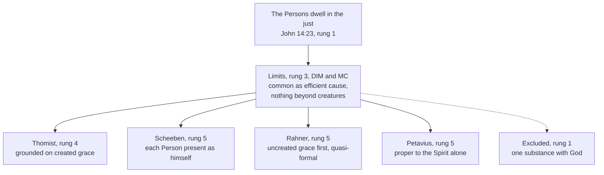

# Creation, Grace & the Last Things · Lesson 4.3: Sanctifying grace, the indwelling, and divinization

> ⏱ ~15 min · Module 4: Grace · Builds on: [4.1](04-01-what-grace-is.md), [`trinity-and-god` 6.1](../../trinity-and-god/lessons/06-01-the-missions-of-the-son-and-the-spirit.md) · Unlocks: [5.1](05-01-trent-session-vi-justification.md), [`ecclesiology-and-mariology` 1.3](../../ecclesiology-and-mariology/lessons/01-03-the-body-of-christ.md), [`sacraments-and-liturgy` 1.1](../../sacraments-and-liturgy/lessons/01-01-what-a-sacrament-is.md)

## Why this matters

Ask what baptism did and most Catholics will say it washed away sin. The tradition says far more, in words that sound reckless: partakers of the divine nature, sons and heirs, temples of God, even "made God". This lesson says what they claim, which are defined and which are a school's, and the qualification, *by grace and not by nature*, that keeps them from claiming too much.

## The idea

A human adoption changes a child's name and inheritance and leaves her what she was. God's adoption, Aquinas notes, makes the adopted fit for the inheritance; a human parent can only choose someone already fit (ST III q.23 a.1). Grace changes the person, not only God's attitude: a man's love finds good in what it loves, God's puts it there (I-II q.110 a.1; [4.1](04-01-what-grace-is.md)).

Take the iron in the fire from [`thomistic-synthesis` 2.3](../../thomistic-synthesis/lessons/02-03-participation.md): it glows with heat it has only from the fire, as much as iron can take, and cools when removed. [Sanctifying grace](../reference.md#sanctifying-grace) is that one level up: the soul receives a share in God's own life of knowing and loving, so that it can know and love him as he is, by faith now and by sight at the end. Aquinas uses the same fire: only God can "deify", as only fire kindles (ST I-II q.112 a.1).

Two more facts. The heat is not the fire: the soul receives a created gift. And the fire is there: the divine Persons dwell in it. How those fit is where the schools part; that the iron never becomes fire, no Catholic may deny.

## Source

*Summa Theologiae* I-II q.110 a.3, "Whether grace is the same as virtue?", from the *respondeo* (English Dominican Province):

> ... infused virtues dispose man in a higher manner and towards a higher end, and consequently in relation to some higher nature, i.e. in relation to a participation of the Divine Nature, according to 2 Pet. 1:4: "... that by these you may be made partakers of the Divine Nature." And it is in respect of receiving this nature that we are said to be born again sons of God.
>
> And thus, even as the natural light of reason is something besides the acquired virtues ... so also the light of grace which is a participation of the Divine Nature is something besides the infused virtues which are derived from and are ordained to this light ...

Three moves. **A virtue presupposes a nature**, so virtues ordered to God as he is need a nature that high; grace supplies one, by participation. **One gift, three names:** "partakers", "born again sons", "the light of grace". **Root and branches:** grace is to the [infused virtues](../reference.md#infused-virtues) as reason to the acquired, so a.4 seats grace in the soul's essence and the virtues in its powers.

## In their own words

A permitted rival line reads the sources otherwise. Petavius (Denis Pétau, 1583–1652; *Dogmata theologica*, *De Trinitate* book 8), following the Greek Fathers, held a union of the Spirit with the just proper to him alone. Matthias Joseph Scheeben (1835–1888) is now usually read as holding each Person present in his own character.

Karl Rahner sharpened it in a 1939 essay, "Some Implications of the Scholastic Concept of [Uncreated Grace](../reference.md#uncreated-and-created-grace)" (*Zeitschrift für katholische Theologie* 63; paraphrased). Scripture and the Fathers make created grace the *consequence* of God's self-gift; Scholasticism made it the *basis*. Aquinas's account of the vision shows the way back: the divine essence is united to the intellect "as the object actually understood" (ST I q.12 a.2 ad 3), almost as a form, not as an efficient cause. Hence [quasi-formal causality](../reference.md#quasi-formal-causality). Grace is glory begun; so God's self-gift comes first, created grace disposes for it, and the graced are related to each Person as himself, though the three stay one efficient cause.

## The doctrine

1. **Grace inheres; it is not favour only.** Trent, Session VI (13 January 1547), can. 11, condemns calling justifying grace "only the favour of God", and ch. 7 says we "are not only reputed, but are truly called, and are, just" (Waterworth). *In words:* God's saving love leaves something new in the person.

2. **A quality at the root of the soul** (ST I-II q.110 aa.2–4). God moving the soul to an act is "not a quality, but a movement of the soul" ([actual grace](../reference.md#actual-grace)); the habitual gift moving it "sweetly and promptly" to eternal good is a quality (a.2). It is "an accidental form of the soul", not a substance, yet "nobler than the nature of the soul, though not in its mode of being", being a share in God's goodness (ad 2). It acts "after the manner of a formal cause" (ad 1), which [5.1](05-01-trent-session-vi-justification.md) needs for Trent's [formal cause](../reference.md#formal-cause). Faith, hope and charity come with it, "infused at once" (Trent VI ch. 7), and the moral virtues (**rung 4**) and gifts (**rung 3**) are [`moral-theology` 3.1](../../moral-theology/lessons/03-01-virtue-acquired-and-infused.md)–[3.3](../../moral-theology/lessons/03-03-the-cardinal-virtues-and-the-gifts.md)'s. *In words:* not a feeling or a second soul, but a lasting quality from which the virtues flow.

3. **Sons, heirs, partakers.** "You have received the spirit of adoption of sons" (Rom 8:15, DR); "if sons, heirs also" (8:17; cf. Gal 4:5–7). We are made "partakers of the divine nature" (2 Pet 1:4, DR; Greek *theias koinōnoi physeōs*, sharers). Aquinas: we are begotten "by grace, not by nature" (III q.23 a.2), and [adoptive sonship](../reference.md#adoptive-sonship) is the whole Trinity's work, [appropriated](../reference.md#appropriation) to the Father as author, the Son as exemplar, the Spirit as imprinting the likeness (ad 3). *In words:* the Son is Son by nature; we are sons by a gift that makes us like him.

4. **The [indwelling](../reference.md#indwelling).** "We will come to him and will make our abode with him" (John 14:23, DR). Beyond God's presence in all things as cause, Aquinas finds a special mode, "as the object known is in the knower, and the beloved in the lover", God dwelling "as in His own temple" (ST I q.43 a.3). Leo XIII, [*Divinum Illud Munus*](../reference.md#divinum-illud-munus) (9 May 1897, §9, paraphrased): the Spirit gives not only his gifts but himself; this union differs from the blessed's only in degree or state; it is the whole Trinity's work, attributed especially to the Spirit. Pius XII, [*Mystici Corporis*](../reference.md#mystici-corporis) (29 June 1943, §§78–80, paraphrased): the mystery is veiled; those who explain it by various reasonings are not censured, within two limits. No union takes the faithful beyond the order of creatures ([`ecclesiology-and-mariology` 1.3](../../ecclesiology-and-mariology/lessons/01-03-the-body-of-christ.md)), and these activities are common to the Trinity "insofar as they have God as supreme efficient cause". §79 cites q.43 a.3. *In words:* the Persons themselves live in the just; only our state separates this from heaven.

5. **[Divinization](../reference.md#divinization), and its guardrail.** Irenaeus: the Word became "what we are, that He might bring us to be even what He is Himself" (*Against Heresies* V, preface, ANF vol. 1). Athanasius: "For He was made man that we might be made God" (*On the Incarnation* 54.3, tr. Robertson, NPNF2 vol. 4); and, drawing the line, we servants by nature "call Him by grace Father, who is by nature our Lord" (*Orations against the Arians* II.51, tr. Newman rev. Robertson). The guardrail is defined: [*Dei Filius*](../reference.md#dei-filius) (24 April 1870), canons on God the Creator, can. 3, condemns saying "the substance and essence of God and of all things is one and the same" (Schaff). *In words:* we become by grace what the Son is by nature, never what God is by essence.

Grace is lost by any mortal sin (ch. 15, can. 27; [`moral-theology` 3.4](../../moral-theology/lessons/03-04-sin-mortal-and-venial.md)) and recovered through penance (ch. 14, can. 29; [`sacraments-and-liturgy` 4.1](../../sacraments-and-liturgy/lessons/04-01-penance-the-sacrament-and-its-history.md)).

| Defined or taught (with level) | A school's explanation or an opinion (no magisterial level) |
|---|---|
| Justifying grace inheres, not favour only: **rung 1** (can. 11) | A quality, an accidental form (q.110 a.2): **rung 4**; seated in the soul's essence (a.4): **rung 5** |
| Charity poured forth and inherent: **rung 1** (can. 11); the three virtues "infused at once": **at least rung 3** (ch. 7) | Grace really distinct from charity (Thomists, Suárez) or one with it (Scotus, Bellarmine): **rung 5** |
| The Persons dwell in the just: **rung 1** (John 14:23); differing from heaven only by state, explained within two limits: **rung 3** (DIM §9; MC §78) | Founded on created grace, appropriated to the Spirit (I q.43 a.3): **rung 4**; quasi-formal (Rahner), proper to each Person (Scheeben) or to the Spirit (Petavius): **rung 5** |
| Partakers of the divine nature, sons by adoption: **rung 1** (2 Pet 1:4; Rom 8:15); never one substance with God: **rung 1** (*Dei Filius* can. 3) | Participation as "a participated likeness" (I-II q.112 a.1): **rung 4** |

**Mark the levels** ([the ladder](../../fundamental-theology/lessons/04-04-the-ladder-of-doctrinal-authority.md); [levels of authority](../reference.md#levels-of-authority)). The table's **rung 1** for the indwelling and adoption rests on Scripture's plain statements, proposed as revealed by the ordinary universal magisterium, as [`ecclesiology-and-mariology` 1.3](../../ecclesiology-and-mariology/lessons/01-03-the-body-of-christ.md) marked Christ's headship. Session VI's proem forbids teaching "otherwise than as by this present decree is defined and declared", so ch. 7 is **at least rung 3**; [5.1](05-01-trent-session-vi-justification.md) weighs more. Aquinas's analyses are the schools' account, **rung 4**, unless the table says otherwise. Loss and recovery are **rung 1** (cans. 27, 29). The Fathers as authors carry **no magisterial level**, and CCC 460 quoting them adds none. Because *Mystici Corporis* has spoken, the school question is **rung 5 inside two rung-3 limits**.

## The map

One fact, one fence, four explanations, one exit closed.

## Worked examples

**Ex 1 (clean): "I feel nothing different."** Invented: Cosmin Aldea, baptized at the Easter Vigil at St Basil's, Kestrel Bay, feels next morning just as before. Something now inheres in him (**rung 1**), on the common account a quality of his soul (**rung 4**), with faith, hope and charity. He is a son and heir, made fit and not merely named (III q.23 a.1), and the Persons dwell in him (**rung 1**). None of this is a feeling: grace escapes experience and is known by faith (CCC 2005), and infused virtue can sit beside old difficulty ([`moral-theology` 3.1](../../moral-theology/lessons/03-01-virtue-acquired-and-infused.md)). His flat morning is no evidence against it.

**Ex 2 (strain): "Is the Spirit in me in a way the Father is not?"** On retreat, Cosmin asks. Half is settled: the Father dwells by grace as truly as the Son and the Spirit but is never *sent*, because sending says origin from another (I q.43 a.5; [`trinity-and-god` 6.1](../../trinity-and-god/lessons/06-01-the-missions-of-the-son-and-the-spirit.md)). Half is open. Leo calls the indwelling the Trinity's, "attributed" to the Spirit; Pius XII, common "insofar as" God is efficient cause. A Thomist reads "attributed" as appropriation: charity likens the soul to the Spirit, who is Love (q.43 a.5 ad 2). On Rahner's line, "insofar as" leaves room for a non-efficient relation proper to each Person. **Where the doctrine stops:** no act says whether God's relation to the graced soul is exhausted by efficient causality. He may be told that the Spirit himself is in him, with the Father and the Son; *how* each is there is the theologians' question.

## Watch out

- **You might think "made God" is pious exaggeration, or an Eastern import.** 2 Peter says "partakers"; Aquinas, that God alone deifies. What is excluded is a share in God's substance (*Dei Filius* can. 3, **rung 1**).
- **You might think the Thomist account is the Church's because *Mystici Corporis* §79 uses its formula.** §78 declines to censure other explanations; borrowing a school's terms does not lift it to **rung 3**. It stays **rung 4**, its rivals **rung 5**.
- **You might think the indwelling is omnipresence turned up.** God is in a stone as its cause; he dwells in the just as the known in the knower, a mode only grace gives (q.43 a.3; [`trinity-and-god` 1.4](../../trinity-and-god/lessons/01-04-immutability-eternity-immensity.md)).

## One-liner

> Sanctifying grace is a created share in God's life, and with it the Persons themselves come to dwell: we become by grace what the Son is by nature, never what God is by essence.

## Problems

**P1 (🟢)** *(Exegetical)* **Diagnose.** An **invented** review in a diocesan magazine of an invented book, *The Fire in the Iron*, written for this problem:

> "Hollis Varga's book is a welcome corrective. (1) Before Rahner, Catholic theology taught that God gives us created grace, a thing in place of himself; the gift of the Spirit in person is a twentieth-century rediscovery. (2) Varga rightly notes that Pius XII settled the matter in 1943: the Spirit dwells in the just by a union proper to him alone, and Catholics must hold it. (3) And since the indwelling is heaven already begun, the baptized already see God, if dimly."

For each numbered sentence, give the correction and the text that supplies it. **Two sentences per item.**

**P2 (🟡)** *(Exegetical)* **Assign the level.** For each claim, give its rung, or say it has no magisterial level, and name the act that fixes it. **One line per item.**

(a) The grace by which we are justified is not only the favour of God.

(b) Sanctifying grace is really distinct from charity.

(c) Grace is a quality of the soul.

(d) The indwelling of the Spirit in the just differs from the union of the blessed with God only by our earthly state.

(e) Faith, hope and charity are infused together with justifying grace.

(f) No creature, however graced, is of one substance with God.

**P3 (🔴)** *(Exegetical)* **Close reading.** ST I q.43 a.3, "Whether the invisible mission of the divine person is only according to the gift of sanctifying grace?", from the *respondeo* and the second reply (English Dominican Province):

> For God is in all things by His essence, power and presence, according to His one common mode, as the cause existing in the effects which participate in His goodness. Above and beyond this common mode, however, there is one special mode belonging to the rational nature wherein God is said to be present as the object known is in the knower, and the beloved in the lover. ... So no other effect can be put down as the reason why the divine person is in the rational creature in a new mode, except sanctifying grace. ... And yet the Holy Ghost is possessed by man, and dwells within him, in the very gift itself of sanctifying grace. Hence the Holy Ghost Himself is given and sent.
>
> **Reply Obj. 2.** Sanctifying grace disposes the soul to possess the divine person ... Nevertheless the gift itself of grace is from the Holy Ghost ...

(a) Why can God's common presence bring nothing new to a creature that already exists, and which words locate the newness of the special mode? **Two sentences.**

(b) Rahner charged that Scholasticism made created grace the *basis* of God's self-gift (see "In their own words"). Which words of this passage give the charge its foothold, and which would a Thomist cite in reply? Does the passage settle the order? **Three sentences.**

Solutions

**P1** *(Exegetical)*

**Must hit, strict:**

- **(1)** False as history. Leo XIII taught in 1897 that the Spirit brings not only his gifts but himself, the supreme Gift (*Divinum Illud Munus* §9), and Aquinas had said the Holy Ghost himself is given (ST I q.43 a.3). What Rahner disputed was the *order* between the created gift and the uncreated one, not whether God gives himself.
- **(2)** Misreports the act and overstates it. *Mystici Corporis* §78 declines to censure the various explanations, requires that these activities be held common to the Trinity as efficient cause, and adopts no theory of a union proper to the Spirit. That view is Petavius's opinion, at **rung 5** within the encyclical's **rung-3** limits, and binds no one.
- **(3)** Leo says the indwelling differs from the blessed's union "in degree or state" (DIM §9, repeated at MC §80), and the vision belongs to the state the wayfarer has not reached. No one in this life sees God's essence (ST I q.12 a.11); the just know him by faith and love him by charity, and see him in heaven by the light of glory.

**Wrong turns:** correcting (1) by saying Catholic theology denies created grace, which overcorrects into the reviewer's own picture. In (2), saying Pius XII condemned Petavius: he condemned no theory, and the exclusive view is, in Pohle's words in the 1909 *Catholic Encyclopedia*, "almost universally rejected" by theologians (a historian's report, no level), not censured. In (3), denying any link between grace and glory, when both encyclicals assert it.

**Model answer:** (1) The gift of the Spirit himself was always taught: Leo XIII says in 1897 that the Spirit gives himself as the supreme Gift, not only his gifts (DIM §9), and Aquinas says the Holy Ghost himself is given (I q.43 a.3). Rahner disputed the order of created and uncreated grace, not the fact. (2) *Mystici Corporis* §78 settled no theory: it permits explanations within two limits, nothing beyond the order of creatures and all these activities common to the Trinity as efficient cause. A union proper to the Spirit alone is Petavius's opinion, rung 5, binding no one. (3) Grace differs from glory "in degree or state" (DIM §9; MC §80), and the vision of God's essence is not given in this life (I q.12 a.11). The baptized know God by faith, not by sight.

---

**P2** *(Exegetical)*

**Must hit, strict:**

- **(a) Rung 1.** Trent, Session VI (1547), can. 11.
- **(b) Rung 5.** No act decides it: Thomists and Suárez distinguish grace and charity, Scotus and Bellarmine identified them. Can. 11 names "the grace and the charity" side by side and defines that both inhere, not that they differ.
- **(c) Rung 4.** The schools' common account (ST I-II q.110 a.2). Trent defines that grace inheres; it does not define its category.
- **(d) Rung 3.** Leo XIII, *Divinum Illud Munus* §9 (1897), quoted in *Mystici Corporis* §80 (1943): two encyclicals, no definition.
- **(e) Split.** The three together are **at least rung 3**: Trent VI ch. 7's "infused at once" is chapter teaching no canon repeats, fenced by the proem. Charity's infusion and inherence alone is **rung 1** (can. 11), which names charity, not faith and hope.
- **(f) Rung 1.** *Dei Filius*, canons on God the Creator, can. 3 (1870); MC §78 applies it to mystical union at rung 3.

**Wrong turns:** (a) at rung 3 because the Catechism says it, which understates a canon. (b) at rung 1 from can. 11's wording. (c) at rung 1 because "inherent" sounds like "quality", or at rung 3 because CCC 2000 calls grace a "habitual gift": the Catechism restates the common account and keeps its weight ([`fundamental-theology` 4.5](../../fundamental-theology/lessons/04-05-reading-a-documents-weight.md)). (d) at rung 1 because two popes said it, or rung 5 because it concerns heaven. (e) rung 1 for all three because "Trent says so", when only charity is in the canon; or rung 4 because Aquinas teaches it, which ignores the chapter. (f) "a Thomist safeguard" (rung 4), which demotes a definition.

**Model answer:** (a) Rung 1: Trent VI can. 11. (b) Rung 5: a school question, Thomists against Scotists; can. 11 defines inherence, not distinction. (c) Rung 4: the common account of the schools after q.110 a.2; Trent fixes inherence only. (d) Rung 3: *Divinum Illud Munus* §9, restated in *Mystici Corporis* §80. (e) At least rung 3 for the three together (ch. 7, a chapter); rung 1 for charity, which can. 11 names. (f) Rung 1: *Dei Filius* can. 3; MC §78 applies it.

---

**P3** *(Exegetical)*

**Must hit, strict (a):**

- The common mode is God present "as the cause existing in the effects": wherever anything exists, God is there causing it, so this presence is already complete in every existing creature and can begin only where a new creature begins.
- The newness is located by "in a new mode" and "no other effect can be put down as the reason ... except sanctifying grace". The new mode has a new created ground, so the novelty lies on the creature's side ([`trinity-and-god` 6.1](../../trinity-and-god/lessons/06-01-the-missions-of-the-son-and-the-spirit.md)), and the "special mode" consists in being known and loved.

**Must hit, strict (b):**

- **Foothold:** "no other effect can be put down as the reason why the divine person is in the rational creature in a new mode, except sanctifying grace", and ad 2's "Sanctifying grace disposes the soul to possess the divine person". Both make the created gift the ground or condition of the presence.
- **Reply:** "in the very gift itself": the Spirit is possessed *in* the gift, not after it or instead of it. "The Holy Ghost Himself is given": the gift includes the Giver. And ad 2's "the gift itself of grace is from the Holy Ghost" puts the Spirit first as its cause.
- **Settles?** No. The passage holds two orders, the Spirit first as efficient cause of the gift and the gift first as disposition to possess him. It never asks Rahner's question, whether the possession is itself a quasi-formal self-gift prior to the disposition. The text refutes the crude charge, that a thing was given instead of God, and leaves the refined one open: **rung 4** against **rung 5**, under *Mystici Corporis* §78's permission.

**Wrong turns:** in (a), answering only "God is known and loved", which names the special mode without saying why the common mode cannot be new. In (b), quoting only the reply words and calling the charge refuted, or only the foothold and calling it proved. Reading "disposes" as a temporal sequence, grace first and the Spirit later. Giving either reading a magisterial level because MC §79 cites this article.

**Model answer:** (a) God is in everything "as the cause existing in the effects", so that presence is already complete in whatever exists and begins only where a new creature begins. The newness lies in the "new mode", the known in the knower and the loved in the lover, whose only created ground is sanctifying grace, so the change is in the creature. (b) The foothold is "no other effect can be put down as the reason ... except sanctifying grace" with ad 2's "disposes the soul to possess the divine person", which make the gift the condition of the presence. A Thomist answers that the Spirit is possessed "in the very gift itself", that "the Holy Ghost Himself is given", and that the gift "is from the Holy Ghost", so the Giver is first as cause. The passage holds both orders without deciding Rahner's question whether God's self-gift is quasi-formal and prior; it is one of several readings the Church permits (MC §78).

## Flashback

**From Lesson [4.1](04-01-what-grace-is.md) (What grace is):** *(Exegetical.)* Close reading. ST I-II q.111 a.2, from the *respondeo* (English Dominican Province). Having divided God's motion of the will into [operating and cooperating grace](../reference.md#operating-and-cooperating-grace), the article turns to the habitual gift:

> But if grace is taken for the habitual gift, then again there is a double effect of grace, even as of every other form; the first of which is *being,* and the second, *operation;* thus the work of heat is to make its subject hot, and to give heat outwardly. And thus habitual grace, inasmuch as it heals and justifies the soul, or makes it pleasing to God, is called operating grace; but inasmuch as it is the principle of meritorious works, which spring from the free-will, it is called cooperating grace.

(a) What makes the one gift operating, and what makes it cooperating? Why does the heat show they are not two graces? **Two sentences.**

(b) Earlier, the *respondeo* calls God's moving of the will to begin willing good operating grace. Trent VI can. 4 condemns saying that free will moved by God "nowise co-operates towards disposing and preparing itself" for justification. Has Trent assigned the beginning of conversion to cooperating grace, against Aquinas? Give each claim's level. **Two sentences.**

Solution

**Must hit, strict (a):**

- **Operating** by the first effect, *being*: as it "heals and justifies the soul, or makes it pleasing to God" (4.1's *gratum faciens*), the gift makes the soul just. **Cooperating** by the second, *operation*: it is "the principle of meritorious works, which spring from the free-will".
- One heat both makes its subject hot and heats outwardly: one form, two effects. So "Operating and cooperating grace are the same grace" (ad 4), divided "only in its effects" (a.3 ad 2).

**Must hit, strict (b):**

- **No.** Aquinas's "operating" says who moves, not that the will is inert: the moved will consents by "a movement of our free-will", which is "not the cause of grace, but the effect" (ad 2). Trent's "co-operates" asserts that real, refusable assent, which Aquinas also holds.
- **Levels:** the assent, **rung 1** (can. 4); the division, **rung 4**, school vocabulary the decree neither adopts nor condemns.

**Wrong turns:** pairing operating with actual grace and cooperating with habitual, when the article applies both names to each; reading "operating" as a merely passive will, which can. 4 condemns and ad 2 denies; making cooperating grace a share of merit that is ours apart from grace ([5.3](05-03-merit.md)); saying Trent rejected Aquinas, or defined his division.

**Model answer:** (a) The gift is operating as it makes the soul just and pleasing to God, and cooperating as the source of meritorious works from free will. Like heat that warms its subject and gives heat outwardly, one form has two effects: "the same grace" (ad 4). (b) No: Aquinas's operating grace moves a will that truly consents, the consent being grace's effect (ad 2), and Trent asserts only that assent. The assent is rung 1 (can. 4); the division, which the decree never adopts, is rung 4.

## Connections

- **Backward:** [4.1](04-01-what-grace-is.md) sorted uncreated from created grace and fixed can. 11 against "favour only"; this lesson says what the created gift is and how the uncreated one is present. [`trinity-and-god` 6.1](../../trinity-and-god/lessons/06-01-the-missions-of-the-son-and-the-spirit.md) gave the invisible mission "according to sanctifying grace", and [`thomistic-synthesis` 2.3](../../thomistic-synthesis/lessons/02-03-participation.md) the participation metaphysics under the iron and the fire. [`christology` 3.4](../../christology/lessons/03-04-the-grace-of-the-head.md) gave Christ's own habitual grace, the source from which ours flows. The Fathers' deification is [`patristics` 3.1](../../patristics/lessons/03-01-athanasius.md) and [5.4](../../patristics/lessons/05-04-maximus-and-john-of-damascus.md).
- **Forward:** [4.4](04-04-nature-and-grace-the-gratuity-of-the-supernatural.md) asks why a share in the divine nature can never be owed to any nature. [5.1](05-01-trent-session-vi-justification.md) takes the inhering grace as Trent's single formal cause; [5.3](05-03-merit.md) builds merit on adoption, which makes us heirs (CCC 2009); [6.2](06-02-heaven-and-the-beatific-vision.md) takes up the vision, from which the indwelling differs "only in degree or state". [`sacraments-and-liturgy` 1.1](../../sacraments-and-liturgy/lessons/01-01-what-a-sacrament-is.md) treats the sacraments as instruments of this grace.
- **Sideways:** the Spirit in the Church is [`ecclesiology-and-mariology` 1.3](../../ecclesiology-and-mariology/lessons/01-03-the-body-of-christ.md)'s reading of the same encyclical, and its limits are the same §78. The moral life of the graced is [`moral-theology` 3.1](../../moral-theology/lessons/03-01-virtue-acquired-and-infused.md)–[3.4](../../moral-theology/lessons/03-04-sin-mortal-and-venial.md). Rahner's 1939 essay states early what [`trinity-and-god` 6.3](../../trinity-and-god/lessons/06-03-rahners-rule-and-the-immanent-trinity.md) counts as his rule's first gain, that grace is God's self-gift and not a created stand-in: the treatise on grace and the treatise on the Trinity meet at the indwelling.
