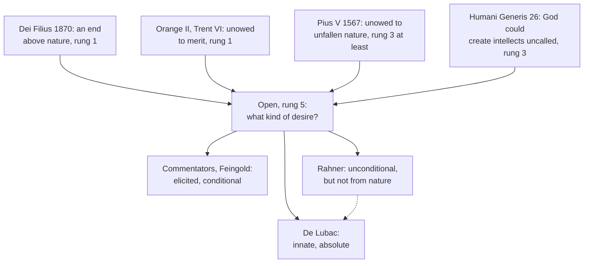

# Creation, Grace & the Last Things · Lesson 4.4: Nature and grace: the gratuity of the supernatural

> ⏱ ~15 min · Module 4: Grace · Builds on: [4.2](04-02-the-necessity-of-grace.md), [3.1](03-01-original-justice-and-the-fall.md), [`thomistic-synthesis` 6.4](../../thomistic-synthesis/lessons/06-04-transcendental-thomism-and-the-ressourcement-quarrel.md), [`moral-theology` 1.2](../../moral-theology/lessons/01-02-beatitude-the-last-end.md) · Unlocks: [6.2](06-02-heaven-and-the-beatific-vision.md), [7.4](07-04-limbo.md)

## Why this matters

Aquinas says every human being naturally desires to see God. The Church says the vision of God is owed to no one. Together they make the sharpest fight in twentieth-century Catholic theology, one that cost a great theologian his chair. Half of it is settled and half is not; this lesson keeps the halves apart.

## The idea

A pardon is unowed because the debtor forfeited his claim. [Grace](../reference.md#grace) is unowed to sinners in that way, the anti-Pelagian doctrine of [3.2](03-02-pelagius-augustine-and-the-councils.md) and [4.2](04-02-the-necessity-of-grace.md). A king's friendship is unowed more deeply: no subject, however loyal, ever had a claim to it. The Church teaches that the vision of God is unowed in this second way too. Not even sinless Adam had a right to it. That is the [gratuity of the supernatural](../reference.md#gratuity-of-the-supernatural).

The trouble: Aquinas holds that a mind knowing God's effects naturally wants to know what God is, and only the [beatific vision](../reference.md#beatific-vision) satisfies that want. A desire built into a nature looks like a claim. If God may leave it unfed, what was it for? If not, how is the vision a gift?

The commentators: the desire is woken by knowledge and wants the vision only *if* God gives it, and God could have given us a lesser end proportioned to our powers. Henri de Lubac: one nature, one end, the desire built in, and the end given as freely as existence. That the vision is unowed is settled. Which account of the desire is right is not.

## Source

ST I q.12 a.1, "Whether any created intellect can see the essence of God?", from the *respondeo* (English Dominican Province):

> Therefore some who considered this, held that no created intellect can see the essence of God. This opinion, however, is not tenable. … Further the same opinion is also against reason. For there resides in every man a natural desire to know the cause of any effect which he sees; and thence arises wonder in men. But if the intellect of the rational creature could not reach so far as to the first cause of things, the natural desire would remain void.

The target is an **impossibility** thesis: that no created mind *can* see God. The omitted lines answer it from faith; these answer from reason, by the [natural desire to see God](../reference.md#natural-desire-to-see-god), described by its origin: effects seen, and wonder. I-II q.3 a.8 runs the same way, and SCG III.50–57 at length. Both sides accept them; they dispute what "natural" and "void" mean.

## In their own words

**The commentators.** From Cajetan (1469–1534) through Suárez to Réginald Garrigou-Lagrange (1877–1964), the school read these texts by one principle: a nature is specified by an end proportioned to its powers, and "man's happiness is twofold" (I-II q.62 a.1). So the desire for the vision is [elicited, not innate](../reference.md#innate-and-elicited-desire), an act of will woken by knowledge: of supernatural effects, said Cajetan; of God's existence, said Báñez, for whom it is also **conditional**, to see God if he grants it. What answers it in nature is an [obediential potency](../reference.md#obediential-potency), a capacity to receive what nature can neither produce nor demand. So [pure nature](../reference.md#pure-nature), humanity with a natural final end, is possible. Their text is I-II q.5 a.5 ad 1: nature "gave him not the wherewithal to attain Happiness … But it did give him free-will, with which he can turn to God, that He may make him happy." Lawrence Feingold's *The Natural Desire to See God* (2001; 2nd ed. 2010) restated the case: q.12 a.1 proves the vision *possible*, not due; q.3 a.8's desire is wonder, elicited by God's effects; only knowledge makes a desire conditional, so an innate one would be an absolute demand; and a conditional desire is not "void" when unmet. Steven A. Long's *Natura Pura* (2010) defends nature's own end and law.

**De Lubac.** *Surnaturel* (1946) called pure nature a sixteenth-century device read back into Aquinas ([`thomistic-synthesis` 6.4](../../thomistic-synthesis/lessons/06-04-transcendental-thomism-and-the-ressourcement-quarrel.md) gives the argument and Garrigou-Lagrange's reply). A spirit is the creature whose desire ends only in God: the desire is innate and absolute, the end one, the gratuity creation's. He granted (1949; *The Mystery of the Supernatural*, 1965) that God could make a spirit uncalled, but it would be another being than I. John Milbank's *The Suspended Middle* (2005) radicalized him; Nicholas Healy (*Communio*, 2008) defended him.

**Rahner.** Karl Rahner's 1950 reply in *Orientierung* (English in *Theological Investigations* I) granted that every human being is unconditionally ordered to the vision, and denied that the ordering is nature, since a part of nature God's goodness could not frustrate would make grace owed. It is a [supernatural existential](../reference.md#supernatural-existential): God's offer of himself, given to everyone with creation, before any response, owed to no one. Nature is a remainder concept, never met alone, and (against de Lubac) the same "I" could have existed uncalled.

## The doctrine

1. **A supernatural end, beyond nature's reach.** [*Dei Filius*](../reference.md#dei-filius) (Vatican I, 24 April 1870) ch. 2: God "of his infinite goodness" has ordained man to a supernatural end, goods that "utterly exceed the intelligence of the human mind" (Schaff). Canon II.3 (on revelation) condemns saying that man cannot be raised by God above nature but can reach all truth and good of himself. *In words:* the vision is real, and no one climbs to it.

2. **Grace is unowed to merit.** [Orange II](../reference.md#orange-ii) (529), can. 18 (lesson's translation): "Grace is preceded by no merits. A reward is owed to good works, if they are done; but grace, which is not owed (*quae non debetur*), goes before, that they may be done." Trent VI ch. 8 (1547) says the same of justification. *In words:* no one earns the first grace ([5.3](05-03-merit.md) owns [merit](../reference.md#merit)).

3. **Unowed even to unfallen nature.** Pius V's *Ex omnibus afflictionibus* (1 October 1567) condemned seventy-nine propositions from the works of Michael [Baius](../reference.md#baius) of Louvain, unnamed. Among them (lesson's translations): that the raising of human nature into fellowship with the divine "was owed to the integrity of its first condition", and so is natural (prop. 21); that the first man's happiness, had he persevered, "would be a wage, and not grace" (prop. 3); that God could not have created man as he is now born (prop. 55). *In words:* sin did not make grace a gift; it always was one.

4. **[*Humani Generis*](../reference.md#humani-generis) §26 (Pius XII, 12 August 1950).** Some "destroy the gratuity of the supernatural order" (in the Latin, its *veram 'gratuitatem'*, true gratuity) by holding that God cannot create intellectual beings without ordering and calling them to the vision. It condemns a thesis about God's **freedom**, a *cannot*. It names no one, never says "pure nature", leaves the desire's kind alone, and speaks of "intellectual beings", not this race. *In words:* God was free not to call.

5. **The actual order.** *Gaudium et Spes* 22 (1965): every human being's ultimate vocation is "in fact one, and divine"; CCC 1998 calls it supernatural, beyond every creature's powers. *In words:* no merely natural human being exists.

**Said plainly.** In June 1950 de Lubac's Jesuit superiors removed him from teaching and withdrew *Surnaturel*; the encyclical came two months later, naming no one ([`thomistic-synthesis` 6.4](../../thomistic-synthesis/lessons/06-04-transcendental-thomism-and-the-ressourcement-quarrel.md)). He was made a cardinal in 1983.

| Defined or taught (with level) | A school's explanation or an opinion (no magisterial level) |
|---|---|
| Man can be raised above nature, not of himself: **rung 1** (*Dei Filius* can. II.3) | The *duplex ordo*: a proportioned natural end, a supernatural end beyond it |
| Grace is unowed to merit: **rung 1** (Orange II can. 18; Trent VI ch. 8) | The desire elicited and conditional, met by obediential potency (Báñez to Feingold) |
| Unowed even to unfallen nature: **at least rung 3** (Pius V, 1567) | Pure nature with a natural beatitude (Cajetan to Long) |
| God could create intellectual beings uncalled: **rung 3** (HG 26) | De Lubac: an innate, absolute desire; an uncalled spirit is not us |
| The human vocation is in fact divine: **at least rung 3** (GS 22) | Rahner: a supernatural existential given to all |

**Mark the levels** ([the ladder](../../fundamental-theology/lessons/04-04-the-ladder-of-doctrinal-authority.md); [levels of authority](../reference.md#levels-of-authority)). *Dei Filius* can. II.3, a conciliar canon: **rung 1**; ch. 2 expounds, **at least rung 3**. Orange II can. 18, received and restated by Trent: **rung 1**. Pius V's notes, heretical down to offensive, fall on the list *respective*, so no contradictory reads off above **rung 3** (default down, can. 749 §3). HG 26 deliberately judges a disputed matter, which its own §20 says closes it: **rung 3**, defining nothing. GS 22, conciliar and undefined, with *Dei Filius* ch. 2 behind it: **at least rung 3**. CCC 27 (the desire for God written in the heart) locates a teaching, fixing no level; the desire's kind is **rung 5**, as is pure nature. The 1950 measures: discipline, **no rung**. The theologians: **no magisterial level**.

## The map

Four settled points bound one open question; dashed, Rahner shares de Lubac's fact but not its source.

## Worked examples

**Ex 1 (clean): Adam's wages.** Invented: at the St Thomas More Chaplaincy, Haddon Cross, Saoirse Lindqvist asks Fr Benedek Osei, "Adam hadn't sinned. Had he kept the command, wouldn't heaven have been his by right?" The first gratuity cannot answer her: no sin forfeited a claim. The second does. Pius V condemned exactly this, the first man's happiness as a wage (prop. 3) and his elevation as owed to his nature (prop. 21): **at least rung 3**. And no nature reaches the vision of itself (**rung 1**). Could Adam have merited heaven? Only as already raised by grace ([5.3](05-03-merit.md)). Left open: whether Adam without grace would have had a natural end, **rung 5**.

**Ex 2 (strain): the contented housemate.** Saoirse's housemate Dev Cardew, a cheerful atheist medic: "I'm happy. Friends, climbing, a job I'll love. There's no God-shaped hole." The doctrine fixes three things to say. His goods are real: Aquinas grants an imperfect happiness won by natural powers (I-II q.5 a.5; [`moral-theology` 1.2](../../moral-theology/lessons/01-02-beatitude-the-last-end.md)). The vision is offered him in fact (GS 22). Nothing he does earns or reaches it. It stops at *how to describe his contentment*. For de Lubac, the restlessness is there whether he feels it or not, and the gospel names what he already is. For the commentators, he may lack any desire for the vision without lacking anything natural, and the gospel offers what "eye hath not seen" (1 Corinthians 2:9, Douay-Rheims, cited by *Dei Filius*), more than he could have wanted. For Rahner, grace is offered him already. Naming a hunger he denies or offering a gift beyond his goods is a rung-5 choice; the apologetic argument from desire is [`apologetics-foundations` 8.3](../../apologetics-foundations/lessons/08-03-apologetics-in-a-secular-age.md)'s.

## Watch out

- **You might think gratuity just means sinners don't deserve heaven.** That is the first gratuity, and Baius held exactly it. The elevation was unowed before sin too, **at least rung 3** (1567, 1950); omitting that understates.
- **You might think *Humani Generis* defined pure nature or condemned de Lubac.** It names no one and never uses the term. It teaches a thesis about God's freedom at **rung 3**; pure nature stays **rung 5**.
- **You might think a disputed desire makes a disputed gift.** That the vision is unowed is fixed at rungs 1 and 3; only the desire's kind is argued. Demoting the gift collapses a level.
- **You might think "beyond nature's powers" means "not owed to nature."** A wage paid by another exceeds your powers and is still owed; Baius made eternal life owed to obedience by natural law (prop. 11). Inability and non-debt are two claims.

## One-liner

> That the vision of God is owed to no nature, fallen or unfallen, is the Church's teaching; what kind of desire for it nature has is the schools' question.

## Problems

**P1 (🟢)** *(Exegetical)* **Assign the level.** Place each claim on the ladder, or say it is no doctrinal claim, and name the act or source that fixes it. **One sentence per item.**

(a) Nothing that precedes justification, whether faith or works, merits the grace of justification.

(b) Man can be raised by divine power to a knowledge and perfection higher than natural.

(c) Had Adam persevered to the end, heaven would have been his as a wage, not as grace.

(d) God could have created intellectual beings without ordering and calling them to the beatific vision.

(e) Human nature left without grace would have had a natural final beatitude proportioned to its powers.

(f) *Humani Generis* condemned de Lubac's *Surnaturel*.

**P2 (🟡)** *(Exegetical)* **Diagnose.** A book review in the termly magazine of an **invented** university chaplaincy, written for this problem:

> "(1) The book's best chapter shows that the Church's teaching on gratuity simply means sinners do not deserve heaven; before the fall, eternal life was humanity's natural due. (2) Since *Humani Generis* is only an encyclical, its line on gratuity is a pious opinion, and a Catholic may hold that God had to call any mind he made to see him. (3) Less convincingly, the author claims that Aquinas speaks of a natural desire to see God's essence; that phrase is really de Lubac's invention. (4) She is right that, as the Council put it, every human being's ultimate vocation is in fact divine. (5) Her last chapter commends Rahner, for whom the supernatural existential is simply the natural openness to God that everyone has by being human."

Four sentences contain an error and one does not. Name the sound one, and for each error give the correction and, where a level is involved, the act that fixes it. **150 words or fewer.**

**P3 (🔴)** *(Exegetical)* **Close reading.** Vatican I, *Dei Filius* (24 April 1870), ch. 2 and canon II.3, in Schaff's translation (*Creeds of Christendom* vol. 2):

> … because God of his infinite goodness has ordained man to a supernatural end, viz., to be a sharer of divine blessings, which utterly exceed the intelligence of the human mind; for 'eye hath not seen, nor ear heard, neither hath it entered into the heart of man, what things God hath prepared for them that love him.'
>
> 3. If any one shall say that man can not be raised by divine power to a higher than natural knowledge and perfection, but can and ought, by a continuous progress, to arrive at length, of himself, to the possession of all that is true and good: let him be anathema.

(a) What thesis does the canon condemn, and what does it therefore define? Which words of the chapter make the end supernatural, and which name the source of the ordination?

(b) One reader says "of his infinite goodness" shows God could not have done otherwise, since infinite goodness must give its best. Another says that in 1870 Vatican I had already defined what *Humani Generis* taught in 1950. Correct both, with levels.

**Two sentences per part.**

Solutions

**P1** *(Exegetical)*

**Must hit, strict:**

- **(a) Rung 1.** Orange II can. 18 (grace "which is not owed" precedes all merit), as confirmed and received ([3.2](03-02-pelagius-augustine-and-the-councils.md)), and Trent VI ch. 8, which reads "freely" this way.
- **(b) Rung 1.** *Dei Filius* can. II.3, a canon of an ecumenical council's dogmatic constitution, condemning its contrary.
- **(c) Condemned.** Pius V, *Ex omnibus afflictionibus* (1567), prop. 3 (with prop. 21). Its denial is **at least rung 3**: the censures are applied *respective*, so no exact note attaches to this proposition, and the ladder defaults down.
- **(d) Rung 3.** *Humani Generis* §26, an encyclical deliberately judging a disputed matter (§20); taught, not defined.
- **(e) Rung 5.** This is pure nature in the commentators' sense, a school thesis. No act proposes it, and HG 26 never uses the term.
- **(f) No doctrinal claim, and false as history.** The encyclical names no one; the 1950 measures against de Lubac were his order's discipline, at **no rung**.

**Wrong turns:** calling (c)'s denial "heretical", or rung 1 (overstatement: the bull does not pair notes with propositions); calling (d) "defined in 1950" or merely "freely disputed"; giving (e) rung 3 because HG 26 "protects pure nature" (it protects a possibility, not the school's state with its natural beatitude); answering (f) with a rung.

**Model answer:** (a) Rung 1: Orange II can. 18, as received, with Trent VI ch. 8. (b) Rung 1: *Dei Filius* can. II.3. (c) Condemned by Pius V in 1567 (prop. 3), so its denial is at least rung 3, the notes being distributed *respective*. (d) Rung 3: *Humani Generis* §26, taught but not defined. (e) Rung 5: the commentators' pure nature, which no act has proposed. (f) Not a doctrinal claim and not true: the encyclical names no one, and the 1950 measures were discipline, with no rung.

---

**P2** *(Exegetical)*

**Accept:** sentence (4) as the sound one, and all four corrections below.

**Must hit, strict:**

- **(1)** Confuses the two gratuities. That eternal life was owed before the fall is Baius's thesis, condemned by Pius V in 1567 (props. 3, 21), **at least rung 3**; and no created nature reaches the vision by its own powers (*Dei Filius* can. II.3, **rung 1**).
- **(2)** Demotes the encyclical. HG 26 rejects the claim that God cannot create intellectual beings without calling them to the vision, and by §20 a deliberate papal judgment closes the matter: **rung 3**, owed religious submission. "Only an encyclical" does not make it optional.
- **(3)** False. Aquinas states the natural desire himself (ST I q.12 a.1; I-II q.3 a.8; SCG III.50–57); the dispute is over its kind.
- **(5)** Inverts Rahner. The existential is **supernatural**, God's offer given with creation and owed to no one; he coined it to deny that the orientation is nature.
- **(4) is sound:** GS 22, **rung 3**.

**Wrong turns:** flagging (4) as de Lubac's private opinion (understates conciliar teaching), or as a reversal of HG 26 (GS 22 speaks of the actual order, HG of what God could do); "correcting" (2) by calling HG 26 defined; correcting (3) by naming the right kind of desire as settled.

**Model answer:** (1) confuses grace unowed to sinners with the supernatural unowed to nature: that eternal life was due before the fall is Baius's thesis, condemned in 1567 (at least rung 3). (2) demotes HG 26, which teaches at rung 3 that God could create intellectual beings without calling them to the vision; a pope's deliberate judgment closes the question (§20). (3) is false: the desire is Aquinas's own (I q.12 a.1; I-II q.3 a.8), and only its kind is disputed. (5) inverts Rahner, whose existential is a supernatural gift, not nature. (4) is sound: GS 22, rung 3.

---

**P3** *(Exegetical)*

**Must hit, strict (a):**

- The canon condemns a rationalist thesis in two halves joined by "but": that man **cannot be raised** by divine power above nature, and that he **can and ought** to reach all truth and good **of himself**, by progress. It therefore defines, at **rung 1**, that man can be raised by God to a higher than natural knowledge and perfection, and that he does not arrive there of himself. Credit noting that the canon condemns the two halves as one thesis.
- **Supernatural:** "a supernatural end", glossed as divine blessings that "utterly exceed the intelligence of the human mind", with 1 Corinthians 2:9. **Source:** "God of his infinite goodness has ordained": a motive of goodness and a fact about the actual order (*ordinavit*, "has ordained").

**Must hit, strict (b):**

- **Reader 1:** goodness is the motive of a free act, not a necessity. *Dei Filius* ch. 1 pairs God's "own goodness" with "absolute freedom of counsel", and canon 5 on God the Creator defines creation free from all necessity (**rung 1**; see [1.1](01-01-creation-out-of-nothing.md)). The reader's inference is the thesis HG 26 rejects (**rung 3**) and mirrors the error HG §25 lists just before it, creation necessary because divine love's liberality is necessary.
- **Reader 2:** overstatement. The 1870 texts teach that God *has* ordained man to a supernatural end and *can* raise him. Neither says God could have created intellectual beings *without* that ordering. That possibility is HG 26's, taught at **rung 3** and defined by no act.

**Wrong turns:** saying the canon defines that every human being *will* reach the vision; reading "infinite goodness" as a claim about God's nature that settles HG's question either way; treating the chapter as the defining text (it expounds; the canon defines); in (b), "correcting" reader 2 by saying HG defined it in 1950.

**Model answer:** (a) The canon condemns the thesis that man cannot be raised above nature by divine power but can reach all truth and good of himself by progress, so it defines at rung 1 that God can raise him above nature and that he does not arrive there by his own powers. The end is supernatural because its blessings "utterly exceed the intelligence of the human mind" (with 1 Cor 2:9), and its source is God's "infinite goodness", which "has ordained" man to it. (b) Goodness is the motive of a free act, not a constraint: *Dei Filius* itself joins God's goodness to "absolute freedom of counsel" and defines creation free from all necessity, and the reader's inference is the very thesis HG 26 rejects at rung 3. Vatican I taught the actual ordering and the possibility of elevation, not that God could have made intellects uncalled; that is HG 26's teaching, at rung 3, not a definition.

## Flashback

**From Lesson [4.2](04-02-the-necessity-of-grace.md) (The necessity of grace):** *(Exegetical.)* Reconstruct. ST I-II q.109 a.8, "Whether man without grace can avoid sin?", from the *respondeo* (English Dominican Province), on fallen man not yet justified:

> ... before man's reason ... is restored by justifying grace, he can avoid each mortal sin, and for a time ... But it cannot be that he remains for a long time without mortal sin. ... For when man's heart is not so fixed on God as to be unwilling to be parted from Him for the sake of finding any good or avoiding any evil, many things happen for the achieving or avoiding of which a man strays from God and breaks His commandments, and thus sins mortally: especially since, when surprised, a man acts according to his preconceived end ...

(a) Reconstruct the argument for "not for a long time" in numbered premises (P1, P2, … ∴ C). Supply the premise the excerpt assumes (an omitted line states it), and mark the premise about the fall.

(b) Which premise fails for the justified, and what are they then able, and still unable, to do? **Two sentences.**

Solution

**Accept:** another order, and P1 phrased through the last end.

**Must hit, strict (a):**

- P1 (supplied): The reason should be subject to God and "place in Him the end of its will".
- P2 (the fall): Unjustified, the reason is not so subject; the heart is not "so fixed on God".
- P3: Over time, many goods and evils draw such a heart from God, and it breaks a commandment, sinning mortally.
- P4: Forethought can resist each, but not always; "when surprised", a man acts from his "preconceived end".
- ∴ C: He can avoid each mortal sin for a time, but not remain long without one ("each but not every", ad 1): **rung 4** (4.2).

**Must hit, strict (b):**

- **P2 fails:** justifying grace heals the reason, so in that state man "can abstain from all mortal sin" (same *respondeo*).
- **Still unable:** the healing is "wrought in the mind", not yet the flesh, so not all venial sins for life (Trent VI can. 23, **rung 1**, saving the Virgin's privilege); and persevering still needs God's special help (can. 22, **rung 1**).

**Wrong turns:** reading "each … for a time" as "every act is a sin", Baius's condemned error (props. 25, 27; contrary **rung 3**); citing can. 22 for the unjustified; putting a.8 above rung 4; blaming the lower appetite, which explains venial sin.

**Model answer:** (a) P1: The reason should be subject to God as its end. P2 (the fall): Unjustified, it is not. P3: So many goods and evils draw it from God into mortal sin. P4: Forethought resists each, not always; surprised, a man acts from his settled end. ∴ C: He avoids each mortal sin for a time, not all for long (rung 4). (b) P2 fails: justifying grace heals the reason, so all mortal sin can be avoided. The flesh is not yet healed, so not all venial sin (can. 23), and perseverance needs God's special help (can. 22), both rung 1.

## Connections

- **Backward:** [4.2](04-02-the-necessity-of-grace.md) counted the helps superadded to nature, elevation in both states and healing in the fallen one; gratuity has the same two layers. [3.1](03-01-original-justice-and-the-fall.md) showed what the first parents had, none of it owed to nature. The quarrel as an episode in Thomism, with its crux about the word "nature", is [`thomistic-synthesis` 6.4](../../thomistic-synthesis/lessons/06-04-transcendental-thomism-and-the-ressourcement-quarrel.md), and the commentators themselves are its [6.1](../../thomistic-synthesis/lessons/06-01-the-commentators.md). [`moral-theology` 1.2](../../moral-theology/lessons/01-02-beatitude-the-last-end.md) handed the natural desire here, and [`fundamental-theology` 4.4](../../fundamental-theology/lessons/04-04-the-ladder-of-doctrinal-authority.md) gave HG §20's rule that a rung-3 act moves a claim off rung 5.
- **Forward:** [6.2](06-02-heaven-and-the-beatific-vision.md) states the vision itself, the [light of glory](../reference.md#light-of-glory) and Vienne's condemnation of natural beatitude. [7.4](07-04-limbo.md) needs this lesson's open question: a [limbo](../reference.md#limbo) of natural happiness, in its later scholastic form, presupposes that a natural end is possible (the ITC keeps Aquinas's own version apart from that later idea of pure nature). [5.3](05-03-merit.md) takes the first gratuity into merit.
- **Sideways:** [`christology` 6.4](../../christology/lessons/06-04-christology-today.md) asked whether Rahner's anthropology can keep the Incarnation unowed; the supernatural existential is the same question asked of grace. *Dei Filius* ch. 2's supernatural end is also why revelation is absolutely necessary ([`fundamental-theology` 1.2](../../fundamental-theology/lessons/01-02-natural-knowledge-of-god.md)). The bridge runs to ethics too: a natural end with its own natural law is what Long's *Natura Pura* defends and what [`moral-theology` 1.3](../../moral-theology/lessons/01-03-natural-law-in-light-of-revelation.md) teaches.
