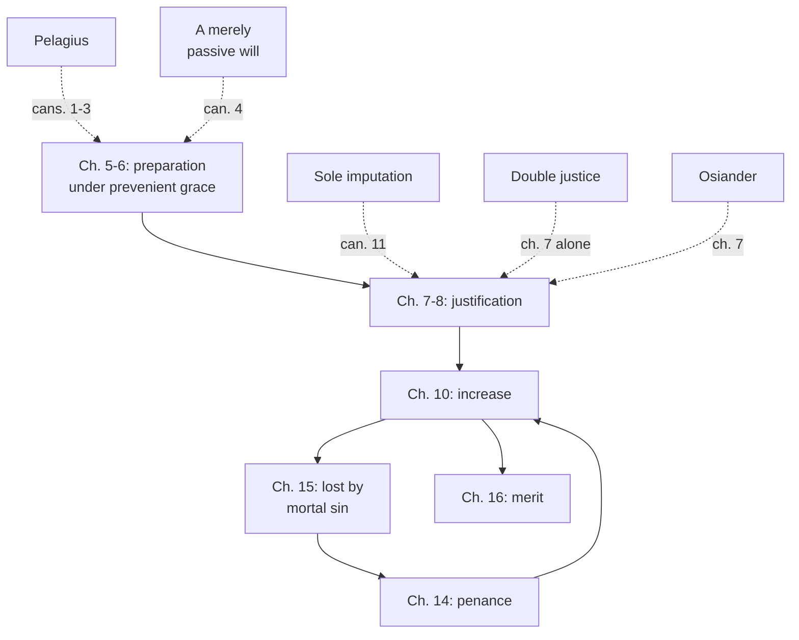

# Creation, Grace & the Last Things · Lesson 5.1: Trent Session VI: justification

> ⏱ ~15 min · Module 5: Justification, merit, and predestination · Builds on: [4.2](04-02-the-necessity-of-grace.md), [4.3](04-03-sanctifying-grace-the-indwelling-and-divinization.md), [3.2](03-02-pelagius-augustine-and-the-councils.md), [`christology` 5.1](../../christology/lessons/05-01-the-paschal-mystery-and-the-threefold-office.md) · Unlocks: [5.2](05-02-the-1999-joint-declaration.md), [5.3](05-03-merit.md), [5.4](05-04-predestination.md)

## Why this matters

Every Catholic sentence about how a sinner becomes just is measured against one text, adopted at [Trent](../reference.md#trent-session-vi) on 13 January 1547. It names no Reformer, yet nearly every clause is aimed at someone, including Catholics who had held the losing view in good faith. Read exactly, it shows what the Church defines, what she only teaches, and what she leaves to the schools.

## The idea

[Justification](../reference.md#justification) is the change by which an enemy of God becomes his friend.

Think of a court and a hospital. A pardon changes your record and leaves you as you were; a cure changes you. For the Lutheran confessions justification is above all a verdict: for Christ's sake God counts the believer righteous, and the renewal that follows is real but does not make him acceptable. For Trent it is verdict and cure in one act: sins are forgiven *because* a justice is given that becomes truly the person's own while remaining wholly God's gift. Faith's job differs too: for the Reformers, the hand that takes the verdict; for Trent, the beginning, foundation and root of a justice that also includes hope and charity.

The decree fights on two fronts. Against [Pelagianism](../reference.md#pelagianism): God starts, and nothing before justification earns it. Against the Reformers: the grace given inheres and transforms, and the will moved by God really consents.

## In their own words

**The Augsburg Confession** (1530), art. IV, in Schaff, *Creeds of Christendom* vol. 3 (Schaff's bracketed German glosses omitted), teaches that

> men can not be justified before God by their own powers, merits, or works; but are justified freely for Christ's sake through faith, when they believe that they are received into favor, and their sins forgiven for Christ's sake

and adds: "This faith doth God impute for righteousness before him" ([imputation](../reference.md#imputation)).

**Melanchthon's *Apology*** (1531), IV.71–72 (*Concordia Triglotta*, 1921), refuses to read "faith justifies" as making faith "the beginning of justification or preparation for justification". Rather, "properly and truly, by faith itself, we are for Christ's sake accounted righteous, or are acceptable to God." He grants that Scripture also says "justified" of being made just, but acceptance rests on remission received by faith alone.

**Luther**, *Commentary on Galatians* (1535), on 3:6, in the English translation of 1575 (Philadelphia reprint, 1891, p. 227): God "counteth my sin for no sin, which notwithstanding is sin indeed", so that "a Christian man is both righteous and a sinner, holy and profane; an enemy of God, and yet a child of God." This is [*simul iustus et peccator*](../reference.md#simul-iustus-et-peccator).

**Two other proposals.** [Double justice](../reference.md#double-justice): the justified have a real inherent justice, but, since it is imperfect, must also rely at the judgment on Christ's justice imputed to them. A twofold justice stood in article 5 at Regensburg, agreed on 2 May 1541 by Catholic theologians under the legate Gasparo Contarini, Johann Gropper among them, with Melanchthon and Bucer; at Trent in autumn 1546 Girolamo Seripando, prior general of the Augustinians, pressed a version of it. [Andreas Osiander](../reference.md#osiander) wrote at Nuremberg in 1525 that "the one and only righteousness availing before God is God Himself" (Bente's translation, *Triglotta*, Historical Introductions §176): Christ's divine righteousness indwelling makes us just. His view became a public storm at Königsberg from 1549.

## The doctrine

1. **Structure, and the first front.** A proem, sixteen chapters, thirty-three canons (Waterworth, 1848, throughout). Chapters 1–3: nature and the Law could not free fallen man, whose free will was "by no means extinguished", and only those reborn in Christ receive the benefit of his death. Cans. 1–3 restate [Orange II](../reference.md#orange-ii) ([3.2](03-02-pelagius-augustine-and-the-councils.md); [4.2](04-02-the-necessity-of-grace.md)): they condemn saying that man can be justified by his own works without grace, that grace only makes easier what free will could do alone, or that one can believe, hope, love or repent as one ought without the Spirit's [prevenient](../reference.md#prevenient-grace) inspiration. *In words:* Trent's first move against the Reformation is a move against Pelagius.

2. **Preparation (ch. 5–6; cans. 4–9).** In adults the beginning is God's call, "without any merits existing on their parts" (ch. 5). They convert "by freely assenting to and co-operating with that said grace", being "also able to reject it", yet unable to move themselves to justice without it. Can. 4 condemns anyone who says the will moved by God "cannot refuse its consent, if it would" and is "merely passive". Chapter 6's dispositions run from faith by hearing and fear to the purpose of baptism; cans. 7–8 condemn saying that works before justification are all sins, or that the fear of hell driving a sinner to mercy is one. *In words:* God starts, the person really consents, and the consent is itself grace-moved.

3. **What justification is (ch. 4 and 7; cans. 10–11).** Chapter 4: a translation from the state of the first Adam into "the state of grace, and of the adoption of the sons of God" (its "or the desire thereof" is [`sacraments-and-liturgy` 2.2](../../sacraments-and-liturgy/lessons/02-02-necessity-infants-and-baptism-of-desire-and-blood.md)'s). Chapter 7: justification "is not remission of sins merely, but also the sanctification and renewal of the inward man". It names five [causes](../reference.md#causes-of-justification): final, efficient, meritorious (Christ's passion: [`christology` 5.3](../../christology/lessons/05-03-satisfaction-anselm-and-aquinas.md)), instrumental (baptism, "the sacrament of faith"), and one [formal cause](../reference.md#formal-cause):

   > the alone formal cause is the justice of God, not that whereby He Himself is just, but that whereby He maketh us just

   "Alone" (*unica*) excludes double justice: one justice, not inherent plus imputed. "Not that whereby He Himself is just", Augustine's phrase ([`new-testament` 5.2](../../new-testament/lessons/05-02-romans-1-4-the-righteousness-of-god.md)), excludes God's own essential justice as our form, Osiander's thesis. "We are not only reputed, but are truly called, and are, just" excludes a justice of imputation only. Can. 11 condemns justification by "the sole imputation of the justice of Christ", or by remission alone, to the exclusion of inherent grace and charity, and calling justifying grace "only the favour of God". Can. 10 condemns saying we are just without Christ's justice, or "formally just" by that justice itself, which reaches any account, Lutheran or Catholic, that makes Christ's justice, imputed, our form. *In words:* God forgives by making just, and the justice is ours because he gives it.

4. **Faith (ch. 8; cans. 9, 12).** We are "justified by faith, because faith is the beginning of human salvation, the foundation, and the root of all Justification", and "freely", because nothing that precedes, "whether faith or works", merits it. Hence neither *sola fide* nor its denial. Trent affirms that faith justifies, but as the root of a justice that needs hope and charity, without which faith "neither unites man perfectly with Christ" (ch. 7). Can. 9 condemns "faith alone" in a stated sense (nothing else co-operates, no preparation of the will); can. 12, justifying faith as mere confidence in mercy. *In words:* faith begins and roots a justice it does not exhaust.

5. **Certainty, growth, loss, recovery (ch. 9–15).** Chapter 9: "no one can know with a certainty of faith, which cannot be subject to error, that he has obtained the grace of God", though no one may doubt God's mercy. Cans. 13–14 condemn making such certainty necessary. Justice grows by works in grace (ch. 10; can. 24; [`new-testament` 6.3](../../new-testament/lessons/06-03-james-faith-and-works.md)), is lost by any mortal sin, even where faith remains (ch. 15; [`moral-theology` 3.4](../../moral-theology/lessons/03-04-sin-mortal-and-venial.md)), and is recovered through penance (ch. 14; [`sacraments-and-liturgy` 4.1](../../sacraments-and-liturgy/lessons/04-01-penance-the-sacrament-and-its-history.md)). Chapters 12–13 are [5.4](05-04-predestination.md)'s; ch. 16, [5.3](05-03-merit.md)'s. *In words:* justification can grow, be lost and be restored, and is never a private certainty.

**Said plainly.** "The alone formal cause" was written against Catholics. Rome rejected Regensburg's article that June. At Trent the Jesuit Diego Laínez answered double justice on 26 October 1546, and the council chose "alone". Seripando was never censured: Pius IV made him a cardinal and a legate of the same council, where he died in 1563. Nor does the decree name Luther: it condemns propositions, so whether a given Lutheran text falls under a canon is a further question ([5.2](05-02-the-1999-joint-declaration.md)).

| Defined or taught (with level) | A school's explanation or an opinion (no magisterial level) |
|---|---|
| Grace begins justification, nothing before it merits it: **rung 1** (cans. 1–3; Orange II as [3.2](03-02-pelagius-augustine-and-the-councils.md) grades it) | What makes grace efficacious, premotion or foreseen consent: **rung 5** ([5.5](05-05-the-de-auxiliis-controversy.md)) |
| Justifying grace and charity inhere in the soul: **rung 1** (can. 11) | Grace as a created quality, a habit, an accident: **rung 4** (ST I-II q.110 a.2; [4.3](04-03-sanctifying-grace-the-indwelling-and-divinization.md)) |
| One formal cause, God's justice making us just: substance **rung 1** (cans. 10–11); the word "alone" **at least rung 3** (ch. 7) | Double justice: a Catholic opinion before 1547, excluded since |
| Faith the beginning, foundation and root: **at least rung 3** (ch. 8) | Faith "formed" by charity (ST II-II q.4 a.3): scholastic vocabulary |
| Certainty of grace not required for justification: **rung 1** (cans. 13–14); no certainty of faith that one has grace: **at least rung 3** (ch. 9) | Grace known "conjecturally by signs" (ST I-II q.112 a.5): Aquinas's account |

**Mark the levels** ([the ladder](../../fundamental-theology/lessons/04-04-the-ladder-of-doctrinal-authority.md); [levels of authority](../reference.md#levels-of-authority)). The canons are where the definition bites ([chapters and canons](../reference.md#chapters-and-canons); [`fundamental-theology` 4.2](../../fundamental-theology/lessons/04-02-infallibility-and-its-conditions.md)): what a canon condemns has its contradictory at **rung 1**. The chapters are fenced unusually strongly. The proem forbids anyone to "believe, preach, or teach, otherwise than as by this present decree is defined and declared"; ch. 16 closes by calling them "Catholic doctrine on Justification, which whoso receiveth not faithfully and firmly cannot be justified". That binds all to their doctrine without making every sentence, proof-texts and all, a definition. So a chapter claim no canon repeats is **at least rung 3**, and rung 1 only where its proposal as revealed is shown (can. 749 §3). Ch. 4's desire clause: presupposed, **not rung 1**. The confessions, Luther, Contarini, Seripando and Osiander: **no magisterial level**.

## The map

The decree's path, and five positions it closes off.

## Worked examples

**Ex 1 (clean): the Easter Vigil.** Invented: Thandeka Morrow, drawn to St Ignatius, Marlow Reach, after a friend's funeral, is baptized at the Vigil. Her first stirring is God's call, given "without any merits" (ch. 5; can. 3). She could have walked away (can. 4), so her yes is real. Her catechumenate shows chapter 6's dispositions, none meriting what follows (ch. 8). At the font she is not merely declared just: sins are remitted, and faith, hope and charity infused at once inhere in her (ch. 7; can. 11). God first, her free consent, God's gift become hers.

**Ex 2 (strain): "Can I know?"** Invented: after a careful confession, Ewan Szabo asks whether he can know he is in grace. Trent excludes two answers. "You must be certain, or you are not forgiven" falls under cans. 13–14. "You can be as certain of it as of the Creed" contradicts ch. 9's "certainty of faith, which cannot be subject to error". Nor may he doubt God's mercy, Christ's merit or the sacrament. Between floor and ceiling the decree is silent. Aquinas's answer, grace known "conjecturally by signs" (ST I-II q.112 a.5), is a school's account. Here the doctrine stops: it fixes the certainty he cannot have and what he must not doubt, and leaves the measure of his peace to pastoral judgment.

## Watch out

- **You might think the chapters are commentary and only the canons bind.** The closing clause makes them "Catholic doctrine" to be received "faithfully and firmly"; but not every chapter sentence is defined. **At least rung 3**; the canons, rung 1.
- **You might think Trent denied that faith justifies.** Chapter 8 says we are "justified by faith"; what is condemned is can. 9's sense of "faith alone".
- **You might think co-operation makes Trent semi-Pelagian.** The assent of ch. 5 is to grace that comes first, and can. 3 makes the whole preparation grace-borne.

## One-liner

> Trent defines that God, beginning without our merit, forgives by making just with one justice that becomes truly ours, and that faith is its root, not the whole of it.

## Problems

**P1 (🟢)** *(Exegetical)* **Assign the level.** For each claim, give its rung on [the ladder](../../fundamental-theology/lessons/04-04-the-ladder-of-doctrinal-authority.md) and name the act that fixes it, or say that none does.

(a) Faith is the beginning, foundation and root of all justification.

(b) All works done before justification, however they are done, are truly sins.

(c) The fear of hell, by which a sinner grieves for his sins and flees to God's mercy, makes him a worse sinner.

(d) Grace is given so that we may do more easily what free will could do without it, though with difficulty.

**Two sentences per item.**

**P2 (🟡)** *(Exegetical)* **Find the crux.** Luther, *Commentary on Galatians* (1535), on 3:6, in the English translation of 1575 (Philadelphia reprint, 1891, pp. 226–227):

> God covereth and pardoneth the remnant of sin in me: that is to say, because of that faith wherewith I began to lay hold upon Christ, he accepteth my imperfect righteousness even for perfect righteousness, and counteth my sin for no sin, which notwithstanding is sin indeed. … Thus a Christian man is both righteous and a sinner, holy and profane; an enemy of God, and yet a child of God.

(a) Name the single premise about what remains in the justified that Luther affirms and Trent denies. Cite the Tridentine text that denies it, and say what that text concedes remains.

(b) A reader says chapter 5's "freely assenting to and co-operating with" grace shows that Trent answered Luther by siding with Pelagius. Name the words in chapter 5, and the canon, that block this reading.

**Two sentences per part.**

**P3 (🔴)** *(Exegetical)* **Diagnose.** From the transcript of a parish podcast at St Ignatius, Marlow Reach, **invented** for this problem:

> "Trent's answer to Luther was simple: faith gets you in the door, and then your works earn your justification. That's why Catholics can never feel any confidence about being in God's grace; Trent forbade it. Lutherans, by contrast, think that once you're forgiven nothing in you has to change. And don't worry about Trent's long chapters; only the canons with the anathemas count."

Find **four** errors. For each, give the correction, cite the text, and name the level where one is involved. **150 words or fewer.**

Solutions

**P1** *(Exegetical)*

**Must hit, strict:**

- **(a)** **At least rung 3.** It is chapter teaching (ch. 8) that no canon repeats, fenced by the decree's closing clause as "Catholic doctrine" to be received "faithfully and firmly". Rung 1 can be argued from ch. 8's "perpetual consent" and its repetition in Vatican I, *Dei Filius* ch. 3 ("the beginning of man's salvation", Schaff), but must be argued; can. 749 §3 defaults down.
- **(b)** **Condemned** by can. 7 (with its rider that striving to dispose oneself for grace is not a graver sin); its contradictory is **rung 1**. That such works are not all sins does not make them merit justification: nothing before justification merits it (ch. 8; **rung 1** with Orange II).
- **(c)** **Condemned** by can. 8; its contradictory is **rung 1**. Fear of divine justice is among chapter 6's dispositions, a step toward mercy under grace, not a sin.
- **(d)** **Condemned** by can. 2, restating Orange II against Pelagius; its contradictory is **rung 1**.

**Wrong turns:** putting (a) at rung 1 "because Trent said it" without naming the act, or at rung 5 "because it is only a chapter"; "correcting" (b) by saying such works prepare a claim on grace, which swaps one condemned error for its Pelagian opposite; grading (c) as pastoral advice with no rung; giving a condemned proposition a rung of its own instead of naming its contradictory's.

**Model answer:** (a) At least rung 3: ch. 8 teaches it and no canon repeats it, though the decree binds all to its chapters as Catholic doctrine. Rung 1 needs an argument, for instance from "perpetual consent" and *Dei Filius* ch. 3. (b) Condemned by can. 7, so its contradictory is rung 1: not every work before justification is a sin. Such works still merit nothing toward justification (ch. 8, rung 1 with Orange II). (c) Condemned by can. 8, so its contradictory is rung 1. The fear that drives a sinner to God's mercy is one of chapter 6's dispositions, not a further sin. (d) Condemned by can. 2, restating Orange II, so its contradictory is rung 1. Grace is not a help to a nature that could manage alone.

---

**P2** *(Exegetical)*

**Must hit, strict (a):**

- The premise: **what remains in the justified, the "remnant" that falls short of the law, is "sin indeed"**, covered and not imputed. Luther affirms it; Trent denies it.
- The denying text: Session V, can. 5 condemns saying that baptism does not take away "the whole of that which has the true and proper nature of sin", and that sin is "only rased, or not imputed": "in those who are born again, there is nothing that God hates". Session VI ch. 7 and can. 11 (inhering justice, not sole imputation) are creditable additions.
- What it concedes: **concupiscence remains**, which the apostle "sometimes calls" sin because "it is of sin, and inclines to sin", not as "truly and properly sin". Chapter 11 also grants that the just fall into "light and daily sins" without ceasing to be just.

**Must hit, strict (b):**

- Chapter 5 puts the beginning in "the prevenient grace of God", "without any merits existing on their parts". The assent is to "that said grace" and he is "not able, by his own free will, without the grace of God, to move himself unto justice".
- **Can. 3** condemns saying man can believe, hope, love or repent as he ought without the Spirit's prevenient inspiration (cans. 1–2 also accepted). Trent's co-operation is grace-moved consent, held against Pelagius and against a merely passive will at once.

**Wrong turns:** naming imputation or "not only reputed" as the crux, which is the formal-cause question, not what the passage asserts about the remnant; saying Trent denies that anything sinful remains, forgetting concupiscence and venial sin; in (b), conceding that co-operation is semi-Pelagian and defending Trent on other grounds.

**Model answer:** (a) Luther holds that what remains in the justified is "sin indeed", covered and not counted; Trent denies it. Session V, can. 5 says baptism takes away everything with "the true and proper nature of sin", not merely unimputed, while conceding that concupiscence remains and is called sin only because it comes from sin and inclines to it. (b) Chapter 5 derives the beginning from "the prevenient grace of God", given "without any merits", and denies that free will can move itself to justice "without the grace of God". Can. 3 condemns any right believing or repenting without the Spirit's prevenient inspiration, so the co-operation is grace-moved consent, not a Pelagian contribution.

---

**P3** *(Exegetical)*

**Accept:** all four below, each corrected with its text.

**Must hit, strict:**

- **"Works earn your justification."** Ch. 8: none of what precedes justification, "whether faith or works", merits it. Rung 1 for the gratuity (cans. 1–3; Orange II). Merit belongs to the justified, in grace, and is [5.3](05-03-merit.md)'s.
- **"Never feel any confidence."** Ch. 9 forbids doubting God's mercy, Christ's merit and the sacraments. What it denies is a "certainty of faith" about one's own grace (at least rung 3), and cans. 13–14 condemn making such certainty necessary (rung 1). Hope is commanded (ch. 13).
- **"Nothing in you has to change."** The *Apology* says "to be justified" also means being made just and reborn (IV.72), and Augsburg VI requires good fruits. The difference is over what makes a sinner acceptable, not whether renewal follows.
- **"Only the canons count."** The closing clause makes the chapters "Catholic doctrine" to be received "faithfully and firmly": **at least rung 3**, the canons rung 1.

**Wrong turns:** "correcting" the first sentence by saying works play no part, which denies can. 24's increase; calling chapter teaching rung 1 throughout; caricaturing the Lutherans in the other direction.

**Model answer:** Trent says nothing before justification, "whether faith or works", merits it (ch. 8; rung 1 with cans. 1–3); merit belongs only to the justified. Trent forbids doubting God's mercy, Christ's merit and the sacraments. It denies only a certainty of faith about one's own grace (ch. 9, at least rung 3) and condemns requiring such certainty (cans. 13–14, rung 1). Lutherans hold that the justified are renewed and must bear good fruits (*Apology* IV.72; Augsburg VI); they deny that the renewal is what makes us acceptable. The chapters are "Catholic doctrine" which all must receive "faithfully and firmly": at least rung 3, the canons rung 1.

## Flashback

**From Lesson [4.3](04-03-sanctifying-grace-the-indwelling-and-divinization.md) (Sanctifying grace, the indwelling, and divinization):** *(Exegetical.)* Assign the level. For each claim, give its rung, or say it has no magisterial level, and name the act or source that fixes it; the list holds traps both ways. **One sentence per item.**

(a) "For He was made man that we might be made God" (Athanasius, *On the Incarnation* 54.3, tr. Robertson), which CCC 460 quotes.

(b) The divine Persons dwell in the souls of the just.

(c) Adoption is appropriated to the Father as its author, the Son as its exemplar, and the Holy Spirit as imprinting the likeness.

(d) Sanctifying grace has its seat in the essence of the soul, the infused virtues in its powers.

Solution

**Must hit, strict:**

- **(a) Split.** As a Father's sentence, **no magisterial level**; CCC 460 quoting it adds none. Its content, a share by grace in the divine nature, is **rung 1** (2 Pet 1:4), and one substance with God is excluded at **rung 1** (*Dei Filius*, canons on God the Creator, can. 3).
- **(b) Rung 1.** John 14:23 (with 1 Cor 3:16), Scripture's plain statement proposed as revealed by the ordinary universal magisterium. *Divinum Illud Munus* §9 and *Mystici Corporis* teach it at rung 3 without setting its ceiling.
- **(c) Rung 4.** Aquinas's appropriation (ST III q.23 a.2 ad 3). Adoption itself is **rung 1** (Rom 8:15); the scheme is not.
- **(d) Rung 5.** q.110 a.4's answer "depends on the preceding" (grace distinct from virtue); those who identify grace with charity (Scotus, Bellarmine) seat it in the will. Trent's "infused at once" (VI ch. 7) says the virtues come with grace, not where either sits.

**Wrong turns:** (a) at rung 3 because the Catechism quotes it, or dismissed as pantheism or Eastern piety; (b) at rung 3 because the texts at hand are encyclicals, or rung 4 by fusing the fact with the Thomist explanation; (c) at rung 1 because Romans 8:15 is Scripture; (d) at rung 4 because Aquinas holds it, or rung 3 through ch. 7.

**Model answer:** (a) No level as Athanasius's sentence, CCC 460 adding none; its content, partaking of the divine nature by grace, is rung 1 (2 Pet 1:4), and identity of substance is excluded at rung 1 (*Dei Filius* can. 3). (b) Rung 1: John 14:23, proposed as revealed by the ordinary universal magisterium. (c) Rung 4: Aquinas's scheme (III q.23 a.2 ad 3); adoption itself is rung 1. (d) Rung 5: a Thomist thesis (q.110 a.4) that Scotists reject, decided by no act.

## Connections

- **Backward:** [3.2](03-02-pelagius-augustine-and-the-councils.md) gave Orange II, which cans. 1–3 restate; [4.2](04-02-the-necessity-of-grace.md) gave the necessity of grace and [4.3](04-03-sanctifying-grace-the-indwelling-and-divinization.md) the inhering grace that ch. 7 makes the single formal cause. [`christology` 5.1](../../christology/lessons/05-01-the-paschal-mystery-and-the-threefold-office.md) handed over how Christ's merit reaches a person, and [`christology` 5.3](../../christology/lessons/05-03-satisfaction-anselm-and-aquinas.md) read the meritorious cause.
- **Forward:** [5.2](05-02-the-1999-joint-declaration.md) asks whether these condemnations reach the Lutheran teaching the 1999 declaration presents; [5.3](05-03-merit.md) takes ch. 16 and can. 32; [5.4](05-04-predestination.md) takes ch. 12–13. The argued dispute over *sola fide* and imputation is [`apologetics-catholic-claims`](../../apologetics-catholic-claims/syllabus.md)'s.
- **Sideways:** Trent as an event is [`church-history` 6.4](../../church-history/lessons/06-04-trent-and-catholic-reform.md). Paul's vocabulary of reckoning and righteousness is [`new-testament` 5.2](../../new-testament/lessons/05-02-romans-1-4-the-righteousness-of-god.md), and James 2:24 is [`new-testament` 6.3](../../new-testament/lessons/06-03-james-faith-and-works.md): Trent defines the doctrine without defining their exegesis. The bridge to the sacraments runs through ch. 7's instrumental cause: baptism in [`sacraments-and-liturgy` 2.1](../../sacraments-and-liturgy/lessons/02-01-baptism-the-rite-and-its-effects.md) and penance, "a second plank after the shipwreck" (ch. 14), in [`sacraments-and-liturgy` 4.1](../../sacraments-and-liturgy/lessons/04-01-penance-the-sacrament-and-its-history.md).
