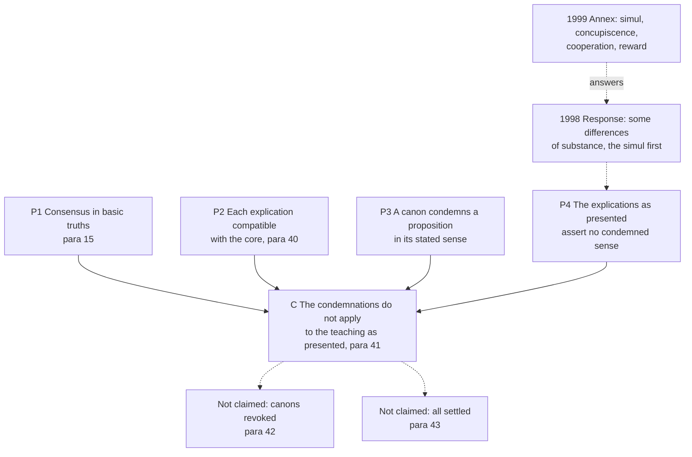

# Creation, Grace & the Last Things · Lesson 5.2: The 1999 Joint Declaration

> ⏱ ~15 min · Module 5: Justification, merit, and predestination · Builds on: [5.1](05-01-trent-session-vi-justification.md), [`fundamental-theology` 4.5](../../fundamental-theology/lessons/04-05-reading-a-documents-weight.md) · Unlocks: [5.3](05-03-merit.md), [`apologetics-catholic-claims`](../../apologetics-catholic-claims/syllabus.md)

## Why this matters

On Reformation Day 1999, in Augsburg, city of the Lutheran confession of 1530, the Catholic Church and the Lutheran World Federation signed a statement: the sixteenth-century condemnations on justification do not apply to each other's teaching as a joint text presents it. Headlines said the Reformation was over; critics on both sides said nothing had been agreed. Both overstate. This lesson reads what the [Joint Declaration](../reference.md#joint-declaration) claims, what it leaves standing, and what the act weighs.

## The idea

A canon of Trent condemns neither a church nor a word. It condemns a **proposition, taken in a stated sense**: "If any one saith …". So two questions come apart. *Is the canon true?* For a Catholic, settled: Trent defined it. *Does this teaching fall under it?* That depends on what the teaching asserts.

Think of a warrant with a description. Withdrawing a warrant is one act; checking whether the person before you fits it is another. The Joint Declaration claims only the second. The warrant stands, but today's partner, *as described in this text*, does not fit ([application of a condemnation](../reference.md#application-of-a-condemnation)).

The method, which ecumenists name [differentiated consensus](../reference.md#differentiated-consensus), has two steps. The sides first state a core together. Then each explains its own idiom: "When Lutherans say X, they do not thereby deny Y." That sentence form is aimed at canons that condemn "X alone, to the exclusion of Y", since an explanation that keeps Y does not assert the condemned proposition. What remains is judged a difference of language, elaboration and emphasis, not of faith.

## In their own words

Critics on both sides call the consensus verbal: incompatible doctrines under shared words.

**German Protestant theologians.** A statement drafted in the Tübingen faculty (6 January 1998), sent to the church leaderships that month with about 140 signatures of German Protestant theology teachers, denied that the Declaration established the consensus in basic truths it claimed. A Tübingen faculty opinion of 17 February added that the remaining differences were only covered over by wording.

**Eberhard Jüngel** (*Um Gottes willen — Klarheit!*, "For God's sake, clarity!", 1997) argued that the Declaration plays down justification's work as criterion. For the Reformation it is not one criterion among several but the one by which all doctrine is judged, so calling it "an indispensable criterion" (§18) beside others gives the point away.

**Christopher Malloy** (*Engrafted into Christ: A Critique of the Joint Declaration*, 2005) argues from the Catholic side. [Trent](../reference.md#trent-session-vi) defines the single [formal cause](../reference.md#formal-cause) as a justice inherent in the soul ([5.1](05-01-trent-session-vi-justification.md)). The common and Lutheran paragraphs describe justifying grace as forgiving favour and Christ's presence, with renewal its inseparable consequence; the Catholic paragraphs never name the formal cause. Hence the *simul*, no increase of justifying grace, no true merit of eternal life. The condemnations still apply, Annex or no Annex.

## The doctrine

1. **What was signed, by whom.** The text was finished in 1997. The LWF Council adopted a resolution on it on 16 June 1998; the Catholic Response followed on 25 June. At Augsburg on 31 October 1999 an [Official Common Statement](../reference.md#official-common-statement-and-annex), with an Annex, was signed: for the Catholic Church by Cardinal Edward Cassidy and Bishop Walter Kasper, president and secretary of the Pontifical Council for Promoting Christian Unity (PCPCU); for the LWF by Bishop Christian Krause and Ishmael Noko, president and general secretary, with its vice-presidents. Both thereby confirm the Declaration "in its entirety". John Paul II hailed it that day as a milestone. *In words:* a bilateral agreement, confirmed by an official act of each partner.

2. **What it claims.** It claims a consensus in basic truths, not agreement on all (§5). The core is §15, confessed together: God accepts us by grace alone, through faith in what Christ has done and not for any merit of ours, and gives the Spirit, who renews the heart for good works. §§19–39 treat seven disputed topics, each confessed together, then explicated by each side. §40 calls the remaining differences "of language, theological elaboration, and emphasis" acceptable. §41: the condemnations "appear in a new light". The Lutheran teaching presented here does not fall under Trent's, nor the Catholic under the Lutheran Confessions'. *In words:* a shared core, non-dividing differences, and condemnations that miss the texts as presented.

3. **What it leaves standing.** It opens by calling the condemnations still valid and church-dividing (§1), and neither takes them lightly nor disavows the past (§7). §42: nothing is taken from their seriousness; some were "not simply pointless"; they remain "salutary warnings". §43 leaves open the word of God and church doctrine, ecclesiology, authority, church unity, ministry, the sacraments, and social ethics. *In words:* no canon is revoked, and §41 judges today's texts, not 1547's.

4. **The Response, and the Annex.** The [1998 Response](../reference.md#catholic-response-1998), prepared by the Congregation for the Doctrine of the Faith (CDF) with the PCPCU and signed by Cassidy, granted a consensus in basic truths, not one removing every difference. Its points, weightiest first: the [*simul iustus et peccator*](../reference.md#simul-iustus-et-peccator) as §29 explains it is not acceptable, since baptism takes away all that is truly sin, and §22 leaves interior renewal unclear; justification is a criterion within the rule of faith (§18); consent is real *cooperatio*, not "mere passive" (§21), and eternal life is grace and reward together; penance needs treating; some differences concern substance, so §§40–41 cannot be affirmed without distinction; and what authority has the LWF's synodal consensus? The Annex takes up all but penance. It gives a limited shared *simul*: the justified are truly renewed and "do not remain sinners in this sense", yet none is without sin (1 John 1:8). It treats [concupiscence](../reference.md#concupiscence) as a word used in different senses; affirms grace alone and "by faith alone" with cooperation by the Spirit's power, judgment on works and a reward of grace; sets the criterion within the Trinitarian confession; and has each partner respect the other's ordered process. *In words:* the Annex narrowed the reservations rather than abolishing them.

5. **Later associations.** The World Methodist Council associated at Seoul on 23 July 2006, the three partners signing an affirmation. The Anglican Consultative Council welcomed and affirmed its substance in April 2016, and Justin Welby presented that resolution at Westminster Abbey on 31 October 2017. The World Communion of Reformed Churches associated at Wittenberg on 5 July 2017, welcoming the model of differentiating consensus. *In words:* three communions affirmed the consensus; none passed a verdict on Trent's canons.

**Said plainly.** A year before signing, the Church's own official Response said some differences concern substance and §41 could not yet be affirmed across the board, the *simul* first. The Church then signed, Annex attached, confirming the Declaration in its entirety. The Response is no veto, and the signature does not make every Lutheran paragraph Catholic teaching.

| Defined or taught (with level) | A school's explanation or an opinion (no magisterial level) |
|---|---|
| Trent's canons condemn what they state, in the sense stated: **rung 1**, unrevoked (§42) | Whether a given text asserts a condemned sense; whether §41 is right: **rung 5** |
| Justification by grace in faith; consent grace-moved and refusable: **rung 1** (VI ch. 5, cans. 1–4) | "Differentiated consensus": the ecumenists' name for the method |
| Justifying grace inheres, and the justice received grows by good works: **rung 1** (VI cans. 11, 24) | Mapping Lutheran "renewal" onto Catholic "justice": the wager of §40, disputed (Malloy) |
| Concupiscence in the baptized is not truly and properly sin: **rung 1** ([V can. 5](../reference.md#trent-session-v); [3.3](03-03-trent-session-v-the-definition.md)) | The Annex's limited shared *simul*; the Lutheran concept of sin as whatever the law judges |

**Mark the levels** ([the ladder](../../fundamental-theology/lessons/04-04-the-ladder-of-doctrinal-authority.md); [levels of authority](../reference.md#levels-of-authority)). Run [`fundamental-theology` 4.5](../../fundamental-theology/lessons/04-05-reading-a-documents-weight.md)'s steps. *Source:* the Catholic Church through the PCPCU, with the CDF on the Response and the pope's endorsement. *Genre:* a bilateral agreement, on no list of teaching genres. *Operative sentence:* "does not fall under" (§41), "confirm … in its entirety": a judgment about texts, not doctrine proposed to the faithful. *Rung:* **none of its own**; it defines and revokes nothing (can. 749 §3). Its Catholic paragraphs keep the weight of what they restate; Trent's canons stay **rung 1**. §41 is officially the Catholic Church's judgment as a party, so "Rome never said that" is false. But no act proposes it to be believed, held or adhered to, so whether it is *correct* is **freely disputed (rung 5)**. The Response's doctrine keeps Trent's weight; its assessments, the method's name, the critics and the associations carry **no magisterial level**.

## The argument

The critics deny P2 or P4; no one denies P3, which is why the canons survive the agreement.

## Worked examples

**Ex 1 (clean): "faith alone" on the handout.** Invented, as is everyone in these examples: St Paul's, Overby, runs a study group with the Lutheran parish of Overby. Pastor Hilke Asmussen's handout quotes the Annex: justified "by faith alone", apart from works. Cosmo Prentice says Rome has signed what Trent condemned. Trent VI can. 9 (Waterworth):

> If any one saith, that by faith alone the impious is justified; in such wise as to mean, that nothing else is required to co-operate in order to the obtaining the grace of Justification, and that it is not in any way necessary, that he be prepared and disposed by the movement of his own will; let him be anathema.

The canon condemns "faith alone" *in such wise as to mean* (*ita ut intelligat*) no cooperation and no preparation of the will. The same Annex paragraph says grace does not exclude human action and quotes the Formula of Concord: once the Spirit has begun, "we can and must cooperate". §21 grants that grace can be refused (can. 4). **Verdict:** outside the canon, which stands at **rung 1**. Nor has "faith alone" become a Catholic formula: Trent calls faith "the beginning of human salvation, the foundation, and the root of all Justification" (ch. 8; [5.1](05-01-trent-session-vi-justification.md)).

**Ex 2 (strain): "fruits and signs".** Wenonah Pryce reads §39. Lutherans hold a preservation of and growth in grace, but righteousness as God's acceptance is always complete, growing only in its effects, and good works are "the fruits and signs of justification", not merits. Trent VI can. 24 condemns denying that the justice received is increased through good works, and calling them "merely the fruits and signs of Justification obtained, but not a cause of the increase thereof". The words match; the claim may not. The canon's "justice" is Trent's inherent justice, and §39 *affirms* growth in grace and faith and in righteousness's effects. The Declaration's own appendix of sources records a German Lutheran verdict: can. 24 misses if "righteousness" means what affects the person, and strikes if it means God's acceptance. So all turns on mapping two vocabularies: is that growth what Trent calls the increase of justice? Trent defines the Catholic proposition (**rung 1**); it cannot define what another tradition's word names. There the doctrine stops determining an answer. [Merit](../reference.md#merit) is [5.3](05-03-merit.md)'s.

## Watch out

- **You might think 1999 revoked Trent's anathemas.** §41 concerns application; §42 keeps them as "salutary warnings"; the canons stay rung 1.
- **You might think the signing made §41 doctrine, or that it is a mere theologians' paper.** It is no teaching act, so §41 is neither rung 1 nor rung 3, yet the Catholic Church signed it as a party; only §41's correctness is freely disputed.
- **You might think "differentiated consensus" is the Declaration's term, or "basic truths" total agreement.** The phrase is the ecumenists' (the LWF credits Harding Meyer with the method), and §§5 and 43 limit the claim.

## One-liner

> The Joint Declaration revised nothing in Trent: an official agreement with no rung of its own, it judges that Trent's standing condemnations miss Lutheran teaching as the text presents it, and whether that judgment holds is open.

## Problems

**P1 (🟢)** *(Exegetical)* **Assign the level.** Place each claim on the ladder and name the act that fixes it, or say why there is none. **One line each.**

(a) Whoever says that justifying faith is nothing else but confidence in the divine mercy is condemned (Trent VI can. 12), after 1999 as before.

(b) The Lutheran teaching presented in the Joint Declaration does not fall under the condemnations of Trent.

(c) We are accepted by God by grace, in faith in Christ's saving work, and not for any merit of ours (the common confession, JDDJ §15).

(d) The Declaration's method is rightly described as a "differentiated consensus".

(e) The *simul iustus et peccator*, as JDDJ §29 explains it, is not acceptable to Catholics (the 1998 Response).

**P2 (🟡)** *(Exegetical)* **Close reading.** Trent, Session VI (13 January 1547), can. 11, in Waterworth's translation (1848):

> If any one saith, that men are justified, either by the sole imputation of the justice of Christ, or by the sole remission of sins, to the exclusion of the grace and the charity which is poured forth in their hearts by the Holy Ghost, and is inherent in them; or even that the grace, whereby we are justified, is only the favour of God; let him be anathema.

The Joint Declaration, paraphrased. §22 (confessed together): God forgives sin by grace and at the same time frees from sin's power and gives new life; when people share in Christ by faith, God no longer imputes their sin to them and through the Spirit works in them an active love; the two are not to be separated. §23 (Lutheran): the sinner is given righteousness before God in Christ through the declaration of forgiveness, and only in union with Christ is life renewed; grace is forgiving love, "the favor of God", which does not deny renewal; justification stays free of human cooperation and does not depend on grace's life-renewing effects.

(a) Name the three claims the canon condemns, and the words that make each exclusive.

(b) Which sentence of §23 would a critic say still falls under the canon, and which would a defender of §41 cite against him? Name the single point on which they divide.

(c) The 1998 Response found a sentence of §22 ambiguous. Which, and why? What did the Annex add?

**Two sentences per part.**

**P3 (🔴)** *(Exegetical (a) · Evaluative (b))* Trent, Session V (17 June 1546), from can. 5 (Waterworth):

> This concupiscence, which the apostle sometimes calls sin, the holy Synod declares that the Catholic Church has never understood it to be called sin, as being truly and properly sin in those born again, but because it is of sin, and inclines to sin.

JDDJ §29, paraphrased: Lutherans call the justified totally righteous in Christ and, looked at through the law, totally sinners still; their contradiction to God is as such truly sin, though "ruled" by Christ and no longer damning.

(a) What did the 1998 Response object to in §29, and what two things did the Annex say in reply? **Two sentences.**

(b) Does the consensus, as the Annex elucidates it, reach this condemnation: is the Lutheran teaching as presented outside it? **120 words or fewer, any verdict.**

Solutions

**P1** *(Exegetical)*

**Must hit, strict:**

- **(a) Rung 1**, Trent VI can. 12 (1547). The Declaration revokes no canon (§42), so the condemnation still binds; whether a given Lutheran text falls under it is a separate question.
- **(b) No rung of its own.** The Catholic Church affirmed it officially as a party, by signing the Official Common Statement (Augsburg, 31 October 1999), but that is an ecumenical agreement, not a teaching act proposing doctrine. Whether the judgment is correct is **freely disputed (rung 5)**.
- **(c) Rung 1** in its Catholic sense: grace begins justification and nothing before it merits it (Trent VI cans. 1–3 and ch. 8's "freely", with Orange II, as [5.1](05-01-trent-session-vi-justification.md) grades it). Its appearing in an ecumenical text neither adds weight nor takes it away.
- **(d) No magisterial level.** It is the ecumenists' description of the method, not a phrase of the 1999 texts. The Reformed association text of 2017 uses it, and that is not a Catholic act at all.
- **(e)** The doctrine the Response applies is **rung 1**: baptism takes away all that is truly and properly sin, and concupiscence is not such sin (Trent V can. 5). Its verdict on §29's wording is an official Catholic assessment of an ecumenical text, **no rung of its own**, and the Church later signed with the Annex's limited shared sense.

**Wrong turns:** (b) as rung 1 or rung 3 because "the Church signed it"; (b) as "a theologians' opinion the Church never adopted", which understates the act; (a) as lapsed since 1999; (c) as having no rung because an ecumenical text states it; (e) as rung 1, which promotes an assessment of wording into doctrine, or as a private opinion, which ignores that the Response is official; (d) given any rung.

**Model answer:** (a) Rung 1, Trent VI can. 12, unrevoked (§42). (b) No rung: officially affirmed by the Catholic Church in the 1999 agreement, which is not a teaching act; its correctness is freely disputed, rung 5. (c) Rung 1 in its Catholic sense (Trent VI cans. 1–3, ch. 8; Orange II); the Declaration adds nothing to that. (d) No magisterial level: an ecumenists' term, absent from the 1999 texts. (e) The doctrine behind it is rung 1 (Trent V can. 5); the verdict on §29's wording is an official assessment with no rung of its own.

---

**P2** *(Exegetical)*

**Must hit, strict (a):**

- The three claims: justification by the *sole* imputation of Christ's justice; by the *sole* remission of sins, both "to the exclusion of" the grace and charity poured forth by the Spirit and "inherent in them"; and that the justifying grace is *only* the favour of God.
- The exclusive words are "sole", "to the exclusion of" and "only". Imputation, remission and God's favour are not condemned as such; a teaching falls under the canon only if it asserts the exclusion.

**Must hit, strict (b):**

- **The critic** cites the sentence that justification does not depend on grace's life-renewing effects: renewal is no part of what justifies, so inherent grace is excluded from justification, which is the canon's sense. **The defender** cites the sentence that this grace does not deny renewal, and §22's "not to be separated": no exclusion is asserted, and the favour is not called "only".
- **The crux:** must inherent grace be *that by which* one is justified, or may it be the inseparable companion of a justification grounded in forgiveness? In short, does "not separated" meet "not to the exclusion of"?

**Must hit, strict (c):**

- The sentence: God no longer imputes their sin and through the Spirit works in them an active love. The Response said man's interior transformation is not clearly seen in it: non-imputation plus a love that follows could be read as imputation plus a consequence.
- The Annex adds that justification is forgiveness *and being made righteous*, and that we are truly and inwardly renewed by the Spirit's action, always dependent on his work.

**Wrong turns:** saying the canon condemns imputation, or the word "favour", as such; saying §23 asserts "sole imputation"; turning (b) into a verdict, when it asks for the crux; citing the Response as a rejection of the whole Declaration.

**Model answer:** (a) The canon condemns justification by the sole imputation of Christ's justice, or by the sole remission of sins, "to the exclusion of" the grace and charity inherent in the soul, and the claim that justifying grace is "only" God's favour. "Sole", "to the exclusion of" and "only" carry the condemnation, so imputation and favour as such are not struck. (b) A critic points to justification not depending on grace's renewing effects, which seems to exclude inherent grace from what justifies; a defender points to the denial that this excludes renewal, and to the common "not to be separated". They divide on whether inherent grace must be that by which we are justified, or may be its inseparable companion. (c) The Response found §22's sentence on non-imputation and the Spirit's working of love unclear about interior transformation. The Annex added that justification is also being made righteous, and that the justified are truly and inwardly renewed by the Spirit.

---

**P3** *(Exegetical (a) · Evaluative (b))*

**Must hit, strict (a):**

- **The Response** (clarification 1) found the formula unacceptable as §29 explains it (totally righteous, yet totally sinners in whom sin still lives), because in baptism all that is really sin is taken away and nothing hateful to God remains, so concupiscence is not properly sin. It found "opposition to God" equivocal, and said it was hard to see how this *simul* escapes Trent's anathemas on original sin and justification.
- **The Annex** answered twice. (1) The justified are truly and inwardly renewed, a new creation, and "do not remain sinners in this sense"; yet none may say he is without sin (1 John 1:8), so both can say *simul iustus et peccator* in that limited sense, their approaches (§§29–30) still differing. (2) "Concupiscence" is used in different senses: for the Lutheran confessions, self-seeking desire that the law shows to be sin; for Catholics, an inclination from sin toward sin. Both agree it does not match God's original design, and that sin has a personal character.

**Must hit, any verdict (b):**

- State exactly what can. 5 condemns: denying that baptism remits the guilt of original sin, or saying the whole of what has the true and proper nature of sin is not taken away but only erased or not imputed. Say whether §29 asserts that.
- Decide whether the disagreement is about the **thing** (does anything hateful to God remain in the baptized?) or the **word** ("sin": for Trent, personal and hateful to God; for §29, whatever the law shows contradicting God).
- Weigh the Response's official doubt (clarification 1) and the Annex's answer; state the strongest case for the opposite verdict.
- Keep levels apart: can. 5 is **rung 1** whatever the verdict; the verdict itself is **rung 5**.

**Wrong turns:** in (a), citing the Response as rejecting the whole Declaration, or the Annex as adopting the Lutheran *simul* without limit. In (b), treating the verdict as settled by the signing, or by the Response; making the canon negotiable; ignoring that §29 itself says this sin no longer damns or separates from God.

**Model answer (a):** The Response rejected the *simul* as §29 explains it, because baptism takes away all that is truly sin and leaves nothing hateful to God, and doubted that it escapes Trent's anathemas. The Annex replied that the justified are truly renewed and do not remain sinners in that sense, though none is without sin, and that "concupiscence" means different things on the two sides, both agreeing it is contrary to God's design.

**Model answer (b), one of several acceptable answers:** Yes, as the Annex presents it. Can. 5 condemns saying that what truly and properly has the nature of sin survives baptism, merely not imputed. §29 does not say that anything damning or hateful to God remains; it calls the inclination "sin" by a law-measured concept the Annex marks as different, and both sides deny that it separates from God. The quarrel is over a word, not a thing. The strongest case against: the Response said the formula was unacceptable, and calling the inclination "truly sin" seems to say exactly what Trent denies. If that "truly" is meant ontologically, the canon still strikes. The canon is rung 1 either way; this verdict is rung 5.

## Flashback

**From Lesson [4.4](04-04-nature-and-grace-the-gratuity-of-the-supernatural.md) (Nature and grace: the gratuity of the supernatural):** *(Exegetical.)* Close reading. ST I-II q.62 a.1, "Whether there are any theological virtues?", from the *respondeo* (English Dominican Province):

> Now man's happiness is twofold, as was also stated above (Q. 5, A. 5). One is proportionate to human nature, a happiness, to wit, which man can obtain by means of his natural principles. The other is a happiness surpassing man's nature, and which man can obtain by the power of God alone, by a kind of participation of the Godhead … And because such happiness surpasses the capacity of human nature, man's natural principles … do not suffice to direct man to this same happiness. Hence it is necessary for man to receive from God some additional principles …

(a) By what does the passage tell the two happinesses apart, and what does its "because" sentence conclude? Two sentences.

(b) One reader says: "So Aquinas teaches pure nature, and a Catholic must hold that humanity could have had a natural final end." Another says: "The second happiness surpasses man's nature, so this passage alone shows the vision was unowed even to sinless Adam." Correct each, with levels. Two sentences each.

Solution

**Must hit, strict (a):**

- The happinesses differ by **what attains them**: man's "natural principles", or "the power of God alone", as a share in the Godhead.
- The "because" sentence argues from **proportion**: an end beyond nature's capacity is out of reach of nature's principles, so God must add principles (the article names them: the theological virtues).

**Must hit, strict (b):**

- **Reader 1 overstates.** Aquinas carries **no magisterial level**, and the passage asserts no state of pure nature: it points back to q.5 a.5, whose proportioned happiness is "imperfect happiness that can be had in this life". [Pure nature](../reference.md#pure-nature) is a school thesis, **rung 5**; the Church teaches only that God could create intellectual beings uncalled (HG 26, **rung 3**). May, not must.
- **Reader 2: true conclusion, bad inference.** "Surpassing" concerns power, not debt; Baius made eternal life owed to obedience (prop. 11). The non-debt rests on Pius V (1567, props. 3, 21), **at least rung 3**, with HG 26.

**Wrong turns:** "correcting" reader 1 by saying the Church rejects pure nature; "correcting" reader 2 by denying that the vision was unowed to Adam; giving the passage a rung because the commentators built on it.

**Model answer:** (a) The happinesses differ by what attains them: natural principles, or God's power alone. Because the second exceeds nature's capacity, nature's principles cannot direct man to it, so God must add principles. (b) Reader 1 overstates: Aquinas has no magisterial level, and the passage, pointing back to this life's "imperfect happiness", asserts no pure nature, a rung-5 thesis. The Church teaches only that God could create intellectual beings uncalled (HG 26, rung 3), so a Catholic may hold it but need not. Reader 2's conclusion is true but not from this text: exceeding nature's powers is not being unowed, as Baius's eternal life owed to obedience shows. The non-debt is fixed by Pius V against Baius (1567, at least rung 3) and HG 26 (rung 3).

## Connections

- **Backward:** [5.1](05-01-trent-session-vi-justification.md) gave Session VI's decree and canons, the standard every claim of §41 is measured against; [3.3](03-03-trent-session-v-the-definition.md) gave Session V on concupiscence; [`fundamental-theology` 4.4](../../fundamental-theology/lessons/04-04-the-ladder-of-doctrinal-authority.md) and [4.5](../../fundamental-theology/lessons/04-05-reading-a-documents-weight.md) gave the ladder and the four steps run above. [`ecclesiology-and-mariology` 5.3](../../ecclesiology-and-mariology/lessons/05-03-ecumenism-as-doctrine.md) placed the Declaration among the Church's ecumenical acts and asked whether its method is false irenicism.
- **Forward:** [5.3](05-03-merit.md) takes up merit, where §§37–39 and the Annex's reward of grace meet Trent's can. 32. [`apologetics-catholic-claims`](../../apologetics-catholic-claims/syllabus.md) argues whether the consensus is real or a postponement, starting from this reading.
- **Sideways:** the Declaration rules on no reading of Paul ([`new-testament` 5.4](../../new-testament/lessons/05-04-the-new-perspective-on-paul.md)). Augsburg's 1530 Confession is in [`church-history` 6.2](../../church-history/lessons/06-02-reformations-beyond-wittenberg.md), and Trent as an event in [6.4](../../church-history/lessons/06-04-trent-and-catholic-reform.md). The Reformed association text recalls the Regensburg colloquy of 1541, the first attempt at this consensus, whose double-justice formula [5.1](05-01-trent-session-vi-justification.md) shows Trent's single formal cause closing off.
