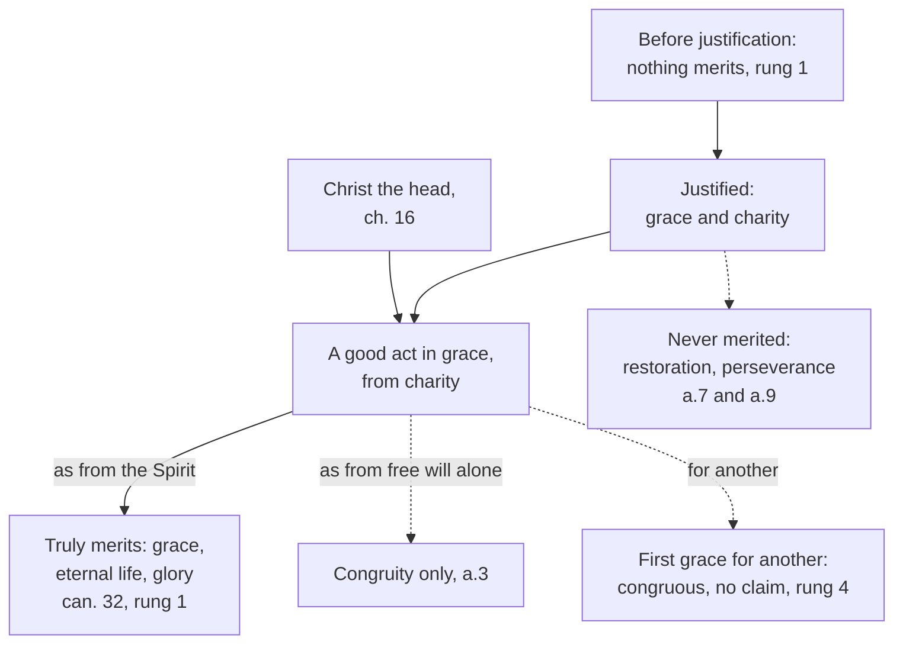

# Creation, Grace & the Last Things · Lesson 5.3: Merit

> ⏱ ~15 min · Module 5: Justification, merit, and predestination · Builds on: [5.1](05-01-trent-session-vi-justification.md), [4.2](04-02-the-necessity-of-grace.md) · Unlocks: [5.5](05-05-the-de-auxiliis-controversy.md), [6.3](06-03-purgatory.md), [`theology-of-debt` 3.4–3.6](../../theology-of-debt/lessons/03-04-aquinas-satisfaction-and-the-debt-of-punishment.md)

## Why this matters

Trent condemns anyone who denies that the justified "truly merit" eternal life (Session VI, can. 32). Many hear the Reformation quarrel in that one word: if grace is a gift, merit is either impossible, since nothing is ours to offer, or a bargain, heaven bought by good behaviour. Yet the same Church, in the Roman Canon, asks not to be weighed by merit. Both are one doctrine, hinged on a grace no one earns.

## The idea

To **merit** is to do something freely to which a reward is owed ([merit](../reference.md#merit)). Between equals that is plain justice, a wage. Between God and us there is no equality: "what hast thou that thou hast not received?" (1 Cor 4:7, DR). Any owing has to start on God's side.

A violin teacher takes on a child who cannot play, gives her an instrument and lessons, and promises her a seat in his orchestra when she can play the concerto. When she plays it, the seat is hers by right: she played, and he promised. Yet instrument, training and promise were all his, and his skill is in her hands without making them less hers. Nothing she did before he took her on earned the lessons; once taught, her playing really earns what he promised.

So the first grace is never merited, and acts done afterwards in grace truly merit more grace and eternal life. The schools name two kinds ([condign and congruous merit](../reference.md#condign-and-congruous-merit)). **Condign** merit is merit in the full sense: the reward matches the act, because the act is the Spirit's work in an adopted child. **Congruous** merit is fittingness without a claim, as when God grants what a friend asks.

## Source

Augustine, *On Grace and Free Will* 6.15 (426 or 427), against the [Pelagian](../reference.md#pelagianism) claim that eternal life is rendered to our preceding merits; NPNF first series vol. 5, tr. Peter Holmes, rev. B. B. Warfield:

> If, indeed, they so understand our merits as to acknowledge them, too, to be the gifts of God, then their opinion would not deserve reprobation. But inasmuch as they so preach human merits as to declare that a man has them of his own self, [...] To a man who holds such views, it is perfect truth to say: It is His own gifts that God crowns, not your merits,—if, at least, your merits are of your own self, not of Him. [...] If, then, your good merits are God's gifts, God does not crown your merits as your merits, but as His own gifts.

Augustine does not deny that eternal life answers to merits; he denies that merits are self-made. The tag "God crowns his own gifts, not your merits" is his middle sentence with its condition cut off, and the last sentence keeps "your good merits", crowned *as* gifts. The *Tractates on John* have the short form (3.10, NPNF vol. 7).

## In their own words

**Melanchthon's *Apology* of the Augsburg Confession** (May 1531), art. III (*Concordia Triglotta*, 1921, tr. F. Bente and W. H. T. Dau, cited by its paragraph numbers), grants rewards (§73):

> We teach that good works are meritorious, not for the remission of sins, for grace or justification (for these we obtain only by faith), but for other rewards, bodily and spiritual, in this life and after this life

It rejects *meritum condigni*, works done from charity as worthy of eternal life (§§195–201). That takes from Christ the office of Mediator, which he holds "perpetually, and not merely in the beginning of justification". It leaves consciences without peace, because "the Law always accuses us, even in good works". No one can tell when a work is condign; the distinction was "devised" only "to elude the Scriptures". And the Church confesses that eternal life comes through mercy. On this view a merit of eternal life either empties grace or turns it into a contract.

## The doctrine

1. **Merit is defined.** Lateran IV's [*Firmiter*](../reference.md#firmiter) (1215) professes that the married too, "pleasing God by right faith and good work, merit to attain eternal beatitude" (lesson's translation). Trent, [Session VI](../reference.md#trent-session-vi) (13 January 1547), can. 32, condemns denying that the good works of the justified are both "the gifts of God" and "also the good merits of him that is justified", or that he does "truly merit" increase of grace, eternal life and its attainment (if he departs in grace), and an increase of glory. Cans. 24, 26 and 31 add that good works increase justice and that hoping for "an eternal recompense" is no sin. *In words:* the works of the just are wholly God's gift and truly their merit, and they may hope for the reward.

2. **The ground: gift and promise.** Chapter 16 offers eternal life "both as a grace mercifully promised ... and as a reward", rendered "according to the promise of God Himself". Christ's virtue flows into the justified "as the head into the members" and "precedes and accompanies and follows" their works. God "will have the things which are His own gifts be their merits": that sentence is the [*Indiculus*](../reference.md#indiculus)'s (Rome, about 435–442, probably by Prosper of Aquitaine), *ut nostra velit esse merita, quae sunt ipsius dona*. Hence a reward, not a wage ([`theology-of-debt` 2.4](../../theology-of-debt/lessons/02-04-the-bond-and-the-ransom.md), [3.2](../../theology-of-debt/lessons/03-02-the-fathers-alms-satisfaction-and-ransom.md)). *In words:* the reward is owed to God's promise and to Christ at work in his members.

3. **The hinge.** "None of those things which precede justification—whether faith or works—merit the grace itself of justification" (ch. 8). Behind it stands [Orange II](../reference.md#orange-ii) (529), can. 18, headed *Nullis meritis gratiam praeveniri*: a reward is owed to good works if they are done, "but grace, which is not owed, goes before, that they may be done" (lesson's translation; the council's standing is [3.2](03-02-pelagius-augustine-and-the-councils.md)'s). Here the *Apology* and Trent agree; the quarrel is over what the justified merit afterwards. *In words:* merit lives only inside grace, so grace's beginning cannot be bought.

4. **Aquinas** (ST I-II q.114, English Dominican Province). Merit is "the effect of cooperating grace" ([cooperating grace](../reference.md#operating-and-cooperating-grace); [4.1](04-01-what-grace-is.md)). With no equality between God and man, it "only exists on the presupposition of the Divine ordination" ([divine ordination](../reference.md#divine-ordination)), so God is debtor only to himself (a.1 ad 3). An act as it proceeds from free will has only congruity; as it proceeds from "the grace of the Holy Ghost" it merits eternal life condignly, its worth depending "on the dignity of grace" that makes us adopted heirs (a.3). No one merits his own first grace (a.5) or his restoration after a fall (a.7). Another's first grace only Christ merits condignly, the just congruously (a.6). Increase of grace is merited (a.8); [perseverance](../reference.md#final-perseverance) in this life is not, though prayer obtains it (a.9 ad 1). Works "deadened" by mortal sin revive with penance ([revival of merits](../reference.md#revival-of-merits); III q.89 aa.4–5). *In words:* merit is God's order honoured by God, and its worth is the Spirit's.

5. **For others, and in prayer.** What a member's works do for another's [temporal punishment](../reference.md#guilt-and-punishment) is [`theology-of-debt` 3.4–3.6](../../theology-of-debt/lessons/03-04-aquinas-satisfaction-and-the-debt-of-punishment.md)'s, and the [suffrages](../reference.md#suffrages) are [6.3](06-03-purgatory.md)'s. The first Preface of the Saints praises God who, "in crowning their merits", crowns "your own gifts" (*eorum coronando merita tua dona coronas*); it is the Catechism's epigraph before CCC 2006. The Roman Canon's *Nobis quoque peccatoribus* asks admission among the saints "not as an assessor of merit but as a lavish giver of pardon" (*non aestimator meriti, sed veniae ... largitor*; lesson's translations). *In words:* the [law of prayer](../reference.md#lex-orandi) speaks from the receiving end, praising merits as gifts and asking, as sinners, for pardon.

| Defined or taught (with level) | A school's explanation or an opinion (no magisterial level) |
|---|---|
| The justified truly merit increase of grace, eternal life and glory; their works are God's gifts and their merits: **rung 1** (VI can. 32; *Firmiter*) | "Truly" read as merit *de condigno*, owed by God's ordination and the dignity of grace (q.114 aa.1, 3): **rung 4** |
| Eternal life is grace promised and reward by promise; Christ's virtue precedes, accompanies, follows: **at least rung 3** (ch. 16) | God a debtor only to his own ordination (a.1 ad 3); Augustine's "crowns his own gifts", a Father's formula |
| No merit precedes the first grace: **rung 1** (Orange II can. 18; Trent VI cans. 1–3, ch. 8) | Grace is merit's principle, so cannot be its term (a.5) |
| Hoping for the reward is no sin: **rung 1** (cans. 26, 31) | Charity as merit's root (a.4); congruous merit for another (a.6); revival of merits (III q.89 a.5): **rung 4** |

**Mark the levels** ([the ladder](../../fundamental-theology/lessons/04-04-the-ladder-of-doctrinal-authority.md); [levels of authority](../reference.md#levels-of-authority)). Cans. 24, 26, 31 and 32 put their contradictories at **rung 1** (as [`theology-of-debt` 2.4](../../theology-of-debt/lessons/02-04-the-bond-and-the-ransom.md) graded can. 32), and *Firmiter*'s clause, in Lateran IV's profession of faith, is **rung 1**. Chapter 16 is **at least rung 3** under the closing clause [5.1](05-01-trent-session-vi-justification.md) reads, though its pairing of gift and merit is rung 1 inside can. 32. *Condign* and *congruous* are words no act uses (**no magisterial level**). That perseverance is unmerited is the schools' teaching (**rung 4**); that the justified need God's special help to persevere is **rung 1** (can. 22). CCC 2006–2011 locates these claims and raises none. The prayers witness and define nothing; the *Indiculus* weighs by reception; Augustine as author and the *Apology* carry **no magisterial level**.

## The map

Everything that can be merited lies downstream of a grace that was not; the dashed edges carry no claim in justice.

## Worked examples

**Ex 1 (clean): the Saturday reading lessons.** Invented: Odile Marchetti, of St Catherine's, Wendling, in the [state of grace](../reference.md#sanctifying-grace), teaches an adult neighbour to read on Saturdays, for love of God and of him. The act is good, free, commanded by [charity](../reference.md#infused-virtues) (a.4) and "done in God" (ch. 16). It truly merits an increase of grace, and eternal life with an increase of glory if she departs in grace (can. 32; degrees of glory are [6.2](06-02-heaven-and-the-beatific-vision.md)'s). Not because phonics is worth heaven, since as from her free will the act has only congruity (a.3), but because it is the Spirit's work in an adopted daughter (a.1). She may hope for the reward (can. 31), and must ask for her perseverance (a.9 ad 1).

**Ex 2 (strain): the brother who never came back.** For twenty years Odile prays and works for her estranged brother Bartek, who dies suddenly with no sign of return. Did her merit fail? She never had a claim. Only Christ merits another's first grace condignly, and hers was congruous, open to "an impediment on the part of him whose salvation the just man desires" (a.6). Her prayer asked mercy, not justice (ad 2), and each work merited her own increase of grace (a.8). Here the doctrine stops. It does not say whether grace reached Bartek at the end, nor how a grace given at a friend's prayer becomes efficacious in a free will ([5.5](05-05-the-de-auxiliis-controversy.md)), and the Church declares no one damned ([6.4](06-04-hell.md)). Odile may hope; she cannot know.

## Watch out

- **You might think merit is a late concession wedged into grace.** It is defined (can. 32, rung 1) and was professed at Lateran IV in 1215, with gift and merit paired inside the canon. "A pious way of speaking" understates.
- **You might think condign and congruous merit, or merit for others, are defined.** No act uses the words: rung 4 at most. CCC 2010 locates it without raising it.
- **You might think "condign" means worth heaven by itself.** From free will alone there is no condignity (a.3). Nor is condign *merit* Christ's condign *satisfaction* ([`christology` 1.3](../../christology/lessons/01-03-why-the-incarnation.md)).
- **You might think "God crowns his own gifts" denies merit.** The short form is conditional, and the full sentence keeps "your good merits".

## One-liner

> The just truly merit eternal life because God crowns in them what he gave them, and nothing they did earned the first gift.

## Problems

**P1 (🟢)** *(Exegetical)* **Assign the level.** For each claim, give its rung on [the ladder](../../fundamental-theology/lessons/04-04-the-ladder-of-doctrinal-authority.md) and name the act that fixes it, or say that none does.

(a) The justified sins when he does good works with a view to an eternal reward.

(b) Married people, pleasing God by right faith and good works, merit to attain eternal beatitude.

(c) The merit of eternal life that Trent defines is merit *de condigno*.

(d) Good works done in charity and deadened by mortal sin revive when grace is recovered through penance.

(e) A just person can merit for another the first grace of conversion, congruously but not condignly.

**Two sentences per item.**

**P2 (🟡)** *(Exegetical)* **Diagnose.** From an RCIA talk at St Catherine's, Wendling, **invented** for this problem:

> "Merit was the medieval Church's bargain with God, and Trent defined it to keep the indulgence trade going. Since the Joint Declaration of 1999 the Church has quietly dropped it; the Mass itself begs God not to look at our merits. Augustine settled it long ago: 'God crowns his own gifts, not your merits', so nothing is really ours. Still, keep praying for your husband. If you do enough good works, you can earn his conversion for him."

Find **four** errors. For each, give the correction, and where a level is involved name the act that fixes it. **150 words or fewer.**

**P3 (🔴)** *(Exegetical)* **Find the crux.** Aquinas, ST I-II q.114 a.7 ad 3 (English Dominican Province):

> Some have said that no one *absolutely* merits life everlasting except by the act of final grace, but only *conditionally,* i.e. if he perseveres. But it is unreasonable to say this, for sometimes the act of the last grace is not more, but less meritorious than preceding acts, on account of the prostration of illness. Hence it must be said that every act of charity merits eternal life absolutely; but by subsequent sin, there arises an impediment to the preceding merit, so that it does not obtain its effect; just as natural causes fail of their effects on account of a supervening impediment.

(a) Name the single premise on which Aquinas and the "some" divide, and the consideration Aquinas offers against them.

(b) Trent VI can. 32 condemns anyone who says the justified does not "truly merit increase of grace, eternal life, and the attainment of that eternal life,—if so be, however, that he depart in grace,—and also an increase of glory" (Waterworth; Latin *ipsius vitae aeternae, si tamen in gratia decesserit, consecutionem*). Does the canon settle the dispute? Say which words matter and at what level the dispute is left.

**Two sentences per part.**

Solutions

**P1** *(Exegetical)*

**Must hit, strict:**

- **(a) Condemned.** Trent VI can. 31 (1547) condemns it, so its contradictory, that hoping for an eternal recompense does not make a good work a sin, is **rung 1**; can. 26 adds that the just ought to hope for that recompense through God's mercy and Christ's merit.
- **(b) Rung 1.** Lateran IV, *Firmiter* (1215), professes it within the council's profession of faith, three centuries before Trent.
- **(c) No magisterial act.** Can. 32 says "truly merit" and never uses *condignus*. Reading "truly" as condign merit is the schools' teaching (**rung 4**), while the merit itself is rung 1.
- **(d) No magisterial act; rung 4 at most.** It is Aquinas's thesis (III q.89 aa.4–5), taught by the schools. Chapter 16 addresses the justified "whether they have preserved uninterruptedly the grace received, or whether they have recovered it when lost", which makes the restored able to merit but defines nothing about earlier works.
- **(e) No magisterial act; rung 4.** It is Aquinas's (q.114 a.6). CCC 2010 speaks of meriting graces "for ourselves and for others", which locates the teaching without raising it.

**Wrong turns:** treating (a) as advice about motives with no level (understated); calling (b) a stray clause or crediting it to Trent; "Trent defined condign merit" in (c), or "defined in ch. 16" in (d) (both overstated); putting (e) at rung 3 "because the Catechism says it".

**Model answer:** (a) Condemned by Trent VI can. 31, so its denial is rung 1; can. 26 says the just should hope for an eternal recompense through God's mercy and Christ's merit. (b) Rung 1: Lateran IV professes it in *Firmiter* (1215), as part of its profession of faith. (c) No act fixes it: can. 32 says "truly merit", and the reading of "truly" as condign is the schools' teaching, rung 4, though the merit itself is rung 1. (d) Aquinas's thesis (ST III q.89 aa.4–5), held by the schools, rung 4 at most; Trent's ch. 16 lets the restored merit but says nothing of reviving earlier works. (e) Rung 4, from Aquinas, q.114 a.6; CCC 2010's merit "for others" locates it and does not raise it.

---

**P2** *(Exegetical)*

**Accept:** any four of the five below, each corrected.

**Must hit, strict:**

- **"Medieval, invented for indulgences."** Augustine and the *Indiculus* already speak of merits as gifts, Lateran IV's *Firmiter* (1215) professes merit, and can. 32 concerns grace and glory. Indulgences concern temporal punishment, which is [`theology-of-debt` 3.6](../../theology-of-debt/lessons/03-06-luther-trent-and-the-reform-of-indulgences.md)'s.
- **"Dropped since 1999."** Can. 32 is **rung 1**. The Joint Declaration (§§37–39) states the Catholic sense of merit, a reward promised to works that remain gifts, and the 1998 Response restates that eternal life is both grace and reward. An ecumenical agreement revokes no canon ([5.2](05-02-the-1999-joint-declaration.md)).
- **"The Mass denies merit."** The *Nobis quoque* is sinners asking admission as pardon, not as assessment. The Preface of the Saints praises God for crowning the saints' merits as his gifts: *lex orandi*, not a denial.
- **"Nothing is ours."** Augustine's tag is conditional ("if, at least, your merits are of your own self"), and his full sentence keeps "your good merits".
- **"Earn his conversion."** Only Christ merits another's first grace condignly (q.114 a.6). The just merit it congruously and impetrate it from mercy, with no claim, and the husband's refusal can block it.

**Wrong turns:** "correcting" the talk by saying good works merit the first grace; treating the Joint Declaration as a magisterial definition in either direction; saying the Canon proves merit is only a manner of speaking; replacing "earn his conversion" with "nothing you do helps him".

**Model answer:** Merit is not a medieval invention: Augustine spoke of merits as God's gifts, Lateran IV professed merit in 1215, and Trent's can. 32 (rung 1) concerns grace and glory, while indulgences concern temporal punishment. The Joint Declaration revoked nothing; its §§37–39 state the Catholic sense of merit, and the 1998 Response restates that eternal life is both grace and reward. The Canon's "not as an assessor of merit" is sinners asking for pardon, and the Preface of the Saints praises God for crowning merits as his gifts. Augustine's sentence is conditional and keeps "your good merits". No one can earn another's conversion as of right; only Christ merits it condignly, while her prayer and works may obtain it congruously from mercy, and he can still refuse.

---

**P3** *(Exegetical)*

**Must hit, strict (a):**

- The premise: whether each act of charity merits eternal life **absolutely**, so that a later sin only impedes its effect, or whether merit of eternal life belongs **only to the act of final grace**, every earlier act meriting conditionally on perseverance.
- Aquinas's consideration: the last act can be **less meritorious** than earlier ones ("on account of the prostration of illness"), so tying the merit to it would make the reward hang on a feeble act. He adds the analogy of natural causes that are impeded without ceasing to be causes.

**Must hit, strict (b):**

- The condition is attached to **"the attainment of that eternal life"**. In the Latin it sits inside *ipsius vitae aeternae … consecutionem*, and "eternal life" is listed separately before it. So the canon is worded in a way that fits Aquinas: merit of eternal life, with its attainment conditional on dying in grace.
- It **does not settle** the dispute. The canon condemns only denying that the justified truly merit. The conditional view also affirms true merit, and it can read the condition as qualifying the attainment, so neither side is condemned. The question stays among the schools, with **no magisterial level** (rung 4 or 5, not 1–3).

**Wrong turns:** naming "whether the justified merit at all" as the crux, which both sides affirm; saying can. 32 "defines Aquinas's view" (overstated) or "condemns the conditional view"; reading "if so be ... depart in grace" as a condition on whether merit exists; importing condign against congruous, which this passage does not use.

**Model answer:** (a) Both sides hold that the justified merit eternal life; they divide on whether each act of charity merits it absolutely, a later sin only blocking the effect, or whether only the act of final grace merits it, earlier acts meriting conditionally. Aquinas objects that the last act may be weaker than earlier ones, for instance in the prostration of illness, so the reward cannot hang on it, and he compares sin to an impediment that stops a natural cause without abolishing it. (b) The canon attaches "if so be, however, that he depart in grace" to "the attainment of that eternal life" (*consecutionem*), listed after "eternal life" itself, a wording that suits Aquinas. But it condemns only the denial of true merit, which neither side makes, so the dispute is not defined and stays a school question with no magisterial level.

## Flashback

**From Lesson [5.1](05-01-trent-session-vi-justification.md) (Trent Session VI: justification):** *(Exegetical.)* Close reading. Trent, Session VI (1547), ch. 7, after naming the formal cause, in Waterworth's translation (1848):

> … man, through Jesus Christ, in whom he is ingrafted, receives, in the said justification, together with the remission of sins, all these (gifts) infused at once, faith, hope, and charity. For faith, unless hope and charity be added thereto, neither unites man perfectly with Christ, nor makes him a living member of His body. … This faith, Catechumens beg of the Church—agreeably to a tradition of the apostles—previously to the sacrament of Baptism; when they beg for the faith which bestows life everlasting, which, without hope and charity, faith cannot bestow

(a) Catechumens ask for faith before baptism, and ch. 8 calls faith "the beginning", "the foundation, and the root"; yet here it is "infused at once" with hope and charity. Say how both hold, and what faith lacks without the other two. **Two sentences.**

(b) A catechist's slide, invented for this problem: "Trent: we are justified by charity, not by faith. 'Justified by faith' is the Lutheran formula." Correct it from ch. 8, and name the sense of "faith alone" that can. 9 condemns, with its level. **Two sentences.**

Solution

**Must hit, strict (a):**

- Faith comes **first as a disposition**: "conceiving faith by hearing", under grace, heads chapter 6's preparation, so it is beginning and root. In justification it is **infused with hope and charity**, which complete it without replacing it.
- Without them it "neither unites man perfectly with Christ, nor makes him a living member", and cannot bestow eternal life: true faith, not living faith (credit citing can. 28, which condemns calling it untrue).

**Must hit, strict (b):**

- Ch. 8 keeps the formula, "justified by faith, because faith is the beginning … the foundation, and the root" (**at least rung 3**). Charity inheres *with* faith in one justice (can. 11, **rung 1**), not in its place.
- Can. 9 condemns "faith alone" meaning that nothing else co-operates and no preparation by one's own will is needed; its contradictory is **rung 1**.

**Wrong turns:** reading "infused at once" as denying that faith comes first; calling faith without charity no faith; saying Trent rejected "justified by faith", or that can. 9 condemns every use of "faith alone".

**Model answer:** (a) Faith begins before justification as the first of chapter 6's grace-moved dispositions, hence its root, and in justification it is infused with hope and charity, which complete it. Without them it is still faith, but it neither unites one perfectly with Christ nor gives eternal life. (b) Ch. 8 says we are "justified by faith" as by beginning, foundation and root (at least rung 3), and charity inheres with faith, not instead of it (can. 11, rung 1). Can. 9 condemns only "faith alone" meaning that nothing else co-operates and no preparation of the will is needed; its contradictory is rung 1.

## Connections

- **Backward:** [5.1](05-01-trent-session-vi-justification.md) gave the causes of justification and the fence around Session VI's chapters; this lesson takes its ch. 16 and can. 32. [4.2](04-02-the-necessity-of-grace.md) showed why no one merits eternal life without grace, [4.1](04-01-what-grace-is.md) gave the cooperating grace whose effect merit is, and [3.2](03-02-pelagius-augustine-and-the-councils.md) gave Orange II, the hinge. [`theology-of-debt` 2.4](../../theology-of-debt/lessons/02-04-the-bond-and-the-ransom.md) and [3.2](../../theology-of-debt/lessons/03-02-the-fathers-alms-satisfaction-and-ransom.md) gave "a reward, not a wage".
- **Forward:** [5.4](05-04-predestination.md) takes perseverance and election, which merit cannot reach (a.9). [5.5](05-05-the-de-auxiliis-controversy.md) asks how the grace inside a meritorious act is efficacious. Degrees of glory are [6.2](06-02-heaven-and-the-beatific-vision.md)'s and the suffrages [6.3](06-03-purgatory.md)'s. [5.2](05-02-the-1999-joint-declaration.md) reads how the Joint Declaration and the 1998 Response treat merit, and the argued dispute with the *Apology* belongs to [`apologetics-catholic-claims`](../../apologetics-catholic-claims/syllabus.md).
- **Sideways:** This answers [`christology` 5.1](../../christology/lessons/05-01-the-paschal-mystery-and-the-threefold-office.md)'s hand-off: Christ's merit reaches a person as the head's grace in a living member, the capital grace of [`christology` 3.4](../../christology/lessons/03-04-the-grace-of-the-head.md). Merit and satisfaction are two currencies, grace and glory here, temporal punishment and the treasury in [`theology-of-debt` 3.4–3.6](../../theology-of-debt/lessons/03-04-aquinas-satisfaction-and-the-debt-of-punishment.md). [`moral-theology` 3.4](../../moral-theology/lessons/03-04-sin-mortal-and-venial.md) gives the mortal sin that deadens merit while faith survives.
