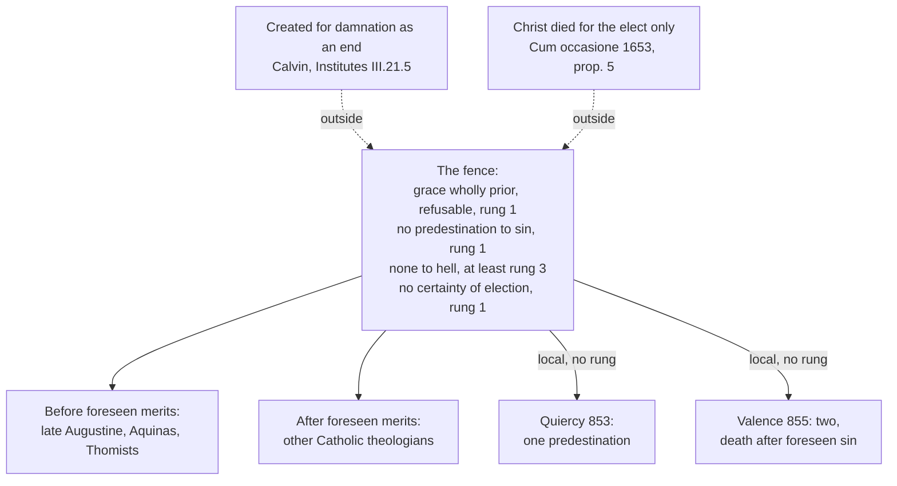

# Creation, Grace & the Last Things · Lesson 5.4: Predestination

> ⏱ ~15 min · Module 5: Justification, merit, and predestination · Builds on: [4.2](04-02-the-necessity-of-grace.md), [3.2](03-02-pelagius-augustine-and-the-councils.md), [5.1](05-01-trent-session-vi-justification.md) · Unlocks: [5.5](05-05-the-de-auxiliis-controversy.md), [5.6](05-06-jansenism.md), [6.4](06-04-hell.md)

## Why this matters

In the 1580s, as a student in Paris, the young Francis de Sales went through what his biographers call a long temptation to despair: the theologians' disputes over predestination had convinced him he was among the lost. The doctrine that frightened him, the Church teaches. The conclusion he drew from it, she forbids. This lesson keeps the two apart.

## The idea

Predestination is not fate. It is the part of God's providence ([`thomistic-synthesis` 5.2](../../thomistic-synthesis/lessons/05-02-providence-and-secondary-causes.md)) that concerns the one end no creature reaches by its own power, the vision of God: his eternal plan to bring someone there, with every means on the way, his free acts included. What it puts in us is its carrying-out, calling and glory (Romans 8:30).

The doctrine is an **asymmetry**. *If anyone is saved, the whole credit is God's*: grace went first, and even the yes was a gift ([4.2](04-02-the-necessity-of-grace.md)). *If anyone is lost, the whole blame is his own*: God planned no one's sin, willed him saved, and gave him real grace. A synod at Quiercy in 853 put it in a line: that some perish "is the desert of those who perish" (lesson's translation). Make it symmetrical and either God authors both outcomes or man does, which is [Pelagius](../reference.md#pelagianism). A third sentence protects the believer: no one reads his own name in the plan. *How* the first two fit, why the gift wins one person's consent and is refused by another, the Church has never said.

## In their own words

John Calvin, *Institutes of the Christian Religion* (1559), III.21.5, tr. Henry Beveridge (1845):

> By predestination we mean the eternal decree of God, by which he determined with himself whatever he wished to happen with regard to every man. All are not created on equal terms, but some are preordained to eternal life, others to eternal damnation.

His case. Grace is wholly free, so salvation cannot hang on anything God foresees in us; to make predestination depend on foreknowledge is "absurd" (III.21.5). Scripture says *predestinated*, and not all are saved, so the difference lies in God's decision. Only knowing his eternal election persuades us that salvation flows from God's free mercy, and it grounds humility and security (III.21.1). He admits that the decree concerning the fall is "dreadful" (III.23.7).

## The doctrine

1. **God predestines.** "For whom he foreknew, he also predestinated to be made conformable to the image of his Son" (Romans 8:29, DR); he "predestinated us unto the adoption of children" (Ephesians 1:5). For Aquinas, [predestination](../reference.md#predestination) is part of providence: the plan directing a rational creature to eternal life, an end that "exceeds all proportion and faculty of created nature" (ST I q.23 a.1). Trent presupposes it, "the secret mystery of divine predestination" (Session VI, 13 January 1547, ch. 12), without defining it. *In words:* God eternally plans to bring some to glory, and the plan is mercy.

2. **No one is predestined to evil.** [Orange II](../reference.md#orange-ii) (3 July 529, confirmed by Boniface II in 531; its weight is [3.2](03-02-pelagius-augustine-and-the-councils.md)'s) says near the end of its conclusion (lesson's translation):

> This too we believe according to the Catholic faith: that after receiving grace through baptism, all the baptized, with Christ helping and cooperating, can and ought to fulfil what belongs to the soul's salvation, if they will labour faithfully. That some have been predestined to evil by divine power (*divina potestate*), we not only do not believe …

and it condemns "with all detestation" any who would. [Trent Session VI](../reference.md#trent-session-vi) can. 17 reuses Orange's words. It condemns saying that justifying grace reaches only those "predestined unto life", the others being called but receiving no grace, "as being, by the divine power, predestined unto evil" (Waterworth). Can. 6 condemns saying God works evil "not permissively only, but properly, and of Himself". *In words:* God causes the good and permits the evil; sin is never his work.

3. **God wills all to be saved.** "Who will have all men to be saved" (1 Timothy 2:4, DR): the [universal salvific will](../reference.md#universal-salvific-will) excludes no one, for God does not want "any to perish" (CCC 1037, 1058), and Christ died for all without exception (CCC 605, quoting Quiercy; Trent VI ch. 3, "He died for all"). That he died for the predestined only is condemned in [*Cum occasione*](../reference.md#five-propositions) (1653), prop. 5 ([5.6](05-06-jansenism.md)). That not all are saved, Aquinas squares with this by [antecedent and consequent will](../reference.md#antecedent-and-consequent-will): a just judge wills every man to live and the murderer hanged (I q.19 a.6 ad 1). *In words:* no one stands outside God's will to save.

4. **No one is lost except by his own fault.** "God predestines no one to go to hell" (CCC 1037, footnoting Orange and can. 17); what damns is a wilful turning from God, persisted in to the end. Aquinas on [reprobation](../reference.md#reprobation) (I q.23 a.3):

> as predestination includes the will to confer grace and glory; so also reprobation includes the will to permit a person to fall into sin, and to impose the punishment of damnation on account of that sin.

It causes abandonment and punishment, never the sin: "guilt proceeds from the free-will of the person who is reprobated" (ad 2). *In words:* God decrees punishment only for a sin he foresees and does not cause.

5. **No one knows he is predestined.** Trent VI ch. 12 forbids presuming to determine for certain that one is among the predestinate, "for except by special revelation, it cannot be known whom God hath chosen"; can. 15 condemns making that certainty something the justified are bound by faith to believe ([certainty of election](../reference.md#certainty-of-election)). For [final perseverance](../reference.md#final-perseverance), ch. 13 asks instead for "a most firm hope in God's help" (can. 16's level is [`moral-theology` 3.2](../../moral-theology/lessons/03-02-faith-hope-and-charity.md)'s). That is the tradition's answer to despair. The secret is itself pastoral: revealed to all, it would make some despair and others careless (I q.23 a.1 ad 4), and the plan runs through means (a.8). *In words:* no one is asked to read the decree, only to hope and to act.

6. **What is not taught: how it fits.** Is predestination to glory decreed [before or after foreseen merits](../reference.md#before-or-after-foreseen-merits)? Aquinas: merit cannot be the reason for its whole effect, since "whatsoever is in man disposing him towards salvation, is all included under the effect of predestination" (I q.23 a.5). Late Augustine ([`patristics` 4.5](../../patristics/lessons/04-05-augustine-against-the-pelagians.md)) and the Thomists say before; other Catholic theologians, after, the merits themselves being gifts. No act has decided; the linked dispute over efficacious grace is [5.5](05-05-the-de-auxiliis-controversy.md)'s. *In words:* the order of God's decrees is the theologians' question.

**Said plainly.** Augustine read 1 Timothy 2:4's "all" as "every sort of men" (*Enchiridion* 103, tr. J. F. Shaw). Aquinas still lists that reading (I q.19 a.6 ad 1) and held that "those who are saved are in the minority" (q.23 a.7 ad 3). Orange's boundary was first tested brutally. In 848 a council at Mainz condemned the monk [Gottschalk](../reference.md#gottschalk-and-the-ninth-century-synods)'s teaching on predestination; at Quiercy in 849 he was flogged, made to burn his writings and confined for life, some twenty years. Then the bishops split: Quiercy (853) taught one predestination, to grace or to just punishment; Valence (855) confessed two, and repeated Orange's condemnation, naming it. Both denied predestination to sin; both were local synods.

| Defined or taught (with level) | A school's explanation or an opinion (no magisterial level) |
|---|---|
| God predestines the elect to glory: **rung 1** | Before or after foreseen merits: **rung 5** |
| No predestination to sin; God works evil only permissively: **rung 1** (Orange; Trent VI cans. 6, 17) | Whether non-election ("negative reprobation") precedes foreseen sin, as Thomists read I q.23 a.3: **rung 5** |
| God wills each person's salvation: **at least rung 3**; Christ died not for the predestined only: **rung 1** (*Cum occasione*) | Antecedent and consequent will; how sufficient grace reaches all |
| No one is bound by faith to believe his election: **rung 1** (can. 15) | How many are elect; Aquinas's "minority" (a.7 ad 3): no level |
| Grace wholly prior, yet refusable: **rung 1** (Orange; Trent VI cans. 3–4) | How grace wins consent: [premotion](../reference.md#physical-premotion), [middle knowledge](../reference.md#middle-knowledge), **rung 5** ([5.5](05-05-the-de-auxiliis-controversy.md)) |

**Mark the levels** ([the ladder](../../fundamental-theology/lessons/04-04-the-ladder-of-doctrinal-authority.md); [levels of authority](../reference.md#levels-of-authority)). Predestination itself is **rung 1** by the ordinary universal magisterium, since Scripture says it in so many words and the Church has always proposed it as revealed; no canon defines it. No predestination to sin is **rung 1** by Orange's conclusion as confirmed and received and, independently, by Trent VI can. 17. God's will to save each person, Christ's death for every human being without exception, and that no one is predestined to hell are **at least rung 3** (CCC 605, 1037, 1058; Trent VI ch. 3): one act behind them is a local synod, and can. 749 §3 defaults down. Ch. 12's wider rule is fenced chapter teaching, **at least rung 3**, its core reaching **rung 1** through can. 16, since predestination includes final perseverance. Quiercy and Valence carry **no rung**; Augustine, Aquinas and Calvin as authors carry **no magisterial level**.

## The map

Only the fence is defined; inside it, everything is permitted.

## Worked examples

**Ex 1 (clean): "Then why pray?"** Invented: at a Lent study group at St Augustine's, Pellworth, Tobiah Hallgrimsson says, "If I'm predestined I'll be saved whatever I do; if not, nothing helps. So why pray?" The second horn assumes he could be shut out of grace: excluded, since the called receive real grace (can. 17, **rung 1**) and the baptized can, with Christ's help, do what salvation requires (Orange). The first assumes the plan reaches its end without its means, the first error in I q.23 a.8: prayer falls *under* predestination as its way of being carried out, hence "labour the more, that by good works you may make sure your calling and election" (2 Peter 1:10, DR). Both horns fail; he prays because prayer is how the plan works.

**Ex 2 (strain): two brothers.** Invented: Perpetua Ochieng, a catechist there, asks about her brothers, raised alike: Lorcan returned to the faith at forty, Desmond died hostile to it. "Why him and not him?" Lorcan's return was God's gift before it was his act (Orange, **rung 1**). Desmond was given real grace (can. 17) and willed saved (CCC 1058); if he is lost, it is by his own doing (CCC 1037), and whether he is, no one may say ([6.4](06-04-hell.md)). Here the doctrine stops: *why* the grace that moved one did not move the other. Aquinas puts the difference in God's choice, which "has no reason, except the divine will" (I q.23 a.5 ad 3); others, in the consent God foresaw. The Church has not chosen, and either answer must keep every sentence above true ([5.5](05-05-the-de-auxiliis-controversy.md)).

## Watch out

- **You might think "double predestination" is the condemned formula.** Valence confessed "a predestination of the impious to death". What Orange and Trent can. 17 exclude is predestination *to sin*, and to no grace.
- **You might think predestination before foreseen merits is Catholic doctrine because Aquinas held it, or Calvinism because Calvin did.** It is **rung 5**: permitted, untaught, uncondemned.
- **You might think the Church teaches that few are saved, or that all are.** Aquinas's "minority" is his opinion; universalism asserted collides with hell's eternity ([6.4](06-04-hell.md)); hope for all is [7.3](07-03-hope-for-all.md)'s.
- **You might think CCC 605 makes Quiercy's sentence a definition.** The Catechism locates; Quiercy is a local synod. "For all without exception" is **at least rung 3**; only the denial of "for the predestined only" is **rung 1**.

## One-liner

> If anyone is saved, God has the credit; if anyone is lost, he has the blame; no one reads the list; and how the first two fit, the Church has never said.

## Problems

**P1 (🟢)** *(Exegetical)* **Diagnose.** An RCIA talk, **invented** for this problem:

> "People hear 'predestination' and think of Calvin, but that's a Protestant idea: Catholics believe in free will instead. Here is what the Church actually teaches. Before creation God looked down the centuries, saw who would freely say yes to him, and chose those people because of their yes. The ones who would say no, he created for hell, since he knew where they were going. And when St Paul writes that God 'will have all men to be saved', the Church follows St Augustine: Paul means all kinds of men, rich and poor, Jew and Greek."

Find **four** errors. Correct each, and where a level is involved, give it and name the act that fixes it. **150 words or fewer.**

**P2 (🟡)** *(Exegetical)* **Close reading.** Trent, Session VI (1547), ch. 12, in Waterworth's translation (1848):

> No one, moreover, so long as he is in this mortal life, ought so far to presume as regards the secret mystery of divine predestination, as to determine for certain that he is assuredly in the number of the predestinate; as if it were true, that he that is justified, either cannot sin any more, or, if he do sin, that he ought to promise himself an assured repentance; for except by special revelation, it cannot be known whom God hath chosen unto Himself.

Canon 15 condemns anyone who says "that a man, who is born again and justified, is bound of faith to believe that he is assuredly in the number of the predestinate".

(a) What exactly does the chapter forbid? What two false beliefs does its "as if" clause say the presumption rests on, and what separate reason does its last clause give? **Two sentences.**

(b) An invented study guide says: "Canon 15 defines what chapter 12 teaches, so both are dogma." Say what the canon condemns and why it is narrower than the chapter, then give the level of each claim with the act that fixes it. **Three sentences.**

**P3 (🔴)** *(Exegetical)* **Find the crux.** Two Frankish synods, in the lesson's translation of the Latin (Denzinger):

> Quiercy (May 853), cap. 1: "… the rest, whom by the judgment of justice he left in the mass of perdition, he foreknew would perish, but did not predestine that they should perish; yet, because he is just, he predestined eternal punishment for them. And so we speak of only one predestination of God (*unam Dei praedestinationem*), which belongs either to the gift of grace or to the retribution of justice."
>
> Valence (8 January 855), can. 3: "… we confidently confess a predestination of the elect to life and a predestination of the impious to death (*praedestinationem impiorum ad mortem*); yet in the choice of those to be saved God's mercy goes before good merit, while in the condemnation of those who will perish evil merit goes before God's just judgment. … In the wicked he foreknew their malice, because it is from them, and did not predestine it, because it is not from him."

(a) On what do the two texts agree about the wicked? Name the words in each that show it. **Two sentences.**

(b) Name the single point on which they disagree. Is it a disagreement about doctrine or about the use of the word "predestination", and what must each side deny to keep its formula safe? **Two sentences.**

(c) What weight does each text carry, and which acts fix the boundary both keep? **Two sentences.**

Solutions

**P1** *(Exegetical)*

**Must hit, strict:**

- **"A Protestant idea; free will instead."** Understated. Predestination is in Scripture (Romans 8:29–30; Ephesians 1:4–5) and proposed by the Church as revealed, **rung 1**, presupposed by Trent VI ch. 12 and cans. 15 and 17. Free will is defined too (Trent VI cans. 4–5, **rung 1**). Catholics hold both.
- **"What the Church teaches: chosen because of their foreseen yes."** Overstated. Predestination after foreseen merits is a school opinion, **rung 5**, and Aquinas and the Thomists hold the opposite (I q.23 a.5). As worded it also fails the fence: the yes is itself a gift of prevenient grace (Orange; Trent VI can. 3, **rung 1**).
- **"Created for hell."** False. "God predestines no one to go to hell" (CCC 1037, **at least rung 3**); no one is predestined to sin by divine power (Orange; Trent VI can. 17, **rung 1**); punishment is decreed only for foreseen sin.
- **"The Church follows Augustine: all kinds of men."** A misattribution. That reading is Augustine's (*Enchiridion* 103), not the Church's: she reads 1 Timothy 2:4 of every human being (CCC 1037, 1058, **at least rung 3**), and denying that Christ died for more than the predestined is heretical (*Cum occasione*, prop. 5, **rung 1** in that sense).

**Wrong turns:** "correcting" the second error by saying the Church teaches predestination *before* foreseen merits (the same overstatement reversed); calling Augustine's reading heretical, when no act condemned it and Aquinas still lists it; treating "foreknew where they were going" as the error, when foreknowledge of sin is Catholic teaching and the error is "created for".

**Model answer:** Predestination is not a Protestant idea: Scripture teaches it and the Church proposes it as revealed (rung 1; Trent VI ch. 12, cans. 15, 17), and she defines free will too (cans. 4–5). "Chosen because of their yes" is one permitted school (rung 5), not Church teaching; Aquinas holds the reverse, and the yes is itself grace's gift (Orange; can. 3, rung 1). No one is created for hell: God predestines no one to it (CCC 1037, at least rung 3), and no one to sin (Orange; can. 17, rung 1). Finally, "all kinds of men" is Augustine's reading, not the Church's, which reads 1 Timothy 2:4 of everyone (CCC 1058, at least rung 3) and condemns saying Christ died for the predestined only (*Cum occasione*, rung 1).

---

**P2** *(Exegetical)*

**Must hit, strict (a):**

- The chapter forbids anyone in this life to presume to **determine for certain** that he is assuredly among the predestined.
- The presumption rests on two false beliefs: that the justified **cannot sin any more**, or that if he sins he may **promise himself an assured repentance**. Credit for noting that the first is condemned at can. 23. The last clause gives a separate, epistemic reason: **without special revelation, no one can know whom God has chosen.**

**Must hit, strict (b):**

- Can. 15 condemns saying the justified is **bound of faith to believe** he is predestined, that is, making certainty of election an obligation of faith. It is narrower: a person who merely claimed such certainty, without saying faith requires it, is not caught by its words, but he does contradict ch. 12.
- **Levels:** the canon's claim is **rung 1** (Trent VI can. 15). Ch. 12's rule is chapter teaching no canon repeats verbatim, fenced by the decree's close as doctrine to be received "faithfully and firmly": **at least rung 3** of itself. Its core reaches **rung 1** through can. 16, since predestination includes final perseverance, and certainty of the one would be certainty of the other.

**Wrong turns:** reading ch. 12 as denying that predestination exists, when it presupposes it ("the secret mystery"); reading it as forbidding hope, when ch. 13 commands "a most firm hope"; calling every sentence of the chapter defined; or the mirror error, calling the chapter mere commentary with no weight.

**Model answer:** (a) It forbids anyone in this life to presume to determine for certain that he is among the predestined, as though the justified could not sin again or could promise himself a sure repentance. Its last clause adds a different reason: without special revelation no one can know whom God has chosen.

(b) Can. 15 condemns only the claim that the justified are *bound by faith* to believe their election, which is narrower than the chapter's ban on presuming certainty at all. The canon's claim is rung 1; the chapter's rule is fenced chapter teaching, at least rung 3 of itself. Its core reaches rung 1 through can. 16, because to be predestined includes persevering, and no one can be absolutely certain of that without revelation.

---

**P3** *(Exegetical)*

**Must hit, strict (a):**

- Both say God **foreknows but does not predestine** the sin and ruin of the wicked, and **decrees their punishment because he is just**, after their evil.
- Quiercy: "foreknew would perish, but did not predestine that they should perish; yet, because he is just, he predestined eternal punishment". Valence: "evil merit goes before God's just judgment"; "foreknew their malice … did not predestine it, because it is not from him."

**Must hit, strict (b):**

- The single point: **one predestination or two.** Valence confesses a second predestination, "of the impious to death", parallel to the elect's "to life"; Quiercy allows only one, which "belongs either to the gift of grace or to the retribution of justice", and refuses to say God predestined them "that they should perish".
- It is a disagreement about the **word and the shape of the decree**, not about doctrine: both predestine the punishment and neither the sin. Valence must deny that a predestination "to death" is a predestination to the evil that earns it, hence its two qualifications (evil merit goes before; malice foreknown, not predestined). Quiercy must deny that the decree of punishment is a second predestination parallel to election, hence "only one" and its refusal of "that they should perish".

**Must hit, strict (c):**

- Both are **local synods**, so neither carries a rung by itself.
- The boundary both keep is fixed by **Orange II's conclusion** (529, as confirmed in 531 and received), which Valence repeats by name, and by **Trent VI cans. 6 and 17** (1547): **rung 1**.

**Wrong turns:** calling Valence "the double predestination the Church condemned" (it is inside the fence); calling Quiercy a definition because CCC 605 quotes its cap. 4 (the Catechism locates); naming a disagreement the passages do not contain. Accept, as extra credit, that the synods also disagreed elsewhere about Christ's death for all (Quiercy caps. 3–4 against Valence can. 4).

**Model answer:** (a) Both texts say God foreknows the wicked's ruin without predestining it and decrees their punishment, because he is just, only after their evil: Quiercy's "did not predestine that they should perish; yet … he predestined eternal punishment", Valence's "evil merit goes before God's just judgment" and "did not predestine it".

(b) They differ on whether there are two predestinations, Valence's "of the impious to death" beside the elect's to life, or one, which Quiercy says belongs either to grace's gift or to justice's retribution. That is a dispute about the word and the shape of the decree, not the doctrine: Valence keeps its formula by denying explicitly that malice is predestined, and Quiercy keeps its own by refusing to call the punishment a second predestination "that they should perish".

(c) Both are local synods and carry no rung by themselves. The boundary they share is Orange II's conclusion, which Valence repeats, and Trent VI cans. 6 and 17, rung 1.

## Flashback

**From Lesson [5.2](05-02-the-1999-joint-declaration.md) (The 1999 Joint Declaration):** *(Exegetical.)* Find the crux. Trent VI can. 13 (Waterworth) condemns anyone who says "that it is necessary for every one, for the obtaining the remission of sins, that he believe for certain, and without any wavering arising from his own infirmity and disposition, that his sins are forgiven him". The Joint Declaration §35, paraphrased: the Reformers stressed that in temptation believers should look not to themselves but to Christ alone; trusting God's promise, they are "assured of their salvation", though never secure when they look at themselves.

(a) Does §35, as presented, assert what the canon condemns? Name the words of the canon that decide it. Two sentences.

(b) A critic grants (a) but says §35 still contradicts Trent VI ch. 9: no one "can know with a certainty of faith, which cannot be subject to error, that he has obtained the grace of God". Name the single point on which he and a defender of the Declaration divide, and give the level of ch. 9 and of the dispute. Two sentences.

Solution

**Must hit, strict (a):**

- **No, on its words.** The canon condemns a *requirement*: certainty "without any wavering arising from his own infirmity" as "necessary … for the obtaining the remission of sins". §35 makes assurance no condition of forgiveness and concedes that wavering: believers are never secure looking at themselves.
- The canon stays **rung 1** (§42); only its [application](../reference.md#application-of-a-condemnation) to this text fails.

**Must hit, strict (b):**

- **The crux is the object of the assurance.** Ch. 9 divides by object: no one may doubt God's mercy, Christ's merit or the sacraments, yet no one has a certainty of faith that *he* has obtained grace. Is §35's "assured of their salvation", grounded in the promise, a certainty of faith about one's own state (the critic), or reliance on the promise that leaves self-regard uncertain (the defender)?
- **Levels:** ch. 9's sentence is fenced chapter teaching that cans. 13–14 do not repeat, **at least rung 3**; the Declaration's judgment has **no rung of its own**, its correctness **rung 5**.

**Wrong turns:** reading can. 13 as condemning all assurance; giving a verdict instead of the crux; calling ch. 9 defined, or mere commentary; treating the signing as settling the question.

**Model answer:** (a) No: can. 13 condemns making certainty "without any wavering arising from his own infirmity" necessary for forgiveness, and §35 makes assurance no condition of forgiveness while conceding that believers are never secure looking at themselves. The canon stays rung 1 but does not reach this text as presented. (b) They divide on the assurance's object: ch. 9 forbids doubting God's mercy and Christ's merit but denies a certainty of faith that one has obtained grace, so all turns on which of the two §35's "assured of their salvation" is. Ch. 9 is at least rung 3; the Declaration's judgment has no rung of its own, and whether it holds is rung 5.

## Connections

- **Backward:** [3.2](03-02-pelagius-augustine-and-the-councils.md) gave Orange II and its weight; [4.2](04-02-the-necessity-of-grace.md) the necessity of grace for the first good movement, which is why the credit sentence holds; [5.1](05-01-trent-session-vi-justification.md) the decree whose ch. 12–13 and cans. 15–17 were read here. Augustine's late texts are [`patristics` 4.5](../../patristics/lessons/04-05-augustine-against-the-pelagians.md), and providence as plan and government is [`thomistic-synthesis` 5.2](../../thomistic-synthesis/lessons/05-02-providence-and-secondary-causes.md).
- **Forward:** [5.5](05-05-the-de-auxiliis-controversy.md) asks how grace can be efficacious and the act still free, the question this lesson leaves open. [5.6](05-06-jansenism.md) is a movement that wanted more Augustine than the Church received, measured against this lesson's fence, *Cum occasione* prop. 5 above all. [6.4](06-04-hell.md) takes the end of the reprobate and why no one is named; [7.3](07-03-hope-for-all.md) asks what may be hoped for all.
- **Sideways:** whether foreknowledge removes freedom is [`philosophy-of-religion` 1.3](../../philosophy-of-religion/lessons/01-03-omniscience-and-human-freedom.md), with Boethius in [`ancient-medieval-philosophy` 5.3](../../ancient-medieval-philosophy/lessons/05-03-time-eternity-and-foreknowledge.md). Romans 9 and the election of Jacob as exegesis are [`new-testament` 5.3](../../new-testament/lessons/05-03-romans-5-11-adam-spirit-israel.md). Hope against despair and presumption is [`moral-theology` 3.2](../../moral-theology/lessons/03-02-faith-hope-and-charity.md). The argued dispute with the Reformed doctrine of election belongs to [`apologetics-catholic-claims`](../../apologetics-catholic-claims/syllabus.md).
