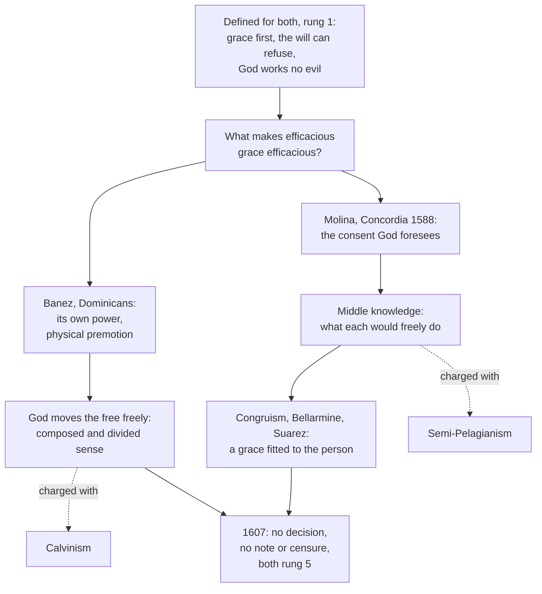

# Creation, Grace & the Last Things · Lesson 5.5: The *de auxiliis* controversy

> ⏱ ~15 min · Module 5: Justification, merit, and predestination · Builds on: [5.4](05-04-predestination.md), [4.1](04-01-what-grace-is.md), [`metaphysics` 6.4](../../metaphysics/lessons/06-04-libertarianism-and-its-critics.md) · Unlocks: [5.6](05-06-jansenism.md)

## Why this matters

From 1598 to 1607 Rome heard Dominicans and Jesuits argue one question under two popes. Then Paul V sent everyone home, promised a decision "at a suitable time", and forbade each side to brand the other. It has never come. This lesson states both schools as their members would, says what both must affirm, and reads the silence as a refusal to decide.

## The idea

Two students hear the same sermon. Ezinne is converted; Emrys shrugs. Two things are fixed doctrine ([5.4](05-04-predestination.md)): Ezinne's conversion is God's gift from its first stirring, and Emrys's refusal is his own, since he could have consented. So Emrys received a real grace he did not follow, which the schools call [sufficient grace](../reference.md#sufficient-and-efficacious-grace); the [actual grace](../reference.md#actual-grace) that brings consent, as in Ezinne, is *efficacious* ([4.1](04-01-what-grace-is.md)).

The question: **what makes efficacious grace efficacious?**

- **Its own power** (intrinsic efficacy). God gives Ezinne a grace that itself moves her will to consent, freely. The difference lies in the grace (Báñez, the Dominicans).
- **The consent God foresees** (extrinsic efficacy). The same grace could work in one person and not in another. God knows who would consent to which grace in which circumstances, and gives Ezinne one he knows she will accept. The difference lies in her free consent, foreseen (Molina, the Jesuits).

The first guards God's primacy and seems to squeeze freedom; the second, the reverse. Each side accused the other of heresy (Calvinism; semi-Pelagianism), and Rome declined to say who was right.

## Source

Paul V's formula closing the dispute, sent to the Dominican and Jesuit generals on 5 September 1607 ([*de auxiliis*](../reference.md#de-auxiliis); lesson's translation of Denzinger's Latin, his omission marked):

> In the matter of the aids, the Supreme Pontiff has given leave to the disputants and the consultors alike to return to their own countries or houses; and it was added that His Holiness would promulgate at a suitable time (*opportune*) the declaration and determination that was awaited. But the same most holy Lord has most seriously forbidden that anyone, in treating this question, should either qualify the side opposed to his own or brand it with any censure (*aut qualificaret aut censura quapiam notaret*). … He wishes, moreover, that they abstain from harsher words that show bitterness of mind.

Three acts, none a verdict. A **dismissal**: the hearings end. A **reservation**: the "declaration and determination" stays with the pope, at no named date. A **precept** binding both sides: no theological note and no censure against the other. To "qualify" is to attach a note such as "rash" or "erroneous", so the ban is wider than "do not call it heresy". It never says either view is true; each order kept teaching its own because nothing was decided.

## In their own words

**Báñez and the Dominicans.** Domingo Báñez (1528–1604) of Salamanca answered Molina in the Dominicans' *Apologetica* (1595). Whatever passes from not acting to acting is moved by the first cause, and the will is no exception: God applies it to its act (the First Mover of [4.2](04-02-the-necessity-of-grace.md); [`thomistic-synthesis` 5.2](../../thomistic-synthesis/lessons/05-02-providence-and-secondary-causes.md)). The help that brings consent is a real, efficient motion, prior to the act in the order of causes, not of time: [physical premotion](../reference.md#physical-premotion), or predetermination ("physical" means real, not merely moral). Such grace is efficacious of itself: the will consents because grace moves it, not the reverse. Freedom is untouched, because God moves each thing according to its nature:

> The Divine will extends not only to the doing of something by the thing which He moves, but also to its being done in a way which is fitting to the nature of that thing. (ST I-II q.10 a.4 ad 1, English Dominican Province)

Moved to consent, the will cannot consent and dissent at once (the [composed sense](../reference.md#composed-and-divided-sense)), yet keeps the power to dissent (the divided sense; ad 3), as a man sitting can stand, though not while sitting (I q.19 a.3). Sufficient grace gives a real power; efficacious grace gives the act.

**Molina and the Jesuits.** Luis de Molina (1535–1600) published his *Concordia* at Lisbon in 1588. A free agent, he holds, is one that, with everything required for acting in place, can act or not act. Yet God's providence is certain. So between God's natural knowledge of all that could be and his free knowledge of what he decrees lies [middle knowledge](../reference.md#middle-knowledge): comprehending each created will, God knows what it *would* freely do in any order of circumstances, though it could do otherwise (*Concordia*, Part IV). Grace is gratuitous and comes first; God concurs in the act itself by [simultaneous concurrence](../reference.md#simultaneous-concurrence), not by a prior determination. Knowing who would consent to what, God chooses which graces to give: the plan infallible, the act free. [Congruism](../reference.md#congruism), the form Bellarmine and Suárez gave the system and the general Aquaviva pressed on Jesuit teachers in 1613 (how far is disputed), adds that efficacious grace is *congruous*: fitted to the person and chosen by God for that reason, a special gift before any consent.

## The doctrine

1. **Grace comes first, the beginning of faith included.** [Orange II](../reference.md#orange-ii) (529, confirmed 531) condemns putting the beginning of faith in nature (can. 5) and professes that "in every good work we do not begin" (*non nos incipimus*; conclusion, lesson's translation). [Trent, Session VI](../reference.md#trent-session-vi) (13 January 1547), can. 3, condemns believing or repenting "as he ought" without "the prevenient inspiration of the Holy Ghost" (Waterworth). *In words:* no salutary movement starts on our side ([prevenient grace](../reference.md#prevenient-grace)).

2. **The will moved by grace cooperates, and can refuse.** Can. 4 condemns saying that free will "moved and excited by God … cannot refuse its consent, if it would" but is "merely passive" (Waterworth; *neque posse dissentire, si velit*). *In words:* grace never turns the will into a stone.

3. **God works evil only permissively.** Can. 6 condemns saying God works evil "not permissively only, but properly", making Judas's treason his work as Paul's call is; Orange II rejects predestination to evil ([5.4](05-04-predestination.md)). *In words:* God permits sin and authors none.

4. **God knows future free acts.** *Dei Filius* (1870), ch. 1: all things are open to his eyes, "even those which are yet to be by the free action of creatures" (Schaff). *In words:* nothing a free creature will do surprises God.

5. **How 1–4 fit: undecided.** A Holy Office decree (1 December 1611) forbade publishing on the question without its leave, renewed under Urban VIII and later lapsed; in 1654 the Holy Office declared an alleged constitution of Paul V condemning Molina unworthy of credence; Benedict XIV's [*Dum praeterito*](../reference.md#dum-praeterito-1748) (31 July 1748) told Spain's Grand Inquisitor that Rome had condemned neither system (P3). *In words:* Rome binds both schools to 1–4 and to courtesy, nothing more.

**Said plainly.** Rome heard the case for nine years and declined to decide it; the promised "declaration and determination" has not come in four centuries. Paul V gave his reasons privately to the Spanish ambassador (26 July 1611): time reveals the truth; both sides agree in substance, that God by his grace "makes the unwilling willing", and "differ only in the mode"; and amid so many heresies both orders' good name had to be kept (lesson's translation of the Italian). The last is prudence, not theology, and he said so.

| Defined or taught (with level) | A school's explanation or an opinion (no magisterial level) |
|---|---|
| Grace precedes every salutary act: **rung 1** (Orange II can. 5; Trent VI can. 3) | Premotion (Báñez); prevenient grace with simultaneous concurrence (Molina) |
| The moved will can refuse: **rung 1** (VI can. 4) | In the divided sense (Thomists); under that very grace (Molinists) |
| God works evil only permissively: **rung 1** (VI can. 6) | God causes the act's being, not its defect (Thomists); concurs with what the will determines (Molinists) |
| God knows future free acts: **rung 1** (*Dei Filius* ch. 1 with the ordinary universal magisterium) | In his decrees (Thomists); by middle knowledge (Molinists) |
| Neither school condemned; neither may brand the other: **law, no rung** | Which is true: **rung 5** |

**Mark the levels** ([the ladder](../../fundamental-theology/lessons/04-04-the-ladder-of-doctrinal-authority.md); [levels of authority](../reference.md#levels-of-authority)). Items 1–3: **rung 1** (Trent's canons; Orange II as confirmed and received, [3.2](03-02-pelagius-augustine-and-the-councils.md)); item 4: **rung 1**, as [`thomistic-synthesis` 5.2](../../thomistic-synthesis/lessons/05-02-providence-and-secondary-causes.md) marks it. That some graces are resisted: **rung 1** (can. 4; *Cum occasione* prop. 2, [5.6](05-06-jansenism.md)); that grace infallibly brings consent where God wills, held by both schools as following from [predestination](../reference.md#predestination): **rung 4**. The schools' theses: **rung 5**; Báñez, Molina, Suárez as authors: **no magisterial level**. The 1607 formula, a decision not to define plus a precept, is **law, no rung**, and lifts neither school above rung 5; the 1611 ban, the 1654 decree and *Dum praeterito* are **discipline, no rung**; Paul V's speech, **no magisterial level**. CCC 1993 and 2022 restate 1–2, not the mode.

## The map

The dashed charges are what 1607 forbade; below the top box, nothing is decided.

## Worked examples

**Ex 1 (clean): one conversion, two lecturers.** At the invented university of Varne, Sr Raymunda Kowal, OP, and Fr Íñigo Tamsett, SJ, co-teach the grace seminar. Their student Ezinne Hargreave goes to confession after a retreat. Sr Raymunda: a premotion moved her to a free consent she could, in the divided sense, have withheld. Fr Íñigo: grace came first, pure gift; God foresaw she would consent to this grace here and gave it; her consent made it efficacious, God concurring. The checks: both put grace first (item 1); both say she could have refused, each in its own sense (item 2); both give God certain knowledge, by decree or by middle knowledge (item 4). Both pass; nothing is decided between them.

**Ex 2 (strain): the refusal.** Emrys Pettersen heard the same sermon and walked out. His grace was real and refusable (item 2), his refusal his own (item 3), his salvation willed by God (5.4). Why did Ezinne's grace work and Emrys's not? Sr Raymunda: Emrys had sufficient grace without the premotion that brings consent; the defect is his, permitted, not caused. Fr Íñigo presses item 3: without the premotion Emrys cannot consent in the composed sense, so the withholding looks like the cause. Fr Íñigo: God foresaw Emrys would refuse this grace. Sr Raymunda presses item 1: then Ezinne's consent made the difference, and "who distinguisheth thee?" (1 Cor 4:7, DR); the congruist answers that God's choice of a congruous grace is itself the gift. Here the doctrine stops: it fixes what neither may say (Emrys could not refuse; God works his sin; Ezinne began her own conversion) and is silent on why God gave this grace to one and that to the other. Both schools end at Romans 11:33.

## Watch out

- **You might think Rome sided with one school, or quietly condemned Molina.** The 1607 formula decides nothing, and in 1654 the Holy Office disowned the alleged bull. Each school is **rung 5**, not a tolerated error.
- **You might think the open question opens its limits.** That grace can be resisted is Trent VI can. 4, **rung 1**, whatever *de auxiliis* left open. The mirror error, "premotion is doctrine because Aquinas is the Church's doctor", ignores that the strongest papal praise of Aquinas reserves disputed questions to freedom ([`thomistic-synthesis` 6.5](../../thomistic-synthesis/lessons/06-05-what-the-church-has-said-about-thomism.md)).
- **You might think this is the predestination dispute.** The axes cross: Bellarmine and Suárez held middle knowledge and also predestination to glory [before foreseen merits](../reference.md#before-or-after-foreseen-merits) ([5.4](05-04-predestination.md), rung 5).
- **You might think Molina's God only watches.** He gives the grace and concurs in the act; middle knowledge is how he knows, not a withdrawal of causality.

## One-liner

> Both schools stand under one defined ceiling (grace first, a will that can refuse, no evil worked by God); Rome heard them for nine years, decided nothing, and forbade either to brand the other.

## Problems

**P1 (🟢)** *(Exegetical)* **Assign the level.** Sr Raymunda's and Fr Íñigo's seminar handout (invented, written for this problem) lists six sentences. For each, give its level on the ladder, or say it is excluded, and name the act that fixes it. **One sentence per item.**

> (a) "When grace moves the will to consent, the will could still refuse."
>
> (b) "Under efficacious grace the will cannot consent and dissent at once, though it keeps the power to dissent."
>
> (c) "God knows what each free creature would do in any circumstances, prior to any decree of his."
>
> (d) "God knows infallibly what free creatures will do."
>
> (e) "A sinner's first desire to believe comes from his own nature, and grace then rewards it."
>
> (f) "God works a sinner's evil act properly, as he works a saint's good act."

**P2 (🟡)** *(Exegetical)* **Diagnose.** A review in the *Varne Theological Quarterly* of a book defending middle knowledge (journal, reviewer, book and author all invented, written for this problem):

> (1) "Dr Ostrander's Molinism is semi-Pelagianism with better manners: it makes our consent the cause of grace."
>
> (2) "Rome saw through it long ago: Paul V had a bull against Molina drafted in 1607 and withheld it for political reasons."
>
> (3) "In any case Trent had settled the matter: Session VI teaches that grace is efficacious of itself."
>
> (4) "Since Rome never decided, a Catholic may say whatever he likes about grace and freedom."

Correct each sentence, naming the act or text involved and the level where one is at stake. **150 words or fewer.**

**P3 (🔴)** *(Exegetical)* **Close reading.** Benedict XIV, letter *Dum praeterito* to the Grand Inquisitor of Spain, 31 July 1748 (lesson's translation of the Latin; a passage on a third school, the Augustinians, is omitted):

> The Thomists are decried as destroyers of human freedom and as followers not only of Jansen but even of Calvin; but since they answer the objections very well, and their opinion has never been reprobated by the Apostolic See, the Thomists hold it with impunity. … The followers of Molina and Suárez are proscribed by their adversaries as if they were Semipelagians; the Roman Pontiffs have not yet passed judgment on this Molinist system, and so they continue, and may continue, in its defence. In a word, bishops and inquisitors must attend not to the notes which doctors fighting among themselves set against one another, but to whether the opinions so marked have been reprobated by the Apostolic See. … We ourselves, though as private doctors we favour one opinion in theological matters, yet as Supreme Pontiffs do not reprobate the opposite, nor allow it to be reprobated by others.

(a) What rule does the letter give bishops and inquisitors, and which words carry it? Apply it to a censor who wants a Molinist textbook banned because a famous Thomist has called it semi-Pelagian.

(b) A reader notes that the Thomists "answer the objections very well" while the Molinists get only "not yet passed judgment", and concludes that the letter ranks the Thomist view higher. Correct him, and say what the letter's last sentence shows about the weight of a pope's own theological opinion.

**Two sentences per part.**

Solutions

**P1** *(Exegetical)*

**Must hit, strict:**

- **(a) Rung 1.** Trent VI can. 4 condemns denying that the will moved by God can refuse its consent "if it would" (with ch. 5). Not a Molinist thesis: both schools must affirm it.
- **(b) Rung 5.** The Thomist reading of can. 4 by the composed and divided senses: permitted, never defined, and not itself what can. 4 defines.
- **(c) Rung 5.** Molina's middle knowledge: permitted, and condemned by no act (*Dum praeterito*, 1748).
- **(d) Rung 1.** *Dei Filius* ch. 1 ("even those which are yet to be by the free action of creatures"), as `thomistic-synthesis` 5.2 marks it. The dispute is over *how* God knows, not *whether*.
- **(e) Excluded.** Semi-Pelagianism: Orange II can. 5 and its conclusion (*non nos incipimus*), Trent VI can. 3. Its contradictory is **rung 1**, and neither school holds it.
- **(f) Excluded.** Trent VI can. 6 condemns it: God works evil "permissively only" (**rung 1**). Thomists say God causes the act's being, never its defect.

**Wrong turns:** demoting (a) or (d) to rung 5 because the dispute is open (the mode is open, not its limits); promoting (b) to rung 1 because it "explains" can. 4, or calling it excluded because it says the will "cannot dissent"; giving (c) rung 1 because (d) has it; calling (e) Molinism.

**Model answer:** (a) Rung 1: Trent VI can. 4 defines that the will moved by God can refuse if it would. (b) Rung 5: the Thomist reading of that canon, permitted and undefined. (c) Rung 5: Molina's middle knowledge, permitted and never condemned. (d) Rung 1: *Dei Filius* ch. 1 teaches that God sees even what free creatures will do. (e) Excluded: it is semi-Pelagianism, condemned by Orange II can. 5 and Trent VI can. 3. (f) Excluded: Trent VI can. 6 condemns it, since God works evil only permissively.

---

**P2** *(Exegetical)*

**Must hit, strict:**

- **(1)** Semi-Pelagianism puts the *beginning* of salvation in nature (condemned: Orange II can. 5 and conclusion; Trent VI can. 3; **rung 1**). Molina makes prevenient grace first and wholly gratuitous; the foreseen consent bears on grace's *efficacy*, not on its being given. No act has censured Molinism, and the 1607 formula forbids branding either school.
- **(2)** There was no such bull: in 1654 the Holy Office under Innocent X declared that no credence was to be given to an alleged constitution of Paul V condemning Molina. Paul V's stated reasons (1611) were reasons for not deciding, not for hiding a decision.
- **(3)** Session VI defines that grace is necessary and prevenient and that the moved will can refuse (cans. 3–4, **rung 1**), which both schools affirm. It defines nothing about the mode, which is why both schools could claim it.
- **(4)** Understated: the mode is **rung 5**, but its limits are **rung 1** (Trent VI cans. 3, 4, 6; Orange II). A view that breaches them is excluded, not free.

**Wrong turns:** correcting (1) by saying Rome *approved* Molinism; correcting (3) by saying Trent sided with Molina because can. 4 says the will "can refuse" (the Thomists affirm can. 4 as well); correcting (4) by saying nothing about grace is settled.

**Model answer:** (1) Semi-Pelagianism puts the beginning of faith in nature, which Orange II can. 5 and Trent VI can. 3 condemn; Molina makes prevenient grace first and wholly free, and the foreseen consent decides only its efficacy. No act has condemned Molinism, and Paul V forbade branding either school in 1607. (2) There was no bull: in 1654 the Holy Office declared that the alleged constitution condemning Molina deserved no credence. (3) Trent VI defines that grace is necessary and prevenient and that the moved will can refuse (cans. 3–4), which both schools hold; it leaves the mode undefined. (4) The mode is freely disputed, but its limits are defined: grace first, a will that can refuse, no evil worked by God (cans. 3, 4, 6). A view that breaks them is excluded.

---

**P3** *(Exegetical)*

**Must hit, strict (a):**

- The rule: judge by whether the **Apostolic See** has reprobated an opinion, not by the notes rival doctors pin on each other ("not to the notes which doctors fighting among themselves set against one another, but to whether the opinions so marked have been reprobated").
- Applied: the Thomist's "semi-Pelagian" is exactly such a note. Rome has "not yet passed judgment on this Molinist system", so the censor has no ground for the ban (and in this matter the 1607 precept had forbidden such notes anyway).

**Must hit, strict (b):**

- The asymmetry ranks nothing. The operative clauses run in parallel, "never been reprobated" and "not yet passed judgment", and both end in permission ("with impunity"; "may continue"). "Answer the objections very well" is a comment, not a judgment, and the letter goes on to say that Rome reprobates neither.
- The last sentence separates the pope as *private doctor*, whose preference is a theologian's opinion with **no magisterial level**, from the pope as *Supreme Pontiff*, who here acts by condemning neither side and letting no one else do it. A pope can favour a school without engaging his office; [6.2](06-02-heaven-and-the-beatific-vision.md) tests the harder case of a pope's opinion later excluded.

**Wrong turns:** reading "with impunity" as approval; reading "not yet" as a promise of condemnation; reading the letter as a definition that both views are true; taking Benedict's private preference for papal teaching, or trying to guess which opinion it was (the letter does not say).

**Model answer:** (a) Bishops and inquisitors are to ask whether the Apostolic See has reprobated an opinion, not what notes rival doctors fling at each other ("not to the notes which doctors … set against one another"). A Thomist's "semi-Pelagian" is such a note, and since the popes have passed no judgment on the Molinist system, the censor has no ground for a ban. (b) The praise is a remark, and the operative words are parallel ("never been reprobated", "not yet passed judgment"), each ending in permission, so neither view is ranked above the other. The last sentence shows that a pope may favour an opinion as a private doctor without that preference carrying any magisterial weight, while as pontiff he condemns neither side and lets no one else condemn it.

## Flashback

**From Lesson [5.3](05-03-merit.md) (Merit):** *(Exegetical.)* Reconstruct. Aquinas, ST I-II q.114 a.5, "Whether a man may merit for himself the first grace?" (English Dominican Province). Having said that grace, as a gratuitous gift, excludes merit, he turns to the thing given ("it" is grace):

> … it cannot come under the merit of him who has not grace, both because it exceeds the proportion of nature, and because previous to grace a man in the state of sin has an obstacle to his meriting grace, viz. sin. But when anyone has grace, the grace already possessed cannot come under merit, since reward is the term of the work, but grace is the principle of all our good works … But [if] anyone merits a further gratuitous gift by virtue of the preceding grace, it would not be the first grace.

(a) Reconstruct the argument as P1, P2, … ∴ C, covering the man without grace and the man who has it. **Five lines or fewer.**

(b) Which line does a magisterial act fix, which act, and at what level? What weight do the other lines carry, and what would be left standing if the premise about principle and term failed? **Two sentences.**

Solution

**Must hit, strict (a):**

- P1. One either lacks grace or has it. P2. Without it, he cannot merit it: it exceeds nature, and sin stands in the way. P3. With it, he cannot merit the grace he has: reward is a work's **term**, grace its **principle**. P4. A gift merited through earlier grace is not the first. ∴ C. No one merits for himself the first grace.
- Both horns are needed; P4 shuts out a first grace earned afterwards.

**Must hit, strict (b):**

- Only **C** is fixed: Orange II can. 18 (*Nullis meritis gratiam praeveniri*, as confirmed and received) and Trent VI ch. 8, nothing preceding justification "merit[s] the grace itself", with cans. 1–3: **rung 1**.
- P1–P4 are Aquinas's explanation, with **no magisterial level**. If P3 failed, C would still stand on the acts: the doctrine does not borrow the argument's weight.

**Wrong turns:** reading P3 as "the justified merit nothing", when what grace causes can be its term (increase of grace and eternal life: a.8; can. 32, **rung 1**); grading the argument rung 1 because its conclusion is; extending C to another's first grace, which a.6 lets the just merit congruously (**rung 4**).

**Model answer:** (a) P1: one either lacks grace or has it. P2: without it he cannot merit it, since it exceeds nature and sin blocks him. P3: with it he cannot merit the grace he has, since reward is a work's term and grace its principle. P4: a gift merited through earlier grace would not be the first. ∴ No one merits his own first grace. (b) Only the conclusion is fixed, by Orange II can. 18 and Trent VI ch. 8 with cans. 1–3, at rung 1. The premises are Aquinas's, with no magisterial level, so if one failed the doctrine would stand on the acts.

## Connections

- **Backward:** [5.4](05-04-predestination.md) set the ceiling (God's universal saving will, no predestination to evil, grace wholly prior) and left open how its parts fit; [4.1](04-01-what-grace-is.md) named sufficient and efficacious grace. The metaphysics of freedom is [`metaphysics` 6.4](../../metaphysics/lessons/06-04-libertarianism-and-its-critics.md), whose two-way power and principle of motion are the premises each school leans on; primary and secondary causes are [`thomistic-synthesis` 5.2](../../thomistic-synthesis/lessons/05-02-providence-and-secondary-causes.md); reading a silence's weight is [`fundamental-theology` 4.5](../../fundamental-theology/lessons/04-05-reading-a-documents-weight.md).
- **Forward:** [5.6](05-06-jansenism.md) takes the next fight over efficacious grace; Benedict XIV's "followers of Jansen" shows how it was used to tar the Thomists. Boss 5 asks for both schools in their own words, and for a verdict.
- **Sideways:** Sixtus IV's *Grave nimis* (1483) did for the Immaculate Conception what Paul V did here, declaring the question undecided and forbidding either side to call the other heretical ([`ecclesiology-and-mariology` 6.3](../../ecclesiology-and-mariology/lessons/06-03-the-immaculate-conception.md)); that question was defined in 1854, so a ban on censure predicts nothing about whether, or which way, a question will close. The secular forms of each school's charge against the other are the manipulation argument ([`metaphysics` 6.2](../../metaphysics/lessons/06-02-compatibilism.md)) and the grounding objection ([`philosophy-of-religion` 1.3](../../philosophy-of-religion/lessons/01-03-omniscience-and-human-freedom.md)).
