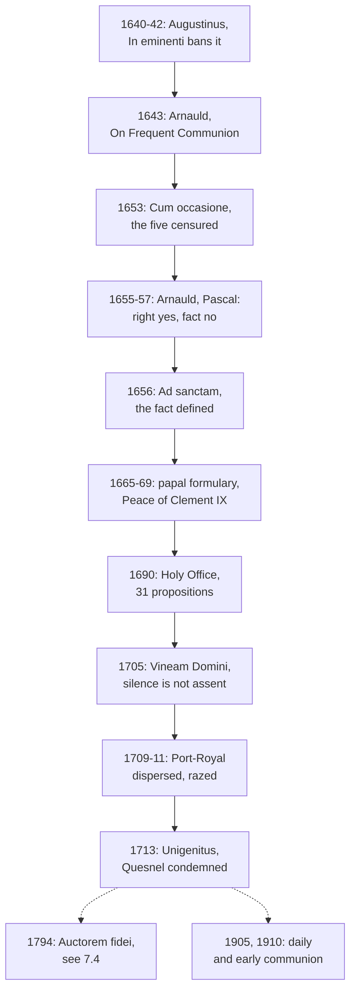

# Creation, Grace & the Last Things · Lesson 5.6: Jansenism

> ⏱ ~15 min · Module 5: Justification, merit, and predestination · Builds on: [5.4](05-04-predestination.md), [5.5](05-05-the-de-auxiliis-controversy.md), [4.2](04-02-the-necessity-of-grace.md) · Unlocks: [6.1](06-01-death-and-the-particular-judgment.md), [7.4](07-04-limbo.md)

## Why this matters

After Trent the gravest challenge to Catholic grace came from men who wanted more Augustine, not less. They lost, leaving two things you need: the cleanest **[dogmatic fact](../reference.md#dogmatic-fact)** on the ladder, and the memory of a century when Catholics were kept from the sacraments for their own good. [5.4](05-04-predestination.md) had to be precise because this is what imprecision looked like.

## The idea

Read Augustine as a machine. After the fall the will follows whichever delight is stronger, earthly or heavenly. Grace is the heavenly delight: when stronger it wins, and when weaker it was never enough. No one is given enough and refuses it: a just man who falls simply lacked it. Grace received becomes a mark of election to be guarded; communion, a reward for the proven, not food for the weak. That, in outline, is [Jansenism](../reference.md#jansenism).

The case had two halves, [droit and fait](../reference.md#droit-and-fait); keep them apart. **Right** (*droit*): are these five sentences heresy? **Fact** (*fait*): are they in this book, in its author's sense? Picture an examiner who strikes five sentences as false and names the textbook that teaches them; its friends agree they are false and deny the book says them. The Church claimed to judge both, because a teaching office that can condemn an error but never say *where* it is cannot protect anyone from a book.

## Source

[The five propositions](../reference.md#five-propositions), as Innocent X's *Cum occasione* (31 May 1653) states them (lesson's translation):

> 1. Some of God's commandments are impossible to just men who will and strive, by the powers they now have; and the grace by which they would become possible is also lacking to them.
>
> 2. In the state of fallen nature interior grace is never resisted.
>
> 3. For merit and demerit in the state of fallen nature, freedom from necessity is not required in man; freedom from coercion is enough (*libertas a coactione*).
>
> 4. The semi-Pelagians admitted the necessity of interior prevenient grace for each act, even for the beginning of faith; and they were heretics in this, that they wanted that grace to be such that the human will could resist or obey it.
>
> 5. It is semi-Pelagian to say that Christ died, or shed his blood, for all men without exception (*pro omnibus omnino hominibus*).

Read the shape. Every proposition concerns **the fallen state**: what grace is now. Proposition 2 is the hinge. If grace is never resisted, a just man who sins lacked it (1); his unavoidable sin needs only freedom from coercion to be imputed (3); a resistible grace becomes heresy (4); and Christ's death for all, bringing grace to all, becomes [semi-Pelagian](../reference.md#semi-pelagianism) (5). Propositions 4 and 5 make opponents, the Molinists above all ([5.5](05-05-the-de-auxiliis-controversy.md)), heirs of the Massilians ([3.2](03-02-pelagius-augustine-and-the-councils.md)).

## In their own words

Cornelius Jansen (1585–1638), bishop of Ypres, died before his *Augustinus* appeared (Louvain, 1640), a book claiming to be Augustine and nothing else. His defenders condemned the five and denied the book contained them. Antoine Arnauld (1612–1694) wrote in 1655 that he had read it carefully without finding them, and condemned them wherever they were, in Jansen too if there (Pascal, *Provincial Letters* I, 23 January 1656, M'Crie's translation). On the right he wrote that "the grace without which we can do nothing, was wanting to St. Peter at his fall."

What Jansen taught, they said, was [efficacious grace](../reference.md#sufficient-and-efficacious-grace), Augustine's and Aquinas's. Pascal to the Jesuit Annat (Letter XVIII, 24 March 1657): a heavenly sweetness surmounts the delights of the flesh, so the soul is drawn "infallibly, but of its own accord", and the will "always may, but never will, resist his grace", for, by Augustine's maxim, we necessarily act by what delights us more.

So the quarrel was about a fact, where the Church is not infallible: councils, Pascal quoted Bellarmine, "may err in questions of fact" (Letter XVII, 23 January 1657). His dilemma: "either Jansenius has merely taught the doctrine of efficacious grace, and in this case he has no errors; or he has taught some other thing, and in this case he has no defenders." On the fact, Arnauld's party concluded, a Catholic owed **[respectful silence](../reference.md#respectful-silence)**, not inward assent.

## The doctrine

1. **The censures.** *Cum occasione* gave each proposition its own note (lesson's translations, here and below): 1, rash, impious, blasphemous, condemned by anathema, heretical; 2 and 3, heretical; 4, false and heretical; 5, false, rash, scandalous, and, understood to mean that Christ died for the salvation of the predestined only (*pro salute dumtaxat praedestinatorum*), impious, blasphemous, contumelious, derogating from God's goodness, heretical. [Trent VI](../reference.md#trent-session-vi) had covered the ground ([5.1](05-01-trent-session-vi-justification.md)). Against 1: ch. 11 calls this a "rash saying" and answers that "God commands not impossibilities" (Waterworth); can. 18 defines the point. Against 2: can. 4, the will that can refuse consent. Against 5: "though He died for all" (ch. 3). Proposition 3 revives the thirty-ninth of [Baius](../reference.md#baius) (1567; [4.4](04-04-nature-and-grace-the-gratuity-of-the-supernatural.md)): what is done voluntarily is free even if necessary. Proposition 4 is false as history, since the Massilians denied that the beginning of faith needs grace, and heretical as doctrine. The bull approves no other opinion in the book. *In words:* four are heresy as worded; the fifth, in the sense that limits Christ's death to the elect.

2. **Right and fact.** Alexander VII replied in *Ad sanctam beati Petri sedem* (16 October 1656): "declaramus et definimus" that the five were taken from the *Augustinus* and condemned "in the sense intended by" Jansen. A [formulary](../reference.md#formulary), first required by the French bishops, became papal in *Regiminis apostolici* (15 February 1665): the signer swears he rejects the five "with a sincere mind" (*sincero animo*), "in the sense intended by the same author". *In words:* the sentences are heresy, and this book teaches them.

3. **Silence refused.** The Peace of Clement IX (1669) accepted four bishops' signatures as unreserved, though they had told their synods silence on the fact sufficed. Clement XI's *Vineam Domini Sabaoth* (16 July 1705) ruled that obedience is not satisfied "by that respectful silence" (*obsequioso illo silentio*): the condemned sense, which "their words plainly bear", must be rejected "not with the mouth only but with the heart". *In words:* on a [dogmatic fact](../reference.md#dogmatic-fact), silence is not obedience.

4. **[Rigorism](../reference.md#rigorism) censured, then undone.** A Holy Office decree of 7 December 1690 condemned thirty-one propositions, Jansenist in origin though unnamed, "respectively", a [global censure](../reference.md#in-globo-censure) (*in globo*) that does not say which note falls where. Among them: satisfaction must precede absolution by Christ's law (prop. 16); those without the purest love of God, free of all admixture, are to be kept from communion (23). The correction came as discipline: *Sacra Tridentina Synodus* (Congregation of the Council, 1905) opened daily communion to anyone in grace with a right intention, communion being no "reward or prize" for virtue (lesson's translation); *Quam singulari* (8 August 1910) set first communion at about seven ([`sacraments-and-liturgy` 3.5](../../sacraments-and-liturgy/lessons/03-05-communion-reservation-adoration.md)). *In words:* the sacraments are remedies, not trophies.

5. **The afterlife.** Clement XI's [*Unigenitus*](../reference.md#unigenitus-1713) (8 September 1713) condemned 101 propositions of Pasquier Quesnel by global censure, as renewing Jansen's heresies; its French sequel is [`church-history` 8.1](../../church-history/lessons/08-01-enlightenment-revolution-and-napoleon.md)'s. *Auctorem fidei* (1794), against the Synod of Pistoia (1786), is [7.4](07-04-limbo.md)'s. *In words:* the system outlived its book.

**Said plainly.** Jansenism was an attempt to be more Augustinian than the Church, and Rome named it: the 1690 decree condemns holding a doctrine clearly grounded in Augustine "without regard to any papal bull" (prop. 30, lesson's translation). The rigorism was no sect's private habit. *Sacra Tridentina* says that as the Jansenist "plague" spread, few were judged worthy of daily communion, merchants and the married were excluded as classes, and even some reputable theologians allowed it only rarely. Repression was hard too: Port-Royal's nuns were dispersed in 1709 and the house razed in 1711.

| Defined or taught (with level) | A school's explanation or an opinion (no magisterial level) |
|---|---|
| Grace can be resisted, and God's commandments are possible to the just (Trent VI can. 4, ch. 11, can. 18; props. 1–2): **rung 1** | How grace is truly [sufficient](../reference.md#sufficient-and-efficacious-grace) yet unused, or efficacious yet resistible ([5.5](05-05-the-de-auxiliis-controversy.md)): **rung 5** |
| Freedom from necessity is required for merit and demerit (prop. 3): **rung 1** | What that freedom is metaphysically ([`metaphysics` 6.2](../../metaphysics/lessons/06-02-compatibilism.md)–6.4) |
| Christ did not die for the predestined only (prop. 5, stated sense): **rung 1** | How a death for all fits election ([5.4](05-04-predestination.md)): **rung 5** |
| The five are in the *Augustinus* in Jansen's sense: **rung 2** | Whether Jansen read Augustine well elsewhere, or was a heretic: historians |

**Mark the levels** ([the ladder](../../fundamental-theology/lessons/04-04-the-ladder-of-doctrinal-authority.md); [levels of authority](../reference.md#levels-of-authority)). The contradictories of propositions 1–3, the denial of 4's charge that resistible grace is heresy, and the denial that Christ died for the predestined only, are **rung 1**: a papal constitution calling itself a definition, largely on ground Trent VI's canons had defined. Rejecting proposition 5 *as worded*, censured below heresy, is **at least rung 3**: whether "false" there is definitive is not manifest, so default down (can. 749 §3). The fact is **rung 2**, the textbook [dogmatic fact](../../fundamental-theology/lessons/04-02-infallibility-and-its-conditions.md): defined in 1656, owed interior assent by 1705, not revealed, so its denial is not heresy (can. 751). Globally censured propositions (1690, 1713) are excluded, **at least rung 3**, with **no precise note** on any one. The formulary's oath, *In eminenti*'s ban on the book (1642) and the decrees of 1905 and 1910 are **law, no rung**. Thomist efficacious grace is **rung 5**.

## The timeline

Right settled in 1653, fact in 1656; then a half-century's fight over the assent the fact was owed.

## Worked examples

**Ex 1 (clean): "God didn't give me the grace."** Invented: on a retreat at St Vincent de Paul, Rookhaven, Wendeline Odhiambo, three years sober, relapses. She fought and prayed, she says, so the commandment was impossible. That is proposition 1, condemned as heretical. Trent answers: God "commands not impossibilities", but by commanding admonishes her to do what she can and pray for what she cannot, and helps her to be able (VI ch. 11). Grace was offered and can be resisted (can. 4): her fall is a fall, not proof of abandonment.

**Ex 2 (strain): was Jansen a heretic?** The fact is **rung 2**: the *Augustinus* teaches the five in its author's sense. (i) Jansen's will, dictated as he died, submitted the book to the Holy See (its authenticity was later questioned), and the five were condemned fifteen years after his death; heresy is obstinate denial of what is proposed as revealed (can. 751). (ii) 1656 speaks of "the sense intended by" Jansen, 1705 of the sense "their words plainly bear"; treating these as one keeps the judgment on a public text, not a dead man's mind. The doctrine binds a historian who thinks the book's public sense innocent, and stops there: it says nothing of Jansen's soul, judges no other page (1653's closing clause), and leaves Thomism untouched.

## Watch out

- **You might think Rome condemned efficacious grace, or Augustine.** It censured five propositions; the Thomists, accused of following Jansen and Calvin, were never reprobated (Benedict XIV, [*Dum praeterito*](../reference.md#dum-praeterito-1748), 31 July 1748): **rung 5**.
- **You might think all five are heretical as worded.** The fifth is heretical only in the sense limiting Christ's death to the predestined; as worded it is "false, rash, scandalous".
- **You might think the fact was mere history (Pascal), or dogma.** It is **rung 2**: denial sets one against definitive teaching (can. 750 §2), not heresy, and silence does not satisfy it.
- **You might think *Unigenitus* names one bull.** Clement VI's (1343) teaches the treasury ([`theology-of-debt` 3.5](../../theology-of-debt/lessons/03-05-the-christian-jubilee-and-the-treasury.md)); Clement XI's (1713) condemns Quesnel.

## One-liner

> Jansenism tried to out-Augustine the Church: its five propositions are heresy, that the *Augustinus* teaches them is a defined fact, and the rigorism it bred took until 1905 to undo.

## Problems

**P1 (🟢)** *(Exegetical)* **Assign the level.** Place each claim on the ladder, or say it is law or has no magisterial level, and name the act that fixes it. **One or two sentences each.**

> (1) "In the state of fallen nature interior grace is never resisted."
>
> (2) "It is semi-Pelagian to say that Christ died for all men without exception."
>
> (3) "The five propositions are in the *Augustinus*, and were condemned in the sense Jansen intended."
>
> (4) "Grace is efficacious of itself, so that the will it moves infallibly consents, as the Thomists teach."
>
> (5) "Those in whom the purest love of God, free of all admixture, is not yet present must be kept from communion."

**P2 (🟡)** *(Exegetical)* **Close reading.** Pascal, *Provincial Letters* XVII, to Father Annat (23 January 1657; M'Crie's translation):

> The question relates entirely to a point of fact, of which no heresy can be made; for the Church, with divine authority, decides the points of *faith*, and cuts off from her body all who refuse to receive them. But she does not act in the same manner in regard to matters of *fact*. [...] Thus we are bound to believe that the commandments of God are not impracticable; but we are under no obligation to know what Jansenius has said upon that subject. [...] to learn whether this or that proposition is contained in Jansenius, all we require to do is to read his book. [...] it is no heresy, though it may be an act of presumption, to disbelieve certain particular facts, because this is no more than opposing reason [...] to an authority which is great indeed, but in this matter not infallible.

(a) Pascal makes two claims about disbelieving the fact: that it is no heresy, and that it opposes an authority "in this matter not infallible". Which does the later teaching accept, which does it reject, and by what act? **Two sentences.**

(b) Pascal's passage has two boxes: faith, which the Church decides with divine authority, and facts, left to reading the book. Name the box the ladder adds, say why the Church claims this fact belongs in it, and say what assent it asks. **Two sentences.**

**P3 (🔴)** *(Exegetical)* **Diagnose.** A podcast, **invented** for this problem: an episode of *Rookhaven Reads*, recorded at St Vincent de Paul, Rookhaven:

> "In 1653 the pope condemned Jansen for teaching that grace works by itself, which, awkwardly, is what the Dominicans had long taught, so after that they had to keep quiet. All five propositions were declared heresies, full stop. The Jansenists said fine, but the sentences aren't in the book, and Rome eventually let that go, because whether a sentence is in a book is just history. So Clement XI went after Quesnel instead, declaring all 101 of his propositions heretical. As for the rigorism, it was a fringe thing; ordinary parishes went on receiving communion as before."

Find **four** errors. Correct each, and where a level is involved name the act that fixes it. **150 words or fewer.**

Solutions

**P1** *(Exegetical)*

**Must hit, strict:**

- **(1)** Proposition 2, censured as **heretical** by *Cum occasione* (Innocent X, 31 May 1653). Its contradictory, that grace can be resisted and the will moved by God can dissent, is **rung 1**, already defined at Trent VI can. 4 (1547).
- **(2)** Proposition 5. **As worded** it is "false, rash, scandalous", not heretical, so its rejection is **at least rung 3** (default down). **In the sense** that Christ died for the predestined only it is heretical, so that denial is **rung 1**.
- **(3)** A **dogmatic fact, rung 2**: defined by Alexander VII, *Ad sanctam beati Petri sedem* (16 October 1656), with interior assent required by *Vineam Domini* (1705). Not rung 1, since it is not revealed and denying it is not heresy; not "mere history at no rung".
- **(4)** **Rung 5**, a permitted school, not condemned with Jansen: *Cum occasione* censured five propositions, not efficacious grace, and Benedict XIV's *Dum praeterito* (1748) says the Thomist view was never reprobated.
- **(5)** Proposition 23 of the Holy Office decree of 7 December 1690, condemned in a **global censure**: excluded by an authentic act (**at least rung 3**), with **no precise note**. The norm that anyone in grace with a right intention may receive daily is **law, no rung** (*Sacra Tridentina Synodus*, 1905).

**Wrong turns:** calling (2) heretical as worded; putting (3) at rung 1, or at no rung with Pascal; saying (4) was condemned in 1653, or promoting it to "the Church's doctrine"; giving (5) a precise note such as "heretical".

**Model answer:** (1) Heretical (*Cum occasione*, prop. 2); its contradictory is rung 1, already Trent VI can. 4. (2) As worded, false, rash and scandalous, so rejected at least at rung 3; in the sense "for the predestined only", heretical, so its denial is rung 1. (3) Rung 2, a dogmatic fact defined in *Ad sanctam* (1656) and owed interior assent by *Vineam Domini* (1705). (4) Rung 5: a permitted school that the 1653 bull did not touch and Benedict XIV in 1748 said was never reprobated. (5) Condemned in the Holy Office's global censure of 1690, at least rung 3 with no precise note; the opposite norm of 1905 is discipline.

---

**P2** *(Exegetical)*

**Must hit, strict (a):**

- **Accepted:** disbelieving the fact is **not heresy**. The fact is not revealed, and heresy is obstinate denial of what is proposed as revealed (can. 751).
- **Rejected:** that the authority is "not infallible" here and owed only deference. *Ad sanctam* (1656) says "declaramus et definimus" of the fact, and *Vineam Domini* (1705) requires rejecting the condemned sense "not with the mouth only but with the heart", so respectful silence does not satisfy.

**Must hit, strict (b):**

- The added box is the **secondary object**: truths **not revealed but connected with revelation** and held **definitively**, rung 2, where dogmatic facts are the textbook class (FT 4.2, 4.4; the CDF's 1998 commentary on the *Professio fidei*, §11, names the class).
- **Why:** if the Church could condemn an error but never say a book teaches it, she could not guard the faithful from the book, so the sense of the *Augustinus* is tied to the doctrine by necessity. **Assent:** firm, interior and irrevocable acceptance, **not theological faith**.

**Wrong turns:** agreeing with Pascal that the fact is presumption to deny but binds no one; calling the fact *de fide* (rung 1); treating "read his book" as settling the question, when the Church claims to judge a text's sense as a teacher.

**Model answer:** (a) The Church agrees that denying the fact is not heresy, because the fact is not revealed. She rejects "not infallible": Alexander VII defined the fact in 1656, and Clement XI ruled in 1705 that it must be accepted in the heart, not met with silence.

(b) The ladder adds definitive teaching on truths connected with revelation, rung 2, where dogmatic facts belong, because a Church that could condemn an error but never locate it in a book could not protect anyone from the book. It asks firm and interior acceptance, irrevocable but not theological faith.

---

**P3** *(Exegetical)*

**Accept:** any four of the five below, each corrected.

**Must hit, strict:**

- **"Grace works by itself" condemned; Dominicans silenced.** *Cum occasione* censured five propositions, not efficacious grace. The Thomist view was never reprobated (Benedict XIV, 1748): **rung 5**.
- **"All five heresies, full stop."** Proposition 5 is heretical only in the sense "for the predestined only"; as worded it is "false, rash, scandalous".
- **"Rome let the fact go."** Alexander VII **defined** it (*Ad sanctam*, 1656), the papal formulary made it an oath (1665), and *Vineam Domini* (1705) refused respectful silence: **rung 2**.
- **"All 101 heretical."** *Unigenitus* (1713) is a **global censure**: notes from "false" to "heretical" applied "respectively", with no precise note on any one.
- **"A fringe."** *Sacra Tridentina Synodus* (1905) says very few were judged worthy of daily communion, the rest receiving yearly, monthly or at most weekly, whole classes were excluded, and some reputable theologians allowed it only rarely.

**Wrong turns:** "correcting" the fact error by calling it rung 1; treating *Unigenitus* as the Church dropping the *Augustinus*; conflating Clement XI's *Unigenitus* with Clement VI's of 1343.

**Model answer:** The 1653 bull condemned five propositions, not efficacious grace; the Thomists stayed free (Benedict XIV, 1748), a permitted school at rung 5. Only four propositions are heretical as worded: the fifth is heretical in the sense that Christ died for the predestined only. Rome did not let the fact go: *Ad sanctam* (1656) defined it, the 1665 formulary made it an oath, and *Vineam Domini* (1705) rejected respectful silence, so it stands at rung 2. *Unigenitus* condemned Quesnel's 101 propositions globally, without a precise note on each. And the rigorism was not a fringe: the 1905 decree says few were judged worthy of daily communion and whole classes were excluded.

## Flashback

**From Lesson [5.4](05-04-predestination.md) (Predestination):** *(Exegetical.)* Find the crux. Aquinas, ST I q.23 a.5, "Whether the foreknowledge of merits is the cause of predestination?" (English Dominican Province). After Origen's answer and the Pelagians', he turns to a third (the second "He" is the man who receives grace):

> And so others said that merits following the effect of predestination are the reason of predestination; giving us to understand that God gives grace to a person, and pre-ordains that He will give it, because He knows beforehand that He will make good use of that grace, as if a king were to give a horse to a soldier because he knows he will make good use of it. But these seem to have drawn a distinction between that which flows from grace, and that which flows from free will, as if the same thing cannot come from both.

(a) Name the single premise the "others" need and Aquinas denies, and say why, once it is denied, the foreseen good use cannot be the reason of predestination's whole effect. **Two sentences.**

(b) A sixth-form handout, invented for this problem: "Here Aquinas refutes predestination after foreseen merits, so a Catholic must hold that God chose the elect before foreseeing their merits." Correct it, giving the level of the question and of the argument, and say what the Church's fence excludes here, with the act. **Two sentences.**

Solution

**Must hit, strict (a):**

- The premise: what **flows from free will** is **other than** what flows from grace, so the foreseen good use could lie outside predestination's effect and be its reason, as the soldier's skill is no gift of the king's.
- Denied: the same act comes **wholly from both**, as from first and secondary cause. The plan includes the free acts on the way ("whatsoever is in man disposing him towards salvation"), so the good use is part of the effect, not its reason.

**Must hit, strict (b):**

- **Before or after foreseen merits** is **rung 5**: no act has decided; Thomists say before, other Catholic theologians after. Aquinas as author has **no magisterial level**.
- The fence excludes a **beginning from us**, the Pelagian answer just rejected: grace wholly prior (Orange II; Trent VI can. 3, **rung 1**). An "after" view stays inside only by holding the foreseen merits to be grace's gifts.

**Wrong turns:** naming foreknowledge as the crux, when both sides grant that God foresees the use; calling the horse view the Pelagian error, which Aquinas lists apart and which puts grace first; reading Aquinas as denying that free will contributes; "correcting" the handout to "anything goes".

**Model answer:** (a) The "others" assume that what comes from free will is distinct from what comes from grace, so a foreseen good use could stand outside predestination and be its reason. Aquinas denies it: the same act is wholly God's as first cause and wholly the will's as secondary cause, so the good use is among predestination's effects and cannot be the reason of the whole. (b) Before or after foreseen merits is freely disputed, rung 5, and Aquinas's argument has no magisterial level. The fence excludes a beginning of salvation from us (Orange II; Trent VI can. 3, rung 1), so an "after" view must hold the foreseen merits to be gifts.

## Connections

- **Backward:** [3.2](03-02-pelagius-augustine-and-the-councils.md) gave the Massilians that propositions 4 and 5 misdescribe; [4.2](04-02-the-necessity-of-grace.md) the necessity of grace the Jansenists overdrew; [4.4](04-04-nature-and-grace-the-gratuity-of-the-supernatural.md) Baius, whose condemned propositions Jansen revived; [5.1](05-01-trent-session-vi-justification.md) the canons each censure stands on; [5.4](05-04-predestination.md) the [universal salvific will](../reference.md#universal-salvific-will); [5.5](05-05-the-de-auxiliis-controversy.md) the schools Jansen's defenders claimed to stand with. Augustine's own texts are [`patristics` 4.5](../../patristics/lessons/04-05-augustine-against-the-pelagians.md); dogmatic facts are [`fundamental-theology` 4.2](../../fundamental-theology/lessons/04-02-infallibility-and-its-conditions.md) and [4.4](../../fundamental-theology/lessons/04-04-the-ladder-of-doctrinal-authority.md).
- **Forward:** [7.4](07-04-limbo.md) takes *Auctorem fidei*'s proposition 26. The *Unigenitus* quarrels and the Revolution are [`church-history` 8.1](../../church-history/lessons/08-01-enlightenment-revolution-and-napoleon.md); the reversal in practice is [`sacraments-and-liturgy` 3.5](../../sacraments-and-liturgy/lessons/03-05-communion-reservation-adoration.md), and absolution moving before satisfaction is its [4.1](../../sacraments-and-liturgy/lessons/04-01-penance-the-sacrament-and-its-history.md).
- **Sideways:** proposition 3 is a theological compatibilism, freedom as absence of coercion, which the Church rejected for the fallen will without defining what freedom from necessity is: [`metaphysics` 6.2](../../metaphysics/lessons/06-02-compatibilism.md) and [6.4](../../metaphysics/lessons/06-04-libertarianism-and-its-critics.md) own the argument. Pascal on probabilism, and the 1690 decree's tutiorism, are [`moral-theology` 4.1](../../moral-theology/lessons/04-01-casuistry-and-the-probabilism-controversy.md).
