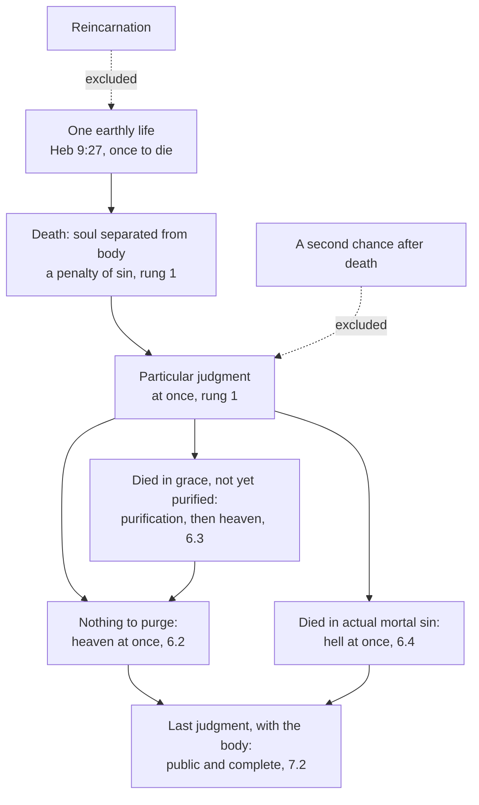

# Creation, Grace & the Last Things · Lesson 6.1: Death and the particular judgment

> ⏱ ~15 min · Module 6: The last things · Builds on: [2.3](02-03-the-soul-immediately-created-and-immortal.md), [3.3](03-03-trent-session-v-the-definition.md) · Unlocks: [6.2](06-02-heaven-and-the-beatific-vision.md), [6.3](06-03-purgatory.md), [6.4](06-04-hell.md), [7.2](07-02-the-parousia-the-last-judgment-and-the-new-creation.md)

## Why this matters

At a funeral everyone wants one sentence said aloud: *she is in heaven now.* The Church defines that each person's destiny takes effect the moment he dies, yet she will not say that sentence over almost anyone; she prays for the dead instead. This lesson states what happens at death, at what weight, and why she knows the rule for everyone and the verdict for almost no one.

## The idea

Think of an examination. When time is called, pens go down: the paper holds what you wrote, and there is no second paper. That is death, the end of the one life in which a person decides for or against God. Each script is then marked at once: the **[particular judgment](../reference.md#particular-judgment)**, particular because it concerns one person. There are three envelopes: *come in*; *come in, once you are made ready* (not a resit, since nothing more is written); *you refused*. Only at the end comes the public prize-giving, everyone present in the body: the **[last judgment](../reference.md#last-judgment)** ([7.2](07-02-the-parousia-the-last-judgment-and-the-new-creation.md)). And almost no results are published: the Church canonizes saints, names no one among the lost, and prays.

## Source

Gregory the Great, *Dialogues* IV.25 (c. 593–594; tr. "P.W.", Paris 1608, ed. Edmund G. Gardner, 1911). Peter has asked whether the souls of the just enter heaven before the general resurrection:

> GREGORY. This thing, speaking generally of all just men, can neither be affirmed nor denied: for the souls of some just men, remaining as yet in certain mansions, be deferred from heaven; by which stay of theirs, what else do we learn, but that they lacked somewhat of perfect justice? And yet is it more clear than day that the souls of them that be perfect, do, straight after death, possess the joys of heaven ...
>
> PETER. If just men's souls be already in heaven: what then shall they receive ... at the day of judgment?
>
> GREGORY. Whereas now their souls be only in heaven, at the day of judgment this further increase of joy shall they have, that their bodies also shall be partakers of eternal bliss ...

Three groups are sorted at death. The perfect are in heaven "straight after death"; some just men are "deferred" for lacking "somewhat of perfect justice" (his purifying fire is chapter 39, [6.3](06-03-purgatory.md)); the wicked, chapter 28 adds, are punished "from the day of their departure". Peter asks what any immediate judgment must answer, what the last day is *for*; Gregory answers, the body. And of just men *in general* he will not say they are in heaven. A Father's book, with no magisterial level; its authenticity is disputed, the majority holding it Gregory's ([`patristics` 5.3](../../patristics/lessons/05-03-gregory-the-great.md)).

## The doctrine

1. **Death is the separation of soul and body, and it came through sin.** In [death](../reference.md#death) the soul leaves the body, to be reunited with it at the resurrection (CCC 997, 1005). "God made not death" (Wisdom 1:13, DR); "by sin death" (Romans 5:12). Trent defines that Adam incurred death, "with which God had previously threatened him", and passed on to us not death alone but sin (Session V, 1546, cans. 1–2, Waterworth; [3.3](03-03-trent-session-v-the-definition.md)). The biology stands: human nature is mortal, and the first man was able not to die only by a gift ([preternatural gifts](../reference.md#preternatural-gifts); [3.1](03-01-original-justice-and-the-fall.md)). So bodily death is in a sense natural and, for faith, "the wages of sin" (CCC 1006, 1008). *In words:* natural to an animal body, a penalty for this person.

2. **Once, and then the judgment.** "It is appointed unto men once to die, and after this the judgment" (Hebrews 9:27, DR); its *hapax*, "once", also marks Christ's one offering (9:28; [`new-testament` 6.2](../../new-testament/lessons/06-02-hebrews.md)). This excludes [reincarnation](../reference.md#reincarnation), for *Lumen Gentium* 48 speaks of the *unico* course of our earthly life, citing this verse (the Vatican's English drops "single"; CCC 1013 keeps it); and a **second chance**, for death ends the time open to accepting or refusing grace (CCC 1021). For Aquinas, "after death man enters into an unchangeable state as to all that concerns the soul" (ST III q.59 a.5 ad 1). *In words:* one life, handed in once.

3. **The particular judgment.** The name is the schools'. The Roman Catechism (1566), Part I, Article VII, states it (tr. McHugh and Callan, 1923):

> The first takes place when each one of us departs this life; for then he is instantly placed before the judgment-seat of God ... This is called the particular judgment.

The Catechism puts each person's eternal retribution at the moment of death (CCC 1022). The texts: Lazarus "carried by the angels into Abraham's bosom" while the rich man's brothers still live (Luke 16:22, 28); "This day thou shalt be with me in paradise" (23:43); Paul's desire "to be dissolved and to be with Christ" (Philippians 1:23). What is judged is a surviving conscious self, the [separated soul](../reference.md#separated-soul) (the CDF's letter on eschatology, 1979, point 3; [2.3](02-03-the-soul-immediately-created-and-immortal.md)). The same letter holds Christ's glorious manifestation "distinct and deferred" with respect to the situation just after death (point 5): against the modern proposal of resurrection at the moment of death, there is an [intermediate state](../reference.md#intermediate-state). *In words:* each is judged alone, at once, and waits for the body.

4. **Three outcomes, at once.** Michael VIII's [profession at Lyons II](../reference.md#lyons-ii-profession) (6 July 1274) gave the shape, defining nothing of itself; [*Benedictus Deus*](../reference.md#benedictus-deus) (29 January 1336) repeated it under a *diffinimus* ([6.2](06-02-heaven-and-the-beatific-vision.md) reads it); Florence's [*Laetentur caeli*](../reference.md#laetentur-caeli) (6 July 1439) defined it (lesson's translation):

> the souls of those who after baptism incurred no stain of sin at all, and those which have been purified ..., are received at once (*mox*) into heaven; ... the souls of those who die in actual mortal sin, or in original sin only, go down at once (*mox*) to hell

With nothing to purge: heaven at once, the [beatific vision](../reference.md#beatific-vision). Dying in charity before making satisfaction: [purification](../reference.md#purgatory), then heaven ([6.3](06-03-purgatory.md)), presupposing that a debt of punishment can outlast forgiven guilt (**rung 1**, Trent VI can. 30; [guilt and punishment](../reference.md#guilt-and-punishment); [`theology-of-debt` 3.4](../../theology-of-debt/lessons/03-04-aquinas-satisfaction-and-the-debt-of-punishment.md)). Dying in actual mortal sin: [hell](../reference.md#hell) at once ([6.4](06-04-hell.md)). The "original sin only" clause is [7.4](07-04-limbo.md)'s. Lyons II and *Benedictus Deus* add *nihilominus*: all will still appear with their bodies before Christ's tribunal (2 Corinthians 5:10). *In words:* no one waits at death in neutral, and the last day still comes.

5. **Never taught: anyone's verdict.** The Church canonizes, judging solemnly that a named person is in glory ([`ecclesiology-and-mariology` 2.2](../../ecclesiology-and-mariology/lessons/02-02-holy.md)). She has never declared anyone damned, and she entrusts "judgment of persons to the justice and mercy of God" (CCC 1861). A Church funeral therefore seeks spiritual help for the dead, honours the body and gives the living the comfort of hope (can. 1176 §2); the Mass is offered for the dead (GIRM 379), its homily "to the exclusion of a funeral eulogy of any kind" (GIRM 382, US translation). *In words:* she prays for her dead because she does not presume to know.

**Said plainly.** The New Testament's judgment is chiefly the last one, as CCC 1021 itself says. The texts for an immediate one are a parable, a promise to one dying man and Paul's hope. Irenaeus kept the souls of the faithful in "the invisible place allotted to them by God" until the resurrection (*Against Heresies* V.31.2, tr. Rambaut), and Tertullian admitted only martyrs to Paradise before the end (P3).

| Defined or taught (with level) | A school's explanation or an opinion (no magisterial level) |
|---|---|
| Death came as the penalty of sin: **rung 1** (Trent V cans. 1–2; Carthage 418 can. 1) | How a mortal nature was kept from dying (ST I q.97 a.1; [3.1](03-01-original-justice-and-the-fall.md)) |
| Each destiny takes effect at death, in one of three outcomes: **rung 1** (Florence) | The judgment as a scene, judgment-seat and scrutiny (Roman Catechism): imagery |
| One earthly life; no conversion after death: **at least rung 3** (LG 48; CCC 1013, 1021) | Why the will is fixed: the separated soul's "unchangeable state" (III q.59 a.5) |
| A conscious self survives: **rung 3** (CDF 1979); a general judgment to come: **rung 1** (the creeds) | What the last day adds (III q.59 a.5; [7.2](07-02-the-parousia-the-last-judgment-and-the-new-creation.md)) |
| A canonized saint is in glory: **rung 2**; a named person damned: never taught | That a dead relative is surely in heaven, or lost: a hope or a fear, no level |

**Mark the levels** ([the ladder](../../fundamental-theology/lessons/04-04-the-ladder-of-doctrinal-authority.md); [levels of authority](../reference.md#levels-of-authority)). That each person is judged immediately after death is **rung 1**: Florence's *diffinimus* governs its clauses, and the CDF's 1998 *Doctrinal Commentary* on the Profession of Faith (§11) lists "the immediate recompense after death" among truths to be believed as revealed. The rung does not wait on *Benedictus Deus*'s *ex cathedra* standing ([`ecclesiology-and-mariology` 4.4](../../ecclesiology-and-mariology/lessons/04-04-infallibility-in-exercise-and-the-ordinary-universal-magisterium.md)). [Immortality](../reference.md#immortality-of-the-soul) is **rung 1** (Lateran V; [2.3](02-03-the-soul-immediately-created-and-immortal.md)). No reincarnation and no second chance are **at least rung 3**, never open questions: their contraries collide with rung-1 truths, rising "with their own bodies which they now bear" (Lateran IV, 1215, lesson's translation) and outcomes without end. The canons and the GIRM are **law, no rung**; the Fathers and Aquinas as authors carry **no magisterial level**.

## The map

One judgment, three outcomes; all three meet again, embodied, at the last.

## Worked examples

**Ex 1 (clean): "Is she being judged now?"** Invented: after the funeral Mass for Hedda Ravenscroft, ninety-one, at St Joseph's, Glenarden, her daughter Ondine asks Fr Evaristo Haugland four things. *Does Mum wait for the end of the world?* No: her destiny took effect at death (**rung 1**). *Could she come back, or still change?* No: one life, and death closes the time of decision (**at least rung 3**). *Then what is the last judgment for?* Her life goes on in children, memory, consequences and a body in the grave; the last day judges all of it publicly and raises the body (III q.59 a.5). *Is she in heaven?* The doctrine gives the outcomes, not her result; he offers grounded hope, and the Mass just offered for her.

**Ex 2 (strain): "We know where Ambrus is."** Invented: at the reception a cousin says it of Hedda's brother Ambrus, who left the Church at twenty, mocked it for fifty years and died suddenly without the sacraments. The rule is defined: those who die in actual mortal sin go down at once to hell (**rung 1**). Applying it needs facts no one has: that his acts were mortal sins, with grave matter, full knowledge and deliberate consent ([`moral-theology` 3.4](../../moral-theology/lessons/03-04-sin-mortal-and-venial.md)), and what passed between him and God at the last. Nor would a refused funeral decide it: can. 1184 withholds one from notorious apostates "unless they gave some signs of repentance", a judgment about public scandal (**law, no rung**), not about a soul. Here the doctrine stops. It fixes the outcomes and lets no one, the Church included, place Ambrus in one.

## Watch out

- **You might think the immediacy is a medieval opinion, since Hebrews 9:27 says only "after this".** The verse fixes "once"; Florence fixes "at once": **rung 1**, whatever is said of *Benedictus Deus*.
- **You might think "particular judgment" names a defined courtroom.** The outcome is defined; the judgment-seat is the Roman Catechism's picture, and the CDF's 1979 letter warns against "arbitrary imaginative representations".
- **You might think the particular judgment makes the last judgment redundant.** *Nihilominus*: all will still appear, in the body.
- **You might think "we know she is in heaven" is only kindness.** As hope, yes. As knowledge it claims what only canonization claims (**rung 2**), at a funeral offered for her.

## One-liner

> At death each person's one life closes and its outcome begins at once, which is defined; which outcome, the Church says only of her saints, so she prays for everyone else.

## Problems

**P1 (🟢)** *(Exegetical)* **Diagnose.** Words of remembrance at a funeral Mass at St Joseph's, Glenarden, **invented** for this problem: Caius Quist on his grandmother Leonora.

> "Gran was a theatre nurse for forty years, and she'd want me to be straight with you. We aren't here to pray for her, because we know she's in heaven, so let's make this a celebration. She always said death is just biology, and the Church has finally admitted that the old idea of death coming from Adam's sin was a myth. And she promised to come back as one of the blackbirds in this churchyard, so when you hear one singing, that's Gran, having another go."

Find **three** errors. Correct each, and give the level or the law involved, naming the act that fixes it. **150 words or fewer.**

**P2 (🟡)** *(Exegetical)* **Close reading.** Luke 16:22–23, 25–26 (Douay–Rheims, Challoner):

> And it came to pass that the beggar died and was carried by the angels into Abraham’s bosom. And the rich man also died: and he was buried in hell. And lifting up his eyes when he was in torments, he saw Abraham afar off and Lazarus in his bosom: ... And Abraham said to him: Son, remember that thou didst receive good things in thy lifetime, and likewise Lazarus evil things: but now he is comforted and thou art tormented. And besides all this, between us and you, there is fixed a great chaos: so that they who would pass from hence to you cannot, nor from thence come hither.

In the verses that follow (27–31), the rich man begs that Lazarus be sent to warn his five brothers.

(a) Name **two** things the passage says about the dead before the end of the world, with the words that say them, and the detail in vv. 27–31 that places the scene before the general judgment.

(b) Name **two** features of the story the Church does not read as doctrine, and say why. Then say what "Abraham's bosom" names in Catholic teaching, and why Lazarus is "comforted" rather than said to see God.

**Three sentences per part.**

**P3 (🔴)** *(Exegetical)* **Find the crux.** Tertullian, *A Treatise on the Soul* (*De anima*), written in his New Prophecy years (after about 207), chapters 55 and 58, tr. Peter Holmes (*Ante-Nicene Fathers* vol. 3). The "He" is Christ, and Tertullian exempts the martyrs, who go at once to Paradise:

> With the same law of His being He fully complied, by remaining in Hades in the form and condition of a dead man; nor did He ascend into the heights of heaven before descending into the lower parts of the earth ... How, indeed, shall the soul mount up to heaven, where Christ is already sitting at the Father's right hand, when as yet the archangel's trumpet has not been heard by the command of God ... ? To no one is heaven opened ... When the world, indeed, shall pass away, then the kingdom of heaven shall be opened. (ch. 55)
>
> All souls, therefore, are shut up within Hades ... there are already experienced there punishments and consolations; and there you have a poor man and a rich. (ch. 58)

Compare Gregory, *Dialogues* IV.25, in this lesson's Source.

(a) Name one thing Tertullian and Gregory agree on about the dead before the resurrection, and the point on which they disagree, with the words that show each. **Two sentences.**

(b) Name the premise on which the disagreement turns, which each must deny to hold his own view, and say what each appeals to in its support. **Three sentences.**

Solutions

**P1** *(Exegetical)*

**Must hit, strict:**

- **"We know she's in heaven; we aren't here to pray for her."** No act teaches that a named person is in glory except a canonization (**rung 2**, a dogmatic fact), and none has been made: hope is right, knowledge is not (CCC 1861; Gregory would not say it of just men in general). The funeral itself is for her: it seeks spiritual help for the dead (can. 1176 §2), and the Mass is offered for the dead (GIRM 379), which is **law, no rung**.
- **"Death from Adam's sin was a myth."** An understatement: that death came as the penalty of sin is **rung 1** (Trent V cans. 1–2; Carthage 418 can. 1) and still taught (CCC 1008). What is true is that bodily death is in a sense natural (CCC 1006), since human nature is mortal and immortality was a gift ([3.1](03-01-original-justice-and-the-fall.md)); Genesis 3's figurative language (CCC 390) does not turn the doctrine into a myth.
- **"Back as a blackbird, having another go."** Reincarnation is excluded: "once to die" (Hebrews 9:27), the "single" course of earthly life (LG 48; CCC 1013), **at least rung 3**. Its contrary collides with a **rung-1** truth, that all will rise "with their own bodies which they now bear" (Lateran IV, 1215).

**Wrong turns:** correcting (1) the other way, "she is in purgatory", which is equally unknown; treating the funeral canons or the GIRM as doctrine; calling reincarnation "freely disputed", or "defined" by name, since no act names it; demoting death-as-penalty to rung 5 because Genesis 3 is figurative, or inflating it into a denial that the body is mortal by nature.

**Model answer:** (1) No act teaches that any named person is in heaven except a canonization (rung 2), and none has been made: Leonora's family may hope, not know. The funeral is for her, since it seeks spiritual help for the dead (can. 1176 §2) and the Mass is offered for the dead (GIRM 379), which is law, not doctrine. (2) That death came as the penalty of sin is rung 1 (Trent V cans. 1–2; Carthage 418 can. 1) and still taught (CCC 1008). Bodily death is in a sense natural (CCC 1006), because immortality was a gift, and figurative language in Genesis does not make the doctrine a myth. (3) Reincarnation is excluded: we die once (Hebrews 9:27) after a single earthly life (LG 48; CCC 1013), at least rung 3, and all will rise with the bodies they now bear (Lateran IV, rung 1).

---

**P2** *(Exegetical)*

**Accept:** in (a), any two of the first four bullets; in (b), any two features of the story.

**Must hit, strict (a):**

- **Destinies part at death, with no interval:** the beggar "died and was carried by the angels"; the rich man "also died: and he was buried in hell".
- **The state is fixed:** "there is fixed a great chaos", so that those who would pass "cannot". No crossing, no change of lot.
- **The dead are conscious and remember:** "Son, remember that thou didst receive good things in thy lifetime". A self survives with its past (the CDF's 1979 letter, point 3).
- **The lot answers to the life lived:** "in thy lifetime ... but now he is comforted and thou art tormented".
- **Before the end:** the five brothers are still alive and could still be warned (vv. 27–28), so history goes on and the scene comes before the general resurrection and judgment. That is why CCC 1021 cites Luke 16:22 for repayment immediately after death.

**Must hit, strict (b):**

- **Not doctrine:** the furniture of the story, such as eyes lifted, distance, a conversation between the lost and the blessed, a finger, water and a tongue in men who have no bodies yet. A parable carries its point (the reversal, and that "Moses and the prophets" suffice, vv. 29–31), and the CDF's 1979 letter warns against "arbitrary imaginative representations" while respecting scripture's images. The weight of the "flame" is [6.4](06-04-hell.md)'s question, not this text's.
- **Abraham's bosom** is the rest of the just who died before Christ, "while they await the Redeemer" (CCC 633): the limbo of the fathers, which Aquinas calls the "hell of the Fathers" (ST III q.52 a.2; [`christology` 6.1](../../christology/lessons/06-01-he-descended-into-hell.md)). Lazarus dies before the Passion, and Christ descended to free these just, so he is "comforted", not yet in the vision ([6.2](06-02-heaven-and-the-beatific-vision.md)).

**Wrong turns:** reading the chasm's geography or the flame as defined (an overstatement); reading the parable as only about wealth, with nothing to say of the dead (an understatement: CCC 1021 cites it); calling Abraham's bosom heaven, or purgatory.

**Model answer:** (a) Destinies part at once: the beggar "died and was carried by the angels", while the rich man "also died: and he was buried in hell". The "great chaos" is "fixed", so no one crosses, and the rich man still remembers his "lifetime". His five brothers are alive and could be warned (vv. 27–28), so the scene comes before the end, which is why CCC 1021 cites it for repayment immediately after death. (b) The geography, the talk across the chasm, and a finger and tongue in men not yet risen are a parable's furniture, not a map of the next world, and the CDF's 1979 letter warns against arbitrary imaginative pictures of it. Abraham's bosom is the rest of the just who awaited the Redeemer, the limbo of the fathers (CCC 633). Lazarus died before Christ came to free them, so he is "comforted" but does not yet see God.

---

**P3** *(Exegetical)*

**Accept:** for Gregory's support in (b), any one of his three texts.

**Must hit, strict (a):**

- **Agreement:** the dead are already sorted, and already receive their lot, before the resurrection: Tertullian's "already experienced there punishments and consolations ... a poor man and a rich"; Gregory's perfect, who "possess the joys of heaven" (and his wicked, punished "from the day of their departure").
- **Disagreement:** whether the faithful are in heaven with Christ before the end. Tertullian: "To no one is heaven opened" until "the world ... shall pass away" (martyrs excepted, in Paradise). Gregory: the perfect, "straight after death, possess the joys of heaven".

**Must hit, strict (b):**

- **The crux:** whether heaven is already open to souls before the Lord's coming, so that to be "with Christ" is to be where his risen body now is. Tertullian must deny that, and Gregory must deny that entry waits for the end of the world.
- **Tertullian's support:** the order of the coming, the trumpet and the catching-up (1 Thessalonians 4:16–17), and Christ's own pattern: he went down to Hades before he went up.
- **Gregory's support:** "Wheresoever the body shall be, thither will the eagles be gathered together" (Matthew 24:28), Paul's "I desire to be dissolved and to be with Christ" (Philippians 1:23), and the house "everlasting in heaven" (2 Corinthians 5:1).
- **Weight:** two Fathers as authors, neither magisterial. The later definitions side with Gregory ([6.2](06-02-heaven-and-the-beatific-vision.md)), which settles the question without making his chapter a definition.

**Wrong turns:** saying Tertullian denies all reward and punishment before the resurrection, when he affirms both; saying Gregory sends every just soul straight to heaven, when he refuses to say so of just men in general; making the crux the survival of the soul, which both affirm; reading Tertullian's martyrs' Paradise as his kingdom of heaven, which he says opens only at the end.

**Model answer:** (a) Both hold that the dead are already sorted before the resurrection, Tertullian with "punishments and consolations ... a poor man and a rich", Gregory with the perfect who "possess the joys of heaven". They part over the faithful, since for Tertullian "to no one is heaven opened" until "the world ... shall pass away", while for Gregory the perfect enter heaven "straight after death". (b) The crux is whether heaven is open to souls before the Lord's coming, so that to be with Christ is to be where his risen body is: Tertullian must deny it and Gregory must deny that entry waits for the world's end. Tertullian appeals to the trumpet and the catching-up of 1 Thessalonians 4:16–17, and to Christ, who descended to Hades before he ascended. Gregory appeals to the eagles gathered where the body is (Matthew 24:28) and to Paul's desire "to be dissolved and to be with Christ" (Philippians 1:23).

## Flashback

**From Lesson [5.5](05-05-the-de-auxiliis-controversy.md) (The *de auxiliis* controversy):** *(Exegetical.)* Assign the level. Four sentences from revision notes for the Varne grace seminar, **invented** for this problem. For each, give its rung, or say it is excluded, false, or of no magisterial level, and name the act or source that decides it; the list holds traps both ways. **One sentence per item.**

(a) "Where God wills a grace to bring consent, it brings it infallibly; but since *de auxiliis* was never decided, even that is freely disputed."

(b) "[Physical premotion](../reference.md#physical-premotion) is Catholic doctrine, since the popes have made Aquinas the Church's own doctor."

(c) "On Molina's account God foresees our consent to grace but has no causal part in the act itself."

(d) "Whoever holds [middle knowledge](../reference.md#middle-knowledge) is thereby committed to predestination after foreseen merits."

Solution

**Must hit, strict:**

- **(a) Rung 4, not rung 5.** Both schools hold it as following from [predestination](../reference.md#predestination) (itself rung 1, [5.4](05-04-predestination.md)); *de auxiliis* left open how grace is efficacious, not that it is. Not rung 1 either: no act defines the consequence.
- **(b) Overstated: premotion is rung 5.** The strongest papal praise of Aquinas reserves disputed questions to freedom in the same paragraph (*Studiorum Ducem* §30, 1923; [`thomistic-synthesis` 6.5](../../thomistic-synthesis/lessons/06-05-what-the-church-has-said-about-thomism.md)); no act has adopted or condemned either school; Aquinas as author carries **no magisterial level**.
- **(c) A misdescription of Molina.** His God gives the prevenient grace first and concurs in the act itself by [simultaneous concurrence](../reference.md#simultaneous-concurrence): middle knowledge is how God knows, not a withdrawal of his causality. A salutary act begun without grace is excluded at **rung 1** (Orange II can. 5; Trent VI can. 3); premotion versus concurrence is **rung 5**.
- **(d) False: the two questions cross.** Bellarmine and Suárez held middle knowledge *and* predestination to glory [before foreseen merits](../reference.md#before-or-after-foreseen-merits); each question is **rung 5** on its own, and an answer to one fixes nothing in the other.

**Wrong turns:** (a) at rung 1 because predestination is defined, or rung 5 because the controversy is open; (b) at rung 4 because Thomists are many, or "excluded", as if a school Rome declined to adopt were thereby rejected; (c) accepting the description and then grading Molinism excluded; (d) treating middle knowledge as the Molinist side of the predestination dispute.

**Model answer:** (a) Rung 4: both schools hold it as following from predestination, and *de auxiliis* left open only how grace is efficacious, not that it is. (b) Overstated: premotion is rung 5, since *Studiorum Ducem* §30 reserves disputed questions to freedom and Aquinas as author has no magisterial level. (c) It misdescribes Molina, whose God gives prevenient grace and concurs in the act itself; a salutary act begun without grace is excluded at rung 1 (Orange II can. 5; Trent VI can. 3), and premotion versus concurrence is rung 5. (d) False: Bellarmine and Suárez held both middle knowledge and predestination before foreseen merits, and each question is rung 5 on its own.

## Connections

- **Backward:** [2.3](02-03-the-soul-immediately-created-and-immortal.md) supplied the immortal soul and the CDF's 1979 letter; [3.1](03-01-original-justice-and-the-fall.md) and [3.3](03-03-trent-session-v-the-definition.md) made death the penalty of sin, defined at Trent V. [`christology` 6.1](../../christology/lessons/06-01-he-descended-into-hell.md) handed over the intermediate state and taught Abraham's bosom as the limbo of the fathers; [`theology-of-debt` 3.4](../../theology-of-debt/lessons/03-04-aquinas-satisfaction-and-the-debt-of-punishment.md) owns the debt of punishment that the middle outcome presupposes.
- **Forward:** [6.2](06-02-heaven-and-the-beatific-vision.md) reads *Benedictus Deus* closely, with the John XXII affair; [6.3](06-03-purgatory.md) takes the purification, with Gregory's chapter 39; [6.4](06-04-hell.md) takes hell, and why the Church names no one there; [7.2](07-02-the-parousia-the-last-judgment-and-the-new-creation.md) says what the last judgment adds; [7.4](07-04-limbo.md) reads the "original sin only" clause.
- **Sideways:** canonization's rung is [`ecclesiology-and-mariology` 2.2](../../ecclesiology-and-mariology/lessons/02-02-holy.md)'s, and *Benedictus Deus*'s *ex cathedra* question its [4.4](../../ecclesiology-and-mariology/lessons/04-04-infallibility-in-exercise-and-the-ordinary-universal-magisterium.md)'s. The suffrages a funeral offers meet [`sacraments-and-liturgy` 4.2](../../sacraments-and-liturgy/lessons/04-02-indulgences-as-a-practice.md). Hebrews's "once" is [`new-testament` 6.2](../../new-testament/lessons/06-02-hebrews.md), and Luke's reversal of rich and poor its [2.3](../../new-testament/lessons/02-03-luke.md). Whether the one judged is the one who lived, Locke's question, is [`metaphysics` 6.6](../../metaphysics/lessons/06-06-personal-identity-over-time.md); Irenaeus and Tertullian as writers are [`patristics` 2.2](../../patristics/lessons/02-02-irenaeus-recapitulation.md) and [2.3](../../patristics/lessons/02-03-tertullian.md).
