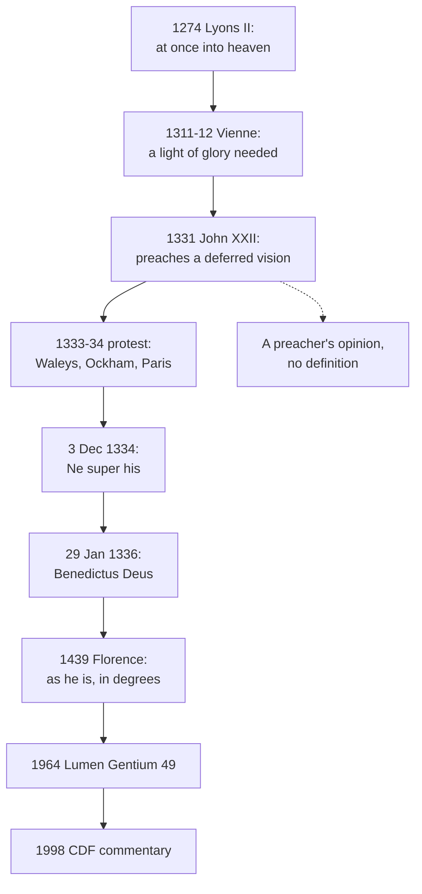

# Creation, Grace & the Last Things · Lesson 6.2: Heaven and the beatific vision

> ⏱ ~15 min · Module 6: The last things · Builds on: [6.1](06-01-death-and-the-particular-judgment.md), [4.4](04-04-nature-and-grace-the-gratuity-of-the-supernatural.md), [`christology` 4.3](../../christology/lessons/04-03-the-beatific-vision-in-christ.md) · Unlocks: [6.3](06-03-purgatory.md), [6.4](06-04-hell.md), [`ecclesiology-and-mariology` 6.5](../../ecclesiology-and-mariology/lessons/06-05-mary-in-the-economy-in-the-church-and-in-devotion.md)

## Why this matters

On All Saints' Day 1331 a pope began preaching that the saints do not yet see God. Five years later his successor defined that they do. The quarrel fixed what heaven *is*, God himself seen, and it is the cleanest case of a pope preaching what the Church would not keep, with no harm to infallibility.

## The idea

Benedict XVI asked whether anyone wants eternal life, if it means endless days; eternity, he answered, is not "an unending succession of days in the calendar" but something like a supreme moment of fulfilment ([*Spe Salvi*](../reference.md#spe-salvi) §§10–12, 2007). The doctrine names heaven by its object: not first a place or a prize, but God. "He has promised Himself," says Augustine (*City of God* XXII.30, tr. Dods).

Think of knowing someone by letters, then meeting them. All we know of God now comes by letters: creatures, through which reason reaches their cause, and revelation, held by faith. "We see now through a glass in a dark manner: but then face to face" (1 Corinthians 13:12, Douay–Rheims); "we shall see him as he is" (1 John 3:2); the clean of heart "shall see God" (Matthew 5:8). That meeting is the [beatific vision](../reference.md#beatific-vision): the mind's direct sight of God's own essence, which makes it blessed. Four questions follow: *when*, *how*, *how much*, *equally*? A pope fought over the first.

## Source

[*Benedictus Deus*](../reference.md#benedictus-deus) (Benedict XII, 29 January 1336), its central sentence, abridged (lesson's translation of the Latin):

> By this constitution, valid for ever, we define by apostolic authority (*diffinimus*) that by God's common ordinance the souls of all the saints … in whom there was nothing to purge when they died, or, if there was, once they have been purged, … at once (*mox*) after their death and that purging, even before the resumption of their bodies and the general judgment (*etiam ante resumptionem suorum corporum et iudicium generale*), … have been, are and will be in heaven … and have seen and do see the divine essence with an intuitive and even face-to-face vision (*visione intuitiva et etiam faciali*), no creature mediating as the object seen (*nulla mediante creatura in ratione obiecti visi se habente*), the divine essence showing itself to them immediately, plainly, clearly and openly.

Its subject is souls, sorted only by whether purging was needed; its time is fixed twice; its object is the essence, with no creature standing in for it. The sentence goes on: the vision ends their acts of faith and hope, and "has continued and will continue" (*continuata exstitit et continuabitur*) for ever.

## In their own words

John XXII's [deferred vision](../reference.md#deferred-vision), at its strongest. Its texts tie the reward to the judgment: "Come, ye blessed … possess you the kingdom" is said when the king judges (Matthew 25:34); we shall see him "when he shall appear" (1 John 3:2). The martyrs' souls wait "under the altar" (Apocalypse 6:9–11), which John read as Christ's humanity: sheltered by it now, they see his divinity after the judgment. Its anthropology: beatitude perfects a human being, and "the soul, without the body, is not man" (the objection in ST I-II q.4 a.5 obj. 3). Its Father: Augustine, for whom the separated soul's desire to rule its body holds it back from the vision (*Literal Meaning of Genesis* XII.35, quoted in obj. 4). The souls are in heaven; the whole reward waits for the whole person.

## The doctrine

1. **Heaven is God, seen and possessed.** CCC 1023–1029: the purified see God face to face (1023); heaven is communion of life and love with the Trinity and all the blessed, a *state* of definitive happiness (1024); God is seen only if he gives the capacity (1028). Not a place in our space, though not nowhere: the risen Christ is there bodily, at no location the cosmos measures ([`christology` 6.2](../../christology/lessons/06-02-resurrection-and-ascension-as-doctrine.md), Ex 2). *In words:* the reward is the Giver.

2. **When: at once.** Michael VIII's profession at [Lyons II](../reference.md#lyons-ii-profession) (1274) said the purified are "received at once into heaven" (*mox in caelum recipi*), naming no vision; *Benedictus Deus* went further. Florence's [*Laetentur caeli*](../reference.md#laetentur-caeli) (6 July 1439) restated the core: received at once, they "clearly behold God himself, three and one, as he is" (lesson's translation), words *Lumen Gentium* 49 quotes. The CDF's 1998 *Doctrinal Commentary* on the *Professio fidei* (§11) lists "the immediate recompense after death" among truths proposed as revealed. *In words:* the purified do not wait for the body.

3. **How: a light of glory.** The Council of Vienne (1311–12), in [*Ad nostrum*](../reference.md#ad-nostrum), condemned among the Beghards' errors (proposition 5) that the soul needs no light of glory raising it (*lumine gloriae, ipsam elevante*) to see God (lesson's translation). Aquinas: the [light of glory](../reference.md#light-of-glory) strengthens the intellect "not as a medium in which God is seen, but as one by which He is seen" (ST I q.12 a.5 ad 2; [`thomistic-synthesis` 4.2](../../thomistic-synthesis/lessons/04-02-knowing-god-from-creatures-the-three-ways.md) reads aa.4–5). So *Benedictus Deus* excludes a creature only *in ratione obiecti visi*, as the thing seen. *In words:* God is seen directly, by a mind he has raised.

4. **How much: all of him, never all the way.** [*Firmiter*](../reference.md#firmiter) (Lateran IV, 1215) and [*Dei Filius*](../reference.md#dei-filius) ch. 1 (1870) confess God *incomprehensibilis* ([`trinity-and-god` 1.2](../../trinity-and-god/lessons/01-02-the-one-true-god-and-what-reason-can-reach.md)). So the blessed see his whole, simple essence, but not as perfectly as he is knowable ([incomprehensibility](../reference.md#incomprehensibility)): a finite light cannot know the infinite infinitely (ST I q.12 a.7). *In words:* seeing God is not exhausting him.

5. **Equally? Degrees of glory.** Florence adds: "yet, according to the diversity of merits, one more perfectly than another" (*pro meritorum tamen diversitate alium alio perfectius*; lesson's translation). Trent VI can. 32 (1547) counts "an increase of glory" among what the justified truly merit ([5.3](05-03-merit.md)), and Aquinas measures the light by charity (ST I q.12 a.6). Why [degrees of glory](../reference.md#degrees-of-glory) are no league table, Augustine (*Tractates on John* 67.2, NPNF1 vol. 7, tr. Innes):

   > For in this way every one really possesses it, when he loves to see in another what he has not himself. There will not, therefore, be any envying amid this diversity of brightness, since in all of them will be reigning the unity of love.

   *In words:* unequal glory, no rivalry.

6. **With whom: the communion of saints.** The Creed confesses the [communion of saints](../reference.md#communion-of-saints). *Lumen Gentium* ch. VII: one Church of pilgrims, the dead being purified, and the blessed, who intercede for us through the one Mediator (§49), and whose help the Church has long implored (§50). Trent's Session XXV decree (December 1563) teaches that the saints pray for men and that invoking them is "good and useful"; Session XXII can. 5 (17 September 1562) condemns calling Masses for obtaining their intercession an imposture. *In words:* heaven still prays for us.

**Said plainly.** John XXII (pope 1316–34), in sermons from All Saints' Day 1331, taught that the just see Christ's humanity, not the divine essence, until the judgment. The Dominican Thomas Waleys preached against him at Avignon in 1333 and was imprisoned; Ockham attacked him; at the turn of 1334 the Paris theologians affirmed the immediate vision and called the pope's view a personal opinion. In consistory he said he had not meant to decide. On 3 December 1334, the day before he died, he declared ([*Ne super his*](../reference.md#ne-super-his)) that purified souls see the essence face to face "as far as the state and condition of the separated soul allows" (lesson's translation), submitting all he had said to the Church. His successor decided against him. (Pius IV's 1564 bull confirming Trent shares the incipit: [`church-history` 6.4](../../church-history/lessons/06-04-trent-and-catholic-reform.md).)

| Defined or taught (with level) | A school's explanation or an opinion (no magisterial level) |
|---|---|
| The essence seen at once, before the body: **rung 1** | The body adds "not in intensity, but in extent" (I-II q.4 a.5 ad 5): **rung 4** |
| A light of glory is needed: **at least rung 3** | The light a created habit (I q.12 a.5): **rung 4** |
| God is incomprehensible: **rung 1** | The blessed see him whole, not wholly (I q.12 a.7): **rung 4** |
| Degrees of glory by merit: **rung 1** | Charity their measure (I q.12 a.6): **rung 4** |
| The saints pray for us; invoking them is good: **at least rung 3** | How they know our prayers (Suppl. q.72 a.1, a posthumous compilation): **rung 5** |

**Mark the levels** ([the ladder](../../fundamental-theology/lessons/04-04-the-ladder-of-doctrinal-authority.md); [levels of authority](../reference.md#levels-of-authority)). The vision at once, before the resurrection: **rung 1**, by Florence under its *diffinimus*, with the 1998 commentary. *Benedictus Deus*'s *ex cathedra* status is open, and the content's rung does not wait on it ([`ecclesiology-and-mariology` 4.4](../../ecclesiology-and-mariology/lessons/04-04-infallibility-in-exercise-and-the-ordinary-universal-magisterium.md) Ex 1). Its own precisions (intuitive; no creature as the object seen; faith and hope ended) rest on its act: **rung 1** if *ex cathedra*, **at least rung 3** regardless, with Florence's "clearly … as he is" carrying their substance at rung 1. *Ad nostrum* condemns proposition 5 among "errors" under one censure, no note on it: its contradictory is **at least rung 3** (default down, can. 749 §3); that no creature reaches the vision of itself is **rung 1** (*Dei Filius* can. II.3; [4.4](04-04-nature-and-grace-the-gratuity-of-the-supernatural.md)). Incomprehensibility: **rung 1** (*Firmiter*; *Dei Filius*); its application to the blessed, stated by no act, **rung 4**. Degrees of glory: **rung 1** (Florence; Trent VI can. 32). The communion of saints: **rung 1** (the Creed); intercession and invocation **at least rung 3** (Trent XXV has no canons; LG 49–50), presupposed by XXII can. 5 (**rung 1**). John XXII's sermons were no act; Fathers, Aquinas and the Supplement carry **no magisterial level**.

## The timeline

Dashed: why a pope's opinion touched no definition.

## Worked examples

**Ex 1 (clean): the sister in the cloister.** Invented: at St Gregory's, Ambermoor, Bronwen Achterberg's sister has been a Poor Clare for thirty years. "If she's higher in heaven than me, won't I mind?" *Is there a higher?* Yes: one sees "more perfectly than another" by merit (Florence; Trent VI can. 32), **rung 1**. *Higher in what?* The same God seen, the difference lying in the glorified power of seeing (ST I q.12 a.6 ad 3), measured by charity: **rung 4**. *Will she mind?* No: each has the other's share by loving to see it there (Augustine).

**Ex 2 (strain): the spare part.** Leocadia Prendergast, an inquirer there: "If my grandfather sees God completely now, why does he need his body back?" Fixed: the purified are truly blessed before the body (**rung 1**), and the body will rise ([7.1](07-01-the-resurrection-of-the-body.md), **rung 1**). What the body adds, no act says; *Benedictus Deus* dropped *Ne super his*'s hedge without denying an increase. Aquinas answers John's worry: the soul has what suffices, yet wishes its body to share, so after the resurrection happiness "increases not in intensity, but in extent" (I-II q.4 a.5 ad 4–5), **rung 4**. The doctrine fixes *that* the body adds; *what* it adds is the schools' question.

## Watch out

- **You might think John XXII refutes infallibility.** His sermons fail [`fundamental-theology` 4.2](../../fundamental-theology/lessons/04-02-infallibility-and-its-conditions.md)'s conditions: a preacher's opinion on an undecided question, never defined, submitted to the Church. Honorius is the first such case ([`ecclesiology-and-mariology` 4.4](../../ecclesiology-and-mariology/lessons/04-04-infallibility-in-exercise-and-the-ordinary-universal-magisterium.md)); this is the second. Calling it heresy in 1331 overstates: no act yet excluded it.
- **You might think "no creature mediating" rules out a created light.** It excludes a creature *as the object seen*, not the light by which one sees.
- **You might think Vienne defined the light of glory**, as the 1913 *Catholic Encyclopedia* ("Heaven") says. One global censure gives **at least rung 3**; what the light *is* stays **rung 4**. "Thomist jargon" understates: the term is the council's.

## One-liner

> Heaven is God himself, seen at once by the purified through a light he gives, never comprehended, in degrees without rivalry; a pope doubted "at once", and his successor defined it.

## Problems

**P1 (🟢)** *(Exegetical)* **Diagnose.** Slides for an inquirers' evening at St Gregory's, Ambermoor, **invented** for this problem:

> **Slide 1.** "Heaven is God's prize for a good life: a beautiful place where we finally get everything we missed out on here."
>
> **Slide 2.** "In heaven we will know everything: every secret, every future event, all of God's plans, because we will see God."
>
> **Slide 3.** "Eternal life means this life going on for ever. Even Pope Benedict admitted that sounds boring."
>
> **Slide 4.** "In heaven it's just you and God. The saints are too absorbed in him to bother with us."

For each slide, name what is wrong and give the correction, with the text that supplies it. **Two sentences per slide.**

**P2 (🟡)** *(Exegetical)* **Assign the level.** For each claim, give its rung and name the act or source that fixes it.

(a) The soul needs a light of glory, raising it, in order to see God.

(b) The light of glory is a created habit perfecting the intellect.

(c) The blessed see God one more perfectly than another, and the measure is charity.

(d) In the blessed, the acts of faith and hope cease.

(e) The saints in heaven pray for us, and it is good to ask them to.

**One sentence per item.**

**P3 (🔴)** *(Exegetical)* **Find the crux.** John XXII and his opponents agreed that the purified are in heaven with Christ.

(a) Name the single premise about the separated soul that John's deferred vision needs and that Aquinas denies in ST I-II q.4 a.5, written decades before *Benedictus Deus*. What evidence does Aquinas offer that would move it?

(b) Michael VIII's profession at Lyons II (1274) said the purified are "received at once into heaven" (*mox in caelum recipi*). Florence (1439) said they are received at once and "clearly behold God himself, three and one, as he is". Why could John's view claim the first sentence, and why could no one claim the second for it?

**Two sentences per part.**

Solutions

**P1** *(Exegetical)*

**Must hit, strict:**

- **Slide 1: an external reward in a place.** The reward is God himself, possessed by seeing him: "we shall see him as he is" (1 John 3:2), and Augustine's "He has promised Himself" (*City of God* XXII.30). Heaven is the communion of life and love with the Trinity, a state before it is a place (CCC 1024). The word "reward" is not the error: that the justified truly merit eternal life is defined (Trent VI can. 32, rung 1). The error is a reward other than God.
- **Slide 2: seeing God taken for comprehending him.** Seeing the essence is not seeing in it all that God does or can do, which would be to comprehend his power (ST I q.12 a.8, resting on a.7). Each knows more the more perfectly he sees, and the blessed see in God what belongs to them (Suppl. q.72 a.1). The ground, God's incomprehensibility, is rung 1 (*Firmiter*; *Dei Filius* ch. 1); the inference about what the blessed know is the schools' (rung 4), fixed by no act.
- **Slide 3: *Spe Salvi* misread.** Benedict XVI raised the worry in order to reject its picture. Eternity is not an unending succession of calendar days but something like a supreme moment of fulfilment (§§10–12). Eternal life is knowing God (John 17:3), not more time.
- **Slide 4: the communion of saints left out.** Heaven is communion with the Trinity, Mary, the angels and all the blessed (CCC 1024). The blessed intercede for us through Christ (LG 49; Trent XXV), and they continue to fulfil God's will toward others (CCC 1029). Augustine's "unity of love" makes the others' share part of each one's joy.

**Wrong turns:** "correcting" slide 1 by denying that heaven is a reward, which collides with can. 32. "Correcting" slide 2 by denying that the blessed see God's essence (an understatement of a rung-1 truth), or by presenting the limits of their knowledge as defined. Treating slide 4 as a matter of taste.

**Model answer:** (1) Heaven's reward is God himself, seen as he is (1 John 3:2; Augustine, "He has promised Himself"), a communion with the Trinity before it is any place (CCC 1024). Heaven is truly merited (Trent VI can. 32), but what is merited is God, not something else. (2) To see God is not to comprehend him, so the blessed do not see in him all that he does or can do; each sees more the more perfectly he sees God (ST I q.12 aa.7–8). God's incomprehensibility is defined (*Firmiter*; *Dei Filius*), but this account of what the blessed know is the schools', fixed by no act. (3) *Spe Salvi* §§10–12 raises the boredom worry only to reject it: eternity is not endless calendar days but something like a supreme moment of fulfilment. Eternal life is knowing God (John 17:3). (4) Heaven is communion with Mary, the angels and all the blessed (CCC 1024), and the saints intercede for us through Christ (LG 49; Trent XXV). Their joy in God includes us.

---

**P2** *(Exegetical)*

**Must hit, strict:**

- (a) **At least rung 3**: Vienne's *Ad nostrum* (1311–12) condemns, as proposition 5 among the Beghards' errors, the claim that the soul needs no light of glory. The censure falls on the sect and its errors together, with no note on this proposition, so default down. Its core, that no creature reaches the vision by its own power, is **rung 1** (*Dei Filius* can. II.3, as 4.4 fixed it).
- (b) **Rung 4**: no act decides what the light is. That it perfects the intellect "as a habit makes a power abler to act" is Aquinas's account (ST I q.12 a.5 ad 1), common teaching.
- (c) **Two levels.** That one sees more perfectly than another, according to merits, is **rung 1** (Florence, *Laetentur caeli*, 1439; increase of glory, Trent VI can. 32). That charity is the measure is **rung 4** (ST I q.12 a.6).
- (d) It rests on *Benedictus Deus*'s own clause (*actus fidei et spei in eis evacuant*), which Florence and LG do not repeat. So it is **at least rung 3**, and **rung 1** if *Benedictus Deus* is *ex cathedra*, which is open (`ecclesiology-and-mariology` 4.4; do not re-argue it). It is also the schools' common teaching (ST I-II q.67 aa.3–4), with charity remaining (1 Corinthians 13:8–12; ST I-II q.67 a.6).
- (e) **At least rung 3**: Trent XXV's decree on the invocation of saints (1563), which has no canons, and LG 49–50. Trent XXII can. 5 (1562), **rung 1** as worded, condemns calling Masses for the saints' intercession an imposture, and so presupposes it. The Creed's "communion of saints" is rung 1 but names the communion, not this mode of it.

**Wrong turns:** "Vienne defined the light of glory" in (a), or "a Thomist term" (overstated, then understated). Giving (c) one level. In (d), re-arguing the *ex cathedra* question, or ignoring that the clause is *Benedictus Deus*'s alone. In (e), "a tolerated custom" (understated) or "defined in the Creed" (overstated).

**Model answer:** (a) At least rung 3, from Vienne's condemnation of the Beghard proposition, a global censure with no note; that no creature reaches the vision of itself is rung 1 by *Dei Filius* can. II.3. (b) Rung 4: Aquinas's account (I q.12 a.5), decided by no act. (c) Degrees according to merit are rung 1 (Florence; Trent VI can. 32); charity as the measure is rung 4 (I q.12 a.6). (d) *Benedictus Deus*'s own clause: at least rung 3, rung 1 if the bull is *ex cathedra*, with the schools' common teaching behind it (I-II q.67). (e) At least rung 3 (Trent XXV; LG 49–50), presupposed by the rung-1 can. 5 of Session XXII.

---

**P3** *(Exegetical)*

**Must hit, strict (a):**

- The premise: perfect beatitude belongs to the human being as a whole, so a soul without its body, which "is not man" (obj. 3), cannot yet receive the vision of the essence.
- Aquinas denies it: happiness belongs to man "in respect of his intellect", which the separated soul keeps (ad 1, ad 3), and the intellect needs the body only for phantasms, through which the essence cannot be seen anyway (respondeo).
- His evidence: 2 Corinthians 5:6–8 (absent from the body, present with the Lord; walking by sight, not by faith).
- Credit for adding what he concedes: the body belongs to beatitude's well-being, so happiness grows "not in intensity, but in extent" when the body returns (ad 4–5).

**Must hit, strict (b):**

- Lyons II named the *place* and the *time*, not the *object*. John's view puts the souls in heaven, consoled by Christ's humanity, so "received at once into heaven" fits it.
- Florence names the object with the time: at once they behold **God himself, three and one, as he is**. That excludes seeing only Christ's humanity. And it came after *Benedictus Deus* (1336) had decided the question.

**Wrong turns:** making the crux "whether souls reach heaven at death", which both sides affirm. Calling Lyons II a definition of the immediate vision (overstated twice: it names no vision, and it is Michael VIII's profession, which defines nothing of itself). Crediting Aquinas with citing *Benedictus Deus*.

**Model answer:** (a) John needs the premise that the vision perfects the whole human being and so must wait for the body, since the separated soul "is not man". Aquinas denies it: beatitude belongs to man by his intellect, which survives, and 2 Corinthians 5:6–8 shows the saints absent from the body walking by sight, present with the Lord. (b) Lyons II said only that the purified go at once into heaven, which John granted, since his souls were in heaven consoled by Christ's humanity. Florence said they see God himself, three and one, as he is, which excludes a sight of the humanity alone, and it spoke after *Benedictus Deus* had settled the matter.

## Flashback

**From Lesson [5.6](05-06-jansenism.md) (Jansenism):** *(Exegetical.)* Close reading. Pascal, *Provincial Letters* I (23 January 1656; M'Crie's translation), lists what the Sorbonne's quarrel over Arnauld left "undisputed and uncondemned by either party". After the first point (that grace is not given to all men):

> *Second*, That all the righteous have always the power of obeying the divine commandments. *Third*, That they require, nevertheless, in order to obey them, and even to pray, an efficacious grace, which invincibly determines their will. *Fourth*, That this efficacious grace is not always granted to all the righteous, and that it depends on the pure mercy of God.

(a) A just man is not given the efficacious grace, and falls. Say what the second point's "power" must mean for the three points to escape proposition 1 of 1653, what it means if they fall under it, and the level of each reading. Two sentences.

(b) Which word of the third point, read one way, falls under Trent VI can. 4, and what reading keeps it inside? Give the level of each reading. Two sentences.

Solution

**Must hit, strict (a):**

- **Escaping:** the power is **real**. With the grace he has, the just man could obey, or at least "pray for what thou art not able" (Trent VI ch. 11, Waterworth), so the commandment was possible to him and the fall is his own: [efficacious grace](../reference.md#sufficient-and-efficacious-grace) gives the act, not the power ([5.5](05-05-the-de-auxiliis-controversy.md)). That is the Thomist reading, **rung 5**, never reprobated (*Dum praeterito*, 1748); whether it really secures the power is the schools' quarrel, and the doctrine fixes only that the power is real.
- **Falling under:** the power leaves obedience impossible "by the powers they now have" until a grace he lacks arrives. Then "the grace by which they would become possible is also lacking": proposition 1, censured as **heretical** by *Cum occasione* (1653). Its contradictory, that God's commandments are possible to the just, is **rung 1**, already defined at Trent VI can. 18. It is 5.6's "no one is given enough and refuses it".

**Must hit, strict (b):**

- **"Invincibly."** Read as "so that the will cannot refuse", it is what can. 4 condemns (that the moved will "cannot refuse its consent, if it would"); the contradictory, that it can dissent, is **rung 1**.
- Read as **infallibly**, the moved will does consent and cannot consent and dissent at once (composed sense), yet keeps the power to dissent (divided sense): Thomist efficacious grace, **rung 5**. Pascal claims this sense in Letter XVIII: the will "always may, but never will, resist".

**Wrong turns:** making the issue whether grace is efficacious of itself, which both readings grant and the bull never condemned; calling the fourth point the heresy, when every just man who sins lacked efficacious grace for that act; calling "invincibly" heretical outright, or any determining grace Thomist and so safe; promoting the Thomist account to doctrine, or demoting the possibility of obedience to a Thomist opinion.

**Model answer:** (a) The points escape proposition 1 only if the power is real, so that the just man without efficacious grace could still have obeyed, or prayed for what he could not yet do, and his fall is his own: the Thomist reading, rung 5. If the power leaves obedience impossible without a grace he lacks, the points are proposition 1, censured as heretical in 1653, whose contradictory is rung 1 (Trent VI can. 18).

(b) "Invincibly", read as meaning the will cannot refuse, is what Trent VI can. 4 condemns, so its contradictory is rung 1. Read as "infallibly", the will in fact consents yet keeps the power to dissent, as Pascal claims in Letter XVIII: Thomist efficacious grace, rung 5.

## Connections

- **Backward:** [6.1](06-01-death-and-the-particular-judgment.md) gave the three outcomes at death; this lesson read the definition behind the first. [4.4](04-04-nature-and-grace-the-gratuity-of-the-supernatural.md) made the vision unowed to any nature; here it is given. [5.3](05-03-merit.md) gave the merit that degrees of glory measure. [`christology` 4.3](../../christology/lessons/04-03-the-beatific-vision-in-christ.md) asked whether Christ's soul saw God on earth, a question this lesson does not reopen; [`thomistic-synthesis` 4.2](../../thomistic-synthesis/lessons/04-02-knowing-god-from-creatures-the-three-ways.md) supplied q.12's argument, and [`trinity-and-god` 1.2](../../trinity-and-god/lessons/01-02-the-one-true-god-and-what-reason-can-reach.md) the defined incomprehensibility.
- **Forward:** [6.3](06-03-purgatory.md) takes the purging *Benedictus Deus* presupposes without defining, and [6.4](06-04-hell.md) its second *diffinimus*. [7.1](07-01-the-resurrection-of-the-body.md) takes the body whose return Ex 2 could not measure. [`ecclesiology-and-mariology` 6.5](../../ecclesiology-and-mariology/lessons/06-05-mary-in-the-economy-in-the-church-and-in-devotion.md) places Mary's intercession inside the communion of saints, and [`apologetics-catholic-claims`](../../apologetics-catholic-claims/syllabus.md) argues the invocation of saints with the traditions that reject it.
- **Sideways:** John XXII is the second "pope outside the conditions" case after Honorius ([`ecclesiology-and-mariology` 4.4](../../ecclesiology-and-mariology/lessons/04-04-infallibility-in-exercise-and-the-ordinary-universal-magisterium.md)); his Avignon is [`church-history` 5.4](../../church-history/lessons/05-04-avignon-the-great-schism-and-the-councils.md). [`moral-theology` 1.2](../../moral-theology/lessons/01-02-beatitude-the-last-end.md) argues why only this vision can be the last end, and leaves its seat, intellect or will, disputed. Gregory of Nyssa's endless ascent ([`patristics` 3.3](../../patristics/lessons/03-03-the-two-gregories.md)) is the Greek form of "never comprehended": a finite mind stretching for ever into an infinite God.
