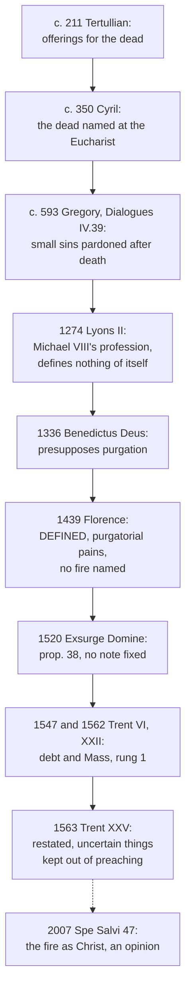

# Creation, Grace & the Last Things · Lesson 6.3: Purgatory

> ⏱ ~15 min · Module 6: The last things · Builds on: [6.1](06-01-death-and-the-particular-judgment.md), [5.3](05-03-merit.md), [`theology-of-debt` 3.4](../../theology-of-debt/lessons/03-04-aquinas-satisfaction-and-the-debt-of-punishment.md) · Unlocks: [7.1](07-01-the-resurrection-of-the-body.md), [`sacraments-and-liturgy` 4.2](../../sacraments-and-liturgy/lessons/04-02-indulgences-as-a-practice.md), [`apologetics-catholic-claims`](../../apologetics-catholic-claims/syllabus.md)

## Why this matters

Dying at Ostia in 387, Monica asked her sons one thing: "This only I ask, that you will remember me at the Lord's altar, wherever you be" (Augustine, *Confessions* IX.11.27, tr. J. G. Pilkington). Augustine thought her holy yet prayed for her sins (IX.13). The Church has defined why that prayer makes sense, and almost nothing of what imagination built around it: the flames, the years, the place.

## The idea

Some die in God's friendship not yet wholly healed. The self that turned to him still carries marks: small sins never repented, habits of vanity or grudge, and what remains of a debt that forgiveness lifted as guilt but not wholly as consequence ([guilt and punishment](../reference.md#guilt-and-punishment)). Nothing defiled enters the vision of God (Rev 21:27; [6.2](06-02-heaven-and-the-beatific-vision.md)). [Purgatory](../reference.md#purgatory) is the Church's name for that last healing.

A man makes peace with the brother he wronged and is taken in. He knows he will stay, but cannot yet meet his brother's eye; the shame must burn off in the warmth of welcome. Nothing in that hour reopens whether he is forgiven.

So it is **not a second chance**: only those who die in grace are there. It is **not a milder hell**: it ends in heaven. And the living **can help**, because the Church is one body across death ([communion of saints](../reference.md#communion-of-saints); [suffrages](../reference.md#suffrages)). Defined: that it happens and that prayer helps. Never said: what it feels like, where, or for how long.

## Source

Trent, [Session XXV](../reference.md#trent-session-xxv), Decree concerning Purgatory (3 December 1563), in Waterworth's translation (1848):

> Whereas the Catholic Church ... has, from the sacred writings and the ancient tradition of the Fathers, taught, in sacred councils, and very recently in this oecumenical Synod, that there is a Purgatory, and that the souls there detained are helped by the suffrages of the faithful, but principally by the acceptable sacrifice of the altar; the holy Synod enjoins on bishops that they diligently endeavour that the sound doctrine concerning Purgatory ... be believed, maintained, taught, and every where proclaimed .... But let the more difficult and subtle questions, and which tend not to edification, ... be excluded from popular discourses before the uneducated multitude. In like manner, such things as are uncertain, or which labour under an appearance of error, let them not allow to be made public .... While those things which tend to a certain kind of curiosity or superstition, or which savour of filthy lucre, let them prohibit ....

Read the verbs. The one doctrinal verb is reported: the Church *has taught*. Everything after the semicolon orders bishops: preach the doctrine; keep out the subtle, the uncertain, the curious and the profitable. No canon; no fire, place, length of time, or account of how a suffrage reaches a soul.

## In their own words

The *Orthodox Confession* of Peter Mogila, signed by the Eastern patriarchs (1643; Schaff, *Creeds* vol. 2, Panagiotes' Latin, lesson's translation), prays for the dead and refuses purgatory. No one dies "between the blessed and the damned" (q. 64), yet many sinners are freed from Hades by the Church's prayers and above all the unbloody sacrifice, not by their own penance. Scripture nowhere teaches "that any temporary punishment, cleansing souls, exists after death", which is chiefly why, it says, Origen's opinion was condemned at Constantinople II (q. 66; 553 is [6.4](06-04-hell.md)'s). A dead soul shares in no sacrament, and satisfaction belongs to penance; so the Church prays for their pardon, "not that they, undergoing some punishment, may then be fully purged".

## The doctrine

1. **The practice came first.** Judas sends for "sacrifice to be offered for the sins of the dead" (2 Macc 12:43, DR; read in [`old-testament` 6.2](../../old-testament/lessons/06-02-tobit-judith-baruch-and-the-maccabees.md), its canon in [6.1](../../old-testament/lessons/06-01-how-the-old-testament-canon-formed.md)). Tertullian counts among customs held by unwritten tradition: "As often as the anniversary comes round, we make offerings for the dead" (*De corona* 3, c. 211, ANF vol. 3, tr. S. Thelwall). Jerusalem's Eucharist prays for all "who in past years have fallen asleep among us" (*Mystagogical Catecheses* 5.9, c. 350, under Cyril's name; NPNF second series vol. 7, tr. rev. E. H. Gifford). This is the [law of prayer](../reference.md#lex-orandi) ([`sacraments-and-liturgy` 6.1](../../sacraments-and-liturgy/lessons/06-01-what-the-liturgy-is.md)). *In words:* the Church prayed for her dead long before she explained why.

2. **The texts the tradition reads.** From Matthew 12:32, a sin forgiven "neither in this world, nor in the world to come" (DR), Gregory the Great infers that others may be pardoned "in the next" (*Dialogues* IV.39, c. 593–594). Cyprian sets the penitent who must pay "the uttermost farthing" (Matthew 5:26) and be "long purged by fire" against the martyr crowned at once (Ep. 51 §20, c. 252, ANF vol. 5, tr. E. Wallis; from [`theology-of-debt` 2.3](../../theology-of-debt/lessons/02-03-the-parables-of-debt.md)), never saying the fire burns after death. In 1 Corinthians 3:11–15 fire "shall try every man's work" on "the day of the Lord", and the builder of stubble "shall be saved, yet so as by fire" (DR); alone, it tests works at the judgment, places no state before the last day, and Gregory allows it may mean "the fire of tribulation" now. *In words:* no verse carries the doctrine alone.

3. **What is purged.** Forgiveness lifts guilt and the eternal debt; a debt of temporal punishment can remain, "to be discharged either in this world, or in the next in Purgatory" (Trent VI, can. 30, 1547; the logic is [`theology-of-debt` 3.4](../../theology-of-debt/lessons/03-04-aquinas-satisfaction-and-the-debt-of-punishment.md)'s), and the Mass is rightly offered for those "departed in Christ, and who are not as yet fully purified" (Session XXII, 1562, ch. 2, can. 3, Schaff; graded in [`sacraments-and-liturgy` 3.4](../../sacraments-and-liturgy/lessons/03-04-the-sacrifice-of-the-mass.md)). Merit belongs to this life ([5.3](05-03-merit.md)): "No one, then, need hope that after he is dead he shall obtain merit with God which he has neglected to secure here" (Augustine, *Enchiridion* 110, c. 421, NPNF first series vol. 3, tr. J. F. Shaw). *In words:* what is purged is what grace has forgiven but not finished.

4. **Professed, then defined.** At Lyons II (6 July 1274) Michael VIII's letter offered the profession Clement IV had proposed to him in 1267 ([Lyons II profession](../reference.md#lyons-ii-profession)): the truly penitent who die in charity before making satisfaction are purged after death *poenis purgatoriis seu catharteriis*, "by purgatorial or cleansing pains". It defines nothing of itself. Florence's [*Laetentur caeli*](../reference.md#laetentur-caeli) (6 July 1439), under its *diffinimus*, takes the clause over: if "the truly penitent die in the love of God (*in Dei caritate*) before they have made satisfaction by worthy fruits of penance for what they have done and failed to do, their souls are purged after death by purgatorial pains (*poenis purgatoriis*)", and the suffrages of the living avail them (lesson's translation). The purged are received "at once" (*mox*) into heaven. No fire is named. [*Benedictus Deus*](../reference.md#benedictus-deus) (1336; [6.2](06-02-heaven-and-the-beatific-vision.md)) presupposes purgation, defining none. *In words:* the unfinished who die in God's love are purified, and the living help.

5. **Assured of salvation** (CCC 1030). That the purged reach heaven is Florence's *in caelum mox recipi*. Their own assurance rests on Leo X's [*Exsurge Domine*](../reference.md#exsurge-domine) (15 June 1520), which condemned Luther's prop. 38, "the souls in purgatory are not sure of their salvation, at least not all" (lesson's translation), *in globo*, under notes such as "heretical", "false" and "offensive to pious ears", none assigned to any one proposition. *In words:* their outcome is defined; their assurance is taught without a fixed note.

6. **[*Spe Salvi*](../reference.md#spe-salvi)** (30 November 2007), §§45–48, paraphrased: death makes a life's choice definitive (§45); "some recent theologians" hold that the fire is Christ himself, whose gaze burns and heals, and its "duration" escapes earthly time (§47); no one is saved alone, so prayer reaches the dead (§48). *In words:* a pope offers the encounter reading as a reading.

**Said plainly.** Trent withheld the furniture of popular purgatory (fire, place, duration, mechanism) and banned "filthy lucre", where purgatory preaching had become a trade ([`theology-of-debt` 3.6](../../theology-of-debt/lessons/03-06-luther-trent-and-the-reform-of-indulgences.md); [`church-history` 6.1](../../church-history/lessons/06-01-the-late-medieval-church-and-luthers-protest.md)). Its own catechism still says "the fire of purgatory" (*Roman Catechism* I, art. 5, tr. McHugh and Callan, 1923): the Latin imagery ran ahead of the definition.

| Defined or taught (with level) | A school's explanation or an opinion (no magisterial level) |
|---|---|
| The truly penitent dying in God's love unfinished are purged by purgatorial pains: **rung 1** (Florence) | The vision delayed plus "corporeal fire" (Supplement, Appendix 1 q.2 a.1); or Christ's gaze as the fire (*Spe Salvi* §47): **rung 5** |
| Suffrages help, the Mass among them: **rung 1**; "principally" the Mass: **at least rung 3** (XXV) | How a suffrage reaches a soul; whether the souls pray for us (Aquinas: no, II-II q.83 a.11 ad 3; CCC 958: they intercede) |
| The purged reach heaven: **rung 1**; their assurance: **at least rung 3** | That venial guilt itself, not only its debt, is remitted there (Supplement, Appendix 1 q.2 a.4) |
| Fire, place, duration: **nothing defined** | A place near hell, only "probable" (Appendix 2 a.2): **rung 5** |

**Mark the levels** ([the ladder](../../fundamental-theology/lessons/04-04-the-ladder-of-doctrinal-authority.md); [levels of authority](../reference.md#levels-of-authority)). Purgatory, the help of suffrages and the purged reaching heaven (so it is no milder hell): **rung 1** (Florence); the remaining debt and the Mass for the dead: **rung 1** (VI can. 30; XXII can. 3). Lyons II and XXV are not the defining acts, and XXV's "principally" is **at least rung 3**. The souls' own assurance: **at least rung 3** (this lesson's decision), since *Exsurge* binds Catholics to reject prop. 38 but fixes no note, and can. 749 §3 forbids calling it defined. A real fire, a place, a duration, *Spe Salvi* §47's opinion: **no act, rung 5**; fire as Scripture's image stands. XXV's orders to bishops: **discipline, no rung**. Fathers, the Supplement, the *Confession*: **no magisterial level**.

## The timeline

Practice ran centuries ahead of definition, and the definition stops short of the imagery.

## Worked examples

**Ex 1 (clean): Teodor's month's mind.** Invented: Teodor Brennecke of Holy Souls, Fennick, dies after confession and anointing, still grudging toward his son-in-law; his widow Leocadia has a Mass offered. He died in God's grace, so hell is not his case ([6.1](06-01-death-and-the-particular-judgment.md)); if unfinished, he is purified and will reach heaven (**rung 1**). The Mass is the suffrage Trent puts first (XXV). Unsayable: whether he needs it, for how long, or what it is like. Like Augustine for Monica, she prays for a man she believes was good.

**Ex 2 (strain): the fire.** Gregory asserts "a Purgatory fire", the Supplement "corporeal fire", the *Roman Catechism* "the fire of purgatory". Florence kept Lyons' *poenae*, naming no fire after Mark of Ephesus attacked it (Ferrara, 1438); Trent named nothing. Augustine had left a purgatorial fire to be "either ascertained or left doubtful" (*Enchiridion* 69). The doctrine requires real pains that purge and stops there: fire, sorrow or Christ's gaze, it does not say. The CDF's *Letter on Certain Questions Concerning Eschatology* (17 May 1979) cuts both ways: shun arbitrary imaginative pictures, but do not empty Scripture's images. A preacher may say "so as by fire"; he may not preach a furnace as dogma, nor a painless purification.

## Watch out

- **You might think purgatory is a second chance.** It holds only those who die "in the love of God" (Florence), and death ends the time for accepting or refusing grace (CCC 1021).
- **Overstating and understating the level.** "Lyons II defined it" or "Trent XXV defined it" names the wrong act: the definition is Florence's, with Trent VI can. 30. "A medieval opinion" understates: **rung 1**.
- **You might think purgatory is hell with an exit.** It is "entirely different from the punishment of the damned" (CCC 1031; the CDF's 1979 letter, point 7).

## One-liner

> Those who die in God's love unfinished are finished after death, and our prayers help them: that is defined; the fire, the place and the clock are not.

## Problems

**P1 (🟢)** *(Exegetical)* **Diagnose.** From the transcript of a parish podcast at Holy Souls, Fennick, **invented** for this problem:

> "Think of purgatory as God's second chance: if you die without having turned to him, you get time there to come round. The Church invented it in the Middle Ages to sell indulgences; before that nobody prayed for the dead. Trent then defined it, with an anathema, in its decree on purgatory. It's really hell with an exit, the same punishment, only shorter. And it lasts exactly as long as your sins add up to, which is what the old 'three hundred days' on prayer cards were counting."

Find **four** errors. For each, give the correction, and where a level is involved name the act that fixes it. **150 words or fewer.**

**P2 (🟡)** *(Exegetical)* **Close reading.** Gregory the Great, *Dialogues* IV.39 (c. 593–594), in the translation of "P.W." (Paris, 1608), ed. Edmund G. Gardner (1911). (Francis Clark's 1987 case against the work's authenticity is a minority view, and the question is [`patristics` 5.3](../../patristics/lessons/05-03-gregory-the-great.md)'s; take it as Gregory's.)

> [...] in such state as a man departeth out of this life, in the same he is presented in judgment before God. But yet we must believe that before the day of judgment there is a Purgatory fire for certain small sins: because our Saviour saith, that he which speaketh blasphemy against the holy Ghost, that it shall not be forgiven him, neither in this world, nor in the world to come. Out of which sentence we learn, that some sins are forgiven in this world, and some other may be pardoned in the next: for that which is denied concerning one sin, is consequently understood to be granted touching some other. But yet this [...] we have not to believe but only concerning little and very small sins [...]. [...] none can be there purged [...] unless in his lifetime he deserved by virtuous works to find such favour in that place.

(a) Reconstruct Gregory's argument from Matthew 12:32 in numbered premises (P1, P2, … ∴ C), and name the premise the verse itself does not state.

(b) How does the passage keep its first sentence true while allowing pardon after death? Name the two limits it sets.

(c) Florence's definition, as this lesson translates it, also speaks of purgation after death. Does it confine purgation as Gregory does? Name the words that decide it, and say what weight Gregory's passage carries.

**Two sentences per part** (numbered premises for (a)).

**P3 (🔴)** *(Exegetical)* **Assign the level.** For each claim, give its rung on [the ladder](../../fundamental-theology/lessons/04-04-the-ladder-of-doctrinal-authority.md) (or discipline, or no magisterial level) and name the act that fixes it, or say that none does.

(a) The Second Council of Lyons (1274) defined that the souls of the truly penitent who die before making satisfaction are purged after death.

(b) The souls in purgatory are helped principally by the sacrifice of the altar.

(c) Purgatory is a place, below the earth and close to hell.

(d) Bishops are to keep the more difficult and subtle questions about purgatory out of sermons to ordinary congregations.

**Two sentences per item.**

Solutions

**P1** *(Exegetical)*

**Accept:** any four of the five below, each corrected.

**Must hit, strict:**

- **"Second chance."** Purgatory is only for those who die in God's grace: the truly penitent who die "in the love of God" (Florence, *Laetentur caeli*, 1439, **rung 1**; CCC 1030). Death ends the time for accepting or refusing grace (CCC 1021), and merit is gained in this life (Augustine, *Enchiridion* 110). Nothing turns there; what is already turned is finished.
- **"Invented to sell indulgences; no one prayed for the dead."** Tertullian attests offerings for the dead on the anniversary (*De corona* 3, c. 211), Cyril the dead named at the Eucharist (c. 350), Augustine Monica's request (387). Indulgences are a later and separate doctrine ([`theology-of-debt` 3.5–3.6](../../theology-of-debt/lessons/03-05-the-christian-jubilee-and-the-treasury.md)).
- **"Trent defined it with an anathema in its decree on purgatory."** Session XXV's decree has no canon; it reports what the Church "has taught" and instructs bishops. The defining act is Florence (1439), with Trent VI can. 30 (**rung 1**) on the debt that can remain "in Purgatory".
- **"Hell with an exit."** It is "entirely different from the punishment of the damned" (CCC 1031; CDF 1979, point 7). Those purged die in charity and are received into heaven (Florence, **rung 1**).
- **"As long as your sins add up to."** No act defines duration. Trent XXV keeps uncertain things out of preaching, and the old "days" were reckoned against canonical penance, never days in purgatory ([`sacraments-and-liturgy` 4.2](../../sacraments-and-liturgy/lessons/04-02-indulgences-as-a-practice.md)).

**Wrong turns:** "correcting" the first error by saying purgatory is for anyone not certainly damned; correcting the third by saying purgatory is only a pious opinion (understated); citing Lyons II as the definition; correcting the fifth by giving a different length of time.

**Model answer:** Purgatory is not a second chance: it holds only those who die in God's love (Florence, rung 1), and death ends the time for choosing (CCC 1021). It was not invented for indulgences: Tertullian already attests offerings for the dead around 211, and Cyril and Augustine prayer for them at the Eucharist. Trent's decree on purgatory has no canon; it reports earlier teaching and directs bishops, while the definition is Florence's, with Trent VI can. 30 (rung 1) on the debt to be paid "in Purgatory". It is not a shorter hell: it is entirely different from the punishment of the damned (CCC 1031), since its souls die in charity and reach heaven. Its duration is defined nowhere; the "days" on old cards measured canonical penance.

---

**P2** *(Exegetical)*

**Must hit, strict (a):**

- A reconstruction such as: **P1** Christ says one sin is not forgiven "neither in this world, nor in the world to come". **P2** What is denied of one sin is "understood to be granted touching some other". **P3** "The world to come" here includes the time after death and before the day of judgment. **∴ C** Some sins may be pardoned after death, before the judgment.
- The unstated premise is **P2**, the inference from a denial about one sin to a grant about others. Credit P3 as a second unstated premise.

**Must hit, strict (b):**

- The first sentence says a person is judged in the state in which he leaves this life. The passage keeps it by allowing after death only what that state already contains: purging, not a change of state.
- The two limits: only "little and very small sins", and only for one who "in his lifetime ... deserved by virtuous works" such favour.

**Must hit, strict (c):**

- **No.** Florence speaks of the truly penitent who die in God's love "before they have made satisfaction ... for what they have done and failed to do", so it reaches the unpaid satisfaction of any repented sin, grave sins included, not only small ones. It agrees with Gregory in excluding those who do not die in charity ("in the love of God"; "deserved by virtuous works").
- **Weight:** a Father's teaching in a book of dialogues, carrying **no magisterial level** as authored, though he wrote it as pope. CCC 1031 quotes it, which locates it and adds no rung.

**Wrong turns:** in (a), offering the verse as if it stated P2; reading the passage as a second chance; in (c), saying Florence adopted Gregory's restriction, or giving the passage a rung because a pope wrote it or the Catechism quotes it.

**Model answer:** (a) P1 Christ says the blasphemy against the Spirit is forgiven neither in this world nor in the world to come. P2 What is denied of one sin is granted of others. P3 "The world to come" includes the time after death, before judgment. ∴ Some sins may be pardoned after death. The verse never states P2, which carries the whole inference. (b) Each person is judged in the state in which he dies, so after death only what that state allows is purged: small sins, and only for one whose life in grace earned the favour. Nothing changes direction there. (c) No: Florence covers anyone truly penitent who dies "in the love of God" before completing satisfaction "for what they have done and failed to do", grave sins included, while agreeing with Gregory that only those who die in charity are purged. Gregory's passage is a Father's teaching, written while pope but not a magisterial act, so it carries no magisterial level.

---

**P3** *(Exegetical)*

**Must hit, strict:**

- **(a) Misidentified act.** Lyons II's text is the profession Clement IV proposed to Michael VIII in 1267, offered in Michael's letter at the fourth session (6 July 1274); it professes Roman teaching and defines nothing of itself. The doctrine is **rung 1** because Florence defined it (*Laetentur caeli*, 6 July 1439, under *diffinimus*), with Trent VI can. 30.
- **(b) At least rung 3.** Trent XXV's decree (3 December 1563), a conciliar doctrinal decree without canon, states the "principally", which neither Florence nor any canon contains. XXII can. 3 defines only that the Mass may rightly be offered for the dead, and the help of suffrages is **rung 1** by Florence; can. 749 §3 keeps the ranking from being read as defined.
- **(c) No magisterial act; rung 5.** Florence and Trent name no place, and the Supplement's appendix, compiled from Aquinas's early *Sentences* commentary, admits that Scripture states nothing clearly and calls the location only "probable". It is school opinion, freely disputed.
- **(d) Discipline, no rung.** It is Trent XXV's pastoral order to bishops: binding law, changeable, and no doctrine about the questions themselves. The same decree commands that the sound doctrine be "taught, and every where proclaimed".

**Wrong turns:** (a) "rung 1 because a general council said it", when the council made no decree on it; (b) "rung 1 because of XXII can. 3", or "a pious opinion"; (c) giving it rung 4 or defined status because Aquinas's name is on it, or concluding that purgatory is unreal because its place is undefined; (d) treating the order as a doctrinal judgment that the subtle questions are false, or as a ban on preaching purgatory.

**Model answer:** (a) The act is misnamed: Lyons II's text is Michael VIII's profession, proposed by Clement IV in 1267, and it defines nothing of itself. The doctrine it professes is rung 1, defined by Florence in 1439, with Trent VI can. 30. (b) At least rung 3: the "principally" comes from Trent XXV's decree, which has no canon. XXII can. 3 defines only that the Mass may be offered for the dead, and Florence that suffrages help (rung 1). (c) No act: neither Florence nor Trent names a place, and the Supplement's appendix calls its location "probable" while admitting Scripture says nothing clear. It is a freely disputed school opinion, rung 5. (d) Discipline with no rung: Trent XXV's order to bishops about preaching, binding and changeable. It decides nothing about the questions themselves, and the same decree orders the doctrine preached everywhere.

## Flashback

**From Lesson [6.1](06-01-death-and-the-particular-judgment.md) (Death and the particular judgment):** *(Exegetical.)* Diagnose. Two slides from a confirmation-class deck at St Joseph's, Glenarden, **invented** for this problem:

> Slide 4: "At the particular judgment, as the Church defines it, you stand in a courtroom: Satan reads out the charges, your guardian angel pleads for you, and your deeds are weighed on scales."
>
> Slide 5: "The New Testament is mostly about this personal judgment at death. The 'last judgment' in the Creed is just a later picture of the same moment, so nothing further happens at the end of time."

Find **three** errors. Correct each, naming the act or text involved and the level where one is at stake. **Two sentences per error.**

Solution

**Must hit, strict:**

- **"As the Church defines it … a courtroom."** No act defines a scene: "[particular judgment](../reference.md#particular-judgment)" is the schools' name, the judgment-seat the Roman Catechism's picture, accuser, advocate and scales iconography. The doctrine fixes the outcome, not its staging, and the CDF's 1979 letter warns against "arbitrary imaginative representations" while respecting Scripture's images.
- **"Mostly about this personal judgment."** Inverted: the New Testament speaks of judgment "primarily" as the final encounter with Christ at his coming (CCC 1021). The texts for a judgment at death are a parable (Luke 16:22), a promise to one dying man (23:43) and Paul's hope (Philippians 1:23).
- **"The same moment; nothing further."** That Christ will come to judge the living and the dead is **rung 1** (the creeds), and Lyons II and *Benedictus Deus* add *nihilominus*: all will nevertheless appear before Christ's tribunal *cum suis corporibus*, with their bodies (2 Corinthians 5:10). The [last judgment](../reference.md#last-judgment) adds what death cannot, the body's share in the outcome (Gregory, *Dialogues* IV.25) and a judgment in public ([7.2](07-02-the-parousia-the-last-judgment-and-the-new-creation.md)).

**Wrong turns:** correcting slide 4 by denying any judgment at death, as if the outcome were imagery too; treating the judgment-seat as defined because the Roman Catechism prints it; correcting slide 5 by making the particular judgment provisional, revised at the end (*nihilominus* adds; it does not reverse).

**Model answer:** (1) No act defines a courtroom: the name is the schools', the judgment-seat the Roman Catechism's picture, the rest iconography. The doctrine fixes the outcome, not its staging, and the CDF's 1979 letter warns against arbitrary imaginative pictures. (2) The New Testament speaks of judgment primarily as the final encounter with Christ (CCC 1021); the texts for a judgment at death are a parable, a promise to the good thief and Paul's hope. (3) That Christ will come to judge the living and the dead is rung 1 (the creeds), and Lyons II and *Benedictus Deus* add that all will nevertheless appear before him with their bodies. The last day adds the body's share in the outcome and a judgment in public.

## Connections

- **Backward:** [6.1](06-01-death-and-the-particular-judgment.md) gave the three outcomes at death, of which this is the middle one. [5.3](05-03-merit.md) put merit in this life; [`theology-of-debt` 3.4](../../theology-of-debt/lessons/03-04-aquinas-satisfaction-and-the-debt-of-punishment.md) gave the guilt and the debt, and [3.6](../../theology-of-debt/lessons/03-06-luther-trent-and-the-reform-of-indulgences.md) read can. 30 against Luther. [`old-testament` 6.2](../../old-testament/lessons/06-02-tobit-judith-baruch-and-the-maccabees.md) read 2 Maccabees; [`patristics` 5.3](../../patristics/lessons/05-03-gregory-the-great.md) handed over the *Dialogues*, and [`patristics` 2.4](../../patristics/lessons/02-04-cyprian-of-carthage.md) gave Cyprian.
- **Forward:** [6.2](06-02-heaven-and-the-beatific-vision.md)'s vision is where purgation ends, and [6.4](06-04-hell.md) is the outcome purgatory is not. [7.1](07-01-the-resurrection-of-the-body.md) takes up the body the purified soul awaits. Indulgences for the dead are [`sacraments-and-liturgy` 4.2](../../sacraments-and-liturgy/lessons/04-02-indulgences-as-a-practice.md)'s, the treasury they draw on [`theology-of-debt` 3.5](../../theology-of-debt/lessons/03-05-the-christian-jubilee-and-the-treasury.md)'s, and the argued case with Protestant and Orthodox objectors is [`apologetics-catholic-claims`](../../apologetics-catholic-claims/syllabus.md).
- **Sideways:** the communion of saints across death is one doctrine with the Church's intercession in [6.2](06-02-heaven-and-the-beatific-vision.md) and the Mass for the dead in [`sacraments-and-liturgy` 3.4](../../sacraments-and-liturgy/lessons/03-04-the-sacrifice-of-the-mass.md). The debt thread meets the last things here: the debtors' prison of Matthew 5:26 ([`theology-of-debt` 2.3](../../theology-of-debt/lessons/02-03-the-parables-of-debt.md)) became, in Cyprian's reception, an image of cleansing. Florence's union is an event in [`church-history` 4.2](../../church-history/lessons/04-02-east-and-west-the-long-estrangement.md).
