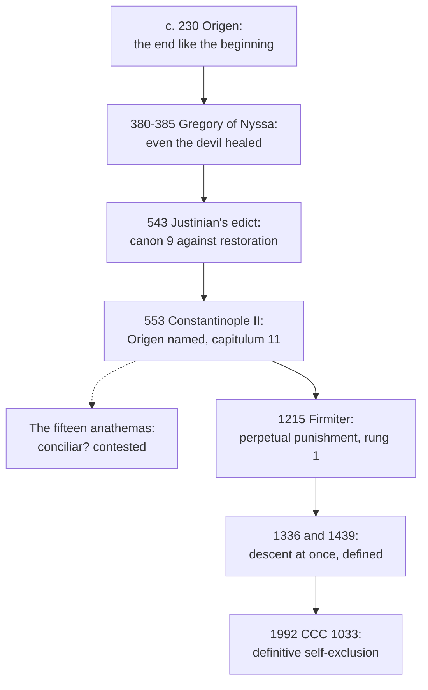

# Creation, Grace & the Last Things · Lesson 6.4: Hell

> ⏱ ~15 min · Module 6: The last things · Builds on: [6.1](06-01-death-and-the-particular-judgment.md), [6.2](06-02-heaven-and-the-beatific-vision.md), [5.4](05-04-predestination.md), [1.3](01-03-the-angels.md) · Unlocks: [7.3](07-03-hope-for-all.md)

## Why this matters

In the 420s Augustine argued about hell not with pagans but with "tender-hearted Christians", who held that the damned would be released after a term (*City of God* XXI.17, tr. Marcus Dods). Elsewhere in this course the danger is promoting opinion to dogma; here it is demoting dogma to opinion. The Church defines hell at its hardest point, its eternity, and almost nowhere else.

## The idea

Hell is having finally refused God. Whoever dies turned from God by grave sin he never repented stays as he chose, without God, for ever ([hell](../reference.md#hell)). He lacks the one good he was made for; Scripture adds that he suffers, and calls it fire.

The foolish virgins come late, knock, and hear "I know you not": "the door was shut" (Matthew 25:10–12, DR). Two true descriptions: they shut themselves out, and the bridegroom shut the door. *Self-exclusion*, the modern formula, states the first; the councils' *punishment*, the second. Keep both.

**Defined:** hell exists, its punishment is for ever, and a soul dying in mortal sin goes there at once. **Not defined:** where it is, what its fire is, who is there.

## In their own words

Gregory of Nyssa's *On the Soul and the Resurrection* (380; *NPNF* second series, vol. 5, tr. William Moore and H. A. Wilson) argues for [universal restoration](../reference.md#apokatastasis) through his dying sister Macrina (read as text in [`patristics` 3.3](../../patristics/lessons/03-03-the-two-gregories.md)). Evil is a turning from the good, with no being of its own to last. God's fire is a refiner's: what he inflicts is "not punishment chiefly and principally" but the separation of good from evil. So God "all in all" (1 Corinthians 15:28) means what it says:

> when evil shall have been some day annihilated in the long revolutions of the ages, nothing shall be left outside the world of goodness

In the *Great Catechism* (385, ch. 26) Christ is "healing even the introducer of evil himself". Behind Gregory stands Origen: "the end is always like the beginning" (*On First Principles* I.6.2, Crombie from Rufinus, a pipe bent toward orthodoxy: [`patristics` 2.5](../../patristics/lessons/02-05-clement-of-alexandria-and-origen.md)). The case argues from God's nature: infinite goodness, punishment as medicine, evil finite.

## The doctrine

1. **Scripture.** Gehenna, "where their worm dieth not" (Mark 9:43–48 [DR 9:42–47]). "Everlasting punishment" beside "life everlasting" (Matthew 25:46, DR), one Greek adjective for both: *kolasin aiōnion*, *zōēn aiōnion*. The devil "tormented day and night for ever and ever" (Revelation 20:10 [DR 20:9–10]); "the second death" (20:14–15; 21:8). *In words:* final loss is real and lasting, and the warning is aimed at the hearer.

2. **The definitions.** The [Athanasian Creed](../reference.md#athanasian-creed), a Latin creed Athanasius did not write and the East never adopted: "they that have done evil, into everlasting fire" (v. 43, Schaff, *Creeds* vol. 2). [*Firmiter*](../reference.md#firmiter) (Lateran IV, 1215): Christ will render to each, "to the reprobate as to the elect", and all will rise (lesson's translation)

   > with their own bodies which they now bear, that they may receive according to their works, whether good or evil, the former perpetual punishment with the devil (*cum diabolo poenam perpetuam*), the latter everlasting glory with Christ.

   That is the final state. For death, [*Benedictus Deus*](../reference.md#benedictus-deus) (1336; read in [6.2](06-02-heaven-and-the-beatific-vision.md)) states under its *diffinimus* that those dying "in actual mortal sin" go down to hell "immediately after their death" (*mox … ad inferna descendunt*), "where they are tormented with infernal punishments" (lesson's translation): *mox* and *cruciantur*, no *perpetuam*. Florence (*Laetentur caeli*, 6 July 1439), under its *diffinimus*, repeats Lyons II's profession (1274): they "descend immediately into hell, to be punished, however, with unlike punishments" (*poenis tamen disparibus*). Its clause on "original sin only" is [7.4](07-04-limbo.md)'s. *In words:* the lost go at once, for ever, and not all alike.

3. **Loss and sense.** The definitions do not divide "punishment"; the schools did ([pain of loss and pain of sense](../reference.md#pain-of-loss-and-pain-of-sense)), by the two sides of mortal sin (ST I-II q.87 a.4, English Dominican Province):

   > in so far as sin consists in turning away from something, its corresponding punishment is the pain of loss, which also is infinite, because it is the loss of the infinite good, i.e. God.

   The turning *to* a creature answers to the finite pain of sense. Innocent III had split them: lack of the vision for original sin, perpetual torment for actual sin (*Maiores Ecclesiae causas*, 1201; [7.4](07-04-limbo.md)). CCC 1035 calls eternal separation from God the "chief punishment"; the CDF's 1979 letter on eschatology (point 7) teaches eternal punishment for a sinner deprived of the sight of God, affecting his whole being. What the fire is, no act says: real fire tormenting even spirits for Augustine (*City of God* XXI.10); for Origen, via Rufinus, "every sinner kindles for himself the flame of his own fire" (*On First Principles* II.10.4). The 1979 letter warns against arbitrary images and against emptying Scripture's. *In words:* the lost lack God for ever, which is the worst of it, and suffer besides.

4. **Self-exclusion.** For CCC 1033, to die in mortal sin unrepentant is to stay separated from God for ever by one's own free choice: "definitive self-exclusion" ([self-exclusion](../reference.md#self-exclusion)). No one is predestined there (CCC 1037; [5.4](05-04-predestination.md)). John Paul II's audience of 28 July 1999 calls hell a state rather than a place, and not a punishment imposed from outside. Yet CCC 1035 keeps "punishments". *Mysterium Ecclesiae* (1973) lets the Church restate a dogma's meaning in new words ([`fundamental-theology` 5.2](../../fundamental-theology/lessons/05-02-newmans-theory-of-development.md)); whether 1992 did that, or softened the meaning, is open. *In words:* no one is in hell who did not, to the end, choose against God.

5. **What eternity excludes.** A hell with a term contradicts *perpetuam*. So does [annihilationism](../reference.md#annihilationism), the wicked's final destruction (Edward Fudge, *The Fire That Consumes*, 1982; tentatively John Stott, 1988), argued from "eternal punishment in destruction" (2 Thessalonians 1:9, DR). Make immortality a gift to the saved alone, and Lateran V is denied ([immortality](../reference.md#immortality-of-the-soul); [2.3](02-03-the-soul-immediately-created-and-immortal.md)). Let God destroy the wicked anyway, and *Firmiter* is denied: perpetual punishment *with the devil* is undergone, like *Benedictus Deus*'s *cruciantur*. *In words:* the lost neither get out nor stop existing.

6. **Origen, 543 and 553.** In 543 Justinian sent Patriarch Menas an edict with nine canons, endorsed by a synod at Constantinople; the ninth condemns holding "the punishment of demons and of impious men" temporary, with "a restoration (*apokatastasis*)" (Percival, *NPNF* second series, vol. 14). Constantinople II (opened 5 May 553, over the Three Chapters: [`christology` 2.4](../../christology/lessons/02-04-the-three-chapters-and-constantinople-ii.md)) names Origen among the heretics in capitulum 11, a name Hefele defends against the charge of insertion. Fifteen further anathemas condemn "the fabulous pre-existence of souls" and "the monstrous restoration which follows from it": the bodiless minds of sixth-century monastic Origenism. Who passed them is **contested** ([Origenist anathemas](../reference.md#origenist-anathemas)): the council, the synod of 543 (Hefele), or the bishops gathered before the opening. For the council: a manuscript heading, the historian Evagrius, later tradition; against: its summons and letters never mention Origen. Percival called a dogmatic answer "the height of rashness". *In words:* the history is tangled; the doctrine does not hang on it.

7. **Canonized, never anti-canonized.** A canonization is a dogmatic fact, to be held definitively (CDF, 1998 commentary on the profession of faith, §11). No act has declared anyone damned, not even Judas, though "It were better for him, if that man had not been born" (Matthew 26:24, DR). We judge acts, not persons (CCC 1861). So preaching aims the warning where the Gospel does, at the hearer (Matthew 7:13–14; CCC 1036). *In words:* hell is preached as a possibility for me, never as a verdict on my neighbour.

**Said plainly.** Origen died a confessor; the canons bearing his name came from an emperor three centuries later, and whether an ecumenical council adopted the fifteen, historians do not know. Gregory, whose restoration reached the devil, was never condemned and is a saint.

| Defined or taught (with level) | A school's explanation or an opinion (no magisterial level) |
|---|---|
| Hell exists; its punishment is perpetual: **rung 1** | Why a sin in time earns it: an aversion irreparable in itself (q.87 a.3) |
| Those dying in actual mortal sin descend at once, to unlike punishments: **rung 1** | Where hell is; whether "descend" is more than idiom: **rung 5** |
| The lost lack the vision of God for ever: **rung 1**; that this is the chief punishment: **at least rung 3** | Loss answering to aversion, sense to conversion (q.87 a.4): **rung 4** |
| A punishment besides the loss, named fire: **at least rung 3** | Real fire burning spirits (Augustine) or conscience (Origen): **rung 5** |
| No one is there but by his own unrepented mortal sin: **at least rung 3** | Why the will is fixed at death; only self-exclusion, or also a sentence: **rung 5** |

**Mark the levels** ([the ladder](../../fundamental-theology/lessons/04-04-the-ladder-of-doctrinal-authority.md); [levels of authority](../reference.md#levels-of-authority)). Eternity: **rung 1**, by *Firmiter*, an ecumenical council's profession, and the Athanasian Creed, a creed of the Latin Church. Immediate descent and unlike punishments: **rung 1** by Florence, with *Benedictus Deus* (its *ex cathedra* standing open: [`ecclesiology-and-mariology` 4.4](../../ecclesiology-and-mariology/lessons/04-04-infallibility-in-exercise-and-the-ordinary-universal-magisterium.md)) and the CDF's 1998 commentary, which counts "immediate recompense after death" among revealed truths; Lyons II's profession defines nothing itself. **The loss of God: rung 1**, since the definitions give the vision to the blessed alone; **that it is the chief, essential punishment: at least rung 3** (CCC 1035; CDF 1979; Innocent III). The pain of sense and self-exclusion: **at least rung 3**. The 543 canons, an edict endorsed by a local synod, have no conciliar rung; the fifteen, of uncertain authorship, add none (can. 749 §3). Canonization: **rung 2**; a named person damned: **taught by no act**. The 1999 audience is authentic teaching at its lightest ([`fundamental-theology` 4.5](../../fundamental-theology/lessons/04-05-reading-a-documents-weight.md)); Fathers, Aquinas and Percival as authors, **no magisterial level**.

## The timeline

Eternity is defined in 1215; nothing in that waits on the dashed box.

## Worked examples

**Ex 1 (clean): the conditionalist.** Invented: at St Michael's, Draycombe, Ruairí Szabo, raised in a conditionalist church, asks whether he may keep its view that the wicked are finally destroyed. His texts are real (Matthew 10:28; 2 Thessalonians 1:9), but his church denies the soul's natural immortality, against Lateran V (**rung 1**). Grant immortality and let God destroy the wicked anyway, and they no longer receive "perpetual punishment with the devil" (*Firmiter*). He keeps "destruction" as a true name for a life's ruin without God, and nothing defined says how the pain of sense is felt. He gives up the lost ceasing to be.

**Ex 2 (strain): the sentence and the choice.** Invented: Clemency Okafor, a catechist there, finds on one sheet "God sends no one to hell; people send themselves" and "Depart from me, you cursed" (Matthew 25:41). No one is lost without his own unrepented mortal sin (**at least rung 3**), yet Christ will "render to each according to his works" (*Firmiter*): both stand, as the shut door does. Where the doctrine stops: no act says whether the punishment is only the choice's inner consequence (John Paul II: not "a punishment imposed externally by God") or also something God inflicts, as the schools held of the pain of sense, nor whether the lost could want to leave.

## Watch out

- **You might think the fire is defined because the creed says "everlasting fire".** The creed takes Scripture's word and defines no physics: a pain beyond the loss is **at least rung 3**, its nature **rung 5**.
- **You might think hell's eternity rests on the 553 anathemas and wobbles with them.** That understates a **rung-1** doctrine resting on *Firmiter* and the creed.
- **You might think Gregory of Nyssa was condemned in 553.** He is never named, and the fifteen strike a restoration bound to pre-existence, which he rejected; *Firmiter* excludes his conclusion.

## One-liner

> Hell is defined at its hardest point, that it is for ever and follows at once on death in mortal sin; where it is, what its fire is, and who is there, the Church has never said.

## Problems

**P1 (🟢)** *(Exegetical)* **Close reading.** Augustine, *City of God* XXI.23 (NPNF first series, vol. 2, tr. Marcus Dods):

> For if all or some of those to whom it shall be said, "Depart from me, ye cursed, into everlasting fire, prepared for the devil and his angels," are not to be always in that fire, then what reason is there for believing that the devil and his angels shall always be there? … Then what a fond fancy is it to suppose that eternal punishment means long continued punishment, while eternal life means life without end, since Christ in the very same passage spoke of both in similar terms in one and the same sentence, "These shall go away into eternal punishment, but the righteous into life eternal!" If both destinies are "eternal," then we must either understand both as long-continued but at last terminating, or both as endless.

(a) The passage makes two arguments. State each, naming the feature of the Gospel text it turns on.

(b) The first argument moves only an opponent who already grants something. What, and which opponent Augustine knew of would not grant it?

(c) Name two things the second argument does not establish on its own.

**Two sentences per part.**

**P2 (🟡)** *(Exegetical)* **Find the crux.** Two positions from this lesson. Gregory of Nyssa: God's fire is a refiner's, and what he inflicts is "not punishment chiefly and principally" but the separation of good from evil, so it ends when the evil is gone, for everyone. Augustine, *City of God* XXI.13 (Dods): against those who "suppose that all punishment is administered for remedial purposes", he holds that punishments purge only those they bring to amend, and that the rest are sent for sins, some of them eternal.

(a) Name the single premise about punishment that one asserts and the other denies, and say what each side rests it on.

(b) The fifteen anathemas associated with 553 condemn a restoration. Do they reach Gregory's position as he states it? Then say which text of 543 does fit his conclusion.

**Two sentences per part.**

**P3 (🔴)** *(Exegetical)* **Diagnose.** From a review in an **invented** diocesan quarterly, written for this problem, of an invented book, *The Mercy of the Fire*:

> (1) "The author shows that since the Catechism of 1992 the Church no longer speaks of hell as a punishment at all, only as self-exclusion."
>
> (2) "Against her, I insist that the fire is defined: the Athanasian Creed says 'everlasting fire', so her reading of it as the burning of conscience is heterodox."
>
> (3) "She is right, though, that the wicked may simply cease to exist: annihilation is the merciful option the Church now permits."
>
> (4) "And she is right that hell is a place beneath us, since the councils say the damned 'descend'."

For each sentence, name the error, cite the text that corrects it, and say what true thing it is reaching for. **Two sentences per item.**

Solutions

**P1** *(Exegetical)*

**Accept:** in (c), any two of the four items listed.

**Must hit, strict (a):**

- **From one sentence for men and devils.** Matthew 25:41 sends the cursed and "the devil and his angels" into the same "everlasting fire" in a single sentence, so whoever lets the men out must let the devils out too.
- **From correlatives.** Matthew 25:46 applies one word, "eternal", to punishment and to life in one antithesis. So either both end or neither does, and since the life does not end, neither does the punishment. (The Greek has *aiōnios* both times and the Vulgate *aeternum* / *aeternam*, which is why the parallel holds in the original.)

**Must hit, strict (b):**

- The argument needs the premise that **the devil's punishment is eternal**, and runs from it to the men's ("what reason is there for believing that the devil … shall always be there?").
- It moves the "tender-hearted Christians" of XXI.17, who freed men but not devils. It does not touch **Origen**, who, as XXI.17 itself reports, released the devil too, and so denies the premise.

**Must hit, strict (c):**

- (i) That *aiōnios* means endless **by itself**: the argument is comparative, and borrows the endlessness from the promise of life.
- (ii) **What the punishment is.** An annihilationist can grant the parity (eternal life, eternal destruction, 2 Thessalonians 1:9) and read "eternal punishment" as a punishment whose result never ends. Answering him needs a punishment *undergone*: *Firmiter*'s "with the devil", *Benedictus Deus*'s *cruciantur*.
- (iii) Anything about the mode: fire, loss, or sense.
- (iv) **Any magisterial weight.** This is a Father's exegesis, no magisterial level: it argues for the Church's doctrine and does not constitute it.

**Wrong turns:** saying the first argument refutes Origen, when it presupposes what he denied; treating the second as a lexical proof that "eternal" always means endless; treating Augustine's argument as the Church's definition.

**Model answer:** (a) The first argument notes that Matthew 25:41 sends the cursed and the devil into one everlasting fire in one sentence, so releasing the men would release the devils. The second notes that Matthew 25:46 uses the same word, "eternal", of punishment and of life in one sentence, so the two last equally, and since the life is endless the punishment is too. (b) The first assumes the devil's punishment is eternal, a premise the tender-hearted of XXI.17 granted. Origen, who released the devil as well, did not grant it, so the argument does not touch him. (c) The parity does not show that "eternal" means endless by itself, since the endlessness is borrowed from the life. Nor does it show that the punishment is suffered rather than a destruction whose result lasts, which an annihilationist can grant while keeping the parity.

---

**P2** *(Exegetical)*

**Must hit, strict (a):**

- **The premise:** every punishment God inflicts is ordered to the healing of the one punished. Gregory asserts it; Augustine denies it.
- **Gregory rests it on God's nature and the nature of evil:** a refiner's fire aims at the gold, evil is a privation and so finite, and God will be "all in all" (1 Corinthians 15:28), so the punishment must end when the evil does.
- **Augustine rests the denial on Scripture's eternal punishment (Matthew 25:46) and on experience.** Punishment amends some and makes others worse, so it purges only those it brings to amend, and otherwise answers to sins committed. Aquinas states the school's form: punishment is "not always intended as a medicine for the one who is punished" (I-II q.87 a.3 ad 2).

**Must hit, strict (b):**

- **No.** The fifteen condemn the restoration "which follows from" the pre-existence of souls, a return of bodiless minds into a unity where bodies vanish (anathemas I, XIV, XV). Gregory rejected pre-existence (*On the Making of Man* XXVIII) and taught the resurrection of the body, so the fifteen do not describe him, whoever passed them, and he is never named.
- **The text that fits** is Justinian's ninth canon of 543, against saying that the punishment of "demons and of impious men" is temporary and that they will be restored. It names Origen, not Gregory, and condemns the proposition whoever holds it. The conclusion is in any case excluded by *Firmiter*'s perpetual punishment.

**Wrong turns:** naming the crux as "whether there is punishment after death", which both affirm; making it "whether God is good"; in (b), saying Gregory was condemned at 553, or the overcorrection that his conclusion is therefore permitted; making his rejection of pre-existence the whole answer without giving the 543 canon.

**Model answer:** (a) The crux is whether every punishment God inflicts aims at healing the one punished. Gregory affirms it from the refiner's fire, the finitude of evil and "God all in all", so the punishment must end. Augustine denies it from Matthew 25:46 and from the fact that punishment hardens some, so for him it purges only those it amends and is otherwise due to sin. (b) No: the fifteen condemn a restoration that follows from pre-existence and ends in bodiless minds, while Gregory rejected pre-existence and taught the bodily resurrection, and he is never named. What fits his conclusion is the ninth canon of 543, against a temporary punishment of demons and impious men and their restoration, and *Firmiter* excludes it in any case.

---

**P3** *(Exegetical)*

**Accept:** all four, each with error, correcting text and true thing.

**Must hit, strict:**

- **(1) A misreading.** CCC 1035 itself speaks of "the punishments of hell" and calls eternal separation from God "the chief punishment". The CDF's 1979 letter (point 7) teaches "eternal punishment" for the sinner, and the definitions say *poenam* and *poenis*. *True thing:* CCC 1033's "definitive self-exclusion" and John Paul II's 1999 audience put the cause in the sinner's own choice, not in an arbitrary infliction. Whether the formula develops or softens the doctrine is a genuinely open question, but no act has withdrawn the word "punishment".
- **(2) Overstated.** The creed (v. 43) and Matthew 25:41 use Scripture's word for the destination; no act defines what the fire is. Origen read it as the fire of conscience (*On First Principles* II.10.4), Augustine as a real fire (*City of God* XXI.10): **rung 5**, and neither reading is heterodox. *True thing:* a punishment besides the loss is taught (**at least rung 3**: CDF 1979; CCC 1035), and the image may not be emptied (CDF 1979).
- **(3) False.** No act permits annihilation. Conditional immortality contradicts Lateran V's *Apostolici regiminis*, the soul immortal by nature (**rung 1**). Destruction by God contradicts *Firmiter*: the reprobate receive "perpetual punishment with the devil", a punishment undergone (*Benedictus Deus*: *cruciantur*). *True thing:* Scripture's "destruction" (2 Thessalonians 1:9) is a true name for the ruin of the loss, and nothing defined says how the pain of sense is felt.
- **(4) Overstated.** "Descend" is the idiom of Scripture and of the definitions (*ad inferna descendunt*; *in infernum descendere*), and no act fixes a location. CCC 1033 calls hell a state, and John Paul II's 1999 audience a state "rather than a place": no location is taught, **rung 5**. *True thing:* the definitions do teach that the descent is immediate on death (Florence, **rung 1**).

**Wrong turns:** in (1), "correcting" by calling self-exclusion a softening or a heresy, which settles the open question; in (2), denying any pain of sense, which understates, or calling Origen's reading condemned; in (3), answering only with Lateran V, which an annihilationist who grants natural immortality escapes, since God can cease to sustain what he made ([2.3](02-03-the-soul-immediately-created-and-immortal.md)); in (4), "hell is nowhere, a mere metaphor", which overcorrects.

**Model answer:** (1) CCC 1035 still speaks of the "punishments of hell" and of the "chief punishment", and the CDF's 1979 letter of "eternal punishment", so nothing was dropped. What is true is that CCC 1033's self-exclusion places the cause in the sinner's own choice; whether that formula is a development or a softening is open. (2) The creed and Matthew 25:41 give the word "fire" but define nothing about it, so Origen's fire of conscience and Augustine's real fire are both permitted (rung 5). What is true is that a pain beyond the loss is taught (at least rung 3) and the image may not be emptied. (3) No act permits annihilation: conditional immortality contradicts Lateran V (rung 1), and destruction contradicts *Firmiter*'s "perpetual punishment with the devil". What is true is that "destruction" is Scripture's own name for the ruin of the loss. (4) "Descend" is the idiom of Scripture and the councils, and no act fixes a place; CCC 1033 calls hell a state, and John Paul II a state rather than a place (rung 5). What is true is that the descent is immediate, which Florence defines (rung 1).

## Flashback

**From Lesson [6.2](06-02-heaven-and-the-beatific-vision.md) (Heaven and the beatific vision):** *(Exegetical.)* Assign the level. Place each claim on the ladder, or say it has no magisterial level, and name the act or source that fixes it. One or two sentences each.

> (1) "When John XXII preached in 1331 that the just see Christ's humanity, not the divine essence, until the judgment, he was preaching heresy."
>
> (2) "That the purified see God's essence before the resurrection was defined by the Second Vatican Council, in *Lumen Gentium* 49."
>
> (3) "That God is incomprehensible, even to the blessed, is a Thomist thesis about finite minds, at rung 4."
>
> (4) "The saints know our prayers because they see them in God."

Solution

**Must hit, strict:**

- **(1) Overstated.** In 1331 no act yet excluded the [deferred vision](../reference.md#deferred-vision): Lyons II's profession (1274) said "at once into heaven" and named no vision. John's sermons were **no act**, but a preacher's opinion on an undecided question, which he said he had not meant to decide and submitted to the Church (*Ne super his*, 1334). Holding it now would deny a **rung-1** doctrine (item 2).
- **(2) Right rung, wrong act.** **Rung 1**, by Florence's *Laetentur caeli* (6 July 1439) under its *diffinimus*, with the CDF's 1998 commentary on the *Professio fidei* (§11) listing "the immediate recompense after death" among truths proposed as revealed. *Lumen Gentium* 49 quotes Florence's words: it is where you read the sentence, not the act that fixes it. *Benedictus Deus* (1336) decided the question first; its *ex cathedra* standing is open, and the rung does not wait on it (`ecclesiology-and-mariology` 4.4).
- **(3) Half understated.** God's incomprehensibility is **rung 1** (*Firmiter*, 1215; *Dei Filius* ch. 1, 1870: *incomprehensibilis*). Its application to the blessed, who see his whole, simple essence but not as perfectly as he is knowable (ST I q.12 a.7), is stated by no act: **rung 4**.
- **(4) Rung 5**, a school's account (Suppl. q.72 a.1, a posthumous compilation with no magisterial level). That the saints pray for us and that invoking them is good is **at least rung 3** (Trent XXV; LG 49–50), and lends the explanation no weight.

**Wrong turns:** in (1), heresy in 1331, or the mirror, that a pope's having held the view leaves it open today; treating the sermons as papal teaching owed submission. In (2), naming LG 49 as the act, or arguing *Benedictus Deus*'s *ex cathedra* status to settle the rung. In (3), one level for both halves. In (4), lifting it to rung 3 on the back of the taught intercession.

**Model answer:** (1) Overstated: in 1331 no act had excluded the deferred vision, and John's sermons were no act, only an opinion he later submitted to the Church; holding it today would deny a rung-1 doctrine. (2) Rung 1, but the act is Florence's definition of 1439, with the CDF's 1998 commentary; *Lumen Gentium* 49 quotes Florence and is not the act. (3) God's incomprehensibility is rung 1 (*Firmiter*; *Dei Filius*), while its application to the blessed, who see him whole but not wholly (ST I q.12 a.7), is rung 4. (4) Rung 5, a school's account (Suppl. q.72 a.1); the intercession it explains is at least rung 3 and lends it no weight.

## Connections

- **Backward:** [1.3](01-03-the-angels.md) gave the devil's perpetual punishment and the irrevocable choice behind it, and [2.3](02-03-the-soul-immediately-created-and-immortal.md) the soul's immortality and the 543 canon on pre-existence. [5.4](05-04-predestination.md) excluded predestination to hell, and [6.1](06-01-death-and-the-particular-judgment.md) and [6.2](06-02-heaven-and-the-beatific-vision.md) gave the immediate judgment and the vision whose loss is the pain of loss. Why forgiven guilt can leave a debt of punishment, while unforgiven mortal sin leaves an eternal one, is [`theology-of-debt` 3.4](../../theology-of-debt/lessons/03-04-aquinas-satisfaction-and-the-debt-of-punishment.md). Origen and Gregory as texts are [`patristics` 2.5](../../patristics/lessons/02-05-clement-of-alexandria-and-origen.md) and [3.3](../../patristics/lessons/03-03-the-two-gregories.md); the council of 553 is [`christology` 2.4](../../christology/lessons/02-04-the-three-chapters-and-constantinople-ii.md), and its politics, Justinian and Vigilius, [`church-history` 2.2](../../church-history/lessons/02-02-ephesus-chalcedon-and-leos-rome.md).
- **Forward:** [7.3](07-03-hope-for-all.md) asks whether one may hope that no one is lost, a hope that has to live inside this lesson's eternity. [7.4](07-04-limbo.md) reads the clause of Lyons II and Florence on those who die "with original sin only", and Innocent III's letter. [7.2](07-02-the-parousia-the-last-judgment-and-the-new-creation.md) takes up the last judgment, *Firmiter*'s other half.
- **Sideways:** whether a good God may permit any final loss is the problem of evil, argued in [`philosophy-of-religion` 4.1](../../philosophy-of-religion/lessons/04-01-the-logical-problem-of-evil.md)–[4.4](../../philosophy-of-religion/lessons/04-04-skeptical-theism.md) and not here. The freedom that makes hell possible is the libertarian freedom weighed in [`metaphysics` 6.4](../../metaphysics/lessons/06-04-libertarianism-and-its-critics.md), and mortal sin as an act is [`moral-theology` 3.4](../../moral-theology/lessons/03-04-sin-mortal-and-venial.md). Holy Saturday did not empty this hell: the descent's *inferna* is not Gehenna ([`christology` 6.1](../../christology/lessons/06-01-he-descended-into-hell.md)).
