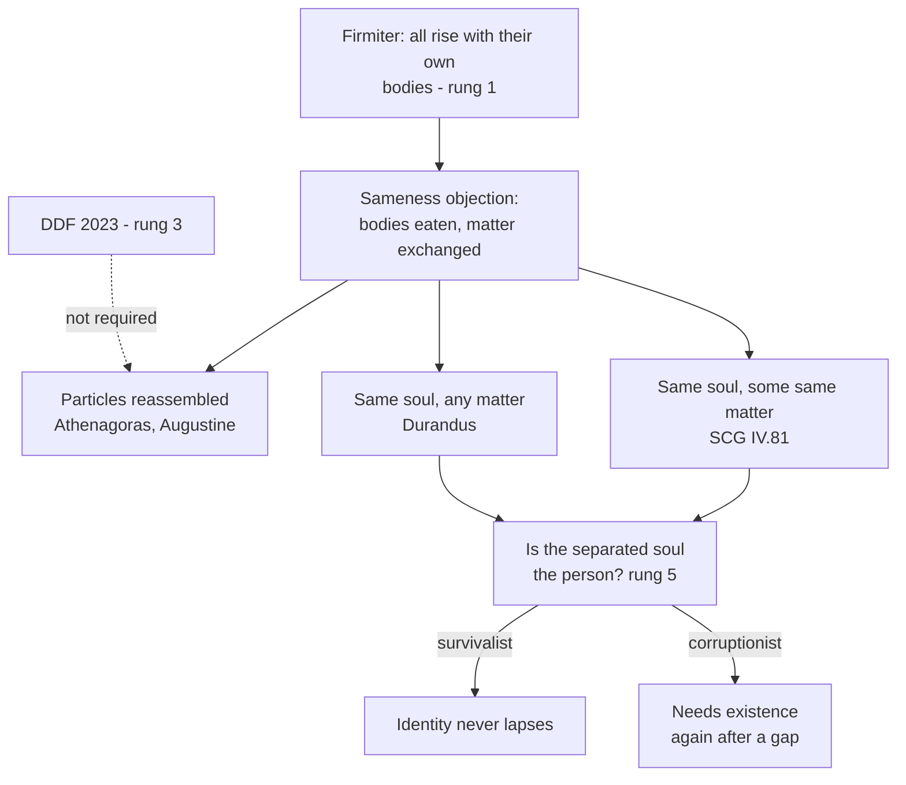

# Creation, Grace & the Last Things · Lesson 7.1: The resurrection of the body

> ⏱ ~15 min · Module 7: The consummation, and the questions left open · Builds on: [2.2](02-02-body-and-soul-one-substance.md), [2.3](02-03-the-soul-immediately-created-and-immortal.md), [`christology` 6.2](../../christology/lessons/06-02-resurrection-and-ascension-as-doctrine.md) · Unlocks: [7.2](07-02-the-parousia-the-last-judgment-and-the-new-creation.md)

## Why this matters

At Athens Paul was heard out until "the resurrection of the dead"; then "some indeed mocked" (Acts 17:32, DR). A surviving soul was respectable; a corpse given back was not, and the Catechism still quotes Augustine that no point of the faith meets more opposition (CCC 996). Here is what is defined, what is only explained, and how the oldest objection is met.

## The idea

Two pictures of the end. In one, death frees the real you, a soul, from the body it wore. In the other, death tears a human being in two and God mends the tear: the same man, body and soul, stands up again, changed. The creed teaches the second, and says "flesh" because the soul does not die and so cannot rise (Roman Catechism, Art. XI).

[2.2](02-02-body-and-soul-one-substance.md) made this necessary. If the [soul is the form of the body](../reference.md#soul-as-form-of-the-body), the [separated soul](../reference.md#separated-soul) is what remains of a man, not a man: "my soul is not I", as 2.2 read Aquinas. So the [resurrection of the body](../reference.md#resurrection-of-the-body) is no bonus added to immortality; it is how *I* am saved at all.

Then Corinth's question: "with what manner of body shall they come?" (1 Cor 15:35, DR). If my matter is eaten or recycled, what makes the risen body mine? That is the [sameness objection](../reference.md#sameness-objection).

## Source

[*Firmiter*](../reference.md#firmiter), Lateran IV (1215), right after Christ "rose in the flesh" (lesson's translation of the Latin in Denzinger):

> He will come at the end of the age to judge the living and the dead, and to render to each according to his works, to the reprobate and the elect alike (*tam reprobis quam electis*): all of whom (*qui omnes*) will rise with their own bodies which they now bear (*cum suis propriis resurgent corporibus, quae nunc gestant*), that they may receive according to their works, whether good or evil, the former perpetual punishment with the devil, the latter everlasting glory with Christ.

Read the grammar. *Qui omnes* points back to *tam reprobis quam electis*: one clause fixes that all rise, the damned too. *Suis propriis* doubles the possessive. *Quae nunc gestant* names this life's body against any substitute. Of its matter, age or glory, nothing.

## In their own words

Celsus, the second-century Platonist whom Origen quotes (*Against Celsus* V.14, tr. Crombie, ANF 4), calls the hope of rising in "the self-same flesh" one "which might be cherished by worms". No rational soul wants a rotted body back, a wholly corrupted body cannot return, and pleading omnipotence is "a most absurd refuge", for God does nothing contrary to reason. Athenagoras reports the sharpest form (*On the Resurrection* IV, tr. Pratten, ANF 2): animals eat the drowned and unburied, men eat those animals, in famine men eat men, so "the same parts cannot rise again with one set of bodies, and with another as well." Today's form: a body's matter is exchanged over a life and dispersed after it.

## The doctrine

1. **The article.** The Apostles' Creed says *carnis resurrectionem*; the [Athanasian Creed](../reference.md#athanasian-creed), "all men shall rise again with their bodies" (Schaff). The local Eleventh Council of Toledo (675) denied that we rise "in an airy or any other flesh" (lesson's translation). The CDF's 1979 letter on eschatology says the whole person rises (point 2); Christ's glorious manifestation is deferred beyond the state after death (point 5); Mary's bodily glory anticipates the other elect's (point 6). *In words:* all of us, in our own bodies, at his coming.

2. **The road to it.** The texts are [`old-testament` 5.4](../../old-testament/lessons/05-04-sirach-and-the-wisdom-of-solomon.md), [6.2](../../old-testament/lessons/06-02-tobit-judith-baruch-and-the-maccabees.md) and [6.3](../../old-testament/lessons/06-03-daniel-and-apocalyptic.md)'s. Sleepers "shall awake: some unto life everlasting, and others unto reproach" (Dan 12:2, DR); a martyr holds out his hands, "I hope to receive them again from him" (2 Macc 7:11, DR). Wisdom 3 says only that "the souls of the just are in the hand of God", with no word of rising. *In words:* the hope came late, through the martyrs.

3. **1 Corinthians 15.** The exegesis is [`new-testament` 4.3](../../new-testament/lessons/04-03-paul-at-work.md)'s; [`christology` 6.2](../../christology/lessons/06-02-resurrection-and-ascension-as-doctrine.md) read v.44's single subject. The seed concedes discontinuity, "not the body that shall be", and keeps the subject: "to every seed its proper body" (vv.37–38; *idion sōma*, "its own body"). The [spiritual body](../reference.md#spiritual-body) is governed by the Spirit, not made of it. Verse 50's "flesh and blood" names a condition, as its twin clause shows: "neither shall corruption possess incorruption". Verse 53's "*this* corruptible" (*touto*) the Roman Catechism reads as "his own body". Leave v.51 aside: the Douay follows the Vulgate, not the Greek. *In words:* changed, not swapped.

4. **Christ's body, pattern and cause.** He rose in his own body, glorified (CHR 6.2), and "will reform the body of our lowness, made like to the body of his glory" (Phil 3:21, DR). His rising causes ours, and its power "extends to the good and wicked alike" (ST III q.56 a.1 ad 3). *In words:* his Easter is ours begun.

5. **The just and the unjust.** "A resurrection of the just and unjust" (Acts 24:15, DR), "of life" and "of judgment" (John 5:29). Aquinas: death, a defect of nature, is undone in all; sin, a defect of the person, only in those joined to Christ (*Summa contra Gentiles* IV.81, paraphrased). *In words:* all rise immortal; only the just rise glorified.

6. **The [glorified body](../reference.md#glorified-body).** Four gifts: impassibility, brightness, agility, subtlety. The Roman Catechism says these "four are specially mentioned by the Fathers, which they infer from the doctrine of St. Paul", from the contrasts of 1 Cor 15:42–44; the posthumous Supplement treats them (qq.82–85). *In words:* a body wholly at the service of a soul that sees God.

7. **Sameness: the replies.** *Reassembly:* human flesh is not man's natural food, so it never becomes the eater's, and God reunites each part "for the exact construction and formation of the same body" (Athenagoras VIII); eaten flesh is "like a pecuniary loan" that "must be returned to the lender" (Augustine, *City of God* XXII.20, tr. Dods). *Form:* nothing essential to a man passes wholly into nothing, for his soul remains, and matter too; and as matter comes and goes in life while he stays one man, he rises with enough of it, God supplying the rest (SCG IV.81 nn.6, 12). The corpse is the same body only equivocally, so sameness runs through the soul ([`thomistic-synthesis` 5.3](../../thomistic-synthesis/lessons/05-03-the-human-soul-in-the-system.md)). *Soul alone:* for Durandus of Saint-Pourçain (d. 1334) the same soul with any matter makes the same body; most manuals required some of the same matter. On 9 December 2023 the Dicastery for the Doctrine of the Faith, with Francis's approval in audience, replied: bodily identity, material but transfigured, "does not imply the recuperation of the identical particles of matter". The soul-based replies then divide as in [`metaphysics` 6.5](../../metaphysics/lessons/06-05-what-a-person-is.md). For a survivalist the person persists in the separated soul. For a corruptionist he ceases at death, and the reply needs one more premise: a substance can exist again after a gap, if one of its principles persists through it. *In words:* defined, that it is mine; disputed, what makes it mine.

8. **[Cremation and burial](../reference.md#cremation-and-burial).** *Piam et constantem* (Holy Office, 5 July 1963) judged cremation not in itself opposed to the faith, and ended the refusal of rites save where it is chosen in denial of the faith (*Ad resurgendum cum Christo* §1). Canon 1176 §3 "earnestly recommends" burial and forbids cremation only when chosen "for reasons contrary to Christian doctrine" (can. 1184 §1 2°; CCC 2301). The CDF's *Ad resurgendum* (15 August 2016) prefers burial, the body being part of the person's identity (§3); ashes go to a sacred place, not home, not divided, not scattered or set in jewellery (§§5–7). The 2023 reply allows commingled ashes in a sacred place, and lets the authority allow "a minimal part" kept where it mattered to the dead, barring pantheist, naturalist or nihilist readings. *In words:* God needs no ashes; the rite guards what it confesses.

| Defined or taught (with level) | A school's explanation or an opinion (no magisterial level) |
|---|---|
| All the dead rise with their own bodies which they now bear: **rung 1** (*Firmiter*; Athanasian Creed) | What makes it the same body: particles reassembled (Athenagoras, Augustine), soul with some same matter (SCG IV.81), soul alone (Durandus): **rung 5** |
| The identical particles are not required: **rung 3** (DDF reply, 2023) | That God will in fact return each particle to its first owner: permitted, **rung 5** |
| The just rise glorified, like Christ: **at least rung 3** (Phil 3:21; CCC 999; 1979, point 6) | Impassibility, brightness, agility, subtlety as four gifts: **rung 4** |
| The whole person rises, not the soul alone: **rung 1** (the creeds' "resurrection of the flesh") | The separated soul is no person: **rung 4**; whether I survive in it: **rung 5** |

**Mark the levels** ([the ladder](../../fundamental-theology/lessons/04-04-the-ladder-of-doctrinal-authority.md); [levels of authority](../reference.md#levels-of-authority)). Beyond the table: just and unjust both rise, **rung 1** (*Firmiter*'s *qui omnes*, an ecumenical council's profession; the Athanasian Creed). The resurrection waits for Christ's coming and is not each person's at death: **at least rung 3** (1979, points 5–6), rung 1 arguable from *Firmiter*'s "he will come ... all of whom will rise" and *Benedictus Deus*'s "before the resumption of their bodies". Christ's rising as cause of all: **rung 4**; the age of the risen: **rung 5**. Canons 1176 and 1184, *Ad resurgendum* and the 2023 permissions: **law, no rung**, so "cremation is contrary to the faith" is false as a general claim. Toledo XI of itself, Athenagoras, Augustine and Durandus: **no magisterial level**. The Catechism (CCC 997–1001, 2301) locates.

## The map

The defined clause sits on top; every route below is a school's, and the 2023 reply makes only the first optional.

## Worked examples

**Ex 1 (clean): the bay.** Invented: Esperanza Sefton asks Fr Kaspar Nkemelu, chaplain at St Lazarus's, Oakhurst, whether her father, a fisherman, may be cremated and scattered on the bay, and whether that endangers his rising. *Doctrine:* no; rising can occur "even if the body has been totally destroyed or dispersed" (2023). *Discipline:* cremation is permitted (can. 1176 §3); love of the bay is no reason contrary to the faith, so the funeral stands (can. 1184 §1 2°). Scattering is not (*Ad resurgendum* §7): the ashes go to a sacred place, though a minimal part may be kept somewhere that mattered to him. All law, except the resurrection itself (rung 1) and the reply's gloss (rung 3).

**Ex 2 (strain): which body is "now"?** Invented: Bertilde Marangoni, ninety-one, who lost a leg to diabetes, asks whether she will rise old and one-legged. *Quae nunc gestant* sets this life's body against a substitute, Toledo's "airy" flesh; it is no snapshot of the body at death. Augustine guessed that all rise at the "vigor and age" Christ reached, about thirty (*City of God* XXII.15), and would "not obstinately dispute" that each keeps the stature he died with (XXII.20). The Roman Catechism restores every member and keeps the martyrs' scars, as Christ kept his wounds. Where the doctrine stops: it fixes that the body is hers, not its age, stature or matter. The strain: if all three may differ, little but the informing soul makes it the body she now bears.

## Watch out

- **You might think the resurrection is the soul's survival**, with Wisdom 3 as its text. Wisdom 3 is about souls; the article is bodily, **rung 1**.
- **You might think the four gifts are dogma because the Roman Catechism lists them.** It calls them the Fathers' inference: **rung 4**.
- **You might think "their own bodies" means the same atoms**, so that cremation endangers the resurrection. The identical particles are not required (**rung 3**, 2023); cremation is **law, no rung**.

## One-liner

> All the dead will rise with their own bodies, the just to glory and the unjust to judgment: that is defined; what keeps the body theirs, the schools explain.

## Problems

**P1 (🟢)** *(Exegetical)* **Diagnose.** Remarks by a family friend at a funeral at St Lazarus's, Oakhurst, **invented** for this problem:

> "Look at the coffin and you see only the shell Teodor wore for eighty years. The real Teodor left it on Tuesday, free at last of a body that failed him. That is what Easter means: the spirit rising out of the flesh. Whatever we do with the shell now, it has nothing more to do with him."

Name **three** errors. For each, name the doctrine it contradicts and the text that states it. Then say, in one sentence, what true thing the speaker is reaching for. **150 words or fewer.**

**P2 (🟡)** *(Exegetical)* **Assign the level.** Place each claim on the ladder and name the act or source that fixes it, or say that none does:

(i) "The bodies of the blessed will be impassible, bright, agile and subtle."

(ii) "The risen body need not contain the identical particles of matter that made it up at death."

(iii) "Everyone will rise at about thirty, the age Christ had reached."

(iv) "Each of us rises at the moment of death, so the dead are risen already."

**Two sentences per item.**

**P3 (🔴)** *(Exegetical)* **Find the crux.** Celsus, as Origen quotes him (*Against Celsus* V.14, tr. Crombie, ANF 4):

> "... such a hope is simply one which might be cherished by worms. For what sort of human soul is that which would still long for a body that had been subject to corruption? ... for what kind of body is that which, after being completely corrupted, can return to its original nature, and to that self-same first condition out of which it fell into dissolution? Being unable to return any answer, they betake themselves to a most absurd refuge, viz., that all things are possible to God. ... For He is the reason of all things that exist, and therefore can do nothing either contrary to reason or contrary to Himself."

Aquinas, *Summa contra Gentiles* IV.81 n.5 (lesson's translation of the Latin):

> Nature cannot restore a corrupted thing numerically the same, because nature always acts through a form, and what is corrupted has lost its form. But the divine power, which brought things into being, remains the same even when things are corrupted, and so can restore them whole.

(a) Celsus makes one objection about desirability and one about possibility. Name each with its words, and say which one Aquinas answers and what he concedes.

(b) Both men agree that God does nothing contrary to reason. Name the premise one of them must deny, and say what Aquinas would have to show to make his denial good.

(c) Which doctrine from earlier in this course does Celsus's desirability objection collide with, and which text of Aquinas answers "what sort of human soul ... would still long for a body"?

**Two sentences per part.**

Solutions

**P1** *(Exegetical)*

**Accept:** any three of the four errors below, each tied to a doctrine and a text.

**Must hit, strict:**

- **"Only the shell ... the real Teodor".** The person is not a soul wearing a body. The rational soul is of itself the form of the body (Council of Vienne, 1312; [2.2](02-02-body-and-soul-one-substance.md)), so the body belongs to what Teodor is, and the separated soul is not the whole man (ST I q.29 a.1 ad 5).
- **"Free at last of a body"** as the final state. Separation is not liberation but the tear the resurrection mends: all will rise with their own bodies (*Firmiter*, 1215; the creeds' "resurrection of the flesh"; 1979 letter, point 2).
- **"Easter ... the spirit rising out of the flesh".** Easter is Christ rising in his own body, the firstfruits of ours (1 Cor 15:20; [`christology` 6.2](../../christology/lessons/06-02-resurrection-and-ascension-as-doctrine.md)). The soul does not die, so it does not rise; the body rises (Roman Catechism, Art. XI).
- **"Nothing more to do with him".** It is the body he will rise with, "which they now bear" (*Firmiter*), and the Church treats it with reverence for that reason (CCC 2300; *Ad resurgendum cum Christo* §3).
- **The true thing:** a conscious self survives death and subsists (1979 letter, point 3), and Teodor may already be with God; his body's failure is not the last word.

**Wrong turns:** answering only with Vienne, which corrects the anthropology but not the eschatology, when the remark's central mistake is about Easter. Reading the last sentence as a ruling on cremation, which it is not. Denying that anything of Teodor survives now, which overcorrects into the view that the dead simply cease.

**Model answer:** "Only the shell" makes Teodor a soul wearing a body, but the soul is the body's form (Vienne), and the separated soul is not the whole man (ST I q.29 a.1 ad 5). "Free at last" makes separation the goal, when the creeds and *Firmiter* teach that all will rise with their own bodies. "The spirit rising out of the flesh" inverts Easter: Christ rose in his own body, the firstfruits of ours (1 Cor 15:20), and souls do not rise. The speaker is reaching for something true: Teodor's conscious self survives and subsists (CDF 1979, point 3), and death's ruin of his body is not final.

---

**P2** *(Exegetical)*

**Must hit, strict:**

- **(i) Rung 4**, common teaching of the schools: the Roman Catechism says the Fathers "infer" the four from Paul, and the Supplement (qq.82–85) systematizes them. What is taught, at least rung 3, is only that the just rise incorruptible and glorious, conformed to Christ (1 Cor 15:42–44; Phil 3:21; CCC 999); the four-fold scheme is not that teaching.
- **(ii) Rung 3**: the Dicastery for the Doctrine of the Faith's reply of 9 December 2023, approved by Francis in audience (ordinary approval, so the act stays the dicastery's), says the dogma does not imply recovering the identical particles. Not rung 1, since *Firmiter* says "their own bodies" and not what makes them so; and no longer rung 5, since a magisterial act has spoken.
- **(iii) No magisterial level; rung 5.** It is Augustine's guess (*City of God* XXII.15), offered as a guess (he concedes only stature to those who dispute it, XXII.20), echoed in the Supplement (q.81 a.1); no act teaches it.
- **(iv) Rejected; its denial at least rung 3.** The 1979 letter defers Christ's glorious manifestation beyond the state after death (point 5) and makes Mary's bodily glory an anticipation of the other elect's (point 6). Credit rung 1 only if argued from *Firmiter* (all rise at his coming) and *Benedictus Deus* ("before the resumption of their bodies").

**Wrong turns:** in (i), rung 3 or 1 because a catechism issued after Trent teaches it, or because 1 Cor 15 is scripture; the catechism's own word is "infer". In (ii), rung 1 because "own bodies" is defined, or "a theologian's opinion" because the reply is recent. In (iii), binding because Augustine is a Doctor, or "condemned". In (iv), "freely disputed among Catholics" after the 1979 letter has spoken.

**Model answer:** (i) Rung 4: the Roman Catechism presents the four gifts as what the Fathers infer from Paul, and the Supplement systematizes them. What is taught (at least rung 3) is only that the just rise incorruptible and glorious like Christ (Phil 3:21; CCC 999). (ii) Rung 3: the DDF's 2023 reply, approved in audience, says the dogma does not require the identical particles. *Firmiter* fixes that the body is one's own, not what makes it so, so it is neither rung 1 nor a free question. (iii) No magisterial level: it is Augustine's conjecture in *City of God* XXII.15, which no act has taken up. It may be freely held or denied (rung 5). (iv) Excluded at least at rung 3: the 1979 letter defers the glorious manifestation beyond the state after death and treats Mary's bodily glory as an anticipation. Rung 1 can be argued from *Firmiter* and from *Benedictus Deus*'s "before the resumption of their bodies".

---

**P3** *(Exegetical)*

**Must hit, strict (a):**

- **Desirability:** "what sort of human soul is that which would still long for a body that had been subject to corruption?" **Possibility:** "what kind of body is that which, after being completely corrupted, can return to ... that self-same first condition".
- Aquinas answers the **possibility** objection, and **concedes** Celsus's premise about nature: nature cannot restore a corrupted thing numerically the same.

**Must hit, strict (b):**

- The crux: **whether restoring a corrupted thing numerically the same is contrary to reason** (a contradiction, beyond even God, as Celsus holds) **or only beyond the power of nature** (as Aquinas holds). Aquinas must deny the first; Celsus must deny that it is merely beyond nature.
- To make his denial good, Aquinas must show that the restored man is not a new creation under an old name: that something of the man is not reduced to nothing. That is his next step (SCG IV.81 n.6), not given in this sentence.

**Must hit, strict (c):**

- It collides with the **goodness of creation** ([1.2](01-02-and-god-saw-that-it-was-good.md)): treating the body as something no rational soul could want ("what sort of human soul ... would still long for a body") denies that it is God's good work; elsewhere in V.14 Celsus calls corpses "more worthless than dung". Credit also the **soul as form of the body** (Vienne; [2.2](02-02-body-and-soul-one-substance.md)).
- The answering text: the separated soul keeps "an aptitude and a natural inclination to be united to the body" (ST I q.76 a.1 ad 6). Credit also *Super I Cor.* 15, lect. 2, "my soul is not I", so the soul's own good requires the body.

**Wrong turns:** in (a), saying Aquinas answers the desirability objection here, or that he denies that nature cannot restore. In (b), making the crux whether God is omnipotent, which both grant within reason, or whether God exists; or answering (b) with the whole soul-as-form account, when the part asks only what Aquinas would have to show. In (c), citing Wisdom 3 or the soul's immortality, which Celsus grants.

**Model answer:** (a) The desirability objection asks "what sort of human soul ... would still long for a body that had been subject to corruption?", and the possibility objection denies that a body "completely corrupted" can return to "that self-same first condition". Aquinas answers only the second, and concedes that nature cannot restore a corrupted thing numerically the same. (b) The crux is whether such restoration is contrary to reason, beyond even God, or only beyond nature: Celsus must deny the second and Aquinas the first. To make good his denial, Aquinas must show that something of the man is not reduced to nothing, so that God repairs the man rather than creates another (SCG IV.81 n.6). (c) Celsus's contempt for the body collides with the goodness of creation (1.2) and with Vienne's soul as the body's form (2.2). Aquinas answers him: the separated soul keeps "a natural inclination to be united to the body" (ST I q.76 a.1 ad 6), so it does long for its body.

## Flashback

**From Lesson [6.3](06-03-purgatory.md) (Purgatory):** *(Exegetical.)* Close reading. Augustine, *Enchiridion* 110 (c. 421; tr. J. F. Shaw, NPNF first series vol. 3), just after saying that the Mass and alms help "only those who during their lives have earned such merit, that services of this kind can help them":

> When, then, sacrifices either of the altar or of alms are offered on behalf of all the baptized dead, they are thank-offerings for the very good, they are propitiatory offerings for the not very bad, and in the case of the very bad, even though they do not assist the dead, they are a species of consolation to the living. And where they are profitable, their benefit consists either in obtaining a full remission of sins, or at least in making the condemnation more tolerable.

(a) Say what the offering does for each kind of dead, and what decides, and when, which kind a person is. **Two sentences.**

(b) "The condemnation more tolerable" may mean easing some of the damned, or (Supplement, q.71 a.5 ad 2) any penalty, the purging pains included. Florence says the [suffrages](../reference.md#suffrages) avail the purged *ut a poenis huiusmodi releventur*, "so that they may be relieved of pains of this kind" (lesson's translation). Which reading does that clause cover, and what weight has Augustine's sentence? **Two sentences.**

Solution

**Accept:** either reading as Augustine's own meaning.

**Must hit, strict (a):**

- The very good get a thanksgiving they do not need; the not very bad a propitiation that helps them; the very bad nothing, the living a consolation.
- The life lived decides it, before death: the services help only those who "during their lives" earned that they could be, since no merit is gained after death (6.3, item 3; [5.3](05-03-merit.md)). Hence the offering for "all the baptized dead": the Church does not know which kind each is.

**Must hit, strict (b):**

- Florence covers the **broad** reading: relief of the purging pains, whole ("full remission") or partial, **rung 1**. No act teaches that suffrages ease the damned: Florence's clause on hell names none, and the Supplement thinks it "safer to say simply that suffrages profit not the damned" (q.71 a.5), a school's judgment.
- The sentence is a Father's, **no magisterial level**, whichever reading is his (credit, not required: *Enchiridion* 112 lets readers suppose the pains of the damned "at certain intervals, in some degree assuaged", which favours the narrow reading).

**Wrong turns:** reading "full remission of sins" as a second chance for those who died in mortal sin (only those who die "in the love of God" are purged); reading "all the baptized dead" as a claim that all the baptized are saved; saying Florence condemns the narrow reading, when it is silent; giving the sentence weight because Peter Lombard and the Supplement quote it.

**Model answer:** (a) The offering is a thanksgiving for the very good, who need nothing, a propitiation that helps the not very bad, and for the very bad no help, only consolation to the living. Which kind a person is was settled by his life, before death, so the Church offers for all the baptized dead without knowing which each is. (b) Florence's clause covers the broad reading, relief of the purging pains in whole or in part (rung 1); no act teaches that suffrages ease the damned. The sentence is a Father's, with no magisterial level, whichever reading Augustine meant.

## Connections

- **Backward:** [2.2](02-02-body-and-soul-one-substance.md) made the soul the body's form, which is why the resurrection is necessary; [2.3](02-03-the-soul-immediately-created-and-immortal.md) made it immortal, which bridges the gap; [6.1](06-01-death-and-the-particular-judgment.md) placed the separated soul between death and this day. [`christology` 6.2](../../christology/lessons/06-02-resurrection-and-ascension-as-doctrine.md) supplied the pattern. The texts are [`old-testament` 5.4](../../old-testament/lessons/05-04-sirach-and-the-wisdom-of-solomon.md), [6.2](../../old-testament/lessons/06-02-tobit-judith-baruch-and-the-maccabees.md), [6.3](../../old-testament/lessons/06-03-daniel-and-apocalyptic.md) and [`new-testament` 4.3](../../new-testament/lessons/04-03-paul-at-work.md)'s; the machinery is [`thomistic-synthesis` 5.3](../../thomistic-synthesis/lessons/05-03-the-human-soul-in-the-system.md)'s and [`metaphysics` 6.5](../../metaphysics/lessons/06-05-what-a-person-is.md)'s.
- **Forward:** [7.2](07-02-the-parousia-the-last-judgment-and-the-new-creation.md) takes the risen to judgment and sets the glorified body in a renewed creation. [`ecclesiology-and-mariology` 6.4](../../ecclesiology-and-mariology/lessons/06-04-the-assumption.md) is the one case already fulfilled, as the 1979 letter's point 6 says.
- **Sideways:** the Eucharist as pledge of the resurrection (John 6:54; CCC 1000, with Irenaeus) is [`sacraments-and-liturgy` 3.1](../../sacraments-and-liturgy/lessons/03-01-the-institution-and-the-earliest-witness.md). The teleporter and fission cases of [`metaphysics` 6.6](../../metaphysics/lessons/06-06-personal-identity-over-time.md) ask the sameness question without God; the history of Christ's own rising is argued in [`apologetics-foundations` 5.3](../../apologetics-foundations/lessons/05-03-the-empty-tomb.md); whether the intellect is immaterial is [`philosophy-of-mind`](../../philosophy-of-mind/syllabus.md)'s.
