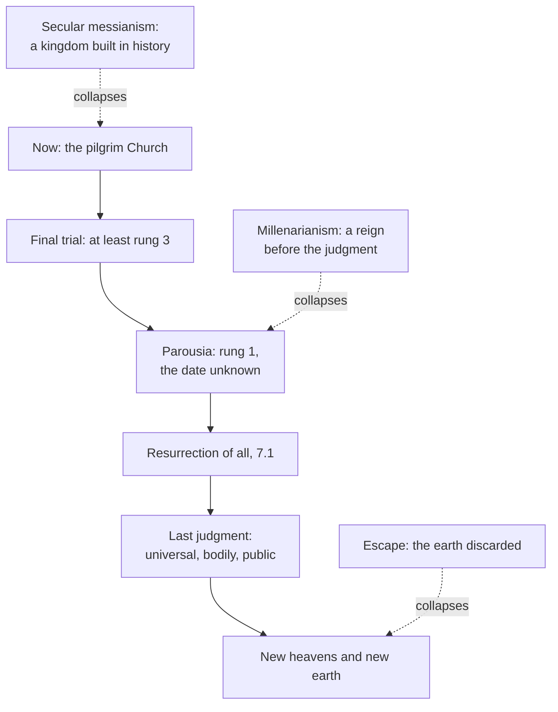

# Creation, Grace & the Last Things · Lesson 7.2: The parousia, the last judgment, and the new creation

> ⏱ ~15 min · Module 7: The consummation, and the questions left open · Builds on: [7.1](07-01-the-resurrection-of-the-body.md), [6.1](06-01-death-and-the-particular-judgment.md), [1.2](01-02-and-god-saw-that-it-was-good.md) · Unlocks: [7.3](07-03-hope-for-all.md), [7.4](07-04-limbo.md)

## Why this matters

Christians have tried to date this article of the Creed more than any other, and an ecumenical council once forbade preachers to do it, saying the date-setters had lied. It also makes this course one story: the world called good in [1.2](01-02-and-god-saw-that-it-was-good.md) is judged and remade, not thrown away. This lesson states what the Church teaches about the end, and what she refuses to say about its timing.

## The idea

Aquinas's analogy: you cannot judge a deed until its results are in. A man dies and his verdict as a person is settled ([6.1](06-01-death-and-the-particular-judgment.md)). But his life goes on in his children, his reputation, the good or harm his work still does, his body. A verdict on all that must wait until history is finished. That is the [last judgment](../reference.md#last-judgment): not a retrial of the soul, but the verdict on a whole life, completed and made public.

The judge is Christ, returning visibly at the [parousia](../reference.md#parousia) (Greek, "arrival"). What ends is the world's present form, not the world, as a damaged house is restored, not demolished: "the fashion of this world passeth away" (1 Cor 7:31, DR). That is the [new creation](../reference.md#new-creation). One thing is withheld on purpose: the date.

## Source

Lateran V, Session XI (19 December 1516), the decree on preaching [*Supernae maiestatis praesidio*](../reference.md#supernae-maiestatis-praesidio) (Mansi vol. 32, col. 946; lesson's translation):

> Nor let them in any way presume to preach or assert a fixed time of future evils, or the coming of Antichrist, or a certain day of judgment; for the Truth says that it is not ours to know the times or moments which the Father has put in his own power; and it is plain that those who have so far dared to assert such things have lied, and that because of them no small harm has been done to the authority of others who preach rightly.

Three things are forbidden: a *tempus praefixum* of coming evils, Antichrist's arrival, a *certum diem iudicii*. The reason is Acts 1:7 with one word changed: the Vulgate's *vestrum*, "yours", becomes *nostrum*, "ours", so the council turns the warning on itself. Past date-setters are *mentitos*, liars. Prophecy is not banned; claimed revelations go to Rome for examination first. The genre is law, backed by excommunication; its reason is doctrine.

## The doctrine

1. **He will come again to judge.** "He shall come again, with glory, to judge both the quick and the dead" (the Creed of 381, Schaff). [*Firmiter*](../reference.md#firmiter) (Lateran IV, 1215): he comes *in fine saeculi*, at the world's end, to render to each, reprobate and elect, according to his works. The New Testament's expectation and its delay are [`new-testament`](../../new-testament/syllabus.md)'s ([4.3](../../new-testament/lessons/04-03-paul-at-work.md), [6.1](../../new-testament/lessons/06-01-the-disputed-pauline-letters-and-the-pastorals.md)); CCC 673 calls the coming imminent and "delayed". *In words:* the same Christ returns, visibly, to finish history by judging it.

2. **The [pilgrim Church](../reference.md#pilgrim-church) waits.** *Lumen Gentium* ch. VII (§48): the Church is perfected only in glory. The world's renewal is "irrevocably decreed" and anticipated in her real but imperfect holiness. The final sorting waits for the harvest, which "is the end of the world" (Matt 13:39, DR; CCC 681), so the parable is no policy for now ([`ecclesiology-and-mariology` 5.4](../../ecclesiology-and-mariology/lessons/05-04-a-church-of-sinners.md)). *In words:* the Church is the kingdom begun, not finished.

3. **The last judgment: universal, bodily, public.** After defining the immediate destinies, *[Benedictus Deus](../reference.md#benedictus-deus)* (1336) goes on: *nihilominus*, "none the less", on the day of judgment all will appear with their bodies before Christ's tribunal to give account of their deeds (lesson's translation). "None the less" keeps both: the [particular judgment](../reference.md#particular-judgment) stands, and there is still a judgment. It adds the body ([7.1](07-01-the-resurrection-of-the-body.md)) and publicity: "we must all be manifested before the judgment seat of Christ" (2 Cor 5:10, DR; LG 48), God's justice shown before all (CCC 1040). For Aquinas it adds the whole life, still unfolding in memory, children and results, so "a perfect and public Judgment" must wait (ST III q.59 a.5). *In words:* it does not retry the soul; it completes and publishes the verdict on everything a life set moving.

4. **Its criterion.** In Matt 25:31–46 the king judges "all nations" by works of mercy: "as long as you did it to one of these my least brethren, you did it to me" (25:40, DR). As doctrine: judgment by works (*Firmiter*); Christ identified with those served, so that how we treat a neighbour shows grace accepted or refused (CCC 678); a final verdict (25:46; [6.4](06-04-hell.md)). Merit is [5.3](05-03-merit.md)'s. *In words:* the judgment reads love given or refused to Christ in others.

5. **Before it, a final trial.** CCC 675–677, paraphrased: the Church must pass through a trial that will shake the faith of many (Luke 18:8), whose height is the [Antichrist](../reference.md#antichrist)'s deception, man glorifying himself in God's place (2 Thess 2:3–4). She enters glory by following her Lord through death, not by "a historic triumph". The deception is also already here: 1 John names present "Antichrists" while presupposing the one expected, "as you have heard that Antichrist cometh" (2:18; [`new-testament` 6.4](../../new-testament/lessons/06-04-peter-jude-and-the-letters-of-john.md)). *In words:* the Church expects her own Passion before her glory, and names neither date nor actors.

6. **No one knows the day.** "Of that day and hour no one knoweth" (Matt 24:36, DR; Mark 13:32's "nor the Son" is [`christology` 4.2](../../christology/lessons/04-02-christs-human-knowledge-the-classical-account.md)'s); Acts 1:7. Augustine calls computing the years left "in vain" (*City of God* XVIII.53, Dods). LG 48 and GS 39 repeat it; Lateran V made it law. *In words:* the Church knows no timetable, and says so.

7. **Millenarianism.** [Millenarianism](../reference.md#millenarianism) expects a reign of Christ on earth before the end. Papias, Justin and Irenaeus had the risen just reign on a renewed earth before the judgment ([`patristics` 2.2](../../patristics/lessons/02-02-irenaeus-recapitulation.md)); Justin granted that many "true Christians, think otherwise" (*Dialogue* 80). Augustine read Revelation 20's thousand years as the Church's age (XX.7; [`new-testament` 6.5](../../new-testament/lessons/06-05-revelation.md)). In 1944 the Holy Office judged that [mitigated millenarianism](../reference.md#mitigated-millenarianism), Christ coming visibly to rule on earth before the final judgment, *tuto doceri non posse*, "cannot safely be taught" (19 July, approved by Pius XII). CCC 676 extends the word to any claim to realize the kingdom inside history, above all a [secular messianism](../reference.md#secular-messianism). CCC 1047 still quotes Irenaeus's millenarian chapter (V.32.1) for creation restored, minus the reign. *In words:* no kingdom is built, or reigned, inside history before the end.

8. **New heavens and a new earth.** Rom 8:21 frees "the creature also itself" from corruption; "Behold, I make all things new" (Rev 21:5, DR). LG 48: with the human race the whole world will be perfectly re-established in Christ (CCC 1042–1047). Irenaeus: "neither is the substance nor the essence of the creation annihilated" (V.36.1, Rambaut). *In words:* what God called good he remakes, and the arc [1.2](01-02-and-god-saw-that-it-was-good.md) opened closes here.

9. **Progress and the kingdom.** GS 39, paraphrased: the hope of a new earth must quicken our care for this one; earthly progress must be "carefully distinguished" from the growth of Christ's kingdom, yet matters vitally to it insofar as it betters society; and the goods of dignity, brotherhood and freedom nurtured here we will find again, "transfigured". The two errors it steers between: progress mistaken for the kingdom, and the earth treated as disposable. Practice is [`catholic-social-teaching`](../../catholic-social-teaching/syllabus.md)'s. *In words:* the kingdom is God's gift, not our product, and work for this world is not wasted.

**Said plainly.** Paul wrote "we who are alive" (1 Thess 4:15 [DR 4:14]), and most critics read him as expecting to see the end ([`new-testament` 4.3](../../new-testament/lessons/04-03-paul-at-work.md)); 2 Peter already answers scoffers asking "Where is his promise?" (3:4, DR). Papias, Justin and Irenaeus, among the oldest Fathers, taught a millennium the Church now judges unsafe to teach. Christians set dates often enough that a council had to forbid it.

| Defined or taught (with level) | A school's explanation or an opinion (no magisterial level) |
|---|---|
| Christ returns to judge all by their works: **rung 1** (the creeds; *Firmiter*) | Why judge twice: "according to different respects" (Aquinas, III q.59 a.5 ad 2) |
| A final trial and the Antichrist's deception come first: **at least rung 3** (CCC 675–677) | That the Antichrist is one man (Aquinas III q.8 a.8): **rung 4**; naming him: nothing |
| No one knows the day: **at least rung 3** (LG 48; GS 39); preachers may not fix it: **law** (Lateran V) | Reckonings of the end from Daniel's or Revelation's numbers: no standing |
| Mitigated millenarianism cannot safely be taught: **rung 3** (Holy Office, 1944) | Augustine's thousand years as the Church's age: **rung 5** as exegesis |
| The world renewed, not annihilated: **at least rung 3** (LG 48; GS 39) | How, and which creatures it holds: **rung 5**; Aquinas's "no animals" (Supplement q.91 a.5) is a school opinion |

**Mark the levels** ([the ladder](../../fundamental-theology/lessons/04-04-the-ladder-of-doctrinal-authority.md); [levels of authority](../reference.md#levels-of-authority)). Beyond the table: the bodily appearing and the standing particular verdict are **rung 1** as 7.1 and 6.1 fix them, held together by *nihilominus*. Publicity (LG 48; CCC 1039–1040), the pilgrim Church of LG 48, Matthew 25 read through CCC 678, and CCC 676 on secular messianism are **at least rung 3**. For the date and for renewal, a rung-1 reading through the ordinary universal magisterium is arguable but not manifest: default down (can. 749 §3). The 1944 note is "unsafe", not "heretical", and the Fathers as authors carry **no magisterial level**. GS 39's distinction is **at least rung 3** (a pastoral constitution's principle, [`fundamental-theology` 4.5](../../fundamental-theology/lessons/04-05-reading-a-documents-weight.md)); how the world is transformed is **rung 5**, since GS 39 says we do not know; *Laudato Si'* §243 is **rung 3**.

## The map

Each dashed node is an error collapsing one joint of the sequence.

## Worked examples

**Ex 1 (clean): "Grandad has already been judged."** Invented: at Christ the Redeemer, Westharbour, the inquirer Tancredi Owusu asks the catechist Lucija Fairbairn why Christ will still judge his grandfather, dead since the spring. *Defined:* both judgments (*nihilominus*): the verdict on the soul is settled (**rung 1**, 6.1), and he will still appear, in his body, before Christ (**rung 1**). *Taught:* in public (2 Cor 5:10; **at least rung 3**). *School:* what is left to judge, on Aquinas's list: the grandchildren he formed, his reputation, the firm he built and any harm it still does. Tancredi may reject it and deny nothing defined.

**Ex 2 (strain): the dog.** Invented: in a sixth-form class, Oisín Marchbank asks whether his dog Bramble, who died at Easter, will be in the new creation. *Settled:* creation is renewed (**at least rung 3**); the creature "itself" is freed (Rom 8:21). *School:* Aquinas says no animals remain, since only what can receive incorruption is renewed (the posthumous Supplement, q.91 a.5). *Strain:* *Laudato Si'* §243 pictures each creature, transfigured, in its rightful place: an encyclical's sentence, **rung 3** though meditative in manner, and it tells against Aquinas's "no", a school opinion that was never the Catholic answer. It does not say whether kinds or individuals are meant, let alone this dog. The doctrine stops at "creation, yes; Bramble, nobody knows": **rung 5**.

## Watch out

- **You might think the last judgment is a retrial.** *Nihilominus* holds both: the soul's verdict is never reopened, and the last day judges "according to different respects".
- **You might think millenarianism is heresy, or open because Irenaeus held it.** The 1944 decree is **rung 3**: "cannot safely be taught", not "heretical"; a Father's opinion has no magisterial level.
- **You might think "no one knows the day" is a pious caution.** It is taught, **at least rung 3**; the ban on preachers is law, the teaching under it is not.
- **You might think 2 Pet 3:10 teaches annihilation.** Renewal is taught, and the verse is unsettled: for the Douay's "burnt up" (Vulgate *exurentur*) Westcott and Hort print *heurethēsetai*, "will be found".

## One-liner

> Christ will come to judge everyone, bodily and in public, and to remake the world he made good; the date is what the Church refuses to give.

## Problems

**P1 (🟢)** *(Exegetical)* **Diagnose.** From a talk at a youth retreat, **invented** for this problem, given at Christ the Redeemer, Westharbour:

> (1) "Every just law we pass and every hungry child we feed builds the Kingdom brick by brick, and when the building is finished Christ will come back to live in it."
>
> (2) "But don't get distracted by saving the planet: nothing we make here lasts into eternity, so put your energy into saving your soul."
>
> (3) "And until he comes, the Church's job is to weed out the bad Catholics, so the field is clean for the harvest."

For each sentence, say what it gets wrong, name the text that corrects it, and give that text's level. **Two sentences per item.**

**P2 (🟡)** *(Exegetical)* **Close reading.** Aquinas, ST III q.59 a.5, from the replies to the first and third objections (Fathers of the English Dominican Province, 2nd ed., 1920):

> after death man enters into an unchangeable state as to all that concerns the soul: and therefore there is no need for postponing judgment as to the reward of the soul. But since there are some other things pertaining to a man which go on through the whole course of time, … all these things must be brought to judgment at the end of time. For although in regard to such things a man neither merits nor demerits, still in a measure they accompany his reward or punishment. … since the soul is changeable only accidentally, on account of the body, once it is separated from the body it enters into an unchangeable condition, and receives its judgment. But the body remains subject to change down to the close of time: and therefore it must receive its reward or punishment then, in the last Judgment.

(a) What does "an unchangeable state as to all that concerns the soul" exclude, and what reason does the passage give for it?

(b) Name the two kinds of thing the passage leaves for the last day, and the clause that keeps the last judgment from adding merit or demerit.

(c) A reader concludes: "So the last judgment changes nothing that matters; it only announces what was settled at death." Say what he gets right and what he misses, from the passage.

**Two sentences per part.**

**P3 (🔴)** *(Exegetical)* **Find the crux.** Matthew 25:40 (DR): "as long as you did it to one of these my least brethren, you did it to me"; 25:45: "as long as you did it not to one of these least, neither did you do it to me." Two readings compete among exegetes.

- **Position A (universal):** "the least" are any needy human beings, so all nations are judged by their mercy to the needy as such.
- **Position B (particular):** in Matthew, Christ's "brethren" and "these little ones" are his disciples (12:49–50; 28:10; 10:42), so the nations are judged by how they received his messengers (10:40, "He that receiveth you, receiveth me").

(a) Name the single premise one side must deny, and two textual features that would move it.

(b) *Gaudium et Spes* 27 cites 25:40 for the duty to be a neighbour to everyone, with no exceptions, and CCC 678 reads the judgment through our attitude to our neighbour. If B were right, what in that teaching would stand and what would not? Give the level of each claim you use.

**Two sentences for (a), three for (b).**

Solutions

**P1** *(Exegetical)*

**Must hit, strict:**

- **(1)** It identifies earthly progress with the kingdom and makes the parousia the crowning of our work. GS 39 says earthly progress must be distinguished from the growth of Christ's kingdom, even though it is of vital concern to the kingdom insofar as it betters society (**at least rung 3**); CCC 676 counts the claim to realize the kingdom inside history as a falsification of it, whose political form is secular messianism (**at least rung 3**). Credit noting what is right in it: the just law and the fed child do matter to the kingdom.
- **(2)** It treats the hope of heaven as a reason to neglect the earth, the second error GS 39 names. GS 39 says the expectation of a new earth must stimulate, not weaken, our care for this one, and that the goods of human dignity, brotherhood and freedom we nurture here we will find again, transfigured (**at least rung 3**). Credit adding *Laudato Si'* §244 (2015): all the good here will be taken up into the heavenly feast (an encyclical, **rung 3**).
- **(3)** The parable puts the sorting at the harvest, "the end of the world", and gives it to the angels (Matt 13:30, 39), so the final separation of wicked and just is Christ's at the last judgment (**rung 1**: *Firmiter*, reprobate and elect each receiving according to their works). Until then the pilgrim Church's holiness is real but imperfect and she holds sinners (LG 48, with LG 8 in [`ecclesiology-and-mariology` 2.2](../../ecclesiology-and-mariology/lessons/02-02-holy.md): **at least rung 3**), though the parable does not abolish her discipline ([5.4](../../ecclesiology-and-mariology/lessons/05-04-a-church-of-sinners.md)).

**Wrong turns:** correcting (1) by saying earthly work is irrelevant to the kingdom, which swaps one GS 39 error for the other; correcting (2) by asserting a level for the world's renewal instead of reading GS 39's teaching on care for the earth; correcting (3) by saying the Church may never exclude anyone, which overreads the parable (`ecclesiology-and-mariology` 5.4); citing the Catechism as if it fixed a level by itself.

**Model answer:** (1) It makes earthly progress the kingdom itself and Christ's return its completion, which GS 39 forbids: progress must be distinguished from the kingdom's growth, though it matters vitally to the kingdom insofar as it betters society (at least rung 3). CCC 676 calls the claim to realize the kingdom inside history a secular messianism, at least rung 3, while the talk is right that feeding the hungry matters. (2) GS 39 names this as the second error: the hope of a new earth must quicken our care for this one (at least rung 3). Nor is the work lost, since the goods of dignity, brotherhood and freedom we nurture here we will find again, transfigured. (3) The sorting belongs to the harvest, "the end of the world", and to the angels (Matt 13:39), that is, to Christ's judgment, where reprobate and elect each receive according to their works (*Firmiter*, rung 1). Till then the pilgrim Church is holy but holds sinners (LG 48, at least rung 3), though she keeps her discipline.

---

**P2** *(Exegetical)*

**Must hit, strict (a):**

- It excludes any change in the soul's merit or destiny after death: no later conversion, no second chance, and no postponing the soul's reward until judgment day ("no need for postponing judgment as to the reward of the soul").
- The reason: the soul is "changeable only accidentally, on account of the body", so once separated it is fixed. Credit noting that this matches the immediacy taught in [6.1](06-01-death-and-the-particular-judgment.md).

**Must hit, strict (b):**

- The two kinds: the "other things pertaining to a man which go on through the whole course of time" (the respondeo's memory, children and results of his acts), and the body, "subject to change down to the close of time".
- The clause: "in regard to such things a man neither merits nor demerits, still in a measure they accompany his reward or punishment". The last day weighs, it does not earn.

**Must hit, strict (c):**

- Right: the soul's verdict and merit are not changed; nothing settled at death is reopened.
- Missed: the body "must receive its reward or punishment then, in the last Judgment", and the life's continuing effects are weighed then. So the whole person's recompense, and the judgment of what a life set going, happen only at the end; "nothing that matters" is false.

**Wrong turns:** reading "unchangeable" as excluding purgatory. The state fixed is the soul's merit and destiny, which purification does not alter, since the souls being purified are already saved (CCC 1030; [6.3](06-03-purgatory.md)). Taking "accompany his reward" to mean the last judgment can raise or lower salvation itself. Treating Aquinas's list as defined: the reasons are a school's explanation, with no magisterial level.

**Model answer:** (a) It excludes any change in what the soul merits or where it is destined after death, so there is no second chance and no waiting until judgment day for the soul's reward. The reason given is that the soul changed only accidentally, through the body, so once separated it is fixed. (b) The last day judges the things of a man that "go on through the whole course of time" and the body, which stays "subject to change down to the close of time". The clause that keeps merit out is "a man neither merits nor demerits" in them, though "they accompany his reward or punishment". (c) He is right that nothing in the soul's verdict changes, since the soul's reward needs no postponing. He misses that the body receives its reward or punishment only "then, in the last Judgment", and that the life's ongoing effects are weighed then, so the whole person is judged only at the end.

---

**P3** *(Exegetical)*

**Accept:** in (a), any two of the textual features listed.

**Must hit, strict (a):**

- The crux: whether "my least brethren" in 25:40 keeps Matthew's in-group sense, Christ's disciples, as "brethren" and "little ones" do elsewhere. B needs that premise and A must deny it, holding that the scene's universal frame widens the term.
- Features that would move it: Matthew's usage (12:49–50, the disciples called "my brethren"; 28:10; 10:42, "little ones … in the name of a disciple"; 18:6, "little ones that believe in me"); the parallel promise of reward for receiving disciples (10:40–42); 25:45's dropping of "brethren"; whether "all nations" (25:32) means the Gentiles, as in 24:14 and 28:19, or everyone; the surprise of both groups, which each side can explain.

**Must hit, strict (b):**

- **Stands:** Christ judges all by their works (**rung 1**, *Firmiter*), and the duty of mercy to everyone, with no exceptions (GS 27, **at least rung 3**), which rests on more than this verse: the Samaritan who "shewed mercy" to a stranger (Luke 10:36–37), love of enemies (Matt 5:44), good "to all men" (Gal 6:10).
- **Would not stand:** a claim that Matthew's literal sense makes "the least" all the needy, since no act fixes the verse's original referent. That exegesis is **rung 5** (no magisterial level as exegesis), and GS 27's use of the verse is an application, not a ruling on it.
- So B, if right, removes a proof-text's literal force, not the teaching. Credit noting that Augustine, quoted in CCC 1039, already speaks of Christ's needy "members", a reading between A and B.

**Wrong turns:** "the Church has defined that the least are the poor" (overstates: GS 27 cites the verse and rules on no exegesis); "if B is right, the Church's teaching on the poor collapses" (understates: the duty has other grounds and its own act); making the crux faith against works, which is [5.3](05-03-merit.md)'s question; treating CCC 678 as fixing a level by itself.

**Model answer:** (a) The crux is whether "my least brethren" keeps the sense Matthew gives "brethren" and "little ones" elsewhere, Christ's disciples: B affirms it and A must deny it. Matthew's usage (12:49–50; 10:42; 18:6) and the reward for receiving disciples (10:40–42) favour B, while 25:45's dropping of "brethren" and a reading of "all nations" as everyone favour A. (b) If B were right, it would still stand that Christ judges all by their works (*Firmiter*, rung 1) and that we must be a neighbour to everyone, with no exceptions (GS 27, at least rung 3), a duty that also rests on the Samaritan, love of enemies and Gal 6:10. What would fall is only the claim that Matthew's own sense of "the least" is all the needy, an exegesis no act fixes (rung 5). GS 27's use of 25:40 is an application, so B would cost the teaching a proof-text, not its ground.

## Flashback

**From Lesson [7.1](07-01-the-resurrection-of-the-body.md) (The resurrection of the body):** *(Exegetical.)* Reconstruct. Supplement q.75 a.1, *respondeo* (English Dominican Province; compiled after Aquinas's death from his *Sentences* commentary), condensed. Man's last end, "which all men desire naturally", is happiness. Some placed it in this life, but "the changeableness of fortune, the weakness of the human body, the imperfection and instability of knowledge and virtue" stand in the way. Others, with Porphyry, placed it in the soul alone, because bodies come from an evil principle, or because "the entire nature of man is seated in the soul", which uses the body "as a sailor uses his ship". But, as Aristotle shows, "the soul is united to the body as form to matter. Hence it is clear that if man cannot be happy in this life, we must of necessity hold the resurrection."

(a) Set the argument out as P1, P2, … ∴ C, supplying the unstated premise that carries it from "not in this life" to "in another". **Six lines or fewer.**

(b) Does the argument prove the resurrection by reason alone? Answer from q.75 a.3, which calls the resurrection "strictly speaking, miraculous and not natural except in a restricted sense". **Two sentences.**

Solution

**Must hit, strict (a):**

- P1 Man's last end, naturally desired by all, is happiness. P2 (unstated) That desire is not in vain. P3 Happiness is not had in this life. P4 So it is had after death, by the soul alone or by the whole man. P5 The soul alone would suffice only if bodies were evil or a man were his soul, the body his tool. P6 Neither: bodies are God's good work ([1.2](01-02-and-god-saw-that-it-was-good.md)), and the [soul is the form of the body](../reference.md#soul-as-form-of-the-body). ∴ C The whole man must live again: the resurrection.
- P6's form clause does the work: "Abraham's soul, properly speaking, is not Abraham himself, but a part of him" (ad 2). That is 7.1's "my soul is not I".

**Must hit, strict (b):**

- **No.** "Of necessity" hangs on "if man cannot be happy in this life" and on P2; even granted both, the argument shows that human nature needs the resurrection, not that it will happen, for "in nature there is no active principle of the resurrection" (a.3), and "from natural things one does not come by a demonstration of reason to know non-natural things" (a.3 ad 2).
- That the dead will rise rests on God's power and on revelation (the creeds; *Firmiter*); the argument shows why the article fits what a human being is.

**Wrong turns:** supplying "the soul is immortal" as the missing premise: it is presupposed (Lateran V; [2.3](02-03-the-soul-immediately-created-and-immortal.md)), but only the desire's not being in vain carries "not here" to "elsewhere". In (b), "yes, it says 'of necessity'", or the mirror error, "it proves nothing", when a.3 calls the resurrection natural in a restricted sense, since it ends in the life of nature.

**Model answer:** (a) P1 Happiness is man's naturally desired end. P2 A natural desire is not in vain. P3 Happiness is not had in this life. P4 So it is had after death, by the soul alone or by the whole man. P5 By the soul alone only if bodies were evil or a man were his soul. P6 Bodies are good, and the soul is the body's form. ∴ C Man must rise, body and soul. (b) No: the necessity depends on the conditional and on P2, and even then shows only that human nature needs the resurrection, since nature has no active principle of it (a.3). That it will happen rests on God's power and on revelation.

## Connections

- **Backward:** [6.1](06-01-death-and-the-particular-judgment.md) gave the particular judgment that *nihilominus* keeps standing, and [7.1](07-01-the-resurrection-of-the-body.md) the bodies in which all appear. [1.1](01-01-creation-out-of-nothing.md) made the world for God's glory and [1.2](01-02-and-god-saw-that-it-was-good.md) called it good: here it reaches that end, renewed. The expectation and delay are read in [`new-testament` 4.3](../../new-testament/lessons/04-03-paul-at-work.md) and [6.1](../../new-testament/lessons/06-01-the-disputed-pauline-letters-and-the-pastorals.md), Revelation 20 in [6.5](../../new-testament/lessons/06-05-revelation.md), and Irenaeus's millennium in [`patristics` 2.2](../../patristics/lessons/02-02-irenaeus-recapitulation.md).
- **Forward:** [7.3](07-03-hope-for-all.md) asks whether one may hope that the judgment's left hand is empty, and [7.4](07-04-limbo.md) what it holds for infants who die unbaptized. What the renewal of creation asks of Christians now is [`catholic-social-teaching`](../../catholic-social-teaching/syllabus.md)'s.
- **Sideways:** the harvest and the pilgrim Church close the argument of [`ecclesiology-and-mariology` 5.4](../../ecclesiology-and-mariology/lessons/05-04-a-church-of-sinners.md) and [1.4](../../ecclesiology-and-mariology/lessons/01-04-people-of-god-communion-sacrament.md): the Church is not yet what she will be. Mark 13:32's "nor the Son" is a question about Christ's human knowledge, [`christology` 4.2](../../christology/lessons/04-02-christs-human-knowledge-the-classical-account.md). Lateran V's ban and the 1944 decree are two acts with the same shape, a discipline resting on a doctrine, the pairing [`fundamental-theology` 4.5](../../fundamental-theology/lessons/04-05-reading-a-documents-weight.md) teaches you to separate.
