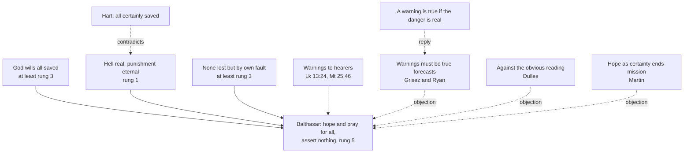

# Creation, Grace & the Last Things · Lesson 7.3: Hope for all

> ⏱ ~15 min · Module 7: The consummation, and the questions left open · Builds on: [6.4](06-04-hell.md), [5.4](05-04-predestination.md), [6.2](06-02-heaven-and-the-beatific-vision.md) · Unlocks: [7.4](07-04-limbo.md)

## Why this matters

On 14 January 2024, asked about hell on Italian television, Pope Francis said that what followed was "not a dogma of faith", then: *a me piace pensare all'Inferno vuoto*, "I like to think of hell as empty" (Vatican News, lesson's translation). Augustine wrote that "many more are left under punishment than are delivered from it" (*City of God* XXI.12, tr. Marcus Dods). Neither binds a Catholic; this lesson says why.

## The idea

A lifeguard posts a sign: *Dangerous current. Swimmers drown here.* It is honest if the current is real: it needs no body count, and the lifeguard's hope that no one drowns does not make it a lie. Written by someone who sees the future, the same words could be a report. The dispute is over which kind of sign Christ's warnings are: a [threat or a prediction](../reference.md#threat-and-prediction).

Every Catholic position must hold four data: God wills all saved; hell is eternal; none is lost but by his own fault; the warnings are real. Three positions try. **Many are lost, and we know it**: long the dominant view. **[Hope for all](../reference.md#hope-for-all)**: the danger is real for everyone, the outcome unknown, and we may hope and pray that all are saved (Balthasar). **All will be saved, and we know it**: [universalism](../reference.md#universalism) asserted.

One distinction does the work: [hope for each](../reference.md#hope-for-each-and-for-all) person against hope that all together are saved. You can hope of every lottery ticket that it wins, knowing they will not all win.

## Source

Augustine, *City of God* XXI.24 (c. 426), tr. Marcus Dods (NPNF, first series, vol. 2):

> At present she prays for her enemies among men, because they have yet opportunity for fruitful repentance. […] But if the Church were certified who those are, who, though they are still abiding in this life, are yet predestinated to go with the devil into eternal fire, then for them she could no more pray than for him. But since she has this certainty regarding no man, she prays for all her enemies who yet live in this world; and yet she is not heard in behalf of all.

The Church prays for every living person, and the ground is **ignorance**: "this certainty regarding no man". Yet "she is not heard in behalf of all": Augustine hopes for each and denies the hope for all. The denial does not come from the prayer. A paragraph later he cites Matthew 25:41 and 46, calling it "excessively presumptuous" to deny that the punishment of those God said shall go away is eternal. He reads the warning as a forecast. Balthasar keeps the prayer and declines the "and yet".

## In their own words

**Balthasar.** *Was dürfen wir hoffen?* (1986) and *Kleiner Diskurs über die Hölle* (1987), in English *Dare We Hope "That All Men Be Saved"? With a Short Discourse on Hell* (Ignatius, 1988), paraphrased. The New Testament gives two series of texts: two outcomes, judgment and the fire (Matthew 25); and God willing and able to save all (1 Timothy 2:4; John 12:32; Romans 11:32). Neither may be dissolved into the other, the universal texts into a mere offer or the threats into empty words. So no one knows the outcome, and the Christian may, and even must, hope for all, since grace may move even the worst sinner to repent before death (as Dulles reports): one chapter is "The obligation to hope for all". He asserts nothing about the result, rejects a hell emptied at the end, and holds damnation a real possibility for each, oneself first.

**The critics.** Ralph Martin, *Will Many Be Saved?* (Eerdmans, 2012), reads a sentence of *Lumen Gentium* 16 often skipped. Having taught that those who without fault do not know the Gospel can be saved, it adds *at saepius*, "but often": people deceived by the Evil One exchange God's truth for a lie. So the conditions are often unmet, and a hope heard as near-certainty has drained evangelization of urgency. Germain Grisez and Peter F. Ryan ("Hell and Hope for Salvation", *New Blackfriars* 95, 2014) add that Christ's warnings convey that more than a few will be lost: he would have been dishonest to move hearers with warnings that were not "truthful information". Avery Dulles ("The Population of Hell", *First Things*, May 2003) finds Balthasar "orthodox" but "at least adventurous": against the obvious reading of Jesus's words, and reconcilable with Scripture if the warnings are "minatory rather than predictive".

**Universalism asserted.** David Bentley Hart, an Eastern Orthodox theologian (*That All Shall Be Saved*, Yale, 2019), paraphrased. A God who creates freely out of nothing answers for every final end he permits. A rational will is moved by its nature toward the Good, so a creature freed of all ignorance and compulsion cannot finally refuse God. So all will be saved, as a conclusion and not a hope, and *aiōnios* means "of the age". The philosopher Marilyn McCord Adams argued the same from horrendous evils ([`apologetics-foundations` 2.3](../../apologetics-foundations/lessons/02-03-evil-and-hiddenness-the-replies-that-cost-something.md)).

## The doctrine

1. **God wills all to be saved.** "Who will have all men to be saved" (1 Timothy 2:4, DR) is Paul's reason for praying "for all men" (2:1); [5.4](05-04-predestination.md) graded the [universal salvific will](../reference.md#universal-salvific-will). *In words:* no one is outside God's will to save.

2. **Hell is real and eternal** ([6.4](06-04-hell.md)). [*Firmiter*](../reference.md#firmiter) (Lateran IV, 1215) has judgment rendered *tam reprobis quam electis*, "to the reprobate as to the elect": *illi cum diabolo poenam perpetuam*, "the former, perpetual punishment with the devil" (lesson's translation). [*Benedictus Deus*](../reference.md#benedictus-deus) (1336) is conditional: those "who die in actual mortal sin" go down at once (lesson's translation). *In words:* a final no is answered for ever; neither text defines that anyone says it.

3. **No one is lost except by his own fault.** God predestines no one to [hell](../reference.md#hell); a wilful turning from God persisted in to the end is required (CCC 1033, 1037). *In words:* whoever is lost chose it.

4. **The warnings are real, and in the future tense.** Asked whether few are saved, Jesus commands and forecasts: "Strive to enter by the narrow gate: for many, I say to you, shall seek to enter and shall not be able" (Luke 13:23–24, DR). Matthew 25:46's "these shall go" is a plain future, *apeleusontai*. CCC 1036 reads such texts as "an urgent call to conversion". *In words:* Christ names damnation as a danger to his hearers.

5. **What the Magisterium has said.** "In hope, the Church prays for 'all men to be saved'" (CCC 1821), and that no one be lost (1058). John Paul II (general audience, 28 July 1999): damnation is "a real possibility", and without special divine revelation we cannot know which human beings are involved (paraphrase). Trent's general reason: "except by special revelation, it cannot be known whom God hath chosen unto Himself" ([Session VI](../reference.md#trent-session-vi), ch. 12, Waterworth). *Spe Salvi* (2007): some *can* destroy all love in themselves (§45); in "the great majority", we may suppose, an openness to God remains (§46); hope is always hope for others too (§48). *In words:* the Church prays for all and says no one knows the outcome.

6. **What it has not said.** John Paul II's book *Crossing the Threshold of Hope* (1994) called Christ's words "unequivocal" (quoted by Dulles); Francis spoke in an interview ([`fundamental-theology` 4.5](../../fundamental-theology/lessons/04-05-reading-a-documents-weight.md)). *In words:* two popes leaned opposite ways in genres that bind no one.

7. **Universalism asserted is excluded.** A hell that ends (Hart) contradicts the defined eternity, as [*apokatastasis*](../reference.md#apokatastasis) did ([6.4](06-04-hell.md)); an eternal hell known to be empty claims what Trent says no one knows. *In words:* to hope is permitted; to know is not.

**The defence.** A warning is true if the danger is real; it needs no census. The universal texts are as plain as the threats. And a hope that asserts nothing cannot honestly be preached as a forecast.

**Said plainly.** The Church has never said that any human being is damned, nor that none is. For most of her history her greatest teachers held that most are lost (Augustine's "many more"; Aquinas's "minority", [5.4](05-04-predestination.md)); no act taught it. No act teaches the empty hell a pope liked to imagine either.

| Defined or taught (with level) | A school's explanation or an opinion (no magisterial level) |
|---|---|
| God wills every human being saved: **at least rung 3** | Antecedent and consequent will ([5.4](05-04-predestination.md)) |
| Hell's punishment is eternal: **rung 1** (*Firmiter*; the [Athanasian Creed](../reference.md#athanasian-creed)) | Its numbers: Augustine's "many more"; Dulles's hope for "very many, if not all": **rung 5** |
| None lost but by his own fault: **at least rung 3**; no predestination to sin: **rung 1** | Whether grace in fact wins every will (a hope); Hart's will that cannot finally refuse (a theory) |
| No one knows, without revelation, whom God has chosen: **at least rung 3** | Warnings as forecasts (Grisez–Ryan) or as real dangers (Balthasar): **rung 5** |
| In hope the Church prays for all to be saved: **at least rung 3** | Whether that licenses hope for all together, or only for each (Augustine): **rung 5** |

**Mark the levels** ([the ladder](../../fundamental-theology/lessons/04-04-the-ladder-of-doctrinal-authority.md); [levels of authority](../reference.md#levels-of-authority)). Beyond the table: the immediate descent of those dying in actual mortal sin ([6.2](06-02-heaven-and-the-beatific-vision.md)) and no one's certainty of his own perseverance without revelation (Trent VI can. 16) are **rung 1**; damnation's real possibility for every living person is **at least rung 3** (1999; CCC 1036). That one may hope all are saved is **rung 5**: no act condemns or teaches it. That any human being is damned is **taught by no act**: *Firmiter* names the class without manifestly defining that it has members (can. 749 §3). Universalism asserted contradicts **rung 1** if hell ends, **at least rung 3** if hell is known empty. The devil's perpetual punishment is **rung 1** ([1.3](01-03-the-angels.md)), so the hope concerns human beings. *Spe Salvi*'s "we may suppose" teaches nothing; the 1994 book, the 2024 interview and every author named carry **no magisterial level**.

## The argument

Balthasar holds the four data by refusing to know; Hart fails at the second.

## Worked examples

**Ex 1 (clean): the man who killed her sister.** Invented: at St John's, Sandling, Lavinia Marangoni asks whether she may pray for the salvation of Ruel Wrayburn, unrepentant and serving life for her sister's murder, and whether hoping he is saved betrays her. Yes, and no. Paul commands prayer "for all men" (1 Timothy 2:1), God wills Ruel's salvation (**at least rung 3**), and he is alive, so even Augustine prays for him. To hope he is saved is to hope he repents, not that the murder stops mattering: grace "does not make wrong into right" (*Spe Salvi* §44). Augustine, Grisez–Ryan and Balthasar agree: this is hope for each.

**Ex 2 (strain): all at once.** Invented: in the parish's inquirers' group, Obiageli Haverford asks, "If I may hope for each, may I hope for all together? Then what is Matthew 25:46 for?" The defined data do not answer. *Firmiter* names the reprobate without defining that the class has human members. The 1999 catechesis says we cannot know *which*, and is silent on whether any. The doctrine stops at whether "these shall go" reports an outcome or the end of a road: exegesis no act has settled (**rung 5**).

## Watch out

- **You might think the Church now teaches the hope for all.** She teaches that she prays in hope for all (**at least rung 3**); hope that all together are saved is **rung 5**.
- **You might think "a state, not a place" (1999) made eternity negotiable.** It says what hell is, not how long: eternity is **rung 1**.

## One-liner

> Hell is defined and its population is not: a Catholic may hope and pray for all while asserting nothing, and may not claim to know the outcome either way.

## Problems

**P1 (🟢)** *(Exegetical)* **Assign the level.** Place each claim on the ladder and name the act or source that fixes it, or say that none does. **One line each.**

(i) God wills every human being to be saved.

(ii) All human beings will certainly be saved, after a hell that purifies them and then ends.

(iii) There is an eternal hell, and it is certain that no human being is or ever will be in it.

(iv) Most human beings are damned.

(v) For every person now living, final damnation is a real possibility.

(vi) In Matthew 25:46, "these shall go into everlasting punishment" foretells that some human beings will in fact be lost.

**P2 (🟡)** *(Exegetical)* **Diagnose.** An **invented** podcast transcript, written for this problem; the speakers are not real people. On *Pew and Pint*, Benedetta Tannhauser and Ifor Quarshie discuss hell:

> (1) **Benedetta:** "Balthasar taught that hell is empty, and in 2024 Pope Francis made that the Church's position."
>
> (2) **Benedetta:** "And the Catechism says the Church 'prays that no one should be lost', so the Church officially hopes that hell is empty."
>
> (3) **Ifor:** "Wrong. Lateran IV says Christ renders judgment 'to the reprobate as to the elect', so it is defined dogma that some human beings are damned."
>
> (4) **Ifor:** "And Augustine and Aquinas settled that most are lost. Jesus said 'many', so that is Church teaching."

Correct each sentence, giving the level and the act or source involved. **Two sentences per item.**

**P3 (🔴)** *(Exegetical)* **Find the crux.** Two positions, paraphrased:

> **A (Balthasar).** We may and must hope that all will be saved, but we cannot know it: a created freedom can finally refuse God, and Christ's warnings name a real danger for each.
>
> **B (Hart).** All will be saved, and this can be known: a will freed of all ignorance and compulsion is moved by its nature to the Good and cannot finally refuse it, and a God who creates out of nothing answers for every final end.

(a) Name the single premise one side asserts and the other denies, and say which Church teaching bears on it, naming the act.

(b) Say what kind of argument would move a reader from B toward A.

**Two sentences per part.**

Solutions

**P1** *(Exegetical)*

**Must hit, strict:**

- **(i)** **At least rung 3**: 1 Timothy 2:4; CCC 1058, 1037; Christ's death for all, not the predestined only, is rung 1 by *Cum occasione* (1653), as [5.4](05-04-predestination.md) graded it. Rung 5 is wrong; so is calling the universal will an opinion because Augustine read "all" as "every sort of men".
- **(ii)** **Excluded; contrary to rung 1.** A hell that ends contradicts the defined eternity of its punishment (Lateran IV, *Firmiter*, *poenam perpetuam*; the Athanasian Creed, "everlasting fire"), as *apokatastasis* did ([6.4](06-04-hell.md)).
- **(iii)** **Excluded, but contrary to at least rung 3, not rung 1.** It claims knowledge that Trent VI ch. 12 says no one has without special revelation, and contradicts the 1999 audience's "real possibility". No definition says that any human being is damned, so "heresy" overstates.
- **(iv)** **No magisterial level; rung 5.** Augustine (*City of God* XXI.12) and Aquinas (ST I q.23 a.7 ad 3) as authors; no act teaches any number.
- **(v)** **At least rung 3**: the 1999 audience; CCC 1036. For oneself the core is **rung 1**: Trent VI can. 16 condemns claiming absolute certainty of final perseverance without special revelation.
- **(vi)** **Rung 5**: a reading of the verse (Grisez–Ryan; Dulles's "obvious interpretation"), which no act has fixed. The inerrancy of the verse is rung 1; the level of the doctrine is not the level of any reading of it ([`fundamental-theology` 4.4](../../fundamental-theology/lessons/04-04-the-ladder-of-doctrinal-authority.md), Ex 1).

**Wrong turns:** citing *Benedictus Deus* for eternity in (ii), when it fixes only the immediate descent; grading (iii) as heresy, or (iv) as rung 3 "because Jesus said many"; grading (vi) as rung 1 because Scripture cannot err; giving (v) rung 1 for every person, when can. 16 is about one's own perseverance; treating (ii) and (iii) as one claim.

**Model answer:** (i) At least rung 3: 1 Tim 2:4 and CCC 1058, with Christ's death for all rung 1 against *Cum occasione* prop. 5. (ii) Excluded: a hell that ends contradicts the eternity fixed by Lateran IV and the Athanasian Creed, rung 1. (iii) Excluded at least at rung 3: Trent VI ch. 12 says no one knows whom God has chosen without revelation, and the 1999 audience calls damnation a real possibility; no definition says anyone is damned. (iv) No magisterial level: Augustine's and Aquinas's opinion, rung 5. (v) At least rung 3 (1999; CCC 1036); for oneself rung 1 (Trent VI can. 16). (vi) Rung 5: a reading, not a defined sense, though the verse itself is inerrant.

---

**P2** *(Exegetical)*

**Must hit, strict:**

- **(1)** Balthasar asserted nothing about the outcome: he argued that Christians may hope and pray for all, held damnation a real possibility, and rejected a hell emptied at the end. Francis spoke in an interview, which has no magisterial level, and said himself that it was "not a dogma of faith".
- **(2)** CCC 1058 and 1821 teach that the Church prays in hope for all to be saved (**at least rung 3**); 1058 illustrates it with a prayer for oneself, "Lord, let me never be parted from you". Whether that prayer carries a hope for all together or for each in turn is disputed (**rung 5**): Augustine prayed for every living person while denying that all would be saved (*City of God* XXI.24). Either way a hope asserts no outcome, and no act says hell is empty.
- **(3)** *Firmiter* defines what the reprobate receive, perpetual punishment, at **rung 1**, and names the class, but no act manifestly defines that the class has human members (can. 749 §3). The 1999 audience says we cannot know which human beings are involved, and the Church has never declared anyone damned.
- **(4)** Augustine and Aquinas as authors carry **no magisterial level**; that most are lost is **rung 5**, taught by no act. "Many" in Matthew 7:13 and Luke 13:24 is a text whose reading is disputed, and Dulles himself concluded that we may hope "very many, if not all" will be saved.

**Wrong turns:** correcting (1) by saying the Church teaches hell is full, or (3) by saying the Church teaches hell is empty, which overcorrects in the other direction; treating (3)'s quotation as misquoted (it is accurate; the error is the inference); in (2), calling the Church's prayer for all "only a pious wish", which understates CCC 1821.

**Model answer:** (1) Balthasar hoped and asserted nothing, keeping damnation a real possibility and rejecting a hell emptied at the end. Francis's remark was an interview, no teaching act, and he called it not dogma. (2) The Catechism teaches that the Church prays in hope for all to be saved (CCC 1058, 1821, at least rung 3), but whether that is hope for each or for all together is disputed (rung 5), and Augustine prayed for everyone while denying that all would be saved. A hope asserts no outcome, so "the Church officially hopes hell is empty" turns a permitted hope into a position no act teaches. (3) Lateran IV defines perpetual punishment for the reprobate and names the class, but nothing manifestly defines that it has human members (can. 749 §3). John Paul II said in 1999 that we cannot know which human beings are lost, and the Church has never declared anyone damned. (4) Augustine and Aquinas held that most are lost, but as authors they carry no magisterial level, and no act teaches a number: rung 5. Jesus's "many" is a text whose reading is disputed, not a definition.

---

**P3** *(Exegetical)*

**Must hit, strict (a):**

- **The crux:** whether a created rational freedom can knowingly and finally refuse God. A affirms it as a real possibility, which is what keeps its hope from becoming knowledge; B denies it, and the certainty follows.
- **Bearing teaching:** the Church holds that created free spirits have made exactly that refusal. *Firmiter* (1215) says the devil and the other demons became evil by their own doing and assigns perpetual punishment "with the devil" (**rung 1**), and the 1999 audience says some have already said no. CCC 1033 calls hell self-exclusion by free choice. Credit either act; credit also the point that B's ending hell contradicts the defined eternity.

**Must hit, strict (b):** one of: an account of freedom on which a will can knowingly prefer itself to God, with the angels' fall as its test case (ST I q.63); or showing that B's moral premise proves too much, since it would also forbid God to permit the demons' final refusal, which the Church teaches; or a case that *aiōnios* in Matthew 25:46 means "everlasting", parallel to the life of the just in the same verse.

**Wrong turns:** naming "whether God is good" or "whether God wills all to be saved", which both affirm; naming "whether hope is permitted", a consequence, not the premise; answering (b) with "the Magisterium says so", which is a reason for a Catholic to reject B, not an argument that would move B's defender.

**Model answer:** (a) They divide on whether a created freedom can knowingly and finally refuse God: Balthasar holds it possible, which is why he can only hope, and Hart denies it, which is why he can claim to know. The Church teaches that the demons made that refusal and are punished perpetually (Lateran IV, rung 1; the 1999 audience), and calls hell self-exclusion by free choice (CCC 1033). (b) An account of freedom on which a will can knowingly prefer itself to God, tested on the angels' fall, would move a reader toward A. So would showing that Hart's moral premise proves too much, forbidding even the demons' refusal the Church teaches.

## Flashback

**From Lesson [6.4](06-04-hell.md) (Hell):** *(Exegetical.)* Find the crux. Augustine, *Enchiridion* 112 (tr. J. F. Shaw, NPNF first series, vol. 3), answering those who "make moan over the eternal punishment":

> But let them suppose, if the thought gives them pleasure, that the pains of the damned are, at certain intervals, in some degree assuaged. For even in this case the wrath of God, that is, their condemnation …, abideth upon them; … His tender mercies are exhibited, not in putting an end to their eternal punishment, but in mitigating, or in granting them a respite from, their torments …

The Supplement (q.71 a.5, English Dominican Province; compiled after Aquinas's death from his *Sentences* commentary) denies that the Church's prayers can lessen or interrupt their pains: guilt "remains for ever in the damned", and "punishment cannot be diminished unless guilt be diminished".

(a) Name the premise one side asserts and the other denies, and the words that let Augustine deny it. **Two sentences.**

(b) Does Augustine's concession collide with [*Firmiter*](../reference.md#firmiter)'s *poenam perpetuam* or with Florence's *poenis tamen disparibus*? **Two sentences.**

Solution

**Must hit, strict (a):**

- **The crux:** whether the damned's guilt, unchanged for ever, fixes the measure of their pain, so that it can neither lessen nor pause. The Supplement asserts it; Augustine's concession supposes it false. Both agree that the guilt remains and the punishment never ends.
- **His words:** he divides the punishment. "The wrath of God, that is, their condemnation" abides; mercy works on "their torments", "not in putting an end to their eternal punishment". Credit noting that he only permits the supposition ("if the thought gives them pleasure"), and in ch. 113 calls mitigation what men "may conjecture".

**Must hit, strict (b):**

- ***Perpetuam*** forbids an end, and Augustine's mercy works "not in putting an end", so a lessening collides with nothing. The pressure point is the respite: Latin *perpetuus* can mean unbroken, so a pause strains the word unless, with Augustine, the perpetual punishment is the condemnation, which abides through any respite.
- ***Disparibus*** makes the punishments unequal between the damned, not variable in time; Augustine holds that inequality too (ch. 111: "one being more endurably miserable than another"). The definitions fix duration and inequality and stop there: Augustine and the Supplement are school opinions, **no magisterial level**.

**Wrong turns:** "Augustine denies eternity", when he excludes an end in the same sentence; treating the Supplement's principle as defined; reading *disparibus* as change over time; naming the crux as whether hell is eternal or God merciful, which both affirm; reading the passage as a hope for all, this lesson's question, when it concerns the lost, who stay lost.

**Model answer:** (a) The crux is whether the damned's unchanging guilt fixes their pain so that it can neither lessen nor pause: the Supplement asserts it, and Augustine's concession supposes it false. He can, because he divides the punishment: God's "wrath, that is, their condemnation", abides, while mercy mitigates or respites "their torments", "not in putting an end to their eternal punishment". (b) A lessening collides with neither text, since *poenam perpetuam* forbids an end and *disparibus* makes the damned's punishments unlike one another, not their pains variable in time. Only the respite presses on *perpetuam*, which can mean unbroken, and Augustine's reply is that the perpetual punishment is the condemnation; past that, both sides are school opinions.

## Connections

- **Backward:** [6.4](06-04-hell.md) set out hell's defined eternity, the 543 and 553 question and Origen's *apokatastasis*; this lesson asks only who is there. [5.4](05-04-predestination.md) gave the universal salvific will, Augustine's "every sort of men" and Aquinas's "minority"; [6.2](06-02-heaven-and-the-beatific-vision.md) gave the vision of God that hope is for. How grace reaches those who never hear the Gospel, and the weight of *Lumen Gentium* 16, are [`ecclesiology-and-mariology` 5.1](../../ecclesiology-and-mariology/lessons/05-01-outside-the-church-there-is-no-salvation.md) and [`apologetics-foundations` 8.2](../../apologetics-foundations/lessons/08-02-salvation-outside-the-visible-church.md).
- **Forward:** [7.4](07-04-limbo.md) runs the same exercise on infants who die unbaptized, where the hope has to face a conciliar text. Boss 7 asks for the argued verdict this lesson withholds.
- **Sideways:** Balthasar's Holy Saturday, the Son's descent among the lost, is a separate dispute, laid out in [`christology` 6.1](../../christology/lessons/06-01-he-descended-into-hell.md). Why God leaves so many without the Gospel is the hiddenness problem, cited from [`philosophy-of-religion` 4.5](../../philosophy-of-religion/lessons/04-05-divine-hiddenness.md); no theodicy is argued here. Adams's universalism is a philosopher's answer to horrendous evil ([`philosophy-of-religion` 4.3](../../philosophy-of-religion/lessons/04-03-theodicies.md); [`apologetics-foundations` 2.3](../../apologetics-foundations/lessons/02-03-evil-and-hiddenness-the-replies-that-cost-something.md)), which collides with 6.4 when asserted.
