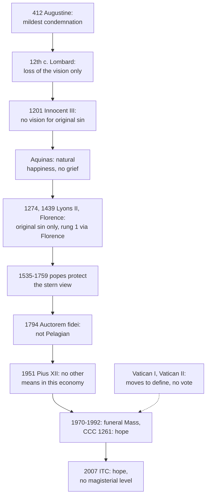

# Creation, Grace & the Last Things · Lesson 7.4: Limbo

> ⏱ ~15 min · Module 7: The consummation, and the questions left open · Builds on: [7.3](07-03-hope-for-all.md), [3.3](03-03-trent-session-v-the-definition.md), [4.4](04-04-nature-and-grace-the-gratuity-of-the-supernatural.md), [`sacraments-and-liturgy` 2.2](../../sacraments-and-liturgy/lessons/02-02-necessity-infants-and-baptism-of-desire-and-blood.md) · Unlocks: Boss problem 7 ([syllabus](../syllabus.md))

## Why this matters

For seven centuries, priests told grieving parents where their unbaptised children were, and the answer was a hypothesis no council defined. What Florence defined, after Lyons II, is harder: those who die "with original sin only" go to [hell](../reference.md#hell). [`sacraments-and-liturgy` 2.2](../../sacraments-and-liturgy/lessons/02-02-necessity-infants-and-baptism-of-desire-and-blood.md) gave the necessity of baptism and the 2007 verdict; here: why the question is hard, how it was answered, what each answer weighs.

## The idea

Three teachings meet in an infant who dies unbaptised: baptism is the one door God gave, necessary as a means; everyone is born without what Adam lost, a real deprivation; and God wills everyone saved. The infant has no sin of his own and can desire nothing. Each answer gives way somewhere:

- **[Pelagius](../reference.md#pelagianism)** denied the second: no inherited loss, so "eternal life", though not the kingdom. Condemned.
- **Augustine** read the third narrowly ([5.4](05-04-predestination.md)): they are condemned, if mildly.
- **The medieval schools** cut the penalty to the loss of the [vision of God](../reference.md#beatific-vision); Aquinas added a natural happiness without grief. Around 1200 the state was named (ITC 2007, §24) from *limbus*, the border of the underworld: [limbo](../reference.md#limbo) of children, *limbus puerorum*.
- **The 2007 study** questions a shared assumption: that God applies Christ's grace only in ways he has told us.

Keep apart the [limbo of the fathers](../reference.md#limbo-of-the-fathers) (*limbus patrum*): the just who died before Christ, in "Abraham's bosom" (CCC 633), freed when he descended ([`christology` 6.1](../../christology/lessons/06-01-he-descended-into-hell.md)). They had faith, grace and hope; the children, on the theory, none (Suppl. q.69 a.6). The one is taught; the other was always a hypothesis.

## Source

ST III q.52 a.7, "Whether the children who died in original sin were delivered by Christ?", from the *respondeo* (English Dominican Province):

> … the children who had died in original sin were in no way united to Christ's Passion by faith and love: for, not having the use of free will, they could have no faith of their own; nor were they cleansed from original sin either by their parents' faith or by any sacrament of faith. Consequently, Christ's descent into hell did not deliver the children from thence. And furthermore, the holy Fathers were delivered from hell by being admitted to the glory of the vision of God, to which no one can come except through grace … Therefore, since children dying in original sin had no grace, they were not delivered from hell.

Two arguments. Deliverance came through union with Christ's Passion, and three channels to it are closed: the child's own faith, the parents', a sacrament. And the vision needs grace. "Hell" is the whole lower world: a.2 (obj. 2) names a "hell of the children" without sensible pain. "Limbo" is absent from the Tertia Pars, not from Aquinas (I-II q.89 a.6).

## In their own words

**The case for limbo.** Aquinas's early *Sentences* commentary (II d.33; the Supplement's Appendix 1 q.1): original sin is the loss of a gift added to nature, so its only penalty is the loss of what the gift was for, the vision; sensible pain would punish "out of proportion to his guilt" (a.1). Nor do these souls grieve, for "no wise man grieves for being unable to fly like a bird" (a.2); they rejoice in "their own natural perfections". *De malo* q.5 a.3: only faith plants knowledge of that end, so they do not know what they lack. Suárez: Christ's healing grace makes that happiness possible (ITC §90).

## The doctrine

1. **The three premises.** Baptism is necessary for salvation (Trent VII, *On Baptism*, can. 5; [S&L 2.2](../../sacraments-and-liturgy/lessons/02-02-necessity-infants-and-baptism-of-desire-and-blood.md)). Adam's sin, "the death of the soul", is "in each one as his own" (Trent V cann. 2–3, Waterworth; [original sin](../reference.md#original-sin), [3.3](03-03-trent-session-v-the-definition.md)). God "will have all men to be saved" (1 Tim 2:4, DR; the [universal salvific will](../reference.md#universal-salvific-will)). *In words:* one certain door, everyone born outside it, God wanting everyone in.

2. **What original sin costs.** Innocent III, [*Maiores Ecclesiae causas*](../reference.md#maiores-ecclesiae-causas) (late 1201): "the punishment of original sin is the lack of the vision of God (*carentia visionis Dei*); the punishment of actual sin is the torment of everlasting hell" (lesson's translation). God, it insists, gave dying infants "some remedy" (*aliquod remedium*): baptism. *In words:* original sin costs the sight of God.

3. **The [*solo originali* clause](../reference.md#solo-originali-clause).** Michael VIII's [profession at Lyons II](../reference.md#lyons-ii-profession) (6 July 1274) and Florence's [*Laetentur caeli*](../reference.md#laetentur-caeli) (6 July 1439):

   > *Illorum autem animas, qui in actuali mortali peccato vel solo originali decedunt, mox in infernum descendere, poenis tamen disparibus puniendas.*
   >
   > But the souls of those who die in actual mortal sin, or with original sin only, go down at once into hell, to be punished, however, with unlike punishments. (Florence; lesson's translation)

   Lyons II reads *vel cum solo originali*, without *actuali*. *Infernum* is the whole lower world, the children's "hell" included. *Disparibus* says unlike, not whether in kind ([pain of loss without pain of sense](../reference.md#pain-of-loss-and-pain-of-sense)) or degree (Augustine). *Mox*, at once, is the thrust (ITC §37; [6.1](06-01-death-and-the-particular-judgment.md)). No infant, no limbo is named. *In words:* whoever dies with original sin unremitted does not see God, and is punished otherwise than mortal sinners.

4. **The schools protected.** The [Jansenist](../reference.md#jansenism) Synod of Pistoia (1786) called limbo a Pelagian fable ([5.6](05-06-jansenism.md)). Pius VI's [*Auctorem fidei*](../reference.md#auctorem-fidei) (28 August 1794), prop. 26, censured the charge: "that place of the lower regions", with the pain of loss and no fire, is not the Pelagians' middle state "free of guilt and of punishment" (lesson's translation). The proposition's own note, not an [*in globo*](../reference.md#in-globo-censure) list, is "false, rash, injurious to the Catholic schools": not "heretical". *In words:* limbo is not Pelagianism, and may be taught.

5. **The twentieth century.** Pius XII told Italian midwives (29 October 1951) that an adult's act of love can supply for baptism, that the unborn and newborn cannot make one, and that "in the present economy" (*nella presente economia*) no other means exists (paraphrase). Moves to define, at Vatican I and before Vatican II, never reached a vote (ITC §§27–28). The 1970 Missal gave a funeral Mass for children whose parents meant to baptise them; the CDF's *Pastoralis actio* (20 October 1980), §13: the Church can only entrust them to God's mercy; CCC 1261: we may hope. *In words:* the Church hopes.

6. **The [2007 study](../reference.md#itc-2007)'s route.** Advisory ([`fundamental-theology` 4.5](../../fundamental-theology/lessons/04-05-reading-a-documents-weight.md)), it argues from the better known, since these infants' fate is unrevealed (§§41, 79). God wills all saved and did not bind his power to the sacraments (§82, citing ST III q.64 a.7): the sacrament's necessity is not absolute; Christ's is. It grants that those who die in original sin lack the vision, and asks whether these infants must die in it (§§37, 83). Possible remedies: conformity to Christ in their death, the Holy Innocents' pattern, a direct gift like Mary's preservation (§§85–87). Christ's solidarity with all outranks Adam's (§§88–91; Rom 5:15–20; *Gaudium et Spes* 22). The Church that supplies faith at the font might supply a desire beyond it (§98); her funeral prayer is evidence (§100; [*lex orandi*](../reference.md#lex-orandi)). Conclusion: grounds for hope, not knowledge (§102); the duty to baptize stands (§103). Limbo never entered the dogmatic definitions, though the Magisterium at times mentioned it in ordinary teaching until Vatican II; it remains possible ("hypothesis", opening summary; "opinion", §41), yet "problematic" (§§90, 95). *In words:* reasons for a hope.

**Said plainly.** Augustine wrote that such infants "will be involved in the mildest condemnation of all", and that to teach otherwise deceives (*On the Merits and Remission of Sins* I.21, tr. Peter Holmes). Popes from the sixteenth to the eighteenth century defended the right to teach that view, fire included (ITC §26). A defined clause sends those dying with original sin only to hell. And for seven centuries the common answer was a hypothesis never defined, though at times mentioned in ordinary teaching.

| Defined or taught (with level) | A school's explanation or an opinion (no magisterial level) |
|---|---|
| Baptism necessary; original sin each one's own: **rung 1** (Trent) | Other remedies, God not being bound by his sacraments (ITC §§82–87) |
| Those dying with original sin only go down to hell, punished unlike mortal sinners: **rung 1** as worded (Florence) | Augustine's mildest condemnation; Lombard's loss only |
| Limbo no Pelagian fable: **at least rung 3** (*Auctorem fidei*); the Church entrusts these children to mercy and may hope: **rung 3** (1980; CCC 1261) | Aquinas's natural happiness without grief; the ITC's hope |
| That any infant dies with original sin only: **rung 5** | Once common teaching (ITC §§34, 40), now one opinion |

**Mark the levels** ([the ladder](../../fundamental-theology/lessons/04-04-the-ladder-of-doctrinal-authority.md); [levels of authority](../reference.md#levels-of-authority)). God's will to save all, **at least rung 3** (5.4). The clause is **rung 1** through Florence, under its *diffinimus*; Lyons II's is Michael VIII's profession, defining nothing itself. So that those dying with original sin only lack the vision is **rung 1**; Innocent III's letter, **at least rung 3**. *Auctorem fidei* censures below heresy: default down. That unbaptised infants lack the vision was **rung 4**, common teaching, until the mid-twentieth century; a theologians' note lapses with their consensus, so now **rung 5**. Checked: the acts touching the application (1951, 1980, CCC 1261) forbid a promise and decide nothing. *Limbus patrum*: **rung 3** (CCC 633). The funeral rite: **law, no rung**. The ITC and the authors: **no magisterial level**.

## The timeline

One defined clause; no act on any child's fate.

## Worked examples

**Ex 1 (clean): "So Florence sent the babies to hell?"** Invented: in Ysolde Penberthy's sixth-form class at Holy Innocents, Merrowdale, Lachlan Obiora reads the clause so. Its subject is a state, dying "with original sin only"; no infant is named. *Infernum* held the children's hell beside the damned's, and *disparibus* fixes a difference without saying which, so the clause does not choose between Augustine and the schools. Defined, **rung 1**: whoever dies so lacks the vision and is punished otherwise than mortal sinners. Not defined: that any infant dies so (**rung 5**), or where, or how.

**Ex 2 (strain): the empty class.** Lachlan presses: for Aquinas no one past the age of reason dies with original sin only, since at his first deliberation a person either turns to God and by grace has it remitted, or sins mortally (I-II q.89 a.6). Hope that every unbaptised infant is saved, and the clause describes nobody. Did a council define a sentence about nobody? Reply: a conditional can be true and grave with no member known; the Church defines the fate of those dying in mortal sin and names none ([7.3](07-03-hope-for-all.md)). The clause's force lay in the immediacy of judgment and the reality of the loss (ITC §37). The limbo defender: councils do not legislate for classes they think empty. Here the doctrine stops: whether the class has members is **rung 5**; whether one may hope for all such infants or some, no act decides; and I-II q.89 a.6 is Aquinas's, not doctrine.

## Watch out

- **You might think Florence defined limbo, or infants' punishment.** It defines a conditional about a state (**rung 1** as worded). "Merely medieval" understates it.
- **You might think *Auctorem fidei* made limbo Church teaching.** It condemned the charge that limbo is Pelagian: a permission, **at least rung 3**.
- **You might think Christ emptied limbo on Holy Saturday.** He freed the fathers (CCC 633), not the children (III q.52 a.7).
- **You might think the Supplement is Aquinas's mature view, or that limbo is [pure nature](../reference.md#pure-nature).** The Appendix is the early *Sentences* commentary; *De malo* changes its reason. The ITC distinguishes Aquinas's limbo from later pure nature (§23).

## One-liner

> That original sin unremitted shuts out the vision of God is defined; that any child dies so was never defined, and limbo was a hypothesis: the Church hopes, and does not promise.

## Problems

**P1 (🟢)** *(Exegetical)* **Diagnose.** Slides for a sixth-form RE lesson at the **invented** parish of Holy Innocents, Merrowdale, written for this problem:

> (1) "Limbo is where Jesus went on Holy Saturday, and he brought the unbaptised babies out with the patriarchs."
>
> (2) "St Augustine invented limbo so that babies who die unbaptised would not go to hell."
>
> (3) "Original sin is not something a baby did, so it is not a real loss; that is why limbo could be a happy place with nothing missing."
>
> (4) "The Church now holds funerals for babies who die before baptism, which shows she knows they are in heaven."
>
> (5) "Aquinas thought these children would not grieve for the vision of God they lack."

Four slides contain an error and one does not. Name the sound one; for each error give the correction and, where a level is involved, the act or source that fixes it. **Two sentences per item.**

**P2 (🟡)** *(Exegetical)* **Find the crux.** Two readings of Romans 5:15 ("much more the grace of God and the gift, by the grace of one man, Jesus Christ, hath abounded unto many", DR).

> Aquinas, ST III q.52 a.7 ad 2 (English Dominican Province): "as Adam's sin was contracted by those only who descended seminally from him according to the flesh, so Christ's grace reached those only who became His members by spiritual regeneration: which does not apply to children dying in original sin."

The ITC (2007), §91, paraphrased: Scripture teaches our solidarity in Adam only as the backdrop to our solidarity in Christ; limbo seems to constrain grace's superabundance; Christ's solidarity with all humanity must have priority over ours with Adam.

Also given: Aquinas holds that "God did not bind His power to the sacraments", so that he can give a sacrament's effect without the sacrament (ST III q.64 a.7, same translation).

(a) Name the single premise the ITC must deny, and say why q.64 a.7 does not by itself settle the dispute in the ITC's favour.

(b) Say what could move either side, and what the ITC concedes that limits how far it can be moved.

**150 words or fewer in all.**

**P3 (🔴)** *(Exegetical (a) · Evaluative (b))* A canon attributed to [Carthage (418)](../reference.md#council-of-carthage-418), in Percival's translation (*Nicene and Post-Nicene Fathers*, second series, vol. 14). The canon condemns anyone who says that

> the saying of the Lord, "In my Father's house are many mansions" is to be understood as meaning that in the kingdom of heaven there will be a certain middle place, or some place somewhere, in which infants live in happiness who have gone forth from this life without baptism, without which they cannot enter the kingdom of heaven, which is eternal life … For after our Lord has said: "Except a man be born again of water and of the Holy Spirit he shall not enter the kingdom of heaven," what Catholic can doubt that he who has not merited to be coheir with Christ shall become a sharer with the devil: for he who fails of the right hand without doubt shall receive the left hand portion.

Percival's note: Surius found it "in a very ancient codex"; it is not in the Greek collection, nor in Dionysius.

(a) What exactly does the canon condemn? Which of its words would a defender of limbo use to say limbo escapes it, and which would an Augustinian use against limbo? What weight can it carry, and why? **Three sentences.**

(b) The ITC (§95) calls limbo problematic: the actual order is supernatural, no human life is lived in a purely natural order, and a human being has two possible ends, the vision of God or hell. Is limbo still a tenable hypothesis? Any verdict. **150 words or fewer.**

Solutions

**P1** *(Exegetical)*

**Accept:** slide (5) as the sound one, and all four corrections below.

**Must hit, strict:**

- **(1)** Conflates the two limbos. The just before Christ, in "Abraham's bosom", were freed by the descent (CCC 633, **rung 3**; the descent itself **rung 1**, as [`christology` 6.1](../../christology/lessons/06-01-he-descended-into-hell.md) grades them); the children were not, says Aquinas, having no faith, no grace and no hope of glory (ST III q.52 a.7; Suppl. q.69 a.6), a theologian's thesis at **no magisterial level**.
- **(2)** Backwards. Augustine taught that such infants are condemned, if to "the mildest condemnation of all" (*Merits and Remission* I.21); limbo is the later schools' softening (Lombard's loss only, the name around 1200, Aquinas), and as a hypothesis it is **rung 5**.
- **(3)** Original sin is a real deprivation: "the death of the soul", "in each one as his own" (Trent V cann. 2–3, **rung 1**). Limbo was never a state with nothing missing: its children lack the vision of God, the pain of loss; only their not grieving is Aquinas's thesis (**rung 5**).
- **(4)** The liturgy shows hope, not knowledge. The Church "can only entrust" these children to God's mercy, as her funeral rite does (*Pastoralis actio* §13, 1980), and CCC 1261 permits hope: **rung 3** for the permitted hope, **rung 5** for the fate; the rite and its permission are liturgical law, no rung.
- **(5) is sound:** *De malo* q.5 a.3, Aquinas's opinion (**no magisterial level**). Credit noting that the early *Sentences* version (Supplement Appendix 1 q.1 a.2) gives a different reason.

**Wrong turns:** correcting (1) by saying Christ freed the children too; correcting (2) by attributing limbo to the ITC's abolition or to Augustine's later works; in (3), calling the pain of loss a pain of sense; in (4), treating the funeral as a definition, or swinging to "she knows they are not in heaven"; flagging (5) as an error because "the Church teaches they grieve" (no act says so).

**Model answer:** (1) The limbo of the fathers held the just before Christ, whom he freed (CCC 633, rung 3); Aquinas denies that the descent freed the children, who had neither faith nor grace (III q.52 a.7), a theologian's view with no magisterial level. (2) Augustine taught that these infants are condemned, if to "the mildest condemnation of all"; limbo is the medieval schools' softening, and it is a hypothesis at rung 5. (3) Original sin is the death of the soul, in each as his own (Trent V cann. 2–3, rung 1). Limbo always meant lacking the vision of God; that its children do not grieve was Aquinas's thesis, rung 5. (4) The funeral entrusts the child to God's mercy, which is all the Church can do (*Pastoralis actio* §13); CCC 1261 allows hope at rung 3, and the fate itself stays rung 5. (5) is sound: it is Aquinas's view in *De malo* q.5 a.3, no magisterial level.

---

**P2** *(Exegetical)*

**Must hit, strict (a):**

- **The premise:** Christ's grace reaches a person *only* by incorporation through spiritual regeneration in this life, by a sacrament or by one's own faith and charity (ad 2's "only"). The ITC must deny it as a limit on all the ways grace reaches, while granting it of the ways revealed: baptism is the ordinary way (§103).
- **Why q.64 a.7 does not settle it:** it states what God *can* do, a power Aquinas holds together with ad 2 in the same Part. The dispute is whether God *does* use that power for these infants, a question about his will in the economy, not about his power.

**Must hit, strict (b):**

- **What could move it:** for the ITC, only argument from what is revealed (the universal salvific will, grace's superabundance, the Church's prayer), since it concedes that the fate of these infants is not revealed (§79). For Aquinas's side, an argument that the revealed means are the only means, which revelation does not state either.
- **The concession:** the ITC claims grounds for hope, not knowledge (§102), and denies nothing defined (§83), so no reading of Romans 5 can carry it to certainty.

**Wrong turns:** making the crux the necessity of baptism, or God's power, which both sides affirm; reading ad 2 as "more are lost than saved", when Aquinas expressly takes "many" absolutely, not comparatively; reporting the ITC as holding that these infants are certainly saved.

**Model answer:** (a) The ITC must deny that Christ's grace reaches anyone *only* through spiritual regeneration in this life, by sacrament or by personal faith and charity; it grants that baptism is the ordinary, revealed way. Aquinas's q.64 a.7 concerns God's power, which he affirms alongside ad 2; the question is whether God in fact uses that power for these infants, and the power alone cannot show it. (b) Since the ITC concedes that their fate is not revealed, it can only argue from revealed premises, God's will that all be saved, grace's superabundance and the Church's prayer, to a reasonable hope; Aquinas's side would need to show that the revealed means are exhaustive, which revelation does not say. Either way the ITC claims hope, not knowledge, and leaves every definition standing.

---

**P3** *(Exegetical (a) · Evaluative (b))*

**Must hit, strict (a):**

- **What it condemns:** reading John 14:2 as promising, *within the kingdom of heaven*, a happy place for infants who die unbaptised, which is the Pelagian "eternal life" without baptism.
- **Limbo's escape:** "in the kingdom of heaven" and "live in happiness" outside the font: limbo is not in the kingdom and is a state of loss, not a happy middle place free of punishment. **The Augustinian's words:** "a sharer with the devil" and "the left hand portion", two portions only, against any natural happiness.
- **Weight:** its authenticity is doubtful (one ancient codex; absent from the Greek collection and from Dionysius; the 1911 Denzinger omits it), so no rung can rest on it. The anti-Pelagian doctrine it expresses stands anyway, at **rung 1**, through Carthage's undisputed can. 2 and Trent V can. 4 ([3.2](03-02-pelagius-augustine-and-the-councils.md)).

**Must hit, any verdict (b):**

- State §95's argument: in the actual order, called to the vision (*Gaudium et Spes* 22, **at least rung 3**), there is no purely natural life and no third end; its target is an intermediate natural destiny gained by Christ's healing grace (§95, pointing to §90's Suárez and later scholastics).
- State the defender's strongest reply: the medieval limbo was never a third end but a mode of the second, the children's "hell" of the lower world (III q.52 a.2; ITC §22's two outcomes); and a natural happiness is no contradiction, since God could have made intellectual beings without calling them (*Humani Generis* 26, **rung 3**, [4.4](04-04-nature-and-grace-the-gratuity-of-the-supernatural.md)).
- Name the crux: whether a natural happiness can be the final state of someone who was in fact called to the vision, which turns on the kind of natural desire (**rung 5**, 4.4).
- Weigh the source: the ITC is **no magisterial level** and itself keeps limbo "a possible theological opinion" (§41), so the verdict must rest on its arguments, not its authority; limbo stays **rung 5** either way.

**Wrong turns:** treating §95 as an act that closes the question; treating *Humani Generis* 26 as teaching that limbo exists (it speaks of what God could have done); conflating Suárez's intermediate destiny with the medieval two-outcome limbo; in (a), calling the canon a definition, or calling limbo Pelagian because the canon names a "middle place".

**Model answer (a):** The canon condemns reading the "many mansions" as a happy middle place within the kingdom of heaven for infants dead without baptism, the Pelagian "eternal life" without the font. A defender of limbo answers that limbo is outside the kingdom and a state of loss, not a place where infants "live in happiness" in heaven, while an Augustinian presses "a sharer with the devil" and the two portions, right and left. Found in one ancient codex and absent from the Greek collection and from Dionysius, it can carry no rung, though the doctrine against Pelagius it voices is rung 1 through Carthage's can. 2 and Trent V can. 4.

**Model answer (b), one of several acceptable answers:** Tenable, narrowly. The ITC's argument is that, since every human being is in fact called to the vision (GS 22, at least rung 3), there is no natural end left to fill and only two ends remain. That tells against Suárez's intermediate destiny but not against the medieval limbo, which put the children inside the second end, the lower world, punished by loss alone. The real crux is whether a natural happiness can be final for someone actually called; that turns on the kind of natural desire, which is rung 5, and *Humani Generis* 26 (rung 3) keeps a natural end possible to God. The ITC, which has no magisterial level, itself calls limbo a possible opinion (§41). So limbo survives as a rung-5 hypothesis, with its strongest form its least consoling.

## Flashback

**From Lesson [7.2](07-02-the-parousia-the-last-judgment-and-the-new-creation.md) (The parousia, the last judgment, and the new creation):** *(Exegetical.)* Close reading. Augustine, *City of God* XX.7 (tr. Marcus Dods, NPNF first series, vol. 2), on readers of Revelation 20 who expect the risen saints to keep a thousand-year Sabbath after six thousand years of history:

> Those who … have suspected that the first resurrection is future and bodily, have been moved … specially by the number of a thousand years … And this opinion would not be objectionable, if it were believed that the joys of the saints in that Sabbath shall be spiritual, and consequent on the presence of God; for I myself, too, once held this opinion. But, as they assert that those who then rise again shall enjoy the leisure of immoderate carnal banquets, … such assertions can be believed only by the carnal.

(a) What does Augustine object to here, and what could he accept? Name the words that draw his line. **Two sentences.**

(b) A reader concludes: "So a [millenarianism](../reference.md#millenarianism) without the banquets is safe to teach." Using the 1944 decree as 7.2 reads it, say where the reasoning fails and what weight Augustine's "would not be objectionable" carries. **Two sentences.**

Solution

**Must hit, strict (a):**

- **The objection:** the carnal content, "immoderate carnal banquets", which "can be believed only by the carnal". In this sentence he does not reject the scheme itself, a future bodily first resurrection of the saints and a thousand-year Sabbath.
- **What he could accept:** the same scheme with joys "spiritual, and consequent on the presence of God", which "would not be objectionable" and which he "once held" (the translation's note points to Sermon 259). Credit noting that he goes on to read the thousand years as the Church's age.

**Must hit, strict (b):**

- **The wrong line.** The 1944 decree does not judge banquets. It judges [mitigated millenarianism](../reference.md#mitigated-millenarianism), Christ coming visibly to rule on earth before the final judgment (with or without, the decree adds, a prior resurrection of many just), and says it "cannot safely be taught": **rung 3**, not heresy. A sober millennium falls under it if "the presence of God" is that visible reign: what counts is how and when Christ reigns, not what the saints enjoy.
- **The weight:** "would not be objectionable" is a Father's opinion as author, **no magisterial level**, as is his own reading of the thousand years (**rung 5** as exegesis). Neither outweighs a rung-3 act.

**Wrong turns:** reading the passage as condemning every millenarianism, when here Augustine rejects only its carnal form, or as licensing a spiritual one now; calling a sober millennium heresy, which overstates a note of safety; treating a Father's tolerance as leaving the question open after 1944, when a magisterial act has spoken to it; making the crux what Revelation's thousand years mean, which is [`new-testament` 6.5](../../new-testament/lessons/06-05-revelation.md)'s question.

**Model answer:** (a) Augustine objects to the "immoderate carnal banquets" that only "the carnal" can believe, not, in this sentence, to a future bodily first resurrection and a thousand-year Sabbath. That scheme "would not be objectionable" with joys "spiritual, and consequent on the presence of God", and he once held it himself. (b) The 1944 decree draws a different line: what "cannot safely be taught" (rung 3) is Christ's visible coming to rule on earth before the final judgment, however spiritual the joys, so dropping the banquets removes nothing the decree judges. Augustine's tolerance is a Father's opinion with no magisterial level, and cannot make safe what a rung-3 act calls unsafe.

## Connections

- **Backward:** [`sacraments-and-liturgy` 2.2](../../sacraments-and-liturgy/lessons/02-02-necessity-infants-and-baptism-of-desire-and-blood.md) gave the necessity of baptism, desire and blood, and the 2007 study's genre; [3.3](03-03-trent-session-v-the-definition.md) original sin as each one's own; [5.4](05-04-predestination.md) the universal salvific will and Augustine's narrow reading of it; [5.6](05-06-jansenism.md) the Jansenists who called limbo Pelagian. [4.4](04-04-nature-and-grace-the-gratuity-of-the-supernatural.md) holds the question limbo leans on, whether a natural end is possible, though the ITC keeps Aquinas's limbo distinct from the later pure nature. [`christology` 6.1](../../christology/lessons/06-01-he-descended-into-hell.md) owns the limbo of the fathers; [`fundamental-theology` 4.4](../../fundamental-theology/lessons/04-04-the-ladder-of-doctrinal-authority.md) and [4.5](../../fundamental-theology/lessons/04-05-reading-a-documents-weight.md) the ladder and the weight of an advisory study.
- **Forward:** Boss problem 7 ([syllabus](../syllabus.md)) asks you to level the clause and to reconstruct the 2007 study's route.
- **Sideways:** [7.3](07-03-hope-for-all.md) is the same exercise at full scale: the Church never names anyone damned, never promises that no one is, and hopes. The Greek Catholic funeral for any infant, baptised or not, asks that the child be received into "the bosom of Abraham" (ITC §100), the image the West kept for the limbo of the fathers. Who may be saved without the visible Church is [`ecclesiology-and-mariology` 5.1](../../ecclesiology-and-mariology/lessons/05-01-outside-the-church-there-is-no-salvation.md)'s.

## Closing the course

The course began with a world made out of nothing and called good, and it ends with that world renewed rather than discarded. Between the two lies one story. God made a creature able to receive him and, owing it nothing, called it beyond its nature to see him face to face. That gift was lost at the start, and every child of Adam is born without it: that is original sin. Grace restores it and exceeds it, justifying, healing and making merit possible, always going first. Its end is glory: the vision of God, purgation for those who need it, the risk of final refusal, the body raised, and a new heaven and a new earth. At every step the course has kept apart what the Church defines and what her schools explain, and the last two lessons showed why that matters most where she has not spoken. There the right answer is the hard one: to hold every defined truth, to say only what has been taught, and to hope without converting the hope into a promise.
