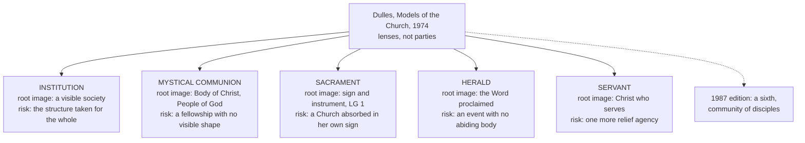

# The Church & Mary · Lesson 1.1: What ecclesiology asks

> ⏱ ~15 min · Module 1: The Church as mystery · Builds on: [`fundamental-theology` 4.4](../../fundamental-theology/lessons/04-04-the-ladder-of-doctrinal-authority.md), [`fundamental-theology` 4.5](../../fundamental-theology/lessons/04-05-reading-a-documents-weight.md) · Unlocks: [1.2 The Church in the New Testament](01-02-the-church-in-the-new-testament.md)

## Why this matters

Every Sunday Catholics confess *one, holy, catholic and apostolic Church* inside the article on the Holy Spirit. This course asks what that clause commits you to, in six modules: mystery, the four marks, constitution, the Petrine office, salvation and sin, and Mary, the Church's type and mother. Three rules govern it. It **states and does not argue**: Orthodox and Reformation positions appear as their own theologians state them, with no reply attached, because the arguing belongs to [`apologetics-catholic-claims`](../../apologetics-catholic-claims/syllabus.md). Every claim's **weight is marked**; understating a level is as much an error as overstating one. And the **hard parts are told straight**.

Ceded: events to [`church-history`](../../church-history/syllabus.md), sacraments to [`sacraments-and-liturgy`](../../sacraments-and-liturgy/syllabus.md), Christ as Head to [`christology`](../../christology/syllabus.md), levels to [`fundamental-theology`](../../fundamental-theology/syllabus.md), grace to [`creation-grace-last-things`](../../creation-grace-last-things/syllabus.md), social mission to [`catholic-social-teaching`](../../catholic-social-teaching/syllabus.md). Full table: [syllabus](../syllabus.md).

## The idea

**Believed before studied.** The Church entered theology as a clause of the Creed, not as a topic. The Fathers and schoolmen speak of her constantly, as body, bride, ark and mother, but always inside another question. Aquinas wrote no question *On the Church*: she appears in his Christology, as the body whose head is Christ (ST III q.8), and in his account of the Creed (the Source below).

**A young treatise, born in a quarrel about power.** The first works with the Church as their whole subject came out of the fight between Boniface VIII and Philip IV ([`church-history` 5.1](../../church-history/lessons/05-01-papal-monarchy-innocent-iii-to-boniface-viii.md)): Giles of Rome's *De ecclesiastica potestate* (most probably 1302) and James of Viterbo's *De regimine christiano* (1302), which its 1926 editor titled *Le plus ancien traité de l'Église* (lesson's gloss: the oldest treatise on the Church). The conciliar crisis added Juan de Torquemada's *Summa de ecclesia* (c. 1453). So the [treatise](../reference.md#ecclesiology) learned to talk while arguing over who rules and whom a king obeys.

**Bellarmine: a Church you can point to.** After the Reformation the quarrel moved from power to visibility. Robert Bellarmine's *Controversies* (published from the 1580s) reject five positions, from Wyclif and Hus's Church of the predestined to the Augsburg Confession and Calvin, which he reads as placing the true Church among those who truly believe or are elect, seen only by faith or by God. (Those traditions' own account of the Church is stated in [5.2](05-02-subsistit-in-and-the-status-of-other-churches.md).) His definition ("De conciliis et ecclesia", bk 3, ch. 2), paraphrased: the one true Church is the company of people bound together by profession of the same Christian faith and communion in the same sacraments, under the rule of legitimate pastors and chiefly of the Roman pontiff. No inner virtue is required to be in some way part of her, only what the senses perceive. Then:

> For the Church is a company of men as visible and palpable as the assembly of the Roman people, or the kingdom of France, or the republic of the Venetians. *(Lesson's translation.)*

It bought a Church that can be found, with a statable boundary, which cannot evaporate into an invisible elect. What it cost, on its critics' account: the manuals read a membership test as the Church's essence, and the treatise thickened around jurisdiction until it could be called a *hierarchology* ([Bellarmine on the visible Church](../reference.md#bellarmine-on-the-visible-church)).

**The recovery.** Johann Adam Möhler, of the Catholic Tübingen school, read the Church out of the first three centuries' Fathers in *Die Einheit in der Kirche* (1825), as the visible form the Spirit's life takes among believers; his *Symbolik* (1832) set her beside the Incarnation. Newman gave the Church a history readable as growth ([`fundamental-theology` 5.2](../../fundamental-theology/lessons/05-02-newmans-theory-of-development.md)) and the laity a voice in it ([5.3](../../fundamental-theology/lessons/05-03-the-sensus-fidei.md)). The twentieth-century [*ressourcement*](../reference.md#ressourcement), return to the sources, went over the manuals' heads to the Fathers, the liturgy and Scripture: Henri de Lubac's *Catholicisme* (1938), on the social aspects of dogma; Yves Congar's *Chrétiens désunis* (1937), *Vraie et fausse réforme dans l'Église* (1950) and *Jalons pour une théologie du laïcat* (1953). Both worked under Roman restriction around 1950 ([`thomistic-synthesis` 6.4](../../thomistic-synthesis/lessons/06-04-transcendental-thomism-and-the-ressourcement-quarrel.md)) and served Vatican II as experts. *Lumen Gentium* (1964) bears their mark, but it is weighed as the Council's text.

**Dulles's models.** Avery Dulles's *Models of the Church* (1974; a sixth model, the community of disciples, added in 1987) sorts ecclesiologies by root image, as his *Models of Revelation* sorts theories of revelation ([`fundamental-theology` 1.3](../../fundamental-theology/lessons/01-03-supernatural-revelation.md)). Each [model](../reference.md#models-of-the-church) lights something up and, used alone, distorts it. They are **models, not parties**: lenses, not teams.

**Weighing a claim.** The ladder grades acts, not topics ([`fundamental-theology` 4.4](../../fundamental-theology/lessons/04-04-the-ladder-of-doctrinal-authority.md)): find the act, ask what it proposes the claim *as*, and default down when that is not manifest (can. 749 §3). Ecclesiology's most famous sentences are theologians', with no [level](../reference.md#levels-of-authority) at all.

## Source

Aquinas, *Summa Theologiae* II-II q.1 a.9 (English Dominican Province), on the creed:

> *Objection 5.* Further, Augustine (Tract. xxix in Joan.) [...] says: "We believe Peter or Paul, but we speak only of believing 'in' God." Since then the Catholic Church is merely a created being, it seems unfitting to say: "In the One, Holy, Catholic and Apostolic Church."
>
> *Reply to Objection 5.* If we say: "'In' the holy Catholic Church," this must be taken as verified in so far as our faith is directed to the Holy Ghost, Who sanctifies the Church; so that the sense is: "I believe in the Holy Ghost sanctifying the Church." But it is better and more in keeping with the common use, to omit the 'in,' and say simply, "the holy Catholic Church," as Pope Leo observes.

Read the shape of the act. Faith *in*, strictly, is owed to God, and the Church is a creature. Aquinas does not drop her from the Creed; he places her, as the work of the Spirit who sanctifies her, which is why the clause stands in the Spirit's article. The Greek Creed of 381 does repeat the preposition (*eis*), and Percival's English keeps it; Aquinas allows that reading only if the "in" runs through to the Spirit. The Catechism says the same: we profess the Church rather than believing in her, so as not to confuse God with his works (CCC 750, paraphrased). ("Pope Leo" is Aquinas's attribution; the New Advent text's bracket traces the point to Rufinus.) So ecclesiology's first question is not *what is this organization?* but *what is the Spirit doing here?* ([credo ecclesiam](../reference.md#credo-ecclesiam)).

## The doctrine

What the Church holds about what she is:

1. **She is confessed in the Creed.** The Creed of Constantinople (381), received at Chalcedon (451), confesses one, holy, catholic and apostolic Church within the article on the Holy Spirit. *In words:* believing the Church is part of believing what God does, not a second faith beside faith in God.
2. **Christ willed and founded her.** *Pastor Aeternus* (1870) opens by saying that the eternal Pastor determined to build up the holy Church. *Lumen Gentium* 18 restates this, expressly following Vatican I. *In words:* the Church exists because Christ willed her, not because his followers later organized ([institution of the Church by Christ](../reference.md#institution-of-the-church-by-christ)); how that shows in the record is [1.2](01-02-the-church-in-the-new-testament.md)'s question.
3. **The visible society and the Mystical Body are one reality.** *Lumen Gentium* 8, paraphrased: the society with hierarchical organs and the Mystical Body are not two things. They form one complex reality of a human and a divine element. *In words:* the visible Church is kept, and is not allowed to be the whole.
4. **She is like a sacrament.** *Lumen Gentium* 1: the Church is in Christ like a sacrament (*veluti sacramentum*), a sign and instrument of intimate union with God and of the unity of the whole human race. *Lumen Gentium* 48 calls her the universal sacrament of salvation. *In words:* the Church is the visible means by which Christ joins people to God and to one another. "Like" marks an analogy, so she is not an eighth sacrament ([the Church as sacrament](../reference.md#church-as-sacrament)).

None of this settles which visible community is that Church ([5.2](05-02-subsistit-in-and-the-status-of-other-churches.md)), what each mark asserts ([2.1](02-01-one.md) onward), or how the images rank ([1.4](01-04-people-of-god-communion-sacrament.md)).

**Mark the levels** (the ladder of [`fundamental-theology` 4.4](../../fundamental-theology/lessons/04-04-the-ladder-of-doctrinal-authority.md), read by [4.5](../../fundamental-theology/lessons/04-05-reading-a-documents-weight.md)). Claims 1 and 2 are **rung 1**: the articles of the Creed and the Church's foundation by Christ's will both stand among the CDF's 1998 examples of truths proposed as divinely revealed. For the second the commentary points to *Pastor Aeternus*'s prologue, which teaches without defining; the rung comes through the ordinary universal magisterium ([1.2](01-02-the-church-in-the-new-testament.md)). Claims 3 and 4 are **conciliar teaching, at least rung 3**: Vatican II defined no new dogma, and "sacrament" restates no earlier definition. Bellarmine's definition and Dulles's models have **no magisterial level**; they are weighed by their arguments.

## The map of models

Each box: what the model sees, and what it misses used alone.

## Worked examples

**Ex 1: three claims, three readings (clean).** Run the steps of [`fundamental-theology` 4.4](../../fundamental-theology/lessons/04-04-the-ladder-of-doctrinal-authority.md).

- *"Christ founded the Church."* Act: the prologue of *Pastor Aeternus*, restated in *Lumen Gentium* 18; the 1998 commentary classes it among truths proposed as revealed. **Rung 1.** Not at rung 1: any historian's reconstruction of how Jesus's intention shows in the sources ([`new-testament` 3.3](../../new-testament/lessons/03-03-what-historians-broadly-agree-on.md)).
- *"The Church is a perfect society."* Act: Leo XIII, *Satis Cognitum* §10, an encyclical, in a precise sense: divine in origin, supernatural in end, with the means and authority that end requires. Mode: authentic, not definitive. **Rung 3.**
- *"The Church is as visible as the Republic of Venice."* Act: none; it is Bellarmine's sentence. **No magisterial level**, however often the manuals repeated it.

**Ex 2: where it strains. Is Bellarmine an institution-model theologian?** Read his next paragraph. From Augustine he takes the Church as a living body with a soul, the Spirit's inner gifts of faith, hope and charity, and a body, the outward profession and the sacraments. Some belong to both. Catechumens or the excommunicated who have faith and charity can belong to the soul and not the body. Those who profess with no inner virtue belong to the body only, like hair or nails. Then:

> Our definition, then, takes in only this last way of being in the Church, because this is what is required as a minimum for someone to be called part of the visible Church. *(Lesson's translation.)*

So the famous definition states a **minimum for visible membership**, written against opponents who made membership invisible, not a claim that the Church is only her structure. Keep apart what a text says and what it is reported to say: a manual that quotes Venice without the "minimum" makes Bellarmine more institutional than he was. And models sort emphases, not authors: Bellarmine fits the institution model on membership and the communion model on the Church's life. The strain is the cost already named: when a minimum is the only thing a treatise defines, the minimum becomes what the treatise talks about.

## Watch out

- **You might think the Church is a second object of faith beside God.** The Creed confesses her inside the Spirit's article, and faith *in*, strictly, is owed to God (the Source; CCC 750).
- **You might think a doctrine is as young as its treatise.** The treatise dates from about 1302; the Church has been confessed as long as the creeds.
- **You might think "perfect society" is either dogma or dead.** Leo XIII taught it at rung 3; it was never defined, and Vatican II's different vocabulary revoked nothing. Promoting it overstates; calling it discarded understates.
- **You might think Dulles's models are the Church's official options.** They are a theologian's taxonomy with no magisterial level ([`fundamental-theology` 1.3](../../fundamental-theology/lessons/01-03-supernatural-revelation.md) warns the same for revelation).

## One-liner

> The Church is first an article of faith, the Spirit's work founded by Christ, and only lately a treatise; weigh every sentence about her by the act behind it, not by how famous the sentence is.

## Problems

**P1 (🟢)** *(Exegetical)* An **invented** confirmation-class worksheet, written for this problem, asked students to finish the sentence "The Church is…". Four answers:

> **Kwame:** "…the people a bishop can count: the baptized of his diocese, the parish registers, the clergy he appoints."
>
> **Siobhan:** "…wherever the Gospel is really preached and someone answers it."
>
> **Arjun:** "…the night shelter our parish runs, because that is where Christ is served."
>
> **Freya:** "…a sign the world can read: in how we pray and live together it should see what God means to do for everyone."

(a) Name the Dulles model each answer expresses. (b) For each, name one *other* model that would supply what the answer leaves out, and say what it supplies. One line per student.

**P2 (🟡)** *(Exegetical, strict)* Four sentences from an **invented** parish podcast transcript. For each, say whether the claim about the level is right, give the correct level (a rung, or "no magisterial level"), and name the act that fixes it. Two lines each.

(a) "'One, holy, catholic and apostolic' is a formula we sing on Sundays; nothing in it is doctrine in the strict sense."

(b) "Vatican II defined the Church as the universal sacrament of salvation, so that is dogma now."

(c) "Dulles's five models are one theologian's map. Using one of them is not making a doctrinal claim."

(d) "Whether Jesus meant to found a Church at all is an open question for Catholics; historians still argue about it."

**P3 (🔴)** *(Exegetical)* An **invented** sidebar from a school religion textbook, written for this problem:

> "Since the Fathers, theology has had a treatise *On the Church*, and Thomas Aquinas devotes a section of his *Summa* to it. At the Council of Trent the Church adopted Robert Bellarmine's definition of the Church as a society as visible as the Republic of Venice. For Bellarmine only outward things mattered: the Church had membership rules and no inner life of grace. Because he was later declared a Doctor of the Church, his definition is binding Catholic teaching."

Find **four** errors and correct each. Where a level is involved, name it. 150 words or fewer.

Solutions

**P1** *(Exegetical)*

**Accept:** for (b), any model that genuinely supplies a dimension the answer omits, with a correct one-clause statement of what it supplies.

**Must hit, strict (a):**

- Kwame: **institution** (a visible, countable society under its pastors).
- Siobhan: **herald** (the Church as the event of the Word proclaimed and answered).
- Arjun: **servant** (the Church as service, here to the poor).
- Freya: **sacrament** (a visible sign and instrument of God's purpose for the whole human race, the *Lumen Gentium* 1 image).

**Must hit, strict (b):** one model per student that supplies what is missing, and what it supplies; for example:

- Kwame + **mystical communion**: the bond of grace and charity that registers cannot record.
- Siobhan + **institution** or **sacrament**: an abiding visible body, with sacraments that do not depend on this week's preaching.
- Arjun + **herald** or **communion**: why the shelter is the Church's work and not only a good one, namely the Word that sends her and the life she shares.
- Freya + **herald** or **servant**: the explicit word that says what the sign means, or the concrete service it should issue in.

**Wrong turns:** filing Freya under communion (the decisive word is *sign*); filing Arjun under sacrament because "Christ is served"; treating (b) as a verdict that an answer is wrong or unorthodox, which turns models into parties; naming one model as "the Catholic one".

**Model answer:** Kwame, institution; communion adds the life of grace the registers cannot show. Siobhan, herald; institution adds a body that lasts between sermons. Arjun, servant; herald adds the Word that makes the shelter the Church's own act. Freya, sacrament; herald adds the spoken word that interprets the sign.

---

**P2** *(Exegetical, strict. Overstating and understating are both errors.)*

**Must hit, strict:**

- (a) **Wrong, an understatement.** It is an article of the Creed of Constantinople (381), received at Chalcedon (451). The 1998 CDF commentary lists the articles of the Creed among truths proposed as divinely revealed: **rung 1**. What each mark precisely asserts is Module 2's work, not a reason to lower the rung.
- (b) **Wrong, an overstatement.** *Lumen Gentium* 48 (with LG 1, "like a sacrament") teaches it. Vatican II defined no new dogma, and this restates no earlier definition: **conciliar teaching, at least rung 3**, owed religious submission.
- (c) **Right.** Dulles's models are a theologian's taxonomy: **no magisterial level**, weighed by their argument. Credit for adding that the images the models build on (Body of Christ, sacrament) do carry conciliar weight; the classification does not.
- (d) **Wrong, an understatement.** That Christ founded the Church by his will is **rung 1**: the prologue of *Pastor Aeternus* (1870), restated in *Lumen Gentium* 18, and listed in the 1998 commentary among first-paragraph truths. What historians dispute is how that intention shows in the sources, a different question at a different level (1.2).

**Wrong turns:** putting (a) at rung 3 because the Creed is "liturgical"; putting (b) at rung 1 because the document is a dogmatic constitution, since genre is not the verdict ([`fundamental-theology` 4.5](../../fundamental-theology/lessons/04-05-reading-a-documents-weight.md)); swinging (b) down to "just a metaphor", which understates; marking (c) wrong out of reflex; letting historical debate in (d) lower a doctrinal rung, or letting the rung settle the historical debate.

**Model answer:** (a) Wrong: an article of the 381 Creed, rung 1. (b) Wrong: LG 1 and 48 teach it; no definition; at least rung 3. (c) Right: a theologian's map, no magisterial level. (d) Wrong: the founding by Christ's will is rung 1 (*Pastor Aeternus* prologue; LG 18); the historians' question is a separate one.

---

**P3** *(Exegetical)*

**Must hit, strict (any four):**

1. **No early treatise.** The first works on the Church as such date from about 1302 (James of Viterbo, Giles of Rome), born in the Boniface–Philip quarrel. The Fathers and Aquinas treat the Church inside other questions: Christ as Head (ST III q.8) and the Creed (II-II q.1 a.9). There is no *Summa* section *On the Church*.
2. **Trent adopted nothing of the kind.** Trent (closed 1563) issued no decree on the Church, and Bellarmine's *Controversies* appeared from the 1580s, after it.
3. **Bellarmine did not deny the inner life.** His definition states the **minimum** for visible membership. His next paragraph gives the Church a soul, faith, hope, charity and the Spirit's gifts, as well as a body.
4. **No magisterial level.** Being declared a Doctor of the Church (1931) commends a theologian's doctrine; it does not make his definitions magisterial acts. His three visible bonds do recur in *Lumen Gentium* 14, where they carry the Council's weight, not his.

**Wrong turns:** "correcting" item 3 by saying Bellarmine was really a communion-model theologian, which swaps one label for another; saying Vatican II condemned the definition, which invents an act (it is a theologian's view, neither binding nor censured); dating the first treatise to Bellarmine.

**Model answer:** The treatise is late: the first works on the Church date from about 1302, and Aquinas treats her under Christ as Head and the Creed, not in a section of her own. Trent issued no decree on the Church and could not adopt a definition published decades after it closed. Bellarmine's definition gives only the minimum for visible membership; the next paragraph adds the soul, the inner gifts of the Spirit. And the doctorate does not turn his definition into teaching: it has no magisterial level, though its three bonds reappear in *Lumen Gentium* 14 with that text's own weight.

## Connections

- **Backward:** the ladder is [`fundamental-theology` 4.4](../../fundamental-theology/lessons/04-04-the-ladder-of-doctrinal-authority.md) and its reading procedure [4.5](../../fundamental-theology/lessons/04-05-reading-a-documents-weight.md); Dulles's method of models is already in [`fundamental-theology` 1.3](../../fundamental-theology/lessons/01-03-supernatural-revelation.md). The Church inside Christology, as the body of the Head, is [`christology` 3.4](../../christology/lessons/03-04-the-grace-of-the-head.md). The quarrel that produced the first treatises is [`church-history` 5.1](../../church-history/lessons/05-01-papal-monarchy-innocent-iii-to-boniface-viii.md), and de Lubac's quarrel with the manuals is [`thomistic-synthesis` 6.4](../../thomistic-synthesis/lessons/06-04-transcendental-thomism-and-the-ressourcement-quarrel.md).
- **Forward:** [1.2](01-02-the-church-in-the-new-testament.md) takes up *ekklēsia* and the historical shape of the founding. [1.3](01-03-the-body-of-christ.md) reads the Body image and *Mystici Corporis* (1943), with the identification it makes. [1.4](01-04-people-of-god-communion-sacrament.md) reads *Lumen Gentium* chs. 1–2 and how the images correct each other. [5.2](05-02-subsistit-in-and-the-status-of-other-churches.md) states, in their own theologians' terms, the Reformation communities' account of the Church, which Bellarmine argued against.
- **Sideways:** the same Bellarmine meets Galileo in [`church-history` 7.3](../../church-history/lessons/07-03-the-galileo-affair.md). Vatican II as an event is [`church-history` 9.2](../../church-history/lessons/09-02-the-second-vatican-council.md). [`sacraments-and-liturgy`](../../sacraments-and-liturgy/syllabus.md) takes the Church as sacrament from 1.4, and [`apologetics-catholic-claims`](../../apologetics-catholic-claims/syllabus.md) argues what this course only states.
