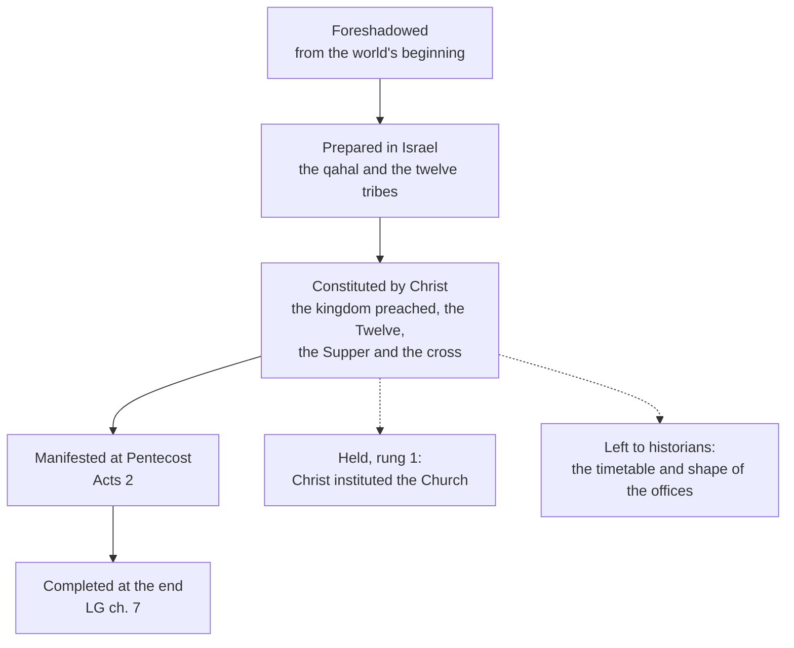

# The Church & Mary · Lesson 1.2: The Church in the New Testament

> ⏱ ~15 min · Module 1: The Church as mystery · Builds on: [1.1 What ecclesiology asks](01-01-what-ecclesiology-asks.md), [`new-testament` 2.2](../../new-testament/lessons/02-02-matthew.md), [`new-testament` 3.3](../../new-testament/lessons/03-03-what-historians-broadly-agree-on.md) · Unlocks: [1.3 The Body of Christ](01-03-the-body-of-christ.md), [1.4 People of God, communion, sacrament](01-04-people-of-god-communion-sacrament.md)

## Why this matters

In 1902 Alfred Loisy put the problem in one sentence: "Jesus foretold the kingdom, and it was the Church that came" (*The Gospel and the Church*, Home's translation, 1903; [`church-history` 8.3](../../church-history/lessons/08-03-leo-xiii-and-the-modernist-crisis.md) reads it in context). On the surface the Gospels bear him out: Jesus preached the kingdom, and "church" is on his lips in two verses of one Gospel. Was the Church intended, or did she just happen? This lesson gathers what the New Testament means by *ekklēsia*, then states what the Church holds about her own foundation, at what level, and what she leaves to historians. The rest of the course assumes the answer.

## The idea

**The word.** [*Ekklēsia*](../reference.md#ekklesia) is the Septuagint's commonest word for the *qahal*, Israel assembled before God. Among the Gospels only Matthew has it: at 16:18 for Jesus's people as a whole, at 18:17 for a congregation settling a dispute ([`new-testament` 2.2](../../new-testament/lessons/02-02-matthew.md)). The translators also used *synagōgē*. In the Greek of Deuteronomy 9:10, Horeb is "the day of the *ekklēsia*" (lesson's translation), but at Numbers 20:4 the *qahal* of the Lord is *synagōgē*. The Douay, following the Vulgate, has "the church of the Lord" there, and *Lumen Gentium* 9 cites the verse: Israel in the desert was already called the Church of God. And the word means *assembly*. Acts uses it for the city assembly of Ephesus, rioting or meeting lawfully (19:32, 39, 41 [DR 19:40]). The sermon gloss "the called-out ones, set apart from the world" leans on the prefix *ek-*, "out"; the Catechism mentions the derivation but gives the meaning as a convocation or an assembly (CCC 751). What was new was who does the calling: the first believers took the name of Israel's assembly before God, as its heirs (CCC 751).

**Kingdom and Church.** Jesus preached the kingdom, and [`new-testament` 3.3](../../new-testament/lessons/03-03-what-historians-broadly-agree-on.md) weighs its two verbs: "at hand" (Mark 1:15) and "come upon you" (Luke 11:20). *Lumen Gentium* 5 cites both verses and says Jesus set his Church on her course by preaching the kingdom. The risen Christ poured out the Spirit, and the Church received the mission to proclaim the kingdom; on earth she is its *germen et initium*, "seed and beginning" (lesson's translation), straining toward its completion. LG 3 calls her the kingdom of Christ already present in mystery. The relation is neither identity with the finished kingdom nor replacement of a kingdom that never came ([kingdom and Church](../reference.md#kingdom-and-church)).

**The Twelve.** Jesus "made that twelve should be with him" (Mark 3:14), and they will sit "on twelve seats judging the twelve tribes of Israel" (Matt 19:28). The number is a claim about Israel: the tribes regathered around Jesus. [`new-testament` 3.3](../../new-testament/lessons/03-03-what-historians-broadly-agree-on.md) files the calling as near-consensus history and the restoration reading as a live dispute. The Church reads the number the same way and draws a doctrinal consequence: the Twelve, with Peter at their head, come first in the structure Christ gave his community, and they represent the tribes as the foundation stones of the new Jerusalem (CCC 765; Rev 21:12–14 [DR Apocalypse]). LG 19 says he formed them after the manner of a college, or stable group. Before Pentecost, Acts 1:15–26 restores the number with Matthias, a witness from John's baptism to the Ascension. Yet when Herod kills James (Acts 12:2), no one replaces him, and Acts gives no reason. The pattern fits a number that marks a founding generation, not an office to be refilled. What does pass on is for [2.4](02-04-apostolic.md) and [3.1](03-01-bishops-and-apostolic-succession.md) ([the Twelve](../reference.md#the-twelve)).

**Pentecost and the images.** In Acts 2 the Spirit comes, three thousand are baptized, and they persevere "in the doctrine of the apostles" (2:42); that verse's *koinōnia* is [1.4](01-04-people-of-god-communion-sacrament.md)'s, its breaking of bread [`sacraments-and-liturgy`](../../sacraments-and-liturgy/syllabus.md)'s. LG 6 gathers the [images of the Church](../reference.md#images-of-the-church), and each says one thing:

- **Flock** (John 10:16): there is one shepherd.
- **Vine** (John 15:5): the branches live from Christ.
- **Temple** (1 Cor 3:16–17; Eph 2:19–22): God dwells in this people.
- **Bride** (Eph 5:25–27; Rev 21:2, 9): Christ loves and cleanses her, and she is not he.

The body belongs to [1.3](01-03-the-body-of-christ.md), and the people of God (1 Pet 2:9–10) to [1.4](01-04-people-of-god-communion-sacrament.md).

**Paul's double reference.** Paul writes "to the church of God that is at Corinth" (1 Cor 1:2), yet says he persecuted "the church of God" (1 Cor 15:9), in the singular. The word can name a household gathering (Rom 16:5), one city's believers, or, in Colossians and Ephesians, the whole body with Christ as its head (Col 1:18; Eph 1:22–23; [`new-testament` 6.1](../../new-testament/lessons/06-01-the-disputed-pauline-letters-and-the-pastorals.md)). The Catechism calls the three senses — liturgical assembly, local community, universal community — inseparable (CCC 752). LG 26 says the Church of Christ is truly present in every legitimate local congregation. Which comes first is [3.2](03-02-the-local-and-the-universal-church.md)'s question.

## The doctrine

**Said plainly.** Jesus preached the kingdom, not the Church. *Ekklēsia* is on his lips in two verses of one Gospel, and critical scholars still argue whether he spoke them in that form; Matthew 16 belongs to [4.1](04-01-the-petrine-texts.md). The doctrine does not rest on a word count.

1. **Christ instituted the Church.** Vatican I, *Dei Filius* ch. 3 (1870), in Schaff's translation:

   > God has instituted the Church through his only-begotten Son, and has bestowed on it manifest notes of that institution, that it may be recognized by all men as the guardian and teacher of the revealed Word.

   *Pastor Aeternus* opens the same way. Its prologue says the eternal Pastor "determined to build up the holy Church". *In words:* the Church is not a society her members formed; God formed her, through the Son ([institution of the Church by Christ](../reference.md#institution-of-the-church-by-christ)).

2. **By a series of acts, not on one day.** Jesus preached the kingdom (CCC 763, quoting LG 5). He gathered the little flock and chose the Twelve with Peter, and "by all his actions" he prepares and builds his Church (CCC 764–765). She is born above all from his self-giving, anticipated at the Supper and fulfilled on the cross (CCC 766, with LG 3's blood and water). LG 2 gives the frame. The Church was foreshadowed from the world's beginning and prepared in Israel. She was constituted in these last times, manifested by the outpouring of the Spirit, and will be completed at the end ([stages of the Church](../reference.md#stages-of-the-church)). *In words:* Christ founded the Church, and Pentecost showed her to the world.

3. **What is excluded.** The Holy Office decree *Lamentabili* (3 July 1907), approved by Pius X, condemned its proposition 52. The proposition held that it was "foreign to the mind of Christ to establish a Church as a society that would last on earth through a long series of centuries" (lesson's translation), since he expected the kingdom to come at once with the end of the world. The 1910 Oath against Modernism made clergy profess that the real and historical Christ founded the Church directly, "as he dwelt with us" (Schaff's translation; [`fundamental-theology` 1.2](../../fundamental-theology/lessons/01-02-natural-knowledge-of-god.md) grades the Oath). *In words:* you may not read the Church as the disciples' improvisation after Jesus's hope failed.

4. **What is left open.** The doctrine fixes who founded the Church and what he founded: a community meant to last, with a structure. It does not fix the timetable or the shape. When the offices took their later form is for historians: in Titus 1:5–7 "presbyter" and "bishop" seem to name the same men, and one bishop per city first appears in Ignatius around 110 ([`new-testament` 6.1](../../new-testament/lessons/06-01-the-disputed-pauline-letters-and-the-pastorals.md)). So is how Jesus pictured the time before the end ([`new-testament` 3.3](../../new-testament/lessons/03-03-what-historians-broadly-agree-on.md)), and whether a given saying is in his own words. Trent defined a hierarchy instituted "by divine ordination", of bishops, priests and ministers (Session XXIII, canon 6; [3.1](03-01-bishops-and-apostolic-succession.md) reads it), and gave no date. *In words:* the doctrine settles the who and the what, and leaves the when and the how to history.

**Mark the levels** ([levels of authority](../reference.md#levels-of-authority); [`fundamental-theology` 4.4](../../fundamental-theology/lessons/04-04-the-ladder-of-doctrinal-authority.md)).

- **Institution by Christ: rung 1.** The ordinary universal magisterium proposes it as revealed; the manuals' *de fide* note is testimony to that, not the act. Vatican I states it in a chapter of *Dei Filius* and the prologue of *Pastor Aeternus*, which teach without defining, and the canons that do define presuppose it: Trent's on the hierarchy, and *Pastor Aeternus* ch. 1's on Peter ([4.3](04-03-vatican-i-and-pastor-aeternus.md)).
- ***Lamentabili* and the Oath: authentic papal acts, not definitions.** *Lamentabili* condemned its propositions as a set, with no note fixed to each ([`new-testament` 3.3](../../new-testament/lessons/03-03-what-historians-broadly-agree-on.md)); the Oath was a formula imposed by papal act, not required since 1967. They show where the rung-1 doctrine's boundary runs and do not raise its level.
- **LG 2, 3, 5, 19 and 26: at least rung 3.** A dogmatic constitution that defined nothing new carries the weight of what it restates ([`fundamental-theology` 4.5](../../fundamental-theology/lessons/04-05-reading-a-documents-weight.md)). The seed and beginning, the stages and Pentecost as manifestation are conciliar teaching, none defined in those words.
- **Historical questions: no magisterial standing.** The offices' timetable, Jesus's expectation of the end and the wording of particular sayings are scholarly hypotheses, argued inside the boundary just drawn. The "called-out ones" etymology is not doctrine at all.

## The stages

LG 2's frame, with what is held and what is left open hung on the third stage.

## Worked examples

**Ex 1: a clean case.** An invented RCIA slide reads: "The Church was born on Pentecost Sunday." It is shorthand, not a magisterial act, so ask what it can mean. LG 2 says the Church was *manifested* by the outpouring of the Spirit, and CCC 767 says that at Pentecost she was openly displayed to the crowds. The Catechism keeps the language of birth for the cross (CCC 766). As a feast-day image the slide is harmless; as a claim that the Spirit and the apostles began something Jesus had not, it runs into point 1, at rung 1. The repair: *founded by Christ, manifested at Pentecost.*

**Ex 2: where it strains — Loisy.** Loisy's full passage, quoted in [`church-history` 8.3](../../church-history/lessons/08-03-leo-xiii-and-the-modernist-crisis.md), says Jesus did not lay out in advance the constitution of a government meant to last for centuries, and defends the Church as legitimate growth. But point 4 also denies a constitution drawn up in advance, and Newman also defends growth. So where is the line? Not in whether the Church developed, but in where her legitimacy comes from. On the Catholic account, growth unfolds what Christ himself willed and began: CCC 765 speaks of a structure "that will remain until the Kingdom is fully achieved". On the position Rome condemned, legitimacy comes from development alone, and Jesus's own intention lay elsewhere, in the kingdom arriving with the end (the second half of proposition 52). The strain: the evidence that offices took shape over a century fits both accounts, so history alone cannot decide between unfolding and substitution. That takes a judgment about continuity, which is Newman's question ([`fundamental-theology` 5.2](../../fundamental-theology/lessons/05-02-newmans-theory-of-development.md)) and [3.1](03-01-bishops-and-apostolic-succession.md)'s when it reaches succession.

## Watch out

- **You might think *ekklēsia* means "the called-out ones", a sect apart.** It means an assembly; Acts uses it for a town meeting. What sets this assembly apart is who convenes it.
- **You might think two verses show Jesus intended no Church.** The teaching rests on acts — the Twelve, the Supper, the cross (CCC 763–766) — not on a word's frequency.
- **Overstatement:** "Catholics must hold that Jesus set up bishops, priests and deacons before Easter." Rung 1 is institution by Christ; Trent's hierarchy by divine ordination carries no date, and how the offices developed is history ([3.1](03-01-bishops-and-apostolic-succession.md)).
- **Understatement:** "Institution by Christ is a pious opinion, since no council says 'we define'." It is rung 1 through the ordinary universal magisterium, and "never defined" is not an argument ([`fundamental-theology` 4.4](../../fundamental-theology/lessons/04-04-the-ladder-of-doctrinal-authority.md)).

## One-liner

> Christ founded the Church through the kingdom he preached, the Twelve he made and the cross he accepted, and Pentecost showed her to the world; when and how her offices took shape is left to the historians.

## Problems

**P1 (🟢)** *(Exegetical)* Close reading, Douay–Rheims:

> To the church of God that is at Corinth, to them that are sanctified in Christ Jesus, called to be saints, with all that invoke the name of our Lord Jesus Christ in every place of theirs and ours. (1 Cor 1:2)
>
> And God indeed hath set some in the church; first apostles, secondly prophets, thirdly doctors ... (1 Cor 12:28)
>
> ... to the churches of Galatia. (Gal 1:2)
>
> ... how that, beyond measure, I persecuted the church of God and wasted it. (Gal 1:13)
>
> And I was unknown by face to the churches of Judea, which were in Christ: But they had heard only: He, who persecuted us in times past doth now preach the faith which once he impugned. (Gal 1:22–23)

(a) For each of the five uses of "church" or "churches", say whether it names one local community, several local communities, or something more than local. Name the word or words that decide. One line each.

(b) Galatians 1:13 and 1:22–23 speak of the same persecuted believers. What does the shift from singular to plural show, and what does "of God that is at Corinth" add? Two sentences.

(c) Name the question these texts raise but do not settle, and the lesson that takes it up. One sentence.

**P2 (🟡)** *(Exegetical)* Four sentences from an invented seminary exam answer. Classify each as **(A)** Church teaching, giving the rung and the act; **(B)** contrary to Church teaching, naming the act that excludes it; or **(C)** a historical question the Church leaves open. One line each.

(a) "Christ himself instituted the Church."

(b) "By the year 60 every local church had one bishop, with presbyters and deacons under him."

(c) "Jesus expected the kingdom to arrive with the end of the world almost at once; a Church lasting for centuries was never in his mind."

(d) "At Pentecost the Church was made manifest to the world."

**P3 (🔴)** *(Exegetical)* Diagnose. An invented podcast transcript, written for this problem:

> "Here's what nobody told you in Sunday school. Jesus preached the kingdom of God. 'Church' turns up in exactly two verses of the Gospels, both in Matthew, so he never meant to start one. *Ekklēsia* literally means 'the called-out ones', a little sect set apart from the world. The Church was Paul's invention: he founded the congregations, so he founded the Church. Catholics, meanwhile, are bound by solemn definition to believe that Jesus handed the Twelve a finished constitution, bishops, priests and deacons included, before he died. Historians have refuted that, so the dogma is gone."

Find **four** errors. For each, give the correction, and where a level is involved, name the act that fixes it. 150 words or fewer.

Solutions

**P1** *(Exegetical)*

**Accept:** for 1 Cor 12:28 and Gal 1:13, any wording that makes the reference reach past one congregation and names the deciding words.

**Must hit, strict (a):**

- **1 Cor 1:2: one local community.** "That is at Corinth" decides it. Credit noting that "of God" names whose church it is, and that "in every place" sets Corinth among the others.
- **1 Cor 12:28: more than local.** "First apostles" decides it, since no single congregation has its own apostles. Credit noting that 12:27 has just applied the body to the Corinthians, so the sentence moves from the local church to the whole.
- **Gal 1:2: several local communities.** The plural "churches" and the region "of Galatia" decide it.
- **Gal 1:13: more than local.** The singular "the church of God" decides it: one name for what a persecution reached in more than one place.
- **Gal 1:22: several local communities.** The plural "churches of Judea" decides it.

**Must hit, strict (b):** the same believers are counted as many churches (1:22) and as one church of God (1:13, with "us" in 1:23 tying them together). Paul counts the same people either way, so the singular is not a later name for a sum of the parts. "Of God that is at Corinth" makes the local community the church of God present in one place, which is what LG 26 restates: the Church of Christ truly present in each legitimate local congregation.

**Must hit, strict (c):** whether the one Church or the many churches is prior. The texts use both without ranking them, and [3.2](03-02-the-local-and-the-universal-church.md) takes the question up.

**Wrong turns:** treating 12:28 as Corinth's own staff list. Reading "of God" as a mere honorific. Concluding that Paul teaches the priority of either the universal or the local Church: the texts do not rank the two, and the question is freely disputed.

**Model answer:** (a) 1:2 is local ("at Corinth"); 12:28 is more than local ("first apostles"); Gal 1:2 is several local churches ("churches of Galatia"); 1:13 is more than local ("the church of God", singular); 1:22 is several local churches ("churches of Judea"). (b) The same persecuted people are "the churches of Judea" and "the church of God", so the one church of God exists in the many. "Of God that is at Corinth" says the Corinthian assembly is that one Church of God present in a place, not a branch office. (c) Which is prior, the universal Church or the particular churches, is 3.2's question.

---

**P2** *(Exegetical)*

**Must hit, strict:**

- **(a) A, rung 1, taught by the ordinary universal magisterium.** Vatican I states it in *Dei Filius* ch. 3 and in *Pastor Aeternus*'s prologue. The defined canons (Trent XXIII can. 6; *Pastor Aeternus* ch. 1) presuppose it.
- **(b) C.** No act fixes a timetable. Trent XXIII can. 6 defines a hierarchy by divine ordination and gives no date. As history the claim runs against the evidence: in Titus 1:5–7 presbyters and bishops seem to be the same men, and one bishop per city is first clear in Ignatius around 110 ([`new-testament` 6.1](../../new-testament/lessons/06-01-the-disputed-pauline-letters-and-the-pastorals.md)).
- **(c) B.** This is close to *Lamentabili* proposition 52 word for word: the Holy Office, 1907, approved by Pius X, with the propositions condemned as a set and no note fixed to each. What makes it incompatible is the rung-1 doctrine of institution. Credit noting that how Jesus spoke of the end is [`new-testament` 3.3](../../new-testament/lessons/03-03-what-historians-broadly-agree-on.md)'s dispute, and what he knew is [`christology` 4.2](../../christology/lessons/04-02-christs-human-knowledge-the-classical-account.md)'s.
- **(d) A, at least rung 3.** This is conciliar teaching (LG 2, restated in CCC 767), carrying the weight of what it restates. It is not defined in those words.

**Wrong turns:**

- On (a), saying "defined by *Dei Filius*". A chapter teaches and the canons define ([`fundamental-theology` 1.2](../../fundamental-theology/lessons/01-02-natural-knowledge-of-god.md)). On (a), also "rung 3, since no canon defines it", which is an understatement.
- On (b), marking A by way of Trent's canon, which is an overstatement.
- On (c), citing *Lamentabili* or the Oath as a definition.
- On (d), marking it rung 1, or C, "only a historian's claim".

**Model answer:** (a) A, rung 1, by the ordinary universal magisterium; stated in *Dei Filius* ch. 3 and presupposed by Trent XXIII can. 6. (b) C: Trent fixes no date, and the evidence (Titus 1; Ignatius c. 110) is against it. (c) B: *Lamentabili* 52 condemned it, and it contradicts the rung-1 doctrine of institution. (d) A: LG 2, conciliar teaching at least at rung 3, not defined.

---

**P3** *(Exegetical)*

**Must hit, strict (any four):**

1. **The word count proves nothing.** The two-verse fact is accurate. But the teaching rests on acts — the Twelve, the Supper, the cross (CCC 763–766) — not on how often a word occurs.
2. ***Ekklēsia* means an assembly.** Acts uses it for the city assembly of Ephesus (19:32, 39, 41 [DR 19:40]). In the Septuagint it names Israel assembled before God (Deut 9:10), and CCC 751 gives the meaning as a convocation or assembly.
3. **Paul did not invent the Church.** He says he persecuted "the church of God" (Gal 1:13; 1 Cor 15:9), so it existed before his conversion.
4. **Overstatement.** What is rung 1, through the ordinary universal magisterium and stated in *Dei Filius* ch. 3, is institution by Christ. No definition gives a finished constitution. Trent XXIII can. 6 defines a hierarchy by divine ordination and fixes no date, and how the offices took shape is history.
5. **"Refuted, so gone" fails twice.** The historians' findings about the offices bear on a claim the Church never made, and the rung-1 doctrine does not hang on them.

**Wrong turns:**

- "Correcting" the two-verse count, which is true.
- Replying that the threefold ministry did exist before Easter. That trades one overstatement for another.
- Naming *Lamentabili* or the Oath as the act that defines institution. Both are authentic papal acts, not definitions.

**Model answer:** Two verses are accurate, but the teaching rests on Christ's acts (the Twelve, the Supper, the cross; CCC 763–766), not word frequency. *Ekklēsia* means assembly: Acts 19 uses it for a town meeting, and the Septuagint for Israel before God. Paul says he persecuted "the church of God" (Gal 1:13), so it predates him. What Catholics hold at rung 1, through the ordinary universal magisterium and stated in *Dei Filius* ch. 3, is that Christ instituted the Church. No definition hands the Twelve a finished constitution: Trent defines a hierarchy by divine ordination and gives no date. So historians' work on when the offices took shape cannot refute the doctrine.

## Connections

- **Backward:** [1.1](01-01-what-ecclesiology-asks.md) set up how an ecclesiological claim is weighed; this lesson weighs the first one. *Ekklēsia* in Matthew is [`new-testament` 2.2](../../new-testament/lessons/02-02-matthew.md); the kingdom's two verbs and the Twelve as history are [`new-testament` 3.3](../../new-testament/lessons/03-03-what-historians-broadly-agree-on.md); the widening body and the presbyter-bishops are [`new-testament` 6.1](../../new-testament/lessons/06-01-the-disputed-pauline-letters-and-the-pastorals.md). Loisy, *Lamentabili* and the Oath as events are [`church-history` 8.3](../../church-history/lessons/08-03-leo-xiii-and-the-modernist-crisis.md); the Oath's weight is [`fundamental-theology` 1.2](../../fundamental-theology/lessons/01-02-natural-knowledge-of-god.md).
- **Forward:** [1.3](01-03-the-body-of-christ.md) takes the body image; [1.4](01-04-people-of-god-communion-sacrament.md) takes the people of God, *koinōnia*, and Israel and the Church. [2.4](02-04-apostolic.md) and [3.1](03-01-bishops-and-apostolic-succession.md) ask what passes on from the Twelve; [3.2](03-02-the-local-and-the-universal-church.md) takes Paul's double reference as a question of priority; [4.1](04-01-the-petrine-texts.md) reads Matthew 16.
- **Sideways:** the same *qahal* gave Qoheleth his name, rendered *Ekklesiastes* in Greek ([`old-testament` 5.2](../../old-testament/lessons/05-02-proverbs-ecclesiastes-and-the-song-of-songs.md)). A generation after Paul, Ignatius sets the local assembly beside "the Catholic Church", the whole, in *Smyrnaeans* 8 ([`patristics` 1.3](../../patristics/lessons/01-03-ignatius-of-antioch.md)). The double reference survives into the second century.
