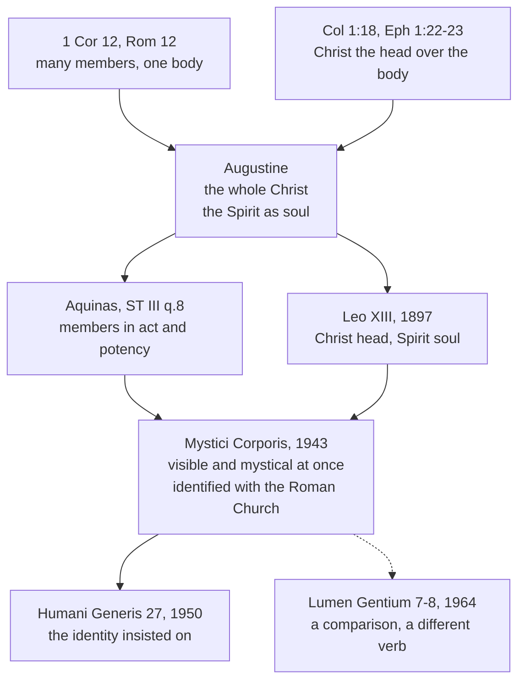

# The Church & Mary · Lesson 1.3: The Body of Christ

> ⏱ ~15 min · Module 1: The Church as mystery · Builds on: [1.2 The Church in the New Testament](01-02-the-church-in-the-new-testament.md), [`christology` 3.4](../../christology/lessons/03-04-the-grace-of-the-head.md), [`trinity-and-god` 4.5](../../trinity-and-god/lessons/04-05-common-proper-appropriated.md) · Unlocks: [1.4 People of God, communion, sacrament](01-04-people-of-god-communion-sacrament.md), [5.2 Subsistit in](05-02-subsistit-in-and-the-status-of-other-churches.md)

## Why this matters

[1.2](01-02-the-church-in-the-new-testament.md) named the New Testament's images of the Church. This lesson takes the one the tradition leaned on hardest. "Body of Christ" answers three questions at once: what holds the members together, who is head, and what gives the whole its life. In 1943 Pius XII used it to say who belongs to the Church and where she is found. Every later lesson on membership, other Christians and *subsistit in* starts from that encyclical, so you need its words and its weight exactly.

## The idea

**Paul uses the image two ways.** In 1 Corinthians 12 and Romans 12 the body is a congregation: many members, different offices, one body. The point is mutual need ("the eye cannot say to the hand: I need not thy help", 1 Cor 12:21, Douay–Rheims), and the head there is one member among the rest. In Colossians and Ephesians, Christ is "the head of the body, the church" (Col 1:18), and the whole body grows from him (Eph 4:15–16; Col 2:19). The first use runs sideways, member to member; the second runs upward, body to head. The exegesis is [`new-testament` 6.1](../../new-testament/lessons/06-01-the-disputed-pauline-letters-and-the-pastorals.md)'s.

**The tradition fused the two.** Augustine's *totus Christus*, the whole Christ, is head and members together, and for Aquinas they are as it were [one mystical person](../../christology/lessons/05-03-satisfaction-anselm-and-aquinas.md).

**Then a third question: what makes it alive?** Augustine answered in a Pentecost sermon:

> What the soul is to the body of a man, that the Holy Spirit is to the body of Christ, which is the Church. (Sermo 267.4, lesson's translation)

He presses one feature. The soul is whole in every member and works differently through each: through the eyes it sees, through the ears it hears. One life, many functions; and a member cut off does not keep the life.

**Aquinas supplies the head's side** ([head and members](../reference.md#head-and-members); ST III q.8). Christ is head by **order** (his grace is first), **perfection** (it is full) and **power** (it flows to every member) (a.1). That this capital grace is his own habitual grace is [`christology` 3.4](../../christology/lessons/03-04-the-grace-of-the-head.md)'s. Two more articles are ecclesiology. Only Christ is head by giving grace from within; bishops and the pope are heads only by outward government, in Christ's place (a.6). And this body is never all present at once (a.3). It spans the world's beginning to its end, so members are counted in act and in potency, in grades: by glory, by charity, by faith alone, by a potency that will be actualized, and by one that never will be. Aquinas's body is wide and graded. Hold that against what comes next.

## The doctrine

What the tradition holds, and what [*Mystici Corporis*](../reference.md#mystici-corporis) (Pius XII, encyclical, 29 June 1943) teaches, in paraphrase:

1. **Christ is the head of the Church, his body.** Scripture says so in as many words (Col 1:18; Eph 1:22–23, 5:23). Trent builds on it: Christ "continually infuses his virtue into the said justified,—as the head into the members" (Session VI, ch. 16, Schaff). *In words:* the Church's life comes down from Christ, and every other "head" in her is a deputy.

2. **The Spirit is the [soul of the Church](../reference.md#soul-of-the-church), as a comparison.** Leo XIII's *Divinum Illud Munus* (9 May 1897, §6) put it in one line, Christ the head and the Spirit the soul, quoting Augustine. MC repeats it (§57): the Spirit is whole in head, body and each member, the principle of every supernatural act there, and absent by sanctifying grace from members wholly cut off. *Lumen Gentium* 7 restates it more cautiously: the Spirit, one and the same in head and members, gives the body life, unity and movement, so that the Fathers *could compare* his work to the soul's. *In words:* the Church's unity is a shared life whose source is a divine person.

   **What the analogy may not be pressed to mean.** Aquinas sets the rule: "In metaphorical speech we must not expect a likeness in all respects; for thus there would be not likeness but identity" (III q.8 a.1 ad 2). (a) The Spirit is not incarnate in the Church. Only the Son assumed a nature; the Spirit did not even assume the dove ([`trinity-and-god` 6.1](../../trinity-and-god/lessons/06-01-the-missions-of-the-son-and-the-spirit.md)). He is not the Church's form, and makes no one substance with her. (b) His work in the Church is the Trinity's. The outward works are undivided, so "soul" is an **appropriation**, a common work said of the Spirit by likeness to what is proper to him ([`trinity-and-god` 4.5](../../trinity-and-god/lessons/04-05-common-proper-appropriated.md)). MC itself requires holding these activities common to the Trinity, and rejects any union by which the faithful would pass beyond the order of creatures (§78). (c) The members stay persons: each keeps his own personality, as the parts of a natural body do not (§61). Aquinas can even liken the Spirit to the heart, which "invisibly quickens and unifies" (a.1 ad 3). The organ changes because it is a likeness.

3. **"Mystical" names a kind of body.** It marks the Church off from Christ's physical body, born of the Virgin, now at the Father's right hand and hidden under the Eucharistic veils, and from every merely physical or moral body (§60). A moral body, a club or a state, is held together by a common end under authority; this one also has an uncreated inner principle, the Spirit (§62). *In words:* the [mystical body](../reference.md#mystical-body) is a real society with something inside it no other society has.

4. **Visible, juridical and mystical at once.** The Church is visible because she is a body (§14, after Leo XIII). MC condemns setting a Church of charity against a "juridical" Church (§65): the commission to rule and teach and the Spirit's invisible mission complete each other, as body and soul do. *In words:* the offices belong to the body; they are not scaffolding around it.

5. **The identification.** MC offers "the Mystical Body of Christ" as the noblest description of the true Church, which it names the One, Holy, Catholic, Apostolic and Roman Church (§13). *Humani Generis* (12 August 1950, §27) summed the doctrine up as the two being "one and the same thing", and complained that some held themselves not bound by it. *In words:* on this teaching the Mystical Body and the Roman Catholic Church are coextensive.

6. **[Membership](../reference.md#members-of-the-church).** Only those are "really" (*reapse*, lesson's gloss) members who are baptized, profess the true faith, and have neither cut themselves off from the body's unity nor been excluded by legitimate authority for grave faults; those divided in faith or government cannot be living in its unity (§22). Not every grave sin cuts a man off; schism, heresy and apostasy do, by their nature (§23). Those outside the visible body are "ordered" (*ordinentur*, lesson's gloss) to it by an unconscious desire and longing, yet lack many helps found only within (§103). *In words:* membership is fixed by visible bonds; a relation by desire is real, and a different category.

Aquinas's a.3 and MC's §22 answer different questions: union with the head across all of time, and membership of the visible body on earth now.

**Said plainly.** *Mystici Corporis* and *Lumen Gentium* do not say the same words about the Mystical Body and the Catholic Church. In 1950 Pius XII summed up his teaching as their being "one and the same thing"; in 1964 the council chose a different verb, [*subsistit in*](../reference.md#subsistit-in). What that change of words did is argued among Catholic theologians, and it is [5.2](05-02-subsistit-in-and-the-status-of-other-churches.md)'s question.

**Mark the levels** (the ladder of [`fundamental-theology` 4.4](../../fundamental-theology/lessons/04-04-the-ladder-of-doctrinal-authority.md); [levels of authority](../reference.md#levels-of-authority)). That Christ is head of the Church, his body, is Scripture's own statement, used by Trent as a premise and restated in LG 7: **rung 1**, taught as revealed by the ordinary universal magisterium, with no definition needed. That the Spirit gives the body life and unity is restated in LG 7 at the weight of what it restates; the word *soul* is a comparison taught in two encyclicals (rung 3) and restated by the council as a comparison. Its limits are rung-1 doctrine: only the Son became incarnate, and the outward works are undivided. MC's own teaching (visible and mystical at once, the identification, the membership criteria, the ordering by desire) is **authentic ordinary magisterium, rung 3**, an encyclical's default ([`fundamental-theology` 4.5](../../fundamental-theology/lessons/04-05-reading-a-documents-weight.md)). It is rung 3 at its heaviest, since *Humani Generis* insisted on the identification and teaches that a deliberate papal judgment takes a question out of free debate. It is no higher: there is no definition and no "definitively held", and "based on the Sources of Revelation" (HG 27) names the teaching's ground, not a mode of proposal (can. 749 §3). Aquinas's analysis is Thomist theology, with no magisterial act; Augustine's sentence is a Father's comparison.

## Two uses, one synthesis

The dashed edge is where [5.2](05-02-subsistit-in-and-the-status-of-other-churches.md) picks up.

## Worked examples

**Ex 1: the clean case. "Saul, Saul, why persecutest thou me?" (Acts 9:4).** Saul has been arresting Christians, not Jesus. Run the two uses. On 1 Corinthians 12's use alone, the arrests are the body's suffering: "if one member suffer any thing, all the members suffer with it" (12:26). That is solidarity among members; it does not make the risen Lord the one persecuted. The head–body use does: the head counts what is done to the members as done to him. That is Augustine's whole Christ ([`christology` 5.3](../../christology/lessons/05-03-satisfaction-anselm-and-aquinas.md)). Now the limits. The identity is mystical, not hypostatic: Saul struck members whose head is in glory, not the Word's own humanity. And the members did not become divine; each keeps his personality (§61). *Result:* the verse licenses "Christ is persecuted in his members", and nothing about the members' nature.

**Ex 2: where it strains. A member in grave sin.** A baptized Catholic keeps the faith but lives in grave sin, without charity. Is he in the body? He meets every condition of §22, and §23 says outright that not every grave sin severs: he is a member. Now run the soul analogy, and it strains. A soul gives life to every member that belongs to its body; here is a member whom the Spirit does not indwell by sanctifying grace. §23 does not hide this: such men are not deprived of all life if they keep faith and hope and are moved by the Spirit toward repentance. MC's criteria are visible on purpose: they count who is in the body, not who is holy. And the analogy has an edge. A soul is the subject of what its body does; the Spirit is not the subject of a member's sin, so "whatever the members do, the Spirit does" is false. How a holy Church is made of sinners is [2.2](02-02-holy.md)'s question, and [5.4](05-04-a-church-of-sinners.md)'s when the sin is grave and public.

## Watch out

- **You might think *Mystici Corporis* defined that the Mystical Body is the Roman Catholic Church.** An encyclical, it defined nothing: rung 3, at the heaviest grade. Reading "based on the Sources of Revelation" as a proposal *as revealed* is the slide from ground to mode that [`fundamental-theology` 4.4](../../fundamental-theology/lessons/04-04-the-ladder-of-doctrinal-authority.md) warns against.
- **The mirror error: "that was Pius XII's opinion, and the council dropped it."** Rung 3 asks religious submission, and *Lumen Gentium* 8 footnotes both MC and *Humani Generis* at its "one complex reality" sentence. Whether the council developed the teaching or changed it is open among Catholics; "dropped" settles it by assertion.
- **You might think "soul of the Church" makes the Spirit her form, or the Church a divine person.** It is a comparison, and LG 7 restates it as one.

## One-liner

> Christ is the head, the Spirit is like the soul, and in 1943 the Body was the Roman Catholic Church, counted by baptism, faith and communion: rung 3, in words the council did not repeat.

## Problems

**P1 (🟢)** *(Exegetical)* Use only *Mystici Corporis* §§22–23 and 103, with no *Lumen Gentium*. For each **invented** person, say whether MC counts him or her "really" (*reapse*) a member, and name the clause that decides it. One line each.

(a) Ifeoma, a catechumen enrolled to be baptized at Easter.

(b) Arkady, baptized as an infant in the Russian Orthodox Church, who confesses the Nicene Creed and has never been in communion with the bishop of Rome.

(c) Rhys, a baptized Catholic whom legitimate authority has excluded from the Church by a declared sentence for a grave crime.

(d) Does §103's phrase "unconscious desire" describe Ifeoma? One sentence.

**P2 (🟡)** *(Exegetical)* An **invented** excerpt from a Pentecost homily, written for this problem:

> "Today the Holy Spirit became incarnate in the Church, just as the Word became flesh in Mary's womb. Pope Pius XII solemnly defined this in 1943 when he called the Spirit the soul of the Church: the Spirit and the Church are now one being, as soul and body make one person. Christ has ascended and belongs to the past; the Spirit is the Church's head today. So when you look at the person beside you in the pew, you are looking at the Holy Spirit."

Find **four** errors. For each, give the correction and the text or rule that fixes it, and name the level wherever a level is involved. **150 words or fewer.**

**P3 (🔴)** *(Exegetical)* Close reading. Colossians 1:18, 21–22, 24 (Douay–Rheims):

> And he is the head of the body, the church: who is the beginning, the firstborn from the dead, that in all things he may hold the primacy: [...] And you, whereas you were some time alienated and enemies in mind in evil works: Yet now he hath reconciled in the body of his flesh through death, to present you holy and unspotted and blameless before him: [...] Who now rejoice in my sufferings for you and fill up those things that are wanting of the sufferings of Christ, in my flesh, for his body, which is the church.

(a) Two readings of "fill up those things that are wanting of the sufferings of Christ": **(i)** Christ's own suffering fell short, and Paul supplies what his redemption lacked; **(ii)** what is still lacking is Christ's suffering in his body, the Church, which Paul bears in his own flesh. Which reading does the passage support, and which words decide it? (b) The passage uses "body" in two senses. Name them, give the words that keep them apart, and name the word the later tradition added to mark the difference, with one other thing that word distinguishes according to *Mystici Corporis*. **Three sentences per part.**

Solutions

**P1** *(Exegetical)*

**Must hit, strict:**

- (a) **Not a member.** She lacks baptism, the first condition of §22 (which cites 1 Cor 12:13, "in one Spirit were we all baptized into one body").
- (b) **Not a member.** He is baptized, but §22's closing sentence decides it: those divided in faith or in government cannot be living in the body's unity, and he is at least divided in government. He also falls among "those who do not belong to the visible Body" whom §103 addresses.
- (c) **Not a member.** The case is built so that §22's last clause applies: he has been excluded by legitimate authority for a grave fault. (The problem does not ask which canonical penalties amount to such an exclusion.)
- (d) **No.** Her desire for baptism and the Church is explicit. MC's "unconscious desire" (*inscio quodam desiderio ac voto*) names the relation of those who do not know what they long for. MC does not mention catechumens, though her relation by desire holds a fortiori.

**Wrong turns:** counting Arkady a member because he is baptized and did not personally "separate himself". §22's closing sentence and §103 cover him without any verdict on his guilt, and MC passes none. Importing *Lumen Gentium* 14–15's language (catechumens "joined with" the Church by their intention, other Christians "linked with" her), which the problem excludes. Counting Ifeoma a member "by desire": MC's word for that relation is *ordered*, not member. Applying §23 to Rhys: §23 concerns sin, and his case turns on an act of exclusion.

**Model answer:** (a) Not a member: unbaptized (§22). (b) Not a member: divided in government, so not in the body's unity (§22, closing sentence); §103 addresses him. (c) Not a member: excluded by legitimate authority for a grave fault (§22). (d) No: her desire is conscious; "unconscious" fits those who do not know the Church they are ordered to.

---

**P2** *(Exegetical)*

**Accept:** any four of the five errors below, in any wording.

**Must hit, strict:**

- (1) **"The Spirit became incarnate."** Only the Son assumed a nature, and the Spirit did not even assume the dove (trinity-and-god 6.1). That the Incarnation is the Son's alone is **rung 1**. "Soul" is a likeness, not an identity (III q.8 a.1 ad 2).
- (2) **"Pius XII solemnly defined this."** MC is an encyclical, **rung 3**, and defined nothing. The formula is Leo XIII's (1897), quoting Augustine, and LG 7 restates it as the Fathers' comparison.
- (3) **"One being, one person."** The Spirit is not the Church's form. Her members keep their own personality (MC §61), and MC rejects any union that passes beyond creatures (§78). The Spirit's work in her is the Trinity's undivided work, appropriated to him.
- (4) **"The Spirit is the Church's head; Christ is past."** Christ is head now (Col 1:18; Eph 1:22), and that is **rung 1**. Leo XIII's own sentence keeps both: Christ head, Spirit soul. Only Christ is head by inward grace (q.8 a.6).
- (5) **"Your neighbour is the Holy Spirit."** The neighbour is a member of Christ, indwelt by the Spirit if in grace. Acts 9:4's logic licenses "Christ in his members", not "the Spirit".

**Wrong turns:** calling (2) a matter of opinion. "Not defined" is not "not binding", since rung 3 asks religious submission. Answering (1) with LG 8's comparison to the Incarnation as though it supported the homily: LG 8 offers an analogy, and calls it one.

**Model answer:** The Spirit became incarnate in nothing; only the Son assumed a nature (rung 1), and "soul" is a likeness. Pius XII defined nothing: *Mystici Corporis* is an encyclical (rung 3) repeating Leo XIII's formula, which Vatican II restated as the Fathers' comparison. The Church is not one being or person with the Spirit; her members keep their personality and the Spirit's work is the Trinity's, appropriated to him. Christ is not past: he is head now (Col 1:18, rung 1), and the formula itself says Christ head, Spirit soul.

---

**P3** *(Exegetical)*

**Accept:** in (a), also the refinement that these are the afflictions appointed for the Messiah's people before the end, since it too places the lack outside Christ's redemptive death.

**Must hit, strict (a):** reading **(ii)**. Verse 22 says the reconciliation is already done, "he hath reconciled in the body of his flesh through death", so nothing in his redemptive death is lacking. Verse 24 locates what is wanting "in my flesh, for his body, which is the church": in the members, not in the head's own work. Verse 18's head–body relation is what lets a member's afflictions be called "the sufferings of Christ", as in Acts 9:4. Credit for noting that Challoner's note to the verse in the Douay–Rheims reads it as (ii).

**Must hit, strict (b):** the two senses are Christ's own physical body, "the body of his flesh" (v. 22), and the Church, "the body, the church" and "his body, which is the church" (vv. 18, 24). The words "of his flesh" and "which is the church" keep them apart. The later word is **"mystical"**. MC §60 says it also distinguishes the Church from any merely physical or moral body. Credit too for naming Christ's body under the Eucharistic veils, which §60 counts as his physical body.

**Wrong turns:** choosing (i) on the strength of "wanting" while ignoring v. 22 in the same passage. Choosing (ii) without naming any deciding words. Merging the two bodies, which turns (ii) back into (i) by adding Paul's pains to the Passion itself. Glossing "mystical" as "not real": MC uses it for a body that is a real society and more than a moral one (§§60–62).

**Model answer:** (a) The passage supports (ii). Verse 22 has the reconciliation already accomplished "in the body of his flesh through death", so the Passion lacks nothing. What is wanting is located "in my flesh, for his body, which is the church", in the members whom verse 18 has placed under Christ as head. (b) "The body of his flesh" is Christ's physical body, in which he died, and "his body, which is the church" is the community of his members. The qualifiers "of his flesh" and "which is the church" keep them apart. The tradition's word is "mystical", which *Mystici Corporis* says also marks the Church off from Christ's Eucharistic body and from every merely moral body.

## Flashback

**From Lesson [1.1](01-01-what-ecclesiology-asks.md) (What ecclesiology asks):** *(Exegetical.)* Find the crux. Two seminarians, both **invented** for this problem, argue about the encyclical you have just read:

> **Henrik:** "*Mystici Corporis* is the institution model's charter. The Church is visible because she is a body (§14), membership is counted by visible bonds (§22), and anyone who sets a Church of charity against the juridical Church is condemned (§65)."
>
> **Mireille:** "No, it is a mystical-communion document. Its subject is the Body of Christ, living from the Spirit as its soul (§57) and held together by an uncreated inner principle that no other society has (§62). So the membership rules of §22 are a juridical leftover that a Catholic may set aside."

(a) Name the premise Henrik and Mireille share, and say what Lesson 1.1 puts in its place, using the encyclical's own §65. (b) Mireille's last sentence weighs a passage by the model it fits. Say what 1.1's rule for weighing a claim looks at instead, and give the level of §22. **Two sentences per part.**

Solution

**Must hit, strict (a):**

- The shared premise: **a document belongs to exactly one model**, as to a party, so the only question is which one.
- What 1.1 puts in its place: Dulles's models are **lenses, not parties**. They sort emphases, not authors or texts, and each one used alone distorts. The encyclical is institutional on visibility and membership (§§14, 22) and mystical-communion on the Spirit's life in the body (§§57, 62). §65 itself refuses to set the juridical Church against a Church of charity: the juridical commission and the Spirit's invisible mission complete each other as body and soul do.

**Must hit, strict (b):**

- The ladder grades **acts, not topics or labels**: find the act and ask what it proposes the claim as. §22 is the encyclical's own teaching: **authentic ordinary magisterium, rung 3**, owed religious submission and not to be set aside.
- Dulles's taxonomy has **no magisterial level**, so filing a passage under a model can neither lower nor raise its rung.

**Wrong turns:** declaring a winner, which turns the models into parties. Filing the encyclical under a third model to break the tie. Treating Dulles's models as official categories with doctrinal weight. In (b), swinging to "§22 is defined", which overstates: an encyclical defines nothing. Bringing in *Lumen Gentium* 8 and *subsistit in*, which the problem does not ask (5.2's question).

**Model answer:** (a) Both assume the encyclical must belong to one model, as to a party; 1.1 treats models as lenses that sort emphases, so the encyclical is institutional on visibility and membership and mystical-communion on the Church's life, and §65 itself joins the juridical commission and the Spirit's mission as body and soul. (b) A claim's weight comes from the act and what it proposes the claim as, not from the model it fits, and Dulles's taxonomy has no magisterial level at all. §22 is the encyclical's own teaching, authentic ordinary magisterium at rung 3, owed religious submission whatever box it is filed in.

## Connections

- **Backward:** [1.2](01-02-the-church-in-the-new-testament.md) gave the images and Paul's local and universal *ekklēsia*. [`new-testament` 6.1](../../new-testament/lessons/06-01-the-disputed-pauline-letters-and-the-pastorals.md) set Colossians' head beside 1 Corinthians 12:21. Capital grace is [`christology` 3.4](../../christology/lessons/03-04-the-grace-of-the-head.md)'s, and "one mystical person" is worked in its [5.3](../../christology/lessons/05-03-satisfaction-anselm-and-aquinas.md). The undivided works and appropriation are [`trinity-and-god` 4.5](../../trinity-and-god/lessons/04-05-common-proper-appropriated.md)'s, and this lesson applies that course's rule to the Spirit and the Church. The encyclical's rung and *Humani Generis*'s principle come from [`fundamental-theology` 4.4](../../fundamental-theology/lessons/04-04-the-ladder-of-doctrinal-authority.md) and [4.5](../../fundamental-theology/lessons/04-05-reading-a-documents-weight.md). In terms of [1.1](01-01-what-ecclesiology-asks.md)'s models, MC deliberately holds the institutional and the mystical-communion models together.
- **Forward:** [1.4](01-04-people-of-god-communion-sacrament.md) sets the Body beside People of God, communion and sacrament, and teaches *Lumen Gentium* 8's "one complex reality". [2.2](02-02-holy.md) and [5.4](05-04-a-church-of-sinners.md) take up Ex 2's sinners. [5.1](05-01-outside-the-church-there-is-no-salvation.md) takes §103's "unconscious desire" together with the 1949 Holy Office letter. [5.2](05-02-subsistit-in-and-the-status-of-other-churches.md) sets MC's identification beside *subsistit in*. Module 1's boss problem ([syllabus](../syllabus.md)) sets the reconstruction of ST III q.8 aa.1–3 that this lesson only taught.
- **Sideways:** how grace reaches the individual member, and the Spirit's indwelling in the just soul, belong to [`creation-grace-last-things`](../../creation-grace-last-things/syllabus.md), which uses MC only for that. The Eucharist as what builds the body (1 Cor 10:17) belongs to [`sacraments-and-liturgy`](../../sacraments-and-liturgy/syllabus.md). Hobbes's *Leviathan* (1651) opens by calling the commonwealth "an Artificiall Man" whose sovereignty is "an Artificiall Soul" ([`history-of-political-thought` 3.4](../../history-of-political-thought/lessons/03-04-hobbes-the-sovereign-and-the-church.md)). That is a moral body in MC's sense whose soul is made, and MC's claim is that the Church's soul is uncreated. Whether MC's insistence on visibility is right against other Christians' accounts of the Church is argued in [`apologetics-catholic-claims`](../../apologetics-catholic-claims/syllabus.md).
