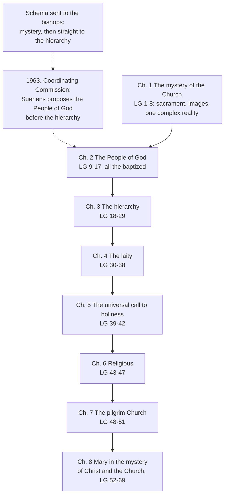

# The Church & Mary · Lesson 1.4: People of God, communion, sacrament

> ⏱ ~15 min · Module 1: The Church as mystery · Builds on: [1.3 The Body of Christ](01-03-the-body-of-christ.md), [1.2 The Church in the New Testament](01-02-the-church-in-the-new-testament.md), [`fundamental-theology` 4.5](../../fundamental-theology/lessons/04-05-reading-a-documents-weight.md) · Unlocks: [2.1 One](02-01-one.md), [3.3 The laity, charisms, and the sensus fidei](03-03-the-laity-charisms-and-the-sensus-fidei.md), [5.2 Subsistit in and the status of other churches](05-02-subsistit-in-and-the-status-of-other-churches.md)

## Why this matters

[1.3](01-03-the-body-of-christ.md) ended with one master image, the [Mystical Body](../reference.md#mystical-body), as *Mystici Corporis* drew it in 1943. *Lumen Gentium* (LG, 1964) kept the Body (LG 7) and set it in a larger frame. The Church is a mystery before she is a society, she is "like a sacrament", and she is a people still on the road. Its reception added a fourth word, *communio*. And the Council argued by layout, putting the People of God *before* the hierarchy. Most quarrels about the Church since, from "we are the Church" to "the Church is not a democracy", push one image past its work. This lesson says what work each does.

## The idea

Think of map projections. Mercator keeps angles true and swells Greenland. An equal-area map keeps areas true and bends the coastlines. No flat map keeps everything, so a good atlas carries several. LG 6 lists more than a dozen biblical images of the Church for the same reason. Four do most of the work, and each answers a different question.

- **Body of Christ: how is the Church one with Christ?** As members with their Head, living from his Spirit (1.3). Alone, it ties her so tightly to Christ that her sins and her unfinished journey vanish.
- **People of God: who is she, and in what story?** A people God gathers, as he gathered Israel. It includes all the baptized before any of them holds office, and it is still travelling. Alone, it becomes sociology: a "people" in the political sense, with sovereignty and parties.
- **Sacrament: what is she for?** A visible sign pointing past herself, and an instrument serving what she signifies. Alone, it turns her into a function and forgets the persons she is made of.
- **Communion: what kind of unity is this?** A sharing in the life of Father, Son and Spirit, and so with one another. It shows in one faith, one sacramental life and one order. Alone, it becomes a fellowship with no shape.

The worry is not abstract. In an address of 27 February 2000, Cardinal Ratzinger said "People of God" had for a time been read as popular sovereignty, and that from about the 1985 Synod communion took over, until it too became a slogan, flattened into the merely horizontal. Each image needs the others.

## The doctrine

1. **The Church as a kind of sacrament.** LG 1, stated in [1.1](01-01-what-ecclesiology-asks.md), calls the Church, "in Christ", *veluti sacramentum*, "like a sacrament" (lesson's gloss: *veluti* means "as it were"). She is a sign and instrument of intimate union with God and of the unity of the whole human race. LG 9 calls her the "visible sacrament of this saving unity", citing Cyprian's "sacrament of unity" (ANF Ep. 75.6; Hartel 69.6). LG 48 calls her the "universal sacrament of salvation". *In words:* she is not an eighth sacrament but *like* one: a visible thing that shows and serves a union larger than herself, and only in Christ, who is the mystery of salvation (CCC 774). Otto Semmelroth's *Die Kirche als Ursakrament* (1953) called her the "primordial sacrament". [`sacraments-and-liturgy`](../../sacraments-and-liturgy/syllabus.md) [1.1](../../sacraments-and-liturgy/lessons/01-01-what-a-sacrament-is.md) takes [the Church as sacrament](../reference.md#church-as-sacrament) from here.

2. **One complex reality.** LG 8, also met in 1.1, takes the hierarchical society and the Mystical Body, the visible assembly and the spiritual community. They are not two realities, it says, but "one complex reality" of a divine and a human element. It compares this, "by no weak analogy", to the Incarnation: as the assumed nature serves the Word, the Church's social structure serves the Spirit of Christ. *In words:* no real Church hides behind the institution, because the visible one is the one the Spirit uses ([one complex reality](../reference.md#one-complex-reality)). The analogy has two limits. There is no hypostatic union of the Spirit with the Church (1.3). And the human element includes sinners, so the same section calls the Church holy and always in need of purification ([2.2](02-02-holy.md)). The section's next sentence, *subsistit in*, belongs to [5.2](05-02-subsistit-in-and-the-status-of-other-churches.md).

3. **The new People of God.** LG 9: God saves people not merely as individuals but by making them a people. He chose Israel and formed it as preparation and figure of the new covenant in Christ's blood, which gathers Jew and Gentile into one people in the Spirit. LG 9 quotes 1 Peter 2:10 (Douay–Rheims): "Who in time past were not a people: but are now the people of God." Israel was already called "the church of God" (Neh 13:1 [DR 2 Esdras 13:1]), the *qahal* of [1.2](01-02-the-church-in-the-new-testament.md). This people has Christ for its head, love for its law and the kingdom for its end. *In words:* the Church is the [people God has always been gathering](../reference.md#people-of-god), now gathered around Christ and on its way.

4. **The order of the chapters.** Cardinal Suenens recounted that the schema sent to the bishops went straight from the mystery to the hierarchy. When he presented it to the Coordinating Commission, he proposed the present order. He insisted that "people of God" meant "pastors as well as the faithful" (*Criterion*, University of Chicago, Spring 1964). LG 30 puts it in the text: everything said of the People of God applies to laity, religious and clergy alike. LG 32 draws the consequence. All share one dignity from rebirth, the same filial grace and the same call to perfection, and a "true equality" in dignity and in common activity. Within that people, ordered by divine institution, some are made pastors for the others by Christ's will. *In words:* what is common to all the baptized comes first, and offices are distinctions *within* the people, for its sake ([the chapter order](../reference.md#chapter-order-of-lumen-gentium)). That is not delegation from below, since chapter 3 grounds the episcopate in Christ's institution and in sacramental consecration ([3.1](03-01-bishops-and-apostolic-succession.md)).

5. **Communion.** *Koinōnia* is a sharing in something held in common (lesson's gloss). The Douay renders the one word "communication" (Acts 2:42), "fellowship" (1 John 1:3), and both "communion" and "partaking" in one verse (1 Cor 10:16; the sacrament itself is ceded). Cyprian called the Church "a people united in one in the unity of the Father, and of the Son, and of the Holy Spirit" (*On the Lord's Prayer* 23, ANF), words LG 4 quotes. The churches lived it as a practice, receiving a travelling Christian on a letter from his own church. The Synod of Antioch (341) ruled: "No stranger shall be received without letters pacifical" (canon 7, in Percival). The 1985 Extraordinary Synod's Final Report (II.C.1) called the ecclesiology of communion "a central and fundamental concept" of the conciliar documents, as quoted in *Christifideles Laici* 19. The CDF's *Communionis Notio* (1992) gave [communion](../reference.md#communio) a vertical and a horizontal dimension, and an invisible and a visible side (§§3–4). It also faulted ecclesiologies that fail to integrate it with People of God, Body and sacrament (§1). *In words:* communion is first a gift, union with God, and then a bond among those who share it, made visible in teaching, sacraments and order.

6. **Pilgrim and eschatological.** LG 48: the Church reaches full perfection only in glory. Until then, in her sacraments and institutions, she wears the form of this passing world, and her holiness is real but imperfect. *In words:* every image above describes a Church still on the way. Chapter 7 and the communion of saints are ceded to [`creation-grace-last-things`](../../creation-grace-last-things/syllabus.md).

**Mark the levels** ([levels of authority](../reference.md#levels-of-authority); [`fundamental-theology` 4.4](../../fundamental-theology/lessons/04-04-the-ladder-of-doctrinal-authority.md)). LG defined nothing new and carries the weight of what it restates. A notification of 16 November 1964, printed as LG's appendix, says the Council defines as binding only what it openly declares so, and nothing in chapters 1–2 is so declared. Restated content keeps its own rung. The four marks are the Creed's, and a hierarchy instituted by divine ordinance is defined by Trent (Session XXIII, 1563, can. 6): both rung 1. The new formulations are **authentic conciliar teaching, at least rung 3**, and defined nowhere. They are "like a sacrament" (LG 1, 9, 48), "one complex reality" (LG 8), the new People of God (LG 9) and LG 32's "true equality". The chapter order is an editorial act with no rung. LG 30's account of it is rung 3, and Suenens's is testimony. A synod only advises (can. 343). Communion's central place weighs at rung 3 because *Christifideles Laici* (apostolic exhortation, 1988) and *Communionis Notio* (CDF letter, a dicastery's grade) took it up, and CN calls it "a key" (§1), not a definition. "Primordial sacrament" and Ratzinger's address are theology, with no magisterial level.

## The chapter order

The common comes first (chapters 1–2), then the particular states (3–6), then the journey's end (7). Mary stands inside the constitution, not beside it ([6.5](06-05-mary-in-the-economy-in-the-church-and-in-devotion.md)).

## Worked examples

**Ex 1 (clean): LG 1, phrase by phrase.** Ask what each phrase excludes.

- *"In Christ"* excludes a Church that is a sacrament in her own right. Christ is the mystery (CCC 774).
- *"Like"* excludes an eighth sacrament. Trent's seven (rung 1) are untouched.
- *"Sign and instrument"* excludes either half alone. A sign that does nothing is a poster, and an instrument that shows nothing is a tool.
- *"Union with God ... and unity of the human race"* excludes the reverse order. CCC 775 makes the first the ground of the second.

So it licenses "the Church exists for more than herself", and forbids both "the Church is an end in herself" and "the Church is a humanitarian agency", which drops the first clause.

**Ex 2 (where it strains): Israel and the new People of God.** LG 9 calls the Church the new People of God, gathered out of Israel's calling. LG 16 says the Jews, to whom the covenants and promises were given, remain most dear to God for the sake of the fathers, because God does not repent of his gifts and call (Rom 11:28–29). If the Church is the *new* People, what is Israel now? LG never says that the Church replaces Israel or that Israel's election has lapsed, nor how the two relate. Here the doctrine stops deciding. Whether "all Israel" in Romans 11:26 means the Jewish people or the whole people of God is freely disputed ([`new-testament` 5.3](../../new-testament/lessons/05-03-romans-5-11-adam-spirit-israel.md)). Whether any claim of fulfilment leaves a "soft supersessionism", as David Novak argues, is argued in [`apologetics-foundations` 6.4](../../apologetics-foundations/lessons/06-04-supersessionism-nostra-aetate-and-the-jewish-people.md). Levels: LG 9, LG 16 and *Nostra Aetate* 4 are rung 3, and none defines a theory of Israel and the Church. On the question [`old-testament` 6.4](../../old-testament/lessons/06-04-the-old-testament-in-light-of-the-new.md) handed here, this course claims both sentences at that level, no more.

## Watch out

- **You might think "like a sacrament" made the Church an eighth sacrament, or that it is decoration.** It is an analogy with content: sign and instrument, in Christ.
- **You might think "People of God" means the laity.** LG 30 applies it to clergy, religious and laity alike, and chapter 4 is the one on the laity.
- **You might think the order demoted the hierarchy, or that chapters 1–2 defined the images.** The order puts the common before the particular, and Trent's can. 6 (rung 1) stands. The images are at least rung 3: calling them dogma overstates, and calling them "pastoral opinion" understates.
- **You might think communion is an invisible bond, or a mood.** *Communionis Notio* 4 makes the visible bonds part of it and puts communion with God first.

## One-liner

> The Church is Christ's Body, God's people on the road, a sacrament pointing past herself, and a communion in the Trinity's life; nearly every error about her keeps one of the four and drops the rest.

## Problems

**P1 (🟢)** *(Exegetical)* An **invented** RCIA slide, written for this problem, lists four sentences. For each, name the image it draws on (Body, People of God, sacrament, communion), say whether that image, as *Lumen Gentium* and *Communionis Notio* use it, licenses or forbids the sentence, and cite the section that decides. **One line each.**

> (a) "The Church shows and serves a unity bigger than herself: first with God, then among all people."
>
> (b) "Because the Church is Christ's Body, any decision her bishops take is Christ's own act."
>
> (c) "'People of God' is the Council's name for the laity, as distinct from the clergy."
>
> (d) "Our parish is one with a parish in Lagos because we share one faith, one sacramental life and one college of bishops, and beneath that, one life from the Father through Christ in the Spirit."

**P2 (🟡)** *(Exegetical (a) · Exegetical (b))* Two **invented** catechists' handouts, written for this problem:

> **Siobhan:** "Vatican II put the People of God before the hierarchy. So the Church is a democracy: authority belongs to the people, and bishops are their delegates."
>
> **Kwame:** "'People of God' is a pious name for the flock. The bishops are the Church that teaches and rules; the people are those they govern."

(a) They disagree about who holds authority, but they share one premise about what "the people" refers to. State it, and give the words of *Lumen Gentium* that deny it. **Two sentences.**

(b) For each handout, say what LG 32 commits a Catholic to against it, with the level. Then name the act that fixes the level of the point Siobhan's handout contradicts. **Three sentences.**

**P3 (🔴)** *(Evaluative)* A seminary is choosing one "master image" to organize its introductory course on the Church: **sacrament** or **communion**. Any verdict, **150 words or fewer**. Which should govern? Give the strongest reason for your choice, name the error your image produces when absolutized and how you guard against it, and say at what level the choice itself stands.

Solutions

**P1** *(Exegetical)*

**Must hit, strict:**

- (a) **Sacrament; licensed; LG 1**: sign and instrument of union with God and of the unity of the human race. Credit LG 48 or CCC 775 for the order of the two clauses.
- (b) **Body; forbidden.** LG 7 makes the Church subject to her Head, which is union and not identity. LG 8's comparison with the Incarnation is an analogy, and the same section calls the Church always in need of purification, so her pastors' decisions are not as such Christ's acts.
- (c) **People of God; forbidden; LG 30**: what was said of the People of God applies to laity, religious and clergy alike. Credit LG 32, or noting that chapter 4 is the chapter on the laity.
- (d) **Communion; licensed; *Communionis Notio* 3–4**: communion with God first, then among the faithful, visible in teaching, sacraments and hierarchical order. Credit LG 13 (the faithful everywhere in communion with one another in the Spirit).

**Wrong turns:** marking (b) licensed because LG 8 compares the Church to the Incarnation, which turns an analogy into an identity. Marking (d) forbidden as "too institutional", which forgets that the visible bonds belong to communion (CN 4). Calling (a) "only a metaphor": *veluti* marks an analogy with content, not an empty figure.

**Model answer:** (a) Sacrament; licensed by LG 1. (b) Body; forbidden: LG 7 subjects the Body to its Head, and LG 8 calls the Church always in need of purification, so the Incarnation analogy is not identity. (c) People of God; forbidden by LG 30, which applies it to clergy, religious and laity alike. (d) Communion; licensed by *Communionis Notio* 3–4, which joins the visible bonds to union with God.

---

**P2** *(Exegetical (a) · Exegetical (b))*

**Must hit, strict (a):**

- The shared premise: **"the people" means the non-ordained**, a group facing the pastors, so the only question is which group rules.
- **LG 30** denies it: what was said of the People of God holds for laity, religious and clergy alike. Credit Suenens's "pastors as well as the faithful", or LG 32's pastors and faithful bound by mutual need.

**Must hit, strict (b):**

- **Against Kwame:** LG 32 teaches that all the baptized share one dignity, the same filial grace, the same call to perfection, and a "true equality" in dignity and in the activity common to all. This is authentic conciliar teaching, **at least rung 3**.
- **Against Siobhan:** LG 32 says the Church is ordered by divine institution and that some are made pastors by Christ's will, not by delegation from below. That a hierarchy exists by divine ordinance is **defined: Trent, Session XXIII (1563), can. 6, rung 1**. Credit can. 7, which condemns the claim that orders conferred without the people's consent or call are invalid.

**Wrong turns:** answering only Siobhan ("the Church is not a democracy") and letting Kwame stand, though his handout contradicts LG 30 and 32 just as squarely. Treating the chapter order as itself a definition: the order has no rung. Calling Kwame's handout heresy, which overstates: what it contradicts is conciliar teaching at rung 3, and no definition names "the people" his way. Citing LG 10's "essence and not only degree" as the crux: it concerns the two priesthoods ([3.3](03-03-the-laity-charisms-and-the-sensus-fidei.md)), not what "people" names.

**Model answer:** (a) Both assume "the people" means the laity as a group facing the clergy, and differ only on which side rules. LG 30 denies it: what was said of the People of God holds for laity, religious and clergy alike. (b) Against Kwame, LG 32 teaches one dignity, one filial grace, one call to perfection and a true equality of all the baptized in dignity and common activity (at least rung 3). Against Siobhan, the same section says pastors are made such by Christ's will within an order of divine institution, not delegated by the people. That a hierarchy exists by divine ordinance is defined by Trent, Session XXIII, can. 6 (rung 1).

---

**P3** *(Evaluative)*

**Accept:** any verdict, including "neither: they are two sides of one claim", if the three moves are made.

**Must hit, any verdict:**

- **What the chosen image does that the other does not.** Sacrament gives visibility, reference beyond the Church, and instrumentality toward the world (LG 1, 48). Communion gives the content of the union, vertical before horizontal, on a Trinitarian ground (CN 3; Cyprian in LG 4).
- **The absolutizing error, named and blocked by another image.** Sacrament alone makes the Church a function and hides her persons and her sins; LG 8 and chapter 2 supply them. Communion alone becomes an invisible or merely horizontal fellowship (Ratzinger, 2000); CN 4 makes the visible bonds part of communion.
- **The level of the choice.** No magisterial act makes either image the master image, so the choice is freely disputed. *Communionis Notio* 1 (rung 3, a dicastery's grade) does require communion to be integrated with People of God, Body and sacrament, so a verdict that drops the others is not open.

**Wrong turns:** saying the 1985 Synod made communion the Church's official or defined master concept. A synod advises (can. 343), and CN calls communion "a key". Saying LG 1 defined the Church as a sacrament, which overstates. Arguing that one image is true and the other false.

**Model answer, one of several:** Sacrament should govern, because it alone says what the Church is *for*. She is a visible sign and instrument of union with God and of human unity (LG 1, 48), so the course starts from Christ and faces outward. Absolutized, it turns the Church into a function and hides that she is a people of sinners on pilgrimage. I guard against that by teaching LG 8 and chapter 2 alongside it: the sign *is* this people, always in need of purification. Communion then supplies what the sign signifies (CN 3–4). The choice itself is freely disputed, since no magisterial act ranks the images. CN 1 (rung 3) does bind me to integrate them all, so my verdict concerns emphasis, not exclusion.

## Flashback

**From Lesson [1.2](01-02-the-church-in-the-new-testament.md) (The Church in the New Testament):** *(Exegetical.)* Close reading. 1 Corinthians 11:17–18, 20, 22 (Douay–Rheims):

> Now this I ordain: not praising you, that you come together, not for the better, but for the worse. For first of all I hear that when you come together in the church, there are schisms among you. [...] When you come therefore together into one place, it is not now to eat the Lord's supper. [...] What, have you no houses to eat and to drink in? Or despise ye the church of God and put them to shame that have not?

(a) What does "church" name in verse 18, and what does it name in verse 22? Give the words that decide each. (b) Which senses in the Catechism's threefold list (CCC 752) are these, and what does the passage show about the sermon gloss "the called-out ones, set apart from the world"? **Two sentences per part.**

Solution

**Accept:** in (a), for verse 22, "the congregation" or "the church of God present at Corinth", provided the answer ties it to the people being shamed.

**Must hit, strict (a):**

- **Verse 18: the assembly as it meets**, the gathering itself, not a building. "When you come together in the church" decides it, with "come together" repeated in verses 17 and 20: the church is what happens when they gather. Credit noting that the Greek has no article, *en ekklēsia*, "in assembly" (lesson's gloss).
- **Verse 22: the community itself, concretely its poorer members.** "Despise ye the church of God" is paired with "put them to shame that have not", and both are set against "houses to eat and to drink in": the church despised is people, not a place.

**Must hit, strict (b):**

- These are the first two of CCC 752's three senses: the **liturgical assembly** (verse 18, which CCC 752 cites for that sense) and the **local community** (verse 22). The Catechism calls the three senses inseparable, and here they pass into each other within five verses.
- The gloss gets no support: the word names people **assembling**, the meaning CCC 751 gives (a convocation or assembly), as in Acts 19's town meeting. What marks this assembly is that it is "of God", whose assembly it is, not a prefix meaning "out".

**Wrong turns:** reading verse 18 as "in the church building": the clause places the divisions in their meetings, and verse 22 sets the church against houses. Arguing from "of God" alone that verse 22 means the universal Church: "of God" says whose the church is, and the paired clause points to the people in the room. Claiming the passage proves the derivation false: CCC 751 itself gives *ek-kalein*, and the point is that usage, not the prefix, fixes the meaning. Turning the question to the Lord's supper, which belongs to `sacraments-and-liturgy`.

**Model answer:** (a) In verse 18 "church" is the assembly as it meets: "when you come together in the church", echoed by "come together" in verses 17 and 20, places the divisions in their gatherings. In verse 22 it is the community itself, concretely the poor, since "despise ye the church of God" is paired with "put them to shame that have not" and set against their own houses. (b) These are the liturgical assembly and the local community, two of the three senses CCC 752 calls inseparable, and here they pass into each other in five verses. The passage uses *ekklēsia* for people gathering, an assembly, and gives no footing to "called out" or "set apart": what marks this one is that it is "of God".

## Connections

- **Backward:** [1.3](01-03-the-body-of-christ.md) supplied the Body and *Mystici Corporis*; this lesson sets them inside LG's frame. The *qahal* and *ekklēsia* of [1.2](01-02-the-church-in-the-new-testament.md) are the "church of God" LG 9 finds in Israel. Dulles's sacrament and mystical-communion models from [1.1](01-01-what-ecclesiology-asks.md) reappear here as images of one reality. The weight of a dogmatic constitution is [`fundamental-theology` 4.5](../../fundamental-theology/lessons/04-05-reading-a-documents-weight.md). The threefold office the whole people shares (LG 10–12, 31) is [`christology` 5.1](../../christology/lessons/05-01-the-paschal-mystery-and-the-threefold-office.md).
- **Forward:** [2.1](02-01-one.md) turns communion into full and partial communion. [2.2](02-02-holy.md) takes LG 8's "always in need of purification". [3.2](03-02-the-local-and-the-universal-church.md) takes the communion of churches and *Communionis Notio*. [3.3](03-03-the-laity-charisms-and-the-sensus-fidei.md) takes the common priesthood (LG 10) and the laity (chapter 4). [5.2](05-02-subsistit-in-and-the-status-of-other-churches.md) reads LG 8's next sentence. [6.5](06-05-mary-in-the-economy-in-the-church-and-in-devotion.md) reads chapter 8. [`sacraments-and-liturgy`](../../sacraments-and-liturgy/syllabus.md) [1.1](../../sacraments-and-liturgy/lessons/01-01-what-a-sacrament-is.md) takes the Church as primordial sacrament, and [`creation-grace-last-things`](../../creation-grace-last-things/syllabus.md) takes chapter 7 and the communion of saints.
- **Sideways:** Israel and the Church: [`old-testament` 6.4](../../old-testament/lessons/06-04-the-old-testament-in-light-of-the-new.md) handed the question here, [`new-testament` 5.3](../../new-testament/lessons/05-03-romans-5-11-adam-spirit-israel.md) reads Romans 11, and [`apologetics-foundations` 6.4](../../apologetics-foundations/lessons/06-04-supersessionism-nostra-aetate-and-the-jewish-people.md) argues supersessionism. The Council as an event, and LG's final vote of 2,151 to 5, are [`church-history` 9.2](../../church-history/lessons/09-02-the-second-vatican-council.md).
