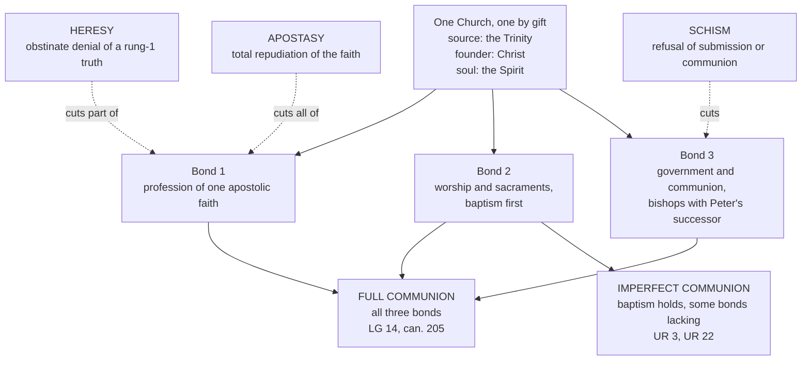

# The Church & Mary · Lesson 2.1: One

> ⏱ ~15 min · Module 2: The four marks · Builds on: [1.3 The Body of Christ](01-03-the-body-of-christ.md), [1.4 People of God, communion, sacrament](01-04-people-of-god-communion-sacrament.md), [`patristics` 2.4](../../patristics/lessons/02-04-cyprian-of-carthage.md), [`fundamental-theology` 4.4](../../fundamental-theology/lessons/04-04-the-ladder-of-doctrinal-authority.md) · Unlocks: [2.2 Holy](02-02-holy.md), [5.2](05-02-subsistit-in-and-the-status-of-other-churches.md), [5.3](05-03-ecumenism-as-doctrine.md)

## Why this matters

Every Sunday Catholics confess "one, holy, Catholic and Apostolic Church" (the creed of 381, as Percival prints it), in a world where the baptized cannot share one altar. Either the word is false, or it names something the divisions do not destroy. Paul's question frames it: "Is Christ divided?" (1 Cor 1:13, DR). The tradition answers no, while conceding that Christians are.

This lesson fixes what the Church's unity consists in, the three ways a person can break it, and why Vatican II can call other Christians brothers in a communion that is real but not complete. Like each of the [four marks](../reference.md#four-marks), "one" asserts something of the Church as such, not of every member.

## The idea

**Unity is received before it is achieved.** The Catechism gives it three sources (CCC 813, mostly from *Unitatis Redintegratio*, UR, 2): the Trinity as its pattern, Christ who reconciled all in one body, and the Spirit as the Church's "soul" ([1.3](01-03-the-body-of-christ.md) sets the limits of that analogy). Cyprian put the same order in a list:

> God is one, and Christ is one, and His Church is one, and the faith is one, and the people is joined into a substantial unity of body by the cement of concord. (*On the Unity of the Catholic Church* 23, ANF 5)

The list runs downward: the Church is one because God is, and the people's concord is the last link. Chapter 7 says it with Christ's seamless coat, "woven from the top throughout" (John 19:23, DR), a unity come down from heaven that the soldiers would not tear. *Unitatis Redintegratio* 13 uses the same image: the great divisions affect "the seamless robe of Christ".

Cyprian's own quarrel, in 251, was over readmitting the lapsed, against Novatian at Rome and a rival faction at Carthage. It was about communion, not creed: Novatian was orthodox. [`patristics` 2.4](../../patristics/lessons/02-04-cyprian-of-carthage.md) reads chapters 5–6 and his argument. The Church kept his premises about unity and not his conclusion that nothing given outside the communion is real. That split is the hinge of this lesson.

**Unity is also visible, and it has parts.** Think of a cord of three strands: one faith, one sacramental life, one communion of pastors. Strands snap separately, but one, baptism, cannot be cut at all. So a person's or community's communion with the Church comes in degrees, full when every strand holds, real but imperfect when some do. The [unity of the Church](../reference.md#unity-of-the-church) itself has no degrees.

**And unity is a task.** Christ prays "that they all may be one" so that the world may believe (John 17:21, DR): a unity the world can see. The work it imposes is [5.3](05-03-ecumenism-as-doctrine.md)'s.

## In their own words

The Augsburg Confession (1530), article 7 (*Triglot Concordia*, 1921), defines the Church as the congregation of saints in which the Gospel is rightly taught and the sacraments rightly administered, then says:

> And to the true unity of the Church it is enough to agree concerning the doctrine of the Gospel and the administration of the Sacraments. Nor is it necessary that human traditions, that is, rites or ceremonies, instituted by men, should be everywhere alike.

Melanchthon's *Apology* (1531), articles 7–8, explains. The Church is not only an outward society of rites, like other governments; it is first a fellowship of faith and of the Holy Spirit in hearts, which nevertheless has outward marks by which it is recognized: the pure Gospel and the sacraments administered according to it. The unity meant is "spiritual unity" (§31), which differing human rites no more injure than differing lengths of day and night (§33). The *satis est*, "it is enough", is a sufficiency claim. The Leuenberg Agreement (16 March 1973), by which Lutheran, Reformed and United churches in Europe declared church fellowship, states it as the Reformers' criterion: agreement in the right teaching of the Gospel and administration of the sacraments is the "necessary and sufficient" condition of true unity (§2), and differences of worship and church order do not divide the Church (§28). On this account the Church is not invisible: its marks are public, and agreement in them can be tested.

The Orthodox account, locating unity in the eucharistic communion of local churches round their bishops, is [3.2](03-02-the-local-and-the-universal-church.md)'s.

## The doctrine

1. **The Church is one.** The creed of 381 confesses it as an article of faith. *In words:* unity belongs to what the Church is, not to what she may achieve.
2. **Charity first, then three visible bonds.** CCC 815 puts charity "above all" (Col 3:14, DR: "charity, which is the bond of perfection"), then lists three visible bonds: the profession of one faith received from the apostles; common worship, above all the sacraments; apostolic succession through Holy Orders. *Lumen Gentium* (LG) 14 names them as profession of faith, the sacraments, and "ecclesiastical government and communion"; can. 205 makes them the definition of full communion. *Lumen Gentium* 14 adds that full incorporation belongs to those who also possess the Spirit of Christ, and that whoever is in the body without persevering in charity is in it only "bodily", not in heart, and is not saved. *In words:* the bonds measure communion; they do not certify holiness ([2.2](02-02-holy.md)).
3. **The gift cannot be lost; the task does not end.** *Unitatis Redintegratio* 4: the unity Christ gave his Church subsists in the Catholic Church as something she can never lose, and is to grow until the end of time (paraphrase). What "subsists" claims is [5.2](05-02-subsistit-in-and-the-status-of-other-churches.md)'s. *In words:* division wounds Christians' communion; it does not leave the Church without her unity.
4. **Three ways to break a bond.** Can. 751, paraphrased. **Heresy** is the obstinate denial or doubt, after baptism, of a truth "to be believed by divine and Catholic faith": a rung-1 truth, nothing lower ([`fundamental-theology` 4.4](../../fundamental-theology/lessons/04-04-the-ladder-of-doctrinal-authority.md)). **Apostasy** is the "total repudiation of the Christian faith". **Schism** is refusing submission to the pope, or refusing communion with the Church's members who are subject to him. Heresy cuts part of the first bond, apostasy all of it, schism the third; schism needs no false doctrine. Division breaks shared worship, but no category reaches baptism, the second bond's floor, which cannot be undone: *Unitatis Redintegratio* 22 calls it a "sacramental bond of unity" (the sacrament itself is `sacraments-and-liturgy`'s). *In words:* [schism, heresy and apostasy](../reference.md#schism-heresy-apostasy) are three different breaks, and none reaches baptism.
5. **The categories name acts of a will.** "Obstinate" and "refusal" describe a person, not a position. A position at odds with a defined truth, held without that will, is what theologians call *material* heresy (or schism); only the willed version is *formal*. Augustine drew the line about 397, writing to men of the Donatist party:

   > if they do not maintain it with passionate obstinacy ... but have accepted it from parents who had been misguided ... such men are not to be counted heretics. (Letter 43.1, NPNF1 1)

   *Unitatis Redintegratio* 3 draws the same line: those born and raised in faith in Christ in the separated communities cannot be charged with the sin of separation. *In words:* a community's separated condition does not make its members heretics or schismatics.
6. **Full and imperfect communion.** Those who believe in Christ and are truly baptized are in communion with the Catholic Church, "even though this communion is imperfect" (UR 3). Differences in doctrine, discipline and the Church's structure are obstacles to full communion, sometimes serious. Gifts found beyond her visible boundaries "belong by right to the one Church of Christ" (UR 3), and the Eastern churches keep true sacraments and, by apostolic succession, priesthood and Eucharist (UR 15). *In words:* communion has degrees because its bonds are several; "partial communion" is this course's shorthand for what the texts call [imperfect or not full](../reference.md#full-and-partial-communion).

**What this does not assert.** That Christians are already one as Christ willed (UR 3 denies it); that the differences are merely administrative; that anyone is half a Christian (UR 3 calls all justified by faith in baptism members of Christ's body); that schism is abolished as a category.

**Mark the levels** ([levels of authority](../reference.md#levels-of-authority)). That the Church is one is **rung 1**, an article of the creed. That her unity is visible and held by the three bonds is **at least rung 3**: *Lumen Gentium* 14 is conciliar teaching restating older teaching, and the Catechism and the Code add no weight of their own ([`fundamental-theology` 4.5](../../fundamental-theology/lessons/04-05-reading-a-documents-weight.md)). Whether the part about communion with Peter's successor stands higher is settled where a stronger act is read, in [4.3](04-03-vatican-i-and-pastor-aeternus.md). [*Unitatis Redintegratio*](../reference.md#unitatis-redintegratio) is a conciliar decree that defines nothing: its teaching on imperfect communion and on those born into separation is **rung 3**, and where it restates the creed it carries the creed's weight. Can. 751 is **law**, not a rung; it defines offences and borrows heresy's object from rung 1. "Material" and "formal" are **theologians' terms** for a distinction the canon and UR 3 presuppose. Cyprian is a Father's argument, without magisterial weight. The Augsburg Confession, the *Apology* and Leuenberg are another tradition's texts, stated here, not graded.

## The bonds and the breaks

Dashed edges are personal acts under can. 751. None reaches baptism, bond 2's floor, so imperfect communion has a floor.

## Worked examples

**Ex 1: the Catholic who stopped going.** Brendan (invented) was baptized and confirmed and has not been to Mass in twelve years; he denies nothing. Run the bonds. Faith: no obstinate denial, so no heresy. Sacraments: his baptism stands, unused. Government: he has refused no one's authority, so no schism. Nothing in can. 751 has happened, and on can. 205's terms he is still in full communion. Now apply *Lumen Gentium* 14's warning about being in the body "bodily" and not in heart. The bonds tell you where Brendan stands, not how he stands before God: [2.2](02-02-holy.md)'s question.

**Ex 2: where the categories strain. The East.** Take an Orthodox woman baptized in Athens and run the bonds on her church. It holds the faith of the seven councils, though differences remain (argued in [`apologetics-catholic-claims`](../../apologetics-catholic-claims/syllabus.md)). It has true sacraments and, by apostolic succession, priesthood and Eucharist (UR 15). What is missing is communion with Peter's successor, exactly where can. 751 puts schism. Yet she fits no line of the canon. She refused nothing, and UR 3 forbids charging her with the separation. No single act began it either: 1054's excommunications were personal, and lifting them in 1965 did not restore communion ([`church-history` 4.2](../../church-history/lessons/04-02-east-and-west-the-long-estrangement.md)). Categories built for individuals who leave meet communities apart for centuries without anyone leaving. So the texts speak of a separated *condition*: UR 13 says communion between the Eastern patriarchates and Rome was "dissolved", and 5.2 shows why these bodies are still called Churches. Orthodox theology does not accept the description; 3.2 states its account.

## Watch out

- **You might think schism means false doctrine.** It means refused communion. A schismatic can hold the whole creed, as Novatian did.
- **You might think every non-Catholic Christian is a heretic or schismatic in the canon's sense.** The canon names acts of a will; UR 3 (rung 3) forbids charging those born into separated communities with the separation.
- **You might think Vatican II "defined" that other Christians are in communion with the Church.** That overstates: *Unitatis Redintegratio* is a decree, and this teaching is rung 3. The mirror error understates: "one" is not an aspiration but an article of the creed, at rung 1.
- **You might think the Lutheran confessions teach an invisible Church.** The *Apology* gives it outward marks by which it is recognized; the question is which visible agreement suffices.

## One-liner

> The Church is one by gift, in faith, sacraments and communion; Christians can break the first and third but not undo baptism, so communion has degrees and unity does not.

## Problems

**P1 (🟢)** *(Exegetical)* Classify each invented case by can. 751 as **heresy**, **apostasy**, **schism**, or **none of the three**, and name the word or condition in the canon that decides it. One line each.

(a) Kwame, a baptized Catholic, has been shown that the Church proposes Christ's bodily resurrection as revealed. He keeps denying it, and insists he is still a Christian.

(b) Siobhan, a baptized Catholic, announces that she has abandoned Christianity altogether and now holds no religious belief.

(c) Teodora's parish professes every article of the Catholic creed. In a dispute over the parish's closure, its members formally vote to refuse the pope's authority and break communion with the bishops in communion with him.

(d) Rangi was baptized as an infant in a Methodist congregation and raised there. He sincerely holds his church's teaching and has never been a Catholic. (Assume the baptism is valid; that question belongs to `sacraments-and-liturgy`.)

(e) Dagny, a Catholic economist, persistently rejects the principle of subsidiarity as *Quadragesimo Anno* (1931) teaches it.

**P2 (🟡)** *(Exegetical)* Cyprian, Letter to Florentius Pupianus §8 (ANF 5, Epistle 68; Ep. 66 in the Oxford numbering):

> they are the Church who are a people united to the priest, and the flock which adheres to its pastor. Whence you ought to know that the bishop is in the Church, and the Church in the bishop; and if any one be not with the bishop, that he is not in the Church ... while the Church, which is Catholic and one, is not cut nor divided, but is indeed connected and bound together by the cement of priests who cohere with one another.

An **invented** letter to the editor, written for this problem:

> "Catholics and Orthodox both keep the faith of the councils, the sacraments and bishops in succession from the apostles. So both simply are the one Church, divided only in administration. Communion between their bishops would be a fine thing, but the Church's unity does not depend on it."

(a) Name the single premise on which the letter and Cyprian divide, and quote the words in Cyprian that carry his side. (b) Using *Lumen Gentium* 14 (or can. 205), say which bonds the letter keeps, which it treats as dispensable, and what can. 751 calls the refusal of the bond it dispenses with. **Two sentences per part.**

**P3 (🔴)** *(Exegetical)* An **invented** sidebar from a high-school religion textbook, written for this problem:

> **Partial communion.** At Vatican II the Catholic Church defined as dogma that all baptized Christians are already in full communion with her, since baptism is the only bond that really counts. The differences that remain are matters of administration, not doctrine. "Partial communion" therefore means that Orthodox and Protestant Christians are half-members of the Church. And since no one alive started the divisions, schism no longer exists as a category.

Find **four** errors. For each, give the correction and the text that supports it, and where a level is involved, name the act and its rung. 150 words or fewer.

Solutions

**P1** *(Exegetical)*

**Must hit, strict:**

- (a) **Heresy.** He was baptized; he obstinately denies a truth "to be believed by divine and Catholic faith", a rung-1 truth, after being shown it is proposed as revealed. It is **not apostasy**, because he does not repudiate the Christian faith as a whole.
- (b) **Apostasy:** "total repudiation of the Christian faith".
- (c) **Schism:** refusal of submission to the pope and of communion with the members subject to him. No heresy is needed; the creed is intact.
- (d) **None of the three.** The canon's "obstinate" and "refusal" name acts of a will, and he has performed none. His divergence from Catholic teaching is at most *material*. UR 3 (rung 3) says those born into separated communities cannot be charged with the sin of separation, and by baptism he is in real though imperfect communion.
- (e) **None of the three.** Heresy's object must be a truth to be believed by divine and Catholic faith (rung 1). Subsidiarity is rung 3 ([`fundamental-theology` 4.4](../../fundamental-theology/lessons/04-04-the-ladder-of-doctrinal-authority.md)'s own example). What she owes it is religious submission of intellect and will (can. 752); whether her rejection is a responsible difficulty or a failure of that submission is [`fundamental-theology` 4.3](../../fundamental-theology/lessons/04-03-religious-submission.md)'s question, not a can. 751 category. She refuses no one's communion.

**Wrong turns:** calling (a) apostasy because the resurrection is central. Calling (d) heresy because his church's teaching departs from defined doctrine, which reads a position as a person. Calling (e) heresy because she "rejects Church teaching", which ignores the rung. Treating rung 3 as optional because rejecting it is not heresy, which understates it.

**Model answer:** as above, one line each.

---

**P2** *(Exegetical)*

**Must hit, strict (a):**

- The premise: **communion among the bishops is constitutive of the Church's unity**, not an optional extra on top of shared faith, sacraments and succession. Cyprian affirms it; the letter denies it.
- The words: "bound together by the cement of priests who cohere with one another", with "if any one be not with the bishop, that he is not in the Church". Cyprian's "priest" here is the bishop, as the next sentence shows.

**Must hit, strict (b):**

- The letter keeps **bond 1** (faith) and **bond 2** (sacraments), and the **succession** element of bond 3.
- It treats as dispensable the other half of bond 3, **government and communion** (LG 14) with Peter's successor and the bishops in communion with him. Can. 751 calls the refusal of that bond **schism**.

**Wrong turns:** naming faith, sacraments or visibility as the crux, when the letter grants all three. Reporting Cyprian's "not in the Church" as the Catholic Church's present teaching about the Orthodox: UR 3 and UR 15 (rung 3) speak of real though imperfect communion and of true sacraments, so the Church did not keep that conclusion of his ([`patristics` 2.4](../../patristics/lessons/02-04-cyprian-of-carthage.md)). Calling the letter heresy. Arguing which side is right, which is not asked.

**Model answer:** (a) They divide on whether communion among the bishops belongs to the Church's unity itself: Cyprian says the one Church is "bound together by the cement of priests who cohere with one another", and the letter says unity does not depend on it. (b) The letter keeps the bonds of faith and sacraments and the succession of bishops, and drops "ecclesiastical government and communion" (LG 14); can. 751 calls the refusal of that communion schism.

---

**P3** *(Exegetical)*

**Accept:** any four of the six below, each corrected with its text.

**Must hit, strict (any four):**

1. **"Defined as dogma."** Vatican II defined nothing here. *Unitatis Redintegratio* is a conciliar decree, and its teaching on imperfect communion is **rung 3**. The sidebar overstates the level.
2. **"Already in full communion."** UR 3 says the communion is real but **imperfect**. Full communion requires all three bonds (LG 14; can. 205).
3. **"Baptism is the only bond that counts."** CCC 815 and LG 14 list three visible bonds, with charity above all. UR 22 calls baptism a beginning, ordered to a complete profession of faith and full eucharistic communion.
4. **"Only administration, not doctrine."** UR 3 names differences in **doctrine**, discipline and the structure of the Church, sometimes serious obstacles.
5. **"Half-members."** UR 3 says all justified by faith in baptism are members of Christ's body. What is imperfect is the communion, measured by bonds, not membership counted by halves.
6. **"Schism no longer exists."** Can. 751 (1983) still defines it. UR 3 removes the **personal guilt** of those born into separation; it does not abolish the category or deny that a separation is a separation.

**Wrong turns:** correcting (1) by saying the decree "is only opinion", which **understates** a rung-3 conciliar act. Correcting (5) by saying non-Catholics are simply outside the Church, which contradicts UR 3.

**Model answer:** Vatican II defined no dogma here; *Unitatis Redintegratio* is a decree, teaching at rung 3. It calls the communion of baptized non-Catholics real but imperfect, not full, since full communion needs faith, sacraments and government together (LG 14, can. 205). Baptism is the floor, not the whole: UR 22 calls it a beginning, ordered to complete faith and eucharistic communion. The remaining differences include doctrine and church structure, not just administration (UR 3). Finally, UR 3 lifts personal guilt from those born into separated communities, but can. 751 still defines schism.

## Flashback

**From Lesson [1.3](01-03-the-body-of-christ.md) (The Body of Christ):** *(Exegetical.)* Mark the levels. Four **invented** revision cards, written for this problem, each end with the level a student gave the claim. For each, say whether that level is right, too high or too low, and give the correct level (a rung, or "no magisterial act") with the act or text that fixes it. **One line each.**

> (a) "Christ is the head of the body, the Church (Col 1:18). Level: Paul's metaphor, never defined, so open."
>
> (b) "The body spans the world's beginning to its end, its members counted in act and in potency (ST III q.8 a.3). Level: Catholic doctrine, since it is in the *Summa*."
>
> (c) "Only those are 'really' members who are baptized, profess the true faith, and are neither cut off nor excluded (*Mystici Corporis* §22). Level: Pius XII's private view; no assent owed."
>
> (d) "The Mystical Body and the Roman Catholic Church are 'one and the same thing', a doctrine *Humani Generis* 27 calls 'based on the Sources of Revelation'. Level: proposed as revealed, rung 1."

Solution

**Accept:** for (b), "a theological note, rung 4 or 5", if the answer says that no magisterial act proposes it.

**Must hit, strict:**

- (a) **Too low. Rung 1.** Scripture says it in as many words (Col 1:18; Eph 1:22–23, 5:23), Trent uses it as a premise (Session VI ch. 16), and LG 7 restates it: taught as revealed by the ordinary universal magisterium, with no definition needed.
- (b) **Too high. No magisterial act.** It is Aquinas's theology, weighed by its arguments; a place in the *Summa* gives it no rung.
- (c) **Too low. Rung 3.** An encyclical's own teaching is authentic ordinary magisterium, owed religious submission, though nothing in it is defined.
- (d) **Too high. Rung 3, at its heaviest.** There is no definition and no "definitively held"; "based on the Sources of Revelation" names the teaching's ground, not a mode of proposal (can. 749 §3). Credit noting *Humani Generis* 20, that a deliberate papal judgment takes a question out of free debate, which is why this is rung 3 at full weight.

**Wrong turns:** on (a), "rung 3, since it was never defined", which still understates: "never defined" is not an argument. On (b), promoting a thesis because of its author. On (c), swinging to "defined", which overstates. On (d), "rung 2", which no act supports; or answering with *Lumen Gentium* 8's change of verb, which is not asked (5.2's question).

**Model answer:** (a) Too low: rung 1, Scripture's own statement taught as revealed (Col 1:18; Trent VI ch. 16; LG 7). (b) Too high: no magisterial act; Thomist theology. (c) Too low: rung 3, an encyclical's authentic teaching, owed religious submission. (d) Too high: rung 3 at its heaviest; "based on the Sources" is the ground, not a proposal as revealed, and nothing was defined.

## Connections

- **Backward:** [1.3](01-03-the-body-of-christ.md) gave the body whose oneness this lesson measures, and reads *Mystici Corporis*'s criteria of membership. [1.4](01-04-people-of-god-communion-sacrament.md) gave *communio*, of which the three bonds are the visible form. Cyprian's chapters 5–6 and his argument are [`patristics` 2.4](../../patristics/lessons/02-04-cyprian-of-carthage.md). The rung that heresy's definition borrows is [`fundamental-theology` 4.4](../../fundamental-theology/lessons/04-04-the-ladder-of-doctrinal-authority.md)'s.
- **Forward:** [2.2](02-02-holy.md) takes up what Ex 1 left open, and the Donatists, who kept Cyprian's conclusion that the Church did not keep. [2.3](02-03-catholic.md) asks how one Church holds many particular churches, and states in its own terms the branch theory that P2's invented letter resembles. [3.2](03-02-the-local-and-the-universal-church.md) states the Orthodox eucharistic account of unity. [4.3](04-03-vatican-i-and-pastor-aeternus.md) reads what Vatican I says the primacy is for. [5.2](05-02-subsistit-in-and-the-status-of-other-churches.md) measures the separated Churches and communities against the bonds, and [5.3](05-03-ecumenism-as-doctrine.md) teaches the task.
- **Sideways:** the events of the East–West estrangement are [`church-history` 4.2](../../church-history/lessons/04-02-east-and-west-the-long-estrangement.md). Baptism as the sacramental bond, and every question of validity, belong to `sacraments-and-liturgy` ([syllabus](../../sacraments-and-liturgy/syllabus.md)). Whether the *satis est* is right is argued in [`apologetics-catholic-claims`](../../apologetics-catholic-claims/syllabus.md), not here.
