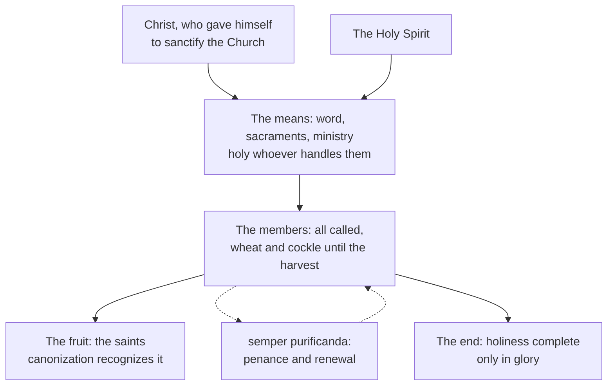

# The Church & Mary · Lesson 2.2: Holy

> ⏱ ~15 min · Module 2: The four marks · Builds on: [1.3 The Body of Christ](01-03-the-body-of-christ.md), [1.4 People of God, communion, sacrament](01-04-people-of-god-communion-sacrament.md), [2.1 One](02-01-one.md), [`patristics` 4.4](../../patristics/lessons/04-04-augustine-against-the-donatists.md) · Unlocks: [2.3 Catholic](02-03-catholic.md), [5.4 A Church of sinners](05-04-a-church-of-sinners.md)

## Why this matters

Every Sunday Catholics confess a holy Church, and every Catholic knows sinners in it, starting with himself. Vatican I even named the Church's "eminent holiness" among the visible signs of her credibility (*Dei Filius*, 1870, ch. 3, Schaff's translation). This lesson states what "holy" asserts of the Church as such, where it comes from, what it does not assert of any member, and what "always in need of purification" commits the tradition to.

## The idea

**The Donatists first, at their strength.** After Diocletian's persecution an African party refused communion with bishops consecrated by men who had handed over the Scriptures. The events are [`church-history` 1.4](../../church-history/lessons/01-04-constantine.md)'s, and Augustine's answer on baptism is [`patristics` 4.4](../../patristics/lessons/04-04-augustine-against-the-donatists.md)'s. Theirs was a martyrs' Church, and it had a text: Christ gave himself for the Church "that he might present it to himself, a glorious church, not having spot or wrinkle" (Eph 5:27, DR). A bride like that cannot shelter traitors. Holiness must be visible, and it must pass from hand to hand. They also claimed Cyprian, keeping his denial that baptism given outside the Church is baptism, a conclusion the Church did not keep. Petilian, Donatist bishop of Cirta, put [the Donatist principle](../reference.md#the-donatist-principle) in one line: what we look for, he wrote, is "the conscience of the giver" to cleanse the recipient's (quoted in Augustine, *Answer to the Letters of Petilian* I.1.2, NPNF first series vol. 4, J. R. King's translation).

**Augustine's reply moves the source.** He does not say the minister's sin is harmless. He says it is not where holiness comes from:

> The conscience of man is often unknown to me, but I am certain of the mercy of Christ … My origin is Christ, my root is Christ, my head is Christ. (*Answer to the Letters of Petilian* I.7.8)

If holiness ran through the minister, no believer could know he had it, since no one sees another's conscience. It runs from the Head, so it is certain. The same move puts the bride's spotlessness at the end of time. At the conference of 411, Augustine reports, the Donatists claimed a Church that already had neither spot nor wrinkle. He answers:

> for the Church, as a whole, the time will not come when it shall be altogether without spot or wrinkle, or any such thing, till the day when we shall hear the words, "O death, where is thy sting?" (Letter 185, *On the Correction of the Donatists*, ch. 9 §38)

**Where *corpus permixtum* comes from.** The phrase is a later shorthand. Tyconius, a Donatist, titled the second of his seven rules for reading Scripture *De Domini corpore bipertito*, the twofold body of the Lord. Augustine calls the name unsuitable, since whoever will not be with Christ in eternity was never truly part of his body, and proposes "the true and the mixed body of the Lord" (*vero atque permixto*), or "Concerning the mixed Church" (*De doctrina christiana* III.32.45, NPNF first series vol. 2). His image there is the net holding good fish and bad (Matt 13:47–48); elsewhere it is the cockle among the wheat: "Suffer both to grow until the harvest" (Matt 13:30, DR). That is the [mixed body](../reference.md#corpus-permixtum): good and bad really inside one visible Church, sorted by the Lord at the end and by nobody before it.

## The doctrine

1. **The Church is [holy](../reference.md#holiness-of-the-church).** The Creed of 381, as the Church received it, confesses "one, holy, Catholic and Apostolic Church" (Percival, NPNF second series vol. 14). *Lumen Gentium* 39 restates it as belief: the Church *indefectibiliter sancta creditur*, is believed to be indefectibly holy. *In words:* the Church's holiness cannot be lost, and it is confessed, not tallied.
2. **Its source is Christ and the Spirit.** In LG 39, Christ loved the Church as his bride and gave himself up to sanctify her (Eph 5:25–26). He joined her to himself as his body and gave her the Spirit. The Church does not possess her marks of herself (CCC 811). *In words:* the Church is holy as a sanctuary is holy, because of who is present and what is given there, not as a person is virtuous.
3. **The holiness is real now and complete only at the end.** On earth her holiness is real though imperfect (*vera sanctitate licet imperfecta*, LG 48; [1.4](01-04-people-of-god-communion-sacrament.md)), perfect only in glory. It shows in the fruits of grace the Spirit produces in the faithful (LG 39), most visibly in the saints. *In words:* holy now in her source, means and fruit; spotless only at the harvest, except in Mary, in whom the Church already has that perfection (LG 65; [6.5](06-05-mary-in-the-economy-in-the-church-and-in-devotion.md)).
4. **She holds sinners and is always being purified.** LG 8 sets Christ, who knew no sin, beside the Church, which holds sinners in her own bosom and is *sancta simul et semper purificanda*, at once holy and always to be purified, constantly following the way of penance and renewal. *Unitatis Redintegratio* 6 adds that Christ calls the pilgrim Church to continual reformation, needed insofar as she is a human, earthly institution: failures in conduct, in discipline, even in how teaching was formulated (as distinct from the deposit) are to be set right. *In words:* the Church herself needs purifying for as long as this age lasts; what needs it is her human side, not Christ's gifts.
5. **Everyone is called.** LG ch. 5 (39–42) teaches the universal call to holiness, already taught in [`moral-theology` 1.4](../../moral-theology/lessons/01-04-the-new-law.md); charity is its soul (LG 42). *In words:* every member is called, and no member has arrived.
6. **Canonization.** By [canonizing](../reference.md#canonization), the Church solemnly proclaims that a named person practised heroic virtue and lived in fidelity to grace, and proposes that person to believers as model and intercessor (CCC 828). *In words:* here the Church says holiness was achieved in one life.

**What [*semper purificanda*](../reference.md#semper-purificanda) commits the tradition to.** First, the Church cannot file every failure as the private sin of members: LG 8 makes the Church the one purified, and UR 6 names discipline among the things reformed. Second, penance is the pilgrim Church's permanent condition, not an emergency measure. Third, the scope is limited: the deposit, the sacraments and the Spirit's gifts are not what is purified. *Ecclesia semper reformanda* is a slogan of Reformed Protestant theology, in no conciliar text. And *Mystici Corporis* (1943) §66 calls the Church spotless in her sacraments, faith and laws, and says members' falls cannot be laid to her charge; LG 8 does not repeat that second clause. Whether the Church herself can be called sinful is [5.4](05-04-a-church-of-sinners.md)'s question.

**The image, and its limits.** On Rahab in Christ's genealogy, Ambrose writes (lesson's translation of *Exposition of Luke* III, PL 15, 1681):

> Rahab, a harlot in type but the Church in mystery … who did not refuse union with many strangers, and the more joined to many, the more chaste: immaculate virgin, without wrinkle … a chaste harlot, a barren widow, a fruitful virgin.

Balthasar's essay "Casta Meretrix" (in *Sponsa Verbi*; English *Spouse of the Word*, 1991) gathered the Fathers' texts on the Church as harlot under Ambrose's phrase, and [*casta meretrix*](../reference.md#casta-meretrix) has since been invoked for a Church of sinners. Read Ambrose for what he says: the "harlotry" is the Church's openness to the Gentiles, and the stress falls on *casta* (so Giacomo Biffi; H. M. Giudice, 2012, who reports the phrase occurs only once in the Fathers). The image carries a Church gathered from sinners and made chaste by Christ. It does not carry a patristic verdict that the Church is a sinner.

**Said plainly.** A Church confessed holy in every Creed had priests who sexually abused children and bishops who knowingly moved them from parish to parish ([`church-history` 9.3](../../church-history/lessons/09-03-after-the-council.md)). Nothing in this lesson makes that smaller. What ecclesiology must say about it is [5.4](05-04-a-church-of-sinners.md)'s work.

**Mark the levels** ([`fundamental-theology` 4.4](../../fundamental-theology/lessons/04-04-the-ladder-of-doctrinal-authority.md); [levels](../reference.md#levels-of-authority)). That the Church is holy is **rung 1**: an article of the Creed, restated in LG 39. That her holiness is Christ's gift and that sinners are truly inside her is constant teaching, restated in *Mystici Corporis* §23 and LG 8: **at least rung 3**. Its sacramental corollary, that a minister in mortal sin still confers the sacrament, is **rung 1**, defined at Trent (Session VII, *On the Sacraments in General*, can. 12), and owned by [`sacraments-and-liturgy`](../../sacraments-and-liturgy/syllabus.md). LG 8's *semper purificanda*, LG 40 and 48, and UR 6 are conciliar teaching defining nothing new: **at least rung 3**. **Canonization is rung 2.** The CDF's *Doctrinal Commentary on the Concluding Formula of the Professio fidei* (29 June 1998, §11) lists "the canonizations of saints (dogmatic facts)" among truths held definitively that cannot be declared divinely revealed, so it is **never rung 1**. The guarantee is narrow: the person is in glory and may be venerated by the whole Church. It covers no particular act, opinion or page of the biography; the acts approving Alphonsus, his canonization among them, made his system safe to follow, not the Church's ([`moral-theology` 4.1](../../moral-theology/lessons/04-01-casuistry-and-the-probabilism-controversy.md)). The commentary's examples are illustrations, and theologians still discuss the guarantee's reach. Augustine's mixed body, Ambrose's image and Balthasar's essay have **no magisterial level**; *ecclesia semper reformanda* has none at all.

## Where holiness comes from

Holiness enters from the top. The dashed loop is LG 8's permanent penance.

## Worked examples

**Ex 1 (clean): the pure parish.** An invented reform group petitions its bishop for a "pure parish" that refuses membership to notorious sinners. The parish's holiness comes from the word, the sacraments and the Spirit (claim 2), so expelling sinners adds nothing to it. The wheat and the cockle grow together until the harvest, and the sorting is the Lord's (Matt 13:30): no membership test of virtue. That does not abolish discipline. *Mystici Corporis* §22 counts as outside those excluded by legitimate authority for grave faults, so the mixed body limits who sorts and why; it does not ban canonical penalties. Then LG 8 turns the petition round: the Church herself follows the way of penance, so the reformers are inside the purifying, not its supervisors.

**Ex 2 (strain): the saint with a file.** Invented: twenty years after a teaching foundress, St Ottoline Varga, is canonized, archives show that as superior she defended harsh corporal punishment of pupils, common in her day, as God's will. Is the canonization now false? Fix the reach first. At rung 2 the Church holds that Ottoline is in glory and may be venerated. Heroic virtue is judged across a whole life (CCC 828) and is not sinlessness (LG 65 sets Mary apart from all who still struggle against sin). Her opinion about punishment was never canonized, any more than Alphonsus's system was defined. The strain is real, though: if the process missed something grave, the guarantee must rest on something other than the evidence. Aquinas met exactly that objection (P3).

## Watch out

- **You might think "holy" means the members are better people.** The mark is asserted of the Church as such, from her source; the saints are its fruit, not its ground.
- **You might think a grave sinner has left the Church.** That is the Donatist instinct; *Mystici Corporis* §23 says not every grave sin severs ([1.3](01-03-the-body-of-christ.md)). But inside is not holy: LG 14 says one who does not persevere in charity remains in the Church only "bodily", not "in his heart".
- **You might think canonization is a dogma of faith, or only an honour.** The first overstates: it is rung 2, a dogmatic fact, never rung 1 (whether the formula is itself *ex cathedra* is disputed). The second, a papal knighthood, understates.
- **"Vatican II says the Church is *semper reformanda*"** misquotes. LG 8 says *semper purificanda*; UR 6 speaks of continual reformation of the Church's human side.

## One-liner

> The Church is holy because Christ holds her, not because her members are good, and so she can be at once holy and always in need of purification.

## Problems

**P1 (🟢)** *(Exegetical)* Two **invented** texts, written for this problem. A homily at a confirmation Mass:

> "We say the Church is holy because, taken all together, Catholics are better people: look at our saints, our hospitals, our schools. And a Catholic who commits a mortal sin has, in that moment, left the Church, so the Church stays pure."

A letter to the editor of a diocesan weekly, replying:

> "The Church is a club of hypocrites. Her own bishops have been exposed, so 'holy' in the Creed is simply false. Even Vatican II admitted the Church is sinful."

Find **four** errors, at least one in each text. For each give the correction, and give the level wherever a level is involved. 150 words or fewer.

**P2 (🟡)** *(Exegetical)* An **invented** diocesan press release. The Diocese of Kestrel Bay's historical commission has found that its parishes seated Black parishioners separately and its schools refused them admission until 1964, and that two successive bishops resisted integration. The release says:

> (1) "The Church is holy, so these were the private failings of individuals in a different era; the Church herself has nothing to purify."
>
> (2) "Because the Church is holy, the bishops' policy must have been prudent in its context."
>
> (3) "We will rewrite our schools' admission rules where needed; such rules belong to discipline, not to the deposit of faith."
>
> (4) "Sadly, sacraments celebrated by clergy who supported segregation conveyed nothing, since a minister in grave sin gives nothing."

For each sentence, say whether it is consistent with Catholic teaching, citing *Lumen Gentium* 8 and *Unitatis Redintegratio* 6 where they apply, and why. Name the principle and its level where a level is involved. Two sentences per item.

**P3 (🔴)** *(Exegetical)* Aquinas, *Quodlibet* IX q.8, asking whether all the saints canonized by the Church are in glory (lesson's translation of the Latin):

> I say, then, that the judgment of those who preside over the Church can err in anything whatever, if only their persons are considered. But if divine providence is considered, which directs its Church by the Holy Spirit so that it does not err … it is certain that the judgment of the universal Church cannot err in matters that pertain to faith. … In other sentences, which concern particular facts, as when the case is about possessions or crimes or the like, the Church's judgment can err because of false witnesses. The canonization of saints is midway between these two. Yet because the honour we show the saints is a kind of profession of faith, by which we believe in the saints' glory, it is piously to be believed that the Church's judgment cannot err even in these.

(a) Name Aquinas's three classes of judgment, say where he puts canonization and on what ground, and quote the words that fix the weight he gives his own conclusion. (b) State the level at which canonization stands today, and by which act. Does that level contradict Aquinas? Two sentences per part.

Solutions

**P1** *(Exegetical)*

**Accept:** any four of the five below, with at least one from each text.

**Must hit, strict:**

- **Homily, the ground.** Holiness is grounded in Christ and the Spirit, not in members' virtue (LG 39; CCC 811). Saints and works are its fruit and sign, not its cause.
- **Homily, "left the Church".** Not every grave sin severs from the Body; schism, heresy and apostasy do (*Mystici Corporis* §23). LG 8 says the Church holds sinners in her bosom. This is the mixed body.
- **Letter, the inference.** The mark is asserted of the Church as such, not of every member. Members' hypocrisy does not falsify it, because the Creed never claimed sinless members.
- **Letter, the level.** That the Church is holy is **rung 1**, an article of the Creed. "Simply false" denies an article of faith.
- **Letter, "Vatican II admitted".** This misreports the text it means. LG 8 says *holy and always in need of purification*, and LG 39 says she is believed indefectibly holy. Neither calls the Church sinful.

**Wrong turns:** treating the homily's appeal to the saints as wholly wrong, when LG 39 does say holiness shows in the fruits of grace in the faithful; calling the letter-writer a heretic, when can. 751 needs obstinate denial after baptism; fixing only the homily.

**Model answer:** The homily grounds holiness in Catholics' virtue, but LG 39 grounds it in Christ, who sanctifies his bride, and the saints are its fruit. Nor does mortal sin as such put a Catholic outside: *Mystici Corporis* §23 reserves that to schism, heresy and apostasy, and LG 8 has the Church holding sinners. The letter confuses the mark, which is said of the Church as such, with a claim about every member, and it denies a rung-1 article of the Creed. And the text the letter means, LG 8, does not call the Church sinful: it calls her holy and always to be purified.

---

**P2** *(Exegetical)*

**Must hit, strict:**

- **(1) Inconsistent.** LG 8 makes the Church herself the subject of *semper purificanda*. UR 6 names deficiencies in conduct and discipline as the Church's to set right, so failures in diocesan policy are not only private failings. "The Church is holy" is correct (rung 1). The error is "nothing to purify".
- **(2) Inconsistent.** Holiness does not guarantee the prudence of a governing policy. UR 6 presupposes that discipline can be deficient, and the inference confuses the mark with impeccability ([5.4](05-04-a-church-of-sinners.md)).
- **(3) Consistent.** UR 6 distinguishes discipline, and even how teaching was formulated, from the deposit of faith, and calls for setting them right at the opportune moment. LG 8's penance and renewal is exactly this.
- **(4) Inconsistent.** LG 8 and UR 6 do not settle it; this is Petilian's Donatist principle, which Augustine answered by placing the source of holiness in Christ. That a minister in mortal sin still confers the sacrament is defined at Trent (Session VII, can. 12), **rung 1**. Sacramental detail belongs to `sacraments-and-liturgy`.

**Wrong turns:** "correcting" (1) by saying the Church as such sinned, which is 5.4's disputed question and not what LG 8 says; marking (3) inconsistent because it is a policy change; giving (4) a rung-3 level; arguing about segregation's morality, which the item does not ask.

**Model answer:** (1) Inconsistent. LG 8 makes the Church herself the one always to be purified, and UR 6 counts failures of discipline as hers to correct. (2) Inconsistent. Holiness is not a guarantee that a policy was prudent, and UR 6 assumes discipline can be deficient. (3) Consistent. UR 6 separates discipline from the deposit and asks for reform at the opportune moment. (4) Inconsistent. This is the Donatist principle, and Trent defined against it (Session VII, can. 12, rung 1).

---

**P3** *(Exegetical)*

**Must hit, strict (a):** the classes are (i) the universal Church's judgments in matters of faith, which cannot err; (ii) judgments about particular facts, such as property and crimes, which can err through false witnesses; (iii) canonization, "midway". The ground is that the honour shown to saints is a kind of profession of faith in their glory. The weight is fixed by "piously to be believed", which is set against "it is certain" for class (i).

**Must hit, strict (b):** the CDF's 1998 *Doctrinal Commentary on the Concluding Formula of the Professio fidei* (§11) lists canonizations as dogmatic facts to be held definitively, **rung 2**, and expressly not as divinely revealed. That is a firmer note than Aquinas's, but the same placement: neither faith itself nor a fallible finding of fact. So it develops his view and does not contradict it.

**Wrong turns:** calling canonization rung 1, or treating its *ex cathedra* status as settled either way; saying Aquinas denied that canonization is infallible, when he holds it as a pious belief; leaving out that his ground is the cult, which is what limits the guarantee to the saint's glory.

**Model answer:** (a) Aquinas separates the universal Church's judgments of faith, which cannot err, from sentences about particular facts, which false witnesses can corrupt. He puts canonization midway, because honouring a saint professes faith in his glory, and marks his conclusion "piously to be believed", not "certain". (b) Today canonization is held definitively as a dogmatic fact, rung 2, on the CDF's 1998 commentary on the *Professio fidei*, which also denies that it can be declared revealed. That firms up Aquinas's pious belief while keeping his middle placement, so it is a development, not a contradiction.

## Flashback

**From Lesson [1.4](01-04-people-of-god-communion-sacrament.md) (People of God, communion, sacrament):** *(Exegetical.)* Cyprian, *On the Lord's Prayer* 8 (ANF 5), an earlier chapter than the one *Lumen Gentium* 4 quotes:

> Before all things, the Teacher of peace and the Master of unity would not have prayer to be made singly and individually, as for one who prays to pray for himself alone. ... Our prayer is public and common; and when we pray, we pray not for one, but for the whole people, because we the whole people are one. The God of peace and the Teacher of concord, who taught unity, willed that one should thus pray for all, even as He Himself bore us all in one.

(a) *Communionis Notio* gives communion a vertical and a horizontal dimension, and an invisible and a visible side. Say what the passage makes the ground of the people's oneness, what it makes the expression of that oneness, and which comes first. (b) Which claim of *Lumen Gentium* 9 does the passage's first sentence anticipate? Name one thing LG 9 says of this people that the passage does not. **Two sentences per part.**

Solution

**Accept:** for (a), a ground located in Christ's act or will ("bore us all in one", "who taught unity") rather than in the people's agreement; for (b), any one of the LG 9 additions below.

**Must hit, strict (a):**

- **Ground:** Christ, who "bore us all in one". The people's oneness is given from above before anyone prays. That is the **vertical** dimension, which *Communionis Notio* 3 puts first, calling communion above all a gift of God's initiative.
- **Expression:** each praying for all, the **horizontal** dimension. It is also **visible**, since the prayer is "public and common" (*Communionis Notio* 4 makes the visible bonds part of communion).
- **Order:** they pray for the whole people *because* they are one; they are not one because they pray together.

**Must hit, strict (b):**

- LG 9: God does not save people merely as individuals, without bond or link between them, but brings them together as one people. Cyprian's "not ... singly and individually" refuses the individual as the unit in the same way.
- One addition, any of: Israel chosen and formed as preparation and figure of the new covenant; the new covenant in Christ's blood gathering Jew and Gentile into one people in the Spirit; a people with Christ for its head, love for its law and the kingdom for its end.

**Wrong turns:** reversing the order, so that "concord" or the shared prayer produces the oneness. Reading "the whole people" as the laity facing the clergy, when a bishop writes "we" and LG 30 applies "People of God" to clergy, religious and laity alike. Giving the passage magisterial weight because LG quotes the same treatise: it is a Father's witness, on no rung. Adding that LG 9 makes the Church replace Israel, which LG never says ([1.4](01-04-people-of-god-communion-sacrament.md), Ex 2).

**Model answer:** (a) The ground is Christ, who "bore us all in one": the people's oneness is a gift from above, the vertical dimension that *Communionis Notio* 3 puts first. Its expression is horizontal and visible, each praying for all in a prayer "public and common", and it follows from the oneness rather than producing it. (b) It anticipates LG 9's claim that God does not save people merely as individuals, without bond or link, but brings them together as one people. LG 9 adds the history the passage leaves out: Israel chosen and formed as preparation and figure, and a new covenant in Christ's blood that gathers Jew and Gentile into one people in the Spirit.

## Connections

- **Backward:** [1.3](01-03-the-body-of-christ.md) reads *Mystici Corporis*; its §§22–23 and §66 are used here. [1.4](01-04-people-of-god-communion-sacrament.md) gave LG's order of chapters, which puts the call to holiness in ch. 5 for everyone. [2.1](02-01-one.md) is the mark this one is paired with. Augustine on baptism and the coercion letters are [`patristics` 4.4](../../patristics/lessons/04-04-augustine-against-the-donatists.md), and Ambrose as a bishop is [`patristics` 4.1](../../patristics/lessons/04-01-ambrose-of-milan.md).
- **Forward:** [2.3](02-03-catholic.md) takes up the next mark. [5.4](05-04-a-church-of-sinners.md) asks whether the Church herself can be called sinful, and what the abuse crisis requires. [`sacraments-and-liturgy`](../../sacraments-and-liturgy/syllabus.md) takes the Donatist principle on to validity, and [`apologetics-catholic-claims`](../../apologetics-catholic-claims/syllabus.md) meets the Donatist question in its modern form. The communion of saints and glory belong to [`creation-grace-last-things`](../../creation-grace-last-things/syllabus.md).
- **Sideways:** Augustine's two cities, which are not Church and State, are [`history-of-political-thought` 2.2](../../history-of-political-thought/lessons/02-02-augustine-the-two-cities.md). Grading canonization at rung 2 uses the same 1998 commentary that [`fundamental-theology` 4.4](../../fundamental-theology/lessons/04-04-the-ladder-of-doctrinal-authority.md) uses for its dogmatic facts.
