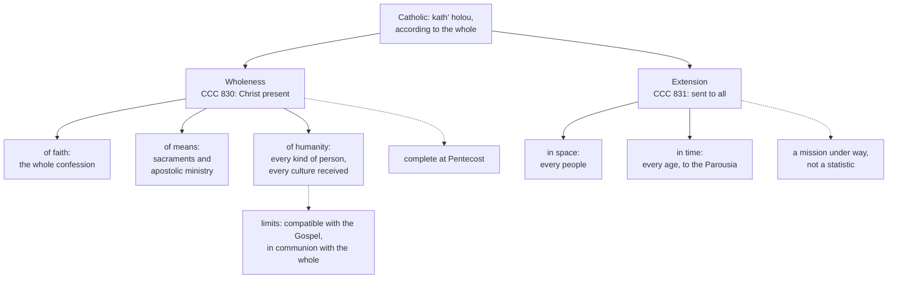

# The Church & Mary · Lesson 2.3: Catholic

> ⏱ ~15 min · Module 2: The four marks · Builds on: [2.1 One](02-01-one.md), [2.2 Holy](02-02-holy.md), [`patristics` 1.3](../../patristics/lessons/01-03-ignatius-of-antioch.md) · Unlocks: [2.4 Apostolic](02-04-apostolic.md), [3.2 The local and the universal Church](03-02-the-local-and-the-universal-church.md)

## Why this matters

Of the [four marks](../reference.md#four-marks), "catholic" is the one most often heard as a number: "universal" becomes "everywhere", then "biggest", and the mark turns into a statistic the Church could lose by shrinking. The tradition reads it the other way round, wholeness first. The Catechism says the Church was catholic on the day of Pentecost (CCC 830), when the community in Jerusalem had numbered about a hundred and twenty a few days before (Acts 1:15).

It matters now because the Church's map has changed. In 1910 about two-thirds of the world's Catholics lived in Europe; by 2010 about a quarter did, and sub-Saharan Africa had gone from under one per cent of the total to about sixteen (Pew Research Center, *The Global Catholic Population*, 2013, from World Christian Database estimates). Whether the Church can receive those peoples without being captured by any one of them is what the mark is about.

## The idea

**[Catholicity](../reference.md#catholicity) is an intensive word before it is an extensive one.** *Katholikos* comes from *kath' holou*, "according to the whole" (lesson's gloss). Thermodynamics has the distinction you need. Mass is extensive: double the system, double the mass. Temperature is intensive: a cup drawn from a lake is as warm as the lake. In its first sense catholicity behaves like temperature: a small community with the whole faith, the whole sacramental life and the apostolic ministry has all of it, and a larger one does not have more. The second sense is extensive, a mission to every people and age, and even there what counts is the mission's scope, not a population share.

The word's early history runs the same way. Ignatius of Antioch, about 110, gives its first attested use: "wherever Jesus Christ is, there is the Catholic Church" (*Smyrnaeans* 8). As [`patristics` 1.3](../../patristics/lessons/01-03-ignatius-of-antioch.md) reads it, the adjective sets the whole Church against the local assembly round its bishop: a description, not yet a name. About 348 Cyril of Jerusalem explains the creed's article on the Catholic Church to candidates for baptism (the Source). About 434 Vincent of Lérins makes the word a test of doctrine: believed everywhere, always, by all ([`fundamental-theology` 5.1](../../fundamental-theology/lessons/05-01-vincent-of-lerins.md)). And the mark was tested before the word existed, when the Jerusalem meeting declined to require circumcision of Gentile converts (Acts 15; [`church-history` 1.1](../../church-history/lessons/01-01-the-first-generation-and-its-sources.md)): the Church would not be bound to the culture she was born in.

**The [branch theory](../reference.md#branch-theory), in its own terms.** William Palmer of Worcester College, Oxford, gave it classic form in *A Treatise on the Church of Christ* (1838). A society cut off by the great body of Christians is outside the Church; but the Catholic Church itself can be divided in external communion without ceasing to be one. So the one Church of the Creed exists in the Roman, the Oriental and the British churches, each holding the apostolic faith with valid ordination and true mission. None may call itself alone catholic; Palmer faults the Roman side for "pretending that their branches of the church are alone catholic." Universality, for him, is moral: adherents in every known nation, never again reduced to a small part of the world.

## Source

Cyril of Jerusalem, *Catechetical Lectures* 18.23, delivered about 348 while he was a presbyter (NPNF second series, vol. 7, Gifford's revision of R. W. Church's translation). He has just recited the article "in one Holy Catholic Church":

> It is called Catholic then because it extends over all the world, from one end of the earth to the other; and because it teaches universally and completely one and all the doctrines which ought to come to men's knowledge, concerning things both visible and invisible, heavenly and earthly; and because it brings into subjection to godliness the whole race of mankind, governors and governed, learned and unlearned; and because it universally treats and heals the whole class of sins, which are committed by soul or body, and possesses in itself every form of virtue which is named, both in deeds and words, and in every kind of spiritual gifts.

Read the shape. Four "because" clauses, the last with two limbs, and only the first is about extension. The rest are about wholeness: the whole of doctrine; every *kind* of person (rulers and ruled, learned and unlearned: kinds, not places); every kind of sin healed; every virtue and gift possessed. Geography comes first and is outweighed by everything after it. The passage is a catechist's explanation: a witness, on no rung of the ladder.

## The doctrine

1. **The Church is catholic.** The creed of 381 confesses "one, holy, Catholic and Apostolic Church" (Percival, NPNF second series, vol. 14). *In words:* catholicity is confessed of the Church as such, as something she is given, not an achievement she reports.
2. **Catholic in a double sense** (CCC 830–831). First, because Christ is present in her, the Church receives from him the [fullness of the means of salvation](../reference.md#fullness-of-the-means-of-salvation): the right and complete confession of faith, the full sacramental life, and ordained ministry in apostolic succession (CCC 830, citing *Unitatis Redintegratio* 3). In this sense she was catholic at Pentecost. Second, she is sent to the whole human race (Matt 28:19; *Lumen Gentium* 13). *In words:* the Church is whole, and she is for everyone; the first is complete from the start, the second a mission under way.
3. **Catholicity includes the power to receive every culture without being bound to one.** *Lumen Gentium* 13: the People of God takes up the abilities, riches and customs of each people *insofar as they are good*, purifying, strengthening and elevating them, and each part brings its gifts to the whole. *Gaudium et Spes* 58: the Church is bound exclusively and indissolubly to no race, nation or way of life, ancient or recent. *Ad Gentes* 22: young churches take up their peoples' wisdom, arts and customs so as to exclude every appearance of syncretism and of false particularism. *In words:* she can be at home in any culture because she is the property of none.
4. **The particular churches are where the one Church exists, not branches of it.** *Lumen Gentium* 23: the [particular churches](../reference.md#particular-church) are formed after the model of the universal Church, and in and from them the one and only Catholic Church comes into being. *Lumen Gentium* 26: in every legitimate local community round its bishop, however small and poor, Christ is present and the one, holy, catholic and apostolic Church is gathered. Paul VI warned against picturing the universal Church as a federation of essentially different particular churches (*Evangelii Nuntiandi* 62, cited in CCC 835). *In words:* each diocese is the whole Church present in one place, never a share of it. Whether the universal Church is *prior* to the particular churches is a separate, freely disputed question, [3.2](03-02-the-local-and-the-universal-church.md)'s.
5. **Division wounds catholicity.** *Unitatis Redintegratio* 4, paraphrased: divisions keep the Church from realizing the fullness of catholicity proper to her in the baptized who are separated from full communion, and make it harder for her to express it in actual life. *In words:* fullness of means is not fullness of realization. Full and partial communion are [2.1](02-01-one.md)'s categories.
6. **Inculturation has a rule and limits.** John Paul II's *Redemptoris Missio* (1990), 52–54, describes [inculturation](../reference.md#inculturation) as a movement both ways: the Gospel transforms a culture's authentic values from within, and the culture is brought into the Church's communion. Two principles govern it, compatibility with the Gospel and communion with the universal Church (54, quoting *Familiaris Consortio* 10), and the bishops discern. *In words:* anything good may come in; nothing the Gospel excludes, and nothing at the price of communion. [`church-history` 7.2](../../church-history/lessons/07-02-accommodation-in-asia.md) handed this lesson its classic case: Rome forbade the Chinese rites in 1715 (*Ex illa die*) and permitted them in 1939 (*Plane compertum est*), holding that their meaning had become civil. The rule against idolatry never moved; the judgment of what a bow meant did.

**Mark the levels** ([`fundamental-theology` 4.4](../../fundamental-theology/lessons/04-04-the-ladder-of-doctrinal-authority.md); [levels of authority](../reference.md#levels-of-authority)). That the Church is catholic is an article of the creed of an ecumenical council: **rung 1**, believed as revealed. Claims 2–5 are Vatican II's teaching (*Unitatis Redintegratio* 3–4; *Lumen Gentium* 13, 23, 26; *Gaudium et Spes* 58; *Ad Gentes* 22). The council defined nothing new, so these carry the weight of what they restate ([`fundamental-theology` 4.5](../../fundamental-theology/lessons/04-05-reading-a-documents-weight.md)): **at least rung 3**, owed religious submission. That the fullness of the means is found in the Catholic Church is bound up with *subsistit in*, whose exact rung is [5.2](05-02-subsistit-in-and-the-status-of-other-churches.md)'s question. *Redemptoris Missio*'s two principles are encyclical teaching, **rung 3**. *Ex illa die* and *Plane compertum est* were **disciplinary rulings**, not doctrine at any rung, which is why the second could reverse the first. The priority of the universal Church is **freely disputed**. Ignatius, Cyril, Vincent and Palmer are witnesses or theologians, not magisterial acts. A percentage sits on no rung at all.

## The two senses

## Worked examples

**Ex 1: the clean case, Pentecost.** Run the two senses on Acts 2. *Wholeness:* the baptized persevered in the apostles' doctrine, the breaking of bread and the prayers (2:42). Faith, sacrament and apostolic ministry are all present, so the Church is complete in the first sense, catholic on that day as CCC 830 says. *Extension:* about three thousand baptized (2:41), all Jews and proselytes, in one city; on a headcount, a Jerusalem sect. *Receptivity:* the crowd came from every nation under heaven, and each heard in his own tongue (2:5–11); the Gospel did not wait for its hearers to learn one sacred language. All three are present at the start, in miniature, and none depends on size.

**Ex 2: where it strains, a Church changing shape.** Does the southward shift make the Church *more* catholic? Not in the first sense, complete at Pentecost. In the second, extension has grown, but a mission is not fulfilled by a percentage. The real strain is on claim 3. For most of the second millennium the Church's universal forms were largely one culture's: Latin worship, Roman law, scholastic theology, a European clergy; in the Americas her missionaries came with conquerors ([`church-history` 7.1](../../church-history/lessons/07-01-conquest-and-conscience-in-the-americas.md)). *Gaudium et Spes* 58 says she is bound to no culture; the record shows how much of one she carried as though it were simply the Church's. The doctrine does not say how that is undone. It gives criteria (claim 6) and names two opposite failures: treating European forms as the only Catholic ones contradicts *Gaudium et Spes* 58, and a young church that makes its own nation's forms the measure falls into the false particularism *Ad Gentes* 22 excludes. Numbers tell you where the Church is, not whether she is catholic.

## Watch out

- **You might think "catholic" means big, or everywhere.** It means whole first. She was catholic at Pentecost (CCC 830); growth adds extension, not catholicity in the first sense.
- **You might think a diocese is a branch office of a global Church.** *Lumen Gentium* 23 and 26 put the Church entire in each. But "not branches" does not settle the priority dispute, which stays freely disputed ([3.2](03-02-the-local-and-the-universal-church.md)).
- **You might think 1939 reversed a doctrine, or that Vatican II defined inculturation.** Both overstate: the Chinese-rites rulings were disciplinary, and *Lumen Gentium* 13 and *Gaudium et Spes* 58 are conciliar teaching at rung 3, not definitions. The opposite error understates: the Church's catholicity is rung 1, not a figure of speech.
- **You might think "fullness of the means" means Catholics are holier, or that others have nothing.** *Unitatis Redintegratio* 3 says the Spirit uses the separated communities as means of salvation; 4 says Catholics fail to live by what they have.

## One-liner

> Catholic is intensive before it is extensive: the Church was whole in one city at Pentecost, and she is sent to every people, to be at home in each without belonging to any.

## Problems

**P1 (🟢)** *(Exegetical)* An **invented** press release, written for this problem:

> **Diocese of Marrowby, Office of Communications, for immediate release.** "With well over a billion members, the Catholic Church is the largest religious body on earth, which is what the Creed means when it calls her catholic. Today's figures confirm that most Catholics now live outside Europe and North America: after twenty centuries the Church has at last become truly catholic. Our diocese, with its forty thousand Catholics, is proud to hold its small share of this worldwide Church. And as the Second Vatican Council solemnly defined, the customs of every culture are to be welcomed into the Church just as they are."

Find **four** errors. For each, give the correction, and where a level is involved, state it. 150 words or fewer.

**P2 (🟡)** *(Exegetical)* Cyril of Jerusalem, *Catechetical Lectures* 18.26 (NPNF second series, vol. 7), a few sentences after the Source:

> But since the word Ecclesia is applied to different things [...], and since one might properly and truly say that there is a Church of evil doers, I mean the meetings of the heretics, the Marcionists and Manichees, and the rest, for this cause the Faith has securely delivered to thee now the Article, "And in one Holy Catholic Church;" that thou mayest avoid their wretched meetings, and ever abide with the Holy Church Catholic in which thou wast regenerated. And if ever thou art sojourning in cities, inquire not simply where the Lord's House is (for the other sects of the profane also attempt to call their own dens houses of the Lord), nor merely where the Church is, but where is the Catholic Church. For this is the peculiar name of this Holy Church, the mother of us all [...].

(a) Is "Catholic" used here as a description or as a name? Name the words that decide it. (b) In *Smyrnaeans* 8, as [`patristics` 1.3](../../patristics/lessons/01-03-ignatius-of-antioch.md) reads it, "catholic" sets the whole Church against the local assembly. What does Cyril set the Catholic Church against, and so what does the word do for his hearer that "Church" cannot? **Two sentences per part.**

**P3 (🔴)** *(Exegetical)* The bishops of the **invented** Kessaro highlands receive three proposals from a regional assembly.

- (i) Bishops are to be addressed by the highland word for a respected elder who settles disputes.
- (ii) At a newborn's naming, a libation is poured to the clan's founding spirit, honoured in the highlands as a divine power, who is asked to accept and protect the child.
- (iii) Henceforth the highland church will choose its bishops in a regional assembly, as its chiefs are chosen, and ordain them without reference to Rome.

(a) Using the Church's criteria (*Lumen Gentium* 13; *Ad Gentes* 22; *Redemptoris Missio* 54), give each a verdict, **permitted** or **not permitted as described**, and name the criterion that decides it. One line each. (b) The elders answer the verdict on (ii) by saying the libation now means only honour to the clan's history. Say what kind of judgment could change that verdict, who supplies it on *Redemptoris Missio* 54's account, and which earlier ruling shows such a judgment being revised while the rule stood. **Two sentences.**

Solutions

**P1** *(Exegetical)*

**Must hit, strict (all four):**

- **Size is not the mark.** "Catholic" means according to the whole. Its first sense is the fullness Christ gives (CCC 830), and it would be true of a Church of a hundred and twenty. The mark is confessed in the Creed, **rung 1**, of the Church as such; it is not a ranking.
- **"At last become catholic" is false.** She was catholic at Pentecost (CCC 830). The second sense is a mission to all peoples (CCC 831; *Lumen Gentium* 13), not a percentage reached. The southward shift tests the Church's power to receive cultures; it does not create the mark.
- **A diocese is not a share.** It is a particular church in and from which the one Church exists (*Lumen Gentium* 23), the Church of Christ truly present in that place however small (*Lumen Gentium* 26), not a fraction of a whole or a unit of a federation (CCC 835).
- **"Solemnly defined" overstates, and "just as they are" misstates.** Vatican II defined no new dogma; *Lumen Gentium* 13 and *Gaudium et Spes* 58 are conciliar teaching, **at least rung 3**. And customs are taken up *insofar as they are good*, purified and elevated (*Lumen Gentium* 13), under compatibility with the Gospel and communion with the universal Church (*Redemptoris Missio* 54).

**Wrong turns:** arguing about the membership figure or about "largest" (the error is conceptual, not arithmetical); correcting the fourth error by calling *Lumen Gentium* 13 "only pastoral" and binding on no one (understatement: religious submission is owed); correcting the third by saying the universal Church is prior to the diocese, as though that were settled (it is freely disputed, [3.2](03-02-the-local-and-the-universal-church.md)).

**Model answer:** "Catholic" means whole before it means widespread. The Church has the fullness Christ gives and was catholic at Pentecost with a few thousand members (CCC 830); the mark is a creedal article, rung 1, not a ranking. She did not "become" catholic as her members moved south. Her extension is a mission to all peoples (CCC 831), and the shift tests her power to receive cultures without creating the mark. A diocese does not hold a share of the Church: the one Church exists in and from the particular churches (*Lumen Gentium* 23) and is wholly present in each, however small (*Lumen Gentium* 26). Vatican II defined nothing new; *Lumen Gentium* 13 and *Gaudium et Spes* 58 are conciliar teaching at rung 3. And they say customs are received insofar as they are good, purified and elevated, not "just as they are".

---

**P2** *(Exegetical)*

**Accept:** for (b), any wording that names the heretical or sectarian assemblies as the contrast, and says the word now marks off one communion from rivals that also call themselves "Church".

**Must hit, strict (a):** a **name**. The decisive words are "this is the peculiar name of this Holy Church", together with the instruction to ask "where is the Catholic Church", in which the word picks out one assembly in a city. Credit for adding that the name is the creed's own ("the Faith has securely delivered to thee now the Article").

**Must hit, strict (b):** Cyril sets the Catholic Church against **the meetings of the heretics**, Marcionites and Manichees, which also call themselves church and the Lord's house. So the contrast is no longer whole against local but the one true communion against rival assemblies, and "Catholic" is the word the rivals cannot borrow. It tells a traveller which door to go through.

**Wrong turns:** answering from 18.23 instead of this passage; reading the deciding sense as geography ("the one that is everywhere"), when the passage gives no spatial argument; reading "the Catholic Church" in 348 as the Roman communion in its post-Reformation sense; treating a catechetical lecture as a magisterial act. It is a witness and sits on no rung.

**Model answer:** (a) Here "Catholic" is a name: Cyril calls it "the peculiar name of this Holy Church" and tells the traveller to ask "where is the Catholic Church". The word now identifies one assembly in a city, and it is the name the creed's article supplies. (b) Ignatius set the whole Church against the local assembly; Cyril sets the Catholic Church against the meetings of Marcionites and Manichees, who also call themselves church and the Lord's house. So "Catholic" draws the boundary of communion, which "Church" alone can no longer do.

---

**P3** *(Exegetical, both parts)*

**Must hit, strict (a):**

- (i) **Permitted.** A good custom taken up (*Lumen Gentium* 13, "insofar as they are good"); nothing in it is contrary to the Gospel, and communion is untouched.
- (ii) **Not permitted as described.** It fails **compatibility with the Gospel**: a petition to a spirit honoured as divine is worship given to another than God. The naming itself can be taken up and purified (*Lumen Gentium* 13), with prayer to God for the child and remembrance of the family's dead.
- (iii) **Not permitted.** It fails **communion with the universal Church**, and it is the false particularism *Ad Gentes* 22 excludes. Election as such is not the fault: the Latin Code knows bishops legitimately elected and then confirmed by the pope (can. 377 §1). The severance is.

**Must hit, strict (b):** a **judgment of fact about what the act means**, not a change in the rule against worshipping anything but God. On *Redemptoris Missio* 54 the **bishops** supply that discernment. The precedent is the Chinese rites: forbidden by *Ex illa die* (1715), permitted by *Plane compertum est* (1939) on the ground that their meaning had become civil, while the rule stood ([`church-history` 7.2](../../church-history/lessons/07-02-accommodation-in-asia.md)).

**Wrong turns:** permitting (ii) because "the Church takes up every culture", which drops "insofar as they are good"; condemning (iii) because elections are "un-Catholic"; saying in (b) that 1939 changed the rule, declared 1715 wrong, or reversed a doctrine. Both were disciplinary rulings.

**Model answer:** (a) (i) Permitted: a good custom, compatible with the Gospel, with communion untouched. (ii) Not permitted as described: a petition to a spirit honoured as divine fails compatibility with the Gospel, though the naming itself can be purified and kept. (iii) Not permitted: ordaining without reference to Rome breaks communion with the universal Church and is false particularism; election as such would not be the problem (can. 377 §1). (b) What could change the verdict is a judgment of fact about what the libation now means, which on *Redemptoris Missio* 54 the bishops make. The Chinese rites show it: forbidden in 1715 and permitted in 1939 because their meaning had become civil, while the rule against idolatry stood.

## Flashback

**From Lesson [2.1](02-01-one.md) (One):** *(Exegetical.)* Two hosts of an **invented** podcast, written for this problem:

> **Maeve:** "Catholics, Orthodox and Protestants cannot share one altar. Whatever the Creed says, the Church is not one now; 'one' names what we pray she will become."
>
> **Obinna:** "The Church is one and cannot be divided. So a baptized Christian who is not in full communion with her is not in communion with her at all."

(a) The hosts draw opposite conclusions from one shared premise. State it, and the distinction from 2.1 that denies it. (b) For each host, name the text the conclusion contradicts, with its level. **Two sentences per part.**

Solution

**Accept:** any wording of the premise that makes communion with the Church all-or-nothing, so that her unity and Christians' full communion stand or fall together.

**Must hit, strict (a):**

- **The premise:** communion with the Church has no degrees. It is full or absent, so the Church's unity stands only if every baptized Christian is in full communion. Maeve keeps the divisions and gives up the unity; Obinna keeps the unity and gives up the divided Christians' communion.
- **The distinction:** the Church's unity is a gift with no degrees, which she can never lose (UR 4). Communion *with* her has degrees, because its bonds are several (faith, sacraments, government and communion: LG 14, can. 205) and baptism holds where others are lacking (UR 3, 22).

**Must hit, strict (b):**

- **Maeve** contradicts the Creed's "one", an article of faith, **rung 1**. UR 4 restates it, carrying the creed's weight where it does: the unity Christ gave subsists in the Catholic Church as something she can never lose.
- **Obinna** contradicts UR 3, **rung 3**: those who believe in Christ and are truly baptized are in communion with the Catholic Church, though that communion is imperfect.

**Wrong turns:** answering Maeve by denying that unity is also a task (UR 4 hopes it will grow; Christ prays "that they all may be one", John 17:21). Calling either host a heretic, when can. 751's categories name obstinate acts of a will, not positions aired on a podcast. Calling UR 3's teaching defined, which overstates it, or Maeve's error a loose figure of speech, which understates the Creed. Making the crux baptism's validity, which neither host disputes and which belongs to `sacraments-and-liturgy`.

**Model answer:** (a) Both assume that communion with the Church is all-or-nothing, so that her unity stands only if every baptized Christian is in full communion: Maeve keeps the divisions and drops the unity, and Obinna keeps the unity and drops the divided Christians' communion. 2.1 separates the two, for the Church's unity is a gift with no degrees, while communion with her has degrees because its bonds are several and baptism holds where others fail (LG 14; UR 3). (b) Maeve turns into an aspiration what the Creed confesses as an article of faith (rung 1), and UR 4 restates that Christ's gift of unity subsists in the Catholic Church as something she can never lose. Obinna contradicts UR 3 (rung 3): the truly baptized who believe in Christ are in communion with the Catholic Church, though imperfectly.

## Connections

- **Backward:** [2.1](02-01-one.md) gave unity and the categories of full and partial communion that claim 5 uses; [2.2](02-02-holy.md) set the pattern of a mark asserted of the Church as such and not of every member. The meaning of *Smyrnaeans* 8 is [`patristics` 1.3](../../patristics/lessons/01-03-ignatius-of-antioch.md)'s, and Vincent's canon is [`fundamental-theology` 5.1](../../fundamental-theology/lessons/05-01-vincent-of-lerins.md)'s. The Chinese rites are [`church-history` 7.2](../../church-history/lessons/07-02-accommodation-in-asia.md); Gregory the Great's letter to Mellitus, an older precedent for keeping the temple and destroying the idol, is [`church-history` 3.1](../../church-history/lessons/03-01-gregory-the-great-and-the-conversion-of-the-peoples.md).
- **Forward:** [2.4](02-04-apostolic.md) takes the last of the four marks, including the apostolic ministry that both CCC 830 and Palmer count. [3.2](03-02-the-local-and-the-universal-church.md) takes up *Lumen Gentium* 23 and the priority dispute. [5.2](05-02-subsistit-in-and-the-status-of-other-churches.md) grades *subsistit in* and the fullness of the means, and [5.3](05-03-ecumenism-as-doctrine.md) teaches *Unitatis Redintegratio*. Inculturation as liturgical law belongs to `sacraments-and-liturgy` ([syllabus](../../sacraments-and-liturgy/syllabus.md)).
- **Sideways:** the intensive/extensive distinction is thermodynamics' ([`engineering-thermodynamics` 1.1](../../engineering-thermodynamics/lessons/01-01-system-vs-control-volume-state.md)): cut the system in half, and whatever stays the same is intensive. The Church's first catholicity survives the cut.
