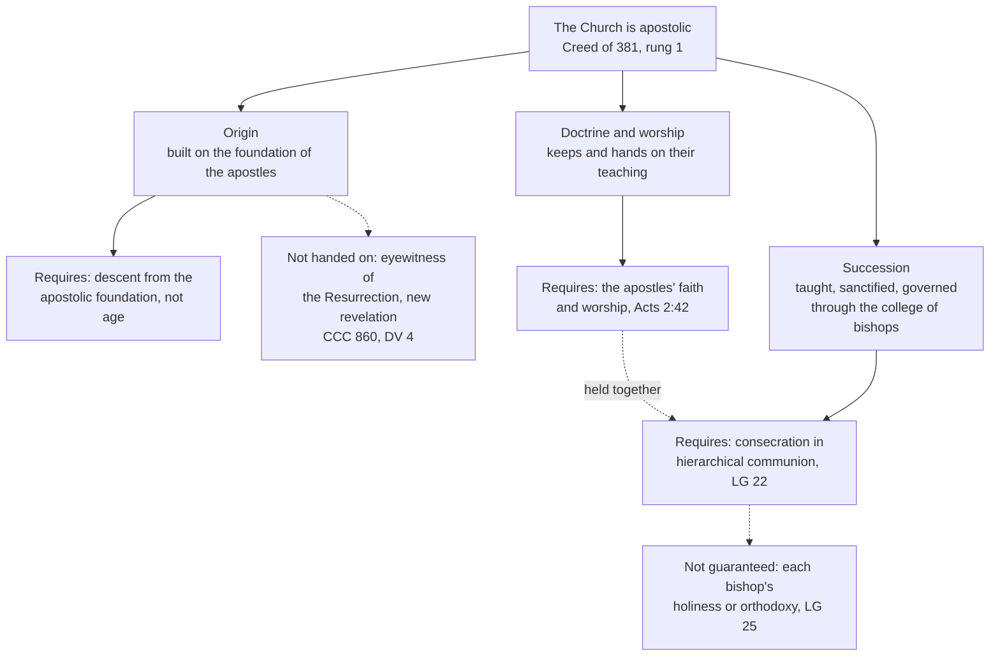

# The Church & Mary · Lesson 2.4: Apostolic

> ⏱ ~15 min · Module 2: The four marks · Builds on: [2.3 Catholic](02-03-catholic.md), [`patristics` 2.1](../../patristics/lessons/02-01-irenaeus-against-the-gnostics.md), [`fundamental-theology` 1.4](../../fundamental-theology/lessons/01-04-public-and-private-revelation.md) · Unlocks: [3.1 Bishops and apostolic succession](03-01-bishops-and-apostolic-succession.md), [4.1 The Petrine texts](04-01-the-petrine-texts.md)

## Why this matters

"Apostolic" is the mark the divided churches actually dispute: what they mean by it decides who has bishops, whose ministers are recognized, and what reunion would take. [`patristics` 1.3](../../patristics/lessons/01-03-ignatius-of-antioch.md) read Ignatius's bishops and left "what it proves theologically" here. [`church-history` 1.2](../../church-history/lessons/01-02-bishops-canon-and-the-parting-of-the-ways.md) found presbyters leading Rome for part of the second century and left open whether the later episcopate is still apostolic. This lesson says what the Church claims by the word: in doctrine, worship and ministry.

## The idea

An *apostolos* is one sent with a commission (lesson's gloss). The Catechism names three ways the Church is [apostolic](../reference.md#apostolicity) (CCC 857):

1. **Origin.** She was and remains built on the foundation of the apostles, the witnesses Christ chose and sent.
2. **Doctrine.** With the Spirit's help she keeps and hands on what she heard from them.
3. **Succession.** She goes on being taught, sanctified and guided by the apostles through their successors in pastoral office, the college of bishops with the successor of Peter.

A commissioned letter has an author, a content and a carrier; Catholic teaching holds the three as one inheritance.

The first defence of the third sense was an argument from **visibility**. Against a claimed secret tradition, Irenaeus named churches' leaders back to the apostles, all teaching one public rule of faith ([`patristics` 2.1](../../patristics/lessons/02-01-irenaeus-against-the-gnostics.md)); Tertullian dared heretics to unroll their roll of bishops (*Prescription* 32, [`patristics` 2.3](../../patristics/lessons/02-03-tertullian.md)). The lists were evidence of *where* the teaching was publicly kept. Behind both stands 1 Clement 42 and 44: the apostles appointed bishops and deacons and left instructions that other approved men should succeed them ([`patristics` 1.2](../../patristics/lessons/01-02-first-clement-and-the-didache.md)).

One part of the apostles' office never passed on: they were chosen witnesses of the Resurrection, the Church's foundation stones (CCC 860). Public revelation closed with them ([`fundamental-theology` 1.4](../../fundamental-theology/lessons/01-04-public-and-private-revelation.md)); successors guard a deposit and do not add to it.

## Source

Irenaeus, *Against Heresies* 4.26.2–4 (ANF vol. 1), on whom to follow when teachers compete:

> Wherefore it is incumbent to obey the presbyters who are in the Church,—those who, as I have shown, possess the succession from the apostles; those who, together with the succession of the episcopate, have received the certain gift of truth, according to the good pleasure of the Father. [...]
>
> Those, however, who are believed to be presbyters by many, but serve their own lusts [...] shall be convicted by the Word [...]
>
> [...] to adhere to those who, as I have already observed, do hold the doctrine of the apostles, and who, together with the order of priesthood, display sound speech and blameless conduct for the confirmation and correction of others.

Read the shape of the act: a rule for discernment with three terms. The first sentence ties a gift to the office, calling the same men presbyters and bishops ([`new-testament` 6.1](../../new-testament/lessons/06-01-the-disputed-pauline-letters-and-the-pastorals.md)). Readers divide over the gift, [*charisma veritatis certum*](../reference.md#charisma-veritatis-certum) in the Latin: a charism given to the office-holder for teaching, or the truth itself, the deposit handed to him with the chair. The next paragraph concedes that some who hold the chief seat serve their own lusts. So the last sets all three together: the apostles' doctrine, the order, and sound speech with blameless life. Succession tells you where to look; it does not certify every holder.

## In their own words

Each as its own theologians give it, with no reply attached; the argument belongs to [`apologetics-catholic-claims`](../../apologetics-catholic-claims/syllabus.md).

**Orthodox.** Philaret's Longer Catechism, which Schaff printed as the Russian Church's chief standard, asks why the Church is apostolic:

> Because she has from the Apostles, without break or change, both her doctrine and the succession of the gifts of the Holy Ghost, through the laying on of consecrated hands.

It adds that in the same sense she is called Orthodox: right faith and the laying on of hands are one apostolicity. John Zizioulas (*Being as Communion*, French 1981) deepens it. Apostolic continuity is carried by communities, not by a line of individuals: the local Church gathered at the Eucharist around its bishop, ordained within such an assembly and for that church. The apostles are men sent into history and also the college round Christ that every Eucharist images. Ordination detached from a church is foreign to this picture, as Chalcedon's canon 6 already held.

**Anglican.** The Lambeth Conference of 1888, after the American bishops at Chicago in 1886, named four articles as a basis for approaching reunion: the Scriptures, the two Creeds, the two sacraments Christ ordained, and

> The Historic Episcopate, locally adapted in the methods of its administration to the varying needs of the nations and peoples called of God into the Unity of His Church.

The Porvoo Common Statement (1992), agreed by the Anglican churches of Britain and Ireland with Nordic and Baltic Lutherans, places apostolic succession primarily in the apostolic tradition of the whole Church (§39). Episcopal succession is a visible, personal way of "focusing the apostolicity of the whole Church" (§46). The sign does not by itself guarantee a church's fidelity, nor the bishop's personal faithfulness (§51).

**Lutheran.** The Augsburg Confession (1530) teaches that God instituted the ministry of Gospel and sacraments so that we may obtain faith (art. 5), and that no one may publicly teach or administer the sacraments unless regularly called (art. 14). Article 7 defines the Church by its marks:

> And to the true unity of the Church it is enough to agree concerning the doctrine of the Gospel and the administration of the Sacraments.

Article 28 gives bishops, by divine right, the power to preach, forgive sins, administer the sacraments and judge doctrine, by the Word alone and without human force. Congregations owe them obedience, except when they teach against the Gospel. Apostolicity is the succession of the apostolic Gospel. Porvoo asks its churches to affirm the apostolic continuity of churches that at some time did not use the episcopal sign (§57).

## The doctrine

What the Catholic Church holds:

1. **The Church is apostolic.** The Creed of 381 confesses her one, holy, catholic and apostolic. *In words:* the mark is asserted of the Church as such, like the other [three](../reference.md#four-marks).
2. **Founded once.** She is built on the foundation of the apostles (Ephesians 2:20; Revelation 21:14). *In words:* their witness to the Resurrection passes to no one, and no new public revelation is awaited before Christ's return (*Dei Verbum* 4).
3. **Keeping what was handed on.** She keeps their teaching (CCC 857), as the first community persevered in the apostles' doctrine, the breaking of bread and the prayers (Acts 2:42). Her teaching office is not above the word of God but serves it (*Dei Verbum* 10). *In words:* faith and worship are what the chain carries.
4. **Succession in office.** Bishops by divine institution have succeeded to the place of the apostles as shepherds of the Church (*Lumen Gentium* 20, restating Trent, Session XXIII ch. 4, and *Pastor Aeternus* ch. 3). As Peter and the apostles formed one college, so do the pope and the bishops, and one enters that body by sacramental consecration and hierarchical communion (LG 22; the [college of bishops](../reference.md#college-of-bishops) is [3.1](03-01-bishops-and-apostolic-succession.md)'s and [4.5](04-05-vatican-ii-primacy-collegiality-synodality.md)'s). *In words:* what passes is an office, the mission to teach, sanctify and govern ([the three munera](../reference.md#three-munera), from [`christology` 5.1](../../christology/lessons/05-01-the-paschal-mystery-and-the-threefold-office.md)), with the sacramental power of orders, which is [`sacraments-and-liturgy`](../../sacraments-and-liturgy/syllabus.md)'s.
5. **What it does not guarantee.** Individual bishops do not enjoy the prerogative of infallibility (LG 25); the college and the pope teach infallibly only under the conditions [4.3](04-03-vatican-i-and-pastor-aeternus.md) and [4.4](04-04-infallibility-in-exercise-and-the-ordinary-universal-magisterium.md) read. Nor does consecration make a bishop holy. *In words:* the promise attached to [apostolic succession](../reference.md#apostolic-succession) is that the apostolic faith will not fail in the whole Church ([5.4](05-04-a-church-of-sinners.md)), not that no successor will fall.
6. **The three together.** LG 20: through those the apostles appointed bishops, and their successors, the apostolic tradition is manifested and preserved. *In words:* succession exists for the doctrine, and the doctrine is held to be kept through the succession; neither stands alone.

Not judged here: other churches' orders. Leo XIII's *Apostolicae Curae* (1896) judged Anglican ordinations null, a sacramental-validity question for `sacraments-and-liturgy` and [`apologetics-catholic-claims`](../../apologetics-catholic-claims/syllabus.md) [4.3](../../apologetics-catholic-claims/lessons/04-03-apostolic-succession-and-the-validity-of-orders.md).

**Mark the levels** ([levels of authority](../reference.md#levels-of-authority); [`fundamental-theology` 4.4](../../fundamental-theology/lessons/04-04-the-ladder-of-doctrinal-authority.md)). That the Church is apostolic is **rung 1**, confessed in the Creed. That she has a hierarchy instituted by divine ordinance, of bishops, presbyters and ministers, is **rung 1**, defined in Trent's Session XXIII, canon 6. That bishops succeed to the apostles' place by divine institution is taught by three councils; LG 20 carries the weight of what it restates, since Vatican II defined no new dogma ([`fundamental-theology` 4.5](../../fundamental-theology/lessons/04-05-reading-a-documents-weight.md)). It is at least **rung 3**, widely held to be rung 1 by the ordinary universal magisterium; the *defined* floor is canon 6. LG 25's denial of individual infallibility is at least **rung 3**, and no act says otherwise. What Irenaeus meant by *charisma veritatis certum* is **freely disputed**; *Dei Verbum* 8, which reuses the pairing of episcopal succession and the sure gift of truth, defines no reading of it. The CDF's 1998 commentary on the Profession of Faith lists *Apostolicae Curae* as an example of **rung 2** teaching; how that weighs is argued downstream.

## The three senses

## Worked examples

**Ex 1: clean case. A diocese erected this year** (invented), where the faith came in the 1950s. *Origin:* apostolic, since the foundation is the apostles' witness, not age or nearness to a tomb. *Doctrine and worship:* apostolic if it confesses the apostolic faith and keeps the sacraments and prayer of Acts 2:42. *Succession:* its bishop was consecrated by members of the college and is in hierarchical communion with its head (LG 22), so through him it is joined to the apostolic college. It is apostolic in the same three senses as Rome; how the one Church exists in each is [3.2](03-02-the-local-and-the-universal-church.md).

**Ex 2: where it strains. Rome's presbyters.** The record ([`church-history` 1.2](../../church-history/lessons/01-02-bishops-canon-and-the-parting-of-the-ways.md)) shows no single bishop at Rome when the apostles died. 1 Clement names none and uses "bishop" and "presbyter" for one office; Hermas has presbyters presiding; Irenaeus's list dates from about 180. Francis Sullivan, SJ (*From Apostles to Bishops*, 2001), accepts that presbyters led Rome for part of the second century. What does claim 4 require?

*Required:* that the apostles' office of shepherding was handed on and did not lapse (1 Clement 44), and that the episcopate the Church came to have is its legitimate bearer (Trent's canon 6; LG 20). *Required by no act:* that every city had one bishop from the apostles' deaths, that each name on Irenaeus's list governed alone, or a date by which the threefold order was universal. The strain sits in "by divine institution". Sullivan answers that a development the Spirit guided, and the Church recognized as normative, can be of divine institution without a blueprint from Christ. Whether that gives the phrase its full sense is argued among Catholic theologians, with [`fundamental-theology` 5.2](../../fundamental-theology/lessons/05-02-newmans-theory-of-development.md)'s tests. The doctrine claims the office is apostolic; the dating is the historians'.

## Watch out

- **You might think succession guarantees each bishop's faith and life.** The promise is to the whole Church; LG 25 denies individual infallibility, and Irenaeus's own rule asks for doctrine and conduct too.
- **You might think succession is a list of names.** The list was public evidence. What passes is an office, conferred by consecration in hierarchical communion (LG 22).
- **Levels, both ways.** "Vatican II defined that bishops succeed the apostles" overstates: it defined nothing new, and the defined floor is Trent's canon 6. "Bishops are a church-order arrangement Catholics may take or leave" understates: a hierarchy of divine ordinance is rung 1.

## One-liner

> The Church is apostolic in foundation, faith and shepherds at once: succession carries the apostles' office but not their eyewitness, and promises the faith to the whole Church, not orthodoxy to every bishop.

## Problems

**P1 (🟢)** *(Exegetical)* State the account of apostolicity given **either** by the Augsburg Confession (arts. 5, 7, 14, 28) **or** by the Chicago–Lambeth Quadrilateral read with the Porvoo Common Statement, as a theologian of that tradition would state it. 120 words or fewer. No reply is asked for, and a reply earns nothing.

**P2 (🟡)** *(Exegetical)* Close reading. Tertullian, *Prescription against Heretics* 20–21 (ANF vol. 3, Holmes):

> [The apostles] then in like manner founded churches in every city, from which all the other churches, one after another, derived the tradition of the faith, and the seeds of doctrine [...] that they may become churches. Indeed, it is on this account only that they will be able to deem themselves apostolic, as being the offspring of apostolic churches. Every sort of thing must necessarily revert to its original for its classification. Therefore the churches, although they are so many and so great, comprise but the one primitive church, (founded) by the apostles, from which they all (spring). In this way all are primitive, and all are apostolic, whilst they are all proved to be one, in (unbroken) unity, by their peaceful communion [...]. (20)
>
> We hold communion with the apostolic churches because our doctrine is in no respect different from theirs. (21)

(a) What kind of argument is this? Name the principle that makes a church founded long after the apostles "apostolic", and quote the words that carry it. (b) Which of CCC 857's three senses does the passage use, and which is absent from it? (c) What must be true for "because our doctrine is in no respect different from theirs" to work as evidence? **Two sentences per part.**

**P3 (🔴)** *(Exegetical)* An invented confirmation-class worksheet, written for this problem:

> **Why we can trust our bishop**
>
> 1. Our bishop was ordained in an unbroken line from the apostles, so the Holy Spirit guarantees that he cannot err when he teaches about faith.
>
> 2. St Irenaeus called this the "certain gift of truth", and Vatican II defined it as dogma in *Dei Verbum*.
>
> 3. Like the apostles, he is a witness of the risen Christ, so he can give the Church new revelations when she needs them.
>
> 4. That is why the list of our bishops hangs in the cathedral: the names are the apostolic succession.

Find **four** errors, one per line. For each, give the correction and, where a level is involved, the act that fixes it. 150 words or fewer.

Solutions

**P1** *(Exegetical)*

**Accept:** either tradition, stated without a reply.

**Must hit, strict (Lutheran):**

- The ministry of the Gospel and the sacraments is instituted by God, so that faith may be given (art. 5); no one teaches publicly or administers the sacraments without a regular call (art. 14).
- The Church is the assembly where the Gospel is rightly taught and the sacraments rightly administered, and agreement in these is enough for true unity; human rites need not be alike (art. 7).
- Bishops hold by divine right the power of the Word: to preach, forgive, administer the sacraments, judge doctrine, without force; they are obeyed unless they teach against the Gospel (art. 28).
- So what makes a church apostolic is the apostles' Gospel rightly taught and the sacraments rightly administered, under a rightly called ministry; no particular succession of ordinations is among the things art. 7 requires. Credit noting that Lutheran churches can keep and value the episcopal sign, as at Porvoo.

**Must hit, strict (Anglican):**

- The historic episcopate is one of four articles proposed for reunion, beside Scripture, the two Creeds and the two dominical sacraments (1886/1888).
- It is "locally adapted" in its administration: the office is held as given, its forms as free.
- Porvoo: apostolic succession is primarily the apostolic tradition of the whole Church (§39); episcopal succession is a visible, personal focus of it (§46); the sign does not by itself guarantee a church's fidelity or the bishop's faithfulness (§51).

**Wrong turns:** volunteering a rebuttal ("but without succession there is no valid ministry"), which earns nothing and is marked as the error. Caricature: "Lutherans hold anyone may preach" (art. 14 denies it); "for Anglicans the episcopate is optional" (it is one of the four articles); "for Anglicans succession guarantees fidelity" (§51 denies it). Importing the Catholic validity question into a statement of another tradition.

**Model answer (Lutheran), one of several:** God instituted the ministry of Word and sacrament so that faith may be given, and no one exercises it publicly without a regular call. The Church is wherever the Gospel is purely taught and the sacraments rightly administered; agreement in that suffices for true unity, and rites may differ. Bishops hold by divine right the power of the Word, to preach, absolve, administer the sacraments and judge doctrine, without force. Congregations owe them obedience unless they teach against the Gospel. A church is apostolic because it keeps the apostles' Gospel. Where the episcopal succession has been kept it may be valued as a sign, but churches that lacked it for a time are not thereby cut off from apostolic continuity.

---

**P2** *(Exegetical)*

**Must hit, strict (a):** an argument from **derivation**, a genealogy: a thing is classed by its origin, so a church is apostolic by descent from a church the apostles founded. The words: "Every sort of thing must necessarily revert to its original for its classification" and "the offspring of apostolic churches". "All are primitive" means primitive by derivation, not by date.

**Must hit, strict (b):** **origin** (derived from the churches the apostles founded) and **doctrine** ("the tradition of the faith", "the seeds of doctrine", "our doctrine is in no respect different"), with **communion** as the visible proof of their unity. **Succession** of ministry is **absent**: no bishop is named in 20–21. The roll of bishops comes in ch. 32 ([`patristics` 2.3](../../patristics/lessons/02-03-tertullian.md)).

**Must hit, strict (c):** the apostolic churches must still teach what the apostles taught, unchanged; and communion must track doctrine, given only where the faith agrees. Both are assumed here, not shown.

**Wrong turns:** reading "offspring" or "seeds" as episcopal succession; calling it an argument from Scripture, the route Tertullian refuses (ch. 19); reversing the ground of 21, as though communion made the doctrine true when the text says doctrine is why communion is held.

**Model answer:** (a) It is a genealogical argument: everything is classed by its origin, so later churches are apostolic as "offspring of apostolic churches". The principle sits in "every sort of thing must necessarily revert to its original for its classification". (b) It uses origin and doctrine, with peaceful communion as the proof that the many churches are one. Succession of bishops is absent; Tertullian brings the roll of bishops only in ch. 32. (c) The founding churches must still hold the apostles' teaching unaltered. Communion must also be extended only where doctrine agrees, so that it can witness to agreement.

---

**P3** *(Exegetical)*

**Must hit, strict:**

1. **Line 1.** Individual bishops do not enjoy infallibility (LG 25). The college and the pope teach infallibly only under stated conditions (LG 25; *Pastor Aeternus* ch. 4). Nestorius, bishop of Constantinople, was deposed at Ephesus for his teaching ([`christology` 2.2](../../christology/lessons/02-02-nestorius-cyril-and-ephesus.md)).
2. **Line 2.** Vatican II defined no new dogma. *Dei Verbum* 8 uses Irenaeus's pairing in a sentence about how tradition advances; that is authentic conciliar teaching, not a definition, and it asserts no personal inerrancy. Irenaeus's phrase is disputed, and he at once warns of office-holders who serve their lusts (AH 4.26.3).
3. **Line 3.** The apostles' eyewitness of the Resurrection is the one part of their office not handed on (CCC 860). Public revelation is closed (*Dei Verbum* 4), and the teaching office serves the word of God (*Dei Verbum* 10).
4. **Line 4.** The list is evidence, Irenaeus's public record against secret tradition. What passes is an office, received by consecration in hierarchical communion (LG 22).

**Wrong turns:** correcting line 1 into "a bishop's teaching asks no assent", an understatement, since LG 25 asks religious assent to bishops teaching in communion with the pope; calling apostolic succession "only a custom", which understates Trent's canon 6 (rung 1); turning line 1 into a question about the validity of an erring bishop's orders, which is ceded to `sacraments-and-liturgy`.

**Model answer:** (1) No bishop is personally infallible (LG 25); infallibility belongs to the college and the pope under conditions, and Ephesus deposed Nestorius, a bishop of Constantinople. (2) Vatican II defined no dogma. *Dei Verbum* 8 borrows Irenaeus's pairing as authentic teaching on tradition, not a definition, and the phrase's meaning is disputed. Irenaeus himself warns of unworthy holders of the chair. (3) Eyewitness of the Resurrection is not transmitted (CCC 860), and public revelation is closed (*Dei Verbum* 4); bishops guard the deposit and add nothing. (4) The names are evidence of where the teaching was publicly kept; succession is an office received by consecration in hierarchical communion (LG 22).

## Flashback

**From Lesson [2.2](02-02-holy.md) (Holy):** *(Exegetical.)* Apply to a new case. The **invented** Diocese of Lindrick is planning a Year of Renewal for its centenary. The bishop asks you to vet three proposals from the planning committee, written for this problem:

> (a) "Our motto will be *Ecclesia semper reformanda*, as Vatican II teaches, and at the close of the Year the diocese's renewal will be complete."
>
> (b) "Holiness is the particular calling of clergy and religious, so the Year's retreats are for them; the laity's part is to support them by prayer."
>
> (c) "The closing liturgy's booklet will explain that the Fathers called the Church *casta meretrix*, a chaste harlot, because they held that the Church herself is a sinner."

For each, say whether the bishop can approve it as worded. If not, say what must change and which text requires it, with its level. **Two sentences per part.**

Solution

**Must hit, strict:**

- **(a) No, on two counts.** The motto is in no conciliar text (credit naming it a slogan of Reformed Protestant theology). LG 8 calls the Church at once holy and always to be purified, *sancta simul et semper purificanda*, and UR 6 calls her to continual reformation insofar as she is a human, earthly institution: conciliar teaching, **at least rung 3**. And the work cannot close with the Year: LG 8 has the Church always following the way of penance and renewal, so penance is the pilgrim Church's permanent condition, not a project with an end date.
- **(b) No.** LG 39 says everyone in the Church, whether of the hierarchy or cared for by it, is called to holiness, and LG ch. 5 (39–42) teaches that universal call: **at least rung 3**. LG 39 does give the evangelical counsels a very special witness to holiness, so retreats for clergy and religious may stay; the stated reason must go, because the laity are called to the same holiness, not only to support it.
- **(c) No.** In Ambrose, reading Rahab (*Exposition of Luke* III), the "harlotry" is the Church's union with many strangers, her openness to the Gentiles, and the stress falls on *casta*: the more joined to many, the more chaste. The image is of a Church gathered from sinners and made chaste by Christ, not a patristic verdict that the Church is a sinner, and it has **no magisterial level**. Credit noting that "the Fathers called" inflates a single Ambrosian text, which Balthasar's essay made a heading for others.

**Wrong turns:** correcting (a) by widening the scope, as if the Year could reform the deposit, the sacraments or the Spirit's gifts, when UR 6 distinguishes how teaching was formulated from the deposit itself; fixing only one of (a)'s two errors. In (b), swinging to "the counsels add nothing", which LG 39 denies. In (c), swinging to "the Church has no sinners, so the image is out of place", when LG 8 has her holding sinners in her bosom; settling either way whether the Church herself can be called sinful, which is 5.4's disputed question; giving the image a magisterial level because a Father wrote it.

**Model answer:** (a) No: the motto is found in no conciliar text, and the Year should instead cite LG 8's *semper purificanda* and UR 6's continual reformation of the Church's human side, both at least rung 3. Nor can renewal be "complete" at the Year's close, because LG 8 makes penance and renewal the pilgrim Church's permanent way. (b) No: LG 39 calls everyone in the Church, ordained or not, to holiness, and LG ch. 5 teaches that universal call at least at rung 3. Retreats for clergy and religious can stay, since LG 39 gives the evangelical counsels a special witness, but the laity are called to the same holiness, not merely to pray for those who seek it. (c) No: Ambrose's *casta meretrix* reads Rahab as the Church joined to many strangers, the Gentiles, and the more joined the more chaste, so the image is of a Church gathered from sinners and made chaste by Christ. It is no patristic verdict that the Church is a sinner and has no magisterial level; whether the Church herself can be called sinful is left to 5.4.

## Connections

- **Backward:** the other marks are [2.1](02-01-one.md), [2.2](02-02-holy.md) and [2.3](02-03-catholic.md). Irenaeus's lists are [`patristics` 2.1](../../patristics/lessons/02-01-irenaeus-against-the-gnostics.md), Tertullian's roll [`patristics` 2.3](../../patristics/lessons/02-03-tertullian.md), 1 Clement's offices [`patristics` 1.2](../../patristics/lessons/01-02-first-clement-and-the-didache.md). The Roman record and Sullivan are in [`church-history` 1.2](../../church-history/lessons/01-02-bishops-canon-and-the-parting-of-the-ways.md), and the closure of revelation is in [`fundamental-theology` 1.4](../../fundamental-theology/lessons/01-04-public-and-private-revelation.md).
- **Forward:** [3.1](03-01-bishops-and-apostolic-succession.md) reads *Lumen Gentium* ch. 3 on the episcopate and what "successor of the apostles" claims. [4.1](04-01-the-petrine-texts.md) to [4.5](04-05-vatican-ii-primacy-collegiality-synodality.md) take up Peter's succession and the college with its head, and [5.2](05-02-subsistit-in-and-the-status-of-other-churches.md) explains why apostolic succession decides what the Church calls a Church. [`apologetics-catholic-claims`](../../apologetics-catholic-claims/syllabus.md) [4.3](../../apologetics-catholic-claims/lessons/04-03-apostolic-succession-and-the-validity-of-orders.md) argues *Apostolicae Curae* and Augsburg 5 and 14, and [`sacraments-and-liturgy`](../../sacraments-and-liturgy/syllabus.md) takes Holy Orders.
- **Sideways:** Zizioulas's eucharistic ecclesiology rests on the ontology of communion read in [`trinity-and-god` 6.4](../../trinity-and-god/lessons/06-04-social-trinitarianism-and-its-critics.md), and it returns in [3.2](03-02-the-local-and-the-universal-church.md)'s local-universal dispute. Irenaeus's argument from visibility is a verification argument: a public, checkable chain beats a private claim.
