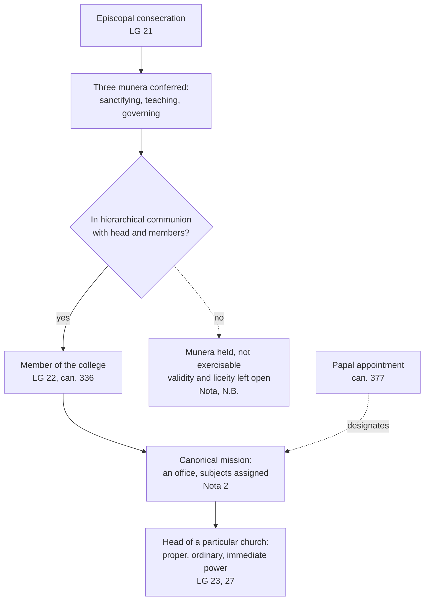

# The Church & Mary · Lesson 3.1: Bishops and apostolic succession

> ⏱ ~15 min · Module 3: The constitution of the Church · Builds on: [2.4 Apostolic](02-04-apostolic.md), [`christology` 5.1](../../christology/lessons/05-01-the-paschal-mystery-and-the-threefold-office.md) · Unlocks: [3.2 The local and the universal Church](03-02-the-local-and-the-universal-church.md), [4.5 Vatican II: primacy, collegiality, synodality](04-05-vatican-ii-primacy-collegiality-synodality.md)

## Why this matters

Every Eucharistic Prayer names the local bishop. The word packs together three things that the hard cases pull apart: being ordained, being in communion with the other bishops, and being given a flock. From the twelfth century the standard textbook of Latin theology held that the first was no sacramental grade at all. The episcopate was a dignity laid on the priesthood, with a power to rule that could be granted from above. Vatican II taught otherwise in *Lumen Gentium* 21. This lesson reads what that paragraph settled, at what weight, and what it left to canon law and to the sacramental treatise.

## The idea

**The dignity view first, at the strength its best readers would recognize.** Peter Lombard's *Sentences* (IV d.24), the schools' textbook, counts seven orders rising to the priesthood. Then it lists names *non ordinum, sed dignitatum vel officiorum* (lesson's gloss: names not of orders but of dignities or offices), and "bishop" is among them. The reason was a definition. Order, as a sacrament, is a power directed to the Eucharist, Christ's true body, and a priest consecrates as truly as a bishop. Aquinas, in the *Supplement* compiled after his death from his commentary on the *Sentences* (q.40 a.5):

> every Order is directed to the sacrament of the Eucharist. Wherefore since the bishop has not a higher power than the priest, in this respect the episcopate is not an Order.

He grants the bishop a higher power over the *mystical* body, to confirm and ordain, but one that "has not the nature of a character". The episcopate is then an order as an office, not as a sacrament. The view had a patristic root. Jerome, arguing that presbyters and bishops were once the same men, asked:

> For what function, excepting ordination, belongs to a bishop that does not also belong to a presbyter?

That is Letter 146 (NPNF). One presbyter, he adds, was later set over the rest to curb schism. On this picture governing is jurisdiction, and jurisdiction can be granted: Aquinas let the pope commission a simple priest to confirm (*Super Sent.* IV d.25 q.1 a.1 ad 3). As late as 1943, *Mystici Corporis* 42 said bishops receive their ordinary jurisdiction directly from the pope.

**Vatican II pulls apart three things the dignity view had fused into two:**

- **Sacrament.** Consecration makes a bishop and brings the offices of sanctifying, teaching and governing.
- **Communion.** Those offices work only in communion with the pope and the other bishops. Consecration plus communion makes a member of the college.
- **Mission.** A canonical act gives a particular flock and makes the power ready to act.

The sacrament says what he is. Communion says with whom he can act. The mission says where, and over whom.

## The doctrine

*Lumen Gentium* ch. 3 in paraphrase, with the earlier acts it restates.

1. **Bishops succeed to the place of the apostles.** In LG 20 the apostles provide for successors so that their mission outlasts them, and the council "teaches" that bishops by divine institution have taken the apostles' place as shepherds. Its footnote cites Trent and Vatican I. Trent, Session XXIII ch. 4 (15 July 1563, in Schaff):

   > bishops, who have succeeded to the place of the Apostles, principally belong to this hierarchical order

   *In words:* the apostles' office of shepherding the Church is permanent, and the order of bishops carries it. This is the third sense of [apostolic succession](../reference.md#apostolic-succession) in [2.4](02-04-apostolic.md).

2. **What "successor of the apostles" does not claim.** The *college* of bishops succeeds the apostolic *college* (LG 22); no bishop inherits a particular apostle. The [Nota explicativa praevia](../reference.md#nota-explicativa-praevia) (§1) calls the parallel a proportion, *pari ratione* and not *eadem ratione*, which transmits none of the apostles' extraordinary power. Being the chosen witnesses of the Resurrection and the Church's foundation stones does not pass on (CCC 860), and public revelation closed with them ([`fundamental-theology` 1.4](../../fundamental-theology/lessons/01-04-public-and-private-revelation.md)). Nor does succession guarantee a bishop's holiness or orthodoxy ([2.4](02-04-apostolic.md)). *In words:* the office continues; the founding role does not.

3. **The episcopate is the fullness of Orders.** LG 21 teaches that consecration confers the "fullness of the sacrament of Orders", the high priesthood of the liturgy and the Fathers, and rests this on the rites of East and West. Priests share the bishops' priestly dignity without its highest degree (LG 28); deacons are ordained for service, not for priesthood (LG 29). Matter and form, fixed for the episcopate by Pius XII's *Sacramentum Ordinis* (1947), are [`sacraments-and-liturgy`](../../sacraments-and-liturgy/syllabus.md) [5.1](../../sacraments-and-liturgy/lessons/05-01-holy-orders-the-three-degrees.md)'s. *In words:* this is [the sacramentality of the episcopate](../reference.md#sacramentality-of-the-episcopate). A bishop is not a priest promoted; a priest shares the bishop's priesthood.

4. **Consecration confers all three *munera*; communion governs their use.** With sanctifying, consecration confers teaching and governing, which by their nature can be exercised only in [hierarchical communion](../reference.md#hierarchical-communion) with the head and members of the college (LG 21; can. 375 §2). Consecration *and* that communion make a man a member of the [college of bishops](../reference.md#college-of-bishops) (LG 22; can. 336). The [three munera](../reference.md#three-munera) are the scheme [`christology` 5.1](../../christology/lessons/05-01-the-paschal-mystery-and-the-threefold-office.md) already graded. *In words:* a bishop's authority to teach and rule comes with the sacrament, not by papal delegation, and works only inside the communion. Here LG 21 parts from the dignity view and from *Mystici Corporis* 42.

5. **A *munus* is not yet power ready to act.** The Nota (§2) says consecration gives an "ontological participation" in the *munera*. Power *ad actum expedita*, ready to act, needs a canonical determination by hierarchical authority: an office, or an assignment of subjects. Recent popes' statements on bishops' jurisdiction, it adds, are to be read in those terms. The Nota as a whole is [4.5](04-05-vatican-ii-primacy-collegiality-synodality.md)'s. *In words:* the sacrament gives the capacity; the canonical mission gives the flock.

6. **Head of a particular church, member of the college.** Each bishop is the visible principle of unity of his [particular church](../reference.md#particular-church) ([3.2](03-02-the-local-and-the-universal-church.md)). He governs it and no other, and owes the whole Church a care that is not an act of jurisdiction (LG 23). His power is proper, ordinary and immediate, its exercise regulated by the supreme authority; bishops are not "vicars of the Roman Pontiffs" (LG 27, whose footnote cites Pius IX's March 1875 letter to the German bishops: [4.3](04-03-vatican-i-and-pastor-aeternus.md)).

**What LG 21 did, and did not do.** It settled, by teaching and not by definition, the question Lombard's scheme had left: the episcopate is a sacramental order, and teaching and governing come with it. It did not make a bishop's power independent of the pope. It did not decide what a validly consecrated bishop outside hierarchical communion validly or lawfully does: the Nota's closing N.B. leaves liceity and validity to theologians, naming the separated Eastern Churches.

**Mark the levels** ([the ladder](../../fundamental-theology/lessons/04-04-the-ladder-of-doctrinal-authority.md); [reading a document's weight](../../fundamental-theology/lessons/04-05-reading-a-documents-weight.md); [levels](../reference.md#levels-of-authority)). Trent XXIII cans. 6–7 are **defined, rung 1**, as [`new-testament` 6.1](../../new-testament/lessons/06-01-the-disputed-pauline-letters-and-the-pastorals.md) marks them. They teach a hierarchy by divine ordination of bishops, priests and ministers, and bishops superior to priests, with a power to confirm and ordain not common to priests. They do **not** define the episcopate as a distinct sacramental order. That bishops succeed the apostles by divine institution (Trent's doctrinal ch. 4, *Pastor Aeternus* ch. 3, LG 20) is constant conciliar teaching tied to canon 6. It is **at least rung 3**, and not to be called defined without showing the act. LG 21 on the sacramentality of the episcopate and the conferral of the *munera* is **not a definition**. The council's notification of 16 November 1964 limits its definitions to what it openly declares binding, and LG 21 "teaches". It is **rung 3**, owed religious submission. Because a council deliberately taught on a disputed question, the dignity view is no longer free (the *Humani Generis* principle in [`fundamental-theology` 4.4](../../fundamental-theology/lessons/04-04-the-ladder-of-doctrinal-authority.md)). The threefold scheme keeps [`christology` 5.1](../../christology/lessons/05-01-the-paschal-mystery-and-the-threefold-office.md)'s grade: adopted in authentic magisterium, "exactly three" not taught. *Mystici Corporis* 42 is encyclical teaching, rung 3 by default, now read through the Nota. Canons are law, not rungs. Lombard's and Aquinas's view was a school opinion with no magisterial level.

## From consecration to office

The dashed branch is where the Nota declines to go.

## Worked examples

**Ex 1: a clean case, step by step.** An invented priest, Kwame Asante, is named bishop of the invented Diocese of Calder Falls. Sort each step into sacrament, communion or mission.

- The apostolic letter of appointment (can. 377 §1) designates the **mission** and confers nothing yet. The profession of faith and oath of fidelity (can. 380) are signs of **communion**.
- Consecration within three months (can. 379) is the **sacrament**. It requires a pontifical mandate (can. 1013) and at least two co-consecrators (can. 1014). He now has the three *munera* and, being in communion, sits in the college. The co-consecrators are the practice LG 22 cites as a sign of the episcopate's collegial character.
- Canonical possession completes the **mission** (can. 382). Only now does he govern Calder Falls, with proper, ordinary and immediate power (can. 381 §1; LG 27).

Between consecration and possession he is a bishop and a college member who cannot yet govern the diocese (can. 382 §1). That gap is the Nota's distinction made visible.

**Ex 2: where it strains, the history.** LG 20 says "by divine institution". Yet in 1 Clement and the Pastorals "bishop" and "presbyter" seem to name one office ([`new-testament` 6.1](../../new-testament/lessons/06-01-the-disputed-pauline-letters-and-the-pastorals.md); [`patristics` 1.2](../../patristics/lessons/01-02-first-clement-and-the-didache.md)). One bishop over presbyters and deacons appears in Ignatius about 110 ([`patristics` 1.3](../../patristics/lessons/01-03-ignatius-of-antioch.md)). Rome was perhaps led by presbyters until the mid-second century ([`church-history` 1.2](../../church-history/lessons/01-02-bishops-canon-and-the-parting-of-the-ways.md)). Does the doctrine need a single bishop in every church in the year 60? LG 20 rests succession on the apostles' provision for successors (it footnotes 1 Clement 44). It claims a succession "running from the beginning": an unbroken line of office, not a date for the one-bishop form. LG 28 claims divine establishment for the *ministry*, whose holders have been called bishops, priests and deacons "from antiquity". So keep apart the doctrine, a ministry of apostolic origin by divine institution whose fullness is the episcopate, and the history of its form, which is the historians'. Catholic and Orthodox readers generally see the threefold order as apostolic, becoming visible in Ignatius (patristics 1.2). Francis Sullivan (*From Apostles to Bishops*, 2001) grants presbyteral leadership at Rome. He argues that the episcopate's emergence was a development Catholics can still call apostolic (church-history 1.2). That is what the record proves theologically, the question patristics 1.3 left here: alone it neither establishes nor refutes the doctrine, but it shapes how "divine institution" is read. Whether the development was faithful is a question for Newman's notes ([`fundamental-theology` 5.2](../../fundamental-theology/lessons/05-02-newmans-theory-of-development.md)). The argument with other Christians is [`apologetics-catholic-claims`](../../apologetics-catholic-claims/syllabus.md)'s.

## Watch out

- **You might think "successor of the apostles" means successor of *an* apostle.** In fact the college succeeds the college. Rome's succession to Peter is a separate claim (Module 4). No bishop inherits the apostles' role as witnesses and foundation (CCC 860).
- **You might think appointment makes a bishop.** In fact consecration does. A titular or auxiliary bishop is fully a bishop and a member of the college. A diocesan bishop not yet in possession is a bishop who cannot yet govern.
- **You might think the level is easy.** "Vatican II defined the sacramentality of the episcopate" overstates: LG 21 teaches it, at rung 3. "So the medieval view is still an open option" understates: a council has deliberately taught the contrary. Trent's rung-1 canons concern the hierarchy and the bishops' superiority, not the episcopate as a sacrament.
- **You might think "not vicars of the pope" means "independent of the pope".** In fact LG 27 denies the first, and LG 21–22 and can. 381 §1, with its reserved cases, deny the second.

## One-liner

> Consecration makes a bishop, communion makes him one of the college, and a canonical mission gives him a flock; it is the college, not each bishop, that succeeds the apostles.

## Problems

**P1 (🟢)** *(Exegetical: apply to a hard case.)* Four men connected with the invented Diocese of Saltmarsh. For each, answer in one line: (i) has he received the three *munera* by consecration? (ii) is he a member of the college of bishops? (iii) does he have governing power over a particular church, and from what source? Cite the text or canon that decides each.

(a) Ruairi Doyle, auxiliary bishop of Saltmarsh, titular bishop of a long-vanished North African see, appointed vicar general.

(b) Hollis Grange, Saltmarsh's former diocesan bishop, whose resignation at 75 was accepted last year and who still lives in the diocese.

(c) Dariusz Kalinowski, a priest appointed apostolic administrator of a neighbouring territory erected as an apostolic administration (can. 371 §2).

(d) Corwin Hale, a Saltmarsh priest consecrated bishop by a visiting bishop acting without a pontifical mandate. Assume the consecration was valid.

(e) Name the one question about (d) that this lesson's texts decline to settle, and the text that declines it. One sentence.

**P2 (🟡)** *(Exegetical: diagnose.)* An **invented** sidebar from an invented confirmation-year textbook, written for this problem:

> **How the Church is organized.** Think of the Church as a worldwide company. The pope is the chief executive and each bishop is his branch manager: the pope delegates his own authority so that bishops can run their dioceses in his name. A man becomes a bishop when the pope appoints him; the consecration Mass that follows is a solemn blessing on the appointment. Each bishop inherits the full powers of one particular apostle. When a bishop retires he hands his authority back, like any manager, and is an ordinary priest again. Vatican II solemnly defined this structure in *Lumen Gentium*.

Find **four** errors, one of which must be in the last sentence. For each, give the correction and the text that fixes it, and mark the level where one is involved. **150 words or fewer.**

**P3 (🔴)** *(Exegetical: find the crux.)* Aquinas (*Supplement* q.40 a.5, quoted above) and LG 21 agree on several points. A bishop has a higher spiritual power than a priest, including the power to ordain, and ordination is a sacrament. Yet Aquinas denies that the episcopate is a sacramental grade of Orders, and LG 21 teaches that it is. (a) Name the single premise Aquinas's denial rests on that LG 21 does not share, and the words in each text that show it. (b) Say what kind of evidence LG 21 offers against that premise, and why Jerome's Letter 146 had lent the older view support. **Two sentences per part.**

Solutions

**P1** *(Exegetical)*

**Accept:** any wording that reaches these verdicts on these grounds, with at least one decisive text or canon per case.

**Must hit, strict:**

- (a) (i) **Yes.** Consecration confers them (LG 21). A bishop without a diocese of his own is a titular bishop, and still a bishop (can. 376). (ii) **Yes.** Consecration plus hierarchical communion (LG 22; can. 336); a see of his own is not a condition. (iii) **Yes, but as vicar general**, appointed by the diocesan bishop (can. 406 §2). It is power attached to that office and exercised in the diocesan bishop's name, not the proper power of the head of a particular church (LG 23, 27).
- (b) (i) **Yes, permanently.** Resignation removes an office, not an order; consecration impresses a sacred character (LG 21; Trent XXIII can. 4 on the character of orders). (ii) **Yes.** Neither consecration nor communion has lapsed. (iii) **No.** The office is gone. He keeps the title emeritus and may live in the diocese (can. 402 §1).
- (c) (i) **No**: he is not consecrated. (ii) **No.** (iii) **Yes.** He governs "in the name of the Supreme Pontiff" (can. 371 §2) and is equivalent in law to a diocesan bishop unless the nature of the matter excludes it (can. 381 §2). His power comes from papal appointment, not from a sacramental *munus*. It is exactly the vicarious power that LG 27 says a bishop does *not* exercise. He cannot ordain anyone (can. 1012).
- (d) (i) **Yes, ontologically** (Nota §2), given the valid consecration. (ii) **No.** Membership needs hierarchical communion as well (LG 22; can. 336). (iii) **No.** He has no canonical mission, and the *munera* can be exercised only in hierarchical communion (LG 21; can. 375 §2). He and his consecrator incur an automatic excommunication reserved to the Apostolic See (can. 1387); can. 1013 forbade the act.
- (e) Whether his sacramental acts, ordinations above all, are valid, and how lawful they are. The Nota's N.B. declines to enter questions of liceity and validity and leaves them to theologians. Sacramental validity belongs to [`sacraments-and-liturgy`](../../sacraments-and-liturgy/syllabus.md).

**Wrong turns:** tying (a)'s membership in the college to having a diocese; saying (b) "is no longer a bishop"; giving (c) the *munera* because he governs "like a bishop", or denying him real governing power because he is not one; calling (d) a member of the college because he was consecrated, or "not a real bishop" when validity was given; answering (e) with a verdict on validity, as if this lesson's texts settled it.

**Model answer:** as above, one line per item.

---

**P2** *(Exegetical)*

**Must hit, strict (any four, including the fifth):**

1. **Branch manager, delegated authority, governing in the pope's name.** Bishops are not vicars of the Roman pontiff. Their power is proper, ordinary and immediate, exercised in Christ's name (LG 27, rung 3). Credit for the counterweight: it is exercised only in hierarchical communion and regulated by the supreme authority (LG 21, 27).
2. **Appointment makes the bishop; consecration is a blessing.** Consecration confers the fullness of Orders and the three *munera* (LG 21, rung 3). Appointment supplies the office and the flock (can. 377; Nota §2).
3. **Each bishop inherits one apostle's full powers.** The college succeeds the college (LG 22). The parallel is a proportion and transmits none of the apostles' extraordinary power (Nota §1). Their role as witnesses and foundation is not handed on (CCC 860).
4. **A retired bishop becomes an ordinary priest.** He loses the office, not the order or the character, and remains a bishop and a member of the college (LG 21–22; can. 402).
5. **"Solemnly defined."** Vatican II defined no new dogma. LG 21 "teaches", and the 1964 notification limits definitions to what is openly declared binding. Ch. 3's new teaching, LG 21 included, is rung 3; what it restates from earlier acts keeps their weight, as Trent's canons on the hierarchy keep rung 1.

**Wrong turns:** correcting the first error into "bishops are independent of the pope", the over-correction LG 22 rules out; calling LG 21 dogma while correcting the fifth; objecting that the pope does not appoint bishops. He does, freely or by confirming a lawful election (can. 377 §1). The error is in what appointment is taken to do.

**Model answer:** Bishops are not the pope's branch managers. LG 27 says they are not vicars of the Roman pontiff: their power is their own, proper, ordinary and immediate, though exercised only in hierarchical communion. Appointment does not make a bishop. Consecration confers the fullness of Orders and, with it, the offices of sanctifying, teaching and governing (LG 21); the appointment supplies the office and the flock. No bishop inherits a particular apostle. The college of bishops succeeds the apostolic college, and the apostles' extraordinary role is not handed on (LG 22; CCC 860). A retired bishop loses his office, not his episcopate. Finally, Vatican II defined nothing here. LG 21 teaches, at rung 3; what ch. 3 restates from earlier definitions, such as Trent's canons on the hierarchy, keeps its own weight.

---

**P3** *(Exegetical)*

**Must hit, strict (a):** the premise that Order **as a sacrament** is defined by its relation to the Eucharist, that is, by power over Christ's true body. Aquinas's words: "every Order is directed to the sacrament of the Eucharist". A bishop has no more Eucharistic power than a priest, so Aquinas concludes that his further power "has not the nature of a character". LG 21 measures the fullness of Orders by the whole sacred ministry. Its words are the "high priesthood" and "the supreme power of the sacred ministry", and it speaks of a character impressed so that bishops act in the person of Christ as Teacher, Shepherd and High Priest.

**Must hit, strict (b):** LG 21 appeals to tradition as expressed especially in the liturgical rites of East and West. These are the consecration prayers its footnotes cite: the *Apostolic Tradition* and the old Roman sacramentaries. So it argues from the Church's worship, not from a definition of order. Jerome had treated bishop and presbyter as originally one office differing only in the power to ordain. That made the bishop a presbyter set over the others: a difference of rank, not of sacrament.

**Wrong turns:** naming as the crux whether bishops are superior to priests (both affirm it, and Trent XXIII can. 7 defines it); saying Trent settled the sacramentality question (it did not); calling Aquinas's view heretical, or LG 21 a definition, which misstates both levels; making the crux "whether jurisdiction comes from the pope", which follows from the premise rather than being it.

**Model answer:** (a) Aquinas assumes that sacramental order is measured by power over the Eucharist ("every Order is directed to the sacrament of the Eucharist"), so a power that adds nothing there cannot be a higher sacramental grade. LG 21 measures Orders by the whole ministry, calling consecration the fullness and "high priesthood" that configures bishops to Christ as Teacher, Shepherd and Priest. (b) LG 21 argues from the liturgy: the rites of consecration in East and West, which pray for the high priesthood and give the Spirit by the laying on of hands. Jerome had made bishop and presbyter one office differing only in ordaining, so the bishop looked like a presiding presbyter, a matter of rank rather than of sacrament.

## Flashback

**From Lesson [2.3](02-03-catholic.md) (Catholic):** *(Exegetical.)* An **invented** seminary exam answer, written for this problem:

> "The branch theory says that every church calling itself Christian is a branch of the one Church. And since the branches are out of communion with one another, the one Church of the Creed no longer exists as one: there are now several Churches."

Restate the theory as William Palmer's *A Treatise on the Church of Christ* (1838) gives it, correcting both distortions: where the one Church exists, what a body needs to count as a branch, how the Church can be divided and still be one, and what its universality is. State it at the strength its defenders would recognize, with no reply attached. **80 words or fewer.**

Solution

**Must hit, strict:**

- **Where:** the one Church of the Creed exists in several communions, the Roman, the Oriental and the British churches.
- **The condition (first distortion):** not every self-described church is a branch. A branch holds the apostolic faith with valid ordination and true mission, and a society cut off by the great body of Christians is outside the Church.
- **One though divided (second distortion):** the Catholic Church itself can be divided in external communion without ceasing to be one. The division is of communion, not a multiplication of Churches.
- **Universality:** no branch may call itself alone catholic (Palmer faults the Roman side for exactly that), and universality is moral: adherents in every known nation, never again reduced to a small part of the world.

**Wrong turns:** volunteering a rebuttal, such as *Lumen Gentium* 23 on particular churches or CCC 835's warning against a federation; the task is fidelity alone. Recasting it as a theory of an invisible Church, when its branches are visible bodies identified by faith and orders. Dropping valid ordination and true mission, without which a body is no branch. Turning its universality into a headcount, or presenting it as the official teaching of a church rather than Palmer's formulation.

**Model answer:** The one Church of the Creed exists in the Roman, the Oriental and the British churches. Not every body calling itself Christian belongs: a branch must hold the apostolic faith, with valid ordination and true mission, and a society cut off by the great body of Christians is outside the Church. The Church can be divided in external communion without ceasing to be one. None may call itself alone catholic; universality is moral, with adherents in every known nation.

## Connections

- **Backward:** [2.4](02-04-apostolic.md) taught apostolicity's three senses and what succession does not guarantee; this lesson gives the office that carries the third. The threefold office and its grade are [`christology` 5.1](../../christology/lessons/05-01-the-paschal-mystery-and-the-threefold-office.md). The presbyter-bishops of the Pastorals and Jerome's Letter 146 are in [`new-testament` 6.1](../../new-testament/lessons/06-01-the-disputed-pauline-letters-and-the-pastorals.md). The offices in 1 Clement, the Didache and Ignatius are [`patristics` 1.2](../../patristics/lessons/01-02-first-clement-and-the-didache.md) and [1.3](../../patristics/lessons/01-03-ignatius-of-antioch.md), read as history in [`church-history` 1.2](../../church-history/lessons/01-02-bishops-canon-and-the-parting-of-the-ways.md). The ladder is [`fundamental-theology` 4.4](../../fundamental-theology/lessons/04-04-the-ladder-of-doctrinal-authority.md).
- **Forward:** [3.2](03-02-the-local-and-the-universal-church.md) takes up the particular church LG 23 names, and [3.3](03-03-the-laity-charisms-and-the-sensus-fidei.md) the laity's share in the same three *munera*. [4.3](04-03-vatican-i-and-pastor-aeternus.md) reads *Pastor Aeternus* ch. 3 and the 1875 exchange that LG 27's footnote recalls. [4.5](04-05-vatican-ii-primacy-collegiality-synodality.md) takes the college with its head and the Nota as a whole. [`sacraments-and-liturgy`](../../sacraments-and-liturgy/syllabus.md) [5.1](../../sacraments-and-liturgy/lessons/05-01-holy-orders-the-three-degrees.md) takes the episcopate as the fullness of the sacrament from here, with *Sacramentum Ordinis*. [`apologetics-catholic-claims`](../../apologetics-catholic-claims/syllabus.md) [4.3](../../apologetics-catholic-claims/lessons/04-03-apostolic-succession-and-the-validity-of-orders.md) assumes this lesson's doctrine of succession when it argues about the validity of orders.
- **Sideways:** the Nota as an event, imposed in the council's "Black Week" of November 1964, is in [`church-history` 9.2](../../church-history/lessons/09-02-the-second-vatican-council.md). The distinction between a capacity conferred and its lawful exercise reappears whenever the Church separates order from jurisdiction, as with faculties and incardination in `sacraments-and-liturgy`.
