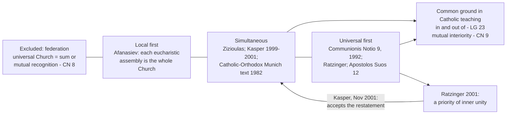

# The Church & Mary · Lesson 3.2: The local and the universal Church

> ⏱ ~15 min · Module 3: The constitution of the Church · Builds on: [2.3 Catholic](02-03-catholic.md), [3.1 Bishops and apostolic succession](03-01-bishops-and-apostolic-succession.md) · Unlocks: [3.3 The laity, charisms, and the sensus fidei](03-03-the-laity-charisms-and-the-sensus-fidei.md), [4.5 Vatican II: primacy, collegiality, synodality](04-05-vatican-ii-primacy-collegiality-synodality.md)

## Why this matters

Paul writes "to the church of God that is at Corinth" (1 Corinthians 1:2); the same word names the whole body of Christ ([1.2](01-02-the-church-in-the-new-testament.md)). [2.3](02-03-catholic.md) settled that a diocese is not a branch: the whole Church is present in it. Three questions remain. What are the units, which the documents name inconsistently? What stands between a diocese and the whole? And which comes first, the one Church or the many churches? On the last, two cardinals, one the future Benedict XVI, disagreed in print.

## The idea

- **[Particular church](../reference.md#particular-church).** In the Latin Code and *Lumen Gentium* (LG) 23, a diocese and its equivalents (can. 368): a portion of the People of God entrusted to a bishop, in which the one, holy, catholic and apostolic Church of Christ is truly present and at work (*Christus Dominus* 11; can. 369; of an eparchy, CCEO can. 177 §1). *In words:* the Church entire, in a place.
- **Local church.** No fixed sense. LG 26 uses it of altar communities, LG 23 of the ancient patriarchal groupings (*Ecclesiae locales*), the CDF's 1992 letter as a synonym of "particular"; *Orientalium Ecclesiarum* (OE) 2 calls whole rite-churches *particulares Ecclesias*.
- **[Universal Church](../reference.md#universal-church).** The Church confessed in the Creed, "the worldwide community of the disciples of the Lord" (*Communionis Notio* 7). Not the Holy See, nor the dioceses added up.
- **[Church *sui iuris*](../reference.md#eastern-catholic-churches).** A body of the faithful joined by its hierarchy and recognized by the supreme authority as *sui iuris*, "of its own law" (lesson's gloss) (CCEO can. 27), living a **rite**: a liturgical, theological, spiritual and disciplinary patrimony (can. 28) from one of five Eastern traditions. Recent *Annuario Pontificio* editions list twenty-three Eastern churches *sui iuris*, twenty-four with the Latin Church.

LG 23 gives the relation: the one Catholic Church exists *in quibus et ex quibus*, "in and out of" (lesson's translation) the particular churches. John Paul II added the converse in 1990; Rome calls the pair **mutual interiority**.

## Source

Hermas, *The Shepherd*, Vision 2.4.1 (Rome, second century; Crombie's translation in *Ante-Nicene Fathers* vol. 2). Hermas has been given a book by an aged woman; in a dream a young man asks him:

> "Who do you think that old woman is from whom you received the book?" [...] And he said, "It is the Church." And I said to him, "Why then is she an old woman?" "Because," said he, "she was created first of all. On this account is she old. And for her sake was the world made."

Read the shape of the act: an allegory about **order in God's design**, not a thesis about dioceses. The Church is no afterthought; the world was made for her. *Communionis Notio* 9 cites it, with 2 Clement 14 (an anonymous homily), for the one Church preceding creation. What Hermas does not settle: whether his one figure, "the Church", is the universal Church *as distinct from* the local churches, or the one Church that exists only in them. The dispute below lives in that gap.

## In their own words

**Nicholas Afanasiev** (1893–1966), a Russian Orthodox priest teaching in Paris, called his position eucharistic ecclesiology. The Church is where the Eucharist is. Each assembly gathered at one table round its bishop is not a part of the Church of God but the whole of it. Many such churches are therefore one Church, because each is the same Church, and no church has power over another. Some carry more authority, Jerusalem first and then Rome, as a priority of witness, not of jurisdiction. The rival "universal ecclesiology", which makes each local church a fragment of a whole governed by law, he traced chiefly to Cyprian ("The Church Which Presides in Love", in *The Primacy of Peter*, English 1963; *The Church of the Holy Spirit*, English 2007).

**John Zizioulas** (1931–2023), Metropolitan of Pergamon, keeps the starting point and corrects it (*Eucharist, Bishop, Church*, his 1965 Athens dissertation, English 2001). The Eucharist that makes a church is the one Eucharist under its bishop; parish Eucharists are offshoots of it, not churches of their own. Each episcopal church is not a part but the whole body of Christ, and all are one Church by what he calls "the mystical identity of full circles", not by adding parts together. That unity shows in mutual recognition and in councils that restore communion. Whether the local or the universal comes first is, for him, a modern dilemma the first three centuries never faced. Pushed to the extreme, "where the Eucharist is, there is the Church" destroys any notion of canonical unity. A permanent universal centre of unity, he holds, is foreign to those centuries.

## The doctrine

1. **The Church is in every altar community under its bishop** (LG 26): there, however small, poor or scattered, Christ is present and the one, holy, catholic and apostolic Church gathers. Here Catholic teaching meets eucharistic ecclesiology, and Ignatius said it first (*Philadelphians* 4, *ANF* vol. 1):

   > Take ye heed, then, to have but one Eucharist. [...] one altar; as there is one bishop

   *In words:* one table, one bishop, one Church in that place; the sacramental side is `sacraments-and-liturgy` 3.5's ([syllabus](../../sacraments-and-liturgy/syllabus.md)). *Communionis Notio* 11, naming no theologian, adds the limit: the one eucharistic Body makes any particular church's self-sufficiency impossible.
2. **Intermediate structures are real; their theological standing is open.** By divine Providence the apostolic churches grew into organically united groups with their own discipline, liturgy and heritage, the ancient patriarchates as mother churches (LG 23). Every church *sui iuris* is equal in dignity (OE 3). [Episcopal conferences](../reference.md#episcopal-conferences) apply the collegial spirit (LG 23), not the collegiality of the whole order of bishops (John Paul II, *Apostolos Suos*, 1998, §12). Their doctrinal declarations are authentic magisterium only if passed unanimously, or by two-thirds of members holding a deliberative vote plus the Holy See's *recognitio* (norms, art. 1), and even then particular magisterium ([`fundamental-theology` 4.1](../../fundamental-theology/lessons/04-01-the-magisterium.md)). *In words:* real in-between structures; conferences teach only locally.
3. **The 1992 letter.** The CDF's *[Communionis Notio](../reference.md#communionis-notio)* (28 May 1992) calls the picture of a universal Church resulting from mutual recognition among particular churches "ecclesiological unilateralism" (§8). The universal Church is not the product of their communion but, in its essential mystery, "ontologically and temporally prior" to every particular church (§9): ontologically, because the one Church precedes creation and is the churches' mother, not their offspring; temporally, because she appears at Pentecost in the hundred and twenty round Mary and the Twelve, already speaking every language. Primacy and college are interior to each particular church (§13). *In words:* the one Church comes first, in God's plan and at Pentecost.
4. **[The priority dispute](../reference.md#priority-of-the-universal-church).** The formula was Ratzinger's before it was the Congregation's: he used it in books of 1987 and 1991 and signed the letter as prefect (Kilian McDonnell, *Theological Studies*, 2002).

   *Kasper*, then bishop of Rottenburg-Stuttgart, objected in a 1999 Festschrift essay, then in *Stimmen der Zeit* (2000) and *America* (23–30 April 2001). He grants that no particular church is self-sufficient, that the universal Church is no federation, and that the Church pre-exists in God's eternal plan. He denies that the pre-existent Church is the universal Church apart from the local churches: that, with de Lubac, he calls an abstraction. The Pentecost church was universal and local in one reality; in Paul *ekklēsia* is first the assembly in a place. The two are simultaneous and indwell each other. His practical fear: once "universal Church" quietly means pope and curia, the formula reverses Vatican II into Roman centralism.

   *Ratzinger* replied in the *Frankfurter Allgemeine Zeitung* (22 December 2000) and *America* (19 November 2001). God's design is one bride and one body, not many; the Fathers carried Israel's pre-existence in God's will over to the Church. At Pentecost the Twelve stand for renewed Israel, not a Jerusalem congregation. In baptism one is born not into a local group but into the one Church, and Eucharist and bishop come to every local church from the whole. Rome is itself a local church, so the priority has nothing to do with centralism. Kasper's closing letter (*America*, 26 November 2001) accepted this restatement, a priority of inner unity, and called the remainder speculative.

   **The crux.** *In words:* both affirm pre-existence and mutual interiority. They split on one premise: *the Church that comes first, in God's design and at Pentecost, is the universal Church as distinct from the local churches.* Ratzinger affirms it; Kasper denies it.

**Mark the levels** ([`fundamental-theology` 4.4](../../fundamental-theology/lessons/04-04-the-ladder-of-doctrinal-authority.md); [levels of authority](../reference.md#levels-of-authority)). That each particular church is the Church truly present, and that the one Church exists in and out of them, is conciliar teaching defining nothing new (LG 23, 26; *Christus Dominus* 11), **at least rung 3** as [2.3](02-03-catholic.md) marked it, restated in both Codes; the federation picture is excluded at that weight. *Apostolos Suos*'s norms are **law**, on no rung; its account of conferences is papal teaching, **rung 3**. *Communionis Notio*, approved by the pope in the ordinary form, remains the Congregation's act ([`fundamental-theology` 4.5](../../fundamental-theology/lessons/04-05-reading-a-documents-weight.md)): its priority formula is authentic teaching, **rung 3, light grade**, and *Apostolos Suos* 12 quoting it adds frequency within rung 3, not a higher rung. What the formula asserts, and whether it excludes simultaneity, is **freely disputed** (syllabus Note 6): a bishop, later a curial cardinal, contested it in print, and its own signatory restated it. "Dogma" overstates; "one man's opinion" understates. Theologians' articles carry no magisterial weight.

## Map of positions

Left to right: from the many to the one. The Catholic–Orthodox commission's Munich text (1982) called the two necessarily simultaneous.

## Worked examples

**Ex 1 (clean): one city, three bishops.** A city holds a Latin archdiocese, a Maronite eparchy and a Ukrainian Greek Catholic eparchy, their territories overlapping. Each is a particular church (can. 369; CCEO can. 177 §1), the whole Church truly present three times over, because a particular church is defined by people, bishop, Gospel and Eucharist, and OE 4 expects several churches' hierarchs in one territory. The eparchies belong to a patriarchal church *sui iuris* (CCEO can. 55–56) and a major archiepiscopal one (can. 151), the archdiocese to the Latin Church. None is a branch of another; the three churches are equal in dignity (OE 3); the universal Church is in each, not over them as a fourth thing.

**Ex 2 (where it strains): a baptism.** An infant is baptized in a Ukrainian eparchy's parish. Into what? *Communionis Notio* 10 answers half: one belongs to the universal Church immediately, not by way of the particular church, though entry always happens in one. Ratzinger read it as his case: the child is born into the one Church, and the eparchy is the door. Kasper read it as his: one becomes Catholic in a specific, episcopally structured church, so simultaneity holds precisely in the sacrament. The doctrine fixes every fact about the baptism and leaves the order of priority to theology.

## Watch out

- **You might think "the universal Church" means the Vatican.** The 1992 letter defines it as the worldwide community of disciples; Ratzinger called Rome a local church.
- **You might think the priority of the universal Church is Catholic dogma, or that *Communionis Notio* is one cardinal's opinion.** The first overstates, the second understates: the formula is authentic teaching at rung 3, and the question it answers is freely disputed.
- **You might think an Eastern Catholic church is a "rite" of the Latin Church.** It is a church *sui iuris* (CCEO can. 27) with a rite (can. 28), equal in dignity (OE 3).

## One-liner

> The whole Church is in every diocese and every diocese is in the whole Church; whether the one comes before the many is the question Catholics may still argue.

## Problems

**P1 (🟢)** *(Exegetical: apply to a case.)* The Eparchy of Lakeport (invented) belongs to an Eastern Catholic church *sui iuris* headed by a major archbishop. It lies far outside that church's home territory, in a city that also has a Latin archdiocese. Name the category each item falls under (particular church, church *sui iuris*, altar community in the sense of LG 26, universal Church, or none of these) and the text that fixes it. One line each.

(a) The Eparchy of Lakeport.

(b) The major archiepiscopal church as a whole.

(c) The Sunday Divine Liturgy in one of the eparchy's parishes.

(d) The country's episcopal conference, to which the eparch belongs.

(e) A parishioner says: "Our eparchy is less fully Church than the archdiocese next door. It is smaller, far from home, and we are only a rite." True or false, and why?

**P2 (🟡)** *(Exegetical: diagnose.)* Two invented letters to the editor of the invented *Fenmoor Catholic Courier*, written for this problem:

> **Letter 1.** "Since 1992 it has been Catholic dogma that the universal Church comes before the dioceses. The universal Church is the Holy See, so our diocese exists by Rome's leave and is Church only to the extent that it is attached to the Vatican."
>
> **Letter 2.** "Vatican II says the whole Church is present wherever the Eucharist is celebrated. So our diocese is complete in itself and needs nothing from anyone. Communion with Rome and with other dioceses is a courtesy we choose to extend."

For each letter, name the error about the Church, cite the text that excludes it, and name one true thing the letter is reaching for. Then correct Letter 1's claim about 1992 exactly. **150 words or fewer.**

**P3 (🔴)** *(Exegetical (a) · Evaluative (b).)* (a) State, as Zizioulas states it, how each episcopal church can be the whole Church while all of them are one Church, and what he says Afanasiev's axiom destroys when pushed to the extreme. Two sentences; fidelity only. (b) *Communionis Notio* 9 calls the universal Church ontologically and temporally prior. §10 says the communion of the faithful and the communion of the churches are not consequences of one another but one reality seen from two viewpoints. Does the mutual interiority both cardinals accept make their dispute merely verbal? Any verdict, **150 words or fewer**.

Solutions

**P1** *(Exegetical)*

**Must hit, strict:**

- (a) **Particular church.** CCEO can. 177 §1: an eparchy is a particular church in which the one Church of Christ is truly present and operative; LG 23.
- (b) **Church *sui iuris*.** CCEO can. 27, with can. 151 on a major archbishop. It is neither a diocese nor the universal Church. Credit for noting that OE 2 would call it a "particular church" in its older usage.
- (c) **Altar community (LG 26).** The Church is truly present there, under the bishop's ministry; a parish is not itself a particular church.
- (d) **None of these.** A conference is a body of bishops, not a grouping of churches (*Apostolos Suos* 12–13). Its joint action applies the collegial spirit and never has the collegial character of the whole order.
- (e) **False.** The whole Church is present in the eparchy (CCEO can. 177 §1). LG 26 says so expressly of small, poor and scattered communities. OE 3 gives every church *sui iuris* equal dignity. "Rite" names a patrimony (can. 28), not a lesser church.

**Wrong turns:** calling (b) "a rite of the Catholic Church", which is the confusion (e) exposes; calling (c) a particular church because the Church is present there; ranking (d) among the churches because LG 23 mentions conferences beside the patriarchates; answering (e) from the size of the community.

**Model answer:** as above, one line each.

---

**P2** *(Exegetical)*

**Accept:** any wording that makes the moves below.

**Must hit, strict:**

- **Letter 1** makes a diocese Church only by attachment, which contradicts *Christus Dominus* 11 and can. 369 (the Church truly present in it) and LG 23. It also identifies the universal Church with the Holy See, which *Communionis Notio* 7 does not do. True thing: the universal Church is not the sum of dioceses, and communion with Peter is interior to each particular church (*Communionis Notio* 9, 13).
- **1992, corrected:** *Communionis Notio* is a CDF letter approved in the ordinary form, not a definition. Its priority formula is authentic teaching at **rung 3**, and the priority question is **freely disputed**. "Dogma" overstates it by two rungs.
- **Letter 2** is the self-sufficiency *Communionis Notio* 8 calls ecclesiological unilateralism. §11: the one eucharistic Body makes self-sufficiency impossible. LG 26 sets the altar community under the bishop's ministry, and communion with the pope and the college is a constituent, not a courtesy (§13). True thing: LG 26, the whole Church present at each altar.

**Wrong turns:** correcting Letter 1 by asserting that the diocese is prior, which is not taught either; pinning Letter 2 on Zizioulas, who grounds unity in mutual recognition and councils and rejects the extreme axiom; calling *Communionis Notio* "only an opinion", which understates.

**Model answer:** Letter 1 makes a diocese Church by attachment. Yet *Christus Dominus* 11 and can. 369 put the whole Church truly present in it, and the universal Church is the worldwide community of disciples, not the Holy See. Its true point: the universal Church is not the dioceses added up, and Peter's ministry is interior to each. In 1992 the CDF issued a letter approved in the ordinary way, not a definition. Its priority formula is rung 3, and the priority question remains freely disputed. Letter 2 is the self-sufficiency *Communionis Notio* 8 rejects. The Eucharist itself rules it out (§11), LG 26 sets the altar under the bishop, and communion with the pope and college belongs to a church's constitution. Its true point: LG 26 does put the whole Church at each altar.

---

**P3** *(Exegetical (a) · Evaluative (b))*

**Must hit, strict (a):** each church, gathered in one Eucharist under its bishop, is not a part but the whole body of Christ. Because each is mystically identical with the one body, the many churches are one Church: full circles, not added-up parts, shown in mutual recognition and councils. Pushed to the extreme, "where the Eucharist is, there is the Church" destroys any notion of canonical unity.

**Must hit, any verdict (b):**

- State what both cardinals affirm: mutual interiority, no federation, the Church's pre-existence in God's plan, Rome as a local church.
- Locate what remains: whether the Church that is first is the universal Church as distinct from the local churches.
- Test "verbal" against a consequence. Show a case on which the two readings differ, or argue that none does.
- Keep the levels straight: the formula is rung 3, and the question is freely disputed.

**Wrong turns:** (a) volunteering a rebuttal ("but then nothing holds the churches together"); making Zizioulas assert the priority of the universal Church; collapsing him into Afanasiev. (b) treating the question as closed by *Communionis Notio* 9 (overstatement) or by Kasper's November letter; ignoring §10, which is the strongest text for "verbal".

**Model answer (b), one of several:** Mostly verbal, with one real remainder. Both accept mutual interiority, reject federation, affirm the Church's pre-existence in God's plan, and deny that "universal Church" means pope and curia. §10 calls the two communions one reality seen from two sides, which is very close to Kasper's simultaneity. Kasper also accepted Ratzinger's final restatement as a priority of inner unity. What remains is whether the Church that comes first is the universal Church as distinct from the local ones. That is substantive in principle, since it decides whether the pre-existent Church is an abstraction. Yet it changes nothing the texts let us test: both men describe the same baptism the same way (Ex 2). The formula is rung 3 and the question freely disputed, so a Catholic may hold either reading.

## Flashback

**From Lesson [2.4](02-04-apostolic.md) (Apostolic):** *(Exegetical.)* Close reading. Irenaeus, *Against Heresies* 4.33.8 (ANF vol. 1), saying what the true "knowledge" is, against rivals who claimed a higher one:

> True knowledge is [that which consists in] the doctrine of the apostles, and the ancient constitution of the Church throughout all the world, and the distinctive manifestation of the body of Christ according to the successions of the bishops, by which they have handed down that Church which exists in every place, and has come even unto us, being guarded and preserved without any forging of Scriptures, by a very complete system of doctrine, and neither receiving addition nor [suffering] curtailment [...]; and [above all, it consists in] the pre-eminent gift of love, which is more precious than knowledge [...].

(a) What does the passage say the successions of bishops handed down, and how was it kept? Quote the deciding words, and name the claim of 2.4's doctrine that this pairing anticipates.

(b) The list ends with "the pre-eminent gift of love, which is more precious than knowledge". Set beside the successions, what does that imply office in succession cannot supply by itself, and which claim of 2.4 states the same limit?

(c) In one line: what magisterial weight does the passage itself carry, and which act gives the defined floor under its claim about bishops, at what rung?

**Two sentences each for (a) and (b).**

Solution

**Accept:** in (a), claim 6 alone, or claim 6 with claims 2–3; in (c), LG 20 named beside Trent's canon, provided the defined floor is the canon.

**Must hit, strict:**

- (a) The successions handed down "that Church which exists in every place, and has come even unto us": the Church herself with her doctrine, not a list of names or a private teaching. It was kept "without any forging of Scriptures, by a very complete system of doctrine, and neither receiving addition nor [suffering] curtailment". That is claim 6 ("The three together"): succession exists for the doctrine, and the doctrine is held to be kept through the succession (LG 20). The ban on addition and curtailment also matches claims 2–3: successors guard a deposit and add nothing (*Dei Verbum* 4, 10).
- (b) Love is listed as a gift of its own, ranked above knowledge itself, and nothing in the passage ties it to the successions. So the successions mark where the true knowledge is publicly kept without making every holder of a see its bearer. Claim 5 states the limit: consecration does not make a bishop holy, LG 25 denies individual infallibility, and the promise is that the faith will not fail in the whole Church, not that no successor will fall.
- (c) Irenaeus, as an author, carries **no magisterial rung**. The defined floor is Trent, Session XXIII, canon 6 (a hierarchy by divine ordinance, of bishops, presbyters and ministers): **rung 1**. LG 20's teaching that bishops succeed to the apostles' place by divine institution restates Trent and *Pastor Aeternus* and stands **at least at rung 3**, widely held to be rung 1 by the ordinary universal magisterium.

**Wrong turns:** reading "the distinctive manifestation of the body of Christ according to the successions" as making each bishop inerrant. Reading love's pre-eminence as making succession or doctrine optional, when the passage sets them all in one list. Taking "that Church which exists in every place" as settling 3.2's priority dispute, which the passage does not address. "Vatican II defined that bishops succeed the apostles" or "Irenaeus's words are dogma" (both overstate); "succession is a custom" (understates canon 6).

**Model answer:** (a) The successions handed down "that Church which exists in every place", kept "without any forging of Scriptures" and "neither receiving addition nor [suffering] curtailment". That is claim 6, succession serving the doctrine and the doctrine kept through it (LG 20), with claim 3's guarding of a deposit that adds nothing. (b) Love, "more precious than knowledge", is a gift the passage never ties to office, so succession shows where the faith is kept without certifying each holder. Claim 5 says the same: consecration does not make a bishop holy, and the promise is to the whole Church (LG 25). (c) No rung for Irenaeus; the defined floor is Trent's Session XXIII canon 6 (rung 1), with LG 20 at least rung 3.

## Connections

- **Backward:** [1.2](01-02-the-church-in-the-new-testament.md) gave *ekklēsia*'s double reference in Paul, and [1.4](01-04-people-of-god-communion-sacrament.md) gave *communio* and *Communionis Notio*'s grade. [2.1](02-01-one.md) promised the Orthodox account of unity in eucharistic communion; it is in this lesson's own-words section. [2.3](02-03-catholic.md) fixed "not branches" and left the priority dispute here. [2.4](02-04-apostolic.md) gave Zizioulas on apostolic continuity, and [`patristics` 1.3](../../patristics/lessons/01-03-ignatius-of-antioch.md) Afanasiev's reading of Ignatius's letter to Rome. [3.1](03-01-bishops-and-apostolic-succession.md) made the bishop head of a particular church and member of the college. [`fundamental-theology` 4.5](../../fundamental-theology/lessons/04-05-reading-a-documents-weight.md) is the procedure run on the 1992 letter. Hermas appears in [`church-history` 1.2](../../church-history/lessons/01-02-bishops-canon-and-the-parting-of-the-ways.md) only for Clement's job as letter-writer.
- **Forward:** [3.3](03-03-the-laity-charisms-and-the-sensus-fidei.md) turns from structures to the whole people. [4.5](04-05-vatican-ii-primacy-collegiality-synodality.md) takes collegiality, the Synod of Bishops, conferences and the Ravenna document. [5.2](05-02-subsistit-in-and-the-status-of-other-churches.md) takes *Communionis Notio* 17, which calls the Orthodox churches particular churches whose condition as such is wounded. `sacraments-and-liturgy` ([syllabus](../../sacraments-and-liturgy/syllabus.md)) completes the eucharistic ecclesiology in its 3.5 and treats the Eastern rites in its 6.3. Primacy against the Orthodox reading is argued in `apologetics-catholic-claims` ([syllabus](../../apologetics-catholic-claims/syllabus.md)).
- **Sideways:** Kasper framed the dispute as Plato against Aristotle: is the universal first in itself, or real only in its instances? That is the transcendent-versus-immanent realism of [`metaphysics` 1.3](../../metaphysics/lessons/01-03-universals-the-realists-case.md). Treat it as an analogy only, since *Communionis Notio* 9 calls the relation a mystery, not a whole and its parts. [`moral-theology` 6.3](../../moral-theology/lessons/06-03-humanae-vitae-its-authority.md) shows what a conference's statement can and cannot do to a universal norm.
