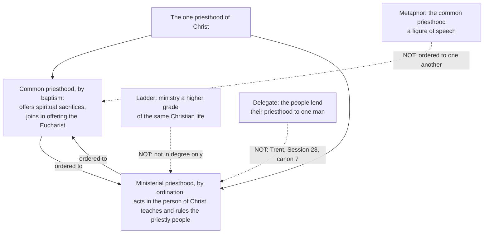

# The Church & Mary · Lesson 3.3: The laity, charisms, and the sensus fidei

> ⏱ ~15 min · Module 3: The constitution of the Church · Builds on: [3.1 Bishops and apostolic succession](03-01-bishops-and-apostolic-succession.md), [3.2 The local and the universal Church](03-02-the-local-and-the-universal-church.md), [`fundamental-theology` 5.3](../../fundamental-theology/lessons/05-03-the-sensus-fidei.md) · Unlocks: [4.5 Vatican II: primacy, collegiality, synodality](04-05-vatican-ii-primacy-collegiality-synodality.md), [6.4 The Assumption](06-04-the-assumption.md)

## Why this matters

[3.1](03-01-bishops-and-apostolic-succession.md) and [3.2](03-02-the-local-and-the-universal-church.md) built the Church from the top, but most of the Church holds no office. What are those people inside the Church? (Their mission in the world is [`catholic-social-teaching`](../../catholic-social-teaching/syllabus.md)'s.) Three answers: a priesthood different in kind from the ordained one; gifts the Spirit gives outside the office; a share in the whole body's grasp of its faith. Each is overstated one way and understated the other, and the 2021–2024 synod tried to give all three a procedure.

## The idea

Start with a wrong picture, a ladder. Lay people stand low, priests higher, bishops higher still, and ordination is promotion to more of the same Christian life. Vatican II rejected the ladder in four Latin words. It also rejected the opposite flattening: everyone a priest in the same sense, the ordained the congregation's employees.

The better picture is **two relations to one Christ.** Baptism makes a person a member of a priestly people that *offers*: itself, its work, its prayer and, with the priest, the Eucharist. Ordination makes a man act toward that people in the person of Christ the Head. Neither is a quantity of the other, and each exists for the other. A conductor is not a better violinist, and an orchestra is not an audience.

Second, **charisms** turn up anywhere in the body; the office judges them and does not issue them. Third, the faith lives in the whole body: the [*sensus fidei*](../reference.md#sensus-fidei) of [`fundamental-theology` 5.3](../../fundamental-theology/lessons/05-03-the-sensus-fidei.md), reloaded here, not re-taught.

## The doctrine

1. **The [common priesthood](../reference.md#common-priesthood) is real.** *Lumen Gentium* 10 (paraphrase): by rebirth and the Spirit's anointing, the baptized are consecrated as a spiritual house and a holy priesthood, to offer spiritual sacrifices through the whole of a Christian life. The warrant is 1 Peter 2:9 (Douay–Rheims):

   > But you are a chosen generation, a kingly priesthood, a holy nation, a purchased people: that you may declare his virtues, who hath called you out of darkness into his marvelous light.

   *In words:* every baptized person holds a priesthood, exercised in a whole life.

2. **It differs from the ministerial priesthood *essentia et non gradu tantum*,** "in essence and not in degree only" (LG 10, lesson's translation). Yet the two are ordered to one another, and each shares in its own way in Christ's one priesthood. The ordained priest acts in the person of Christ, teaching and ruling the priestly people and offering the Eucharist in the name of all; the faithful join in that offering. *In words:* [the formula](../reference.md#essence-not-degree) shuts two doors. "Not in degree only" shuts the ladder and the delegate together: ministry is not a higher grade of the same life, nor the congregation's priesthood concentrated in one man. "Ordered to one another" shuts the other door: the common priesthood is no figure of speech.

3. **The laity share the [three *munera*](../reference.md#three-munera), and their mark is the secular character.** LG 31 defines the laity as all the faithful except the clergy and the approved religious state. By baptism they share, in their own way, Christ's priestly, prophetic and kingly functions (so can. 204 §1, of all the faithful). [`christology` 5.1](../../christology/lessons/05-01-the-paschal-mystery-and-the-threefold-office.md) graded the threefold scheme. The mark: *Laicis indoles saecularis propria et peculiaris est*, "the secular character is proper and peculiar to the laity" (LG 31, lesson's translation). Their mission in temporal affairs is ceded to `catholic-social-teaching`. Inside the Church they may take on certain ecclesiastical functions (LG 33), and where competent they are permitted, sometimes obliged, to speak on the Church's good (LG 37). *In words:* "secular" says where the lay vocation is lived, not that it lives outside the Church.

4. **[Charisms](../reference.md#charisms) are given to every rank, and the office judges them without owning them.** LG 12, second paragraph (paraphrase): the Spirit gives special graces to the faithful of every rank, outstanding or simple and widespread, for building up the Church. Extraordinary gifts are not to be sought rashly (*temere*), nor fruits presumptuously expected from them. Judging their genuineness and ordered exercise belongs to those who preside, whose task is not to extinguish the Spirit. The council cites 1 Thessalonians 5:19–21 (Douay–Rheims):

   > Extinguish not the spirit. Despise not prophecies. But prove all things: hold fast that which is good.

   A charism brings the right and duty to use it, in communion with the pastors who judge it (*Apostolicam Actuositatem* 3). The CDF letter *Iuvenescit Ecclesia* (2016) calls hierarchical and charismatic gifts "co-essential", John Paul II's word (§10), and makes recognizing founding charisms a pastoral duty (§17). Its criteria (§18): the primacy of holiness, evangelization, profession of the Catholic faith, communion with the whole Church, esteem for other charisms, acceptance of trial, spiritual fruits, the social dimension. *In words:* the bishop is judge, not source, and extinguishing fails the office as surely as rubber-stamping.

5. **The *sensus fidelium* lives in this body, and it is not the body's majority.** LG 12 places it in the whole people "from the bishops down to the last of the lay faithful". The footnote gives Augustine (*On the Predestination of the Saints* 14.27), defending the book of Wisdom because it has been heard

   > by all Christians, from bishops downwards, even to the lowest lay believers, penitents, and catechumens, with the veneration paid to divine authority.

   (*NPNF*, first series, vol. 5, ch. 27.) The phrase was born describing **reception**. The ITC's *Sensus Fidei* (2014) adds that public opinion belongs to societies built on popular sovereignty, which the Church is not, so the two are never simply identical (§§113–118). *In words:* the sense belongs to the body, pastors included; a majority is a fact about opinion.

6. **[Reception](../reference.md#reception) is real, and it is not ratification.** For the ITC (§78), it is the people of God recognizing a teaching as in accord with the apostolic Tradition and building it into its life and worship. Yves Congar's essay "La 'réception' comme réalité ecclésiologique" (1972) made it a category: a church body taking as its own a decision it did not originate. Two limits stand. Papal definitions are irreformable "of themselves, and not from the consent of the Church" (*Pastor Aeternus* ch. 4, Schaff). Conciliar decrees bind once the pope approves, confirms and promulgates them (can. 341 §1). *In words:* reception recognizes; it does not vote.

7. **The synod of 2021–2024 gave this a [procedure](../reference.md#synodality).** Launched in October 2021, it ran from diocesan and eparchial consultation through national and continental stages to an assembly in two sessions (October 2023, October 2024). Lay and consecrated men and women, deacons and priests sat as full members (Francis, 2 October 2024; *Episcopalis Communio*, 2018, art. 2 §2). On 26 October 2024 the assembly approved the Final Document, every part by over two-thirds, and Francis signed it that day without an exhortation. It restates LG 12 and denies that the *sensus fidei* is public opinion (§22). It separates decision-*making*, done jointly, from decision-*taking* by the competent authority (§90). An agreed result may not be set aside without a compelling, explained reason (§91), and inviolable authority may still not ignore a properly discerned direction (§92). *In words:* all are heard; the pastor decides and owes reasons.

**Said plainly.** Pius X's *Vehementer Nos* (1906, §8) called the Church essentially an unequal society of pastors and flock, and gave the multitude one duty: "to allow themselves to be led". *Lumen Gentium* does not repeat that; it gives all a common dignity (LG 32) and sometimes obliges the laity to speak (LG 37). Whether it develops or corrects Pius X is argued among Catholics.

**Mark the levels** ([`fundamental-theology` 4.4](../../fundamental-theology/lessons/04-04-the-ladder-of-doctrinal-authority.md); [levels of authority](../reference.md#levels-of-authority)). **Rung 1, defined:** a visible priesthood with power to consecrate and absolve, not only to preach, whose ordination does not depend for validity on the people's call (Trent, Session 23, 1563, canons 1 and 7). LG 10's rejection of the delegate carries that weight; the sacrament is ceded to [`sacraments-and-liturgy`](../../sacraments-and-liturgy/syllabus.md). **At least rung 3:** LG 10's formula and ordering; the lay *munera*, within christology 5.1's grading; the secular character; LG 12 and AA 3 on charisms. **LG 12 on the whole body's inerrancy *in credendo*: at least rung 3, not defined, not open.** No act manifestly proposes it as revealed, so rung 1 is not claimed (can. 749 §3). *Iuvenescit Ecclesia*, approved at an audience with no claim of specific form, carries what it restates; its criteria are norms of discernment. The ITC and Congar: **no magisterial level**. **The 2024 Final Document** is, by Francis's Accompanying Note (24 November 2024), part of the ordinary papal magisterium (EC 18 §1): rung 3 at most for what it teaches itself, restated doctrine at its own weight, and proposals "not strictly normative" yet committing.

## The essence-not-degree formula

Solid arrows: the doctrine. Dotted arrows: three errors that never arrive.

## Worked examples

**Ex 1 (clean): discerning an invented movement.** The Lantern Houses, in an invented diocese, are lay households that take in men leaving prison and pray the Hours; some members report recoveries after praying with the sick. Their founder, Siobhan Kerrigan, asks for recognition. *Who judges?* The bishop: it is his duty (*Iuvenescit Ecclesia* 17). *By what?* The §18 criteria: holiness put before the work, the faith professed, communion (asking to be judged is a sign of it), esteem for the parish's outreach rather than rivalry, readiness for a period of accompaniment, fruits. *The healings?* Not to be sought rashly (LG 12): he may ask them not to advertise recoveries, without denying such gifts. *What may he not do?* Suppress a genuine gift because it is untidy or was not his idea, or approve it untested. Verdict: recognition with accompaniment. The gift is theirs, the judgment his; recognition certifies the gift, not every member's holiness.

**Ex 2 (where it strains): reception and the council of 449.** Events: [`church-history` 2.2](../../church-history/lessons/02-02-ephesus-chalcedon-and-leos-rome.md), [`christology` 2.3](../../christology/lessons/02-03-eutyches-leo-and-chalcedon.md). In August 449 a council at Ephesus under Dioscorus restored Eutyches, refused to read Leo's Tome and deposed Flavian; Leo called it a *latrocinium*. Chalcedon (451) deposed Dioscorus and received the Tome, and no list of councils counts 449. Church-history 2.2 concludes, as history, that 449 was never received. Theologically: did non-reception *unmake* a council, or *show* that it never was one? The first answer makes reception ratification, which claim 6 excludes. The second reads it as the body recognizing what 449 lacked: Rome's legates were overridden, Leo rejected it, and it contradicted the faith. Here the category strains. Egypt, much of Syria and Armenia never received Chalcedon either, and Catholic theology does not conclude that Chalcedon was unmade. So non-reception cannot decide alone; it is read with communion with Rome and consonance with the faith. Congar's point stands: a council nobody receives is not operative in the body.

## Watch out

- **You might think "essence, not degree" makes the ordained a superior kind of Christian.** It distinguishes priesthoods, not holiness: all share one vocation to perfection (LG 32).
- **You might think the secular character keeps the laity out of the Church's inner life, or that lay ministry is its goal.** LG 33 and 37 answer the first. The Final Document answers the second: not every charism must become a ministry (§66).
- **You might think LG 12 defines the infallibility of the faithful, or that the *sensus fidelium* is a pious opinion.** Over- and understated: at least rung 3, not defined, not open.
- **You might think Francis's signature made the Final Document infallible, or that "not strictly normative" made it optional.** It is ordinary papal magisterium, rung 3 at most, and his note says it commits.

## One-liner

> The baptized share Christ's priesthood in another kind than the ordained, carry gifts the office judges but does not issue, and with their pastors hold a faith that cannot fail: heard and discerned, never polled.

## Problems

**P1 (🟢)** *(Exegetical)* For each claim, say whether it is **compatible** or **incompatible** with LG 10's "in essence and not in degree only… ordered to one another". If incompatible, say whether it **collapses the two priesthoods into one kind** or **empties the common priesthood**. One line each.

(a) "Ordination is the next stage of Christian maturity for those who take their faith most seriously."

(b) "The priest is the congregation's delegate: the people hold the priesthood and lend it to one man to exercise for them."

(c) "A lay hospital chaplain may be holier, wiser and better at prayer than the bishop who commissioned her, and none of that enables her to celebrate Mass."

(d) "The faithful 'join in the offering' only in a figurative sense; the Mass is offered by the priest alone."

(e) "The ministerial priesthood exists for the sake of the common priesthood, and both participate in Christ's one priesthood."

**P2 (🟡)** *(Exegetical)* An **invented** confirmation-class worksheet, written for this problem:

> "**Charisms: what you need to know.** (1) Charisms are the extraordinary gifts: tongues, healing, prophecy. Most Catholics don't have one, and that's fine. (2) Because the Spirit blows where he wills, no bishop can judge whether a charism is genuine; that would put the Spirit under the hierarchy. (3) Charisms are for lay people; the ordained have the sacrament instead. (4) If you think you have a gift of healing, pray to receive it more strongly and expect results."

Correct each of the four statements from LG 12 or *Apostolicam Actuositatem* 3. Then say who judges a charism, name three of the criteria *Iuvenescit Ecclesia* 18 gives, and say what the judge may not do. **150 words or fewer.**

**P3 (🔴)** *(Exegetical, strict)* (a)–(c): for each **invented** sentence about the 2024 Final Document, say whether it states the document's weight **correctly**, **overstates** it, or **understates** it. Correct it in one sentence, citing Francis's Accompanying Note or *Episcopalis Communio* art. 18.

(a) "Because the pope signed it, the Final Document is infallible teaching."

(b) "No apostolic exhortation followed, so the Final Document is only the synod's advice to the pope and has no magisterial standing."

(c) "Francis called it 'not strictly normative', so a diocese may set it aside."

(d) An invented diocesan pastoral council reaches agreement after a long consultation; the bishop decides otherwise. In two sentences, say what Final Document §§91–92 asks of him and what it leaves to him.

Solutions

**P1** *(Exegetical)*

**Must hit, strict:**

- (a) **Incompatible: collapses into one kind.** It makes ministry a higher grade of the same Christian life, which is the ladder that "not in degree only" shuts. LG 32 gives all the same vocation to perfection.
- (b) **Incompatible: collapses into one kind.** It makes the ministerial priesthood the common priesthood exercised by a delegate, so a difference of function and not of essence. Trent, Session 23, canon 7 defines against it (rung 1).
- (c) **Compatible.** The difference is of kind, not of holiness or skill, so being holier or wiser does not cross it.
- (d) **Incompatible: empties the common priesthood.** LG 10 says the faithful, by their royal priesthood, join in the offering of the Eucharist.
- (e) **Compatible.** It is LG 10's "ordered to one another" plus *Christifideles Laici* 22's "as its aim".

**Wrong turns:** marking (c) incompatible because it seems to slight the bishop; it is the formula's whole point. Marking (e) as the delegation error; ordering the ministry *to* the people is not deriving it *from* them. Calling (d) a ladder error.

**Model answer:** (a) incompatible, collapses (ladder). (b) incompatible, collapses (delegation; Trent can. 7). (c) compatible. (d) incompatible, empties. (e) compatible.

---

**P2** *(Exegetical)*

**Must hit, strict:**

- (1) Charisms include "the more simple and widely diffused" (LG 12) and "the more elementary" (AA 3), and the Spirit gives them to everyone for profit (1 Cor 12:7). Most Catholics are not without one.
- (2) LG 12 gives the judgment of genuineness and ordered exercise to those who preside. AA 3 sets the Spirit's freedom ("breathes where He wills") in the same sentence as the pastors' judgment, so the two are not rivals.
- (3) LG 12: "the faithful of every rank". The ordained receive charisms too, and *Iuvenescit Ecclesia* calls the hierarchical and charismatic gifts co-essential.
- (4) LG 12: extraordinary gifts are not to be sought rashly, nor their fruits presumptuously expected.
- Who judges: the pastors, the bishop for a founding charism. Criteria (any three of §18): holiness first; evangelization; profession of the Catholic faith; communion with the whole Church; esteem for other charisms; acceptance of trial; spiritual fruits; social dimension. Not: extinguish the Spirit. His task is to test and hold fast what is good.

**Wrong turns:** correcting (2) by saying the bishop's approval *creates* the charism; he judges a gift he does not give. Correcting (4) by denying that extraordinary gifts occur; LG 12 regulates them, it does not deny them.

**Model answer:** (1) Charisms include simple, widespread gifts, given to everyone for the common good; most Catholics have some. (2) Judgment of genuineness and ordered use belongs to those who preside (LG 12), and AA 3 puts the Spirit's freedom and the pastors' judgment together. (3) Charisms are given to the faithful of every rank, ordained included. (4) Extraordinary gifts are not to be sought rashly or their fruits presumed (LG 12). The bishop judges, by criteria such as profession of the faith, communion with the whole Church and spiritual fruits. He may not extinguish the Spirit.

---

**P3** *(Exegetical, strict)*

**Must hit, strict:**

- (a) **Overstates.** The Accompanying Note places the document in the *ordinary* magisterium of the Successor of Peter (EC 18 §1). It defines nothing, so rung 3 is its ceiling for what it teaches on its own authority, and what it restates keeps the weight it already had.
- (b) **Understates.** Under EC 18 §1 a final document expressly approved by the pope participates in his ordinary magisterium. Francis approved and signed it on 26 October 2024, said in the Note that it is part of that magisterium, and asked that it be welcomed and received.
- (c) **Understates.** The Note says "not strictly normative" does not mean it fails to commit the churches to choices consistent with it. Local churches are to implement its proposals through the processes of discernment and decision the law and the document provide.
- (d) It asks him not to depart from an agreement reached by consultation without a compelling reason, which must be explained (§91), and not to ignore a direction that emerged from proper discernment (§92). It leaves the decision itself to him, since the authority to take decisions is called inviolable and grounded in the hierarchical structure Christ established (§92).

**Wrong turns:** calling (a) correct because "ordinary magisterium" sounds like the ordinary *universal* magisterium of LG 25, which is a different thing. Answering (d) as if the bishop were bound by the council's majority. Treating §92's call to revise the Code's "merely consultative" formula as a change already in force; a final document can propose a change in law but cannot enact one.

**Model answer:** (a) Overstates: the Note calls it ordinary papal magisterium; nothing is defined, so its own teaching sits at rung 3 at most. (b) Understates: approved expressly by the pope, it participates in his ordinary magisterium (EC 18 §1), and he asked that it be received. (c) Understates: the Note says it still commits the churches to consistent choices. (d) He may not set aside an agreed result without a compelling, explained reason, nor ignore a properly discerned direction. The decision remains his to take.

## Flashback

**From Lesson [3.1](03-01-bishops-and-apostolic-succession.md) (Bishops and apostolic succession):** *(Exegetical.)* Diagnose. An **invented** reply in a Catholic magazine's readers'-questions column, written for this problem. The question was "Is a bishop just a senior priest?"

> (1) "No. Episcopal consecration confers the fullness of the sacrament of Orders. The Council of Trent defined this in 1563, so the medieval view that the episcopate is only a dignity is a heresy."
>
> (2) "*Mystici Corporis* (1943) said that bishops receive their jurisdiction directly from the pope. Vatican II showed that this was simply a mistake, and since the Council a bishop's power to govern his diocese does not come through the pope at all."
>
> (3) "And because every bishop shares responsibility for the whole Church, a bishop may issue binding decrees for a neighbouring diocese whenever he sees a need there."

Each paragraph contains at least one error. Correct each from the text that decides it, and give the level wherever one is involved. **Two sentences per paragraph.**

Solution

**Must hit, strict:**

- **(1) The act and the level.** The opening is right: LG 21 teaches that consecration confers the fullness of Orders. But Trent's Session XXIII cans. 6–7 (**rung 1**) define a hierarchy of divine ordination and bishops superior to priests, with a power to confirm and ordain; they do not define the episcopate as a sacramental order. LG 21 "teaches" it, and the council's notification of 16 November 1964 limits its definitions to what it openly declares binding, so it stands at **rung 3**. The dignity view of Lombard and Aquinas was a school opinion, never heresy; since a council deliberately taught the contrary, it is no longer a free option either.
- **(2) Understated, then over-corrected.** LG 21 does part from MC 42 on where the *munera* come from: consecration confers teaching and governing with sanctifying (can. 375 §2). But MC 42 is encyclical teaching, **rung 3**, not a mistake to discard: the Nota (§2) directs that recent popes' statements on bishops' jurisdiction be read as concerning the canonical determination, by hierarchical authority, that makes power ready to act. So a diocesan bishop still governs only through papal appointment or confirmation (can. 377 §1), in hierarchical communion (LG 21), and the exercise of his proper power is regulated by the supreme authority (LG 27).
- **(3) Whose church he governs.** Each bishop governs the portion of the People of God committed to him, not other churches nor the universal Church (LG 23). His care for the whole Church is a real duty, but LG 23 says it is not exercised by an act of jurisdiction: he may send a neighbouring diocese fraternal aid, not decrees.

**Wrong turns:** "correcting" the opening of (1), which is LG 21's own teaching; swinging from "heresy" to "still an open question", which understates. Answering (2) by making bishops the pope's delegates again, which LG 27 excludes (they are not vicars of the Roman Pontiffs); calling MC 42 defined. In (3), denying that a bishop has any duty toward other churches, when LG 23 lays it on him by Christ's institution.

**Model answer:** (1) LG 21 does teach that consecration confers the fullness of Orders, but at rung 3, not by definition; Trent's canons 6–7 define only a divinely ordained hierarchy and the bishops' superiority, with their power to confirm and ordain. So the dignity view was never heresy, though since a council has deliberately taught the contrary it is no longer free. (2) LG 21 parts from MC 42 on the source of the *munera*, which come with consecration, but MC 42 remains rung-3 teaching, read through the Nota as concerning the canonical determination that makes power ready to act. A bishop still receives his office by papal appointment (can. 377 §1) and governs only in hierarchical communion, his proper power regulated by the supreme authority (LG 21, 27). (3) A bishop governs his own particular church and no other (LG 23). His care for the whole Church is a duty exercised without jurisdiction, so he may help a neighbouring diocese but cannot legislate for it.

## Connections

- **Backward:** [1.4](01-04-people-of-god-communion-sacrament.md) put the People of God before the hierarchy in *Lumen Gentium*'s order, and this lesson is what that ordering cashes out to. [3.1](03-01-bishops-and-apostolic-succession.md) gave the bishop's *munera*; this lesson gives everyone else's. [`christology` 5.1](../../christology/lessons/05-01-the-paschal-mystery-and-the-threefold-office.md) handed on the faithful's share in the three offices, and [`fundamental-theology` 5.3](../../fundamental-theology/lessons/05-03-the-sensus-fidei.md) handed on the Church as the body in which the *sensus fidei* lives; both promises are kept here.
- **Forward:** [4.5](04-05-vatican-ii-primacy-collegiality-synodality.md) sets synodality beside collegiality and weighs the Synod of Bishops as an institution. [6.4](06-04-the-assumption.md) reads the 1946 consultation of the bishops before the Assumption's definition. [`sacraments-and-liturgy`](../../sacraments-and-liturgy/syllabus.md) takes the essence-not-degree formula into Holy Orders.
- **Sideways:** the lay mission in the world is [`catholic-social-teaching`](../../catholic-social-teaching/syllabus.md)'s. The Robber Synod's events are [`church-history` 2.2](../../church-history/lessons/02-02-ephesus-chalcedon-and-leos-rome.md)'s. The "nothing without" logic the Final Document borrows from Ignatius and Cyprian (§88) goes back to the bishops of [`patristics` 1.3](../../patristics/lessons/01-03-ignatius-of-antioch.md) and [2.4](../../patristics/lessons/02-04-cyprian-of-carthage.md).
