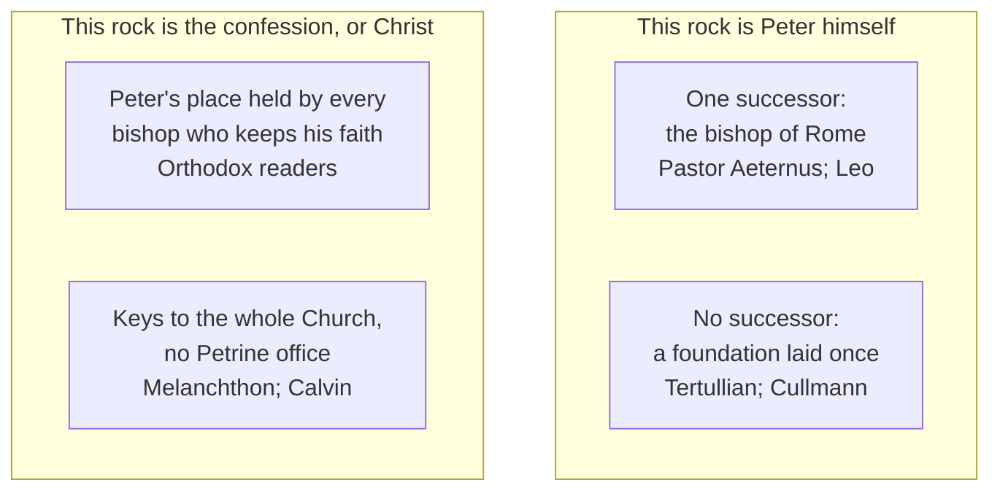

# The Church & Mary · Lesson 4.1: The Petrine texts

> ⏱ ~15 min · Module 4: The Petrine office · Builds on: [3.1 Bishops and apostolic succession](03-01-bishops-and-apostolic-succession.md), [3.2 The local and the universal Church](03-02-the-local-and-the-universal-church.md), [`new-testament` 2.2](../../new-testament/lessons/02-02-matthew.md) · Unlocks: [4.2 The development of papal claims, read honestly](04-02-the-development-of-papal-claims-read-honestly.md), [4.3 Vatican I and Pastor Aeternus](04-03-vatican-i-and-pastor-aeternus.md)

## Why this matters

Module 4 rests on three sayings to one fisherman. *Pastor Aeternus* builds its first chapter on two of them and cites the third before its definition; Calvin, Melanchthon and the Orthodox read the same verses and find no papacy. Before anyone argues (`apologetics-catholic-claims`'s job), you need to say what each text says, which words carry it, and which step the New Testament alone does not take.

## The idea

Read the [Petrine texts](../reference.md#petrine-texts) as one pattern. Each singles Peter out from the Twelve and gives him something: a name and keys (Matthew 16:17–19), a prayer and a charge (Luke 22:31–32), a flock (John 21:15–17). Each sets the gift beside his failure. Five verses after "thou art Peter" he is "Satan" and a *skandalon*, a stumbling-stone (16:23; lesson's gloss), and the threefold "lovest thou me?" answers a threefold denial (John 18:17, 25, 27).

Then one distinction. A Petrine **function** is what Peter does in the New Testament: confess, speak for the others, strengthen, shepherd. A Petrine **office** is that function made permanent, held by successors, located in Rome. The US Lutheran–Catholic dialogue (1973), drawing on *Peter in the New Testament* (eds. Brown, Donfried and Reumann), traced a "trajectory" of images of Peter: not yet primacy "in its later technical sense", though it could point that way (quoted in *The Bishop of Rome*, 2024, §43).

The Fathers on "this rock", checked in the public-domain translations (whether they reach Trent's "unanimous consent" is [`patristics`](../../patristics/syllabus.md) Boss 5(d)'s question):

| Reader | "This rock" | Where |
|---|---|---|
| Tertullian | Peter personally, not "every Church akin to Peter" | *On Modesty* 21 |
| Origen | Peter by the letter; by the spirit, every disciple who confesses | *Comm. Matt.* XII.10–11 |
| Chrysostom | "the faith of his confession", though Christ "makes him a shepherd" | *Hom. Matt.* 54.3 |
| Augustine | Christ; Peter, given the keys, "represented the universal Church" | *Tractates on John* 124.5 |
| Leo | Peter, named for what Christ is; none may leave "Peter's solid rock" | Letter 10.1 |

## Source

Matthew 16:17–19, the lesson's translation from the Greek. Every "you" is singular.

> Jesus answered and said to him, "Blessed are you, Simon Bar-Jona, for flesh and blood did not reveal this to you, but my Father who is in the heavens. And I say to you: you are *Petros*, and on this *petra* I will build my *ekklēsia*, and the gates of Hades will not overpower it. I will give you the keys of the kingdom of the heavens; and whatever you bind on earth will have been bound in the heavens, and whatever you loose on earth will have been loosed in the heavens."

- **[*Petros* and *petra*](../reference.md#petros-and-petra).** *Petra* is the ordinary word for rock; a man's name needs the masculine *Petros*. Behind both stands the Aramaic *Kēpha*: "Cephas, which is interpreted Peter" (John 1:42), Paul's usual name for him (Gal 2:9, 11; at 1:18 DR follows the Vulgate's "Peter"). Grammar alone does not decide whether the pair is one word or two.
- **The gates of Hades** (*pylai hadou*; DR "hell"): the power of death (lesson's gloss). The promise is the Church's survival.
- **[The keys](../reference.md#power-of-the-keys).** Many readers hear Isaiah 22:22: "the key of the house of David" on the king's steward, who "shall open, and none shall shut".
- **Binding and loosing:** forbidding and permitting, or imposing and lifting a ban (lesson's gloss). Whether the future perfect means heaven ratifying or heaven having already decided is argued.
- **Matthew 18:18 gives binding and loosing in the plural** (*dēsēte*) to the disciples, where a brother is corrected and "the church" told. It does not repeat the name, the rock or the keys.

## In their own words

Each as its own theologians give it, with no reply attached; the argument belongs to [`apologetics-catholic-claims`](../../apologetics-catholic-claims/syllabus.md).

**Orthodox.** The case was set out in English in *The Primacy of Peter* (London, 1963), essays by Meyendorff, Schmemann, Afanasiev and Koulomzine. On the texts, Meyendorff's essay gathers Byzantine writers for whom Peter's succession belongs to no single see: every bishop who keeps Peter's confession holds Peter's place in his church. Rome's first place rests on the canons and the city. The joint Catholic–Orthodox commission recorded that the East, with "a different interpretation of the Scriptures and the Fathers", never read that place as Peter's succession (Chieti, 2016, §16). Philaret's Longer Catechism, the Russian standard Schaff printed, concludes (Q. 259):

> The Church, being to abide through all generations of time, needs also an ever-abiding head; and such is Jesus Christ alone.

**Lutheran.** Melanchthon's *Treatise on the Power and Primacy of the Pope* (Smalcald, 1537), a Lutheran confession, reads all three texts (§§22–30). Peter speaks for all the apostles: what 16:19 says to him in the singular, 18:18 and John 20:23 say to all in the plural. The keys belong immediately to the Church, not to one person. "This rock" is the ministry of Peter's confession; "feed" means teaching the Word, which Peter shares with the others.

**Reformed.** For Calvin (*Institutes* IV.6.4–8) the keys are the preaching of the Gospel, which opens heaven; binding and loosing are reconciliation by faith and bondage by unbelief; nothing is given Peter that his colleagues lack. The rock is the confession, because Christ is the only foundation (1 Cor 3:11). Peter may be "the first among the faithful", but rank is not power: his colleagues sent him (Acts 8:14), and Paul rebuked him (Gal 2:11). Nor will Calvin allow "wresting a single fact into a perpetual enactment" (IV.6.8).

**Cullmann.** The Lutheran exegete Oscar Cullmann (*Peter: Disciple, Apostle, Martyr*, 1952) read the rock as Peter himself, since the confession cannot be detached from the man who made it. But the role is the unrepeatable one of first foundation, and the text gives no basis for successors in it.

## The doctrine

1. **Luke 22:31–32.** "Satan hath desired to have you" (*hymas*: all of you) "... But I have prayed for thee" (*sou*: you alone) "that thy faith fail not: and thou, being once converted, confirm thy brethren" (DR; *stērison*, make firm, lesson's gloss). It follows a quarrel over greatness, settled by "he that is the leader, as he that serveth" (22:26). *In words:* all will be shaken; one is prayed for, so that, turned back, he can steady the rest.
2. **John 21:15–17.** Three questions, three charges: *boske*, feed (vv. 15, 17), and between them *poimaine*, shepherd (v. 16) (lesson's glosses). DR, following the Vulgate's single *pasce*, says "feed" each time. *Poimainō* is Matthew 2:6's verb for the ruler from Bethlehem, where DR has "rule". *In words:* the man who denied three times is three times given the flock, with a word that includes governing.
3. **The record.** Peter heads every list of the Twelve: "The first, Simon" (Matt 10:2). In Acts he leads the choice of Judas's replacement, preaches at Pentecost, receives Cornelius and speaks first at the council (1:15; 2:14; ch. 10; 15:7). Yet James gives the judgment ("I judge", 15:19), the apostles send Peter to Samaria (8:14), and after chapter 15 Acts drops him. Paul's "pillars" are James, Cephas and John (Gal 2:9).

**Said plainly.** At Antioch Paul "withstood him to the face, because he was to be blamed" (Gal 2:11). The New Testament names no successor to Peter, says nothing of a bishop of Rome, and records no handing on of his place. The Anglican–Roman Catholic commission (ARCIC) found "no explicit record of a transmission of Peter's leadership" (1981).

4. **[From function to office](../reference.md#petrine-function-and-petrine-office).** Beyond the function, an office needs perpetuity, succession and Rome. The New Testament gives the first only as an inference from purpose, a foundation for a Church Hades will not overpower, and neither of the others. *Pastor Aeternus* ch. 2 takes the steps on other ground: what Christ established in Peter for the Church's perpetual welfare must remain "by the same institution", and Peter lives and presides in his successors at Rome. *In words:* the office is held from Christ's institution as the tradition knows it.
5. **What the Church holds.** [*Pastor Aeternus*](../reference.md#pastor-aeternus) (1870) ch. 1: Christ gave Peter the primacy of jurisdiction "immediately and directly" (Matt 16:16–19; John 21:15–17). It excludes a primacy of honour only, and one given to the Church and through her to Peter as her minister. Ch. 2: by Christ's institution Peter has perpetual successors, and the Roman pontiff is that successor. *Lumen Gentium* 22 makes Simon alone the rock, bearer of the keys and shepherd of the whole flock, and grants the binding and loosing also to the [college](../reference.md#college-of-bishops) of apostles with its head. The Catechism uses both readings of the rock: the faith Peter confessed (CCC 424), and Peter because of it (CCC 552).

**Mark the levels** ([`fundamental-theology` 4.4](../../fundamental-theology/lessons/04-04-the-ladder-of-doctrinal-authority.md); [levels of authority](../reference.md#levels-of-authority)). Peter's primacy of true jurisdiction, received directly from Christ and not of honour only, is **rung 1**: the canon of *Pastor Aeternus* ch. 1. That Peter has perpetual successors by divine right, and that the Roman pontiff is that successor, is **rung 1**: the canon of ch. 2 ([4.3](04-03-vatican-i-and-pastor-aeternus.md)). The chapters' exegesis is the act's reasoning, not its definition, by the rule [4.4](04-04-infallibility-in-exercise-and-the-ordinary-universal-magisterium.md) applies. So **the referent of "this rock" is not defined**: two Doctors, Chrysostom and Augustine, did not read it as Peter's person alone, and which reading is primary is **freely disputed** inside the defined primacy. On the college's share, LG 22 teaches at **rung 3** at its heaviest ([4.5](04-05-vatican-ii-primacy-collegiality-synodality.md)). Catechism paragraphs weigh what they restate; the Fathers are witnesses, not acts; dialogue statements and *The Bishop of Rome* carry **no magisterial weight**.

## Map of positions

Two questions, often run together:

Tertullian and Leo share the rock and part on succession; a Catholic may read the rock as the confession (CCC 424) and hold the defined succession.

## Worked examples

**Ex 1 (clean case): does Luke 22:32 show an office?** *Function:* yes; the pronouns isolate Peter, and he is to strengthen the others. *Perpetuity:* not in the text, which concerns one night; "being once converted" looks to his return after the denial. *Succession, Rome:* nothing. *Pastor Aeternus* ch. 4 applies the verse to Peter's successors in its preamble, which explains and does not define. Calvin and a Catholic exegete can both sign this and still differ on the office.

**Ex 2 (where it strains): is "shepherd" Peter's word?** John 21:16 gives Peter *poimaine*. 1 Peter 5:1–2, written as Peter, has the "fellow-elder" (*sympresbyteros*) tell the elders to "feed the flock" with the same verb. The *Treatise* takes feeding as common to all the apostles (§30). Read with *Pastor Aeternus* ch. 1 and LG 22, the difference lies in the object: "my sheep", the whole flock, against "the flock of God which is among you". With the verb shared, everything rides on whether "my sheep" means all of them, which the text alone does not settle.

## Watch out

- **You might think *Petros* is a pebble and *petra* a cliff, so Peter is not the rock.** *Kēpha* stands behind both (John 1:42), and the Lutheran Cullmann read the rock as Peter. The lexicon decides less than either side hopes.
- **Overstating:** "The Church has defined that 'this rock' is Peter's person." It defined the primacy; the referent is free. **Understating:** "The Fathers disagree on the rock, so the primacy is open." The canons of chs. 1–2 are rung 1.
- **You might think Matthew 18:18 gives the keys to all.** It gives binding and loosing in the plural and never mentions keys. Treating the two as one grant is an argument, not a reading.

## One-liner

> The texts give one man a name, keys, a prayer and a flock; that the gift outlives him in Rome, the Church holds from Christ's institution, not from the page alone.

## Problems

**P1 (🟢)** *(Exegetical)* Close reading. Isaiah 22:20–22, 25 (DR, Isaias). Verse 15 calls Sobna the one "over the temple"; the Hebrew has "over the house", the steward's title that 4 Kings 18:18 [2 Kings 18:18] gives Eliacim.

> And it shall come to pass in that day, that I will call my servant Eliacim the son of Helcias, And I will clothe him with thy robe, and will strengthen him with thy girdle, and will give thy power into his hand: and he shall be as a father to the inhabitants of Jerusalem, and to the house of Juda. And I will lay the key of the house of David upon his shoulder: and he shall open, and none shall shut: and he shall shut, and none shall open. [...] In that day, saith the Lord of hosts, shall the peg be removed, that was fastened in the sure place: and it shall be broken and shall fall [...]

(a) Supposing Matthew 16:19 echoes this passage, name three things the key image carries, each with the words that carry it. (b) Name two things it does not carry, at least one shown by the text itself. **120 words or fewer.**

**P2 (🟡)** *(Exegetical)* Find the crux. Two readings of Matthew 16:19 beside 18:18, both stated in this lesson:

- **A** (*Lumen Gentium* 22): Simon alone is the rock and the bearer of the keys, and shepherd of the whole flock; the power of binding and loosing given to Peter was granted also to the college of apostles joined with its head.
- **B** (*Treatise on the Power and Primacy of the Pope* §§23–24): what 16:19 says to Peter in the singular, the keys and "whatsoever thou shalt bind", 18:18 says to all in the plural; so Peter receives for all, and the keys belong to the Church.

(a) From the Greek, say what 16:19 gives in the singular, what 18:18 gives in the plural, and what 18:18 does not repeat. (b) Name the single premise on which A and B split. (c) Name one piece of textual evidence that bears on it, and which way it leans. **120 words or fewer.**

**P3 (🔴)** *(Exegetical)* State at full strength. (a) State Calvin's reading of Matthew 16:18–19, and of Peter's place among the apostles, as *Institutes* IV.6 states it. **Three sentences.** (b) Cullmann reads "this rock" the other way and still finds no successor. Say what each takes the rock to be, and name the premise about succession they share. **Two sentences.** Graded on fidelity alone; no reply is asked for.

Solutions

**P1** *(Exegetical)*

**Accept:** any three features in (a) with the words that carry them; any two limits in (b), one from the text.

**Must hit, strict (a):**

- **Delegated authority:** the key is "of the house of David", laid on the steward by God ("I will lay"). It is the king's key in a steward's hand.
- **Rule over the household, as care:** the office "over the house" (v. 15, Hebrew; 4 Kings 18:18), and "a father to the inhabitants of Jerusalem".
- **Decisions that stand:** "he shall open, and none shall shut", the pairing Matthew's bind and loose resembles.
- **An office distinct from its holder:** Sobna's "robe", "girdle" and "power" pass to Eliacim (v. 21; v. 19, "depose thee from thy ministry").

**Must hit, strict (b):**

- **Not the holder's security:** the peg "fastened in the sure place" falls (v. 25). An office's authority is not its holder's permanence. Interpreters divide on whose fall v. 25 means; the point holds either way.
- **No successor named, and no see:** the text says nothing of who holds the key after Eliacim, or of anything beyond Judah.
- **The echo is inexact:** one key and open and shut here; keys and bind and loose in Matthew. Reading 16:19 through Isaiah is an interpretive judgment, and Matthew does not cite Isaiah.

**Wrong turns:** treating the echo as Matthew's own citation; arguing from the passage for or against a papacy, which the question does not ask; missing v. 21's transfer, which is the strongest "office" evidence in the passage.

**Model answer:** (a) The key is "of the house of David" and God lays it on Eliacim, so it is the king's authority held by a steward. It makes him "a father" to Jerusalem and Judah, over the royal house. Its decisions stand: "he shall open, and none shall shut". And it belongs to an office that outlasts holders: Sobna's robe, girdle and power pass to Eliacim. (b) It does not make the holder secure: the peg "fastened in the sure place" falls (v. 25). It names no successor and no place beyond Judah. The match with Matthew is in structure, not words.

---

**P2** *(Exegetical)*

**Must hit, strict (a):** 16:19 gives, in the singular, the keys (*dōsō soi tas kleidas*) and binding and loosing (*dēsēs*, *lysēs*). 18:18 gives binding and loosing in the plural (*dēsēte*, *lysēte*), in a passage on correcting a brother and telling "the church". 18:18 does **not** repeat the keys, the name or the rock.

**Must hit, strict (b):** whether the keys and the binding and loosing of 16:19 are **one grant or two**. B must hold them one, so that 18:18's plural shares the keys' content. A must hold them two: the keys a distinct grant to Peter alone, binding and loosing shared.

**Must hit, strict (c):** any relevant textual evidence, with its direction. For example: the "and" of 16:19 (*kai ho ean*), read as spelling out what the keys are (toward B) or as adding a second gift (toward A); Isaiah 22:22, where the key is a steward's office and opening and shutting its exercise (it can serve either side); John 20:23, which gives forgiving and retaining to the disciples with no mention of keys.

**Wrong turns:** making the crux "is Peter the rock?", since 18:18 does not touch the rock and B's rock reading is a separate premise; saying 18:18 gives the keys to all, which is B's inference, not the text; saying A denies that the college binds and looses, when LG 22 affirms it; volunteering a verdict.

**Model answer:** (a) 16:19 gives Peter alone the keys and binding and loosing (*dēsēs*, *lysēs*); 18:18 gives binding and loosing to the disciples (*dēsēte*, *lysēte*) and says nothing of keys. (b) They split on whether keys and binding are one grant. If one, 18:18's plural shares the keys; if two, it shares only what follows them. (c) The "and" of 16:19: explanatory favours B, additive favours A.

---

**P3** *(Exegetical)*

**Must hit, strict (a):**

- Keys as the **preaching of the Gospel**, which opens heaven; binding and loosing as **reconciliation by faith and bondage by unbelief**; nothing promised Peter that is not **common to his colleagues** (IV.6.4).
- The rock as **the confession**, made in his brethren's name too, because **Christ is the only foundation** (1 Cor 3:11; IV.6.6).
- Peter granted **honour of rank**, first among the faithful, but **not power**. He was sent by his colleagues and rebuked by Paul (IV.6.5, 7), and a chief among twelve makes **no perpetual rule** for the whole Church (IV.6.8).

**Must hit, strict (b):** Calvin: the rock is the confession, with Christ as foundation. Cullmann: Peter himself. Shared premise: what the text gives, it gives to Peter personally (or as one of the Twelve), and nothing in it extends the gift to successors. The step from a person's role to a perpetual office needs a warrant the text does not supply.

**Wrong turns:** **volunteering a rebuttal**, such as citing *Pastor Aeternus* ch. 2, Leo or the Fathers against either; making Calvin deny Peter any precedence, when he grants rank; giving Cullmann the confession reading; turning (b) into a verdict on who reads the rock rightly.

**Model answer:** (a) For Calvin the keys are the preaching of the Gospel, which opens heaven, and binding and loosing are reconciliation by faith and bondage by unbelief, so nothing was promised Peter that his colleagues lacked. The rock is the confession Peter made for them all, because Christ is the only foundation. Peter may be honoured as first among the faithful, but rank is not power, and a chief among twelve would make no perpetual rule for the whole Church. (b) Calvin takes the rock to be the confession; Cullmann takes it to be Peter himself. Both hold that whatever the text gives is given to Peter's person or to the Twelve, and that nothing in it reaches a successor.

## Flashback

**From Lesson [3.2](03-02-the-local-and-the-universal-church.md) (The local and the universal Church):** *(Exegetical.)* Diagnose. A sidebar, "How the Church is organized", from an **invented** Grade 10 religion textbook, written for this problem:

> (1) A diocese is one piece of the Catholic Church: add all the pieces together and you have the whole Church.
>
> (2) Vatican II settled that the universal Church and the dioceses come into being together, neither one before the other.
>
> (3) *Apostolos Suos* (1998) is canon law, so nothing in it counts as Church teaching, not even what it says about whether bishops' conferences share in the collegiality of the bishops.
>
> (4) The Latin Church is one of several churches *sui iuris*, and none of them stands above the others in dignity.

One sentence is right: say which. For each of the other three, name the error and correct it, citing the text that fixes it and giving the level where a level is involved. **One sentence each.**

Solution

**Accept:** any wording that makes the moves below; naming who holds simultaneity in (2) earns credit but is not required.

**Must hit, strict:**

- **(4) is right.** Every church *sui iuris*, the Latin Church included, is of equal dignity (*Orientalium Ecclesiarum* 3).
- **(1)** is the sum, or federation, picture. The one Church of Christ is truly present and operative in each diocese (can. 369; *Christus Dominus* 11) and exists in and out of the particular churches (LG 23), so the universal Church is not their total (*Communionis Notio* 8–9). That is conciliar teaching, at least rung 3, and it excludes the federation picture at that weight.
- **(2)** gives the Council a theologians' position. LG 23 teaches that the one Church exists in and out of the particular churches; it does not say the two arise together. Simultaneity is held by Zizioulas, by Kasper and by the Catholic–Orthodox Munich text (1982), none of them a magisterial act. *Communionis Notio* 9 (1992) calls the universal Church prior, as authentic teaching at rung 3, light grade; what that priority asserts, and whether it excludes simultaneity, is freely disputed.
- **(3)** runs law and teaching together. The complementary norms (unanimity, or two-thirds plus the *recognitio*) are law, on no rung. The account of conferences, that they apply the collegial spirit and not the collegiality proper to the whole order of bishops (§12), is papal teaching at rung 3.

**Wrong turns:** calling (4) false because the Eastern churches are "rites" of the Latin Church; over-correcting (1) to "a diocese is no part of the Church", when can. 369 calls it a portion of the People of God and *Communionis Notio* 9 itself calls particular churches part of the one Church, in mutual interiority with the whole; correcting (2) by making the priority of the universal Church dogma (overstated) or simultaneity a forbidden opinion (the reach of §9 is the disputed point); correcting (3) by lifting the voting rule into doctrine.

**Model answer:** (4) is right: every church *sui iuris*, the Latin included, has equal dignity (OE 3). (1) is the federation picture: the whole Church is truly present in each diocese (can. 369) and exists in and out of the dioceses (LG 23), so the universal Church is not their sum (*Communionis Notio* 8–9), conciliar teaching at least rung 3. (2) Vatican II settled no order: LG 23 teaches "in and out of" without saying the two arise together, simultaneity is a theologians' and a dialogue text's position, and *Communionis Notio* 9's priority is rung 3, light grade, with the question freely disputed. (3) Its voting norms are law on no rung, but its teaching that conferences express the collegial spirit, not the collegiality of the whole order (§12), is papal teaching at rung 3.

## Connections

- **Backward:** [`new-testament` 2.2](../../new-testament/lessons/02-02-matthew.md) read Matthew's Peter and *ekklēsia* and left the doctrine of primacy here; whether 16:17–19 goes back to Jesus is its Boss 2's question ([syllabus](../../new-testament/syllabus.md)). The Antioch scene is read in [`new-testament` 5.1](../../new-testament/lessons/05-01-galatians-faith-law-and-the-gentiles.md), and Jerome and Augustine dispute it in [`patristics` 4.2](../../patristics/lessons/04-02-jerome.md). The Orthodox accounts of primacy already stated: Afanasiev in [`church-history` 1.2](../../church-history/lessons/01-02-bishops-canon-and-the-parting-of-the-ways.md) and [`patristics` 1.3](../../patristics/lessons/01-03-ignatius-of-antioch.md), Meyendorff in [`church-history` 4.2](../../church-history/lessons/04-02-east-and-west-the-long-estrangement.md). [3.1](03-01-bishops-and-apostolic-succession.md) had the college succeed the college and left Rome's succession to Peter for this module. [3.2](03-02-the-local-and-the-universal-church.md) gave the Orthodox eucharistic ecclesiology (Afanasiev, Zizioulas), in which each bishop's church is the whole Church. Firmilian's "many other rocks" is [`patristics` 2.4](../../patristics/lessons/02-04-cyprian-of-carthage.md)'s, and Leo's anniversary sermons are [`patristics` 5.2](../../patristics/lessons/05-02-leo-the-great.md)'s.
- **Forward:** [4.2](04-02-the-development-of-papal-claims-read-honestly.md) traces how the claim grew after the New Testament, from the second-century succession lists ([`patristics` 2.1](../../patristics/lessons/02-01-irenaeus-against-the-gnostics.md)) on, forgeries included. [4.3](04-03-vatican-i-and-pastor-aeternus.md) reads the canons of chs. 1–2 and the definition of ch. 4. [4.5](04-05-vatican-ii-primacy-collegiality-synodality.md) takes LG 22's college. `apologetics-catholic-claims` ([syllabus](../../apologetics-catholic-claims/syllabus.md)) argues what this lesson only states.
- **Sideways:** the same verse does other work elsewhere: [`theology-of-debt` 3.5](../../theology-of-debt/lessons/03-05-the-christian-jubilee-and-the-treasury.md) reads the keys as the power to dispense the Church's treasury, a later use of 16:19.
