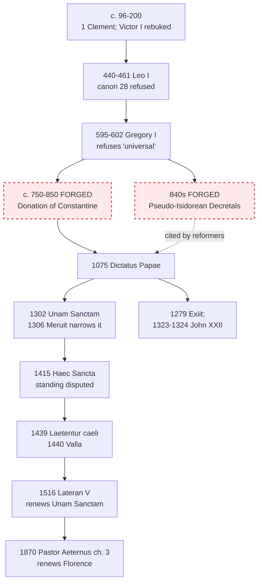

# The Church & Mary · Lesson 4.2: The development of papal claims, read honestly

> ⏱ ~15 min · Module 4: The Petrine office · Builds on: [4.1 The Petrine texts](04-01-the-petrine-texts.md), [`church-history` 5.1](../../church-history/lessons/05-01-papal-monarchy-innocent-iii-to-boniface-viii.md), [`fundamental-theology` 5.2](../../fundamental-theology/lessons/05-02-newmans-theory-of-development.md) · Unlocks: [4.3 Vatican I and *Pastor Aeternus*](04-03-vatican-i-and-pastor-aeternus.md)

## Why this matters

Vatican I teaches that the primacy was instituted in Peter and is perpetual in the Roman pontiffs ([4.3](04-03-vatican-i-and-pastor-aeternus.md)). The second century does not look like 1870. Two lazy stories fill the gap: today's papacy was there from Peter onward, or forgers manufactured it. The record refutes both. This lesson reads [`church-history`](../../church-history/syllabus.md)'s events for what they show, settles two status questions that course handed over, and runs Newman's notes on the whole [development](../reference.md#development-of-papal-claims).

## The idea

**Three questions, never one.** For any piece of evidence ask: what did Rome *claim*? What did the other churches *concede*? What has the Church since *defined*? A claim is not a concession, a concession is not a definition, and 1870 does not certify every earlier claim. Most bad arguments merge two of them.

Era by era, with church-history's facts ([the evidence by era](../../church-history/reference.md#roman-primacy-the-evidence-by-era)):

- **c. 96–200.** The Roman church writes to Corinth in the church's name, not a bishop's ([`patristics` 1.2](../../patristics/lessons/01-02-first-clement-and-the-didache.md)); Ignatius greets Rome in a phrase read three ways ([`patristics` 1.3](../../patristics/lessons/01-03-ignatius-of-antioch.md)); Victor I tries to cut off Asia over Easter and Irenaeus rebukes him ([`church-history` 1.2](../../church-history/lessons/01-02-bishops-canon-and-the-parting-of-the-ways.md)). *Claimed:* responsibility for other churches. *Conceded:* that Roman communion mattered. *Not shown:* a head of all Christians.
- **440–461, Leo I.** Peter acts in his see ([`patristics` 5.2](../../patristics/lessons/05-02-leo-the-great.md)), and the whole Church's care converges on Peter's one seat (Letter 14). *Not conceded:* Chalcedon's canon 28 ranked Constantinople by the city's political standing; Leo refused it, and the East kept it ([`church-history` 2.2](../../church-history/lessons/02-02-ephesus-chalcedon-and-leos-rome.md)).
- **595–602, Gregory I.** He refuses the title "universal" as one that takes from his brother bishops, while approving his predecessor's annulment of an Eastern synod by Peter's authority ([`patristics` 5.3](../../patristics/lessons/05-03-gregory-the-great.md)).
- **1075–1302.** After ninth-century forgeries (below), the claim at its fullest, temporal power included: [*Dictatus Papae*](../reference.md#dictatus-papae), Innocent III, Boniface VIII ([`church-history` 4.1](../../church-history/lessons/04-01-the-reform-papacy-and-the-investiture-contest.md), [5.1](../../church-history/lessons/05-01-papal-monarchy-innocent-iii-to-boniface-viii.md)).

**Development is the Church's own category for this history.** She holds an origin and a core, not that every era's exercise was the core.

## Source

The closing sentence of Boniface VIII's [*Unam Sanctam*](../reference.md#unam-sanctam) (18 November 1302), Latin as printed in Denzinger's eleventh edition (1911):

> *Porro subesse Romano Pontifici omni humanae creaturae declaramus, dicimus, definimus et pronuntiamus omnino esse de necessitate salutis.*
>
> Further, we declare, we say, we define and we pronounce that to be subject to the Roman pontiff is, for every human creature, altogether necessary for salvation.

(lesson's translation). Read the shape of the act: four verbs of solemn utterance, one of them *definimus*; one predicate, "necessary for salvation", said of being subject to the Roman pontiff, for every human creature. Notice what the sentence lacks: "temporal", "king", "sword". Those belong to the bull's body, whose two swords are [`church-history`](../../church-history/syllabus.md) Boss 5's. Gladstone argued that *Porro* pulled the whole bull into the definition. Newman answered (*Letter to the Duke of Norfolk*, 1875, Postscript) that it links two separate judgments, this one and the one before it against two first principles.

## The doctrine

**Said plainly.** Forged documents were used in the service of papal claims. The [Pseudo-Isidorean Decretals](../reference.md#forged-decretals), forged in the province of Reims probably in the 840s, put into the mouths of early popes letters that routed bishops' cases to Rome. The [Donation of Constantine](../reference.md#donation-of-constantine), forged between about 750 and the mid-ninth century, has Constantine grant the pope supremacy over every church and rule of Rome and the West. A pope cited the Donation to the patriarch of Constantinople in 1053–54, and canonists built on both for centuries. Lorenzo Valla exposed the Donation in 1440 ([`church-history` 3.3](../../church-history/lessons/03-03-popes-franks-and-emperors.md)).

1. **What the forgeries show, and what a Catholic account concedes.** Pseudo-Isidore was forged by Frankish clergy, not in Rome: enlarging Rome's jurisdiction was their means of protecting bishops from archbishops and kings. Schatz, as church-history reports him, concedes that the forgeries served the claims and holds that the claims were older ([3.3](../../church-history/lessons/03-03-popes-franks-and-emperors.md)). He also grants that no one in 100 or 200 would have called Rome's bishop head of all Christians ([1.2](../../church-history/lessons/01-02-bishops-canon-and-the-parting-of-the-ways.md)), and that the balance of 1870, the bishops, came only at Vatican II ([8.2](../../church-history/lessons/08-02-pius-ix-vatican-i-and-the-fall-of-rome.md); [4.5](04-05-vatican-ii-primacy-collegiality-synodality.md)). *In words:* the question is not whether the 1870 office existed in 200, but whether what grew is growth.
2. **The status of *Unam Sanctam*'s closing sentence** (handed here by [`church-history`](../../church-history/syllabus.md) Boss 5; [5.1](05-01-outside-the-church-there-is-no-salvation.md) reads the opening). Three readings stand.
   - *A definition, narrowly read.* Joseph Fessler, Vatican I's secretary-general, held only the bull's last sentences infallible. Newman follows him (Postscript), applying his rule that prefaces are not part of what is defined (§9).
   - *A definition, broadly read.* The subjection includes the temporal subjection of rulers that the body argues. It was the maximal medieval reading, and Gladstone's.
   - *Not a definition in the 1870 sense.* Testing a bull issued in a quarrel with one king against ch. 4's conditions means judging its address and intent, and later acts narrowed it. Clement V's *Meruit* (1306) declared that it left France subject to the Roman Church no differently than before ([`church-history` 5.1](../../church-history/lessons/05-01-papal-monarchy-innocent-iii-to-boniface-viii.md)). Lateran V renewed the bull in 1516 (P2 reads how).

   *In words:* it is not manifest that the sentence is a definition, so can. 749 §3 does not count it as one; its narrow content stands anyway, because other acts teach it.
3. **Florence and Constance.** [*Laetentur caeli*](../reference.md#laetentur-caeli) (6 July 1439) defines the Roman pontiff's primacy over the whole world and his full power, given in Peter, to feed, rule and govern the universal Church, *quemadmodum etiam* (lesson's gloss: "as also", or "in the way that") it is contained in the acts of the councils and the canons. Whether the clause limits or confirms is [`church-history` 4.2](../../church-history/lessons/04-02-east-and-west-the-long-estrangement.md)'s question; Vatican I renewed the definition, clause included (*Pastor Aeternus* ch. 3). Constance's [*Haec Sancta*](../reference.md#haec-sancta) (6 April 1415) said the council held its power immediately from Christ, and that everyone, the pope included, must obey it in matters of faith, the schism and reform ([`church-history` 5.4](../../church-history/lessons/05-04-avignon-the-great-schism-and-the-councils.md)). Its standing is disputed three ways: a standing rule, an emergency measure for a Church with three claimants, or never validly enacted, since only John XXIII's obedience was present. Martin V's approval of what was done *conciliariter* does not clearly reach it. Later acts closed the strong reading: Pius II's *Execrabilis* (1460) forbade appeals from a pope to a future council ([`history-of-political-thought` 2.5](../../history-of-political-thought/lessons/02-05-marsilius-and-conciliarism.md)); a bull of Lateran V (19 December 1516) gives the pope alone authority over all councils, to convoke, transfer and dissolve them; and *Pastor Aeternus* ch. 3 calls appealing from the pope to a council as to a higher authority an error. *In words:* what Constance did in 1415 is argued; a council permanently above an undoubted pope cannot stand beside 1870.
4. **Newman's notes, run on the trajectory** (names from [`fundamental-theology` 5.2](../../fundamental-theology/lessons/05-02-newmans-theory-of-development.md); no magisterial level). *Preservation of type:* the type is what *Lumen Gentium* 18 names, Peter as the permanent, visible source and foundation of the unity of faith and communion (paraphrase). A continuity reading must show that each era's exercise served that unity, not lordship. *Anticipation of its future* runs on authentic texts only, thinner and more ambiguous than the forgeries made them look. *Power of assimilation* is where Rome borrowed most: Roman law's heirs, vicars and fullness of power (Ex 1). *Chronic vigour* cuts both ways: the office outlived the tenth-century collapse, Avignon and three claimants, while the temporal claims flared from 1075 to 1302 and were shed. Read negatively, the note files them as accretion, and the reading then owes a showing that they were never part of the type. *In words:* the notes do not prove the development; they assign the burdens.

**Mark the levels** ([levels of authority](../reference.md#levels-of-authority); [`fundamental-theology` 4.4](../../fundamental-theology/lessons/04-04-the-ladder-of-doctrinal-authority.md)).

- **Rung 1:** the primacy over the whole Church as Florence defined it and Vatican I renewed it ([4.3](04-03-vatican-i-and-pastor-aeternus.md) grades 1870 chapter by chapter). What the Florentine clause first meant is disputed.
- ***Unam Sanctam*'s closing sentence:** as an act, a disputed candidate, and under can. 749 §3 **not manifestly defined** ([4.4](04-04-infallibility-in-exercise-and-the-ordinary-universal-magisterium.md)). Read narrowly, as [5.1](05-01-outside-the-church-there-is-no-salvation.md) reads the axiom (the necessity of the Church with her visible head, not a census), its content is taught at **rung 1** by other acts. A census reading is not manifestly defined. The temporal subjection of rulers has **no rung**; 4.4 settled the deposing power.
- ***Haec Sancta*:** standing **disputed, no level**; the permanent-superiority reading cannot stand beside *Pastor Aeternus* ch. 3.
- ***Dictatus Papae*:** a list in the papal register, not a decree ([`church-history` 4.1](../../church-history/lessons/04-01-the-reform-papacy-and-the-investiture-contest.md)): no level. Gregory I's letters on the title are not definitions.
- **No authority at all:** the forgeries. **No magisterial level:** Newman's notes, Schatz.

## The timeline

Dashed red boxes are forgeries.

## Worked examples

**Ex 1: one text, three questions. Leo's Letter 14.** Leo rebukes his vicar, Anastasius of Thessalonica, for harshness to a bishop:

> For we made you our deputy, beloved, on the understanding that you were engaged to share our responsibility, not to take plenary powers on yourself.

(Feltoe's translation.) *Claimed:* Rome owes care to all the churches by divine institution (earlier in the letter) and may delegate it. *Conceded:* in Illyricum; not at Chalcedon, on ranking sees. *Defined:* nothing here; the vicariate is an arrangement. Now run assimilation. Feltoe's "plenary powers" renders the phrase the canonists made the name of papal government, *plenitudo potestatis*, which Innocent III used regularly ([`church-history` 5.1](../../church-history/lessons/05-01-papal-monarchy-innocent-iii-to-boniface-viii.md)). A limit on a deputy became the description of the principal, and a continuity reading must show that the borrowed category served the care for unity Leo names.

**Ex 2: where it strains. Did John XXII contradict *Exiit*?** History from [`church-history` 5.2](../../church-history/lessons/05-02-friars-and-universities.md): Nicholas III's *Exiit qui seminat* (1279) praised the renunciation of all ownership, singly and in common, as taught by Christ. John XXII's *Cum inter nonnullos* (1323) declared "by this perpetual edict" (lesson's translation) that it is heretical to assert obstinately that Christ and the apostles had nothing, singly or in common. In *Quia quorundam* (1324) he rejected the claim that *Exiit* bound his successors. Denzinger's 1911 edition calls John's text a definition and cites Natalis Alexander for why it does not conflict with *Exiit*; neither bull is among the acts nobody contests (4.4). The harmonizing reading denies a contradiction: *Exiit* approved a way of life, *Cum inter* condemned a thesis about Christ's legal rights. The Franciscans saw one, since the way of life was praised as Christ's own. Either way the implication is narrow: a contradiction would show only that one was not a definition, which can. 749 §3 never granted either, and the 1870 conditions are untouched. What the case touches is anticipation. Brian Tierney (*Origins of Papal Infallibility, 1150–1350*, 1972) argued that irreformability was first urged by Peter John Olivi, to bind future popes to *Exiit*, and that a pope resisted it. If so, a continuity reading must absorb an awkward ancestry; critics answer that canonists held versions of the idea earlier.

## Watch out

- **You might think *Unam Sanctam* defined that kings are subject to the pope in temporal matters.** The sentence never mentions temporal power, *Meruit* narrowed the bull, and the sentence is not manifestly defined: two overstatements.
- **You might think that, since the sentence is not manifestly defined, communion with Peter's successor is optional.** That understates: read narrowly, its content is taught at rung 1 by other acts ([5.1](05-01-outside-the-church-there-is-no-salvation.md), [4.3](04-03-vatican-i-and-pastor-aeternus.md)).
- **You might think the forgeries created the papacy, or don't matter.** They served older claims, and they inflated exactly the early evidence anticipation needs.
- **You might think *Haec Sancta* is either dogma or simply void.** Its standing is disputed; what is excluded is a permanent rule setting councils over an undoubted pope.

## One-liner

> The papal claim grew, sometimes on forged evidence; ask of each era what Rome claimed, what others conceded, and what was later defined.

## Problems

**P1 (🟢)** *(Exegetical)* An **invented** answer from a seminary examination, written for this problem:

> "The papacy passes Newman's notes with ease. *Anticipation:* the Donation of Constantine shows that Rome's supremacy over all churches was acknowledged in the fourth century. *Chronic vigour:* the papal power to depose rulers has run unbroken from Gregory VII to the present. *Conservative action:* when *Unam Sanctam* defined that every human creature must be subject to the pope, it simply repeated Gregory the Great. And Schatz shows that the Roman claims appeared only once the forged decretals supplied them."

Find **four** errors. For each give the correction and, where a level is involved, name the act or rule that fixes it. **150 words or fewer.**

**P2 (🟡)** *(Exegetical)* Set the Source sentence beside its renewal. In a bull approved at the Fifth Lateran Council's eleventh session (19 December 1516), the bull that abrogated the French Pragmatic Sanction, Leo X writes, in substance (paraphrase): *since* subjection to the Roman pontiff is necessary for salvation for all Christ's faithful (*omnes Christi fideles*), as Scripture, the Fathers and Boniface's constitution teach, he, with the council's approval, *renews and approves* that constitution, without prejudice to Clement V's *Meruit*.

(a) Name **three** differences between the two sentences that bear on scope or weight, and the words that carry each. One line each. (b) An **invented** parish website FAQ says: "An ecumenical council defined in 1516 that every human being must submit to the pope to be saved." Correct it in **two sentences**, marking the level.

**P3 (🔴)** *(Exegetical)* *Dictatus Papae* prop. 2 (Henderson's translation, 1910): "That the Roman pontiff alone can with right be called universal." Nearly five centuries earlier Gregory I told Eulogius of Alexandria not to call him "universal pope", because he will not count as honour a title by which his brother bishops lose theirs (Letter VIII.30, paraphrased). Reader A: "Prop. 2 claims exactly what Gregory refused." Reader B: "Prop. 2 claims what Gregory exercised and never refused."

(a) Name the single premise on which A and B divide. (b) Name one piece of evidence that pushes each way; at least one must come from the *Dictatus* itself. (c) *Pastor Aeternus* ch. 3 quotes Gregory's letter to Eulogius ("My honor is the honor of the whole Church", Schaff) in the sentence saying that papal power asserts, strengthens and protects the bishops' ordinary and immediate power. Whose reading does that citation adopt, and does it settle (a)? **Two sentences per part.** State the readings; do not argue for either.

Solutions

**P1** *(Exegetical)*

**Accept:** any four of the five items below, each with its correction.

**Must hit, strict (any four):**

- **The Donation is a forgery** of about 750 to the mid-ninth century, exposed by Valla in 1440. It is no evidence for the fourth century, and a forged anticipation counts for nothing; anticipation runs on authentic texts.
- **The deposing power has not run "to the present".** It was never defined, Pius IX disowned infallibility in it ([4.4](04-04-infallibility-in-exercise-and-the-ordinary-universal-magisterium.md)), and no act teaches it: no rung. Read negatively, chronic vigour files it as a claim that flared and was shed.
- ***Unam Sanctam*'s closing sentence is not manifestly defined** (can. 749 §3), so "defined" overstates; and it is no repetition of Gregory I, who refused even the title "universal".
- **Schatz says the opposite:** the claims were older than the forgeries, which served them. Pseudo-Isidore was Frankish, not Roman.
- (Credit) "Passes with ease" treats weighed marks as a proof, and the notes carry no magisterial level ([`fundamental-theology` 5.2](../../fundamental-theology/lessons/05-02-newmans-theory-of-development.md)).

**Wrong turns:** correcting the deposing-power line by saying popes "can still depose but rarely do", which keeps the overstatement; calling the closing sentence "certainly not a definition", which understates the dispute (Fessler counted it).

**Model answer:** The Donation was forged between about 750 and the mid-ninth century, so it shows nothing about the fourth, and forged anticipations count for nothing. The deposing power was never defined; Pius IX denied that a pope is infallible in exercising it, and no act teaches it, so it is a claim that flared and was shed, not chronic vigour. *Unam Sanctam*'s closing sentence is not manifestly defined (can. 749 §3), and it repeats no claim of Gregory I, who refused even the title "universal". Schatz holds that the claims were older than the forgeries, which served them.

---

**P2** *(Exegetical)*

**Accept:** for (a), any three of the four differences below.

**Must hit, strict (a):** any three of:

- **Of whom:** "every human creature" becomes "all Christ's faithful" (*omnes Christi fideles*), the baptized, a narrower subject.
- **Grammatical status:** four verbs of solemn utterance, *definimus* among them, become a "since" clause that gives the *reason* for the act. A reason is not a definition.
- **What is done:** the main verbs are "renew and approve", and their object is Boniface's constitution, not a new proposition.
- **The proviso:** "without prejudice to *Meruit*" carries Clement V's narrowing into the renewal.

**Must hit, strict (b):** the council **renewed** the bull and stated the necessity **for Christ's faithful as a reason**, not by a new definition for every human being. Level: read narrowly, the content is **rung 1 by other acts** (the necessity of the Church, [5.1](05-01-outside-the-church-there-is-no-salvation.md); jurisdiction over all the faithful, [4.3](04-03-vatican-i-and-pastor-aeternus.md)); a definition for every human being is **not manifestly established** (can. 749 §3).

**Wrong turns:** reading "renew and approve" as itself a fresh definition; saying Lateran V repeated "every human creature"; ignoring the *Meruit* proviso; swinging to "so it is only an opinion", which understates.

**Model answer:** (a) The subject narrows from every human creature to all Christ's faithful (*omnes Christi fideles*). The necessity moves from four verbs including "define" into a "since" clause giving the reason for the act. The act itself is to renew and approve the constitution, and it is done without prejudice to *Meruit*. (b) Lateran V renewed *Unam Sanctam*, stating subjection to the Roman pontiff as necessary for salvation for Christ's faithful, as the reason for the renewal and without prejudice to *Meruit*; it defined nothing about every human being. Read that way, the content is taught at rung 1 by other acts, while a definition for every human being is not manifestly established anywhere (can. 749 §3).

---

**P3** *(Exegetical)*

**Accept:** for (b), any text that fixes the sense of "universal" in either document, correctly assigned to A or B.

**Must hit, strict (a):** the crux is **what "universal" means**. On one sense, a universal bishop is *the* bishop, so others hold their office from him: this is what Gregory refused, because it takes from the brethren. On the other sense, he is a bishop with care and authority over the whole Church beside bishops who are truly bishops: this is what Gregory exercised. A must hold that prop. 2 uses the word in the first sense, and B in the second.

**Must hit, strict (b):** toward A, props. 3 and 25 (he alone, even without a synod, deposes and reinstates bishops) give "universal" a content that reaches the bishops' own standing; Gregory's argument that the title subtracts from the others also counts. Toward B, prop. 21 (the greater cases of every church referred to Rome) is appellate care that leaves bishops in place; Gregory's approval of Pelagius II's annulment by Peter's authority also counts.

**Must hit, strict (c):** the citation adopts **B's** reading: universal jurisdiction that protects the bishops' power rather than absorbing it. It **does not settle** (a): it shows how the Church of 1870 reads Gregory, not what a register list of 1075 meant. Neither text is a definition, so the crux decides no defined doctrine.

**Wrong turns:** **volunteering a rebuttal**, defending or attacking the Catholic or the Orthodox and Protestant reading of Gregory, which is [`patristics` 5.3](../../patristics/lessons/05-03-gregory-the-great.md)'s map and is argued in `apologetics-catholic-claims`. Treating the *Dictatus* as a decree. Saying ch. 3's citation proves Gregory's meaning.

**Model answer:** (a) They divide on whether "universal" in prop. 2 means the sole bishop from whom others derive, which Gregory refused, or a bishop with care for the whole Church beside true bishops, which he exercised. Everything else they can share. (b) For A, props. 3 and 25 claim that the pope alone, without a synod, deposes and reinstates bishops, a content that reaches their own standing. For B, prop. 21's appeal of greater cases leaves bishops in place, and Gregory himself approved an annulment by Peter's authority. (c) Vatican I's use of the Eulogius letter adopts B's reading, a primacy that strengthens the bishops. It shows how Vatican I read Gregory, not what the register meant in 1075, and neither text is a definition.

## Flashback

**From Lesson [3.3](03-03-the-laity-charisms-and-the-sensus-fidei.md) (The laity, charisms, and the sensus fidei):** *(Exegetical (a) · Evaluative (b).)* Find the crux. Pius X's encyclical *Vehementer Nos* (11 February 1906) protests a French law that gave the administration of public worship to associations of lay people. Its §8 rests on this premise (paraphrase): the Church is by essence an unequal society of pastors and flock; the pastors alone hold the right and authority to direct every member to the society's end; and the one duty of the multitude is "to allow themselves to be led", following their pastors as a docile flock.

(a) From *Lumen Gentium* 10, 32 and 37, name one thing the council **keeps** from §8 and one thing it **does not repeat**, citing the article for each. Then give the level of §8's "one duty" sentence and of the divinely instituted hierarchy it presupposes. **One sentence each, plus one line on levels.**

(b) Catholics argue whether *Lumen Gentium* here develops Pius X or corrects him. Name the question the answer turns on, then give your verdict and its reason. **Two sentences.**

Solution

**Accept:** in (b), either verdict. "Correction" passes if it reads "one duty" as denying the laity any active part and shows that LG 37's "sometimes even obliged" to speak denies exactly that. "Development" passes if it reads §8 as settling who governs and shows that LG keeps that answer.

**Must hit, strict (a):**

- **Kept (any one):** a distinction among the faithful willed by Christ. LG 10: the ministerial priesthood differs from the common one in essence and not in degree only. LG 32: the distinction the Lord made between sacred ministers and the rest of the People of God. LG 37: the laity are to accept their shepherds' decisions in Christian obedience.
- **Not repeated (either one):** the *one* duty. LG 32 gives all the faithful a true equality in dignity and in the activity common to all for building up the Body of Christ. LG 37 says the laity are permitted, and sometimes even obliged, to express their opinion on what concerns the good of the Church.
- **Levels:** the "one duty" sentence is an encyclical's own teaching, **rung 3 at most**, and defines nothing. The hierarchy it presupposes is **rung 1**: Trent, Session XXIII, canon 6, anathematizes denying a hierarchy instituted by divine ordination.

**Must hit, any verdict (b):**

- **The crux:** whether LG *denies* something §8 asserted or *adds* what §8 left unsaid. That turns on what "one duty" asserts: that the laity have no part but to be led, or only who governs, said in a quarrel over who would run public worship.
- **The other side's best text, faced:** a development verdict must say why LG 37's duty to speak does not contradict "one duty"; a correction verdict must say why the distinction and the obedience LG keeps do not make it a restatement.
- Credit for noting that the two texts differ only where both are non-definitive, while the rung-1 hierarchy stands on either reading, so no defined doctrine turns on the verdict.

**Wrong turns:** settling (b) by rank ("a council outranks an encyclical"), which says which text would prevail, not whether they conflict. Reading LG 32's equality as equality of office, or LG 37's duty to speak as a share in deciding: the decision stays with the competent authority (Final Document §§90, 92, from 3.3). Marking the "one duty" sentence rung 1 because the hierarchy is, or dismissing it as Pius X's private opinion, which no encyclical is.

**Model answer (a):** LG keeps a distinction willed by Christ, the ministerial priesthood differing from the common one in essence and not in degree only (LG 10), and asks the laity to accept their shepherds' decisions in obedience (LG 37). It does not repeat the "one duty": LG 32 gives all a true equality in dignity, and LG 37 says the laity are sometimes even obliged to speak on the Church's good. Levels: the sentence is rung 3 at most; the hierarchy it presupposes is rung 1 (Trent, Session XXIII, canon 6).

**Model answer (b), one of several:** The answer turns on whether "one duty" denies the laity any part beyond being led, or says only who governs, in a quarrel over who would run public worship. Read the second way, it is development: LG keeps who governs and adds the dignity and the voice §8 left unsaid, LG 37's duty to speak included, a voice that advises the pastors without taking their decision.

## Connections

- **Backward:** [4.1](04-01-the-petrine-texts.md) read the texts this history claims to unfold. The events are [`church-history` 1.2, 2.2, 3.3, 4.1, 5.1 and 5.4](../../church-history/reference.md#roman-primacy-the-evidence-by-era), and the Fathers' own words are `patristics` [1.2](../../patristics/lessons/01-02-first-clement-and-the-didache.md), [1.3](../../patristics/lessons/01-03-ignatius-of-antioch.md), [5.2](../../patristics/lessons/05-02-leo-the-great.md) and [5.3](../../patristics/lessons/05-03-gregory-the-great.md). The seven notes are [`fundamental-theology` 5.2](../../fundamental-theology/lessons/05-02-newmans-theory-of-development.md), and the rungs are [`fundamental-theology` 4.4](../../fundamental-theology/lessons/04-04-the-ladder-of-doctrinal-authority.md).
- **Forward:** [4.3](04-03-vatican-i-and-pastor-aeternus.md) reads the constitution that renewed Florence and named appeals to a council an error. [4.4](04-04-infallibility-in-exercise-and-the-ordinary-universal-magisterium.md) counts the *ex cathedra* candidates, *Unam Sanctam* among them, and takes Honorius and the deposing power. [5.1](05-01-outside-the-church-there-is-no-salvation.md) cites this lesson's verdict on the closing sentence. What the record proves is argued in `apologetics-catholic-claims` ([syllabus](../../apologetics-catholic-claims/syllabus.md)).
- **Sideways:** conciliarism as political theory, Marsilius and Tierney's *Foundations of the Conciliar Theory* are [`history-of-political-thought` 2.5](../../history-of-political-thought/lessons/02-05-marsilius-and-conciliarism.md). The poverty quarrel behind Ex 2 is [`church-history` 5.2](../../church-history/lessons/05-02-friars-and-universities.md).
