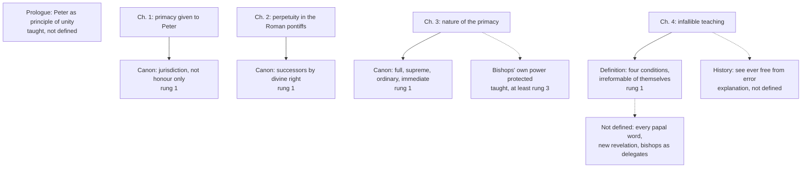

# The Church & Mary · Lesson 4.3: Vatican I and *Pastor Aeternus*

> ⏱ ~15 min · Module 4: The Petrine office · Builds on: [4.1 The Petrine texts](04-01-the-petrine-texts.md), [4.2 The development of papal claims](04-02-the-development-of-papal-claims-read-honestly.md), [`church-history` 8.2](../../church-history/lessons/08-02-pius-ix-vatican-i-and-the-fall-of-rome.md), [`fundamental-theology` 4.2](../../fundamental-theology/lessons/04-02-infallibility-and-its-conditions.md) · Unlocks: [4.4 Infallibility in exercise](04-04-infallibility-in-exercise-and-the-ordinary-universal-magisterium.md), [4.5 Vatican II](04-05-vatican-ii-primacy-collegiality-synodality.md)

## Why this matters

[4.2](04-02-the-development-of-papal-claims-read-honestly.md) followed the papal claim to the fifteenth century; in 1870 it became a definition. Most people know one sentence of [*Pastor Aeternus*](../reference.md#pastor-aeternus) and misread it. It has a prologue, four chapters, three canons and a definition, and its heaviest claim on daily Church life is in chapter 3. This lesson marks what each part defines, and what the first authoritative reading (1875) said it does *not* mean. The event is [`church-history` 8.2](../../church-history/lessons/08-02-pius-ix-vatican-i-and-the-fall-of-rome.md)'s.

## The idea

**The prologue says what the primacy is for.** "In order that the Episcopate also might be one and undivided", Christ set Peter over the other apostles as "the abiding principle of this twofold unity, and its visible foundation" (Schaff's translation throughout): the bishops' unity, and through them the faithful's in faith and communion. The primacy serves the episcopate's unity; it is not its rival.

**Each chapter makes a claim and condemns a living position.**

- **Ch. 1:** Christ gave Peter a primacy of jurisdiction "immediately and directly" (Matthew 16:16–19, John 21:15–17; [4.1](04-01-the-petrine-texts.md)), not one "of honor only", nor one given to Peter through the Church "as her minister".
- **Ch. 2:** Peter has perpetual successors "by divine right", and the Roman pontiff is that successor.
- **Ch. 3:** the power's nature (the Source below). **Ch. 4:** a history, then the definition.

**Ch. 4, reloaded** from [`fundamental-theology` 4.2](../../fundamental-theology/lessons/04-02-infallibility-and-its-conditions.md), which quotes it whole (DH 3074). Its four [conditions](../reference.md#conditions-for-papal-infallibility) are a conjunction: the pope (1) speaks as pastor and doctor of all Christians, (2) by his supreme apostolic authority, (3) defines a doctrine of faith or morals, (4) to be held by the universal Church. That is *[ex cathedra](../reference.md#ex-cathedra)*. He then has "that infallibility with which the divine Redeemer willed that his Church should be endowed", and his definitions are "irreformable of themselves, and not from the consent of the Church". It names conditions; it does not make every papal word infallible.

## Source

*Pastor Aeternus* ch. 3 (Schaff):

> Hence we teach and declare that by the appointment of our Lord the Roman Church possesses a superiority of ordinary power over all other churches, and that this power of jurisdiction of the Roman Pontiff, which is truly episcopal, is immediate; to which all … both pastors and faithful … are bound, by their duty of hierarchical subordination and true obedience, to submit not only in matters which belong to faith and morals, but also in those that appertain to the discipline and government of the Church throughout the world … But so far is this power of the Supreme Pontiff from being any prejudice to the ordinary and immediate power of episcopal jurisdiction, by which Bishops … feed and govern, each his own flock, as true pastors, that this their episcopal authority is really asserted, strengthened, and protected by the supreme and universal Pastor.

Read the shape of the act: two powers, both ordinary and immediate, over one flock, with no rule for how they fit. The dialogues, drawing on Bishop Zinelli's explanations for the drafting committee, gloss **ordinary** as belonging to an office, not delegated, and **immediate** as reaching subjects without an intermediary (*The Bishop of Rome*, 2024, §67). Neither says *how often*. Bismarck and the German bishops met in that gap.

## The doctrine

1. **A primacy of jurisdiction, given to Peter** (ch. 1 and its canon). *In words:* Peter received real power to govern the whole Church, not mere first place.
2. **Perpetual in the Roman pontiffs by divine right** (ch. 2 and its canon). *In words:* the office outlived Peter, and the bishop of Rome holds it.
3. **[Ordinary and immediate jurisdiction](../reference.md#ordinary-and-immediate-jurisdiction), full and supreme**, over every church, pastor and believer, in discipline and government as well as faith and morals (ch. 3 and its canon). The chapter renews Florence's definition ([`church-history` 4.2](../../church-history/lessons/04-02-east-and-west-the-long-estrangement.md)), claims free communication with every flock against any state's *placet* ([`church-history` 8.1](../../church-history/lessons/08-01-enlightenment-revolution-and-napoleon.md)), and bars appeal from the pope to a council. Its sentence on this jurisdiction, and on the unity of communion and faith with the pope it secures, ends: "This is the teaching of Catholic truth, from which no one can deviate without loss of faith and of salvation". *In words:* the pope can act anywhere in the Church, on any church matter, without anyone's leave.
4. **Infallibility under conditions** (ch. 4). The history before the definition sets its limit:

   > the Holy Spirit was not promised to the successors of Peter, that by his revelation they might make known new doctrine; but that by his assistance they might inviolably keep and faithfully expound the revelation or deposit of faith

   It also records popes defining after councils and after "asking for the mind of the Church scattered throughout the world". *In words:* a definition guards what was handed on and adds nothing.
5. **Where ["of themselves, and not from the consent of the Church"](../reference.md#ex-sese-non-ex-consensu-ecclesiae) came from.** Its target was the fourth Gallican Article of 1682 ([`church-history` 8.1](../../church-history/lessons/08-01-enlightenment-revolution-and-napoleon.md); lesson's translation):

   > In questions of faith, too, the Supreme Pontiff has the chief part, and his decrees reach all the churches and each one; yet his judgment is not irreformable unless the consent of the Church is added.

   Ch. 4 inverts that last clause almost word for word. The minority asked for something else: infallibility tied to the witness of the churches. Cardinal Guidi of Bologna proposed saying that the pope defines with the counsel of the bishops, who manifest their churches' tradition. The majority refused to write any such step in as a *condition*. Bishop Vinzenz Gasser of Brixen explained ch. 4 for the drafting committee before the 13 July vote. Drawing on his *relatio*, the US Lutheran–Catholic dialogue (1978, quoted in *The Bishop of Rome* §§69–70) reads "consent" juridically: an official approval giving force, not the Church's agreement. *In words:* a pope should consult, and popes did, but a definition binds when made, not when its consultation is certified.
6. **Three things it did not define:** that whatever a pope teaches is infallible (only acts meeting all four conditions; two are uncontested, [4.4](04-04-infallibility-in-exercise-and-the-ordinary-universal-magisterium.md)); that a pope receives new revelation (the text denies it); that bishops are his delegates (ch. 3 protects their power). Nor is the narrative defined: [4.4](04-04-infallibility-in-exercise-and-the-ordinary-universal-magisterium.md) sets its "ever free from all blemish of error" beside Honorius. *In words:* conditions, not omniscience; guarding, not revealing; over bishops, not instead of them.

**Said plainly.** The definition passed over the objection of a minority that left rather than vote against it. On 13 July, 88 fathers voted *non placet* and 62 *placet iuxta modum*; some 55 to 60 then renewed their votes by letter and went home; on 18 July the constitution passed 533 to 2 ([`church-history` 8.2](../../church-history/lessons/08-02-pius-ix-vatican-i-and-the-fall-of-rome.md)). None finally refused the decrees, though some came slowly, Josip Strossmayer of Đakovo among the slowest.

7. **[The German bishops' declaration of 1875](../reference.md#german-bishops-declaration-of-1875).** Bismarck's circular note of 14 May 1872, on the next papal election, argued that the decrees had merged episcopal jurisdiction into papal. The German bishops' joint declaration (early 1875) answered, as the CDF's *The Primacy of the Successor of Peter in the Mystery of the Church* (1998, §§5, 7) and *The Bishop of Rome* §65 summarize it (DH 3112–3114):
   - primacy and episcopate are in harmony;
   - the episcopate rests on the same divine institution as the papacy, so the primacy does not reduce the bishops' ordinary authority;
   - the primacy is bounded by divine law and by the Church's divinely given constitution;
   - infallibility reaches exactly as far as the Church's infallible magisterium, bound to Scripture, tradition and earlier definitions.

   Pius IX approved it as the council's authentic sense in a March 1875 letter to the German bishops and an allocution of 15 March, both cited (DH 3112–3117) by *Lumen Gentium* 27 for bishops not being vicars of the Roman pontiffs ([3.1](03-01-bishops-and-apostolic-succession.md)). *In words:* the pope who defined ch. 3 endorsed a reading in which bishops govern by their own right.
8. **Left unfinished.** *Pastor Aeternus* was cut from a schema on the Church distributed on 21 January 1870, whose papal chapters were taken first on 29 April. The rest, bishops included, never reached a vote; Joseph Kleutgen's further draft, *Tametsi Deus*, stayed unfinished. After Rome fell, Pius IX suspended the council on 20 October 1870 (*Postquam Dei munere*). The "First" Constitution on the Church waited for *Lumen Gentium* ([4.5](04-05-vatican-ii-primacy-collegiality-synodality.md)). *In words:* the council defined the head and never reached the body.

**Mark the levels** ([levels of authority](../reference.md#levels-of-authority); [the ladder](../../fundamental-theology/lessons/04-04-the-ladder-of-doctrinal-authority.md)).

- **Rung 1, defined:** exactly what the three canons and the definition state: Peter's primacy of jurisdiction; its perpetuity in the Roman pontiffs; their full, supreme, ordinary and immediate jurisdiction; infallibility under the four conditions, irreformable *ex sese*. Ch. 3 puts the note of faith on that jurisdiction and the unity of communion it secures, which settles [2.1](02-01-one.md)'s open question: that bond stands at rung 1.
- **Taught, not defined:** the prologue (the founding is rung 1 by another route, [1.2](01-02-the-church-in-the-new-testament.md)), the histories, and "ever free from all blemish of error". Ch. 3's protection of the bishops is conciliar teaching, **at least rung 3** (restated in LG 27); their divine institution is defined at Trent (Session XXIII can. 6; [3.1](03-01-bishops-and-apostolic-succession.md)).
- **Rung 3:** the 1875 declaration, a national episcopate's reading made an authentic papal interpretation by Pius IX's approval. It cannot narrow or widen the definition.
- **No magisterial level:** Gasser's and Zinelli's explanations (weighty evidence of the sense voted on), the dialogues, *The Bishop of Rome* ([4.5](04-05-vatican-ii-primacy-collegiality-synodality.md)). Which acts beyond 1854 and 1950 are *ex cathedra* is disputed ([4.4](04-04-infallibility-in-exercise-and-the-ordinary-universal-magisterium.md)).

## What each chapter defines

## Worked examples

**Ex 1: ch. 3 on a clean case.** Invented: the bishop of Port Avery closes a parish by decree; a parishioner takes recourse to Rome, which overturns it, as ch. 3 allows "in all causes" belonging to the Church. *Ordinary:* Rome judges by its own office, not by power the bishop lent it. *Immediate:* its decision binds the parish directly, not by the bishop's leave. *Is the bishop now Rome's vicar?* No: the decree was his own act, of a power the same chapter protects. How often Rome *should* intervene, the text does not say.

**Ex 2: where it strains, 1801.** For the Concordat, Pius VII asked every sitting French bishop to resign and replaced the several dozen who refused: a pope removing a national episcopate by his own act, a first ([`church-history` 8.1](../../church-history/lessons/08-01-enlightenment-revolution-and-napoleon.md)). Run both texts.

- Ch. 3 licenses it: power over "each and all the pastors" includes replacing any of them.
- The 1875 reading survives it: the new bishops governed by their own power, not as papal administrators.

The strain: the definition subjects *each* bishop to the primacy, the 1875 reading protects the *episcopate*, and nothing says when acts against each become an act against the order. No earthly tribunal enforces the limits named, divine law and the Church's constitution. The [`apologetics-catholic-claims` syllabus](../../apologetics-catholic-claims/syllabus.md) (5.3) puts the sharper Orthodox objection here, at ch. 3; *Ut Unum Sint* opened the same ground ([4.5](04-05-vatican-ii-primacy-collegiality-synodality.md)).

## Watch out

- **You might think ch. 4 is the dogma and the rest is discipline.** That understates: chs. 1–3 end in anathematized canons, and the jurisdiction is **rung 1**.
- **You might think "ordinary and immediate" makes the pope every diocese's real bishop.** That overstates: the same chapter calls the bishops' power ordinary, immediate and protected (1875; LG 27).
- **You might think *ex sese* means apart from the Church.** The consent excluded is juridical ratification; the infallibility is the Church's.

## One-liner

> *Pastor Aeternus* defined a real primacy of jurisdiction and an infallibility bound by four conditions, protected the bishops' power in the same chapter, and left their doctrine unwritten when Rome fell.

## Problems

**P1 (🟢)** *(Exegetical)* Four **invented** papal acts. For each, say whether it meets every condition of ch. 4's definition; if not, name the condition or conditions that fail. One line each.

(a) At a Wednesday audience, in a series of talks on the Creed, the pope says: "The Church has always believed, and I repeat it to you today, that Christ descended to the dead to free the just who awaited him."

(b) An apostolic letter to the bishops of one country: "To end the quarrel in your churches, by our apostolic authority we declare and define that the prayers of the living help the souls of the dead, to be held by all the faithful of your nation."

(c) A bull: "By the authority of our Lord Jesus Christ, of the blessed apostles Peter and Paul, and our own, we declare and define, to be held by the whole Church, that the universe is about 13.8 billion years old."

(d) A constitution: "By the authority of our Lord Jesus Christ, of the blessed apostles Peter and Paul, and our own, we declare and define as a dogma divinely revealed, to be held by the whole Church, that every human soul is created immediately by God." Its preamble says the bishops were consulted and some dissented. A year later one national episcopal conference announces that it does not receive the definition. Answer the conditions, and say whether either fact touches the act's force.

**P2 (🟡)** *(Exegetical)* Find the crux. Two positions at Vatican I, in the lesson's paraphrase:

- *Minority (compare Cardinal Guidi's proposal):* the pope defines infallibly when, with the counsel of the bishops, he states the tradition of their churches.
- *Majority (the text as passed):* such definitions are irreformable of themselves, and not from the consent of the Church.

(a) Name two premises both sides held. (b) State the single premise on which they split, and the worry that made each side refuse the other's answer. Two sentences per part.

**P3 (🔴)** *(Exegetical)* An **invented** letter to the editor of an invented newspaper, the *Tidewater Gazette* (2026):

> "Sir, your columnist calls Vatican I ancient history. It is not. In 1870 the bishops of the world agreed to make the pope infallible in everything he teaches. Chapter 3 made him the real bishop of every diocese, so a local bishop is only his deputy. Since then a pope may announce new doctrines when he likes, and the council even defined that no pope has ever erred, which is why Catholics cannot discuss Honorius. Only the infallibility chapter is binding; the rest is discipline, which Catholics may take or leave. — Bronagh Solberg"

Find **four** errors. For each, give the correction and the text or act that fixes it, with its level where a level is involved. 150 words or fewer.

Solutions

**P1** *(Exegetical)*

**Must hit, strict:**

- (a) **Not *ex cathedra*.** It fails "defines": he repeats and teaches, and settles no question. It also fails "by supreme apostolic authority": no binding authority is invoked. The content is an article of the Apostles' Creed, rung 1 by that route. This act adds no weight to it.
- (b) **Not *ex cathedra*.** It fails "to be held by the universal Church": it binds one nation. It also fails "pastor and doctor of all Christians": he acts toward one country's churches. The defining formula does not rescue it. Whatever level the content has comes from other acts.
- (c) **Not *ex cathedra*.** It fails "a doctrine of faith or morals": the age of the universe is neither. All the other markers are present, and they cannot supply the missing condition.
- (d) **Meets all four.** It addresses the whole Church with the full authority formula, defines, and concerns faith. Neither fact touches its force. Definitions are irreformable "of themselves, and not from the consent of the Church": no agreement is a condition, before or after. The dissent and the non-reception are real problems of communion, but they are not defects in the act.

**Wrong turns:** treating (a) as infallible because its content is true; reading (b)'s "define" or (c)'s formula as decisive; saying in (d) that consultation was unnecessary (ch. 4's history shows popes consulting) or that the conference's refusal suspends the definition (Gallicanism's fourth article).

**Model answer:** (a) No: no definition and no supreme authority invoked; the Creed carries the content. (b) No: one nation, not the whole Church, and not as pastor of all. (c) No: not faith or morals. (d) Yes, all four; dissent and non-reception do not touch irreformability, which is "of themselves".

---

**P2** *(Exegetical)*

**Accept:** any two shared premises from the list below, and a crux stated as a *condition* of the definition's force.

**Must hit, strict (a):** two of these: a definition states the faith already handed on, not new doctrine (ch. 4); the infallibility is the Church's own, exercised by the pope; consulting the churches is the normal means (ch. 4's history narrates councils and inquiries).

**Must hit, strict (b):** the crux is **whether the bishops' witness to their churches' tradition is a condition of a definition's force**, so that a definition lacking it, or where it was disputed, would not bind. The majority feared that any condition of consent would leave every definition open to dispute over whether the condition was met, which is 1682 by another door. The minority feared that without it a definition would seem to rest on the pope alone, cut off from the churches whose faith it states.

**Wrong turns:** naming whether the pope is infallible as the crux (many of the minority thought a definition inopportune rather than false, [`church-history` 8.2](../../church-history/lessons/08-02-pius-ix-vatican-i-and-the-fall-of-rome.md)); naming whether the pope ought to consult, which both affirm; listing the four conditions; casting the minority as Gallicans demanding later ratification.

**Model answer:** (a) Both held that a definition states the faith already handed down and adds no new doctrine. Both held that the infallibility exercised is the Church's own. (b) They split on whether the episcopate's witness must be a stated condition of a definition's binding force. The majority refused it because a definition whose force waited on proof of consent could always be reopened; the minority wanted it because a definition without it might look like the pope's faith rather than the Church's.

---

**P3** *(Exegetical)*

**Must hit, strict (any four):**

1. **"The bishops agreed."** On 13 July, 88 voted *non placet*, and some 55 to 60 of the minority left rather than vote against on 18 July ([`church-history` 8.2](../../church-history/lessons/08-02-pius-ix-vatican-i-and-the-fall-of-rome.md)).
2. **"Infallible in everything."** Ch. 4 defines four conditions; most papal teaching falls outside them. The definition itself is rung 1.
3. **"The real bishop of every diocese."** Ch. 3 itself protects the bishops' own ordinary and immediate power. The German bishops' 1875 declaration, approved by Pius IX (rung 3), denies that episcopal jurisdiction was absorbed into papal, and LG 27 says bishops are not vicars of the Roman pontiffs.
4. **"New doctrines."** Ch. 4 says the Spirit was not promised for new doctrine but to guard the deposit.
5. **"Defined that no pope erred."** "Ever free from all blemish of error" is in the narrative, not the definition. Honorius is openly discussed (4.4).
6. **"The rest is discipline."** This understates. The canons of chs. 1–3 are defined, rung 1.

**Wrong turns:** correcting (6) by calling ch. 3 "only" authentic teaching; treating the 1875 declaration as itself defined (it is rung 3); answering the history by arguing that the council was unfree, which is a disputed question ([`church-history` 8.2](../../church-history/lessons/08-02-pius-ix-vatican-i-and-the-fall-of-rome.md) P3), not an error in the letter.

**Model answer:** The bishops did not all agree: 88 voted against on 13 July, and some 55–60 left before the final vote. Ch. 4 defines infallibility (rung 1) only for acts meeting four conditions, not for everything a pope teaches. Ch. 3 protects the bishops' own ordinary and immediate power; the German bishops' 1875 declaration, which Pius IX approved (rung 3), and LG 27 deny that bishops are papal vicars. Ch. 4 says the Spirit was not promised for new doctrine. "Ever free from all blemish of error" is narrative, not defined. And chs. 1–3 end in defined canons, rung 1, so they are not optional discipline.

## Flashback

**From Lesson [4.1](04-01-the-petrine-texts.md) (The Petrine texts):** *(Exegetical.)* Close reading. Jerome, *Against Jovinianus* I.26 (393; *NPNF* second series, vol. 6). Jovinian had appealed to the apostles, whom he took to be married men, to show that virginity ranks no higher than marriage. Jerome has just argued that John, a virgin, was loved more than the others. He then takes up an objection:

> But you say, the Church was founded upon Peter: although elsewhere the same is attributed to all the Apostles, and they all receive the keys of the kingdom of heaven, and the strength of the Church depends upon them all alike, yet one among the twelve is chosen so that when a head has been appointed, there may be no occasion for schism. But why was not John chosen, who was a virgin? Deference was paid to age, because Peter was the elder [...]

(a) What does Jerome say all the apostles share, what does he give Peter alone, and for what stated purpose? Quote the words that carry each.

(b) Apply Lesson 4.1's step from function to office to this passage alone: which Petrine function does it name, and which of the further marks of an office (perpetuity, succession, Rome) does it supply?

(c) What is Jerome arguing about when Peter comes up, and what weight does that leave the passage as evidence for the primacy?

**Two sentences per part.**

Solution

**Must hit, strict (a):** to all, the founding ("the same is attributed to all the Apostles"), the keys ("they all receive the keys of the kingdom of heaven") and the Church's strength ("depends upon them all alike"). To Peter alone, being the "one among the twelve" chosen, "a head" appointed. The stated purpose is unity: "that ... there may be no occasion for schism". Peter rather than John because "deference was paid to age".

**Must hit, strict (b):** the function is headship among the Twelve, for the sake of unity. The passage supplies none of the further marks: no perpetuity, no successor, no see. A reader may infer perpetuity from the purpose, since the danger of schism outlives the Twelve, but that is an inference of the kind 4.1 found in Matthew 16, not something the passage says.

**Must hit, strict (c):** the dispute is over virginity and marriage. Peter enters as the objection's case, the married apostle on whom the Church was founded rather than the virgin John, and Jerome concedes the founding and explains the choice by age. A Father is a witness, not a magisterial act, and a concession made in passing shows what Jerome took for granted, a head among the Twelve, not what that headship included or whether it passed on.

**Wrong turns:** (a) making Jerome deny that the Church was founded on Peter, when his "although ... yet" concedes it; giving the keys to Peter alone in this passage; giving merit or the confession as the reason Peter was chosen, when Jerome says age. (b) reading successors or Rome into "head"; the opposite slide, treating the passage's silence as a denial of successors; bringing in Jerome's other writings, when the question is this passage alone. (c) giving the sentence magisterial weight, or reading it as a treatise on primacy.

**Model answer:** (a) All the apostles share the founding, "they all receive the keys", and the Church's strength "depends upon them all alike". Yet "one among the twelve is chosen" as "a head" so that "there may be no occasion for schism", and Peter rather than John because "deference was paid to age". (b) The function is headship among the Twelve for the sake of unity. The passage supplies no perpetuity, successor or see; perpetuity can at most be inferred from the purpose, since the danger of schism outlives the Twelve. (c) Jerome is defending virginity against Jovinian, and Peter comes up as the married apostle preferred to the virgin John, a choice Jerome puts down to age. So the passage is a Father's witness to what he took for granted, a head among the Twelve, and neither a magisterial act nor an account of that head's powers or successors.

## Connections

- **Backward:** [4.1](04-01-the-petrine-texts.md) reads the Petrine texts that chs. 1 and 4 cite (Matthew 16, John 21, Luke 22:32). [4.2](04-02-the-development-of-papal-claims-read-honestly.md) traces the claims ch. 3 renews and the conciliarism it shuts out. [`church-history` 8.2](../../church-history/lessons/08-02-pius-ix-vatican-i-and-the-fall-of-rome.md) has the event, the votes and the minority's letter. [`church-history` 8.1](../../church-history/lessons/08-01-enlightenment-revolution-and-napoleon.md) has the Four Articles and 1801. [`fundamental-theology` 4.2](../../fundamental-theology/lessons/04-02-infallibility-and-its-conditions.md) has the conditions as a test.
- **Forward:** [4.4](04-04-infallibility-in-exercise-and-the-ordinary-universal-magisterium.md) asks which acts have met the conditions, sets Honorius against ch. 4's narrative, and reads Newman on what the definition asks. [4.5](04-05-vatican-ii-primacy-collegiality-synodality.md) writes the missing chapter on the bishops. [`apologetics-catholic-claims`](../../apologetics-catholic-claims/syllabus.md) 5.3 argues the Orthodox objection to 1870, which this lesson does not.
- **Sideways:** Weber read infallibility as a bureaucratic "competence" that works only *ex cathedra*, in office ([`social-theory` 4.4](../../social-theory/lessons/04-04-bureaucracy-rationalization-and-disenchantment.md) P1). Ch. 3's ban on appeal to a council answers Marsilius and the conciliarists of [`history-of-political-thought` 2.5](../../history-of-political-thought/lessons/02-05-marsilius-and-conciliarism.md).
